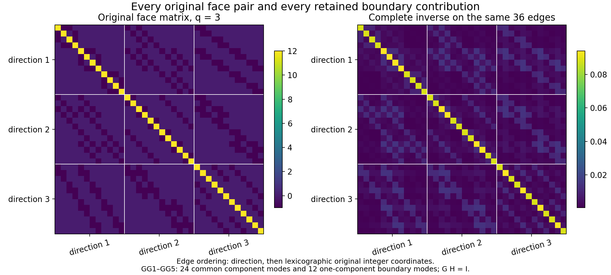
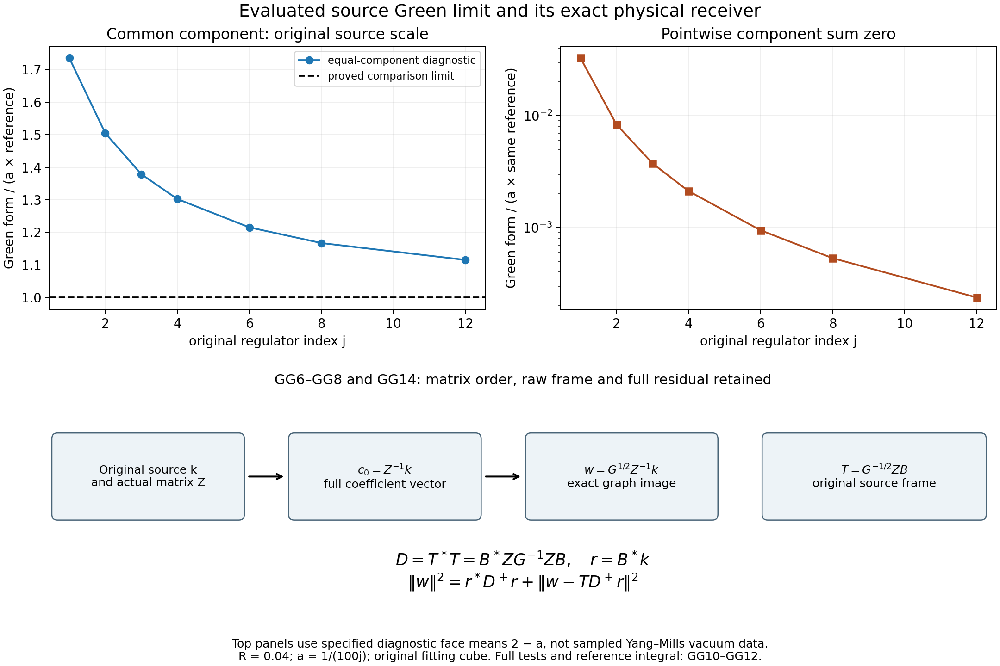

# Exact patch Green matrix and the original source through the physical inverse

The full face graph admits an explicit inverse on the original fitting cube, including the longitudinal boundary modes. Its quadratic form on the actual Yang–Mills source has an evaluated continuum limit. An exact projection identity carries the graph through the physical matrix inverse without commuting either matrix. Every complementary term and raw coefficient norm remains in the receiving formulas.

Providers: [QCF10–QCF16](https://github.com/KokunoYumeto/yang-mills-interacting-workbench/blob/b04f7c833679773bf76ff8db71fe29dc19f5fae2/yang-mills/continuations/20261011-central-signs-shrinking-window/QUANTITATIVE_FORCE_CURL.md), [QG5–QG20](https://github.com/KokunoYumeto/yang-mills-interacting-workbench/blob/b04f7c833679773bf76ff8db71fe29dc19f5fae2/yang-mills/continuations/20261011-central-signs-shrinking-window/THREE_SHIFT_GAINS_AND_SOURCE_GRAPH.md), and [DF10–DF20](https://github.com/KokunoYumeto/yang-mills-interacting-workbench/blob/b04f7c833679773bf76ff8db71fe29dc19f5fae2/yang-mills/continuations/20261011-central-signs-shrinking-window/CURRENT_DENSITY_FLUX_AND_PROJECTED_RESIDUAL.md). Their original-author provenance remains in the source-use ledger. This is a direct calculation; no additional external reading or novelty is claimed.

## Original objects and finite domains

Keep the open lattice with vertices \(\{0,\ldots,2L_j\}^3\), every positive edge, the original vertex gauge action, and probability Haar measure. The SU(2) edge metric has radius two and \(T_\alpha=-i\sigma_\alpha/2\) orthonormal. Retain
\[
\begin{gathered}
L_j=j^4,\quad a_j=(100j)^{-1},\quad g_j^2=\kappa_*a_j/2,\quad
b_j=(\kappa_*a_j^2)^{-1},\quad s_j=100\kappa_*a_j,\\
U_p=U_d(z)U_k(z+e_d)U_d(z+e_k)^{-1}U_k(z)^{-1}\quad(d<k),\\
D_p=2-\operatorname{Tr}U_p,\quad
V=b_j\sum_pD_p=2b_j|\mathcal P_j|-b_j\sum_p\operatorname{Tr}U_p,\\
H_j=-\kappa_*\Delta+V,\quad H_j\psi_j=E_{0,j}\psi_j,\quad
\psi_j>0,\quad \|\psi_j\|=1,\quad d\mu_j=\psi_j^2dU .
\end{gathered}
\]
The positive smooth gauge-invariant ground and its score bound are the original SOM1–SOM5. Suppress \(j\) only within finite formulas and write \(\kappa=\kappa_*\), \(w=\log\psi\), \(g_e=d_ew\), \(G_e=|g_e|^2\), \(T_e=\mu G_e\), \(F_e=d_eV\), and
\[
\mathscr D=\Delta+2dw\cdot d,\qquad
\mathscr L_0=-\kappa\mathscr D,\qquad
\mathscr L_1=\kappa(dd_\mu^*+d_\mu^*d).
\]
All are the original weighted operators on the compact full configuration manifold; no outside derivative is suppressed.

For the centered observable below, \(E_X=\kappa\mu|dX|^2\). For the original full test use \(A=H-E_0I\), \(u_{\mathbf f}=(C_{\mathbf f}-\mu C_{\mathbf f})\psi\), \(\zeta_{\mathbf f}=A^{1/2}u_{\mathbf f}\), and \(\mathcal R_{\mathbf f}(z)=\langle\zeta_{\mathbf f},(A+zI)^{-1}\zeta_{\mathbf f}\rangle=\kappa\langle dC_{\mathbf f},D_z^{-1}dC_{\mathbf f}\rangle_\mu\). SG12 proves this exact original-Hamiltonian map.

For a nonzero real continuous compactly supported triple \(\mathbf f=(f_{12},f_{13},f_{23})\), keep
\[
\begin{gathered}
x_p=o+a(z-L_j\mathbf1+(e_d+e_k)/2),\quad
x_e=o+a(z-L_j\mathbf1+e_d/2),\\
C_{\mathbf f}=a\sum_p f_{\sigma(p)}(x_p)D_p,\quad
X=a\sum_pu_pD_p-\mu\!\left(a\sum_pu_pD_p\right),\\
u_p=f_{\sigma(p)}(x_p)\ \hbox{for the full source},\qquad
u_p=f_{\sigma(p)}(x_p)\mathbf1_{\{e_0\notin\partial p\}}
\ \hbox{for its outside source},\\
M_f=\max_\sigma\|f_\sigma\|_\infty,\quad
t_1=f_{12}+f_{13},\quad t_2=f_{12}+f_{23},\quad
t_3=f_{13}+f_{23},\quad J_t=\sum_d\int_{\mathbb R^3}t_d^2>0 .
\end{gathered}
\]
The last strict inequality follows by the inverse relations \(2f_{12}=t_1+t_2-t_3\), \(2f_{13}=t_1+t_3-t_2\), \(2f_{23}=t_2+t_3-t_1\). Put \(v=dX\), \(J_X=dw\cdot dX\), \(\alpha_e=a^2\Pi_edw\), and \(D_z=\mathscr L_1+zI\), \(z>0\). For a deterministic finite edge list, \(\mathsf Cc=\sum_ec_e\alpha_e\), \(\mathsf N=\mathsf C^*\mathsf C\), \(\mathsf Z=(D_z\mathsf C)^*D_z\mathsf C\), \(\mathsf b=\mathsf C^*v\), \(k=(D_z\mathsf C)^*v\). The distinct sources \(k\) and \(\mathsf b\) are never identified.

Use the fitting cube \(Q=v_Q+\{0,\ldots,q\}^3\) for a physical support cube \(\prod_d[c_d,c_d+R]\), where \(q=\lceil R/a\rceil+3\), \((v_Q)_d=L_j+\lfloor(c_d-o_d)/a\rfloor-1\). Eventually it is strictly inside the full lattice. Its finite quantities, with boundary indicators retained, are
\[
\begin{gathered}
N_Q=3q(q+1)^2,\quad M_Q=3q^2(q+1),\quad
I=E_Q^\circ,\quad n=|I|=3q(q-1)^2,\\
C_Q=2q(q+1)\sum_d
[\mathbf1_{\{(v_Q)_d>0\}}+\mathbf1_{\{(v_Q)_d+q<2L_j\}}],\\
W_Q=\sum_{p\ {\rm inside}\ Q}D_p,\quad d_Q=\mu W_Q,\quad
T_Q=\sum_{e\ {\rm inside}\ Q}T_e,\quad E_Q=E_0-E_{\rm out},\\
\Lambda_Q=\min\{2M_Q,6g^2\sqrt{N_QM_Q}\}+2C_Q,\quad
\kappa T_Q+bd_Q\le E_Q\le b\Lambda_Q,\\
\mathsf L_R=9\kappa_*R^3+24R^2,\qquad
K_R=\frac{\mathsf L_R+\sqrt{\mathsf L_R^2-81\kappa_*^2R^6/4}}2 .
\end{gathered}
\]
Every edge in \(I\) has four incident faces, all inside \(Q\). HVR18–HVR22 prove both \(\limsup a_j^2d_Q\le K_R\) and \(\limsup a_j^2(\Lambda_Q-d_Q)\le K_R\). The inside, outside and crossing energies remain as displayed. All limits below use this same fitting prescription and original path.

Retain the complete Hessian row, incident deficit and positive density
\[
\begin{gathered}
H_{er}=(\nabla^2w)_{er},\quad R_e=\sum_{r\in\mathcal E_j}\|H_{er}\|_{\rm HS}^2,\quad
W_e^{\rm def}=\sum_{p\ni e}D_p,\quad w_e=\mu W_e^{\rm def},\\
\mathcal K_e=\Delta_eV-\kappa(2R_e+G_e),\quad \mu\mathcal K_e=0,\\
\mathcal A_e=\kappa(2R_e+G_e)+(3b/4)W_e^{\rm def}\ge0,\quad
\mu\mathcal A_e=6b,\quad d\nu_e=\frac{\mathcal A_e}{6b}d\mu,\\
I_j(C)=\{e\in I_j:w_e\le Ca_j\},\quad
C=\max\{\kappa_*,64M_f^2K_R/J_t\},\\
\liminf a_j^{-3}\|\mathsf b_{I(C)}\|^2\ge27J_t/16,\qquad
\gamma_C(z)=z^2a^4\,\frac{9(8-Ca)^2}{256Ca}\quad(Ca<8).
\end{gathered}
\]
CFC6–CFC20 prove these identities and bounds in the actual state, with no changed boundary or reference law. The ground log-Hessian bound and score estimate remain \(\nabla^2w\ge-2(\kappa a)^{-1}g\) and \(T_e\le3/(\kappa a)\).

## All modes on the original patch

Write \(r=z-v_Q\) only for the integer labels. An edge \(e=(r,d)\) belongs to \(I\) exactly when \(0\le r_d\le q-1\) and \(1\le r_k\le q-1\) for both \(k\ne d\). Its physical location is still \(x_e=o+a(v_Q+r-L_j\mathbf1+e_d/2)\). Define the positive matrix \(\mathsf G_I\) by
\[
c^*\mathsf G_I c=\mathcal G(c)
=\sum_{p\in\mathcal P_j}\sum_{\substack{e<f\\e,f\in\partial p}}|c_e-c_f|^2,
\]
with every coefficient outside \(I\) zero. QCF12 gives
\(\mathsf G_I\ge\lambda_q I\), \(\lambda_q=16\sin^2(\pi/(2q))>0\). The diagonal is \(12\): each edge belongs to four faces with three other edges on each face. No exterior face meets an edge in \(I\).

For \(m_d\in\{1,\ldots,q\}\), \(m_k\in\{1,\ldots,q-1\}\) when \(k\ne d\), retain the unscaled vectors
\[
\Phi_{m,d}(r,e)
=\mathbf1_{\{e=d\}}
\sin\!\left(\frac{\pi m_d(r_d+1/2)}q\right)
\prod_{k\ne d}\sin\!\left(\frac{\pi m_kr_k}q\right).
\tag{GG1}
\]
The symbol \(e\) in this display is a direction label; evaluation at an original edge uses its \(r,e\). The common modes \(m\in\{1,\ldots,q-1\}^3\) have all three components. For each remaining mode exactly one index \(m_d=q\), and only its \(d\)-component exists. There are \(3(q-1)^3+3(q-1)^2=3q(q-1)^2\) vectors.

Here are the complete one-dimensional inner products, with both grids retained:
\[
\begin{aligned}
&\sum_{r=1}^{q-1}\sin(\pi mr/q)\sin(\pi nr/q)
=\frac q2\delta_{mn}\quad(1\le m,n<q),\\
&\sum_{r=0}^{q-1}
\sin(\pi m(r+1/2)/q)\sin(\pi n(r+1/2)/q)\\
&\hspace{18mm}
=\begin{cases}q/2,&m=n<q,\\q,&m=n=q,\\0,&m\ne n.\end{cases}
\end{aligned}\tag{GG2}
\]
For the second identity use \(2\sin u\sin v=\cos(u-v)-\cos(u+v)\).
The cosine sum at integer frequency \(\ell\) is zero for \(1\le|\ell|\le2q-1\), since
\(\sum_{r=0}^{q-1}\cos((r+1/2)t)=\sin(qt)/(2\sin(t/2))\).
At \(\ell=0\) it is \(q\); at \(\ell=2q\) it is \(-q\). These are exactly the three cases in GG2. The first identity follows by the same product formula and finite geometric series, or from the symmetric Dirichlet matrix and the norm calculation in QCF11. Distinct directions have disjoint coordinates. Products of GG2 therefore prove orthogonality, the exact squared norms
\[
n_m=\|\Phi_{m,d}\|^2=
\begin{cases}q^3/8,&m\in\{1,\ldots,q-1\}^3,\\q^3/4,&m_d=q,\end{cases}
\]
and completeness by the stated dimension count. The raw coefficient of \(c\) is
\(\widehat c_{m,d}=n_m^{-1}\sum_{e\in I}\Phi_{m,d}(e)c_e\).
No unit-norm replacement of the source or basis is made.

## Exact blocks, inverse and retained-set restriction

Put
\[
s_d=\sin^2\!\left(\frac{\pi m_d}{2q}\right),\qquad
u_d=\cos\!\left(\frac{\pi m_d}{2q}\right),\qquad
D_d=8+4\sum_{k\ne d}s_k.
\]
For a common mode the exact block is
\[
(\mathsf K_m)_{dd}=D_d,\qquad
(\mathsf K_m)_{dk}=-4u_du_k\quad(d\ne k),
\qquad
\mathsf G_I\Phi_m=\Phi_m\mathsf K_m .
\tag{GG3}
\]
The remaining one-component mode has scalar block \(D_d\).

To prove this with all boundary terms, apply QCF10 to each face in directions \(d,k\). The doubled parallel differences contribute \(8s_k|\widehat c_{m,d}|^2\) to the \(d\)-coefficient after division by its unchanged squared norm. The difference of the two parallel sums contributes
\(4|u_k\widehat c_{m,d}-u_d\widehat c_{m,k}|^2\). The face function in that term has half-step sines in \(d,k\) and an integer sine in the remaining coordinate. Its squared norm is \(q^3/8\) for common modes, and \(q^3/4\) for the one-component boundary mode. Face functions at distinct indices are orthogonal by GG2. Missing boundary components are zero; all transverse endpoint sines are zero. Summing the contribution \(8s_k+4u_k^2=4+4s_k\) for both \(k\ne d\) gives \(D_d\); the mixed contribution gives \(-4u_du_k\). This proves GG3 first as the complete quadratic form and then as the operator identity by polarization. In particular no boundary mode is discarded.

For the three distinct labels \(d,k,\ell\), define
\[
\begin{aligned}
\Delta_m={}&D_1D_2D_3
-16(D_1u_2^2u_3^2+D_2u_1^2u_3^2+D_3u_1^2u_2^2)\\
&-128u_1^2u_2^2u_3^2,\\
(\mathsf K_m^{-1})_{dd}
={}&\frac{D_kD_\ell-16u_k^2u_\ell^2}{\Delta_m},\\
(\mathsf K_m^{-1})_{dk}
={}&\frac{4u_du_k(D_\ell+4u_\ell^2)}{\Delta_m}.
\end{aligned}
\]
All blocks inherit positivity from \(\mathsf G_I\ge\lambda_qI\), so \(\Delta_m>0\). Expanding the determinant along its first row gives the displayed expression; the diagonal and off-diagonal cofactors give the two entries. Thus the original-coordinate Green matrix is
\[
\begin{aligned}
\mathsf H_I(e,f):=(\mathsf G_I^{-1})_{ef}
={}&\frac8{q^3}\sum_{m\in\{1,\ldots,q-1\}^3}
\sum_{d,k=1}^3
\Phi_{m,d}(e)(\mathsf K_m^{-1})_{dk}\Phi_{m,k}(f)\\
&+\frac4{q^3}\sum_{d=1}^3
\sum_{\substack{m_d=q\\1\le m_k<q,\ k\ne d}}
\frac{\Phi_{m,d}(e)\Phi_{m,d}(f)}{D_d}.
\end{aligned}\tag{GG4}
\]
Multiplication by \(\mathsf G_I\), using GG3 and completeness with the norms in GG2, gives the identity matrix. This verifies every factor in the inverse.

Let \(\varnothing\ne J\subset I\), \(K=I\setminus J\), and let \(\mathsf G_J\) be the principal restriction, still acting on coefficients extended by zero. For \(K\ne\varnothing\),
\[
\mathsf G_J^{-1}
=\mathsf H_{JJ}-\mathsf H_{JK}\mathsf H_{KK}^{-1}\mathsf H_{KJ}.
\tag{GG5}
\]
Indeed solve \(\mathsf H(x_J,x_K)=(y_J,0)\). The second row gives
\(x_K=-\mathsf H_{KK}^{-1}\mathsf H_{KJ}x_J\); the first gives
\(y_J=(\mathsf H_{JJ}-\mathsf H_{JK}\mathsf H_{KK}^{-1}\mathsf H_{KJ})x_J\).
On multiplying the full equation by \(\mathsf G_I\), its first row gives \(x_J=\mathsf G_Jy_J\), proving GG5. Positivity makes the indicated principal block invertible. For \(K=\varnothing\) GG5 is GG4 without a complement term; no inverse on an empty list is required.

## Exact noncommuting physical receiver

Fix the original positive shift \(z\) and a nonempty actual retained list \(J\subset I(C)\). Its current matrices satisfy \(0<\mathsf Z_\star<\mathsf Z\) by DF15. Put \(G=\mathsf G_J\), \(Z=\mathsf Z_J(z)\), \(k=k_J(z)\), and \(c_0=Z^{-1}k\). Both inverse metrics and the exact dual formula are
\[
\begin{gathered}
\mathcal G(c_0)=k^*Z^{-1}GZ^{-1}k,\qquad
(Z^{-1}GZ^{-1})^{-1}=ZG^{-1}Z,\\
\mathcal G(c_0)=
\sup_{h\in\mathbb C^J}
\{2\operatorname{Re}(h^*k)-h^*ZG^{-1}Zh\}.
\end{gathered}\tag{GG6}
\]
The inverse equality follows by multiplication in the displayed order. With \(M=ZG^{-1}Z>0\), complete the square:
\(2\operatorname{Re}h^*k-h^*Mh=k^*M^{-1}k-(h-M^{-1}k)^*M(h-M^{-1}k)\).
The maximum is attained at \(h=M^{-1}k\). This proves GG6 without a commutation assertion.

Let \(B:\mathbb C^m\to\mathbb C^J\) be any finite frame of original raw-source columns. It may be dependent. Define
\[
\begin{gathered}
T=G^{-1/2}ZB,\qquad w=G^{1/2}Z^{-1}k,\\
D=B^*ZG^{-1}ZB=T^*T,\qquad r=B^*k=T^*w,\\
\mathcal G(c_0)=r^*D^+r+\|w-TD^+r\|^2.
\end{gathered}\tag{GG7}
\]
Here \(D^+\) inverts every positive eigenvalue and is zero on \(\ker D\).
Since \(G^{-1/2}Z\) is invertible, \(\ker D=\ker T=\ker B\).
For \(\gamma\in\ker D\), \(\gamma^*r=(T\gamma)^*w=0\).
Consequently \(DD^+r=r\), and \(w-TD^+r\) is orthogonal to every column of \(T\).
Its complementary squared norm is therefore \(\|w\|^2-\|TD^+r\|^2\).
The retained part has norm \(r^*D^+DD^+r=r^*D^+r\), proving GG7. This argument also proves the meaning and range of the pseudoinverse when the original source family is dependent. The square roots specify exact Euclidean maps; neither \(k\), \(B\) nor \(c_0\) is replaced or rescaled.

Substituting GG7 into QCF16 gives the full receiving bound
\[
\begin{aligned}
\Omega(z)\ge{}&
A_C(a)\{r^*D^+r+\|w-TD^+r\|^2\}\\
&+2z\kappa_*a^4\sum_{e<f}|(c_0)_e-(c_0)_f|^2
\mu\|(\nabla^2w_{\rm ground})_{ef}\|_{\rm HS}^2\\
&+(c_\star-c_0)^*\mathsf Z_\star(c_\star-c_0).
\end{aligned}\tag{GG8}
\]
In this display \(w_{\rm ground}=\log\psi\); the vector \(w\) in GG7 has its separately stated domain. All original edge pairs occur, including noncoface pairs and outside pairs; the two complementary nonnegative terms and the entire graph-projection residual are present. GG4–GG5 evaluate the geometric inverse in \(D\). The remaining \(ZB\), \(r\), and physical residual remain actual interacting moments.

## The fixed-mode inverse limit on the same physical cube

Write \(\mathcal Q=\prod_{d=1}^3(c_d,c_d+R)\), where this is the same support cube used to fit \(Q_j\). Its open interior suffices for integrals, since the boundary has zero volume. Retain
\[
\ell_j=o+a_j(v_{Q_j}-L_j\mathbf1),\qquad
(\ell_j)_d=c_d-a_j\left(1+
\frac{c_d-o_d}{a_j}-\left\lfloor\frac{c_d-o_d}{a_j}\right\rfloor\right).
\]
Thus \(\ell_j\to c\) and \(a_jq_j\to R\), with the original floor, ceiling and extra three sites intact. For any fixed positive triple \(m\), let
\[
\chi_m(x)=\prod_{d=1}^3
\sin\!\left(\frac{\pi m_d(x_d-c_d)}R\right),\qquad
\lambda_m=\frac{\pi^2(m_1^2+m_2^2+m_3^2)}{R^2}.
\]
The original half-step and integer samples in GG1 converge to these functions at their physical edge locations. For the common block,
\[
a_j^2\mathsf K_{m,j}^{-1}
\longrightarrow
\frac{3}{4\lambda_m}P_{\mathbf1}
=\frac1{4\lambda_m}\mathbf1\mathbf1^*,
\qquad P_{\mathbf1}=\frac13\mathbf1\mathbf1^* .
\tag{GG9}
\]
To verify the singular inverse limit, set \(S=s_1+s_2+s_3\).
For this fixed mode, \(s_d/a_j^2\to\pi^2m_d^2/(4R^2)\) and
\(u_d=1-s_d/2+O(a_j^4)\).
The zero-order block is \(12(I-P_{\mathbf1})\).
The scalar compression on \(P_{\mathbf1}\) is
\[
\frac13\mathbf1^*\mathsf K_m\mathbf1
=\frac13\{24+8S-8(u_1u_2+u_1u_3+u_2u_3)\}
=\frac{16}3S+O(a_j^4).
\]
The off-diagonal map between \(P_{\mathbf1}\) and its complement is \(O(a_j^2)\), and the complementary block is \(12I+O(a_j^2)\). Its inverse is bounded, for example by \(1/6\) eventually, by the Rayleigh quotient. The exact Schur scalar is the displayed scalar minus
\(P_{\mathbf1}\mathsf K_m(1-P_{\mathbf1})
[(1-P_{\mathbf1})\mathsf K_m(1-P_{\mathbf1})]^{-1}
(1-P_{\mathbf1})\mathsf K_mP_{\mathbf1}\);
the subtracted term is \(O(a_j^4)\). Dividing by \(a_j^2\) gives \(4\lambda_m/3>0\).
The exact block inverse formula now proves GG9: its complementary and mixed blocks vanish after multiplication by \(a_j^2\). Every finite entry remains the one in GG3–GG4; GG9 concerns their limit.

## The continuum comparison operator with all sine factors

The following scalar operator is defined on the unchanged physical cube. For \(h\in L^2(\mathcal Q)\), set
\[
\widehat h_m=\frac8{R^3}\int_{\mathcal Q}\chi_m(x)h(x)\,dx,\qquad
\mathcal T_Rh=\sum_{m\in\mathbb N^3}\frac{\widehat h_m}{\lambda_m}\chi_m,
\]
so
\[
\langle h,\mathcal T_Rh\rangle
=\frac8{R^3}\sum_{m\in\mathbb N^3}
\frac{\left|\int_{\mathcal Q}\chi_m h\right|^2}{\lambda_m}.
\tag{GG10}
\]
The sines have squared norm \(R^3/8\) and are mutually orthogonal by direct integration. For completeness, reflect an \(L^2\) function oddly across each face into a \(2R\)-periodic function in each original coordinate. Convolution in each coordinate with
\[
F_N(t)=\frac1{2R(N+1)}
\left[\frac{\sin((N+1)\pi t/(2R))}{\sin(\pi t/(2R))}\right]^2
\quad(-R\le t\le R)
\]
uses its continuous value at \(t=0\). Expansion of the geometric sum shows that its integral is one, it is nonnegative and it is a trigonometric polynomial. For every \(0<\delta<R\), its integral over \(\delta\le|t|\le R\) tends to zero, since the denominator there is bounded away from zero and the numerator is at most one. Translation is continuous in \(L^2\): prove it for continuous periodic functions by uniform continuity and then approximate step functions and general \(L^2\) functions in norm by continuous ones. Splitting the convolution difference at \(\delta\), using this continuity for the small part and the bound \(2\|h\|_2\) for the remaining part, proves convergence in \(L^2\). The product convolution preserves oddness in every coordinate, so each resulting polynomial is a finite linear combination of precisely the displayed sine products. This proves completeness and Parseval with the retained norm \(R^3/8\).

The series for \(\mathcal T_Rh\) converges in \(H_0^1(\mathcal Q)\), because direct differentiation gives
\(\int\overline{\nabla\chi_m}\cdot\nabla\chi_n=(R^3/8)\lambda_m\delta_{mn}\), and
\(\sum(R^3/8)|\widehat h_m|^2/\lambda_m
\le\lambda_{(1,1,1)}^{-1}\|h\|_2^2\).
Here \(H_0^1\) is the closure of compactly supported smooth functions in the \(H^1\) norm; each sine product is in this closure by cutting off strips at its zero boundary and estimating its linear vanishing there. For a compactly supported smooth test \(v\), repeated integration by parts against \(-\Delta\chi_m=\lambda_m\chi_m\) gives arbitrarily fast decay of its sine coefficients. Its finite sine series therefore converges in \(H^1\), as well as in \(L^2\). Termwise differentiation and then continuity give
\(\int\overline{\nabla v}\cdot\nabla\mathcal T_Rh=\int\overline v h\).
Density extends this equality to every \(v\in H_0^1\).
Uniqueness follows by testing the difference against itself: zero gradient and zero boundary imply zero function. For the last implication one may use
\(|v(x)|^2\le R\int_{c_1}^{c_1+R}|\partial_1v(t,x_2,x_3)|^2dt\)
first on compactly supported smooth \(v\), integrate and pass to the closure.
Thus \(\mathcal T_R\) is exactly the Dirichlet inverse of the original-coordinate scalar \(-\Delta\) on \(\mathcal Q\). GG10 defines a comparison operator; it does not identify this operator with the Yang–Mills Hamiltonian.

## Evaluated inverse-graph form of the actual source

Let \(h=f_{12}+f_{13}+f_{23}\), with the original full continuous compactly supported tests and the same fitting cube. The actual raw source obeys
\[
\lim_{j\to\infty}a_j^{-1}
\mathsf b_{I_j}^*\mathsf G_{I_j}^{-1}\mathsf b_{I_j}
=\frac94\langle h,\mathcal T_Rh\rangle .
\tag{GG11}
\]
This includes the original outside-star source.

Here is a full error and tail proof. QG5–QG6 retain the exact source and its comparison:
\[
\begin{aligned}
\mathsf b_e
&=-\frac{3a_j^3}{8}\sum_{p\ni e}f_{\sigma(p)}(x_p)\mu_j\operatorname{Tr}U_p,\\
\overline{\mathsf b}_{(z,d)}
&=-\frac{3a_j^3}{2}t_d(x_e),\\
\|\mathsf b_I-\overline{\mathsf b}_I\|
&\le3a_j^3\sqrt{|I_j|}\,\omega_f(a_j/2)
+3a_j^3M_f\sqrt{d_{Q_j}}=o(a_j^{3/2}).
\end{aligned}
\]
For the outside-star source add its retained \(12a_j^3M_f\).
For complex tests apply the real estimate to the real and imaginary parts; the resulting sum of the two bounds is still \(o(a_j^{3/2})\). Riemann sums give
\(a_j^{-3}\|\overline{\mathsf b}\|^2\to(9/4)\sum_d\int|t_d|^2\).
The actual error in the inverse form is bounded in absolute value by
\[
\frac{\|\mathsf G_I^{-1}\|}{a_j}
\|\mathsf b-\overline{\mathsf b}\|
(\|\mathsf b\|+\|\overline{\mathsf b}\|)
\le
\frac{\|\mathsf b-\overline{\mathsf b}\|
(\|\mathsf b\|+\|\overline{\mathsf b}\|)}
{16a_j\sin^2(\pi/(2q_j))}
=o(1).
\]
Thus no derivative or asymptotic expansion of a vacuum mean has been assumed.

For a fixed common mode the original coefficient satisfies
\[
a_j^{-3}\widehat{\overline{\mathsf b}}_{m,d}
\longrightarrow
-\frac{12}{R^3}\int_{\mathcal Q}t_d(x)\chi_m(x)\,dx .
\]
This follows from \(n_m=q_j^3/8\), the exact coefficient in GG2, the convergence of the shifted physical grids, and continuous compactly supported Riemann sums. In particular all floor/ceiling discrepancies vanish in this limit and remain in the finite formula. Combining this with GG9 and \(a_j^3q_j^3\to R^3\) gives the fixed-mode contribution
\[
\begin{aligned}
\lim a_j^{-1} n_m\,
\widehat{\overline{\mathsf b}}_m^*\mathsf K_{m,j}^{-1}
\widehat{\overline{\mathsf b}}_m
&=\frac{18}{R^3\lambda_m}
\left|\int_{\mathcal Q}h\chi_m\right|^2 .
\end{aligned}
\]
Here \(\sum_dt_d=2h\); its factor two is kept in the square.

To justify the entire infinite sum, let \(P_{M,j}\) project onto all common modes with \(1\le m_d\le M\), retaining all three components and their norms \(q_j^3/8\). These are full invariant blocks of \(\mathsf G_I\), so the Green form splits exactly into retained and complementary terms. Put
\(\eta_{M,j}=\|(1-P_{M,j})\overline{\mathsf b}\|^2\).
Parseval on the finite grid and the preceding coefficient limits show
\[
\begin{aligned}
\lim a_j^{-3}\eta_{M,j}
=\frac94\sum_d\int_{\mathcal Q}|t_d|^2
-\frac{18}{R^3}\sum_{m\in\{1,\ldots,M\}^3}\sum_{d=1}^3
\left|\int_{\mathcal Q}t_d\chi_m\right|^2 .
\end{aligned}
\]
In the last sum the mode restrictions apply to all three mode indices, and \(d\) is independently summed over the three components. By the completeness just proved, this nonnegative expression tends to zero as \(M\to\infty\).
The entire complementary inverse contribution is bounded by
\[
0\le a_j^{-1}
\overline{\mathsf b}^*(1-P_{M,j})\mathsf G_I^{-1}
(1-P_{M,j})\overline{\mathsf b}
\le \frac{a_j^2}{\lambda_{q_j}}\,a_j^{-3}\eta_{M,j},
\qquad
\frac{a_j^2}{\lambda_{q_j}}\longrightarrow\frac{R^2}{4\pi^2}.
\]
This includes every high mode and every one-component boundary mode. Taking the regulator limit at fixed \(M\), then \(M\to\infty\), proves GG11 and its factor \(9/4\) by GG10. The source comparison handles the actual state and outside-star variant.

For equal-component tests \(f_{12}=f_{13}=f_{23}=\varphi\), GG11 is
\[
\lim a_j^{-1}\mathsf b_I^*\mathsf G_I^{-1}\mathsf b_I
=\frac{81}{4}\langle\varphi,\mathcal T_R\varphi\rangle.
\]
It is strictly positive for every nonzero \(\varphi\): completeness gives at least one nonzero sine coefficient, and every denominator in GG10 is positive. For pointwise \(h=0\), the limit is zero. Neither statement removes the original factor \(a_j\).

For any fixed finite family of tests let \(B_j\) contain its actual source columns and let
\(\mathsf V_{rs}=(9/4)\langle h_r,\mathcal T_Rh_s\rangle\).
Applying GG11 to the four combinations in the complex polarization identity gives convergence of every entry and hence matrix norm:
\[
\begin{gathered}
\|a_j^{-1}B_j^*\mathsf G_{I_j}^{-1}B_j-\mathsf V\|\longrightarrow0,\\
\left|\gamma_j^*B_j^*\mathsf G_{I_j}^{-1}B_j\gamma_j
-a_j\gamma_j^*\mathsf V\gamma_j\right|
\le a_j\varepsilon_j\|\gamma_j\|^2,\qquad
\varepsilon_j=\|a_j^{-1}B_j^*\mathsf G_{I_j}^{-1}B_j-\mathsf V\|.
\end{gathered}\tag{GG12}
\]
All mixed entries and growing raw coefficient norms are retained. Its kernel consists exactly of combinations with \(\sum_r\gamma_r h_r=0\) almost everywhere, hence everywhere for these continuous tests, by GG10 and completeness.

## Complete cutoff defect and all three shift matrices

For a full source \(b=(b_J,b_K)\), GG5 also gives the exact defect
\[
\begin{gathered}
b^*\mathsf H_I b-b_J^*\mathsf G_J^{-1}b_J
=e_K^*\mathsf H_{KK}e_K\ge0,\qquad
e_K=b_K+\mathsf H_{KK}^{-1}\mathsf H_{KJ}b_J .
\end{gathered}\tag{GG13}
\]
Expand the right side and use GG5 to verify equality term by term. The empty complement has zero defect. For a family of columns the same multiplication gives the full positive semidefinite defect matrix. This constructs the exact discarded-source and boundary-coupling object for the actual retained set \(I(C)\). In particular GG11 does not assert that this defect vanishes after division by \(a_j\); the formula retains it for calculation.

Finally keep one common \(J\) and source frame \(B\) at the three original shifts. Define the original signed moments
\[
\begin{gathered}
\mathsf Z^{(0)}=(\mathscr L_1\mathsf C)^*(\mathscr L_1\mathsf C),\\
\mathsf Q=\mathsf C^*\mathscr L_1\mathsf C,\qquad
\mathsf N=\mathsf C^*\mathsf C,\\
Z(z)=\mathsf Z^{(0)}+2z\mathsf Q+z^2\mathsf N,\\
k(z)=k(0)+z\mathsf b,\qquad k(0)=(\mathscr L_1\mathsf C)^*v,\\
Y_0=\mathsf Z^{(0)}B,\qquad Y_1=2\mathsf QB,\qquad Y_2=\mathsf NB,\\
D(z)=\sum_{p,q=0}^2z^{p+q}Y_p^*G^{-1}Y_q,\\
r(z)=B^*k(0)+zB^*\mathsf b .
\end{gathered}\tag{GG14}
\]
Self-adjointness of \(\mathscr L_1\) on the smooth original columns makes \(\mathsf Q\) Hermitian; expansion of \(D_z\mathsf C=(\mathscr L_1+z)\mathsf C\) proves the full polynomial with the factor two. Expanding its two copies proves all nine terms of \(D(z)\). GG4–GG5 compute the inverse between them, with all mixed and complementary terms present. Inserting these exact \(D(z),r(z)\) in GG7–GG8 at \(z_r=100\kappa_*a_j\theta_r\) provides the actual receiver at every shift.

The evaluated GG11–GG12 concerns \(B^*G^{-1}B\). GG14 constructs its exact connection to \(B^*ZG^{-1}ZB\) through the three original column images \(Y_0,Y_1,Y_2\); it does not identify those distinct forms. The next calculation is to evaluate these nine interacting moments and the full DF18 physical residual in the signed window. The continuum reconstructed interacting state, its global smoothness and the smooth no-gap endpoint remain open.

## The two evaluated source forms detect every original test direction

For the finite family in GG12, retain the exact angular matrix from QG12,
\[
(\mathsf J_{\rm an})_{rs}
=\int_{\mathcal Q}\sum_{d<k}
\overline{(t_d^{(r)}-t_k^{(r)})}
(t_d^{(s)}-t_k^{(s)}),
\]
and put \(\mathsf V_h=(\langle h_r,\mathcal T_Rh_s\rangle)_{rs}\).
The two proved limits yield
\[
\begin{gathered}
\mathsf E_j=
\frac1{9a_j^3}B_j^*\mathsf G_{I_j}B_j
+\frac4{9a_j}B_j^*\mathsf G_{I_j}^{-1}B_j
\longrightarrow
\mathsf E=\mathsf J_{\rm an}+\mathsf V_h,\\
\ker\mathsf E=
\mathcal K:=
\left\{\gamma\in\mathbb C^m:
\sum_r\gamma_r\mathbf f^{(r)}(x)=0
\text{ for every }x\right\}.
\end{gathered}\tag{GG15}
\]
The first limit is in matrix norm by QG12 and GG12, with their exact factors.
To prove the kernel identity, a zero quadratic form in this sum of positive matrices makes \(t_1=t_2=t_3\) everywhere for the combined continuous test. The original inverse formulas then give \(f_{12}=f_{13}=f_{23}=\varphi\).
The second quadratic form vanishes only if \(h=3\varphi=0\), by GG10. Thus the combined test is zero. The reverse implication follows by linearity. This also proves the statement for complex combinations.

If \(\mathcal K^\perp\ne\{0\}\), let \(\lambda_{\mathcal E}>0\) be the least eigenvalue of the restriction of the explicitly defined finite matrix \(\mathsf E\) to \(\mathcal K^\perp\). Strict positivity follows from the proved kernel identity and compactness of its unit sphere. With
\(\delta_j=\|\mathsf E_j-\mathsf E\|\to0\), every original coefficient satisfies
\[
\gamma_j^*\mathsf E_j\gamma_j
\ge(\lambda_{\mathcal E}-\delta_j)
\|P_{\mathcal K^\perp}\gamma_j\|^2 .
\]
Indeed \(\mathcal K\subset\ker B_j\) for every \(j\), since a zero test gives exactly a zero observable and source, even for the outside-star variant. Both \(\mathsf E_j\) and \(\mathsf E\) therefore vanish on \(\mathcal K\), and the Rayleigh bound on its orthogonal complement proves the inequality. If \(\mathcal K^\perp=\{0\}\), all sources and both matrices are zero and the statement requires no positive eigenvalue. This supplies the exact finite comparison space determined by the joint kernel, with its complete maps and coefficient error. It does not assert that either source form alone is a physical spectral-window mass.

## Reproducible figures and diagnostics

The plotted face means are explicit diagnostic inputs \(2-\kappa_*a_j\), with \(\kappa_*=1\); they are not sampled Yang–Mills vacuum data. Keep \(R=1/25\), \(c=o=0\), and
\[
\varphi(x)=
\begin{cases}
\prod_{d=1}^3\sin(\pi x_d/R),&x\in[0,R]^3,\\
0,&x\notin[0,R]^3.
\end{cases}
\]
The common test is \((\varphi,\varphi,\varphi)\), and the component-sum-zero test is \((\varphi,-\varphi,0)\). The reference is exactly
\[
\frac{81}{4}\langle\varphi,\mathcal T_R\varphi\rangle
=\frac{81}{4}\frac{R^3/8}{3\pi^2/R^2}
=\frac{27R^5}{32\pi^2}.
\]
All intermediate factors remain displayed. The figure uses the full actual-grid source formula with these specified means, original \(a_j=(100j)^{-1}\) and \(q_j=\lceil R/a_j\rceil+3\), and every half-step and integer sample. The proof of GG11 uses the actual interacting state and its full established error bound instead. The [finite checks](check_graph_green.py), [figure source](figure_graph_green.py) and [source-use record](GRAPH_GREEN_SOURCE_USE_LEDGER.json) accompany the complete arguments. Random complex matrix checks test the noncommuting identities; they are not substitute Yang–Mills states.

## Actual kinetic profiles and joint shift moments

[KP1–KP17](https://github.com/KokunoYumeto/yang-mills-interacting-workbench/blob/main/yang-mills/continuations/20261011-central-signs-shrinking-window/ACTUAL_KINETIC_PROFILE_AND_SHIFT_MOMENTS.md) construct actual subsequential kinetic profiles and prove
\[
0<\tau_d\le3/\kappa_*,\qquad
\sum_d\int_{\mathcal Q}\tau_d^{-1}\le16K_R/9.
\]
The full first current-energy matrix obeys
\[
0\le Q_j\le15a_j^2/\kappa_*,
\]
with its entire positive Hessian remainder retained. One constructed actual subsequence carries the kinetic profiles, a bounded first-energy operator and every member of a finite original test family. KP11 evaluates four joint Green moments, including both mixed entries, at their unchanged \(a_j^5,a_j^6,a_j^7\) scales. KP16 gives the original source norm and energy matrices; KP15 proves their local relation to the plaquette-mean measures. The five remaining moments retain the complete current-span residual in KP13, and KP17 identifies the exact remainder-saturation space for further calculation. All raw coefficient factors, shift powers and physical residuals remain; the smooth interacting no-gap goal continues.
