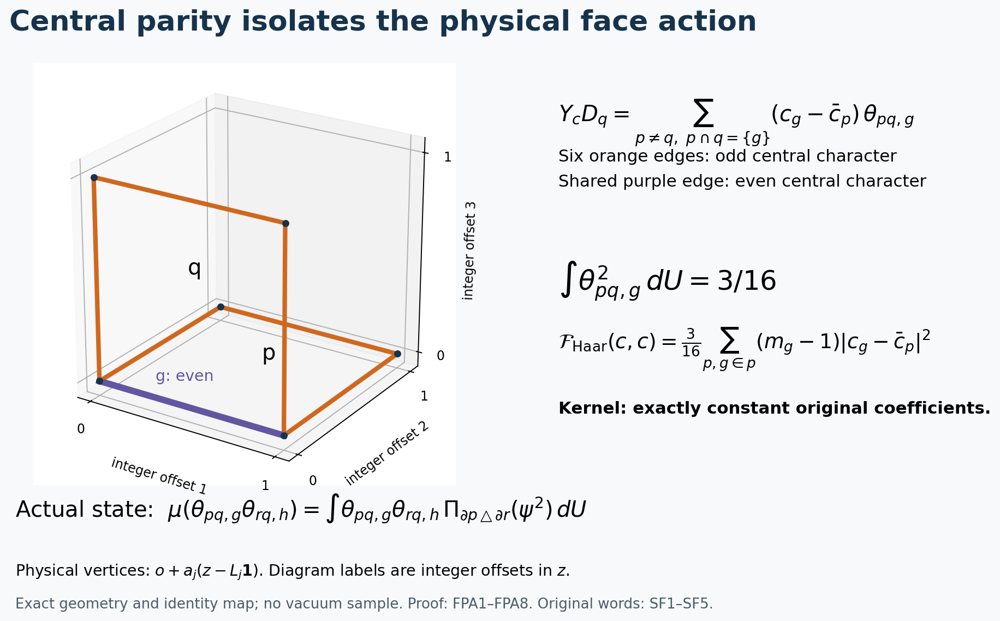

# Original face fields, exact physical action and the ground-density defect

Reviewed derivation, 13 October 2026. The finite-regulator proofs and diagnostic checks are complete. The smooth interacting global no-gap state remains the goal.

This calculation uses the original objects of [SLE1–SLE24](https://github.com/KokunoYumeto/yang-mills-interacting-workbench/blob/819b16440d723d7b5d72513a55038001de98e9bf/yang-mills/continuations/20261011-central-signs-shrinking-window/SCALAR_RESIDUAL_AND_LOCAL_ENERGY.md), the ordered two-face words in [SF1–SF15](https://github.com/KokunoYumeto/yang-mills-interacting-workbench/blob/819b16440d723d7b5d72513a55038001de98e9bf/yang-mills/continuations/20261011-central-signs-shrinking-window/SHARED_FACE_WORDS_AND_PHYSICAL_COUPLING.md), and independent central link multiplication in [CS1–CS5](https://github.com/KokunoYumeto/yang-mills-interacting-workbench/blob/819b16440d723d7b5d72513a55038001de98e9bf/yang-mills/continuations/20261011-central-signs-shrinking-window/CENTRAL_SIGNS_AND_BOUNDARIES.md). The prior human source for the center-multiplication mechanism is L. Li and Y. Meurice, [arXiv:hep-lat/0410029v2](https://arxiv.org/abs/hep-lat/0410029v2), Sections II–IV and Appendix, with its author-source provenance retained in CS. The independent character projections and receiving calculations below are proved here; no new reading or novelty claim is made.

## 1. Full original state, field and face action

The vertices are \(\{0,\ldots,2L_j\}^3\), with all positive edges \(\mathcal E_j\), all original unit faces \(\mathcal P_j\), and
\[
\begin{gathered}
L_j=j^4,\quad a_j=(100j)^{-1},\quad
g_j^2=\kappa_*a_j/2,\quad b_j=(\kappa_*a_j^2)^{-1},\quad
s_j=100\kappa_*a_j,\\
U_p=U_d(z)U_k(z+e_d)U_d(z+e_k)^{-1}U_k(z)^{-1}\quad(d<k),\\
D_p=2-\operatorname{Tr}U_p,\quad
V=b_j\sum_pD_p=2b_j|\mathcal P_j|-b_j\sum_p\operatorname{Tr}U_p,\\
H=-\kappa_*\Delta+V,\quad H\psi=E_0\psi,\quad
\psi>0,\quad\int\psi^2dU=1,\quad \rho=\psi^2,\quad w=\log\psi,\quad d\mu=\rho\,dU .
\end{gathered}
\]
Retain the radius-two metric on every \(SU(2)\), product probability Haar measure, and \(T_\alpha=-i\sigma_\alpha/2\). The full vacuum is smooth and gauge invariant. At fixed \(j\) write \(\kappa=\kappa_*\), \(b=b_j\). For every original complex edge array \(c\), without changing its amplitude, set
\[
\bar c_p=\tfrac14\sum_{g\in\partial p}c_g,\qquad
\alpha_{c,g}=\sum_{p\ni g}(c_g-\bar c_p)d_gD_p,\qquad
Y_cf=\sum_g\langle\alpha_{c,g},d_gf\rangle,\qquad
z_c=Y_cw .
\]
The contractions in this definition are complex bilinear extensions of the real metric. Norms and Hilbert inner products use conjugation on the first entry. The Haar divergence of \(Y_c\) is zero by the full four-edge Casimir cancellation in SLE3. All fields and face functions are smooth and gauge equivariant or invariant respectively.

For distinct incident faces \(p,q\), let \(g=p\cap q\) be their unique common edge, and write
\(\theta_{pq,g}=\langle d_gD_p,d_gD_q\rangle\). The exact action is
\[
\boxed{Y_cD_q=
\sum_{\substack{p\ne q\\p\cap q=\{g\}}}
(c_g-\bar c_p)\theta_{pq,g}}.
\tag{FPA1}
\]
The notation \(p\cap q=\{g\}\) means intersection of their edge sets; vertices are retained in the original graph. To prove (FPA1), expand the definition of \(Y_cD_q\). Different faces intersecting at no edge contribute zero. The self-face contribution is
\[
\sum_{g\in\partial q}(c_g-\bar c_q)|d_gD_q|^2
=(D_q-D_q^2/4)\sum_{g\in\partial q}(c_g-\bar c_q)=0.
\]
This keeps every self-edge term before its exact cancellation. A pair of distinct cubic unit faces has at most one common edge, giving the remaining sum.

## 2. Independent central characters isolate every term

Let \(\mathcal T=\{1,-1\}^{\mathcal E_j}\). For \(\tau\in\mathcal T\), let
\((D_\tau U)_e=\tau_eU_e\); inverses transform as
\((\tau_eU_e)^{-1}=\tau_eU_e^{-1}\), preserving their order. For an edge subset \(S\), define the character and its full projection by
\[
\chi_S(\tau)=\prod_{e\in S}\tau_e,\qquad
(\Pi_SF)(U)=2^{-|\mathcal E_j|}
\sum_{\tau\in\mathcal T}\chi_S(\tau)F(D_\tau U).
\tag{FPA2}
\]
These are mutually orthogonal projections in the original Haar \(L^2\). Indeed each \(D_\tau\) preserves Haar and is its own inverse. Multiplication of two such finite sums and
\(\sum_\tau\chi_S(\tau)\chi_T(\tau)=2^{|\mathcal E_j|}\mathbf1_{\{S=T\}}\)
prove self-adjointness, orthogonality and the projection identity. The character sum follows by pairing assignments differing on any edge in \(S\mathbin\triangle T\); if that set is empty every summand is one. No invariance of the interacting density under independent edge signs is assumed.

Central multiplication commutes with each original left derivative. Since
\(\operatorname{Tr}U_p(D_\tau U)=\chi_{\partial p}(\tau)\operatorname{Tr}U_p(U)\),
its gradient has the same character; the constant \(2\) in \(D_p\) differentiates to zero only after the original formula is retained. Consequently
\[
\begin{gathered}
\theta_{pq,g}(D_\tau U)
=\chi_{\partial p\triangle\partial q}(\tau)\theta_{pq,g}(U),\\
\Pi_{\partial p\triangle\partial q}(Y_cD_q)
=(c_g-\bar c_p)\theta_{pq,g}.
\end{gathered}\tag{FPA3}
\]
For fixed \(q\), the subsets \(\partial p\triangle\partial q\) are distinct for distinct \(p\): cancelling the same \(\partial q\) recovers \(\partial p\). Thus the projector selects exactly the displayed term of (FPA1). The character is odd on the six noncommon edges and even on the shared edge; both six-edge and eight-edge words of SF4 have precisely this character.

## 3. Exact Haar form and the physical-action kernel

The original pair contraction has the exact norm
\[
\int\theta_{pq,g}\,dU=0,\qquad
\int\theta_{pq,g}^2\,dU=\frac3{16}.
\tag{FPA4}
\]
Here is the full metric and measure calculation. Use SF10's aligned holonomies
\(X=H_{p,g}^{\epsilon_{p,g}}\) and
\(Y=H_{q,g}^{\epsilon_{q,g}}\).
The two remaining three-edge paths have disjoint edge sets. Conditional on \(U_g\), their ordered products are independent probability Haar, because integration in any one path edge is invariant under multiplication and inversion. The pair \((X,Y)\) is therefore independent probability Haar as well.

Write, as algebraic coordinates on the unchanged group,
\[
X=x_0I+2\sum_{\alpha=1}^3x_\alpha T_\alpha,\quad
Y=y_0I+2\sum_{\alpha=1}^3y_\alpha T_\alpha,\quad
x_0^2+\sum_\alpha x_\alpha^2=y_0^2+\sum_\alpha y_\alpha^2=1 .
\]
This parameterization does not change the radius-two metric or the generators. Under the original derivative \(\exp(tT_\alpha)X\), one has \(d x_0/dt=-x_\alpha/2\); hence \(d(2-\operatorname{Tr}X)/dt=x_\alpha\). The aligned common-edge derivative gives the same formula for \(Y\), including reversed original faces. Therefore \(\theta_{pq,g}=\sum_{\alpha=1}^3x_\alpha y_\alpha\). Probability Haar has \(\int x_\alpha=0\) and
\(\int x_\alpha x_\beta=\delta_{\alpha\beta}/4\): sign and coordinate symmetries of the four quaternion coordinates give the vanishing cross moments and equal diagonal moments; their sum is one. Independence now gives \(0\) for the mean and \(3(1/4)^2=3/16\) for the square. This is also a direct nonvanishing proof for every ordered face pair, not an assumed Wilson expectation in the interacting vacuum.

For arbitrary original complex \(c,d\), (FPA3)–(FPA4) give the complete sesquilinear form
\[
\begin{gathered}
\int\overline{Y_cD_q}\,Y_dD_q\,dU
=\frac3{16}
\sum_{\substack{p\ne q\\p\cap q=\{g\}}}
\overline{(c_g-\bar c_p)}(d_g-\bar d_p),\\
\mathcal F_{\rm Haar}(c,d):=
\sum_q\int\overline{Y_cD_q}\,Y_dD_q\,dU\\
=\frac3{16}\sum_p\sum_{g\in\partial p}
(m_g-1)\overline{(c_g-\bar c_p)}(d_g-\bar d_p),
\qquad m_g=|\{q:g\in\partial q\}|\in\{2,3,4\}.
\end{gathered}\tag{FPA5}
\]
Cross terms with different \(p\)'s vanish by orthogonality of their different central characters in Haar measure, rather than by an independence assertion for overlapping face holonomies. For each fixed \(p,g\), there are precisely \(m_g-1\) different \(q\)'s in the outer sum, including the actual boundary incidence. This proves the second equality.

All weights \(m_g-1\) are positive. Thus
\[
\begin{gathered}
\mathcal F_{\rm Haar}(c,c)
\ge\frac3{64}\sum_p
\sum_{\substack{e<f\\e,f\in\partial p}}|c_e-c_f|^2,\\
Y_cD_q=0\text{ for every original }q
\quad\Longleftrightarrow\quad c\text{ is constant}.
\end{gathered}\tag{FPA6}
\]
The coefficient follows from the exact four-value identity
\(\sum_{g\in\partial p}|c_g-\bar c_p|^2
=\tfrac14\sum_{e<f\in\partial p}|c_e-c_f|^2\).
Expand both sides with all complex conjugates to verify it. Zero in (FPA5) forces every \(c_g=\bar c_p\); the connected coface graph of the full original box then forces one global constant, as proved in SLE23. A constant gives \(\alpha_c=0\), hence vanishing of every face action. In particular every nonconstant real original array generates a field acting nontrivially on at least one gauge-invariant elementary face trace. Such a field is not everywhere tangent to gauge orbits, since a tangent field annihilates every smooth gauge-invariant function.

## 4. The exact receiving form in the interacting density

The Haar form is an exactly calculated comparison. The actual state and all its cross terms remain
\[
\begin{split}
\mathcal F_\mu(c,d)
:={}&\sum_q\mu\bigl(\overline{Y_cD_q}\,Y_dD_q\bigr)\\
={}&\sum_q
\sum_{\substack{p\ne q,\ r\ne q\\p\cap q=\{g\},\ r\cap q=\{h\}}}
\overline{(c_g-\bar c_p)}(d_h-\bar d_r)\,
\mu(\theta_{pq,g}\theta_{rq,h}).
\end{split}\tag{FPA7}
\]
There is an exact map locating each mixed density contribution:
\[
\begin{gathered}
\mu(\theta_{pq,g}\theta_{rq,h})
=\int \theta_{pq,g}\theta_{rq,h}
\,\Pi_{\partial p\triangle\partial r}\rho\,dU,\\
\rho_{\min}\mathcal F_{\rm Haar}(c,c)
\le\mathcal F_\mu(c,c)
\le\rho_{\max}\mathcal F_{\rm Haar}(c,c),\\
\rho_{\min}=\min_{U}\psi(U)^2>0,\qquad
\rho_{\max}=\max_{U}\psi(U)^2<\infty .
\end{gathered}\tag{FPA8}
\]
The product of contractions has character
\((\partial p\triangle\partial q)\triangle
(\partial r\triangle\partial q)=\partial p\triangle\partial r\).
Self-adjointness of the Haar projector therefore proves the first line. The second line follows by integrating the nonnegative function \(\sum_q|Y_cD_q|^2\) against the actual pointwise bounds on \(\rho\). Smoothness, compactness and strict positivity prove those bounds at each finite \(j\). They are not asserted uniform in \(j\), and no new state is introduced.

For \(p=r\), the density contribution is its full central average \(\Pi_\varnothing\rho\), not automatically the constant one. For \(p\ne r\), the actual character component can be nonzero and has no assigned sign. Gauge invariance only enforces
\(\Pi_S\rho=0\) if the subset \(S\) has odd degree at some vertex: change the signs on all edges at that vertex, which is its central gauge transformation; the character changes by \(-1\) and the density is unchanged. The present \(S=\partial p\triangle\partial r\) has even degree at every vertex, so this gauge cancellation does not remove the mixed term. The full original interacting form is thus (FPA7), with the explicit density map (FPA8).

Equations (FPA6)–(FPA8) prove that the kernel of \(c\mapsto(Y_cD_q)_q\) in the actual \(L^2(\mu)\) is exactly the constants. This is a theorem about physical face action, not about the different map \(c\mapsto z_c\). The latter remains the common kernel of the three energy moment matrices in SLE21.

## 5. The exact equation for a ground-density-preserving field

Haar divergence zero gives, for every smooth complex scalar \(f\),
\[
\mu(Y_cf)=-2\mu(fz_c),\qquad \mu z_c=0 .
\tag{FPA9}
\]
Indeed integrate \(\operatorname{div}(f\rho Y_c)\) over the compact manifold; its two nonzero terms are \(\rho Y_cf+2f\rho Y_cw\). Taking \(f=1\) proves the second identity. Thus a nonconstant \(c\) in the energy kernel still has nonzero face action by (FPA8), while its mean action on every test is zero. This is an exact difference between preservation of the density and pointwise preservation of the observables. For real \(c\), SLE24 supplies the complete measure-preserving flow.

To calculate the remaining cancellation, let \(\nabla^2w\) be the full product Hessian, and for a real field \(Y=Y_c\) define
\[
S_Y(\xi,\eta)=\tfrac12
[\langle\nabla_\xi Y,\eta\rangle+\langle\nabla_\eta Y,\xi\rangle],
\qquad
\Delta^\nabla Y=\operatorname{tr}\nabla^2Y .
\]
The trace uses the original radius-two orthonormal frame on every edge, with all mixed blocks retained. On this product,
\(\operatorname{Ric}(Y)=Y/2\): each \(SU(2)\) is a three-sphere of radius two, whose second fundamental form is \(1/2\) times the metric. The Gauss equation gives sectional curvature \(1/4\); summing the two orthogonal sectional curvatures gives Ricci tensor \(2/2^2\) times its metric; the product has no mixed Ricci terms. With \(z=Yw\), the exact original source equation is
\[
\boxed{
\begin{aligned}
L_0z+YV
&+2\kappa\langle S_Y,\nabla^2w+dw\otimes dw\rangle\\
&+\kappa\langle\Delta^\nabla Y+\tfrac12Y,dw\rangle=0 .
\end{aligned}
}
\tag{FPA10}
\]
Every factor and sign can be checked as follows. The ground equation gives
\(V-E_0=\kappa(\Delta w+|dw|^2)\), retaining both constants before differentiation. For any smooth \(w\),
\[
\begin{gathered}
\Delta(Yw)=Y\Delta w+
\langle\Delta^\nabla Y+\operatorname{Ric}(Y),dw\rangle
+2\langle S_Y,\nabla^2w\rangle,\\
Y|dw|^2=2\langle dw,d(Yw)\rangle
-2S_Y(dw,dw).
\end{gathered}
\]
For the first identity take an orthonormal frame at a point, differentiate the scalar pairing \(\langle Y,dw\rangle\) twice, and retain both cross terms. The covariant derivative commutation is
\(\Delta^\nabla dw=d\Delta w+\operatorname{Ric}(dw)\);
contracting its indices gives the displayed curvature term. The symmetric Hessian pairs only with the symmetric part \(S_Y\), an equality rather than an omitted contribution. For the second identity differentiate \(Yw\) once and use symmetry of \(\nabla^2w\). Apply \(Y\) to the full ground equation and substitute these identities. Finally
\(\kappa(\Delta+2dw\cdot d)z=-L_0z\), which proves (FPA10). The same equality extends complex linearly.

In particular, on the actual energy kernel \(z_c=0\),
\[
b\sum_qY_cD_q
=-2\kappa\langle S_{Y_c},\nabla^2w+dw\otimes dw\rangle
-\kappa\langle\Delta^\nabla Y_c+\tfrac12Y_c,dw\rangle .
\tag{FPA11}
\]
The full potential scalar \(2b|\mathcal P_j|\) and \(E_0\) have derivative zero, while every original face deficit remains in the sum. Equations (FPA1), (FPA7)–(FPA8) and (FPA10) specify the actual coefficient, density and curvature terms in this equation. A measure-preserving flow need not preserve the kinetic metric; (FPA11) gives its exact deformation contribution. No Killing-field or potential-invariance assumption is inserted.

The two pictured faces are an exact lattice-coordinate sample of the shared-edge geometry. Physical vertex coordinates are \(o+a_j(z-L_j\mathbf1)\); the plotted numbers are the integer offsets in \(z\), without replacing those physical coordinates. The six noncommon edges carry the odd central character and the shared edge carries the even character. The adjacent formulas record FPA3–FPA8, including the interacting density term that prevents replacing the physical form by its Haar comparison. Reproducible source: figure_face_field.py.

## Next receiving calculation

The calculation has established the full raw-coefficient physical-action kernel and the exact state-density term between that action and the Haar comparison. It also derives the equation actually satisfied by the score-contracted source, including kinetic deformation and the original Ricci coefficient. The next task is to evaluate the density-character contributions in (FPA8) and their cancellation against the full Hessian and score terms of (FPA10) along the unchanged regulator path. These formulas do not yet determine \(z_c\)'s physical-window inverse moments, the original \(X_\varphi/Q_\varphi\) annulus mass, or a continuum state. Their exact receiving maps remain SLE19–SLE22 and TSC1–TSC12.
