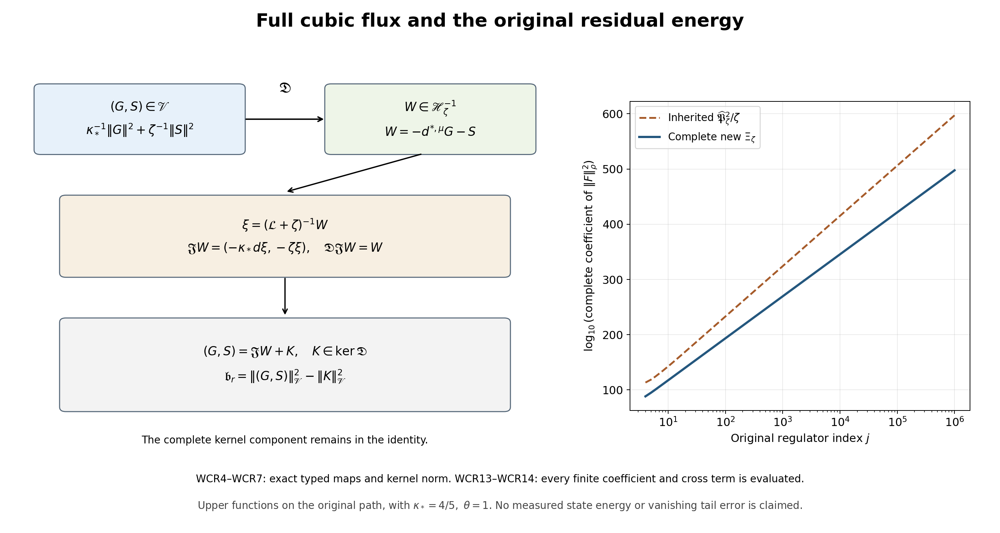

# Full cubic flux and the original residual energy

Derivation, 15 October 2026. This paper writes the complete original cubic residual as a weighted divergence and scalar forcing, constructs an exact typed right inverse, retains the full kernel component, calculates all six coefficient divergences, and evaluates a stronger finite upper bound. The full bound has growth degree 76, compared with degree 91 for the inherited bound. These are degrees of explicit upper functions, not measurements of the actual residual. Neither bound proves a vanishing tail error or the smooth global no-gap goal.

The precise receiving sources are [PST1–PST11, complete signed tail and original residual resolvent](https://github.com/KokunoYumeto/yang-mills-interacting-workbench/blob/e52eaa71efe72bf8931f4a95b35de27a0617a317/yang-mills/continuations/20261011-central-signs-shrinking-window/POSITIVE_SIGNED_TAIL_AND_RESIDUAL.md), [CDE1–CDE4, full original ordered cubic equation and typed maps](https://github.com/KokunoYumeto/yang-mills-interacting-workbench/blob/e52eaa71efe72bf8931f4a95b35de27a0617a317/yang-mills/continuations/20261011-central-signs-shrinking-window/ORIGINAL_FRAME_CUBIC_RESIDUAL.md), [CCJ1–CCJ20, complete original graph and marginal derivative bounds](https://github.com/KokunoYumeto/yang-mills-interacting-workbench/blob/e52eaa71efe72bf8931f4a95b35de27a0617a317/yang-mills/continuations/20261011-central-signs-shrinking-window/CONTRACTED_CUBIC_BOUNDS.md), [FCC, closed cubic compression and original source inclusion](https://github.com/KokunoYumeto/yang-mills-interacting-workbench/blob/e52eaa71efe72bf8931f4a95b35de27a0617a317/yang-mills/continuations/20261011-central-signs-shrinking-window/FULL_CUBIC_SOURCE_COMPRESSION.md). Their indicated arguments are used below with the original state and coefficients retained. Fifteen bounded disk-index hits are routing records; no new external paper was read or used. No novelty is claimed.

## Original state, source and full operators

Keep the original SU(2) product with radius-two metric, probability Haar measure, generators \(T_\alpha=-i\sigma_\alpha/2\), and ordered left-multiplication fields \(X_{e,\alpha}\). All operators below restrict to the original gauge-invariant physical subspace. The complete state is
\[
\begin{gathered}
a=(100j)^{-1},\quad L=j^4,\quad g^2=\kappa_*a/2,\quad
b=(\kappa_*a^2)^{-1},\quad\zeta=\theta\kappa_*/j,\quad j\ge4,\\
N=3(2L)(2L+1)^2,\qquad M=3(2L)^2(2L+1),\\
V=2bM-b\sum_pT_p,\quad H=-\kappa_*\sum_{i\in\mathcal I}X_i^2+V,\quad
H\psi=E_0\psi,\quad \psi>0,\quad\int\psi^2dU=1,\\
d\mu=\psi^2dU,\quad w=\log\psi,\quad
\mathcal L=\psi^{-1}(H-E_0)\psi,\quad\mathscr H_\mu=L^2(\mu).
\end{gathered}
\]
The original oriented plaquette and raw centered source are
\[
\begin{gathered}
U_p=U_d(z)U_k(z+e_d)U_d(z+e_k)^{-1}U_k(z)^{-1},\qquad
T_p=\operatorname{Tr}U_p,\\
Z_p=a(\mu T_p-T_p)/2,\qquad Z=\sum_p\varphi_p Z_p .
\end{gathered}
\]
Every original face, orientation, source center and coefficient stays fixed.
Let \(Q_r=(L-r)\mathbf1+\{0,\ldots,2r\}^3\), \(50j\le r\le L\), with the original source supported in \(Q_{50j}\). Write
\(\rho_r(x_r)=\int\psi(x_r,y_r)^2dy_r\) and
\(\mathscr H_r=L^2(\rho_r dx_r)\). The exact maps are
\[
J_r:\mathscr H_r\to\mathscr H_\mu,\quad J_rf=f(x_r),\qquad
J_r^*f=\rho_r^{-1}\int\psi^2 f\,dy_r,\qquad J_r^*J_r=I.
\]
Their full complement \(I-J_rJ_r^*\) is retained. The constants \(\kappa_*,\theta\) are positive. Use the original filter parameters \(1/4,4\) and every term of
\[
\begin{gathered}
q_\zeta(\lambda)=(\lambda+\zeta)(\lambda+\zeta/4)(\lambda+4\zeta),\\
k_\zeta(\lambda)=\frac{\zeta\lambda}{(\lambda+\zeta)^2}
-\frac{16}{25}\frac{(\zeta/4)\lambda}{(\lambda+\zeta/4)^2}
-\frac{16}{25}\frac{4\zeta\lambda}{(\lambda+4\zeta)^2}.
\end{gathered}
\]
Define the positive full cubic \(\mathscr A_\zeta=q_\zeta(\mathcal L)\), with domain H6 and form domain H3, and its closed compression \(\mathcal B_r=J_r^*\mathscr A_\zeta J_r\), with the same original inside Sobolev orders. Put
\[
\begin{gathered}
F_r=J_r^*Z,\quad t_r=\mathcal B_r^{-1}F_r,\quad u_r=J_rt_r,\quad
Y_r=\mathscr A_\zeta u_r=Z+W_r,\quad J_r^*W_r=0,\\
h_r=\mathscr A_\zeta^{-1}Z-u_r=-\mathscr A_\zeta^{-1}W_r,\quad
\delta_r=\|\mathscr A_\zeta^{1/2}h_r\|_\mu^2,\\
C(F)=\langle Z,k_\zeta(\mathcal L)Z\rangle_\mu,\quad
T_r(F)=\langle Y_r,k_\zeta(\mathcal L)Y_r\rangle_\mu,\quad
m_1(F)=\langle Z,\mathcal LZ\rangle_\mu .
\end{gathered}
\]
NSE7–NSE9 prove smoothness of the displayed finite-regulator vectors, their gauge restrictions, and
\[
v_s=u_{s+1}-u_s,\quad
d_s=\|\mathscr A_\zeta^{1/2}v_s\|_\mu^2,\quad
h_r=\sum_{s=r}^{L-1}v_s,\quad
\delta_r=\sum_{s=r}^{L-1}d_s,\quad
\langle v_s,\mathscr A_\zeta v_t\rangle=0\quad(s\ne t).
\]
The terminal cube has \(J_L=I\), \(W_L=h_L=0\) and crossing count zero. These identities retain the entire finite tail and its original terminal boundary.

For every real Sobolev order s, the original shifted scale is
\[
\mathscr H_\zeta^s=D((\mathcal L+\zeta)^{s/2})\quad(s\ge0),\qquad
\|f\|_{s,\zeta}=\|(\mathcal L+\zeta)^{s/2}f\|_\mu ;
\]
for negative s use the completion in that norm, equivalently the dual of the positive space with the original L2 pairing. All constants here are at the fixed regulator unless a complete j-dependent bound is displayed. In particular
\[
\mathfrak b_r(F)=\langle W_r,(\mathcal L+\zeta)^{-1}W_r\rangle_\mu,
\qquad
\mathsf B_{{\rm res},r}[v,v]=\mathfrak b_r(F_v).
\]
The matrix is indexed by the unchanged raw face coefficients. The full space of field-component arrays used below carries the original product metric and its gauge-covariant action; its components are not asserted to be invariant scalar observables. The scalar outputs restrict to the physical subspace. The gradient, weighted adjoint and resolvent intertwine these actions, so the displayed divergence and right inverse restrict to the corresponding physical scalar and covariant-array spaces.

## 1. Retain every original coefficient in six rows

Fix the original source cube Q, its inside field indices I, the full field indices \(\mathcal I\), and \(t=\mathcal B_\zeta^{-1}F\). Keep
\(\delta c=c-\mathbb E[c\mid x]\) with its original \(\psi^2\)-weighted outside integral, and
\(a_{hi}=X_hX_i\psi/\psi\), \(a_{hji}=X_hX_jX_i\psi/\psi\).
For the original filter \(e_1=21\zeta/4,e_2=21\zeta^2/4,e_3=\zeta^3\).
Define the following complete uncentered coefficients:
\[
\begin{aligned}
c_{h,2}&=-6\kappa_*^3a_h,\\
c_{h,1}&=4e_1\kappa_*^2a_h-6\kappa_*^2V_h,\\
c_{h,0}&=-2\kappa_*e_2a_h+(6\kappa_*^2+2e_1\kappa_*)V_h
-4\kappa_*^2\sum_{j\in\mathcal I}a_jV_{jh},\\
c_{hi,1}&=-12\kappa_*^3a_{hi},\\
c_{hi,0}&=4e_1\kappa_*^2a_{hi}-8\kappa_*^2V_{hi}
-4\kappa_*^2(V_ha_i+2V_ia_h),\\
c_{hji,0}&=-8\kappa_*^3a_{hji}.
\end{aligned}\tag{WCR1}
\]
All indices except the explicitly full j in the third row range over I. In particular the outside contribution in that row remains.
The exact CDE4 forcing is
\[
\begin{aligned}
W={}&\sum_h\left[
\delta c_{h,2}X_h\Delta_Q^2t
+\delta c_{h,1}X_h\Delta_Qt+\delta c_{h,0}X_ht\right]\\
&+\sum_{h,i}\left[
\delta c_{hi,1}X_hX_i\Delta_Qt+\delta c_{hi,0}X_hX_it\right]
+\sum_{h,j,i}\delta c_{hji,0}X_hX_jX_it .
\end{aligned}
\]
Substitute WCR1 and collect the full original CDE4 terms. Each derivative word is unchanged; only the names of summed indices change. The constants \(2bM,E_0\) remain in the ground equation used by CDE4. Their zero derivatives do not remove the potential or energy from the original state.

For later use define six inside-measurable derivative words
\[
B_{h,2}=\Delta_Q^2t,\quad B_{h,1}=\Delta_Qt,\quad B_{h,0}=t,\quad
B_{hi,1}=X_i\Delta_Qt,\quad B_{hi,0}=X_it,\quad
B_{hji,0}=X_jX_it .
\]
Thus each row of W is \((\delta c_{h,\nu})X_h B_{h,\nu}\), where the finite index \(\nu\) includes all remaining ordered indices. This notation includes every one of the six displayed rows; it does not commute any word.

## 2. Weighted differentiation of the actual conditional integral

For every smooth original coefficient c and \(h\in I\), differentiation under the full outside integral gives
\[
X_h\mathbb E[c\mid x]
=\mathbb E[X_hc\mid x]
+2\left(\mathbb E[a_hc\mid x]-\mathbb E[a_h\mid x]\mathbb E[c\mid x]\right).
\]
Indeed \(X_h\psi^2=2a_h\psi^2\) and
\(X_h\rho=2\rho\,\mathbb E[a_h\mid x]\); apply the quotient rule with both terms. Consequently, with \(\bar a_h=\mathbb E[a_h\mid x]\),
\[
\begin{aligned}
\mathscr D_h(\delta c)
&:=(X_h+2a_h)\delta c\\
&=\delta(X_hc)+2a_h\delta c
-2\mathbb E[(a_h-\bar a_h)c\mid x],\\
\mathbb E[\mathscr D_h(\delta c)\mid x]&=0 .
\end{aligned}\tag{WCR2}
\]
The last identity follows because the conditional expectation of the first term is zero and
\(\mathbb E[a_h\delta c\mid x]=\mathbb E[(a_h-\bar a_h)c\mid x]\).
This is the full conditional covariance correction. A derivative has not been commuted through the conditional integral.

## 3. Exact original flux and scalar forcing

For inside h set
\[
\mathcal F_h=\sum_\nu(\delta c_{h,\nu})B_{h,\nu},\qquad
\mathcal S=\sum_{h,\nu}\mathscr D_h(\delta c_{h,\nu})B_{h,\nu};
\]
for every outside h set \(\mathcal F_h=0\). The sums contain all six WCR1 rows. In particular each \(\mathcal F_h\) contains the full fourth derivative \(\Delta_Q^2t\), and \(\mathcal S\) keeps the coefficient derivatives and conditional covariance from WCR2. Smoothness at fixed regulator makes all these actual vectors square integrable.

The original weighted adjoint is \(X_h^{*,\mu}=-X_h-2a_h\). The complete identity is
\[
W=-\sum_{h\in\mathcal I}X_h^{*,\mu}\mathcal F_h-\mathcal S .
\tag{WCR3}
\]
For each original row,
\[
-X_h^{*,\mu}((\delta c)B)-\mathscr D_h(\delta c)B
=(X_h+2a_h)((\delta c)B)-(X_h+2a_h)(\delta c)B
=(\delta c)X_hB.
\]
The product rule proves the identity without discarding any term. Sum it over the six rows. WCR2 and inside measurability imply
\(\mathbb E[\mathcal F_h\mid x]=\mathbb E[\mathcal S\mid x]=0\).
The vector components carry the original field-frame transformation law; no claim is made that each component is itself a gauge-invariant scalar.

## 4. The full energy estimate and its exact missing contribution

Let \(\mathscr V\) be the original space of square-integrable field-component arrays and scalar pairs, with norm
\[
\|(G,S)\|_{\mathscr V}^2
=\kappa_*^{-1}\sum_{h\in\mathcal I}\|G_h\|_\mu^2
+\zeta^{-1}\|S\|_\mu^2 .
\]
The map
\[
\mathfrak D:\mathscr V\longrightarrow\mathscr H_\zeta^{-1},
\qquad
\mathfrak D(G,S)=-\sum_hX_h^{*,\mu}G_h-S
\]
is interpreted distributionally, by pairing with the original H1 form space. The full energy form and Cauchy–Schwarz prove
\[
|\langle f,\mathfrak D(G,S)\rangle|
\le\left(\kappa_*\sum_h\|X_hf\|_\mu^2+\zeta\|f\|_\mu^2\right)^{1/2}
\|(G,S)\|_{\mathscr V}.
\]
This proves boundedness with norm at most one into the indicated dual norm.
For each \(W\in\mathscr H_\zeta^{-1}\), let
\(\xi=(\mathcal L+\zeta)^{-1}W\in\mathscr H_\zeta^1\). The exact right inverse is
\[
\mathfrak J W=(-\kappa_*d\xi,-\zeta\xi)\in\mathscr V,\qquad
\mathfrak D\mathfrak J W=W,\qquad
\|\mathfrak J W\|_{\mathscr V}^2
=\|W\|_{-1,\zeta}^2 .
\]
The original identity \(\mathcal L=\kappa_*d^{*,\mu}d\) proves the first equality. The energy equation proves the second norm identity. Thus the map is surjective, and the right inverse retains every full outside derivative of \(\xi\).

For \((G,S)\in\ker\mathfrak D\), integration by parts gives
\(\langle\mathfrak J W,(G,S)\rangle_{\mathscr V}
=\langle\xi,\mathfrak D(G,S)\rangle=0\), with the usual conjugation for the chosen Hilbert convention. Therefore any pair representing W has the exact orthogonal decomposition
\[
\begin{gathered}
(G,S)=\mathfrak J W+\left((G,S)-\mathfrak J W\right),\qquad
(G,S)-\mathfrak J W\in\ker\mathfrak D,\\
\|(G,S)\|_{\mathscr V}^2
=\|W\|_{-1,\zeta}^2+
\|(G,S)-\mathfrak J W\|_{\mathscr V}^2 .
\end{gathered}
\]
Apply this to the complete pair \((\mathcal F,\mathcal S)\) in WCR3. The entire original residual energy satisfies
\[
\begin{aligned}
\mathfrak b_r
={}&\kappa_*^{-1}\sum_h\|\mathcal F_h\|_\mu^2
+\zeta^{-1}\|\mathcal S\|_\mu^2\\
&-\|(\mathcal F,\mathcal S)-\mathfrak J W_r\|_{\mathscr V}^2\\
\le{}&\kappa_*^{-1}\sum_h\|\mathcal F_h\|_\mu^2
+\zeta^{-1}\|\mathcal S\|_\mu^2 .
\end{aligned}\tag{WCR4}
\]
All mixed entries within each full sum defining \(\mathcal F_h,\mathcal S\) remain in these norms. Polarizing in the unchanged original face coefficients gives the full matrix identity and upper order, including every mixed face entry. The last squared norm is an actual component in the kernel of the full divergence map, not an assumed zero error.

WCR4 is an exact receiving formula and bound involving actual original coefficient covariances and trial derivatives. It is not yet a bound evaluated solely from j. The direct WCR2 derivative introduces fourth ground derivatives. The following full-field extension calculates their contraction using the original ground equation, with all additional outside flux components retained.

## 5. Extend the outer derivative over the full original field set

In WCR1 allow the outer index h to range over all of \(\mathcal I\), while the uncontracted i,j in the last three rows remain inside. Retain the already full j-sum in \(c_{h,0}\). Each added original row is exactly zero because \(X_h B_{h,\nu}=0\) for outside h. This proves that the extended coefficients represent the identical W. The extended flux \(\widetilde{\mathcal F}_h\) and scalar \(\widetilde{\mathcal S}\) are defined by the same formulas as WCR3, now with the full outer h-sum. They need not equal the former flux and scalar separately. Their full divergence difference belongs to \(\ker\mathfrak D\), and both pairs represent the original W exactly.

For every complete vector of coefficients \(c_h\), write
\[
\mathscr T(c)=\sum_{h\in\mathcal I}(X_h+2a_h)c_h,\qquad
\bar c_h=\mathbb E[c_h\mid x],\qquad
\bar a_h=\mathbb E[a_h\mid x].
\]
For an outside h, \(\bar a_h=0\), by integrating \(X_h(\psi^2)/2\) in its original Haar variable. The same integration by parts gives
\(\mathbb E[(X_h+2a_h)c_h\mid x]=0\).
For an inside h the differentiated conditional identity proves
\(X_h\bar c_h=\mathbb E[(X_h+2a_h)c_h\mid x]-2\bar a_h\bar c_h\).
Combining these exact inside and outside formulas yields
\[
\sum_{h\in\mathcal I}(X_h+2a_h)\delta c_h
=\delta\mathscr T(c)-2\sum_{h\in\mathcal I}(a_h-\bar a_h)\bar c_h .
\tag{WCR5}
\]
No outside mean \(\bar c_h\) is assumed zero. In the extended six rows B is independent of the outer h. Hence WCR5 can be multiplied by each complete original B and summed to calculate \(\widetilde{\mathcal S}\) directly.

## 6. Compute every full coefficient divergence

All sums in this paragraph are over the complete original field set. Define
\[
\begin{aligned}
A_0&=(V-E_0)/\kappa_*+\sum_h a_h^2,\\
A_i&=\kappa_*^{-1}[(V-E_0)a_i+V_i]+\sum_h a_ha_{hi},\\
A_{ji}&=\kappa_*^{-1}[(V-E_0)a_{ji}+V_{ji}+V_ja_i+V_ia_j]
+\sum_h a_ha_{hji},\\
D_V&=6bM-3V+2\sum_h a_hV_h,\\
D_{V,i}&=-3V_i+2\sum_h a_hV_{hi},\\
E_i&=a_i(6bM-3V)+\sum_hV_ha_{hi}
+a_i\sum_h a_hV_h+2\sum_h a_hV_{hi}+2V_iA_0,\\
D_\times&=\sum_{h,j}(a_{hj}+a_ha_j)V_{jh}
-2\sum_j a_jV_j .
\end{aligned}
\]
The symbol \(A_0\) here is a local abbreviation in this section, not the unrelated upper-bound scalar named A0 in CDE6. These definitions keep the entire \(V-E_0\), both potential constants and every ordered derivative.
The six divergences are exactly
\[
\begin{aligned}
\mathscr T(c_{\cdot,2})&=-6\kappa_*^3 A_0,\\
\mathscr T(c_{\cdot,1})&=4e_1\kappa_*^2 A_0-6\kappa_*^2D_V,\\
\mathscr T(c_{\cdot,0})&=-2\kappa_*e_2 A_0
+(6\kappa_*^2+2e_1\kappa_*)D_V-4\kappa_*^2D_\times,\\
\mathscr T(c_{\cdot i,1})&=-12\kappa_*^3 A_i,\\
\mathscr T(c_{\cdot i,0})&=4e_1\kappa_*^2 A_i-8\kappa_*^2D_{V,i}
-4\kappa_*^2E_i,\\
\mathscr T(c_{\cdot ji,0})&=-8\kappa_*^3 A_{ji}.
\end{aligned}\tag{WCR6}
\]
Here is the full derivation of the contracted identities. For any ordered inside word J,
\[
\sum_h(X_h+2a_h)a_{hJ}
=\psi^{-1}\Delta X_J\psi+\sum_h a_h a_{hJ}
=\kappa_*^{-1}\psi^{-1}X_J((V-E_0)\psi)
+\sum_h a_h a_{hJ}.
\]
The quotient derivative produces one negative \(a_ha_{hJ}\), while the weighted drift produces two copies; the displayed single copy remains. The original Casimir commutation and ground equation give the second equality. Expanding J of lengths zero, one and two proves \(A_0,A_i,A_{ji}\), respectively, including every product term. The original identity \(\Delta V=6bM-3V\) and \([\Delta,X_i]=0\) prove \(D_V,D_{V,i}\).
For the product coefficient,
\[
\begin{aligned}
\sum_h(X_h+2a_h)(V_ha_i)
&=a_i\Delta V+\sum_hV_ha_{hi}+a_i\sum_h a_hV_h,\\
\sum_h(X_h+2a_h)(2V_i a_h)
&=2\sum_h a_hV_{hi}+2V_i A_0.
\end{aligned}
\]
Adding these full product rules proves \(E_i\).

For the last coefficient retain the order \(V_{jh}=X_jX_hV\).
The quotient derivative gives
\[
\sum_{h,j}(X_h+2a_h)(a_jV_{jh})
=\sum_{h,j}(a_{hj}+a_ha_j)V_{jh}
+\sum_j a_j\sum_h X_hX_jX_hV .
\]
The radius-two field brackets imply
\[
\sum_hX_hX_jX_h=X_j\Delta+X_j .
\]
To verify the last coefficient, fields on other links commute; on j's link,

\[
\sum_h[X_h,X_j]X_h=\frac12\sum_{h,\gamma,\delta}
\epsilon_{hj\gamma}\epsilon_{\gamma h\delta}X_\delta=X_j .
\]
The contraction is \(2\delta_{j\delta}\), and the original bracket signs are both negative. Thus the two signs multiply to positive. Applying the full identity to V gives

\[
\sum_hX_hX_jX_hV=X_j(6bM-3V)+X_jV=-2V_j .
\]
Substitution proves \(D_\times\) and completes all six WCR6 rows.

The full scalar remainder is now calculated as
\[
\widetilde{\mathcal S}
=\sum_\nu\left[
\delta\mathscr T(c_{\cdot,\nu})
-2\sum_{h\in\mathcal I}(a_h-\bar a_h)\bar c_{h,\nu}
\right]B_\nu .
\]
The six \(\mathscr T\) values are WCR6. Thus no fourth ground derivative remains in this complete contraction: its exact replacements are the displayed full potential, vacuum energy, third-derivative products, outside flux and conditional covariance. This statement follows from the identities, not from a change in the original state.

## 7. The new quantitative receiving expression

WCR3–WCR4 apply to the extended pair, proving
\[
\mathfrak b_r
\le\kappa_*^{-1}\sum_{h\in\mathcal I}\|\widetilde{\mathcal F}_h\|_\mu^2
+\zeta^{-1}\|\widetilde{\mathcal S}\|_\mu^2 .
\tag{WCR7}
\]
Both norms contain every original cross term. In particular the new full-field components must be counted in any subsequent finite bound; the former inside-only count cannot be used for them. The exact kernel-component identity from WCR4 also applies to this pair.
Sections 8–13 evaluate the extended representation with the original source data and CCJ graph estimates. Both exact flux representations remain available. Their upper bounds do not establish positivity of the signed trial response.

## 8. Original energy gives stronger derivative estimates

We now evaluate the WCR7 bound from the original regulator data. No norm of an unknown trial derivative is left as an assumed input. Retain the CCJ constants
\[
\begin{gathered}
c=2/(\kappa_*a),\quad A=4bM/\kappa_*,\quad
G=4\pi^2Nc^2,\quad A_Q=2\pi c\sqrt{N_Q},\\
d_{\rm all}=3N,\qquad K=A+(d_{\rm all}-1)c .
\end{gathered}
\]
The original Hessian lower bound and exact trace equation give
\[
-cg\le\nabla^2w\le Kg,\qquad \|\nabla^2w\|_{\rm op}\le K.
\]
Indeed every eigenvalue is at least \(-c\), and their full sum is
\((V-E_0)/\kappa_*-|dw|^2\le A\). Each eigenvalue is therefore at most \(A+(d_{\rm all}-1)c\). Since \(d_{\rm all}\ge3\), this K also bounds the modulus of the negative eigenvalues. The exact trace retains \(E_0\); A is only the stated independent upper function.

Write
\[
s_0=e_3^{-1},\quad s_1=(2\sqrt{\kappa_*e_2e_3})^{-1},\quad
s_L=(2\sqrt{e_1e_3})^{-1},\quad s_{3/2}=(2\sqrt{e_3})^{-1}.
\]
CCJ1–CCJ2 prove, for the actual \(u=Jt\) and raw \(F\),
\[
\|t\|_\rho\le s_0\|F\|_\rho,\quad
\|dt\|_\rho\le s_1\|F\|_\rho,\quad
\|\mathcal Lu\|_\mu\le s_L\|F\|_\rho,\quad
\|\mathcal L^{3/2}u\|_\mu\le s_{3/2}\|F\|_\rho .
\]

Let \(D_{m,r}(t)^2=\sum_{|J|=m}\|X_J\Delta_Q^rt\|_\rho^2\), with every ordered inside word. The following exact identity is particularly useful:
\[
D_{2,0}(t)^2
=\kappa_*^{-2}\|\mathcal Lu\|_\mu^2
+2\int\psi^2\,\nabla^2w(du,d\overline u)\,dU .
\]
Here is a direct proof with the original fields. Integration by parts gives
\(\|\mathcal Lu\|^2=\kappa_*\sum_i\langle X_iu,X_i\mathcal Lu\rangle\).
Use
\[
[X_i,\mathcal L]
=-2\kappa_*\sum_h[(X_ia_h)X_h+a_h[X_i,X_h]],
\qquad [X_i,\Delta]=0.
\]
The term \(\mathcal LX_iu\) contributes
\(\kappa_*^2\sum_{h,i}\|X_hX_iu\|^2\).
Write \(X_ia_h=\nabla^2w(X_i,X_h)+(\nabla_{X_i}X_h)w\).
The connection term is antisymmetric in i,h. For each fixed h the bracket term is antisymmetric in i and its output field index. Their real quadratic contractions with the original complex gradient both vanish by exchanging those indices. The symmetric Hessian term contributes exactly the displayed integral, with the indicated sign after rearrangement. Outside derivatives of u vanish because u is the original inside function.

Also
\(\sum_{h,i}|X_hX_iu|^2=|\nabla^2u|_{\rm HS}^2+|du|^2/2\):
the Hessian is symmetric, the connection correction is antisymmetric, and
\(\sum_{h,i}|\frac12[X_h,X_i]u|^2=|du|^2/2\) for the original radius-two brackets. Thus \(\|\nabla^2u\|_\mu\le D_{2,0}(t)\).

Define the complete finite quantities
\[
\begin{gathered}
b_{0,1}=\kappa_*^{-1}s_L+2A_Qs_1,\\
b_{2,0}=\sqrt{\kappa_*^{-2}s_L^2+2Ks_1^2},\\
b_{1,1}=\kappa_*^{-3/2}s_{3/2}+2Ks_1+2A_Qb_{2,0}.
\end{gathered}\tag{WCR8}
\]
Then \(D_{m,r}(t)\le b_{m,r}\|F\|_\rho\) for these three pairs.
For \((0,1)\), solve the original drift equation
\(\Delta_Qu=-\kappa_*^{-1}\mathcal Lu-2dw\cdot du\).
For \((2,0)\), use the exact Hessian identity and K. For \((1,1)\), differentiate that full drift equation:
\[
d\Delta_Qu=-\kappa_*^{-1}d\mathcal Lu
-2\nabla^2w(du,\cdot)-2\nabla^2u(dw,\cdot).
\]
The full first term obeys
\(\|d\mathcal Lu\|_\mu=\kappa_*^{-1/2}\|\mathcal L^{3/2}u\|_\mu\).
The last Hessian has only inside components on the original product metric, so its contraction uses \(|d_Qw|\le A_Q\). The middle term retains the full Hessian, including its outside components, and is bounded by K. These three terms prove WCR8.

## 9. Full positive-marginal derivatives and the actual auxiliary generator

The original conditional marginal gives the exact positive operator
\[
\overline{\mathcal L}=J^*\mathcal LJ
=-\kappa_*[\Delta_Q+2d\log\alpha\cdot d],\qquad
\alpha=\sqrt\rho,\qquad \mathscr U_\rho=\kappa_*\Delta_Q\alpha/\alpha .
\]
Its closed form has domain H1 and operator domain H2 on the original inside product. Smooth positive multiplication gives
\[
M_\alpha\overline{\mathcal L}M_\alpha^{-1}
=-\kappa_*\Delta_Q+\mathscr U_\rho,\qquad
(-\kappa_*\Delta_Q+\mathscr U_\rho)\alpha=0.
\]
These are exact typed maps on the stated domains. The trial still solves the full cubic compression \(\mathcal B_\zeta t=F\). In particular no identity \(\mathcal B_\zeta=q_\zeta(\overline{\mathcal L})\) is used. With \(\mathcal K=Q_c\mathcal LJ\), \(Q_c=I-JJ^*\), and the original complementary compression \(\mathcal D=Q_c\mathcal LQ_c\), the exact smooth-core block identity is
\[
\begin{aligned}
\mathcal B_\zeta={}&\overline{\mathcal L}^3
+\overline{\mathcal L}\mathcal K^*\mathcal K
+\mathcal K^*\mathcal K\overline{\mathcal L}
+\mathcal K^*\mathcal D\mathcal K\\
&+e_1(\overline{\mathcal L}^2+\mathcal K^*\mathcal K)
+e_2\overline{\mathcal L}+e_3I .
\end{aligned}
\]
Multiply the original two-by-two block operator three times to prove it, retaining both cross orders. FCC gives the closed compression forms; the displayed identity is used on the actual smooth trials.

Keep the full finite CCJ7–CCJ9 quantities \(R^+_{m,r}\) and \(I^+_{m,r}\). They bound, respectively, \(\rho^{-1}D^m\Delta_Q^r\rho\) and \(\alpha D^m\Delta_Q^r\alpha^{-1}\). Define
\[
H^+_{0,0}=1,\qquad
H^+_{m,r}=\sum_{\pi\in\Pi_{m+2r}}
\left|(1/2)_{|\pi|}\right|
\prod_{B\in\pi}R^+_{m_B,r_B},\quad m+2r\ge1.
\]
Here the ordered positions, adjacent original Laplacian pairs, \(r_B\), \(m_B=|B|-2r_B\), and every split-pair contraction are exactly those of CCJ9. The falling coefficient is \((z)_n=z(z-1)\cdots(z-n+1)\).
The full ordered chain rule for \(\alpha=\rho^{1/2}\), followed by the same proved contractions, shows that \(H^+_{m,r}\) bounds \(\alpha^{-1}D^m\Delta_Q^r\alpha\). This is the positive-half coefficient, not the inverse-half coefficient of CCJ9.

The complete potential derivative ceilings are
\[
\mathcal U^+_{m,r}
=\kappa_*\sum_{a+b+c=r}\frac{r!2^c}{a!b!c!}
\sum_{s=0}^m\binom ms
I^+_{s+c,a}H^+_{m-s+c,b+1}.
\tag{WCR9}
\]
CCJ5's full contracted product rule applied to
\(\mathscr U_\rho=\kappa_*\alpha^{-1}\Delta_Q\alpha\)
proves this bound. The factors of alpha cancel only by their exact multiplication identity; every derivative, falling coefficient and shared contraction remains. We use only \((m,r)=(1,0),(2,0),(1,1)\), hence orders at most five.

## 10. Evaluate the fourth inside derivative without an assumed regularity bound

Let
\[
\overline d_{m,r}=\mathscr P_{m,r}(\widehat\Theta)
=\sum_l[z^l]\mathscr P_{m,r}(z)\widehat\Theta_l
\]
be the complete original CCJ11 and CCJ16 coefficientwise bound, including every finite partition and derivative factor. Thus
\(D_{m,r}(t)\le\overline d_{m,r}\|F\|_\rho\) for \(m+2r\le6\).

Differentiating the original conditional integral for \(\mathcal Lu\) gives
\[
d_Q\overline{\mathcal L}t
=\mathbb E[d_Q\mathcal Lu\mid x]
+2\,\operatorname{Cov}(d_Qw,\mathcal Lu\mid x).
\]
Conditional Cauchy–Schwarz, including the full subtracted means, yields
\[
\|\operatorname{Cov}(d_Qw,\mathcal Lu\mid x)\|_\rho
\le A_Q\|\mathcal Lu\|_\mu .
\]
Indeed its squared norm at x is at most the conditional variance of the full score array times the conditional variance of \(\mathcal Lu\); these are at most \(A_Q^2\) and \(\mathbb E[|\mathcal Lu|^2\mid x]\). Therefore
\[
\|\overline{\mathcal L}^{3/2}t\|_\rho
\le M_{3/2}\|F\|_\rho,\qquad
M_{3/2}=s_{3/2}+2\sqrt{\kappa_*}A_Qs_L .
\]
No outside covariance has been set to zero.

For the upper third power define the full finite sum
\[
\begin{aligned}
M_3={}&\kappa_*^3\overline d_{0,3}
+6\kappa_*^3H^+_{1,0}\overline d_{1,2}
+12\kappa_*^3H^+_{2,0}\overline d_{2,1}
+8\kappa_*^3H^+_{3,0}\overline d_{3,0}\\
&+6\kappa_*^2\mathcal U^+_{1,0}\overline d_{1,1}
+8\kappa_*^2\mathcal U^+_{2,0}\overline d_{2,0}
+12\kappa_*^2\mathcal U^+_{1,0}H^+_{1,0}\overline d_{2,0}\\
&+2\kappa_*^2\mathcal U^+_{1,1}\overline d_{1,0}
+4\kappa_*^2H^+_{1,0}\mathcal U^+_{2,0}\overline d_{1,0}.
\end{aligned}
\]
To prove \(\|\overline{\mathcal L}^3t\|_\rho\le M_3\|F\|_\rho\), apply the complete CDE3 product expansion to the actual positive ground alpha and potential \(\mathscr U_\rho\) on the inside product. Its nine terms have the same original ordered coefficients
\(-1,-6,-12,-8,-6,-8,-4,-2,-4\).
The product coefficient in the seventh term is
\((X_j\mathscr U_\rho)(X_i\alpha/\alpha)+2(X_i\mathscr U_\rho)(X_j\alpha/\alpha)\), producing the displayed factor twelve only after the exact sum is bounded. The eighth term remains
\(-2\kappa_*^2\sum_i(\Delta_QX_i\mathscr U_\rho)X_it\), bounded by \(\mathcal U^+_{1,1}\).
The Wilson identity \(\Delta V_i=-3V_i\) is not applied to this different potential. Each term is bounded using WCR9 and the original \(\overline d\) values. This proves the complete sum.

Spectral Hölder for the same original positive \(\overline{\mathcal L}\) gives
\[
\|\overline{\mathcal L}^2t\|_\rho
\le\|\overline{\mathcal L}^{3/2}t\|_\rho^{2/3}
\|\overline{\mathcal L}^3t\|_\rho^{1/3}
\le M_2\|F\|_\rho,\qquad M_2=M_{3/2}^{2/3}M_3^{1/3}.
\tag{WCR10}
\]
The exponent identity in the squared spectral integral is
\(\lambda^4=(\lambda^3)^{2/3}(\lambda^6)^{1/3}\). Hölder proves the displayed inequality, including vectors with a vacuum component.

The complete second-power equation in these same original variables is
\[
\begin{aligned}
\overline{\mathcal L}^2t={}&\kappa_*^2\Delta_Q^2t
+4\kappa_*^2\sum_i\frac{X_i\alpha}{\alpha}X_i\Delta_Qt\\
&+4\kappa_*^2\sum_{i,j}\frac{X_jX_i\alpha}{\alpha}X_jX_it
+2\kappa_*\sum_i(X_i\mathscr U_\rho)X_it .
\end{aligned}
\]
It follows directly from the original ground product rule; all four terms remain. Solving for the first term gives the finite bound
\[
b_{0,2}=\kappa_*^{-2}M_2+4A_Qb_{1,1}
+4H^+_{2,0}b_{2,0}+2\kappa_*^{-1}\mathcal U^+_{1,0}s_1 .
\]
Set, finally,
\[
\begin{gathered}
\widehat t_{0,0}=s_0,\quad
\widehat t_{1,0}=\min\{\overline d_{1,0},s_1\},\\
\widehat t_{m,r}=\min\{\overline d_{m,r},b_{m,r}\},
\qquad(m,r)\in\{(0,1),(2,0),(1,1),(0,2)\}.
\end{gathered}\tag{WCR11}
\]
Every bound is for the unchanged \(D_{m,r}(t)\) divided by the raw source norm, with the zero source handled by linearity. The minima keep both complete finite estimates.

## 11. Bound all six full-field covariances

Use the original full ceilings \(U_m=U_m^{\rm all}\) of CCJ3–CCJ4 and
\[
v_1=4b\sqrt M,\qquad v_2=12b\sqrt M.
\]
The six coefficient arrays have the following remaining derivative pairs:
\[
(m,r)=(0,2),(0,1),(0,0),(1,1),(1,0),(2,0) .
\]
Define their complete upper bounds by
\[
\begin{aligned}
C_{0,2}&=6\kappa_*^3U_1,\\
C_{0,1}&=4e_1\kappa_*^2U_1+6\kappa_*^2v_1,\\
C_{0,0}&=2\kappa_*e_2U_1+(6\kappa_*^2+2e_1\kappa_*)v_1
+4\kappa_*^2U_1v_2,\\
C_{1,1}&=12\kappa_*^3U_2,\\
C_{1,0}&=4e_1\kappa_*^2U_2+8\kappa_*^2v_2+12\kappa_*^2v_1U_1,\\
C_{2,0}&=8\kappa_*^3U_3.
\end{aligned}
\]
These bound the entire uncentered coefficient arrays in WCR1 with the extended full h index. They follow from the exact rows and tensor Cauchy–Schwarz, including the full \(a_jV_{jh}\) contraction.

The complete full-divergence ceilings are obtained from
\[
\begin{aligned}
g_0&=A+U_1^2,\\
g_1&=AU_1+v_1/\kappa_*+U_1U_2,\\
g_2&=AU_2+(v_2+2v_1U_1)/\kappa_*+U_1U_3,\\
d_V&=6bM+2U_1v_1,\qquad d_{V,1}=3v_1+2U_1v_2,\\
e_V&=6bMU_1+v_1U_2+U_1^2v_1+2U_1v_2+2v_1g_0,\\
d_\times&=(U_2+U_1^2)v_2+2U_1v_1 .
\end{aligned}
\]
Here \(|6bM-3V|\le6bM\) follows from the full original range \(0\le V\le4bM\). The exact potential and energy remain in WCR6 before these upper bounds. Put
\[
\begin{aligned}
\Gamma_{0,2}&=6\kappa_*^3g_0,\\
\Gamma_{0,1}&=4e_1\kappa_*^2g_0+6\kappa_*^2d_V,\\
\Gamma_{0,0}&=2\kappa_*e_2g_0+(6\kappa_*^2+2e_1\kappa_*)d_V
+4\kappa_*^2d_\times,\\
\Gamma_{1,1}&=12\kappa_*^3g_1,\\
\Gamma_{1,0}&=4e_1\kappa_*^2g_1+8\kappa_*^2d_{V,1}+4\kappa_*^2e_V,\\
\Gamma_{2,0}&=8\kappa_*^3g_2 .
\end{aligned}\tag{WCR12}
\]
Every original row of WCR6 is now bounded, with no inside-only count assigned to a full-field array.

For each complete inside derivative array B, the exact conditional variance gives
\[
\|(\delta c)B\|_\mu^2
=\int\rho\,\operatorname{Var}(cB\mid x)dx
\le\int\rho\,\mathbb E[|cB|^2\mid x]dx
\le C_{m,r}^2\|B\|_\rho^2.
\]
The same identity bounds \((\delta\mathscr T(c))B\) by \(\Gamma_{m,r}\|B\|_\rho\).
For the retained correction in WCR5, conditional Cauchy–Schwarz gives
\[
\left\|\sum_h(a_h-\bar a_h)\bar c_hB\right\|_\mu
\le U_1 C_{m,r}\|B\|_\rho .
\]
Its conditional score variance is at most \(U_1^2\), and the conditional mean coefficient norm is at most \(C_{m,r}\). This proves the estimate with all subtracted means and every original tensor index; no independence is assumed.

Let \(\mathcal J_0\) be the full six-element index set above. Define
\[
\begin{gathered}
\mathfrak F_\zeta=\sum_{(m,r)\in\mathcal J_0}C_{m,r}\widehat t_{m,r},
\qquad
\mathfrak S_\zeta=\sum_{(m,r)\in\mathcal J_0}
(\Gamma_{m,r}+2U_1C_{m,r})\widehat t_{m,r},\\
\Xi_\zeta=\kappa_*^{-1}\mathfrak F_\zeta^2+\zeta^{-1}\mathfrak S_\zeta^2,
\qquad
\Xi_\zeta^{\rm best}
=\min\{\Xi_\zeta,\zeta^{-1}\widehat{\mathfrak P}_\zeta^2\}.
\end{gathered}
\]
WCR7 and the preceding complete variance bounds prove
\[
\mathfrak b_{50j}(F)\le\Xi_\zeta^{\rm best}\|F\|_\rho^2,\qquad
\mathsf B_{{\rm res},50j}\le\Xi_\zeta^{\rm best}\mathsf S,\qquad
\mathsf S=F^*F=Z^*Z .
\tag{WCR13}
\]
The triangle inequality is applied to the six complete row vectors only after their exact expressions have been retained. The squared sums above include their numerical cross terms. Apply the scalar bound to every unchanged raw coefficient vector to prove the full matrix order; no matrices commute in this argument.

## 12. Exact growth of the full original upper function

Keep \(q=100j\), \(N_Q=300j(100j+1)^2\), \(M_Q=30000j^2(100j+1)\),
\(C_Q=1200j(100j+1)\), the original full N,M, and \(\zeta=\theta\kappa_*/j\).
The exponents in this section describe limits of the complete positive upper functions, not substitutions for any finite expression. CCJ20 gives the preceding exponents. The positive partition formula adds
\[
\begin{gathered}
H^+_{1,0}:5/2,\qquad H^+_{m,r}:7(m+2r)\quad(m+2r\ge2),\\
\mathcal U^+_{1,0}:21,\quad \mathcal U^+_{2,0}:28,\quad
\mathcal U^+_{1,1}:35,\quad M_{3/2}:9/2,\quad M_3:45,\quad M_2:18.
\end{gathered}
\]
For each partition term its exponent is the sum of the exponents of its blocks; taking the largest exponent is exact because all retained coefficients are nonnegative and at least one maximal term is positive. This verifies the stated H and potential powers directly from the displayed finite formulas. The same positive-sum rule in M3, followed by the exact Hölder exponents, gives its last two powers.

The complete row powers are

| Remaining pair | Trial ceiling | Coefficient C | Divergence Gamma | Flux term | Scalar term |
|---|---|---|---|---|---|
| (0,2) | 47/2 | 7 | 14 | 61/2 | 75/2 |
| (0,1) | 5 | 8 | 15 | 13 | 20 |
| (0,0) | 3 | 15 | 22 | 18 | 25 |
| (1,1) | 33/2 | 14 | 21 | 61/2 | 75/2 |
| (1,0) | 5/2 | 15 | 22 | 35/2 | 49/2 |
| (2,0) | 19/2 | 21 | 28 | 61/2 | 75/2 |

For verification, WCR8 gives the derivative powers 5,19/2,33/2; the three terms in \(b_{0,2}\) following \(M_2/\kappa_*^2\) have powers 19,47/2,47/2, while \(M_2\) has power 18. Thus its power is47/2. Each improves the corresponding old \(\overline d\) exponent, so the stated minima have those exact leading orders. The C and Gamma powers follow by inserting the full original \(U_1:7,U_2:14,U_3:21,v_1:8,v_2:8,A:14\) in WCR12. Each \(2U_1C\) has the same exponent as its Gamma. Adding the trial exponent gives the final two columns. Consequently the flux part of Xi has power 61 and the scalar part has power 76.

The leading coefficient is also explicit. Set
\[
\begin{gathered}
\mathfrak a=960000/\kappa_*^2,\qquad
\mathfrak g=3840000\pi^2/\kappa_*^2,\qquad
u_1=\sqrt{\mathfrak g},\quad u_2=\mathfrak a+\mathfrak g,\\
\gamma=\sqrt{2\pi(2\mathfrak a+\mathfrak g)},\quad u_3=u_2\gamma,\quad
d=(\sqrt{21}\,\theta^{5/2}\kappa_*^3)^{-1},\\
\ell_{20}=\sqrt{2\mathfrak a}\,d,\quad
\ell_{11}=2\mathfrak a\,d,\quad
\ell_{02}=4[\mathfrak a\sqrt{2\mathfrak a}
+u_1(2\mathfrak a+\mathfrak g)]d,\\
\mathfrak s=\kappa_*^3[
6(\mathfrak a+3\mathfrak g)\ell_{02}
+12u_1(4\mathfrak a+3\mathfrak g)\ell_{11}
+8(\mathfrak a u_2+3u_1u_3)\ell_{20}].
\end{gathered}
\]
Then
\[
\lim_{j\to\infty}\frac{\Xi_\zeta}{j^{76}}
=\lim_{j\to\infty}\frac{\Xi_\zeta^{\rm best}}{j^{76}}
=\frac{\mathfrak s^2}{\theta\kappa_*}>0 .
\tag{WCR14}
\]
To check the less immediate constants, the full positive-half partition sum gives leading \(H^+_{2,0}=\mathfrak a\,j^{14}\) and
\(H^+_{1,1}=2u_1(2\mathfrak a+\mathfrak g)j^{21}\).
Terms with an isolated inside first derivative have smaller degree; the complete contracted \(R^+_{1,1}\) has leading \(4u_1(2\mathfrak a+\mathfrak g)\).
Thus WCR9 gives leading \(\mathcal U^+_{1,0}=2\kappa_*u_1(2\mathfrak a+\mathfrak g)j^{21}\). Substitution in WCR8–WCR11 yields the three ell constants. The three maximal scalar rows are precisely (0,2),(1,1),(2,0); WCR12 gives their displayed coefficients in \(\mathfrak s\).
The scalar contribution to Xi is \(\mathfrak S_\zeta^2/\zeta\); its leading coefficient is therefore \(\mathfrak s^2/(\theta\kappa_*)\). The inherited alternative has degree 91 with positive leading coefficient, so the minimum has the same degree 76 limit.

At \(\kappa_*=4/5,\theta=1,j=4\), every finite term is evaluated:
\[
\begin{aligned}
\log_{10}\Xi_\zeta&\approx88.36586128427194,\\
\log_{10}(\widehat{\mathfrak P}_\zeta^2/\zeta)&\approx113.35914747217482 .
\end{aligned}
\]
These are evaluations of upper functions, not measurements of the actual energy or proof constants replacing the complete formulas. In particular the new bound remains large and its positive growth does not establish growth of the actual residual energy.

## 13. Retain the original signed receiver

The entire PST10 comparison now has the explicit original-state consequence
\[
\begin{aligned}
|C(F)-T_{50j}(F)|
\le{}&\frac{86}{25}
\sqrt{m_1(F)\,\Xi_\zeta^{\rm best}\|F\|_\rho^2}
+\frac{43}{25}\zeta\,\Xi_\zeta^{\rm best}\|F\|_\rho^2,\\
-\mathsf X_\tau\le{}&\mathsf C-\mathsf T_{50j}\le\mathsf X_\tau,\\
\mathsf X_\tau={}&\tau(43/25)^2\mathsf M_1
+(\tau^{-1}+43\zeta/25)\Xi_\zeta^{\rm best}\mathsf S,\qquad\tau>0 .
\end{aligned}\tag{WCR15}
\]
Substitute WCR13 into both proved PST10 orders. This retains every raw source matrix, its actual norm, both spectral tails and all mixed entries. The original NSE10 first-energy and source ceilings can be inserted as written; no coefficient vector is rescaled.
The entire flux and variational identities, coefficient contractions, derivative bounds and signed receiver are established above. This finite bound does not tend to zero. It therefore does not yet prove surviving shrinking-window mass, the intended continuum theory, or the smooth global no-gap result. The next calculation uses the full conditional covariance and the exact kernel component in WCR4, rather than assigning them their maximal pointwise envelopes.

## 14. Exact map, complete upper functions and diagnostic scope

The left panel shows WCR3–WCR7, with all full-field flux components retained. The pair is the sum of its isometric resolvent representative and a vector in the divergence kernel; the squared kernel norm is explicitly subtracted in the exact identity. The right panel evaluates every finite term in WCR13 on the original parameter path, with \(\kappa_*=4/5,\theta=1\). Both plotted quantities multiply the unchanged \(\|F\|_\rho^2\); the ordinate is their base-ten logarithm. The plot does not replace any finite formula by its limiting degree and does not show measured Wilson-state energy. Proof locators: WCR4–WCR7,WCR13–WCR15. Provider citations and source versions are listed above.

The accompanying exact diagnostics check original radius-two noncommuting field contractions, complete ground-equation divergences, positive-half contracted partitions, and the weighted Hessian identity by exact Haar integration. A separate two-factor conditional-integration fixture retains every covariance term. Finite Hermitian fixtures check the complete noncommuting cubic block and variational kernel identities, including a vacuum. The positive-ground fixtures use their constructed potentials and are not claimed to be Wilson states. Eighty-digit evaluations check the complete finite upper functions, exact rational growth exponents and an independently written leading coefficient at several original parameter choices. These diagnostics supplement the arguments above and do not prove spectral survival.
