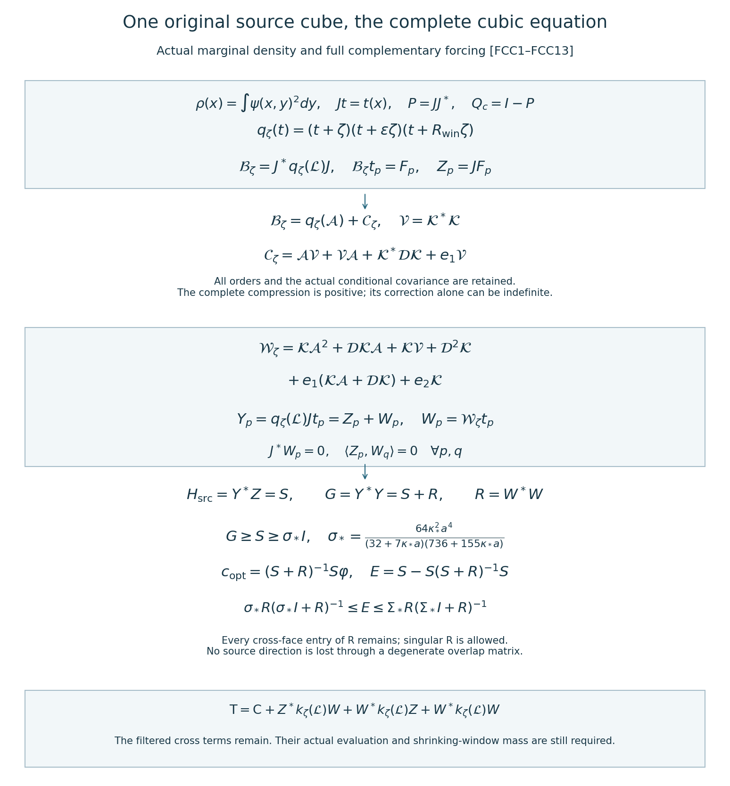

# Full cubic compression on the original source cube

Reviewed derivation, 15 October 2026. Complete FCC1–FCC13 proofs, 996 diagnostics and the figure checked. This continues the complete original source and polynomial covariance bounds [SMP1–SMP13](https://github.com/KokunoYumeto/yang-mills-interacting-workbench/blob/3fefc4ca4bd5d9baa51e47847217426a4ab41e1c/yang-mills/continuations/20261011-central-signs-shrinking-window/ACTUAL_SPATIAL_MOMENT_MATRICES.md) and the full common-equation residual [SCR1–SCR13](https://github.com/KokunoYumeto/yang-mills-interacting-workbench/blob/3fefc4ca4bd5d9baa51e47847217426a4ab41e1c/yang-mills/continuations/20261011-central-signs-shrinking-window/COMMON_CUBIC_SPATIAL_RESPONSE.md). The actual inside marginal and physical receiving map are [IM1–IM13](https://github.com/KokunoYumeto/yang-mills-interacting-workbench/blob/3fefc4ca4bd5d9baa51e47847217426a4ab41e1c/yang-mills/continuations/20261011-central-signs-shrinking-window/INSIDE_MARGINAL_ENERGY.md). These proof sections were read for the stated uses. Thirteen bounded disk-index hits are routing records, not new author-source reading. No novelty or no-gap conclusion is asserted.

## 1. Keep the original state and every inside, outside and crossing term

Use the original full radius-two SU(2) link product with probability Haar, orthonormal generators \(-i\sigma_\alpha/2\), every boundary vertex gauge action, and
\[
\begin{gathered}
a=(100j)^{-1},\quad L=j^4,\quad g^2=\kappa_*a/2,\quad
b=(\kappa_*a^2)^{-1},\quad s_j=\kappa_*/j,\\
N=3(2L)(2L+1)^2,\quad M=3(2L)^2(2L+1),\\
H=-\kappa_*\Delta+2bM-b\sum_pT_p,\quad
H\psi=E_0\psi,\quad\psi>0,\quad\int\psi^2dU=1,\\
d\mu=\psi^2dU,\quad w=\log\psi,\quad
\mathcal L=\psi^{-1}(H-E_0)\psi
=-\kappa_*[\Delta+2dw\cdot d].
\end{gathered}
\]
Let the original induced cube \(Q=v+\{0,\ldots,q\}^3\) contain every link of every source face. Its actual boundary data are
\[
\begin{gathered}
N_Q=3q(q+1)^2,\quad M_Q=3q^2(q+1),\\
C_Q=2q(q+1)\sum_{d=1}^3
[\mathbf1_{\{v_d>0\}}+\mathbf1_{\{v_d+q<2L\}}].
\end{gathered}
\]
Let x be its original inside links and y all outside links. Retain
\[
H=H_Q+H_{\rm out}+bW_\times,\qquad
H_Q=-\kappa_*\Delta_Q+b\sum_{p\subset Q}(2-T_p),
\]
where \(H_{\rm out}\) has all outside kinetic terms and outside faces, and \(W_\times\) has every crossing deficit. The scalar terms are \(2bM_Q\), \(2b(M-M_Q-C_Q)\), and \(2bC_Q\), whose sum is exactly \(2bM\).

Define the actual marginal and conditional factor
\[
\rho(x)=\int\psi(x,y)^2dy,\qquad
\alpha(x)=\sqrt{\rho(x)},\qquad
\chi(x,y)=\psi(x,y)/\alpha(x),\qquad \int\chi^2dy=1.
\]
They are smooth, positive and gauge equivariant in the precise sense proved by the outside Haar change of variables. In the notation of IM3–IM4, retain
\[
\begin{gathered}
T_Q(x)=\int|d_Q\chi|^2dy,\quad
R_Q(x)=\langle\chi,(H_{\rm out}-E_{\rm out}+bW_\times)\chi\rangle_y,\\
[-\kappa_*\Delta_Q+bW_Q+R_Q+\kappa_*T_Q]\alpha
=(E_0-E_{\rm out})\alpha.
\end{gathered}\tag{FCC1}
\]
This is the actual marginal equation, not an isolated-cube ground equation. Its outside ground energy, crossing cost and conditional kinetic term are retained.

On the full weighted spaces set
\[
\begin{gathered}
(Jt)(x,y)=t(x),\qquad
J^*f=\rho^{-1}\int\psi^2f\,dy,\qquad P=JJ^*,\quad Q_c=I-P,\\
\mathcal A=J^*\mathcal LJ
=-\kappa_*[\Delta_Q+2d\log\alpha\cdot d],\quad
\mathcal K=Q_c\mathcal LJ,\quad
\mathcal D=Q_c\mathcal LQ_c,\quad
\mathcal V=\mathcal K^*\mathcal K.
\end{gathered}\tag{FCC2}
\]
The complementary operator is the one associated to the inherited closed form. J is an isometry from \(L^2(\rho dx)\) to \(L^2(\mu)\), as follows by integrating y. Outside Haar integration preserves all Sobolev spaces, and multiplication by the positive smooth \(\psi^2,\rho^{-1}\) does so at fixed regulator. Thus P preserves the smooth and Sobolev domains used below. Original gauge changes preserve x and y separately; changing y variables proves that these maps commute with the gauge actions. Restricting them to invariant functions gives the original physical maps, without factoring the physical Hilbert space.

## 2. Actual conditional differential operators

Put \(r=d_Qw-d\log\alpha\), an original inside tangent vector at x, and
\(\Sigma(x)=\mathbb E_\mu[r\otimes r\mid x]\).
Differentiation of the full conditional integral gives \(\mathbb E_\mu[r\mid x]=0\), and direct subtraction of the two generators gives
\[
\begin{gathered}
\mathcal Kt=-2\kappa_*\langle r,dt\rangle,\qquad
\mathcal K^*h=2\kappa_*\rho^{-1}
\operatorname{div}_Q\{\rho\,\mathbb E_\mu[rh\mid x]\},\\
\mathcal Vt=-4\kappa_*^2\rho^{-1}
\operatorname{div}_Q(\rho\Sigma\,dt),\\
\langle t,\mathcal Vt\rangle_\rho
=4\kappa_*^2\int\rho\,\Sigma(d\overline t,dt)\,dx .
\end{gathered}\tag{FCC3}
\]
The adjoint formula follows by integration on the compact original inside product:
\(\langle\mathcal Kt,h\rangle=-2\kappa_*\int\rho\langle d\overline t,\mathbb E[rh\mid x]\rangle dx\).
Moving this derivative gives the displayed positive divergence sign. Inserting \(h=\mathcal Kt\) gives V and its positive form. All divergences and derivatives use the original product connection; no coordinate density factor or boundary condition has been suppressed. The actual \(\mathcal D\), hence every term \(\mathcal K^*\mathcal D\mathcal K\) below, retains all outside derivatives and the conditional projection.

## 3. Compress the complete cubic equation

Retain all three original positive shifts:
\[
\begin{gathered}
q_\zeta(t)=(t+\zeta)(t+\varepsilon\zeta)(t+R_{\rm win}\zeta)
=t^3+e_1t^2+e_2t+e_3,\\
e_1=\zeta(1+\varepsilon+R_{\rm win}),\quad
e_2=\zeta^2(\varepsilon+R_{\rm win}+\varepsilon R_{\rm win}),\quad
e_3=\varepsilon R_{\rm win}\zeta^3>0 ,
\end{gathered}
\]
where \(0<\varepsilon<1<R_{\rm win}\) and the actual target is
\(\zeta=\theta s_j\). Define the full compressed cubic by its closed form
\[
\mathfrak b_\zeta[v,t]
=\langle q_\zeta(\mathcal L)^{1/2}Jv,
q_\zeta(\mathcal L)^{1/2}Jt\rangle_\mu .
\tag{FCC4}
\]
For t in the associated operator domain, this form is exactly \(\langle v,\mathcal B_\zeta t\rangle_\rho\). Its form domain is the original inside \(H^3\) space, restricted to invariant functions when appropriate. Indeed the full elliptic generator has Sobolev graph norms, and the positive polynomial q has degree three and positive constant e3. Its square-root graph norm is equivalent to the full \(H^3\) norm. On J's range that norm is equivalent to the inside \(H^3\) norm; the positive smooth densities supply equivalent weighted norms. The inside form is consequently closed and bounded below by e3. It defines a self-adjoint operator with
\(\mathcal B_\zeta\ge e_3I\) and
\(\|\mathcal B_\zeta^{-1}\|\le e_3^{-1}\).

On smooth vectors the exact ordered block multiplication gives
\[
\begin{gathered}
\mathcal B_\zeta=q_\zeta(\mathcal A)+\mathcal C_\zeta,\\
\mathcal C_\zeta=
\mathcal A\mathcal V+\mathcal V\mathcal A+
\mathcal K^*\mathcal D\mathcal K+e_1\mathcal V,\\
\mathcal W_\zeta=Q_cq_\zeta(\mathcal L)J\\
=\mathcal K\mathcal A^2+\mathcal D\mathcal K\mathcal A+
\mathcal K\mathcal V+\mathcal D^2\mathcal K\\
\hspace{10mm}+e_1(\mathcal K\mathcal A+\mathcal D\mathcal K)+e_2\mathcal K .
\end{gathered}\tag{FCC5}
\]
For a direct verification, \(\mathcal LJt=J\mathcal At+\mathcal Kt\).
A second multiplication gives inside component
\((\mathcal A^2+\mathcal V)t\) and complementary component
\((\mathcal K\mathcal A+\mathcal D\mathcal K)t\).
A third gives inside component
\((\mathcal A^3+\mathcal A\mathcal V+\mathcal V\mathcal A+
\mathcal K^*\mathcal D\mathcal K)t\) and complementary component
\((\mathcal K\mathcal A^2+\mathcal D\mathcal K\mathcal A+
\mathcal K\mathcal V+\mathcal D^2\mathcal K)t\).
Adding all three polynomial coefficients proves FCC5. Nothing commutes K past A or D.

The operator \(\mathcal B_\zeta\) is a differential operator on the original compact inside link product with smooth actual coefficients. This also follows by applying \(\mathcal L^3\) to t(x) and integrating y: every y derivative acts on the smooth coefficients, not on t. Its principal symbol is \(\kappa_*^3|\xi|^6\), from \(\mathcal A^3\); V has order two and the extra terms in \(\mathcal C_\zeta\) have order at most four. Elliptic regularity therefore gives its operator domain \(H^6\) and sends smooth right sides through its inverse to smooth functions, by iteration through the Sobolev orders. Gauge equivariance and uniqueness preserve invariance. Thus all following products and full residual norms exist, including at the original shrinking shifts.

There is no positivity assertion for \(\mathcal C_\zeta\) alone. To check why it cannot be inferred from block positivity, retain the exact positive matrix
\[
L_0=\begin{pmatrix}1&0&1\\0&4&1\\1&1&2\end{pmatrix},
\quad A_0=\begin{pmatrix}1&0\\0&4\end{pmatrix},
\quad K_0=(1,1),\quad D_0=2 .
\]
Its leading principal minors are 1,4,3, hence it is positive definite. For every e1,
\(A_0V_0+V_0A_0+K_0^*D_0K_0+e_1V_0
=\left(\begin{smallmatrix}4+e_1&7+e_1\\7+e_1&10+e_1\end{smallmatrix}\right)\)
has determinant -9. This finite example is not a Yang–Mills state; it establishes that the proposed block-order inference is false. FCC4 supplies the actual positive operator without making that inference.

## 4. Match every original source column in one conditional space

Let \(\mathcal F\) be the original source faces in Q and keep
\(Z_p=a(\mu T_p-T_p)/2=JF_p\), with their actual means.
For each column define
\[
t_p=\mathcal B_\zeta^{-1}F_p,\quad u_p=Jt_p,\quad
W_p=\mathcal W_\zeta t_p,\quad Y_p=q_\zeta(\mathcal L)u_p .
\]
Here \(W_p\) denotes the complementary vector in this section, not a Wilson trace; the trace is always \(T_p\). FCC5 and the defining equation give
\[
Y_p=Z_p+W_p,\qquad J^*W_p=0,\qquad
Z_p-Y_p=-W_p .
\tag{FCC6}
\]
All source faces use the same conditional projection. Consequently
\(\langle Z_p,W_q\rangle_\mu=0\) for every p,q, not only p=q. This is a proved projection identity in the actual full state, not independence of different faces.

The vacuum is retained exactly. Since \(\mathcal L1=0\),
\(\mathcal B_\zeta1=e_3\), and
\(\langle1,F_p\rangle_\rho=0\), self-adjointness gives
\(\langle1,t_p\rangle_\rho=0\). Therefore u, Y, W and the original source are all vacuum orthogonal.

Let \(t_p^0=q_\zeta(\mathcal A)^{-1}F_p\) be the earlier marginal-cubic trial on this same cube. The entire correction and its map are
\[
\begin{gathered}
t_p-t_p^0=-\mathcal B_\zeta^{-1}\mathcal C_\zeta t_p^0,\\
W_p=\mathcal W_\zeta t_p^0
-\mathcal W_\zeta\mathcal B_\zeta^{-1}\mathcal C_\zeta t_p^0,\\
q_\zeta(\mathcal L)^{-1}Z_p-u_p
=-q_\zeta(\mathcal L)^{-1}W_p .
\end{gathered}\tag{FCC7}
\]
The first line follows by applying \(\mathcal B_\zeta\) to the difference; the second substitutes it into the full complementary operator. The last multiplies FCC6 by the entire inverse. All three original resolvent factors and the complete tail remain. No smallness of this correction is assumed.

## 5. Evaluate the full overlap matrix and its invertibility

Keep raw coefficients \(\varphi\), \(X=Z\varphi\), and the full matrices
\[
S=Z^*Z,\quad R=W^*W,\quad G=Y^*Y,\quad H_{\rm src}=Y^*Z .
\]
The orthogonality proved in FCC6 gives the exact evaluation
\[
H_{\rm src}=S,\qquad G=S+R,\qquad R\ge0 .
\tag{FCC8}
\]
Every cross-face entry \(\langle W_p,W_q\rangle\) remains in R. The earlier SMP11–SMP12 bounds apply without a change of source:
\[
\begin{gathered}
\sigma_*I\le S\le\Sigma_*I,\qquad
\sigma_*=\frac{64\kappa_*^2a^4}
{(32+7\kappa_*a)(736+155\kappa_*a)},\\
\Sigma_*=a^2\min\{|\mathcal F|,B_Q,U_{2,Q}/4\},\\
B_Q=\min\{4M_Q,\Lambda_Q\},\quad
U_{2,Q}=\min\{(4M_Q)^2,\Lambda_Q^2+16(g^2)^2\},\\
\Lambda_Q=\min\{2M_Q,6g^2\sqrt{N_QM_Q}\}+2C_Q .
\end{gathered}
\]
For a nonempty face list, \(G\ge S\ge\sigma_*I\), so
\(\|G^{-1}\|\le\sigma_*^{-1}\), at every positive shift. This bound has no additional inverse-shift factor. Both the source-overlap matrix and the full equation Gram matrix have full column rank; the trial functions themselves are linearly independent because \(q_\zeta(\mathcal L)\) is injective.

The optimal raw coefficients in this entire column space and their residual are
\[
\begin{gathered}
c_{\rm opt}=(S+R)^{-1}S\varphi,\qquad
E=S-S(S+R)^{-1}S,\\
\|X-Yc_{\rm opt}\|^2=\varphi^*E\varphi,\qquad
\|c_{\rm opt}\|_{\ell^2}\le
(\Sigma_*/\sigma_*)\|\varphi\|_{\ell^2}.
\end{gathered}\tag{FCC9}
\]
The normal equation \(Gc_{\rm opt}=H_{\rm src}\varphi\) follows by differentiating the full quadratic norm, or by expanding
\(\|X-Y(c_{\rm opt}+d)\|^2
=\|X-Yc_{\rm opt}\|^2+\|Yd\|^2\).
Thus this is the unique minimizing coefficient vector. The original source remains \(Z\varphi\).

## 6. Exact residual comparison without inverting a singular residual matrix

Write \(G=S+R\). Multiplying in the indicated order gives
\[
E=S-SG^{-1}S=SG^{-1}R=RG^{-1}S
=R-RG^{-1}R .
\]
The two middle products agree because each equals the self-adjoint first expression. No commutation of S and R has been assumed. Inverse order applied to
\(\sigma_*I+R\le S+R\le\Sigma_*I+R\), followed by the full R sandwich, proves
\[
\begin{gathered}
\sigma_*R(\sigma_*I+R)^{-1}
\le E\le\Sigma_*R(\Sigma_*I+R)^{-1},\\
0\le E\le S,\ R .
\end{gathered}
\tag{FCC10}
\]
Only R commutes with a scalar multiple of I and its own resolvent. Thus these formulas cover singular R. Its complete spectral decomposition shows that the lower function vanishes exactly on \(\ker R\); the upper bound by R supplies the converse, proving
\(\ker E=\ker R=\ker W\).
There are no missing source directions arising from \(\ker H_{\rm src}\), since \(H_{\rm src}=S>0\). A zero optimal residual is equivalent to the vanishing of the actual full complementary forcing for that source coefficient vector. Its vanishing has not been asserted.

## 7. The signed spectral response still keeps every filtered cross term

Retain
\[
\begin{gathered}
k_\zeta(\lambda)=\frac{\zeta\lambda}{(\lambda+\zeta)^2}
-c_-\frac{\varepsilon\zeta\lambda}{(\lambda+\varepsilon\zeta)^2}
-c_+\frac{R_{\rm win}\zeta\lambda}{(\lambda+R_{\rm win}\zeta)^2},
\\
c_-=\frac{4\varepsilon}{(1+\varepsilon)^2},\qquad
c_+=\frac{4R_{\rm win}}{(1+R_{\rm win})^2}.
\end{gathered}
\]
Let \(B=k_\zeta(\mathcal L)\), \(\mathsf C=Z^*BZ\), and
\(\mathsf T=Y^*BY\). The complete polynomial is
\[
\begin{aligned}
P_\zeta(\lambda)={}&(\lambda+\varepsilon\zeta)^2
(\lambda+R_{\rm win}\zeta)^2\\
&-c_-\varepsilon(\lambda+\zeta)^2(\lambda+R_{\rm win}\zeta)^2\\
&-c_+R_{\rm win}(\lambda+\zeta)^2(\lambda+\varepsilon\zeta)^2
=\sum_{k=0}^4p_k\lambda^k .
\end{aligned}
\]
Since \(k_\zeta=\zeta\lambda P_\zeta/q_\zeta^2\), the exact trial matrix and its full filtered correction are
\[
\begin{gathered}
\mathsf T_{pq}=\zeta\sum_{k=0}^4p_k
\langle\mathcal L^{(k+1)/2}u_p,\mathcal L^{(k+1)/2}u_q\rangle_\mu,\\
\mathsf T=\mathsf C+Z^*BW+W^*BZ+W^*BW .
\end{gathered}\tag{FCC11}
\]
In general B does not preserve the conditional subspace, so the two middle terms do not vanish. FCC8 eliminates the unfiltered cross terms only, by its exact projection proof.

For \(\varepsilon=1/4,R_{\rm win}=4\) the five original coefficients are
\[
(p_0,p_1,p_2,p_3,p_4)
=(-43\zeta^4/25,\ \zeta^3/2,\ 3801\zeta^2/400,\ \zeta/2,\ -43/25).
\]
Use the complete SCR2 constants
\(k_+=113/2500\),
\(k_-=-F(\beta)\),
\(F(y)=(-688y^2+200y+5177)/[25(y+2)(4y+17)^2]\),
where \(\beta\) is the unique root in (9,10) of
\(2752y^3-13296y^2-110508y-164041=0\).
Set \(\alpha_{\rm f}=(k_+-k_-)/2\), \(d_{\rm f}=(k_++k_-)/2\).
SCR2 proves \(\|B-\alpha_{\rm f}I\|\le d_{\rm f}\) with both negative tails retained.

Put \(s_\varphi=\varphi^*S\varphi\), \(r_0^2=\varphi^*R\varphi\), and
\(r_{\rm opt}^2=\varphi^*E\varphi\). Exact expansion and Cauchy–Schwarz give
\[
\begin{gathered}
|\mathcal C_X-\varphi^*\mathsf T\varphi+\alpha_{\rm f}r_0^2|
\le d_{\rm f}r_0\sqrt{4s_\varphi+r_0^2},\\
|\mathcal C_X-c_{\rm opt}^*\mathsf T c_{\rm opt}
-\alpha_{\rm f}r_{\rm opt}^2|
\le d_{\rm f}r_{\rm opt}\sqrt{4s_\varphi-3r_{\rm opt}^2}.
\end{gathered}\tag{FCC12}
\]
For the first line, \(Y\varphi=X+W\varphi\) and
\(\langle X,W\varphi\rangle=0\), so
\(\|X\|^2-\|Y\varphi\|^2=-r_0^2\) and
\(\|X+Y\varphi\|^2=4s_\varphi+r_0^2\).
Expand the difference of the two B-quadratic forms around
\(\alpha_{\rm f}I\); the mixed real parts cancel and the operator bound gives the result. For the second line the normal equation makes the optimal residual orthogonal to \(Yc_{\rm opt}\), yielding the two exact norms in SCR13. This proves the different signs and radicands rather than interchanging the two trials.

## 8. An exact nonzero filtered cross term

The positive matrix \(L_0\) from Section 3 gives a complete finite check of the distinction in FCC11. Set \(\zeta=1,\varepsilon=1/4,R_{\rm win}=4\), let J include the first two coordinate directions, let \(F=(1,0)^t\), and put \(Z=JF\). With the same original polynomial and filter formulas,
\[
\begin{gathered}
t=(J^*q_1(L_0)J)^{-1}F
=\frac1{31033}\begin{pmatrix}1482\\-98\end{pmatrix},\\
W=(I-JJ^*)q_1(L_0)Jt
=\frac1{62066}\begin{pmatrix}0\\0\\75837\end{pmatrix},\\
Z^*W=0,\qquad
Z^*k_1(L_0)W=
\frac{102961775980169187}{7214417235183322850}>0 .
\end{gathered}\tag{FCC13}
\]
These values follow by ordinary rational matrix multiplication of
\(q_1(L_0)=(L_0+I)(L_0+I/4)(L_0+4I)\) and the three displayed terms of \(k_1\). Thus even the exact matched-cubic construction has a nonzero filtered cross term in this positive-operator example. Adding a one-dimensional zero block and including it in J gives an explicit vacuum sector, with zero source component there and all displayed entries unchanged. This example tests the algebraic inference only; it is not assigned to the Yang–Mills ground or used as an estimate of its filtered correlation.

The construction solves the actual compressed cubic equation, evaluates \(H_{\rm src}=S\) and \(G=S+R\), and proves full raw coefficient invertibility using the actual polynomial covariance floor. The remaining matrix R is the full complementary forcing from FCC3–FCC7, including its cross-face entries. The full signed trial matrix also remains to be evaluated. Neither a small R nor survival of mass in the original shrinking annulus follows from the Gram invertibility. The next calculation is that complementary forcing and its filtered cross terms; the original continuum state, reconstruction, theory identification and smooth global no-gap target remain active.

FCC1–FCC7 preserve the actual inside marginal, every ordered cubic block and the full complementary forcing. All faces share one original conditional space, which proves the unfiltered orthogonality for every pair. FCC8–FCC10 transfer the actual polynomial source floor to the full equation Gram matrix, with the original raw coefficients and singular residual directions retained. FCC11–FCC13 keep the filtered cross terms and give an exact rational example where one is nonzero. The figure displays these proved maps, not a simulated vacuum or spectral density. Reproducible sources: [figure_cubic_compression.py](figure_cubic_compression.py) and [check_cubic_compression.py](check_cubic_compression.py). The 996 diagnostics use exact rational algebra and finite positive-operator fixtures, including vacuum and singular-residual cases; the preceding proof establishes the original-state claims.

## Original-field residual and exact inverse-trial bounds

[CDE1–CDE8](https://github.com/KokunoYumeto/yang-mills-interacting-workbench/blob/main/yang-mills/continuations/20261011-central-signs-shrinking-window/ORIGINAL_FRAME_CUBIC_RESIDUAL.md) retain every term of the original cubic residual, with explicit typed maps and the full outside-index contribution. [CIT1–CIT20](https://github.com/KokunoYumeto/yang-mills-interacting-workbench/blob/main/yang-mills/continuations/20261011-central-signs-shrinking-window/CUBIC_INVERSE_TRIAL_BOUNDS.md) derive weighted graph bounds for the matched inverse trial, retaining every derivative introduced by the exact marginal unitary. They give the complete original-state estimate and its raw matrix consequences:
\[
\begin{gathered}
\|\mathcal W_\zeta\mathcal B_\zeta^{-1}F\|_\mu
\le\mathfrak P_\zeta\|F\|_\rho,\\
R\le\mathfrak P_\zeta^2S,\qquad
E\le\frac{\mathfrak P_\zeta^2}{1+\mathfrak P_\zeta^2}S .
\end{gathered}
\]
The finite expression for the upper function is explicit. Its exact original-path growth is a positive constant times j to the sixtieth power, with every finite term retained. This improves the earlier exponential density comparison but remains insufficient to prove surviving spectral mass. It does not establish divergence of the actual residual. The signed response and actual shrinking-window behavior remain the next calculations toward the smooth global no-gap goal.

## Contracted cubic and actual marginal geometry

[CCJ1–CCJ20](https://github.com/KokunoYumeto/yang-mills-interacting-workbench/blob/main/yang-mills/continuations/20261011-central-signs-shrinking-window/CONTRACTED_CUBIC_BOUNDS.md) retain the original Hessian trace and every Laplacian contraction, derive all inverse-multiplier terms, and prove exact cancellation of the mapped fifth-order coefficient. The fourth-order terms are the actual marginal potential and conditional score covariance; the complete lower-order expression and all outside contributions remain. The resulting full residual and raw matrix bounds are
\[
\begin{gathered}
\|\mathcal W_\zeta\mathcal B_\zeta^{-1}F\|_\mu
\le\widehat{\mathfrak P}_\zeta\|F\|_\rho,\\
R\le\widehat{\mathfrak P}_\zeta^2S,\qquad
E\le\frac{\widehat{\mathfrak P}_\zeta^2}{1+\widehat{\mathfrak P}_\zeta^2}S .
\end{gathered}
\]
The complete finite upper function has exact original-path growth of degree45 with its positive leading coefficient proved, improving the preceding degree60 estimate. Its guaranteed captured fraction still tends to zero; neither divergence of the actual residual nor spectral survival follows. The entire signed response, both spectral tails and the smooth global no-gap goal remain.

## Nested inverse-energy defects and signed response

[NSE1–NSE13](https://github.com/KokunoYumeto/yang-mills-interacting-workbench/blob/main/yang-mills/continuations/20261011-central-signs-shrinking-window/NESTED_INVERSE_ENERGY_AND_SIGNED_RESPONSE.md) prove the exact cubic inverse-energy defect and its complete signed-source comparison. Typed inclusions between the original nested cubes give every inverse increment and the entire remaining defect, with the full complementary state retained:
\[
\begin{gathered}
C(F)\ge T_r(F)-\frac{86}{25}\zeta\sqrt{m_1(F)\delta_r(F)}
-\zeta^3\delta_r(F),\\
\delta_r(F)=\sum_{s=r}^{L-1}
\|\mathscr A_\zeta^{1/2}(u_{s+1}-u_s)\|_\mu^2 .
\end{gathered}
\]
The original source budgets give a selected actual source-to-annular coupling bound of order j^(-1/2), with its full finite formula and parameter-dependent constant, and a one-sided signed quadratic ceiling of order j^(-2). The selected increment is not the whole remaining tail. Both negative spectral tails, all filtered mixed terms, raw coefficient and family-size factors remain. A positive shrinking-window response and the smooth global no-gap result are not yet established.
