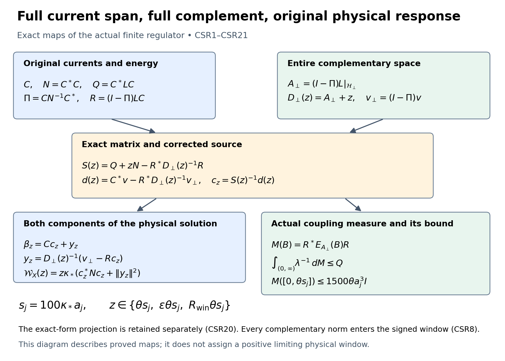
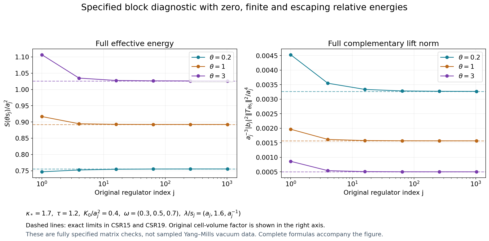

# Full current Schur response and the actual complementary energy measure

The current-span residual in KP13 defines an exact Schur complement on the full original one-form space. This calculation retains its source correction, inverse, norm, and every original spectral shift. The actual KP8 energy bound controls the entire inverse-energy coupling measure. A common subsequence then constructs its relative-energy limit, including mass at zero and infinity. This gives the effective energy and norm of the full complementary lift at the original shrinking scale. The physical source overlap and exact-form projection remain explicit.

Providers are [KP8–KP17](https://github.com/KokunoYumeto/yang-mills-interacting-workbench/blob/d0e2f70785f9b0eb075d6955fd263c0f59c2db4e/yang-mills/continuations/20261011-central-signs-shrinking-window/ACTUAL_KINETIC_PROFILE_AND_SHIFT_MOMENTS.md), [DF18–DF21](https://github.com/KokunoYumeto/yang-mills-interacting-workbench/blob/d0e2f70785f9b0eb075d6955fd263c0f59c2db4e/yang-mills/continuations/20261011-central-signs-shrinking-window/CURRENT_DENSITY_FLUX_AND_PROJECTED_RESIDUAL.md), [SG12–SG13](https://github.com/KokunoYumeto/yang-mills-interacting-workbench/blob/d0e2f70785f9b0eb075d6955fd263c0f59c2db4e/yang-mills/continuations/20261011-central-signs-shrinking-window/ACTUAL_GROUND_GRADIENT_TRIAL.md), and [PT12–PT16](https://github.com/KokunoYumeto/yang-mills-interacting-workbench/blob/d0e2f70785f9b0eb075d6955fd263c0f59c2db4e/yang-mills/continuations/20261011-central-signs-shrinking-window/POSITIVE_TIME_COVARIANCE.md).

Human provenance for the Schur method is Geneviève Dusson, Israel Michael Sigal and Benjamin Stamm, *The Feshbach–Schur map and perturbation theory*, [arXiv:2105.02058v1](https://arxiv.org/abs/2105.02058v1), original author TeX lines 398–490, labels Fesh, QP and Ulam-def. The source archive remains intact; its statement refers elsewhere for the general proof. The original-domain proof and every receiving calculation needed here are supplied below. No novelty claim is made.

## Original objects and the two projections

Retain the original open lattice, radius-two SU(2) edge metric, probability Haar measure and ground:
\[
\begin{gathered}
L_j=j^4,\quad a_j=(100j)^{-1},\quad
g_j^2=\kappa_*a_j/2,\quad
b_{{\rm pot},j}=(\kappa_*a_j^2)^{-1},\quad
s_j=100\kappa_*a_j,\\
U_p=U_d(z)U_k(z+e_d)U_d(z+e_k)^{-1}U_k(z)^{-1},\quad d<k,\\
D_p=2-\operatorname{Tr}U_p,\qquad
V_j=b_{{\rm pot},j}\sum_pD_p
=2b_{{\rm pot},j}|\mathcal P_j|-b_{{\rm pot},j}\sum_p\operatorname{Tr}U_p,\\
H_j=-\kappa_*\Delta+V_j,\quad H_j\psi_j=E_{0,j}\psi_j,\quad
\psi_j>0,\quad\|\psi_j\|=1,\quad d\mu_j=\psi_j^2dU,\quad w_j=\log\psi_j,\\
L=\mathscr L_{1,j}=\kappa_*(dd_\mu^*+d_\mu^*d),\qquad
\mathscr L_{0,j}=\kappa_*d_\mu^*d .
\end{gathered}
\]
Suppress \(j\) only in finite identities. The Hilbert space \(\mathscr H_j\) is the full weighted \(L^2\) space of one-forms on the compact configuration manifold, with the original product metric. Inner products are conjugate-linear in the first argument. The closed operator \(L\) is the nonnegative self-adjoint weighted Hodge operator constructed in PT; its smooth current columns are in its domain.

For a continuous compactly supported real or complex test triple \(\mathbf f\), retain the original centers and observable
\[
\begin{gathered}
x_p=o+a_j(z-L_j\mathbf1+(e_d+e_k)/2),\qquad
x_e=o+a_j(z-L_j\mathbf1+e_d/2),\\
C_{\mathbf f}=a_j\sum_p f_{\sigma(p)}(x_p)D_p,\qquad
X=C_{\mathbf f}-\mu_j C_{\mathbf f},\qquad v=dX,\\
t_1=f_{12}+f_{13},\quad t_2=f_{12}+f_{23},\quad t_3=f_{13}+f_{23}.
\end{gathered}
\]
Continuity is in physical space; at each finite regulator the observable is a finite smooth function of configuration. The inverse test map is
\(2f_{12}=t_1+t_2-t_3\), \(2f_{13}=t_1+t_3-t_2\), \(2f_{23}=t_2+t_3-t_1\).

Use the same strict fitting edge set \(I_j\): for the physical cube
\(\mathcal Q=\prod_d(c_d,c_d+R)\), take
\(q_j=\lceil R/a_j\rceil+3\) and
\((v_Q)_d=L_j+\lfloor(c_d-o_d)/a_j\rfloor-1\).
No outside edge or boundary coupling is removed from \(L\).
The original current columns and raw matrices are
\[
\begin{gathered}
\mathsf Cc=\sum_{e\in I_j}c_ea_j^2\Pi_edw_j,\qquad
T_e=\mu_j|d_ew_j|^2,\qquad
\mathsf N=\mathsf C^*\mathsf C=a_j^4\operatorname{diag}(T_e)>0,\\
\mathsf Q=\mathsf C^*L\mathsf C,\qquad
\mathsf Z^{(0)}=(L\mathsf C)^*L\mathsf C,\qquad
\mathsf b=\mathsf C^*v,\qquad k(z)=((L+z)\mathsf C)^*v .
\end{gathered}
\]
Keep the distinction between \(\mathsf b\) and \(k(z)\). KP8 proves
\(0\le\mathsf Q\le15a_j^2/\kappa_*\,I\).
The current-span projection and its complete residual are
\[
\Pi=\mathsf C\mathsf N^{-1}\mathsf C^*,\qquad
\mathsf R=(I-\Pi)L\mathsf C,\qquad v_\perp=(I-\Pi)v .
\]
The exact-form projection \(P_{\rm ex}\) from PT14 is different: it reduces \(L\) and contains \(v\). All formulas below use both with their specified meanings.

## Complementary domain, source and inverse

To prove that the compression has its claimed domain, use the auxiliary isometry
\(U=\mathsf C\mathsf N^{-1/2}\), retaining all raw factors.
Its range is \(\Pi\mathscr H_j\), and \(U^*U=I\).
The finite-column map
\(B=(I-\Pi)LU=\mathsf R\mathsf N^{-1/2}\)
is bounded. On \(\operatorname{Dom}L\), the adjoint off-diagonal map is \(B^*\): this follows by pairing against each smooth column and using self-adjointness of \(L\).
Both \(\Pi\) and \(I-\Pi\) preserve this domain, since \(\Pi\) has a finite smooth range.

The bounded self-adjoint off-diagonal operator is \(BU^*+UB^*\), with \(B\) viewed as a map into the complement. Subtracting it from \(L\) gives a self-adjoint operator on \(\operatorname{Dom}L\). One direct justification of this bounded-perturbation step is that, for imaginary parameter of modulus greater than the perturbation norm, the resolvent equation is invertible by its norm-convergent geometric series; symmetry and surjectivity at both imaginary signs prove self-adjointness. The resulting operator is block diagonal. Each orthogonal block is therefore self-adjoint on its intersection with the domain. In particular
\[
\begin{gathered}
A_\perp=(I-\Pi)L\big|_{\mathscr H_\perp},\qquad
\mathscr H_\perp=(I-\Pi)\mathscr H_j,\qquad
\operatorname{Dom}A_\perp=\operatorname{Dom}L\cap\mathscr H_\perp,\\
A_\perp\ge0,\qquad D_\perp(z)=A_\perp+zI,\qquad
\|D_\perp(z)^{-1}\|\le z^{-1},\quad z>0 .
\end{gathered}\tag{CSR1}
\]
Nonnegativity follows by testing on the same domain and using \(L\ge0\), followed by closure. No uniform gap for this complement is assumed.

Define finite raw matrices and a corrected source:
\[
\begin{gathered}
\boldsymbol{\Sigma}(z)=\mathsf R^*D_\perp(z)^{-1}\mathsf R,\qquad
\mathsf S(z)=\mathsf Q+z\mathsf N-\boldsymbol{\Sigma}(z),\\
d(z)=\mathsf b-\mathsf R^*D_\perp(z)^{-1}v_\perp,\qquad
e(z)=\langle v_\perp,D_\perp(z)^{-1}v_\perp\rangle .
\end{gathered}\tag{CSR2}
\]
For \(c\in\mathbb C^{|I_j|}\) and \(y\in\operatorname{Dom}A_\perp\), expand the full quadratic form:
\[
\begin{aligned}
\langle \mathsf Cc+y,(L+z)(\mathsf Cc+y)\rangle
={}&c^*(\mathsf Q+z\mathsf N)c
+2\operatorname{Re}\langle y,\mathsf Rc\rangle
+\langle y,D_\perp(z)y\rangle\\
={}&c^*\mathsf S(z)c+
\|D_\perp(z)^{1/2}
(y+D_\perp(z)^{-1}\mathsf Rc)\|^2 .
\end{aligned}
\]
The equality extends to the form domain by closure. Its minimum is attained at
\(y=-D_\perp(z)^{-1}\mathsf Rc\), an element of the operator domain.
Since the original quadratic form is at least
\(z(\|\mathsf Cc\|^2+\|y\|^2)\), this proves
\[
\mathsf S(z)\ge z\mathsf N>0,\qquad
0\le\boldsymbol{\Sigma}(z)\le\mathsf Q\le\frac{15a_j^2}{\kappa_*}I .
\tag{CSR3}
\]
This controls the inverse-weighted full residual, even though its unweighted total \(\mathsf R^*\mathsf R\) may be large.

Decompose \(\beta_z=(L+z)^{-1}v=\mathsf Cc_z+y_z\).
Pair its equation with the current columns and project onto the complement. The two original equations are
\[
(\mathsf Q+z\mathsf N)c_z+\mathsf R^*y_z=\mathsf b,\qquad
\mathsf Rc_z+D_\perp(z)y_z=v_\perp .
\]
Hence the exact solution is
\[
c_z=\mathsf S(z)^{-1}d(z),\qquad
y_z=D_\perp(z)^{-1}(v_\perp-\mathsf Rc_z),\qquad
\beta_z=\mathsf Cc_z+y_z .
\tag{CSR4}
\]
All terms are in their asserted domains. Conversely these expressions solve both blocks, and uniqueness follows from \(L+z>0\).

## Full physical response, derivative and three shifts

The original-Hamiltonian response in SG12 and DF18 is therefore
\[
\begin{gathered}
\mathcal R_X(z)
=\kappa_*\langle v,(L+z)^{-1}v\rangle
=\kappa_*\{d(z)^*\mathsf S(z)^{-1}d(z)+e(z)\},\\
\mathcal W_X(z)
=z\kappa_*\{\,
c_z^*\mathsf Nc_z+
\|D_\perp(z)^{-1}(v_\perp-\mathsf Rc_z)\|^2\,\}.
\end{gathered}\tag{CSR5}
\]
For the first equality substitute CSR4 in
\(\langle v,\beta_z\rangle=\mathsf b^*c_z+\langle v_\perp,y_z\rangle\);
the cross term changes \(\mathsf b^*\) into \(d(z)^*\).
For the second equality use the orthogonality of the two components.
The complete \(\beta_z\) is exact because \(P_{\rm ex}\) commutes with \(L\) and fixes \(v\). Its two current-span components need not be exact separately.

Resolvent differentiation in operator norm for \(z>0\) gives
\[
\begin{gathered}
\mathsf S'(z)=\mathsf N+\mathsf R^*D_\perp(z)^{-2}\mathsf R,\qquad
d'(z)=\mathsf R^*D_\perp(z)^{-2}v_\perp,\\
e'(z)=-\|D_\perp(z)^{-1}v_\perp\|^2,\qquad
-\mathcal R_X'(z)=\kappa_*(c_z^*\mathsf Nc_z+\|y_z\|^2),\\
\mathcal W_X(z)=-z\mathcal R_X'(z).
\end{gathered}\tag{CSR6}
\]
To verify the middle identity directly, differentiate \(d^*\mathsf S^{-1}d\).
The derivative is
\(2\operatorname{Re}(d'^*c_z)-c_z^*\mathsf S'c_z\).
Adding \(e'\) completes the square
\(-\|D_\perp^{-1}(v_\perp-\mathsf Rc_z)\|^2\), with
\(-c_z^*\mathsf Nc_z\) left over. Every source derivative is necessary for this identity.

For any two positive shifts, put \(D_r=D_\perp(z_r)\).
The scalar spectral identity for \(A_\perp\) proves
\(D_2^{-1}-D_1^{-1}=-(z_2-z_1)D_2^{-1}D_1^{-1}\).
Thus, on the same original trial set and full complement,
\[
\begin{aligned}
\mathsf S(z_2)-\mathsf S(z_1)
&=(z_2-z_1)(\mathsf N+\mathsf R^*D_2^{-1}D_1^{-1}\mathsf R),\\
d(z_2)-d(z_1)
&=(z_2-z_1)\mathsf R^*D_2^{-1}D_1^{-1}v_\perp .
\end{aligned}\tag{CSR7}
\]
These identities require no commutation of raw coefficient matrices.

For the three original shifts \(z,\varepsilon z,R_{\rm win}z\), with
\(z=\theta s_j\), \(0<\varepsilon<1<R_{\rm win}\), define
\(F(r)=c_r^*\mathsf Nc_r+\|y_r\|^2\).
Then the exact signed window expression is
\[
\begin{aligned}
\mathcal C_X(z)=\kappa_*\bigg\{&
zF(z)
-\frac{4\varepsilon}{(1+\varepsilon)^2}\,\varepsilon zF(\varepsilon z)\\
&-\frac{4R_{\rm win}}{(1+R_{\rm win})^2}\,
R_{\rm win}zF(R_{\rm win}z)\bigg\},\\
\nu_{X,j}([\varepsilon z,R_{\rm win}z])&\ge4[\mathcal C_X(z)]_+ .
\end{aligned}\tag{CSR8}
\]
Here \(\nu_{X,j}\) is the original spectral measure of \(X\psi_j\) for
\(H_j-E_{0,j}I\). To recall the bound directly, its response kernel is
\(h_z(\lambda)=z\lambda/(\lambda+z)^2\le1/4\).
For \(0\le\lambda\le\varepsilon z\),
\(h_z/h_{\varepsilon z}
=\varepsilon^{-1}(\lambda+\varepsilon z)^2/(\lambda+z)^2
\le4\varepsilon/(1+\varepsilon)^2\).
For \(\lambda\ge R_{\rm win}z\), the corresponding ratio with
\(h_{R_{\rm win}z}\) is at most
\(4R_{\rm win}/(1+R_{\rm win})^2\).
At \(\lambda=0\) all kernels vanish. The signed kernel is nonpositive outside the interval and at most \(1/4\) inside. Integration proves the last line. CSR8 retains all three signs and full complementary norms; no sign of \(\mathcal C_X\) is assigned.

## Actual complementary spectral measure and its original-path bound

Let \(E_\perp\) be the spectral resolution of the self-adjoint operator in CSR1. Define the positive matrix measure and its source cross measure
\[
\begin{gathered}
\mathsf M(B)=\mathsf R^*E_\perp(B)\mathsf R,\qquad
J(B)=\mathsf R^*E_\perp(B)v_\perp,\qquad
n(B)=\|E_\perp(B)v_\perp\|^2,\\
\mathsf M([0,\infty))=\mathsf R^*\mathsf R
=\mathsf Z^{(0)}-\mathsf Q\mathsf N^{-1}\mathsf Q,\\
\boldsymbol{\Sigma}(z)=\int_{[0,\infty)}\frac{d\mathsf M(\lambda)}{\lambda+z},
\qquad
d(z)=\mathsf b-\int_{[0,\infty)}\frac{dJ(\lambda)}{\lambda+z}.
\end{gathered}\tag{CSR9}
\]
The total-mass equality is KP13. For every Borel set \(B\) and raw \(c\),
\[
|c^*J(B)|^2\le(c^*\mathsf M(B)c)n(B).
\]
Indeed both sides are the ordinary Cauchy–Schwarz inequality for
\(E_\perp(B)\mathsf Rc\) and \(E_\perp(B)v_\perp\).
The full block measure with entries \(\mathsf M,J,J^*,n\) is positive by the same Gram construction.

For \(0\le\lambda\le\Lambda\), one has
\(1\le(\Lambda+z)/(\lambda+z)\).
Integrate this inequality against each scalar \(c^*\mathsf M c\) and use CSR3. Letting \(z\downarrow0\) gives
\[
\begin{gathered}
\mathsf M([0,\Lambda])\le\Lambda\mathsf Q,\qquad
\mathsf M(\{0\})=0,\\
\mathsf M([0,\theta s_j])
\le1500\theta a_j^3 I,\\
\limsup_j a_j^{-6}\,
\mathsf b_j^*\mathsf M_j([0,\theta s_j])\mathsf b_j
\le225\kappa_*\theta\,\langle t,\mathcal Qt\rangle_{\mathcal H}
\quad\hbox{along the KP subsequence}.
\end{gathered}\tag{CSR10}
\]
The last line uses the actual KP16 limit
\(a_j^{-5}\mathsf b_j^*\mathsf Q_j\mathsf b_j
\to(9/4)\langle t,\mathcal Qt\rangle\) and the unchanged
\(s_j=100\kappa_*a_j\). This is a bound on actual complementary coupling mass, not on the original observable's spectral mass.

Monotone convergence and CSR3 prove the finite inverse-energy moment:
\[
\begin{gathered}
\boldsymbol{\Sigma}_0=\int_{(0,\infty)}\lambda^{-1}d\mathsf M(\lambda)
=\lim_{z\downarrow0}\boldsymbol{\Sigma}(z)\le\mathsf Q,\qquad
\mathsf K_0=\mathsf Q-\boldsymbol{\Sigma}_0\ge0,\\
\mathsf S(z)=\mathsf K_0+z\mathsf N+
\int_{(0,\infty)}\frac{z}{\lambda+z}\,
\frac{d\mathsf M(\lambda)}{\lambda}.
\end{gathered}\tag{CSR11}
\]
In finite coefficient dimension the monotone limit is a finite matrix; all cross entries follow by polarization. No inverse \(A_\perp^{-1}\) on an arbitrary vector has been assumed.

The defect has the exact variational meaning
\[
c^*\mathsf K_0c=
\inf_{y\in\operatorname{Dom}A_\perp}
\langle\mathsf Cc+y,L(\mathsf Cc+y)\rangle .
\tag{CSR12}
\]
For the lower bound, CSR3's completed square at parameter \(z>0\) gives the form at \(z=0\) at least
\(c^*\mathsf S(z)c-z(\|\mathsf Cc\|^2+\|y\|^2)\);
send \(z\downarrow0\).
For the upper bound insert \(y_z=-D_\perp(z)^{-1}\mathsf Rc\).
The resulting energy is
\(c^*\mathsf Qc-2c^*\boldsymbol{\Sigma}(z)c+
\int\lambda(\lambda+z)^{-2}d(c^*\mathsf Mc)\).
Each integral tends to its inverse-energy moment by dominated convergence, bounded by \(\lambda^{-1}\).
This proves the infimum identity without asserting it is attained at \(z=0\).
It supplies the exact connection between the unreduced current energy and its full complementary relaxation.

## Constructed common relative-energy measure, including both endpoints

Retain the physical cell space \(\mathcal H=L^2(\mathcal U;\mathbb C^3)\), where \(\mathcal U\) is the same fixed larger cube used in KP9,
and the original KP9 maps: \(\mathcal J_jc\) is the value \(c_e\) on the direction-\(d\) half-open cell centered at \(x_e\), of volume \(a_j^3\), and zero outside the corresponding strict edge cells.
The averaging map is
\((\mathcal A_jh)_e=a_j^{-3}\int_{\text{cell }e}h_d\).
Thus \(\mathcal A_j\mathcal J_j=I\),
\(\mathcal A_j=a_j^{-3}\mathcal J_j^*\),
\(\|\mathcal J_jc\|^2=a_j^3\|c\|^2\), and
\(\mathcal P_j=\mathcal J_j\mathcal A_j\to\mathbf1_{\mathcal Q}\) strongly.
Keep \(\tau_{j,d}=a_jT_e\) on these cells and zero elsewhere.

Use the compact space \([0,\infty]\), with coordinate \(r/(1+r)\).
For Borel \(B\) in that space define
\[
\begin{gathered}
\mathcal V_j(B)=a_j^{-2}\mathcal J_j
\left(\int_{\{\lambda>0:\lambda/s_j\in B\}}
\lambda^{-1}d\mathsf M_j(\lambda)\right)\mathcal A_j,\qquad
\mathcal K_j=a_j^{-2}\mathcal J_j\mathsf K_{0,j}\mathcal A_j,\\
\mathcal Q_j=a_j^{-2}\mathcal J_j\mathsf Q_j\mathcal A_j,\qquad
0\le\mathcal V_j([0,\infty])\le\mathcal Q_j\le15/\kappa_*\,I,\\
\mathcal K_j+\mathcal V_j([0,\infty])=\mathcal Q_j .
\end{gathered}\tag{CSR13}
\]
These are actual ground-state quantities. The two endpoints carry zero measure at finite \(j\), but need not have zero limiting measure.

Here is a construction of a common limit, preserving the KP subsequence.
Choose countable dense linear sets of cell-space test vectors and continuous functions on the compact interval, including the constant function. All integrals of their matrix elements are bounded, because the positive total measure is at most \(15/\kappa_*\). Successive subsequences and a diagonal choice make this countable family converge, simultaneously with the bounded matrix elements of \(\mathcal K_j\).
Density and the uniform bound extend each limiting functional to all continuous functions and all vector pairs. For a diagonal vector pair it is positive, so the representation theorem for positive functionals on a compact interval gives a finite positive scalar Borel measure.
Polarization gives the cross measures and their sesquilinearity.
For each Borel \(B\), positivity and Cauchy–Schwarz for these scalar measures imply
\(|\mathcal V_{u,v}(B)|\le(15/\kappa_*)\|u\|\|v\|\).
They therefore define a bounded positive operator \(\mathcal V(B)\).
Scalar countable additivity for all vector pairs proves weak countable additivity of this operator measure. Its positive total remains bounded; this also ensures strong convergence of increasing partial sums by the positive-operator Cauchy estimate.
The same bounded-form construction defines \(\mathcal K\ge0\).
Using the constant function in CSR13 proves
\[
\mathcal K+\mathcal V([0,\infty])=\mathcal Q,\qquad
0\le\mathcal K,\mathcal V([0,\infty])\le\mathcal Q .
\tag{CSR14}
\]
Each is supported on the original physical cube:
\(\mathcal V(B)=\mathbf1_{\mathcal Q}\mathcal V(B)\mathbf1_{\mathcal Q}\)
and similarly for \(\mathcal K\).
For example the diagonal measure of a vector supported outside the cube is zero: the corresponding prelimit total is bounded by
\((15/\kappa_*)\|\mathcal P_jh\|^2\to0\);
polarization then proves both support identities.
No full-sequence uniqueness or convergence of Borel masses at atoms is claimed.

For \(\theta>0\), the functions
\(r/(r+\theta)\) and \(\theta/(r+\theta)\) extend continuously to this compact interval, with respective endpoint values \((0,1)\) and \((1,0)\).
Applying CSR11–CSR14 gives the exact finite identities and their weak operator limits:
\[
\begin{gathered}
a_j^{-2}\mathcal J_j\boldsymbol{\Sigma}_j(\theta s_j)\mathcal A_j
=\int\frac{r}{r+\theta}\,d\mathcal V_j(r)
\ \rightharpoonup\ \int\frac{r}{r+\theta}\,d\mathcal V(r),\\
a_j^{-2}\mathcal J_j\mathsf S_j(\theta s_j)\mathcal A_j
=\mathcal K_j+\int\frac{\theta}{r+\theta}\,d\mathcal V_j(r)
+100\kappa_*\theta a_j^2M_{\tau_j}\mathcal P_j
\ \rightharpoonup\ \mathcal S(\theta),\\
\mathcal S(\theta)=\mathcal K+\mathcal V(\{0\})
+\int_{(0,\infty)}\frac{\theta}{r+\theta}\,d\mathcal V(r),\qquad
0\le\mathcal S(\theta)\le\mathcal Q .
\end{gathered}\tag{CSR15}
\]
The original norm term has been retained explicitly; its norm is at most
\(300\theta a_j^2\), since \(\tau_j\le3/\kappa_*\).
This proves its limit rather than deleting it from the finite formula.
The first limit includes the full \(\mathcal V(\{\infty\})\) term.

For each integer \(m\ge1\), differentiation of the continuous kernels, with a uniform bound on compact \(\theta\)-intervals, gives
\[
\begin{gathered}
\mathcal S'(\theta)=
\int_{(0,\infty)}\frac{r}{(r+\theta)^2}\,d\mathcal V(r)\ge0,\\
(-1)^{m-1}\mathcal S^{(m)}(\theta)
=m!\int_{(0,\infty)}\frac{r}{(r+\theta)^{m+1}}\,d\mathcal V(r)\ge0,\qquad
\|\mathcal S^{(m)}(\theta)\|\le\frac{15m!}{\kappa_*\theta^m},\\
\lim_{\theta\downarrow0}\mathcal S(\theta)=\mathcal K+\mathcal V(\{0\}),\qquad
\lim_{\theta\uparrow\infty}\mathcal S(\theta)
=\mathcal Q-\mathcal V(\{\infty\}).
\end{gathered}\tag{CSR16}
\]
The derivatives are in operator norm: the scalar Taylor remainder is uniformly bounded on the compact spectral interval for \(\theta\) bounded away from zero. The endpoint limits are strong.
Indeed scalar dominated convergence first gives weak convergence, while monotonicity and the uniform bound give
\(\|Bh\|^2\le\|B\|\langle h,Bh\rangle\) for each positive difference \(B\), proving strong convergence.

The exact leading effective kernel is independent of positive \(\theta\):
\[
\ker\mathcal S(\theta)
=\ker\mathcal K\cap\ker\mathcal V([0,\infty)),
\qquad
\ker\mathcal Q\subseteq\ker\mathcal S(\theta).
\tag{CSR17}
\]
The set \([0,\infty)\) excludes the compactification point.
To prove the first equality, a zero quadratic form of \(\mathcal S(\theta)\)
forces its positive \(\mathcal K\) term to vanish and forces
\(\int\theta/(r+\theta)\,d\mathcal V_{h,h}(r)=0\).
The kernel is strictly positive at every finite \(r\); its level sets
where it is at least \(1/n\) cover that interval, so the measure there is zero.
Positive-form Cauchy–Schwarz upgrades zero quadratic forms to zero operator images. The converse follows by substitution. CSR14 proves the inclusion.
This is the precise refinement of KP17: leading effective cancellation can involve complementary energy at arbitrarily high relative frequencies. No equality of the two kernels is asserted.

## Joint source matrices and the full complementary lift

Define the lift and its complete Gram metric by
\[
\begin{gathered}
\mathsf T_zc=\mathsf Cc-D_\perp(z)^{-1}\mathsf Rc,\qquad
\mathsf T_z^*\mathsf T_z
=\mathsf N+\mathsf R^*D_\perp(z)^{-2}\mathsf R=\mathsf S'(z),\\
\mathsf T_z^*(L+z)\mathsf T_z=\mathsf S(z),\qquad
\mathsf T_z^*L\mathsf T_z=\mathsf S(z)-z\mathsf S'(z),\qquad
\mathsf T_z^*v=d(z).
\end{gathered}\tag{CSR18}
\]
Orthogonality proves the first line; the minimizing completed square proves the second line's first identity; subtracting the full \(z\)-weighted norm gives the next, and direct pairing gives the source. Thus every map has its original norm, energy and observable receiver.

The comparison with the cited author's formulas is exact. Take their \(H=L\), \(P=\Pi\) and spectral parameter \(\lambda=-z\). On the current range their Feshbach map and reconstruction satisfy
\[
\begin{gathered}
U^*F_\Pi(L+z)U=\mathsf N^{-1/2}\mathsf S(z)\mathsf N^{-1/2},\\
Q_\Pi(-z)U=\mathsf T_z\mathsf N^{-1/2}.
\end{gathered}
\]
Indeed \(U^*(L+z)U=\mathsf N^{-1/2}(\mathsf Q+z\mathsf N)\mathsf N^{-1/2}\) and \((I-\Pi)LU=\mathsf R\mathsf N^{-1/2}\); insertion in the source's two formulas proves both identities. The raw current matrices and all factors of \(\mathsf N\) remain the working quantities here.

For a finite family of original tests, KP16 and the strong source comparison give, on the same constructed subsequence,
\[
\begin{aligned}
a_j^{-5}(\mathsf b_j^{(\ell)})^*\mathsf S_j(\theta s_j)\mathsf b_j^{(m)}
&\longrightarrow\tfrac94\langle t^{(\ell)},\mathcal S(\theta)t^{(m)}\rangle,\\
a_j^{-4}\langle
\mathsf T_{\theta s_j}\mathsf b_j^{(\ell)},
\mathsf T_{\theta s_j}\mathsf b_j^{(m)}\rangle
&\longrightarrow
\frac9{400\kappa_*}\langle t^{(\ell)},\mathcal S'(\theta)t^{(m)}\rangle,\\
a_j^{-5}\langle
\mathsf T_{\theta s_j}\mathsf b_j^{(\ell)},
L_j^{(1)}\mathsf T_{\theta s_j}\mathsf b_j^{(m)}\rangle
&\longrightarrow
\tfrac94\langle t^{(\ell)},
[\mathcal S(\theta)-\theta\mathcal S'(\theta)]t^{(m)}\rangle .
\end{aligned}\tag{CSR19}
\]
Here \(L_j^{(1)}=\mathscr L_{1,j}\); it is not the lattice-size integer \(L_j=j^4\).
For the first line, use
\(\mathcal J_j(a_j^{-3}\mathsf b_j)\to-3t/2\) strongly
and CSR15's uniformly bounded operators.
For the second, the exact finite identity is
\[
s_ja_j^{-2}\mathcal J_j\mathsf S_j'(\theta s_j)\mathcal A_j
=100\kappa_*a_j^2M_{\tau_j}\mathcal P_j
+\int\frac{r}{(r+\theta)^2}\,d\mathcal V_j(r).
\]
The continuous integral kernel has value zero at both endpoints. Combine its limit with
\(s_j=100\kappa_*a_j\), the original cell volume \(a_j^3\), and CSR18 to obtain the coefficient \(9/(400\kappa_*)\). Subtract the full \(z\)-weighted norm to prove the last line.
Its limiting positive operator is explicitly
\[
\mathcal S(\theta)-\theta\mathcal S'(\theta)
=\mathcal K+\mathcal V(\{0\})
+\int_{(0,\infty)}\frac{\theta^2}{(r+\theta)^2}\,d\mathcal V(r)\ge0 .
\]
No ratio divides by a limiting norm that might vanish.
Each finite-family matrix converges in norm; for raw lists
\(\gamma_j,\eta_j\), its error is bounded by
\(a_j^5\epsilon_j\|\gamma_j\|\|\eta_j\|\) for the energy matrices and
\(a_j^4\epsilon_j\|\gamma_j\|\|\eta_j\|\) for the lifted norm, with the relevant \(\epsilon_j\to0\).
All mixed entries and original coefficients remain.

The actual physical projection of the lift is
\(\widehat{\mathsf T}_z=P_{\rm ex}\mathsf T_z\).
Because \(P_{\rm ex}\) reduces \(L\), its exact comparison is
\[
\begin{gathered}
\mathsf S'(z)=\widehat{\mathsf T}_z^*\widehat{\mathsf T}_z
+[(I-P_{\rm ex})\mathsf T_z]^*[(I-P_{\rm ex})\mathsf T_z],\\
\mathsf S(z)=\widehat{\mathsf T}_z^*(L+z)\widehat{\mathsf T}_z
+[(I-P_{\rm ex})\mathsf T_z]^*(L+z)[(I-P_{\rm ex})\mathsf T_z],\\
\widehat{\mathsf T}_z^*v=d(z),\qquad
\mathcal R_X(z)\ge
\frac{\kappa_*|c^*d(z)|^2}{c^*\mathsf S(z)c}
\quad(c\ne0).
\end{gathered}\tag{CSR20}
\]
The cross terms vanish by reduction; pairing with the exact source proves the third identity. For the inequality apply Cauchy–Schwarz to
\((L+z)^{-1/2}v\) and \((L+z)^{1/2}\mathsf T_zc\).
CSR3 makes the displayed denominator positive. The two retained complementary physical terms quantify exactly what is still needed to turn CSR19's full one-form limits into limits of physical exact trials.

There is also a finite bound on the source correction, with every scale present:
\[
\begin{gathered}
|c^*(\mathsf b-d(z))|^2
\le(c^*\boldsymbol{\Sigma}(z)c)e(z)
\le(c^*\mathsf Qc)\frac{E_X}{\kappa_*z},\\
E_X=\kappa_*\|v\|^2
\le16\kappa_*a_j^2M_f^2d_Q,\qquad
M_f=\max_\sigma\|f_\sigma\|_\infty,\\
\mathsf b^*\mathsf b/a_j^3\longrightarrow
\tfrac94\|t\|_{\mathcal H}^2 .
\end{gathered}\tag{CSR21}
\]
The first inequality is Cauchy–Schwarz after applying \(D_\perp(z)^{-1/2}\) to both vectors. The second uses CSR3 and
\(e(z)\le\|v_\perp\|^2/z\). The original energy estimate is TCR8; the final limit is the strong raw-source comparison.
For \(c=\mathsf b\), \(z=\theta s_j\), the first bound is \(O(a_j^4)\) for the squared correction, whereas \(\mathsf b^*\mathsf b=O(a_j^3)\).
Consequently this bound alone does not show that the correction is smaller than the raw overlap. The full cross measure \(J\) in CSR9 supplies its exact next calculation.

The current derivation has constructed the actual limiting complementary measure and evaluated its complete effective energy and norm maps. It has not assumed a nonzero finite-frequency component, a nonvanishing corrected physical overlap, or convergence of the full interacting vacuum. The next calculation is to evaluate the cross measure \(J\) and the exact-form portion in CSR20 on the same original sequence, insert them into CSR5–CSR8, and then continue the continuum-state and reconstruction construction. The globally smooth interacting no-gap result remains the programme goal.

## Reproducible figures and exact diagnostic inputs

The plotted block model is a specified diagnostic, not sampled Yang–Mills vacuum data. Its complete scalar current and three-dimensional complement are
\[
\begin{gathered}
\kappa_*=17/10,\quad \tau=6/5,\quad k_0=2/5,\quad
\omega=(3/10,1/2,7/10),\quad \rho=8/5,\\
a_j=(100j)^{-1},\quad s_j=100\kappa_*a_j,\quad
\lambda_j=s_j(a_j,\rho,a_j^{-1}),\quad
N_j=a_j^3\tau,\quad Q_j=a_j^2(k_0+\omega_1+\omega_2+\omega_3),\\
(R_j)_r=\sqrt{a_j^2\omega_r\lambda_{j,r}},\qquad
C_j=(\sqrt{N_j},0,0,0)^{\mathsf T},\\
L_j^{\rm diag}=
\begin{pmatrix}
Q_j/N_j&R_j^*/\sqrt{N_j}\\
R_j/\sqrt{N_j}&\operatorname{diag}(\lambda_j)
\end{pmatrix}.
\end{gathered}
\]
All three \(\lambda_{j,r}\) are positive. Completing the complementary square leaves \(a_j^2k_0\) in raw current coordinates, so the full matrix is positive. Its inverse-energy coupling has exactly the three masses \(a_j^2\omega_r\), since \(|R_{j,r}|^2/\lambda_{j,r}=a_j^2\omega_r\). Thus direct substitution gives the plotted exact references
\[
\begin{gathered}
S_j(\theta s_j)/a_j^2\longrightarrow
k_0+\omega_1+\omega_2\theta/(\rho+\theta),\\
b_j=-3a_j^3/2,\qquad
\frac{a_j^{-3}|b_j|^2}{a_j^4}
\|\mathsf T_{\theta s_j}\|^2
\longrightarrow
\frac9{400\kappa_*}\frac{\omega_2\rho}{(\rho+\theta)^2}.
\end{gathered}
\]
The factor \(a_j^{-3}\) in the second display is the explicit original-volume density used for this one-cell diagnostic, not an additional physical state. The full finite expressions, all raw norms, and both endpoint contributions are retained by [the diagnostic source](check_current_schur.py). [Figure source](figure_current_schur.py) and [source-use ledger](CURRENT_SCHUR_SOURCE_USE_LEDGER.json) accompany the complete proof.

## Exact physical scalar receiver and stronger original-state bounds

[PFR1–PFR19](https://github.com/KokunoYumeto/yang-mills-interacting-workbench/blob/main/yang-mills/continuations/20261011-central-signs-shrinking-window/PHYSICAL_SCALAR_RECEIVER_AND_CURRENT_COVARIANCE.md) prove the full scalar receiver for the physical current Schur lift, including both density/score-fluctuation mixed terms. The exact diagonal Hessian defect, with all exterior rows retained, improves the actual state bounds to
\[
a_jT_e\le\Theta_0(a_j)<\frac3{2\kappa_*},\qquad
\liminf_j\frac{\mu_jD_p}{a_j}\ge\frac{3\kappa_*}{8},\qquad
0\le Q_j<\frac{9a_j^2}{\kappa_*}I .
\]
The plaquette inequality uses PFR12's uniform finite lower root; it holds along any sequence of original faces. PFR13–PFR16 strengthen the finite local budget, spatial mean floors and original observable's first-energy and resolvent coefficients. The force/source upper constant \(K_R\) is unchanged.

The KP kinetic profiles now have ceiling \(3/(2\kappa_*)\). CSR10's complementary low-energy bound is \(900\theta a_j^3I\), CSR13's measure total is at most \(9/\kappa_*\), and CSR16's derivative ceiling is \(9m!/(\kappa_*\theta^m)\). The retained finite norm terms in CSR15 and CSR19 are bounded by \(150\theta a_j^2\) and \(150a_j^2\). Earlier weaker bounds remain valid. PFR17–PFR19 supply the complete equal-time scalar covariance, inverse-energy bound and explicit positive trace defect. All raw coefficient errors, original shifts, cross covariances and physical complementary components remain. Positive first energy does not yet establish positive mass in the original shrinking spectral window; that calculation and the smooth interacting continuum endpoint remain active.

## Actual physical spectral measure and its total kernel

[PSC1–PSC10](https://github.com/KokunoYumeto/yang-mills-interacting-workbench/blob/main/yang-mills/continuations/20261011-central-signs-shrinking-window/ACTUAL_PHYSICAL_SCORE_SPECTRAL_MEASURE.md) construct the actual physical current-norm measure and its complete joint source/energy measure on the original relative-energy interval. They prove
\[
\ker\mathcal M([0,\infty])\cap L^2(\mathcal Q;\mathbb C^3)=\{0\},
\qquad
d\mathcal C_j(r)=100a_j^2r\,d\mathcal M_j(r).
\]
The first statement concerns the total physical measure, including both endpoint atoms. The second preserves the exact map to the leading score covariance, whose original-scale limit is \(\mathcal G\delta_\infty\). Its possible zero coefficient is retained.

PSC7 keeps the surviving original source in one positive block measure. PSC8–PSC9 give all physical cross-shift norm, energy, source and original signed-window limits with their full factors and signs. PSC10 identifies the different kernels obtained when infinity or both endpoints are excluded. Thus total injectivity is proved without assigning it to finite relative energies. The actual allocation of mass and the sign of the original three-shift window remain active calculations toward the smooth interacting continuum no-gap goal.

## Original gauge constraints and stronger actual-state bounds

[GWH1–GWH15](https://github.com/KokunoYumeto/yang-mills-interacting-workbench/blob/main/yang-mills/continuations/20261011-central-signs-shrinking-window/GAUGE_HESSIAN_AND_COVARIANT_GRAPH.md) differentiate the original vertex gauge invariance with its full connection term, apply both endpoint constraints, and retain every outside Hessian row. They prove the stronger actual ceiling and the physical norm correction
\[
\begin{gathered}
\Theta_G(a)=\frac{-3a/2+\sqrt{9a^2/4+144/[\kappa_*^2(7/5)]}}8,
\qquad a_jT_e\le\Theta_G(a_j)<\frac3{2\kappa_*}\sqrt{\frac57},\\
\mathsf C_j^*P\mathsf C_j+\mathsf V_{g,j}\le\mathsf N_j,\qquad
c^*\mathsf V_{g,j}c
=a_j^4\mu\langle K_U^*D_cg,(K_U^*K_U)^\dagger K_U^*D_cg\rangle .
\end{gathered}
\]
The original full gauge graph, holonomy transports and all gauge zero modes remain. Horizontality of the physical exact-current columns follows from their proved gauge invariance and projection equivariance. The full row minimum and its complete residual are GWH8–GWH9.

GWH6 and GWH12–GWH15 propagate the finite root through the complete current and scalar covariance bounds, complementary spectral measure and derivatives, original cube budget and oriented means, first-energy and both original resolvent trials, and the exact density variance. The scalar-score low-energy ceiling is \(100\theta\Theta_G(a_j)\); the current energy ceiling is \(a_j^2(3/\kappa_*+4\Theta_G(a_j))\). The complete four mixed density/score terms, raw coefficient errors and source upper constant \(K_R\) remain. The actual physical total satisfies
\(\mathcal M([0,\infty])+\mathcal V_g\le M_{\mathbf1_{\mathcal Q}\tau}\).
These strengthen the existing receivers without assigning physical mass to a spectral interval. The original window and interacting smooth global no-gap endpoint remain active.

## Full gauge-current matrix and exact dynamic curl

[GCM1–GCM16](https://github.com/KokunoYumeto/yang-mills-interacting-workbench/blob/main/yang-mills/continuations/20261011-central-signs-shrinking-window/GAUGE_CURRENT_COVARIANCE_AND_DYNAMIC_CURL.md) retain the complete vertex cross covariance and prove the full matrix lower bound
\[
\mathsf V_g\ge a_j^4\mathsf A_0\mathsf A_1^\dagger\mathsf A_0
\ge\frac{a_j^4}{12}\mathsf A_0,\qquad
\mathsf A_0=\mu B_U^*B_U,\quad
\mathsf A_1=\mu B_U^*(K_U^*K_U)B_U .
\]
The physical source-energy receiver keeps this entire correction. Its scalar inverse and continuum inverse-half domains are proved in GCM6–GCM9. The single-edge bound \((\mathsf V_g)_{ee}\ge2\mathsf N_{ee}/7\) is a diagonal statement: the full original constant list has \(\mathsf V_g\mathbf1=0\) and \(P\mathsf C\mathbf1=\mathsf C\mathbf1\). No factor inferred from the diagonal replaces the actual matrix.

The original contraction \(\mathscr T\alpha=K_U^*\alpha^\sharp\) satisfies
\[
\mathscr T L_1-L_0^{\mathbb V}\mathscr T
=\kappa_*\mathscr R\,d,\qquad
\mathscr R\omega=\mathscr S_U((*_e\omega_{ee})_e).
\]
GCM13–GCM16 prove every connection sign, the \(12\) degree bounds, the current identity with zero initial diagonal curl, and the complete two-form resolvent correction. GCM10–GCM12 construct the graph-energy receiver for a common smooth spatial weight, with no infinity atom at \(\lambda/a_j^2\). Its connection to physical time energy \(\lambda/s_j\) remains the exact norm and dynamic maps above. All endpoint atoms in the physical measure, original raw coefficients, mixed scalar kernels and the signed physical window remain.

## Exact force receiver and common physical source

[TFC1–TFC26](https://github.com/KokunoYumeto/yang-mills-interacting-workbench/blob/main/yang-mills/continuations/20261011-central-signs-shrinking-window/TWO_FORM_FORCE_AND_COMMON_SPECTRUM.md) prove the full original force-curl receiver, including
\[
L_2d\mathsf Cc=-a_j^2d(D_cdV),\qquad
\mathsf N^\perp=\kappa_*a_j^4
\int_{(0,\infty)}\lambda^{-3}\,d\Omega_j(\lambda).
\]
The actual force covariance tends strongly to \(9/\kappa_*^2\) times the direction-difference projection on the original support cube. Its kernel is exactly the common-coefficient subspace. For a common \(C_c^1\) coefficient, TFC15 evaluates the next spatial term and TFC21–TFC22 prove a uniform removed-current second moment at the unchanged energy. All face deficits, their second moments, outside neighbors and limiting zero atoms remain.

The original common plaquette observable \(X_{\varphi,j}\) and the explicitly defined centered squared-score observable \(Q_{\varphi,j}\) satisfy
\[
dX_{\varphi,j}+dQ_{\varphi,j}
=-\frac{\kappa_*a_j}{2}L_1P\mathsf Cc_j+Pe_{\varphi,j},
\qquad \|e_{\varphi,j}\|=O(a_j).
\]
TFC23–TFC25 prove the complete low-band and original three-shift comparisons. The displayed scaled response error is \(O(a_j)\); its unscaled error is only \(O(1)\), and no positive window sign is inferred. TFC26 proves that the leading full Hessian-pair remainder kills the common subspace, with \(\mathcal Qh=\kappa_*\mathcal Gh\) there. These formulas strengthen the existing physical, score and force receivers while leaving the actual spectral allocation and interacting smooth global no-gap construction active.

## Exact scalar source and full positive-energy band

[TSC1–TSC12](https://github.com/KokunoYumeto/yang-mills-interacting-workbench/blob/main/yang-mills/continuations/20261011-central-signs-shrinking-window/SCALAR_COMMON_SOURCE_RECONSTRUCTION.md) integrate the common-source gradient identity with every original centering constant:
\[
X_{\varphi,j}+Q_{\varphi,j}
=\frac{\kappa_*^2a_j^3}{2}B_{c_j}+r_{\varphi,j},
\qquad r_{\varphi,j}=\kappa_*L_0^{-1}\delta_\mu e_{\varphi,j}.
\]
The full scalar score term has norm \(O(\sqrt{a_j})\). For every Borel subset \(B\subset[\epsilon s_j,\infty)\), the exact finite estimate proves
\[
\|E_0(B)(X_{\varphi,j}+Q_{\varphi,j})\|
\le d_{\varphi,j}(\epsilon s_j)=O(\sqrt{a_j}).
\]
Consequently the original \(X\) and squared-score \(Q\) masses have equal extended liminf and limsup on every such sequence of bands, including the original shrinking annulus. This compares the actual unweighted physical masses without assigning a positive value to either one. TSC8–TSC9 retain all three original response shifts and give explicit signed bounds. TSC10–TSC12 evaluate the actual mixed density/score covariance combination and give a whole-variance floor of order \(a_j\). The weighted Poisson residual at zero, all mixed terms and original coefficient norms remain. The spectral allocation and smooth interacting continuum no-gap construction continue.
