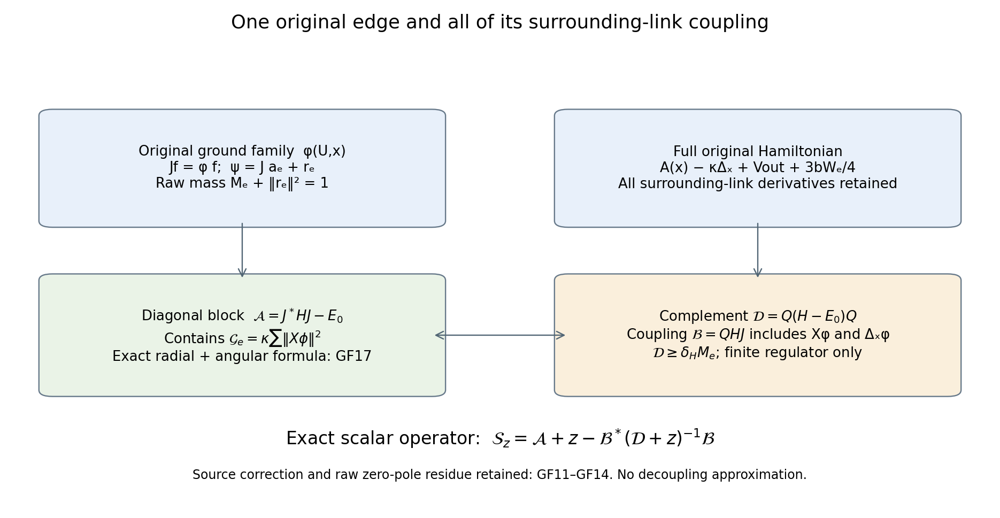
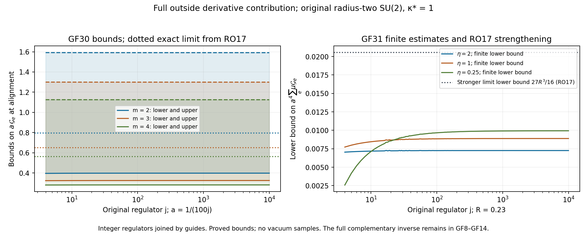

# The full Hamiltonian in its one-edge ground family

This calculation continues EV1–EV29. It computes the outside derivatives of the actual one-edge ground family, their complete contribution to the full Hamiltonian, and the exact complementary resolvent. It then evaluates that derivative contribution at zero surrounding sum, at alignment, and in the actual local vacuum average. Every statement is at the original finite regulator unless a particular limit is explicitly proved.

The operator elimination used below belongs to the Feshbach–Schur method. A human source is Geneviève Dusson, Israel Michael Sigal and Benjamin Stamm, *The Feshbach–Schur map and perturbation theory*, [arXiv:2105.02058v1](https://arxiv.org/abs/2105.02058v1), source labels \(\mathrm{Fesh}\), \(\mathrm{QP}\), \(\mathrm{Hlam\text{-}deco}\), and \(\mathrm{Ulam\text{-}def}\), original TeX lines 398–473. Their finite-rank perturbation estimates are not applied here: the outside space is infinite dimensional. The form construction, domains, inverses and source identities for the present operator are proved below. No novelty claim is made for the elimination method.

## 1. Original family, its regularity and its response

Fix the original positive edge \(e\), and write \(U=U_e\), \(x=(U_\ell)_{\ell\ne e}\). All measures are the original probability Haar measures. All edge metrics have radius two, and all left fields have generators \(T_\alpha=-i\sigma_\alpha/2\). Retain
\[
\begin{gathered}
H=-\kappa(\Delta_U+\Delta_x)+b\sum_pD_p,\qquad
D_p=2-\operatorname{Tr}U_p,\\
H\psi=E_0\psi,\quad\psi>0,\quad\|\psi\|_2=1,\quad d\mu=\psi^2dU\,dx,\\
m=m_e\in\{2,3,4\},\quad
W_e=\sum_{p\ni e}D_p=2m-\operatorname{Tr}(US(x)),\quad
S(x)=\sum_{p\ni e}B_{p,e}(x),\\
A(x)=-\kappa\Delta_U+\frac b4 W_e(U,x),\qquad
A(x)\phi_x=\lambda(x)\phi_x,\quad\phi_x>0,\quad\|\phi_x\|_{L^2(dU)}=1 .
\end{gathered}\tag{GF1}
\]
Each \(B_{p,e}\) is the actual three-edge path from the head to the tail of \(e\), with its original order and inverses. Distinct incident paths have disjoint edge sets, as proved in EV3. The full potential constant in \(A\) is \(bm/2\).

The positive family \(\phi_x\) is smooth jointly in \((U,x)\), including at \(S=0\). Here is a direct construction in the original coordinates. At a fixed \(x_0\), compact ellipticity, positivity and the ground-transform proof LC3 give a simple lowest eigenvalue separated from the next one. Choose a small circle enclosing that eigenvalue and no other eigenvalue. The potential difference \(A(x)-A(x_0)\) is a bounded multiplier, smooth in \(x\) in every multiplier derivative norm. On that circle, the resolvent identity and its locally convergent Neumann series give a smooth resolvent and hence a smooth rank-one Riesz projection. Apply that projection to \(\phi_{x_0}\). The resulting real vector is nonzero near \(x_0\); choose its sign by positive overlap and divide by its own positive norm. It is the unique positive unit ground vector. The resolvent maps \(L^2\) into the second Sobolev space by the elliptic equation. Differentiating that equation in \(x\) and bootstrapping in \(U\) proves smoothness with values in every Sobolev space, hence joint smoothness. Uniqueness makes the local choices agree.

The first two eigenvalues are continuous by the min–max inequality
\(|\lambda_k(x)-\lambda_k(y)|\le\|V_x-V_y\|_\infty\), where \(V_x=bW_e(\cdot,x)/4\). Compactness of the outside space therefore gives a positive minimum of their difference for this fixed regulator. This asserts no lower bound uniform in \(j\).

Let \(P_x=|\phi_x\rangle\langle\phi_x|\), \(Q_x=I-P_x\), and
\[
R_x=\left.(A(x)-\lambda(x))^{-1}\right|_{\operatorname{Ran}Q_x}.
\]
It is the inverse on the orthogonal complement only. For an outside field \(Y=X_{\ell,\alpha}\), write \(\phi_Y=Y\phi\). Differentiating the unit norm and the ground equation gives
\[
\begin{gathered}
\langle\phi,\phi_Y\rangle=0,\qquad
Y\lambda=\langle\phi,(YV)\phi\rangle,\qquad
\phi_Y=-R_xQ_x((YV)\phi),\\
YV=-\frac b4\operatorname{Tr}(U\,YS),\\
Q_x\phi_{YY}
=-R_xQ_x\big((Y^2V)\phi+2(YV-Y\lambda)\phi_Y\big),\qquad
\langle\phi,\phi_{YY}\rangle=-\|\phi_Y\|^2 .
\end{gathered}\tag{GF2}
\]
All inner products in this display are in the \(U\) fiber. The second line is the derivative of the full original path sum, not a replacement of its factors. For a factor \(U_\ell\), \(YU_\ell=T_\alpha U_\ell\); for an inverse, \(YU_\ell^{-1}=-U_\ell^{-1}T_\alpha\). The product rule retains all factors in their order. The last line follows by differentiating twice and projecting; the term containing \(Y^2\lambda\) vanishes under \(Q_x\), whereas the displayed term containing \(Y\lambda\) remains. Thus no derivative of the ground energy has been dropped.

## 2. Exact full-Hamiltonian blocks

Define the isometry and its complement on the original full Hilbert space by
\[
\begin{gathered}
J:L^2(dx)\longrightarrow L^2(dU\,dx),\qquad (Jf)(U,x)=\phi_x(U)f(x),\\
J^*u(x)=\int\phi_x(U)u(U,x)\,dU,\qquad P=JJ^*,\quad Q=I-P,\\
V_{\mathrm{out}}(x)=b\sum_{p\not\ni e}D_p(x),\qquad
H=A(x)-\kappa\Delta_x+V_{\mathrm{out}}(x)+\frac{3b}{4}W_e(U,x).
\end{gathered}\tag{GF3}
\]
The remaining three quarters of the incident potential are essential. The incident and nonincident terms sum to the entire original potential, including all constants.

For smooth \(f\), the product rule and
\(\langle\phi,Y\phi\rangle=0\),
\(\langle\phi,Y^2\phi\rangle=-\|Y\phi\|^2\), give
\[
\begin{gathered}
J^*HJ=-\kappa\Delta_x+V_{\mathrm{out}}+\lambda
+\frac{3b}{4}\langle\phi,W_e\phi\rangle+\mathcal G_e(x),\\
\mathcal G_e(x)=\kappa\sum_{\ell\ne e,\alpha}\|X_{\ell,\alpha}\phi_x\|^2,\\
\mathcal B f:=QHJf
=-2\kappa\sum_{\ell\ne e,\alpha}(X_{\ell,\alpha}\phi_x)
X_{\ell,\alpha}f
-\kappa Q_x(\Delta_x\phi_x)f
+\frac{3b}{4}Q_x(W_e\phi_x)f .
\end{gathered}\tag{GF4}
\]
The first-derivative scalar connection vanishes because the positive unit family is real. Its squared derivatives do not vanish. The \(A\phi=\lambda\phi\) and outside scalar terms disappear only after applying \(Q\) in the last line. Each other term is retained.

Smoothness on the compact product makes \(J,J^*,P,Q\) bounded on the first and second Sobolev spaces. For example, differentiate \(Jf=\phi f\); each derivative of \(\phi\) is bounded. For \(J^*u\), differentiate under the compact fiber integral and apply Cauchy's inequality. This proves the corresponding assertion for \(P\) and \(Q\).

For \(r\in QH^1\), the distributional adjoint of \(\mathcal B\) is
\[
\mathcal B^*r
=2\kappa\sum_{\ell\ne e,\alpha}
\langle X_{\ell,\alpha}\phi,X_{\ell,\alpha}r\rangle
+\kappa\langle\Delta_x\phi,r\rangle
+\frac{3b}{4}\langle W_e\phi,r\rangle .
\tag{GF5}
\]
To verify it, integrate the first term of (GF4) once by parts in the outside Haar variable. Differentiation of its coefficient contributes \(2\kappa\langle\Delta_x\phi,r\rangle\); the second term of (GF4) contributes its negative half. Since \(Qr=r\), its \(Q_x\) can be removed inside this pairing. Formula (GF5) is bounded from \(QH^1\) to \(L^2(dx)\). Consequently \(\mathcal B\) extends from \(L^2(dx)\) to the dual of \(QH^1\). The full first-order expression (GF4) still maps \(H^1(dx)\) into \(QL^2\).

Gauge transformations intertwine the fiber operator at the corresponding outside configurations. They preserve positivity, Haar and the metric, so uniqueness of the positive unit ground gives the corresponding covariance of \(\phi\). Changing the fiber integration variable proves that \(J\) intertwines the outside gauge action with the full gauge action. Thus these blocks restrict to the physical subspaces. No tensor factorization of the physical Hilbert space is assumed.

## 3. The complementary inverse and the actual raw ground overlap

Put \(L=H-E_0\). Its first positive full-space eigenvalue \(\delta_H\) is positive at every fixed regulator by compact resolvent and the one-dimensional kernel proved in LC3. Keep the original overlap and remainder:
\[
a_e=J^*\psi,\quad r_e=Q\psi,\quad
M_e=\|a_e\|_{L^2(dx)}^2\in(0,1],\quad
\|r_e\|^2=1-M_e,\quad \psi=Ja_e+r_e .
\tag{GF6}
\]
For any \(r\in QH^1\),
\[
\langle r,Lr\rangle
\ge\delta_H\big(\|r\|^2-|\langle\psi,r\rangle|^2\big)
\ge\delta_H M_e\|r\|^2 .
\tag{GF7}
\]
The first inequality is the spectral expansion of \(L\); the second uses
\(\langle\psi,r\rangle=\langle r_e,r\rangle\) and
\(\|r_e\|^2=1-M_e\). Hence the closed compressed form on \(QH^1\) defines a self-adjoint operator \(\mathcal D=QLQ\) with inverse bounded by \((\delta_HM_e)^{-1}\). This is a proved finite-regulator inverse; neither factor has been assigned a uniform positive limit.

The compressed form is equivalent to the \(H^1\) norm on \(QH^1\). Indeed it is bounded above by a fixed multiple of that norm and satisfies both (GF7) and
\(\langle r,Lr\rangle\ge\kappa\|dr\|^2-C\|r\|^2\)
for a finite \(C\), since the potential is bounded. A convex combination of the latter inequality and (GF7), with a sufficiently small positive weight on the derivative inequality, gives a positive multiple of \(\|r\|_{H^1}^2\). Lax–Milgram therefore extends
\(\mathcal D_z^{-1}\), \(\mathcal D_z=\mathcal D+z\), for every \(z\ge0\), from the dual form space into \(QH^1\).

Let \(\mathcal A=J^*HJ-E_0\), with the complete potential in (GF4). Then
\[
\mathcal S_z=\mathcal A+z-\mathcal B^*\mathcal D_z^{-1}\mathcal B
\quad(z\ge0)
\tag{GF8}
\]
is self-adjoint on \(H^2(dx)\), with form domain \(H^1(dx)\).
For this domain assertion, (GF5) and the preceding inverse show that
\(\mathcal B^*\mathcal D_z^{-1}\mathcal B\) is bounded on \(L^2(dx)\). It is self-adjoint and nonnegative, since its form is the squared dual-form pairing with the positive inverse. The operator \(\mathcal A\) is the outside Laplacian plus a bounded smooth real potential. Bounded self-adjoint perturbation therefore proves the assertion.

For all \(f\in H^1(dx)\) and \(r\in QH^1\), expansion gives the complete square
\[
\begin{split}
\langle Jf+r,(L+z)(Jf+r)\rangle
={}&\langle f,\mathcal S_zf\rangle\\
&+\left\langle r+\mathcal D_z^{-1}\mathcal Bf,\,
\mathcal D_z(r+\mathcal D_z^{-1}\mathcal Bf)\right\rangle .
\end{split}\tag{GF9}
\]
These are form pairings. The two cross terms reproduce the entire coupling (GF4), and the additional diagonal term cancels the negative term in (GF8). Minimizing over \(r\) shows
\(\mathcal S_z\ge zI\). At \(z=0\), its kernel is exactly the span of \(a_e\): zero in (GF9) yields a full vector in \(\ker L=\mathbb C\psi\), and conversely the decomposition (GF6) has zero energy. In particular,
\[
r_e=-\mathcal D^{-1}\mathcal B a_e,\qquad
\mathcal S_0a_e=0 .
\tag{GF10}
\]
All inverses used here were established in (GF7).

For \(z>0\), solving the two coupled equations gives, for arbitrary \(\eta\in L^2(dU\,dx)\), with \(b_\eta=J^*\eta\) and \(z_\eta=Q\eta\),
\[
\begin{gathered}
k_{\eta,z}=b_\eta-\mathcal B^*\mathcal D_z^{-1}z_\eta,\\
f=\mathcal S_z^{-1}k_{\eta,z},\qquad
r=\mathcal D_z^{-1}(z_\eta-\mathcal Bf),\qquad
(L+z)^{-1}\eta=Jf+r,\\
\langle\eta,(L+z)^{-1}\eta\rangle
=\langle z_\eta,\mathcal D_z^{-1}z_\eta\rangle
+\langle k_{\eta,z},\mathcal S_z^{-1}k_{\eta,z}\rangle .
\end{gathered}\tag{GF11}
\]
One first verifies these equations against \(H^1\) test functions, using (GF9); uniqueness for \(L+z\) identifies the solution. Expanding its pairing with \(\eta\) proves the last line. Taking \(z_\eta=0\) also proves
\(J^*(L+z)^{-1}J=\mathcal S_z^{-1}\).

The resolvent identity, with the form-space extension just established, gives
\[
\mathcal S'_z
=I+(\mathcal D_z^{-1}\mathcal B)^*
(\mathcal D_z^{-1}\mathcal B),\qquad
\langle a_e,\mathcal S'_0a_e\rangle=M_e+\|r_e\|^2=1 .
\tag{GF12}
\]
For completeness, subtract the inverses at \(z+h\) and \(z\):
\(\mathcal D_{z+h}^{-1}-\mathcal D_z^{-1}
=-h\mathcal D_{z+h}^{-1}\mathcal D_z^{-1}\).
The positive lower bound (GF7) permits its operator-norm limit in the relevant form spaces. Substitute into (GF8), then use (GF10).
Moreover the full spectral theorem and the fixed positive \(\delta_H\) imply
\[
\lim_{z\downarrow0}z\mathcal S_z^{-1}
=|a_e\rangle\langle a_e|
\quad\text{in operator norm}.
\tag{GF13}
\]
Its residue retains the raw mass \(M_e\); replacing it by a unit projection would change the result.

For the original source \(\eta=F\psi\), \(F=C_{\mathbf f,j}-\mu C_{\mathbf f,j}\), EV25 gives exactly \(b_\eta=b_{F,e}\) and \(z_\eta=z_{F,e}\). Its centering is the exact relation
\[
\langle a_e,b_{F,e}\rangle+\langle r_e,z_{F,e}\rangle=0,
\qquad
\langle a_e,k_{\eta,0}\rangle=0 .
\tag{GF14}
\]
The second equality follows from (GF10), with its sign retained. Thus the zero-energy pole cancels for this source. Formula (GF11), evaluated at the original positive energies, remains the complete Stieltjes transform of its physical spectral measure. A fixed-regulator \(z\downarrow0\) statement is not interchanged with the regulator limit.

## 4. Exact derivative metric for the actual surrounding paths

Identify a real quaternion matrix \(S=s_0I+i\sum_{\alpha=1}^3s_\alpha\sigma_\alpha\) with its coefficient vector \(s\in\mathbb R^4\), retaining
\[
|S|_4^2=\tfrac12\operatorname{Tr}(S^*S)=|s|^2,\qquad
\rho=|S|_4,\quad Q_S=S/\rho\quad(\rho>0).
\]
This coefficient norm is explicitly distinguished from the radius-two tangent metric. Every path \(B_p\) has coefficient norm one. The exact fiber ground is
\(\phi_x(U)=f_\rho(UQ_S)\), where \(f_\rho\) is the positive unit central ground for
\(-\kappa\Delta+bm/2-(b\rho/4)\operatorname{Tr}U\).
Conjugation invariance and uniqueness prove centrality.
Define
\[
\begin{gathered}
K_\rho=\int|df_\rho|^2\,dU,\qquad
A_\rho=\int|\partial_\rho f_\rho|^2\,dU,\\
T_\rho(x)=\sum_{\ell\ne e,\alpha}(X_{\ell,\alpha}\rho)^2 .
\end{gathered}\tag{GF15}
\]
The radius-two derivatives are used in \(K_\rho\).

At a fixed positive \(\rho\), conjugation invariance gives
\(\langle\partial_\rho f_\rho,X_\alpha f_\rho\rangle=0\) and
\(\langle X_\alpha f_\rho,X_\beta f_\rho\rangle
=(K_\rho/3)\delta_{\alpha\beta}\).
Indeed the first three components transform as a vector under every adjoint rotation, so are zero. The symmetric three-by-three matrix in the second identity commutes with every such rotation, so is a scalar matrix; its trace is \(K_\rho\). One can verify the scalar conclusion using rotations by \(\pi\) about each coordinate axis to remove off-diagonal entries and quarter-turns to equate the diagonal entries.

For any outside field \(Y\),
\(Y\rho=\langle Q_S,YS\rangle_4\) and
\(|YQ_S|_4^2=(|YS|_4^2-(Y\rho)^2)/\rho^2\).
A unit tangent vector in coefficient norm has radius-two metric norm two. Therefore the full derivative norm is
\[
\|Y\phi_x\|^2
=A_\rho(Y\rho)^2+
\frac{4K_\rho}{3\rho^2}\big(|YS|_4^2-(Y\rho)^2\big).
\tag{GF16}
\]
The factor four is the original metric comparison and remains explicit.

Each of the \(3m\) outside path edges occurs in exactly one path. At any of those edges, its three original derivatives of \(B_p\) are one half of an orthonormal coefficient-tangent frame at \(B_p\). This follows by multiplying \(T_\alpha\), whose coefficient norm is \(1/2\), by the original unit path factors on both sides; inverses introduce an orthogonal adjoint transformation and a sign. Hence
\[
\begin{gathered}
\sum_{\ell\ne e,\alpha}|X_{\ell,\alpha}S|_4^2=\frac{9m}{4},\\
c_p=\langle Q_S,B_p\rangle_4,\qquad \sum_pc_p=\rho,\qquad
T_\rho=\frac34\left(m-\sum_pc_p^2\right),\\
0\le T_\rho\le\frac34\left(m-\frac{\rho^2}{m}\right)
\le\frac32(m-\rho),\\
\mathcal G_e
=\kappa\left\{A_\rho T_\rho+
\frac{4K_\rho}{3\rho^2}\left(\frac{9m}{4}-T_\rho\right)\right\}
\ge\frac{3\kappa}{m}K_\rho\qquad(\rho>0).
\end{gathered}\tag{GF17}
\]
For the second line, project \(Q_S\) onto each of the three tangent directions at \(B_p\), sum their squares, and count the three edges of that path. Cauchy's inequality gives \(\sum c_p^2\ge\rho^2/m\), proving the third line. Substitution in (GF16) proves the equality in the last line. Its angular coefficient is at least \(2m/\rho^2+1/m\), which is at least \(3/m\), since \(0<\rho\le m\). The nonnegative radial term has not been discarded from the equality.

The radial response is also exact:
\[
A_\rho=\frac{b^2}{16}
\left\|R_\rho Q_\rho^{\mathrm{fib}}
\big((\operatorname{Tr}U)f_\rho\big)\right\|^2 .
\tag{GF18}
\]
Here \(Q_\rho^{\mathrm{fib}}\) is the orthogonal complement of \(f_\rho\), and \(R_\rho\) is its actual fiber inverse. It is not the matrix \(Q_S\). Formula (GF18) is (GF2) differentiated in the scalar parameter \(\rho\).

## 5. The zero-sum configuration: every derivative and a nonzero coupling

At \(S=0\), \(A=-\kappa\Delta+bm/2\), \(\phi=1\), and \(\lambda=bm/2\). For a fixed outside field \(Y\), set \(A_Y=YS\), \(\chi_Y(U)=\operatorname{Tr}(UA_Y)\). The trace is real. The original Haar identities are
\[
\int\chi_Y=0,\quad
\int\chi_Y\chi_Z=\langle A_Y,A_Z\rangle_4,\quad
\Delta_U\chi_Y=-\tfrac34\chi_Y .
\]
They follow by writing the unit quaternion \(U\) in four real coordinates, with second moments \(\delta_{ij}/4\), and by the original Casimir. Equation (GF2) now gives
\[
\phi_Y=\frac{b}{3\kappa}\chi_Y,\qquad
Y\lambda=0,\qquad
YZ\lambda=-\frac{b^2}{6\kappa}\langle A_Y,A_Z\rangle_4,\qquad
\mathcal G_e=\frac{b^2m}{4\kappa}.
\tag{GF19}
\]
For the mixed derivative of \(\lambda\), differentiate its expectation in (GF2); the Haar integral of \(\operatorname{Tr}(U\,YZS)\) is zero, and the two ground-derivative terms give the stated coefficient. Although outside fields need not commute, their commutator applied to \(\lambda\) is zero at this point because all its first derivatives vanish.

The traceless quadratic \(\chi_Y^2-|A_Y|_4^2\) has original Casimir two:
\[
\Delta_U(\chi_Y^2-|A_Y|_4^2)
=-2(\chi_Y^2-|A_Y|_4^2).
\]
Indeed \(|d\chi_Y|^2=|A_Y|_4^2-\chi_Y^2/4\), so the product rule and \(\Delta\chi_Y=-3\chi_Y/4\) give this equality without a representation-theoretic assumption. Substituting in (GF2) yields
\[
\phi_{YY}
=\frac{b}{3\kappa}\operatorname{Tr}(U\,Y^2S)
+\frac{b^2}{12\kappa^2}(\chi_Y^2-|A_Y|_4^2)
-\frac{b^2}{9\kappa^2}|A_Y|_4^2 .
\tag{GF20}
\]
The last term is the complete unit-norm derivative contribution.

For \(\chi_p=\operatorname{Tr}(UB_p)\), the original three-edge Casimir and tangent-frame identities give
\[
\Delta_xS=-\tfrac94 S,\qquad
\sum_Y\chi_Y^2=3m-\tfrac34\sum_p\chi_p^2,\qquad
\sum_Y|A_Y|_4^2=\tfrac{9m}{4}.
\]
Thus at \(S=0\),
\[
\begin{gathered}
Q_x\Delta_x\phi=\frac{b^2}{16\kappa^2}
\left(m-\sum_p\chi_p^2\right),\\
\mathcal Bf
=-\frac{2b}{3}\sum_Y\chi_Y\,Yf
+\frac{b^2}{16\kappa}\left(\sum_p\chi_p^2-m\right)f,\\
V_{\mathrm{out}}+\lambda+\frac{3b}{4}\langle W_e\rangle_\phi+\mathcal G_e
=V_{\mathrm{out}}+2bm+\frac{b^2m}{4\kappa}.
\end{gathered}\tag{GF21}
\]
The remaining potential has no \(Q_x\) component here because \(W_e=2m\) is constant in \(U\), while the displayed second-derivative contribution is generally nonzero.

It is in fact nonzero for every such actual zero-sum configuration. Let \(v_p\in\mathbb R^4\) be the coefficient vector of \(B_p\), and \(T=\sum_pv_pv_p^T\). Then \(\operatorname{tr}T=m\), \(T\ge0\), and \(\sum_pv_p=0\) implies \(\operatorname{rank}T\le m-1\). Quaternion multiplication in the trace changes a fixed orthogonal sign matrix in \(v_p\); it preserves these quantities. The Haar fourth moments on the unit three-sphere give
\[
\int\left(\sum_p\chi_p^2-m\right)^2dU
=\frac{4\operatorname{tr}(T^2)-m^2}{3}
\ge\frac{m^2(5-m)}{3(m-1)}>0.
\tag{GF22}
\]
To verify the fourth moments, rotational symmetry makes
\(\mathbb E u_1^4=3\mathbb E u_1^2u_2^2\); expanding
\((\sum_{i=1}^4u_i^2)^2=1\) gives respectively \(1/8\) and \(1/24\). Expand the quadratic square to obtain the first equality. If \(r=\operatorname{rank}T\le m-1\), Cauchy's inequality on its \(r\) positive eigenvalues gives \(\operatorname{tr}(T^2)\ge m^2/r\ge m^2/(m-1)\), proving the bound.
For the actual outside constant function \(1\), (GF21) consequently proves at each zero-sum point
\[
\|(\mathcal B1)_x\|_{L^2(dU)}^2
\ge\frac{b^4m^2(5-m)}{768\kappa^2(m-1)}.
\tag{GF23}
\]
The coefficient in (GF22) and hence (GF23) is sharp for each actual incidence. Explicit coefficient vectors for the path matrices are
\[
\begin{array}{c|l}
m&v_p\\ \hline
2&(1,0,0,0),\ (-1,0,0,0),\\
3&(1,0,0,0),\
(-\tfrac12,\tfrac{\sqrt3}{2},0,0),\
(-\tfrac12,-\tfrac{\sqrt3}{2},0,0),\\
4&(0,1,1,1)/\sqrt3,\ (0,1,-1,-1)/\sqrt3,\
(0,-1,1,-1)/\sqrt3,\ (0,-1,-1,1)/\sqrt3 .
\end{array}\tag{GF22a}
\]
They have unit norm, zero sum, and \(m-1\) equal nonzero eigenvalues \(m/(m-1)\) in \(T\). Thus equality holds in the Cauchy estimate in (GF22). Each matrix assignment is realized by setting two links of each disjoint original three-edge path to the identity and choosing its remaining link, or inverse, to realize that matrix. This proves sharpness on actual configurations. The result is a pointwise fiber statement; no probability mass is assigned to the zero-sum locus.

## 6. Alignment and the actual local average

At full alignment \(\rho=m\), equality in the triangle inequality forces every \(B_p=Q_S\). Then \(c_p=1\), \(T_\rho=0\), and (GF17) gives exactly
\[
\mathcal G_e=\frac{3\kappa}{m}K_m .
\tag{GF24}
\]
For all \(0<\rho\le m\), put
\[
\begin{gathered}
D(U)=2-\operatorname{Tr}U,\quad
d_\rho=\int D f_\rho^2\,dU,\quad
q_\rho=\int(D-D^2/4)f_\rho^2\,dU,\\
e_\rho=\lambda_m(\rho)-\frac{b(m-\rho)}2
=\kappa K_\rho+\frac{b\rho}{4}d_\rho .
\end{gathered}\tag{GF25}
\]
The symbols \(d_\rho,q_\rho\) denote actual integrals and keep their full terms. In particular \(q_\rho>0\). Also \(0<d_\rho<2\). Positivity follows because \(f_\rho>0\) and \(D>0\) off one point. To show the strict upper bound, write the ground energy as \(bm/2+\mathcal E_\kappa(b\rho/4)\). EV8 proves \(\mathcal E_\kappa(t)<0\) for \(t>0\), while concavity gives \(\mathcal E_\kappa'(t)\le\mathcal E_\kappa(t)/t<0\). Its derivative exists by the smooth family and equals \(-\int\operatorname{Tr}U\,f_\rho^2\) by (GF2). Thus that trace mean is strictly positive.

Haar integration by parts with \(\Delta\operatorname{Tr}U=-3\operatorname{Tr}U/4\) gives
\[
\frac38(2-d_\rho)
=\int f_\rho\,d(\operatorname{Tr}U)\cdot df_\rho\,dU .
\]
Cauchy's inequality and \(|d(\operatorname{Tr}U)|^2=D-D^2/4\) therefore prove
\[
K_\rho\ge\frac{9(2-d_\rho)^2}{64q_\rho}
\ge\frac{9(2-d_\rho)^2}{64d_\rho}.
\tag{GF26}
\]
The original quadratic contribution remains in the first denominator.
The proved trial bound EV18 and (GF25) also give
\[
0<d_\rho\le\overline d_\rho
:=3\sqrt{\frac{\kappa}{b\rho}}+\frac{3\kappa}{4b\rho},
\qquad
0<K_\rho\le \frac34\sqrt{\frac{b\rho}{\kappa}}+\frac3{16}.
\tag{GF27}
\]
The potential minimum and the positivity of both summands in (GF25) justify dividing its bound to obtain each inequality. Whenever the explicitly computed number \(\overline d_\rho\) is below two, the function \((2-d)^2/d\) decreases on \(0<d<2\). Substitution in (GF17) and (GF26) yields the actual estimate
\[
\mathcal G_e(x)\ge
\frac{27\kappa}{64m}\,
\frac{(2-\overline d_\rho)^2}{\overline d_\rho}
\quad(\rho>0,\ \overline d_\rho<2).
\tag{GF28}
\]
This inequality is derived from the actual family; no approximate ground state has been substituted.

On the prescribed path \(b_j=(\kappa_*a_j^2)^{-1}\), \(\kappa=\kappa_*\),
\[
\overline d_\rho
=\frac{3\kappa_*a_j}{\sqrt\rho}
+\frac{3\kappa_*^2a_j^2}{4\rho}.
\tag{GF29}
\]
At exact alignment, (GF24), (GF27) and (GF28) show
\[
\frac{9}{16\sqrt m}
\le\liminf_{j\to\infty}a_j\mathcal G_e\big|_{\rho=m}
\le\limsup_{j\to\infty}a_j\mathcal G_e\big|_{\rho=m}
\le\frac{9}{4\sqrt m}.
\tag{GF30}
\]
Here the lower and upper limits refer to the scalar aligned profile at each regulator with a fixed incidence \(m\). The finite lower expression is (GF28) with (GF29), and the finite upper expression is \(9/(4\sqrt m\,a_j)+9\kappa_*/(16m)\); both retain their full constants.

The derivative term is also large in the actual local outside marginal, not only at isolated configurations. Use the original strictly fitted cube
\[
\begin{gathered}
q=\lceil R/a_j\rceil+3,\quad
v_{j,d}=L_j+\lfloor(c_d-o_d)/a_j\rfloor-1,\quad
Q_j=v_j+\{0,\ldots,q\}^3,\\
N_Q=3q(q+1)^2,\ M_Q=3q^2(q+1),\ C_Q=12q(q+1),\\
\Lambda_Q=\min\{2M_Q,6g_j^2\sqrt{N_QM_Q}\}+2C_Q,\quad\\
E_Q^\circ=\{\text{original edges with both transverse coordinates interior}\}.
\end{gathered}
\]
EV21–EV22 prove
\(|E_Q^\circ|=3q(q-1)^2\), \(m_e=4\) there,
\(\sum_{e\in E_Q^\circ}\mu_j\{\rho_e\le4-\eta\}
\le2\Lambda_Q/\eta\),
\(a_j^3|E_Q^\circ|\to3R^3\), and
\(a_j^2\Lambda_Q\to9\kappa_*R^3+24R^2\).
For any fixed \(0<\eta<4\), put
\[
\begin{gathered}
d_{\eta,j}=\frac{3\kappa_*a_j}{\sqrt{4-\eta}}
+\frac{3\kappa_*^2a_j^2}{4(4-\eta)},\\
h_{\eta,j}=\frac{27\kappa_*}{256}
\frac{(2-d_{\eta,j})^2}{d_{\eta,j}}\quad(d_{\eta,j}<2).
\end{gathered}
\]
On \(\rho_e>4-\eta\), (GF28) gives \(\mathcal G_e\ge h_{\eta,j}\). Everywhere \(\mathcal G_e\ge0\). It follows that
\[
\sum_{e\in E_Q^\circ}\mu_j\mathcal G_e
\ge h_{\eta,j}\left(|E_Q^\circ|-\frac{2\Lambda_Q}{\eta}\right),
\qquad
\liminf_{j\to\infty}a_j^4
\sum_{e\in E_Q^\circ}\mu_j\mathcal G_e
\ge\frac{27R^3}{32}.
\tag{GF31}
\]
The finite right side can be negative at small \(j\), which does not affect the inequality. For the limit,
\(a_jh_{\eta,j}\to9\sqrt{4-\eta}/64\) and
\(a_j^3\Lambda_Q\to0\).
The lower limit is at least \(27\sqrt{4-\eta}R^3/64\) for every fixed \(\eta\); taking the supremum over \(\eta\downarrow0\) gives the stated coefficient.

The expectation in (GF31) is against the original outside marginal
\(\int\psi^2dU\), because \(\mathcal G_e\) depends only on \(x\). Its expectation against the raw projected measure \(a_e^2dx\) is a different quantity. [RO1–RO17](RAW_OVERLAP_AND_ORIGINAL_METRIC.md) construct the exact original-coordinate map and prove a positive lower bound for that raw overlap and its derivative contribution. Their separate kinetic and potential limits strengthen (GF30) to the exact limit \(9/(8\sqrt m)\) and double the coefficient in (GF31) to \(27R^3/16\). The complete projected operator retains the raw measure, \(\mathcal B\), and \(\mathcal D_z^{-1}\) in (GF6)–(GF14). A large positive diagonal derivative term does not give a lower bound on the full physical gap: the exact negative term in (GF8) and source correction in (GF11) remain. The next calculation is their cancellation on the original shrinking spectral windows, using the now-proved raw overlap bounds.

Provider proofs: [EV1–EV29](https://github.com/KokunoYumeto/yang-mills-interacting-workbench/blob/b00c8daade155396db839be52c4832d17460ae62/yang-mills/continuations/20261011-central-signs-shrinking-window/ACTUAL_EDGE_ENERGY_VARIANCE.md), [LC1–LC20](https://github.com/KokunoYumeto/yang-mills-interacting-workbench/blob/b00c8daade155396db839be52c4832d17460ae62/yang-mills/continuations/20261011-central-signs-shrinking-window/LOCAL_CURVATURE_BUDGET.md), [WH1–WH33](https://github.com/KokunoYumeto/yang-mills-interacting-workbench/blob/b00c8daade155396db839be52c4832d17460ae62/yang-mills/continuations/20261011-central-signs-shrinking-window/SMOOTH_WEIGHTED_LOCAL_ENERGY.md), and [SF1–SF27](https://github.com/KokunoYumeto/yang-mills-interacting-workbench/blob/b00c8daade155396db839be52c4832d17460ae62/yang-mills/continuations/20261011-central-signs-shrinking-window/SHARED_FACE_WORDS_AND_PHYSICAL_COUPLING.md). New receiving proofs: [GF1–GF31](https://github.com/KokunoYumeto/yang-mills-interacting-workbench/blob/main/yang-mills/continuations/20261011-central-signs-shrinking-window/FULL_HAMILTONIAN_GROUND_FIBER.md) and [RO1–RO17](https://github.com/KokunoYumeto/yang-mills-interacting-workbench/blob/main/yang-mills/continuations/20261011-central-signs-shrinking-window/RAW_OVERLAP_AND_ORIGINAL_METRIC.md).

Reproducible diagnostics and figure sources: [original path and block checks](check_ground_fiber.py), [original-coordinate checks](check_raw_overlap.py), and [source reading/use record](GROUND_FIBER_SOURCE_USE_LEDGER.json). These diagnostics do not sample the original full vacuum.
