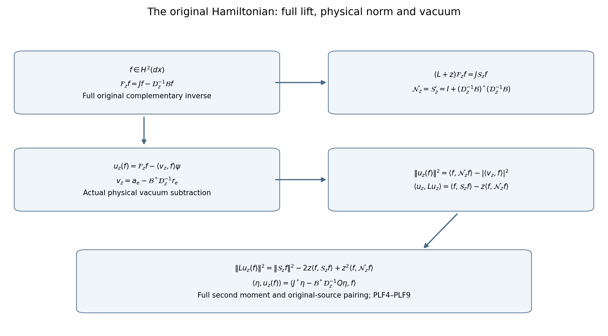
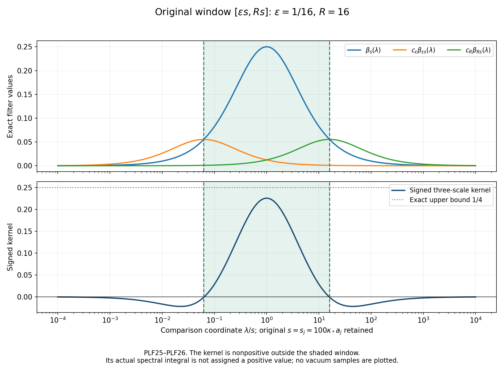

# The full physical lift and the original Wilson source

This calculation continues GF3–GF14 and RO1–RO17. It computes the physical norm, vacuum subtraction, first two energy moments and original-source pairing of the entire coupled ground-family lift. It also proves an error bound for removing the incident faces from the original observable and an exact three-scale estimate for its physical spectral window. All expressions use the original finite-regulator Hamiltonian. No limiting window mass is assigned a value.

The operator elimination has the human provenance recorded in GF: Geneviève Dusson, Israel Michael Sigal and Benjamin Stamm, *The Feshbach–Schur map and perturbation theory*, [arXiv:2105.02058v1](https://arxiv.org/abs/2105.02058v1), original author TeX labels Fesh, QP, Hlam-deco and Ulam-def, lines 398–473. The present outside space is infinite dimensional; the required form domains and inverse were proved directly in GF3–GF14. The scalar-filter and receiving estimates below are proved here. No novelty claim is made.

## 1. Original operator and full lift

Retain probability Haar measure on every original radius-two \(SU(2)\) edge, the fields \(X_{\ell,\alpha}\) generated by \(-i\sigma_\alpha/2\), all original plaquette orders and inverses, and
\[
\begin{gathered}
H=-\kappa\sum_\ell\Delta_\ell+b\sum_pD_p,\quad
D_p=2-W_p,\quad W_p=\operatorname{Tr}U_p,\\
H\psi=E_0\psi,\quad \psi>0,\quad\|\psi\|_2=1,\quad
L=H-E_0,\quad d\mu=\psi^2\,dU\,dx .
\end{gathered}\tag{PLF1}
\]
Fix an edge \(e\), write \(U=U_e\), and let \(x\) contain every other original edge. The positive fiber ground \(\phi_x\) belongs to
\[
-\kappa\Delta_U+\frac b4\sum_{p\ni e}D_p .
\]
Keep the maps and blocks
\[
\begin{gathered}
Jf=\phi_xf(x),\quad P=JJ^*,\quad Q=I-P,\quad
a_e=J^*\psi,\quad r_e=Q\psi,\\
\mathcal A=J^*HJ-E_0,\quad\mathcal B=QHJ,\quad
\mathcal D=QLQ,\quad \mathcal D_z=\mathcal D+z,\\
\mathcal S_z=\mathcal A+z-\mathcal B^*\mathcal D_z^{-1}\mathcal B,
\quad
\mathcal F_zf=Jf-\mathcal D_z^{-1}\mathcal Bf .
\end{gathered}\tag{PLF2}
\]
The compression \(\mathcal D\) is defined by its closed form on \(QH^1\), not by deleting derivatives of \(Q\). In GF7 it was proved that
\(\mathcal D\ge\delta_H M_e>0\), where \(M_e=\|a_e\|^2\) and \(\delta_H\) is the actual finite-regulator first positive full eigenvalue. No lower bound uniform in the regulator is assumed.

GF4 retains the complete outside kinetic term, \(V_{\rm out}\), \(\lambda(x)\), the remaining \(3bW_e/4\), and the squared outside derivatives of \(\phi_x\) in \(\mathcal A\). It also retains both orders of outside derivatives and that remaining potential in \(\mathcal B\). These definitions are used without further projection.

The form inverse \(\mathcal D_z^{-1}:(QH^1)^*\to QH^1\) and \(\mathcal B:L^2(dx)\to(QH^1)^*\) make \(\mathcal F_z\) a bounded map from \(L^2(dx)\) to the full \(L^2\) space. For \(f\in H^1(dx)\) its value belongs to full \(H^1\). In the following pairings the first argument is conjugate linear.

Differentiating the full inverse, as in GF12, gives
\[
\begin{gathered}
\mathcal N_z:=\mathcal S'_z
=I+(\mathcal D_z^{-1}\mathcal B)^*
       (\mathcal D_z^{-1}\mathcal B),\\
\mathcal S''_z=-2(\mathcal D_z^{-1}\mathcal B)^*
                    \mathcal D_z^{-1}(\mathcal D_z^{-1}\mathcal B)
\le0,\\
\|\mathcal F_zf\|^2=\langle f,\mathcal N_zf\rangle .
\end{gathered}\tag{PLF3}
\]
The norm identity follows from orthogonality of \(Jf\) and the \(Q\) component. For the derivatives, use
\(\mathcal D_{z+t}^{-1}-\mathcal D_z^{-1}
=-t\mathcal D_{z+t}^{-1}\mathcal D_z^{-1}\).
The positive finite-regulator lower bound permits the limit in operator norm between the form spaces, including at \(z=0\). Composing the bounded maps proves every displayed identity on \(L^2(dx)\).

For \(f\in H^2(dx)\), the two full block equations give
\[
\begin{gathered}
(L+z)\mathcal F_zf=J\mathcal S_zf,\\
\langle\mathcal F_zf,L\mathcal F_zf\rangle
=\langle f,\mathcal S_zf\rangle
-z\langle f,\mathcal N_zf\rangle\ge0,\\
\|L\mathcal F_zf\|^2
=\|\mathcal S_zf\|^2-2z\langle f,\mathcal S_zf\rangle
 +z^2\langle f,\mathcal N_zf\rangle\\
=\|(\mathcal S_z-z)f\|^2
 +z^2\|\mathcal D_z^{-1}\mathcal Bf\|^2 .
\end{gathered}\tag{PLF4}
\]
There is no omitted complementary term in the second moment. To verify the operator domain, first test the block equations on \(H^1\); the complementary equation is zero, and the outside equation is \(\mathcal S_zf\in L^2\). Thus \(\mathcal F_zf\), already in \(H^1\), solves a full elliptic equation with \(L^2\) right side. The full compact-product operator has domain \(H^2\), so \(\mathcal F_zf\in H^2\). Pair the equation with \(\mathcal F_zf\), using \(J^*\mathcal F_zf=f\), for the energy identity. Square \(J\mathcal S_zf-z\mathcal F_zf\) for the second moment. The first-energy identity extends to \(H^1(dx)\) by form continuity. In particular the stronger form inequality \(\mathcal S_z\ge z\mathcal N_z\) holds.

## 2. Exact physical vacuum subtraction

Define the actual coefficient vector
\[
\begin{gathered}
v_z=a_e-\mathcal B^*\mathcal D_z^{-1}r_e,\qquad
c_z(f)=\langle v_z,f\rangle,\qquad
u_z(f)=\mathcal F_zf-c_z(f)\psi,\\
\langle\psi,\mathcal F_zf\rangle=c_z(f),\qquad
\mathcal S_za_e=zv_z,\qquad
\mathcal F_za_e=\psi-z\mathcal D_z^{-1}r_e .
\end{gathered}\tag{PLF5}
\]
The first equality for the pairing follows by decomposing \(\psi=Ja_e+r_e\). GF10 says \(\mathcal B a_e=-\mathcal D r_e\). Substitution in (PLF2) gives the last identity. Also
\[
\mathcal S_za_e
=za_e+\mathcal B^*(\mathcal D^{-1}-\mathcal D_z^{-1})
\mathcal B a_e
=z(a_e-\mathcal B^*\mathcal D_z^{-1}r_e),
\]
which proves the middle identity with its sign retained.

For \(f\in H^1\), \(u_z(f)\perp\psi\) and
\[
\begin{gathered}
\|u_z(f)\|^2
=\langle f,\mathcal N_zf\rangle-|\langle v_z,f\rangle|^2,\\
\langle u_z(f),Lu_z(f)\rangle
=\langle f,\mathcal S_zf\rangle-z\langle f,\mathcal N_zf\rangle .
\end{gathered}\tag{PLF6}
\]
For \(f\in H^2\) the full second moment is (PLF4), unchanged by the subtraction because \(L\psi=0\). These formulas polarize: for any finite collection \(f_i\in H^2\), its full norm, energy and second-moment matrices have entries
\[
\begin{gathered}
\langle f_i,\mathcal N_zf_k\rangle
-\overline{\langle v_z,f_i\rangle}\langle v_z,f_k\rangle,\\
\langle f_i,\mathcal S_zf_k\rangle
-z\langle f_i,\mathcal N_zf_k\rangle,\\
\langle\mathcal S_zf_i,\mathcal S_zf_k\rangle
-2z\langle f_i,\mathcal S_zf_k\rangle
+z^2\langle f_i,\mathcal N_zf_k\rangle .
\end{gathered}\tag{PLF7}
\]
They remain valid for linearly dependent vectors. No inverse of a finite Gram matrix is taken.

At \(z=0\), \(\mathcal F_0a_e=\psi\) and
\[
v_0=\mathcal N_0a_e,\qquad
\langle a_e,\mathcal N_0a_e\rangle=1,\qquad
u_0(f)=\mathcal F_0\big(f-\langle a_e,\mathcal N_0f\rangle a_e\big).
\tag{PLF8}
\]
For the first equality, use
\(\mathcal N_0a_e=a_e+\mathcal B^*\mathcal D^{-2}\mathcal B a_e
=a_e-\mathcal B^*\mathcal D^{-1}r_e\).
Thus the physical centering uses the full metric \(\mathcal N_0\) and the actual raw vector \(a_e\). Centering only in outside Haar measure would give a different vector.

For an arbitrary centered physical source \(\eta\perp\psi\), retain
\[
\eta_Q=Q\eta,\qquad b_\eta=J^*\eta,\qquad
k_{\eta,z}=b_\eta-\mathcal B^*\mathcal D_z^{-1}\eta_Q .
\]
Taking the pairing with the full lift proves
\[
\langle\eta,u_z(f)\rangle
=\langle\eta,\mathcal F_zf\rangle
=\langle k_{\eta,z},f\rangle .
\tag{PLF9}
\]
Gauge covariance of \(J,P,Q\) and all blocks was proved in GF. Therefore these maps and formulas restrict to the original physical spaces.

## 3. The original observable with an evaluated incident-face error

Keep the actual path and the original real test coefficients:
\[
\begin{gathered}
L_j=j^4,\quad a_j=(100j)^{-1},\quad
g_j^2=\kappa_*a_j/2,\quad
\kappa=\kappa_*,\quad b_j=(\kappa_*a_j^2)^{-1},\\
s_j=100\kappa_*a_j=\kappa_*/j,\qquad
C=a_j\sum_pf_pD_p,\quad F=C-\mu C,\quad\eta=F\psi,\\
h_e=a_j\sum_{p\not\ni e}f_p(D_p-\mu D_p),\qquad
q_e=a_j\sum_{p\ni e}f_p(D_p-\mu D_p),\\
F=h_e+q_e,\qquad \mu h_e=\mu q_e=0,\qquad
M_f=\sup_{\sigma,x}|f_\sigma(x)| .
\end{gathered}\tag{PLF10}
\]
The fixed coefficients include the original orientations, locations and support. A face avoiding \(e\) is independent of \(U_e\); hence \(h_e\) is an outside multiplier. Every omitted incident summand is retained in \(q_e\). Since \(0\le D_p\le4\),
\[
\begin{gathered}
A_{e,j}:=4a_j\sum_{p\ni e}|f_p|
\le4a_jm_eM_f\le16a_jM_f,\qquad
\|q_e\psi\|\le\|q_e\|_\infty\le A_{e,j},\\
\left|\|\Pi F\psi\|-\|\Pi h_e\psi\|\right|\le A_{e,j}
\quad\text{for every orthogonal physical spectral projection }\Pi .
\end{gathered}\tag{PLF11}
\]
This is the triangle inequality and contraction of \(\Pi\). It does not multiply the error by an uncontrolled total source norm. In particular it holds for every original shrinking window.

The exact differentiated outside multiplier is
\[
\begin{gathered}
\Delta_xh_e=3a_j\sum_{p\not\ni e}f_pW_p
=6a_j\sum_{p\not\ni e}f_p
-3a_j\sum_{p\not\ni e}f_pD_p,\\
Yh_e=-a_j\sum_{\substack{p\not\ni e\\p\ni\ell}}f_p\,YW_p,
\qquad Y=X_{\ell,\alpha},\quad\ell\ne e .
\end{gathered}\tag{PLF12}
\]
Each face uses four distinct edges. At each edge the original trace Casimir is \(3/4\), so its full Laplacian is \(-3W_p\); constants from centering have zero derivative. Each \(YW_p\) differentiates the actual ordered product, with
\(YU_\ell=T_\alpha U_\ell\) and
\(YU_\ell^{-1}=-U_\ell^{-1}T_\alpha\).
This proves (PLF12), including its scalar \(6a_j\sum f_p\).

## 4. Full outside current and its physical moments

For any smooth real outside \(h\), define
\[
\begin{split}
g_h&=QL(h\psi)\\
&=-\kappa(\Delta_xh)r_e
-2\kappa Q\sum_{\ell\ne e,\alpha}(X_{\ell,\alpha}h)
                                      (X_{\ell,\alpha}\psi),\\
\mathcal D(hr_e)+\mathcal B(a_eh)&=g_h .
\end{split}\tag{PLF13}
\]
The product rule for \(L(h\psi)\) proves the first two lines: \(L\psi=0\), and the entire potential commutes with \(h\). Multiplication by \(h(x)\) commutes with \(P,Q\) and intertwines with \(J,J^*\). Applying \(Q\) to the full block decomposition proves the final equality. For \(h=h_e\), substitution gives the complete original Wilson current
\[
\begin{split}
g_{h_e}={}&-\kappa\left(6a_j\sum_{p\not\ni e}f_p
-3a_j\sum_{p\not\ni e}f_pD_p\right)r_e\\
&+2\kappa a_j Q\sum_{\ell\ne e,\alpha}
\left(\sum_{\substack{p\not\ni e\\p\ni\ell}}
 f_pX_{\ell,\alpha}W_p\right)X_{\ell,\alpha}\psi .
\end{split}\tag{PLF14}
\]
The derivative of the actual full vacuum is retained.

GF9 and the original ground transform give, for \(z\ge0\),
\[
\begin{split}
\langle a_eh,\mathcal S_z(a_eh)\rangle
={}&\kappa\mu|d_xh|^2+z\mu h^2\\
&-\langle g_h+zhr_e,\mathcal D_z^{-1}(g_h+zhr_e)\rangle .
\end{split}\tag{PLF15}
\]
Indeed \(h\psi=J(a_eh)+hr_e\), and the complete-square remainder is
\(\mathcal D_z^{-1}(g_h+zhr_e)\) by (PLF13). The original full energy of \(h\psi\) is \(\kappa\mu|d_xh|^2\). In particular, with \(d_h=\mathcal D^{-1}g_h\),
\[
\begin{gathered}
h\psi-\mathcal F_0(a_eh)=d_h,\qquad
0\le\langle g_h,\mathcal D^{-1}g_h\rangle
\le \kappa\mu|d_xh|^2,\\
\|d_h\|^2\le
\frac{\kappa\mu|d_xh|^2}{\delta_H M_e}.
\end{gathered}\tag{PLF16}
\]
The last bound uses \(\mathcal D^{-1}\le(\delta_H M_e)^{-1}I\). It is a finite-regulator estimate, with its entire regulator dependence visible.

For the actual centered \(h=h_e\), the complete physical norm, energy and original-source pairing become
\[
\begin{gathered}
c_0(a_eh_e)=-\langle r_e,d_{h_e}\rangle,\\
\|u_0(a_eh_e)\|^2
=\mu h_e^2-2\operatorname{Re}\langle h_er_e,d_{h_e}\rangle
+\|d_{h_e}\|^2-|\langle r_e,d_{h_e}\rangle|^2,\\
\langle u_0(a_eh_e),Lu_0(a_eh_e)\rangle
=\kappa\mu|d_xh_e|^2-\langle g_{h_e},\mathcal D^{-1}g_{h_e}\rangle,\\
\langle F\psi,u_0(a_eh_e)\rangle
=\mu h_e^2+\mu(q_eh_e)
-\langle h_er_e+Q(q_e\psi),d_{h_e}\rangle .
\end{gathered}\tag{PLF17}
\]
These follow by substituting \(\mathcal F_0(a_eh_e)=h_e\psi-d_{h_e}\) in (PLF6), (PLF9) and (PLF15), and using \(\mu h_e=\mu F=0\). They display the complete remaining complementary inverse in the actual source calculation. By contrast, the raw outside coefficient norm is
\(\|a_eh_e\|^2=\int h_e^2\,d\nu_e\), with the original
\(d\nu_e=|a_e|^2dx\). Positive total mass of \(\nu_e\) from RO does not evaluate either the displayed physical norm or the centered integral of \(h_e\).

There are actual estimates for the differentiated source errors. Put
\(t_p=D_p-D_p^2/4\), \(W_e=\sum_{p\ni e}D_p\). The full incident gradient satisfies
\[
\begin{split}
|dq_e|^2
&=a_j^2\left\{\left|\sum_{p\ni e}f_p\,d_eD_p\right|^2
                 +3\sum_{p\ni e}f_p^2t_p\right\}\\
&\le a_j^2(m_e+3)\sum_{p\ni e}f_p^2t_p
\le a_j^2(m_e+3)M_f^2W_e,\\
\langle q_e\psi,Lq_e\psi\rangle
&=\kappa\mu|dq_e|^2
\le\kappa a_j^2(m_e+3)M_f^2\mu W_e .
\end{split}\tag{PLF18}
\]
Here \(d_eD_p\) is the original three-component edge gradient. Its squared norm is \(t_p\). The three outside edges of each incident path are disjoint from the other incident paths, so their squared contributions add exactly; only the central-edge sum has cross terms. Cauchy's inequality on that sum proves the bound.

Keep the actual score \(g_\ell=d_\ell\log\psi\) and its previously proved bound
\[
|g_\ell|\le G_j,\qquad
G_j=\min\left\{\frac8{\kappa_*^2a_j^2},
\frac{2+2\sqrt{4+2\pi}}{\kappa_*a_j}\right\}.
\]
The complete second moment and an explicit bound are
\[
\begin{gathered}
\|L(q_e\psi)\|^2
=\mu\left|-\kappa\Delta q_e
-2\kappa\sum_{\ell\ {\rm in\ the\ incident\ paths\ or}\ \ell=e}
 g_\ell\cdot d_\ell q_e\right|^2,\\
\Delta q_e=6a_j\sum_{p\ni e}f_p
-3a_j\sum_{p\ni e}f_pD_p,\\
\|L(q_e\psi)\|^2
\le72\kappa^2a_j^2m_e^2M_f^2\\
\hspace{1em}
+8\kappa^2a_j^2(1+3m_e)(m_e+3)G_j^2M_f^2\,\mu W_e .
\end{gathered}\tag{PLF19}
\]
For the bound, \(|\Delta q_e|\le6a_jm_eM_f\) since \(|W_p|\le2\). There are \(1+3m_e\) differentiated edges. Cauchy's inequality bounds the squared score contraction by \((1+3m_e)G_j^2|dq_e|^2\). Apply \(|u+v|^2\le2|u|^2+2|v|^2\), then (PLF18). This larger second-moment bound does not weaken the independent spectral-amplitude estimate (PLF11).

When the original support is contained in the strictly fitted cube \(Q_j\), the actual outside-source energy also obeys
\[
\begin{gathered}
\kappa\mu|d_xh_e|^2
=\kappa a_j^2\mu\sum_{\ell\ne e}
\left|\sum_{\substack{p\not\ni e\\p\ni\ell}}f_p\,d_\ell D_p\right|^2\\
\le16\kappa a_j^2M_f^2\mu W_{Q_j}
\le16\kappa a_j^2M_f^2\Lambda_{Q_j}.
\end{gathered}\tag{PLF20}
\]
The equality retains all distinct-face contractions. For the first inequality, at most four retained faces meet each edge; Cauchy's inequality gives a factor at most four, each face has four edges, and \(t_p\le D_p\). The last inequality is LC15. Its original \(\Lambda_{Q_j}\), fitted offsets and boundary terms are retained; (PLF20) does not replace them by a constant. Inserting this bound in (PLF16) still retains the actual factor \((\delta_HM_e)^{-1}\).

## 5. A full resolvent filter and its original-window receiver

Let \(z>0\), \(R_z=(L+z)^{-1}\), and define on the original physical space
\[
\begin{gathered}
\beta_z(\lambda)=\frac{z\lambda}{(\lambda+z)^2},\qquad
0\le\beta_z\le\frac14,\qquad
\mathcal W_\eta(z)=\|\beta_z(L)^{1/2}\eta\|^2,\\
\mathcal W_\eta(z)
=z\langle\eta,R_z\eta\rangle-z^2\|R_z\eta\|^2
=z\|L^{1/2}R_z\eta\|^2 .
\end{gathered}\tag{PLF21}
\]
The spectral theorem proves the identities and bound because
\((\lambda+z)^2-4z\lambda=(\lambda-z)^2\).
The scalar function vanishes at \(\lambda=0\) and tends to zero at infinity; this by itself makes no assertion about a sequence of raw measures whose mass can grow.

For arbitrary physical \(\eta\), retain the complete source correction in (PLF9) and set
\[
f_{\eta,z}=\mathcal S_z^{-1}k_{\eta,z},\qquad
\rho_{\eta,z}=\mathcal D_z^{-1}(\eta_Q-\mathcal Bf_{\eta,z}).
\]
GF11 gives the following full evaluation formula:
\[
\begin{split}
\mathcal W_\eta(z)
={}&z\left\{\langle\eta_Q,\mathcal D_z^{-1}\eta_Q\rangle
+\langle k_{\eta,z},\mathcal S_z^{-1}k_{\eta,z}\rangle\right\}\\
&-z^2\left\{\|f_{\eta,z}\|^2+\|\rho_{\eta,z}\|^2\right\}.
\end{split}\tag{PLF22}
\]
Indeed \(R_z\eta=Jf_{\eta,z}+\rho_{\eta,z}\), with orthogonal summands. Substitute its squared norm and GF11's full resolvent pairing into (PLF21). Both the direct complementary source and its coupling to the outside solution remain. The nonnegativity of the resulting difference is proved by (PLF21); its separate terms need not be small.

For the original \(F=h_e+q_e\), contraction by \(\beta_z(L)^{1/2}\), whose norm is \(1/2\), proves uniformly for all \(z>0\)
\[
\left|\sqrt{\mathcal W_{F\psi}(z)}
-\sqrt{\mathcal W_{h_e\psi}(z)}\right|
\le A_{e,j}/2 .
\tag{PLF23}
\]
There is also an exact bound on the full corrected source error before filtering. By linearity \(k_{F\psi,z}-k_{h_e\psi,z}=k_{q_e\psi,z}\). Positivity in GF11 and \(R_z\le z^{-1}I\) give
\[
\|\mathcal D_z^{-1/2}Q(q_e\psi)\|^2
+\|\mathcal S_z^{-1/2}k_{q_e\psi,z}\|^2
=\langle q_e\psi,R_zq_e\psi\rangle
\le A_{e,j}^2/z .
\tag{PLF24}
\]
At \(z=s_j=100\kappa_*a_j\), its right side is at most
\(64a_jM_f^2/(25\kappa_*)\). Thus the entire source-error norm in this direct sum is at most
\(8M_f\sqrt{a_j/\kappa_*}/5\). This is an evaluated vanishing error at the original regulator path; it assumes no convergence of separate entries of \(\mathcal B\) or \(\mathcal D^{-1}\).

Finally fix \(0<\varepsilon<1<R<\infty\), retaining the original energy units, and put
\[
\begin{gathered}
c_\varepsilon=\frac{4\varepsilon}{(1+\varepsilon)^2},
\qquad c_R=\frac{4R}{(1+R)^2},\\
\mathcal C_\eta(z;\varepsilon,R)
=\mathcal W_\eta(z)-c_\varepsilon\mathcal W_\eta(\varepsilon z)
-c_R\mathcal W_\eta(Rz),\qquad [t]_+=\max(t,0).
\end{gathered}
\]
For the actual raw spectral measure
\(\nu_\eta(B)=\|1_B(L)\eta\|^2\), the following two bounds hold:
\[
\begin{gathered}
\nu_\eta([\varepsilon z,Rz])
\ge4[\mathcal C_\eta(z;\varepsilon,R)]_+,\\
\nu_\eta([\varepsilon z,Rz])
\le\frac{\mathcal W_\eta(z)}
{\min\{\varepsilon/(1+\varepsilon)^2,\ R/(1+R)^2\}} .
\end{gathered}\tag{PLF25}
\]
Here is the full lower-bound proof. On \(0<\lambda<\varepsilon z\),
\[
\frac{\beta_z(\lambda)}{\beta_{\varepsilon z}(\lambda)}
=\frac1\varepsilon\left(\frac{\lambda+\varepsilon z}{\lambda+z}\right)^2
\le\frac{4\varepsilon}{(1+\varepsilon)^2}=c_\varepsilon .
\]
The ratio increases with \(\lambda\), since \(1-\varepsilon>0\); its endpoint value gives the bound. At \(\lambda=0\) both functions are zero. On \(\lambda>Rz\),
\[
\frac{\beta_z(\lambda)}{\beta_{Rz}(\lambda)}
=\frac1R\left(\frac{\lambda+Rz}{\lambda+z}\right)^2
\le\frac{4R}{(1+R)^2}=c_R .
\]
This ratio decreases with \(\lambda\), since \(R-1>0\). Therefore the low and high parts of the \(\beta_z\) integral are bounded by the two subtracted full integrals. The remaining central integral is at most one quarter of its raw mass, proving the lower bound. On the central interval the minimum of \(t/(1+t)^2\) is its smaller endpoint value, since its derivative is \((1-t)/(1+t)^3\). Integration proves the upper bound.

Apply the first bound to the actual outside source, then use (PLF11). The original observable has the explicit receiver
\[
\begin{split}
\|1_{[\varepsilon s_j,Rs_j]}(H_j-E_{0,j})(F_j\psi_j)\|^2
\ge\left[
2\sqrt{[\mathcal C_{h_e\psi_j}(s_j;\varepsilon,R)]_+}
-A_{e,j}\right]_+^2 .
\end{split}\tag{PLF26}
\]
The projection is a projection of the original physical generator \(H_j-E_{0,j}\). The box-size integer \(L_j=j^4\) is unchanged. Formula (PLF22) evaluates each of the three terms of \(\mathcal C\) through its own full complementary inverse. No bounded total source norm or bounded low-energy raw mass was used. The source error satisfies \(A_{e,j}\le16a_jM_f\).

The immediate remaining calculation is the signed three-scale quantity \(\mathcal C_{h_e\psi_j}\) in (PLF26), using (PLF14), (PLF17) and (PLF22) together with the original Wilson correlations. Positive raw fiber overlap, the diagonal derivative energy and the vanishing source error alone do not evaluate that quantity. Its actual value, the continuum state and reconstruction, global smoothness, intended-theory identification and the no-gap endpoint remain active parts of the programme.

Provider proofs: [GF3–GF14](https://github.com/KokunoYumeto/yang-mills-interacting-workbench/blob/7e16e6360eae3e46a3adb52a55e270e06ee66113/yang-mills/continuations/20261011-central-signs-shrinking-window/FULL_HAMILTONIAN_GROUND_FIBER.md), [RO1–RO17](https://github.com/KokunoYumeto/yang-mills-interacting-workbench/blob/7e16e6360eae3e46a3adb52a55e270e06ee66113/yang-mills/continuations/20261011-central-signs-shrinking-window/RAW_OVERLAP_AND_ORIGINAL_METRIC.md), [LC3 and LC15](https://github.com/KokunoYumeto/yang-mills-interacting-workbench/blob/7e16e6360eae3e46a3adb52a55e270e06ee66113/yang-mills/continuations/20261011-central-signs-shrinking-window/LOCAL_CURVATURE_BUDGET.md), [SR65](https://github.com/KokunoYumeto/yang-mills-interacting-workbench/blob/7e16e6360eae3e46a3adb52a55e270e06ee66113/yang-mills/continuations/20261011-central-signs-shrinking-window/SQUARE_ROOT_SCORE_RECEIVING_MAPS.md), [LE physical-window calculations](https://github.com/KokunoYumeto/yang-mills-interacting-workbench/blob/7e16e6360eae3e46a3adb52a55e270e06ee66113/yang-mills/continuations/20261011-central-signs-shrinking-window/LOCAL_ENERGY_PHYSICAL_WINDOWS.md).

Reproducible [diagnostics and figures](check_physical_lift.py) and [source-use record](PHYSICAL_LIFT_SOURCE_USE_LEDGER.json). Finite graph models are not samples of the original Yang–Mills vacuum.

## Actual filtered currents and the complete inverse contribution

[FTC1–FTC33](https://github.com/KokunoYumeto/yang-mills-interacting-workbench/blob/main/yang-mills/continuations/20261011-central-signs-shrinking-window/ACTUAL_FILTERED_CURRENT_AND_TAIL.md) transfer the original positive first energy to the outside Wilson source and prove a positive filtered-response bound with its original vanishing scale retained. The complete inverse contribution is located through an exact map from the physical window, including its full metric. Direct optimization of the filtered response retains the original force, every mixed Hessian and all exterior rows in a complete second-moment matrix. Both physical residual norms remain. An explicit comparison measure shows why the moment bounds alone do not establish surviving low-energy weight. The signed three-scale interacting response and the continuum no-gap endpoint remain active calculations.
