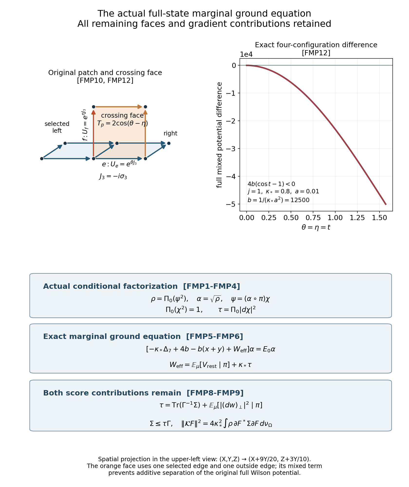
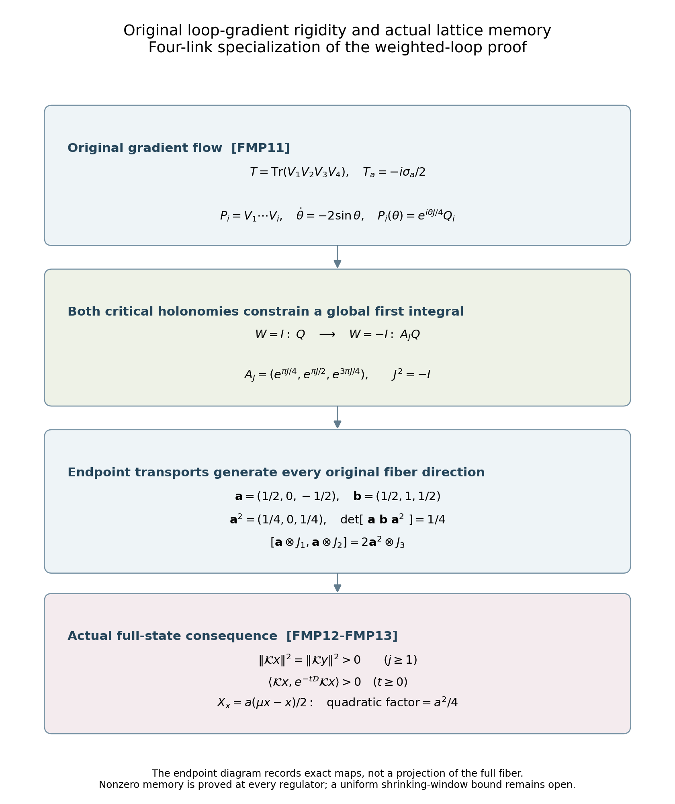

# The actual full-lattice marginal ground equation and its retained gradient energy

Reviewed derivation, 14 October 2026. The source identities below are written for the actual original full ground. The complete FMP1–FMP13 source and two figures have been reviewed; 227 independent diagnostics pass. This continues [TPL15–TPL17](https://github.com/KokunoYumeto/yang-mills-interacting-workbench/blob/b916dc4daadf3b5f43c8059ec7ab5787c5507b92/yang-mills/continuations/20261011-central-signs-shrinking-window/SHARED_LINK_TWO_PLAQUETTE.md). The 36 bounded disk-index routes are metadata; no newly read external theorem is claimed. The aim is to calculate the actual extra terms, without replacing this ground by the isolated two-face ground.

## 1. Original state, measures and conditional map

Keep every original regulator parameter and face:
\[
\begin{gathered}
a_j=(100j)^{-1},\quad L_j=j^4,\quad g_j^2=\kappa_*a_j/2,\quad
b_j=(\kappa_*a_j^2)^{-1},\quad s_j=\kappa_*/j,\\
N_j=3(2L_j)(2L_j+1)^2,\qquad M_j=3(2L_j)^2(2L_j+1),\\
H=-\kappa_*\Delta+2b_jM_j-b_j\sum_pT_p,\quad
H\psi=E_0\psi,\quad\psi>0,\quad\int\psi^2dU=1.
\end{gathered}
\]
Here dU is the original product probability Haar measure and each factor has the radius-two metric and orthonormal generators \(-i\sigma_\alpha/2\). The full ground is smooth and gauge invariant by the compact elliptic ground construction. Write b=bj in the following formulas, keeping this exact relation. For two adjacent coplanar faces use the exact trace map \(\pi=(x,y,z)\), domain Omega, density \(d\nu_\Omega=dx\,dy\,dz/(4\pi^2)\) and full kinetic matrix Gamma of TPL1–TPL6. The two face potentials and every remaining face are
\[
V_2=4b-b(x+y),\qquad V_{\rm rest}=b\sum_{p\ne p_1,p_2}(2-T_p),\qquad
V=V_2\circ\pi+V_{\rm rest}.
\]
Let \(\Pi_0\) be conditional expectation with respect to the original Haar measure given pi, with values viewed as functions on Omega. All its fibers and their probability weights are those constructed by the tree/Haar map in TPL1–TPL3. Set
\[
\rho=\Pi_0(\psi^2),\qquad \alpha=\sqrt\rho,\qquad
\chi=\frac{\psi}{\alpha\circ\pi},\qquad \mu=\psi^2dU.
\tag{FMP1}
\]
These are actual state-dependent quantities. The positive smooth lift of rho is obtained by integrating the full smooth psi2 in the Haar tree and remaining-link coordinates. Its minimum is positive. Thus alpha circpi and chi are positive smooth functions on the full compact link manifold. They satisfy
\[
\Pi_0(\chi^2)=1,\qquad \int_\Omega\alpha^2d\nu_\Omega=1,\qquad
\mathbb E_\mu[f\mid\pi]=\Pi_0(\chi^2f).
\tag{FMP2}
\]
For example, the last identity follows by integrating against every bounded function of pi: multiplying its right side by rho reproduces the original psi2 integral exactly. It is a change of conditional measure with its full density, not a substitution of a different ground.

## 2. Conditional differentiation with its full metric

For any original smooth scalar f, the original Haar conditional map obeys the weak identity
\[
\Pi_0(\Delta f)=\Delta_7\Pi_0f.
\tag{FMP3}
\]
Indeed test it against a smooth gauge-invariant trace function F. Compact-link integration by parts and the exact relation \(\Delta(F\circ\pi)=(\Delta_7F)\circ\pi\) give
\(\int F\Pi_0(\Delta f)d\nu_\Omega=\int f(\Delta_7F)\circ\pi\,dU\).
This is exactly the weak right side. The corresponding Haar projection onto functions of pi commutes with the heat semigroup and Laplacian. More explicitly, first integrate every link outside the selected seven, and then average the compact six-vertex gauge group on those seven links. These commuting orthogonal projections have precisely the trace-measurable range proved in TPL1–TPL3, so their product is the Haar conditional projection. Outside-link integration commutes with the product heat semigroup. Each vertex transformation is an isometry of the original product metric, so its average commutes with that semigroup as well. The product therefore commutes with its generator and every spectral function of the Laplacian. In particular it is a contraction on every Laplacian Sobolev space and preserves smoothness. The inherited closed domain justifies all following integrations at the degenerate trace boundary as well.

Let \(d_j=\Delta\pi_j=(-3x,-3y,-9z/2)_j\). For a compactly supported smooth interior test phi, integration on the full link manifold gives
\[
\begin{aligned}
\int_\Omega\phi\,\Pi_0(\chi\langle d\chi,d\pi_j\rangle)d\nu_\Omega
&=-\frac12\int\chi^2
\left[d_j\phi+\sum_i\Gamma_{ij}\partial_i\phi\right]\circ\pi\,dU\\
&=-\frac12\int_\Omega
\left[d_j\phi+\sum_i\Gamma_{ij}\partial_i\phi\right]d\nu_\Omega=0.
\end{aligned}
\]
The last equality is exactly \(d_j=\sum_i\partial_i\Gamma_{ij}\). Applying FMP3 to chi2 and using its product rule therefore proves
\[
\Pi_0(\chi\langle d\chi,d\pi_j\rangle)=0,\qquad
\Pi_0(\chi\Delta\chi)=-\Pi_0|d\chi|^2=:-\tau.
\tag{FMP4}
\]
Both identities hold as full conditional identities and on their smooth interior representatives. The product rule is \(\Delta\chi^2=2\chi\Delta\chi+2|d\chi|^2\), and \(\Delta_7\Pi_0\chi^2=\Delta_7 1=0\); no derivative of a conditional weight has been discarded. The nonnegative tau is a conditional integral of all N original link-gradient contributions.

## 3. Exact marginal ground equation

Insert \(\psi=(\alpha\circ\pi)\chi\) into the original full equation, multiply by chi and take Pi0. The Laplacian product rule has three terms:
\[
\Delta[(\alpha\circ\pi)\chi]
=\chi(\Delta_7\alpha)\circ\pi
+2\langle d(\alpha\circ\pi),d\chi\rangle
+(\alpha\circ\pi)\Delta\chi.
\]
The first conditional factor is Pi0chi2=1, the middle one vanishes by every component of FMP4, and the third gives -alpha tau. Therefore the actual amplitude satisfies
\[
\boxed{\left[-\kappa_*\Delta_7+4b-b(x+y)
+\mathbb E_\mu[V_{\rm rest}\mid\pi]+\kappa_*\tau\right]\alpha
=E_0\alpha.}
\tag{FMP5}
\]
This retains the original full vacuum energy E0 and the entire remaining-face sum. It holds in the inherited weak domain and hence pointwise on the interior. Define
\(W_{\rm eff}=\mathbb E_\mu[V_{\rm rest}\mid\pi]+\kappa_*\tau\).
For this actual fixed ground, W_eff is a determined nonnegative function, not a freely chosen potential. The equation has not yet evaluated its variation on the regulator path.

The corresponding full energy identity is
\[
\begin{aligned}
E_0={}&\frac{\kappa_*}{4\pi^2}\int_\Omega
\sum_{i,j}\overline{\partial_i\alpha}\Gamma_{ij}\partial_j\alpha\,dx\,dy\,dz\\
&+\int_\Omega\rho[4b-b(x+y)]d\nu_\Omega
+\int V_{\rm rest}\psi^2dU
+\kappa_*\int_\Omega\rho\tau\,d\nu_\Omega.
\end{aligned}\tag{FMP6}
\]
It follows either by multiplying FMP5 by alpha or directly by expanding the full gradient norm. The gradient cross term vanishes by FMP4, leaving both nonnegative gradient contributions. Every Wilson term is nonnegative because each original SU(2) face trace lies in [-2,2]. The constant unit trial function has energy 2bM: each face trace has Haar mean zero by integrating any one of its four original links. The variational principle therefore gives the exact finite-regulator bounds
\[
0\le\kappa_*\int_\Omega\rho\tau\,d\nu_\Omega\le E_0\le2bM,\qquad
0\le\mathbb E_\mu[V_{\rm rest}\mid\pi]\le4b(M-2).
\]
These full-volume bounds are retained as such. Their growth along the stated path is not a shrinking-window spectral estimate.

## 4. Relation to the full dynamic residual

Keep \(w=\log\psi\), \(h_i=\langle dw,d\pi_i\rangle\) and \(\bar h_i=\mathbb E_\mu[h_i\mid\pi]\). TPL17 proves \(\bar h_i=\sum_j\Gamma_{ij}\partial_j\log\rho/2\). Put
\[
\zeta=d\log\chi=dw-\frac12\sum_i(\partial_i\log\rho)\circ\pi\,d\pi_i,
\qquad
\Sigma_{ij}=\mathbb E_\mu[(h_i-\bar h_i)(h_j-\bar h_j)\mid\pi].
\]
FMP2 and \(|d\chi|^2=\chi^2|d\log\chi|^2\) give two exact expressions:
\[
\tau=\mathbb E_\mu[|\zeta|^2\mid\pi]
=\mathbb E_\mu[|dw|^2\mid\pi]
-\frac14\sum_{i,j}\Gamma_{ij}(\partial_i\log\rho)(\partial_j\log\rho).
\tag{FMP7}
\]
The subtraction follows by expanding the whole square and substituting the full conditional mean hbar; its cross term is minus one half of the displayed quadratic form and its final square adds one quarter.

On the interior Gamma is invertible. The span of the three covectors dpi_i has Gram matrix Gamma. Its orthogonal projection of zeta is
\(\sum_i[\Gamma^{-1}(h-\bar h)]_i\,d\pi_i\).
The perpendicular part of zeta is the perpendicular part \((dw)_\perp\) of dw itself, since the subtracted marginal gradient lies in this span. Pythagoras and conditional integration yield the exact decomposition
\[
\tau=\operatorname{Tr}(\Gamma^{-1}\Sigma)
+\mathbb E_\mu[|(dw)_\perp|^2\mid\pi],\qquad
0\le\Sigma\le\tau\Gamma.
\tag{FMP8}
\]
The matrix inequality follows without dividing by Gamma at any singular orbit: for any real vector v, \(v^T(h-\bar h)=\langle\zeta,\sum_i v_i d\pi_i\rangle\). Conditional Cauchy–Schwarz gives \(v^T\Sigma v\le\tau v^T\Gamma v\). Complex vectors follow by the real symmetric matrix inequality. The inverse identity is asserted only on the interior; both nonnegative terms are kept, including the entire unobserved perpendicular score.

For the actual ground generator \(\mathcal L=\psi^{-1}(H-E_0)\psi\), let J be the trace isometry of TPL16 and \(\mathcal K=(I-JJ^*)\mathcal LJ\). The proved TPL17 formula now gives
\[
\begin{gathered}
\|\mathcal KF\|^2=4\kappa_*^2\int_\Omega\rho
\sum_{i,j}\overline{\partial_iF}\Sigma_{ij}\partial_jF\,d\nu_\Omega,\\
\|\mathcal KF\|^2\le4\kappa_*^2\int_\Omega\rho\tau
\sum_{i,j}\overline{\partial_iF}\Gamma_{ij}\partial_jF\,d\nu_\Omega.
\end{gathered}\tag{FMP9}
\]
This relates the actual dynamic residual directly to the retained marginal gradient energy. For every positive sigma, the complete nonnegative complementary form operator \(\mathcal D\) also gives
\(0\le\langle\mathcal KF,(\mathcal D+\sigma)^{-1}\mathcal KF\rangle\le\|\mathcal KF\|^2/\sigma\).
The projection preserves the needed Sobolev form domains: conditional Haar projection does so by FMP3, and the conditional mu projection is its composition with multiplication by the smooth bounded positive factors psi2 and rho inverse. Thus the complementary closed form and its resolvent are the actual full ones. No part of that resolvent has been replaced by a finite matrix tail.

## 5. The full state has a strictly positive retained gradient contribution

For every original regulator j>=1, the last term of FMP6 is strictly positive:
\[
\int_\Omega\rho\tau\,d\nu_\Omega>0.
\tag{FMP10}
\]
Suppose this integral were zero. Positivity of rho and the definition of tau give \(d\chi=0\) almost everywhere in original Haar measure. Smoothness and connectedness of the full product SU(2) manifold then make chi constant. FMP2 and positivity make that constant exactly one, so \(\psi=\alpha\circ\pi\). The full ground equation and TPL15 would consequently make V_rest a function of pi alone:
\(V_{\rm rest}=E_0+\kappa_*[(\Delta_7\alpha)/\alpha]\circ\pi-V_2\circ\pi\).
The identity holds for the smooth lifts at every original configuration, including singular trace orbits.

Here is an explicit contradiction on every original box. Place the two selected xy faces at integer lower corners (-1,0,0) and (0,0,0). These lie in every box with L>=1. Set all original links to the identity except the positively oriented z edge from (0,0,0) to (0,0,1). Give that edge the matrix \(W_\theta=\cos\theta I-i\sin\theta\sigma_3\). All seven selected links stay the identity and pi=(2,2,2) stays fixed. Precisely four original plaquettes contain that edge, all outside the selected pair. Each has trace \(\operatorname{Tr}W_\theta^{\pm1}=2\cos\theta\); every other face has trace two. Hence the complete remaining potential on these configurations is
\[
V_{\rm rest}=4b(2-2\cos\theta).
\]
It is not constant in theta, contradicting dependence on the fixed pi. The same proof applies to a translated or rotated admissible adjacent pair by choosing an available perpendicular edge; the stated explicit pair suffices for every regulator in the programme. This proves FMP10 for that original receiving map.

Strict positivity of this total gradient energy does not itself prove \(\Sigma\ne0\): FMP8 retains an additional perpendicular contribution. The following original-gradient argument establishes nonzero trace covariance directly. Quantitative regulator asymptotics and variation of W_eff remain to be calculated.

## 6. Rigidity of the original SU(2) loop-trace gradient

Let \(V_1,\ldots,V_m\in SU(2)\), with the original radius-two metric on every factor, and define \(P_i=V_1\cdots V_i\), \(W=P_m\), \(T=\operatorname{Tr}W\). For arbitrary fixed positive numbers \(\lambda_1,\ldots,\lambda_m\), keep the full weighted vector field
\[
\mathcal X_\lambda F=\sum_{e=1}^m\lambda_e\langle d_eT,d_eF\rangle.
\]
For every smooth complex scalar F on the whole product,
\[
\mathcal X_\lambda F=0\quad\Longrightarrow\quad F\text{ is constant on }SU(2)^m.
\tag{FMP11}
\]
This statement permits independent spectator variables: holding them fixed gives the same conclusion about all m loop factors. The actual plaquette uses m=4 and every lambda=1; the weighted statement proves a further generality without changing that original case. Inverse-oriented factors are allowed because inversion is an isometry of the given bi-invariant metric.

Here is a complete proof with the original generator constants. Put \(J_a=-i\sigma_a\), so \(T_a=J_a/2\) are the original orthonormal generators, \(J_a^2=-I\), and \([J_1,J_2]=2J_3\). Every noncentral W has a unique representation \(W=\cos\theta I+\sin\theta J\) with \(0<\theta<\pi\), \(J=\sum_a n_aJ_a\), \(\sum_a n_a^2=1\). Direct contraction gives
\[
K(W):=\sum_a\operatorname{Tr}(T_aW)T_a
=\frac{W^{-1}-W}{4}=-\frac{\sin\theta}{2}J.
\]
The gradient equation in the e-th factor is
\(\dot V_e=\lambda_e P_{e-1}^{-1}K(W)P_{e-1}V_e\).
Indeed a left variation of V_e differentiates T as \(\operatorname{Tr}(P_{e-1}T_aP_{e-1}^{-1}W)\); invariance of the generator contraction gives this exact matrix. Summing all contributions to each partial product, with \(c_i=\lambda_1+\cdots+\lambda_i\), yields
\[
\dot P_i=c_iK(W)P_i,\qquad
\dot\theta=-\frac{c_m}{2}\sin\theta,\qquad
\frac{dP_i}{d\theta}=\frac{c_i}{c_m}JP_i.
\]
Thus J stays fixed on a noncentral orbit. If \(Q=(Q_1,\ldots,Q_{m-1})\in SU(2)^{m-1}\), its full flow arc, parameterized by theta, is
\[
P_i(\theta)=\exp\left(\frac{c_i}{c_m}\theta J\right)Q_i\quad(i<m),
\qquad P_m(\theta)=\exp(\theta J).
\]
Recover the original factors exactly by \(V_i=P_{i-1}^{-1}P_i\), with P0=I. As theta tends to zero the total holonomy tends to I and the partial products tend to Q. As theta tends to pi the total holonomy tends to -I and the partial products tend to
\(A_JQ\), where \((A_J)_i=\exp(\alpha_iJ)\) and \(\alpha_i=\pi c_i/c_m\in(0,\pi)\). A first integral F is constant along each such arc. Its continuity at both critical sets therefore implies
\(F_+(Q)=F_-(A_JQ)\) for every Q and every J, where F+ and F- are its restrictions to W=I and W=-I.

For m=1, the first critical set is one point, and every noncentral arc limits to it, proving the claim immediately. For m>=2 the endpoint identity makes F+ invariant under every left multiplication \(A_K^{-1}A_J\). Let H be the closed subgroup of \(SU(2)^{m-1}\) generated by these elements. It is invariant under simultaneous conjugation, since \(A_{gJg^{-1}}=gA_Jg^{-1}\) in every component. Its Lie algebra therefore is invariant under the same simultaneous adjoint action.

Fix K=J3 and differentiate \(J(\varepsilon)=\cos\varepsilon J_3+\sin\varepsilon J_1\) at zero. In this loop lemma, the coefficient vectors with entries a_i,b_i are separate from the original scalar spacing a and coupling b; the figures write these vectors in bold. The resulting Lie-algebra element has i-th component
\[
e^{-\alpha_iJ_3}\sin\alpha_iJ_1
=a_iJ_1-b_iJ_2,\qquad
a_i=\sin\alpha_i\cos\alpha_i,\quad b_i=\sin^2\alpha_i.
\]
Conjugation by \(e^{\pi J_1/2}\) fixes J1 and negates J2, so the sum and difference of these two Lie-algebra vectors give a tensor J1 and b tensor J2 separately. Other simultaneous conjugations give both coefficient vectors a,b tensored with every element of su(2). If coefficient vectors u,v have this property, their componentwise product does too, since
\([u\otimes J_1,v\otimes J_2]=2(uv)\otimes J_3\), followed by simultaneous conjugation. The allowable coefficient vectors consequently form a real algebra containing a and b.

Every b_i is positive. If B is the finite set of its distinct values, the polynomial \(p(t)=1-\prod_{\beta\in B}(1-t/\beta)\) has zero constant term and satisfies p(b_i)=1. Thus this algebra contains the constant vector one. Moreover the points (a_i,b_i) are distinct: \(2a_i=\sin(2\alpha_i)\), \(1-2b_i=\cos(2\alpha_i)\), and the alpha_i increase strictly in (0,pi). For each i the polynomial
\[
L_i(A,B)=\prod_{j\ne i}
\frac{(A-a_j)(a_i-a_j)+(B-b_j)(b_i-b_j)}{(a_i-a_j)^2+(b_i-b_j)^2}
\]
therefore evaluates to one at (a_i,b_i) and zero at all the other displayed points. Each coordinate unit vector belongs to the coefficient algebra. The Lie algebra of H is the entire direct sum of m-1 copies of su(2). The exponential map therefore puts a full neighborhood of the identity in H. Its translates make H open; its other cosets are also open. Connectedness of the ambient product group forces H to be the entire group. Hence F+ is constant, and the flow arcs show that F is constant at every noncentral point. Continuity includes both central sets and proves FMP11.

For the actual four-link case, the full constants reduce to
\[
a=(1/2,0,-1/2),\qquad b=(1/2,1,1/2),\qquad
a^2=(1/4,0,1/4),\qquad \det[\,a\ b\ a^2\,]=1/4.
\]
The bracket factor two remains as above. These three vectors already span all three coefficient slots, so the original case requires no interpolation beyond those explicit three vectors. This proof concerns the actual loop-gradient on its complete compact product, including both critical holonomies; a local first integral on the noncentral region need not extend to either critical set.

## 7. Nonzero actual trace-score covariance at every original regulator

For the explicit adjacent pair fixed in FMP10, the actual residual obeys
\[
\|\mathcal Kx\|^2=\|\mathcal Ky\|^2>0,
\qquad
\int_\Omega\rho\Sigma_{xx}\,d\nu_\Omega
=\int_\Omega\rho\Sigma_{yy}\,d\nu_\Omega>0.
\tag{FMP12}
\]
This holds for every original j>=1 and kappa>0, with b fixed to \(1/(\kappa_*a_j^2)\); it is not restricted to an expansion about b=0.

Suppose first that both residual norms vanished. FMP9 and the exact pointwise source of TPL17 would give
\(\langle d\log\chi,dx\rangle=\langle d\log\chi,dy\rangle=0\)
almost everywhere in the full positive ground measure. These are smooth functions on the original compact product, so both identities hold everywhere. Hold all other links fixed and apply FMP11 to the four oriented factors of the left plaquette. It makes logchi independent of each of those four original links. Apply it to the four factors of the right plaquette in the same way. Their union is the full seven-link patch, so chi depends only on the complementary original links. Thus the actual state factorizes as
\(\psi(U_{\rm patch},U_{\rm out})=(\alpha\circ\pi)(U_{\rm patch})\beta(U_{\rm out})\),
with positive smooth factors and their full original probability norms. The Laplacian product rule has no cross term between these disjoint link sets. Dividing the original ground equation by psi therefore forces its entire potential to be additively separable:
\[
2bM-b\sum_pT_p
=E_0+\kappa_*\frac{\Delta_{\rm patch}(\alpha\circ\pi)}{\alpha\circ\pi}
+\kappa_*\frac{\Delta_{\rm out}\beta}{\beta}.
\]

This is contradicted by two explicit original links. Let e be the x edge from (0,0,0) to (1,0,0) in the selected right face, and let f be the outside z edge from (0,0,0) to (0,0,1). Set every other original link to I and set
\(U_e=\cos\theta I+\sin\theta J_3\), \(U_f=\cos\eta I+\sin\eta J_3\).
Each edge belongs to four original faces. They share precisely the xz face with lower corner (0,0,0), whose holonomy has trace \(2\cos(\theta-\eta)\). The other three e faces have trace \(2\cos\theta\), and the other three f faces have trace \(2\cos\eta\); all remaining faces have trace two. Thus the entire original potential on these configurations is
\[
V(\theta,\eta)=3b(2-2\cos\theta)+3b(2-2\cos\eta)
+b(2-2\cos(\theta-\eta)).
\]
All 2bM terms are included in this evaluation; the identity traces contribute their exact zero Wilson terms. Its mixed finite difference is
\[
\begin{aligned}
&V(\theta,\eta)-V(\theta,0)-V(0,\eta)+V(0,0)\\
&\hspace{1cm}=2b[-\cos(\theta-\eta)+\cos\theta+\cos\eta-1].
\end{aligned}
\]
For theta=eta=t with 0<t<2pi this equals \(4b(\cos t-1)<0\), whereas additive separation makes the same four-term expression zero. Both edges and all seven incident faces lie in every original box L>=1. This contradiction proves that the sum of the two residual squared norms is positive.

Finally reflect the full symmetric box in its coordinate plane x=0, sending every reversed oriented link to its inverse. This is a measure-preserving isometry of the exact product metric and preserves the full original face potential. Uniqueness of the positive unit ground makes psi invariant. On the selected common-root holonomies the reflection sends U,V to \(V^{-1},U^{-1}\), so it sends the trace triple to (y,x,z). Therefore it preserves the trace-measurable subspace and commutes with its ground-measure orthogonal projection, the full ground generator and the complementary form. The unitary reflection sends Kx to Ky; their norms are equal. Since their squared sum is positive, each is strictly positive. FMP9 then gives the covariance statements with the full factor \(4\kappa_*^2\), proving FMP12.

## 8. The entire trace-complement memory is strictly positive

Let \(\mathcal D\) be the actual complementary closed form operator in FMP9 and let sigma>0. FMP12 implies
\[
\begin{gathered}
\langle\mathcal Kx,e^{-t\mathcal D}\mathcal Kx\rangle
=\langle\mathcal Ky,e^{-t\mathcal D}\mathcal Ky\rangle>0
\quad(t\ge0),\\
\langle\mathcal Kx,(\mathcal D+\sigma)^{-1}\mathcal Kx\rangle
=\langle\mathcal Ky,(\mathcal D+\sigma)^{-1}\mathcal Ky\rangle>0.
\end{gathered}\tag{FMP13}
\]
For proof, the spectral measure of a nonzero vector Kx for the self-adjoint nonnegative D has positive total mass. The functions exp(-t lambda) and 1/(lambda+sigma) are strictly positive at every finite spectral value, so their integrals against that measure are strictly positive. Reflection gives the equalities because it commutes with the same complementary operator. For each original centered single-face observable \(X_x=a(\mu x-x)/2\), or its y counterpart, K kills the constant and multiplies the displayed quadratic expressions by the exact factor \(a^2/4\). No shift, raw coefficient or full complementary spectral tail is removed.

This is the complement of the trace-measurable subspace. It has a proved exact receiving map to the original full state; it is not silently identified with the earlier central-sign complement. FMP12–FMP13 establish nonzero actual dynamic coupling at every original regulator, beyond the small-b result of TPL14. They do not give a uniform lower bound in a shrinking spectral window or fix the full signed three-shift combination. Those quantities, the variation of W_eff and the continuum construction remain the next calculations.

The spatial graph uses the exact projection (X,Y,Z) to (X+9Y/20,Z+3Y/10) of the original integer vertices in FMP10 and FMP12. The selected seven links remain blue; the crossing xz face contains the original e and f edges with their orientations intact. The curve is the exact four-configuration potential difference of FMP12 at the original j=1 regulator with kappa=0.8, a=0.01 and b=12500; it is not an approximation to the unknown ground. The lower equations retain the full conditional remaining potential, original ground energy and both score contributions. The inverse Gamma formula is an interior identity, as specified in FMP8.

This diagram specializes FMP11 to the original four links with all weights one. The integer i labels the partial products, with Q4=I. The two critical holonomies and their exact endpoint transports determine the global first-integral condition; the coefficient vectors in bold are distinct from the physical scalar spacing and coupling. Their square is componentwise, the determinant is exactly one quarter, and the Lie bracket retains its factor two. FMP12 uses this complete compact argument and the explicit crossing face to prove nonzero dynamic residuals at every original regulator. FMP13 applies the actual entire complementary spectral measure. No uniform shrinking-window lower bound is inferred. Reproducible sources: [figure_full_marginal.py](figure_full_marginal.py), [check_full_marginal.py](check_full_marginal.py), and [check_loop_rigidity.py](check_loop_rigidity.py).

The diagnostics comprise 80 conditional-score/full-potential checks and 147 original generator, weighted-flow, endpoint coefficient, crossing-face and full-box reflection checks. They do not compute the full ground. All actual-ground and global-rigidity conclusions are proved in the text. The inherited Wilson center-multiplication human provenance remains L. Li and Y. Meurice, [arXiv:hep-lat/0410029v2](https://arxiv.org/abs/hep-lat/0410029v2), Sections II–IV and Appendix, through the retained CS/CK author-source record; no new external theorem reading or novelty claim is asserted.

## Quantitative full-state loop coupling and complete memory bounds

[QLR1–QLR10](https://github.com/KokunoYumeto/yang-mills-interacting-workbench/blob/main/yang-mills/continuations/20261011-central-signs-shrinking-window/QUANTITATIVE_LOOP_RIGIDITY.md) give an evaluated positive lower bound for the actual face-to-trace-complement coupling on every original regulator. The proof retains the full nine-by-nine endpoint derivative, the exact crossing Wilson coefficient and all original ground-density and link-ball factors. It proves
\[
\begin{gathered}
\|\mathcal Kx\|^2=\|\mathcal Ky\|^2\ge m_*>0,\\
\langle\mathcal Kx,e^{-t\mathcal D}\mathcal Kx\rangle
\ge m_*e^{-tE_*/m_*},\qquad
\langle\mathcal Kx,(\mathcal D+\sigma)^{-1}\mathcal Kx\rangle
\ge\frac{m_*^2}{E_*+\sigma m_*},
\end{gathered}
\]
with every constant specified in the proof, t>=0 and sigma>0. The centered original observable keeps its factor \(a^2/4\). The proof also constructs the exact unrestricted L2 coercivity defect and overcomes it using the actual ground derivatives. These complete finite-regulator bounds are small: at kappa=4/5 and j=1 the displayed formula has log10 mass floor about -466826.28. This is a bound, not the actual spectral mass. The full signed shrinking window and smooth global no-gap construction remain active.

## Actual local conditional memory bound and its original-path coefficient

[LPF1–LPF7](https://github.com/KokunoYumeto/yang-mills-interacting-workbench/blob/main/yang-mills/continuations/20261011-central-signs-shrinking-window/LOCAL_CONDITIONAL_MEMORY_FLOOR.md) retain the actual outside marginal and every density derivative in the crossing Wilson identity. The original four-link and seven-link conditional comparisons give an evaluated positive full-state residual floor, with the earlier bound retained as well:
\[
\|\mathcal Kx\|^2=\|\mathcal Ky\|^2\ge\max\{m_*,m_C\},\qquad m_C=2\kappa_*^2B_Pe_C^{23}>0.
\]
The complete time and resolvent memory bounds keep the same original complementary operator and the physical factor \(a^2/4\). Every constant is specified. The lower-bound formula has the exact limit
\[
m_C j^{869}e^{84800\pi^2j/\kappa_*}\longrightarrow A_{\kappa_*}>0,
\]
with its full coefficient proved in LPF7. This improves the volume dependence of the earlier estimate while retaining every original boundary term. It describes the bound formula, not the actual spectral mass. The signed shrinking window and smooth global no-gap construction remain active.
