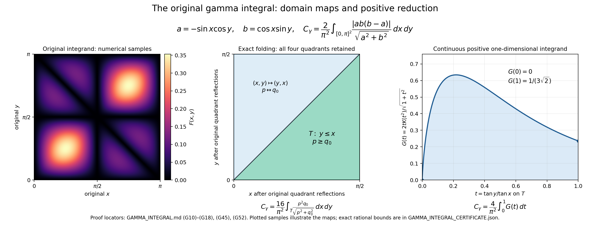

# Exact evaluation of the assigned gamma integral

Status: complete independent derivation, 2026-10-11. This note evaluates the exact constant supplied in the task. The receiving cochain construction and its convergence to this constant are owned by the receiving calculation. No novelty claim is made. Every analytic identity used below is derived here; no unread external theorem is imported.

## 1. Original object and result

For the original coordinates \((x,y)\in[0,\pi]^2\), retain

\[
a(x,y)=-\sin x\cos y,\qquad b(x,y)=\cos x\sin y,
\]

\[
\begin{gathered}
F(x,y)=
\begin{cases}
\dfrac{|a(x,y)b(x,y)(b(x,y)-a(x,y))|}
{\sqrt{a(x,y)^2+b(x,y)^2}},&(a(x,y),b(x,y))\ne(0,0),\\[2mm]
0,&(a(x,y),b(x,y))=(0,0),
\end{cases}\\
C_\gamma=\frac{2}{\pi^2}\int_0^\pi\int_0^\pi F(x,y)\,dx\,dy.
\end{gathered}\tag{G1}
\]

The assigned cochain expression motivating this constant is

\[
v_2=\frac{w(k)v(l)}{\sqrt{2n}},\qquad
v_3=-\frac{v(k)w(l)}{\sqrt{2n}},\qquad
\gamma=\frac{v_2v_3(v_3-v_2)}{\sqrt{v_2^2+v_3^2}},
\tag{G2}
\]

with zero at simultaneous zeros. This note preserves the prefactor in (G1); it does not replace or rederive the definitions of \(v,w\), their supports, or the receiving sum.

For \(|z|<1\), define

\[
\operatorname{Li}_2(z)=\sum_{k=1}^{\infty}\frac{z^k}{k^2},
\tag{G3}
\]

and also define \(\operatorname{Li}_2(1)=\sum_{k\ge1}k^{-2}\), a convergent sum. Put

\[
A=\sqrt2,\qquad q=A-1,\qquad \tau=q^2=3-2A.
\tag{G4}
\]

**Theorem G.** The original integral (G1) satisfies

\[
\boxed{
C_\gamma=
\frac{2+\frac{\sqrt2}{2}
+3\log\!\left(\frac{2}{1+\sqrt2}\right)
-\frac{\operatorname{Li}_2(3-2\sqrt2)}{2\sqrt2}}{\pi^2}
-\frac{1}{24\sqrt2}.
}
\tag{G5}
\]

It is strictly positive and obeys the exact elementary bounds

\[
\frac{\sqrt2}{\pi^2}<C_\gamma<\frac{2}{\pi^2}.
\tag{G6}
\]

The standard-library rational calculation in `verify_gamma_integral.py`, using the proved remainders of Section 8, establishes the strict finite enclosure

\[
\boxed{
0.181178439743214882282299233973
<C_\gamma<
0.181178439743214882282299233974.
}
\tag{G7}
\]

Both a dilogarithm evaluation and an independent geometrically convergent moment series give (G7). Their complete arithmetic certificates are reproduced by running `python verify_gamma_integral.py`; the result is `GAMMA_INTEGRAL_CERTIFICATE.json`.

First, (G1) defines a continuous function, including its specified zero value. Indeed, for \(r=\sqrt{a^2+b^2}\),

\[
|ab|\le\frac{r^2}{2},\qquad |b-a|\le\sqrt2\,r,
\qquad 0\le\frac{|ab(b-a)|}{r}\le\frac{r^2}{\sqrt2}.
\tag{G8}
\]

Thus this expression tends to zero when \((a,b)\to(0,0)\). Elsewhere its denominator is nonzero and the expression is continuous. Since \(a,b\) are continuous on the compact original square, so is \(F\). In particular its integral is finite and ordinary Riemann sums converge to the original integral. This observation concerns (G1) itself; any additional cochain prefactor must still be retained in its receiving proof.

## 2. Exact quadrant and triangle maps

Write \(Q=[0,\pi/2]^2\). On \(Q\), let

\[
p=\sin x\cos y\ge0,\qquad q_0=\cos x\sin y\ge0,
\qquad r=\sqrt{p^2+q_0^2}.
\tag{G9}
\]

The name \(q_0\) here is separate from the constant \(q=\sqrt2-1\) in (G4). The original coordinate reflections, with absolute Jacobian one, give the following four values at the corresponding points:

The four original point / original \((a,b)\) / original \(F\) rows are:

\((x,y)\); \((-p,q_0)\); \(p q_0(p+q_0)/r\).

\((\pi-x,y)\); \((-p,-q_0)\); \(p q_0|p-q_0|/r\).

\((x,\pi-y)\); \((p,q_0)\); \(p q_0|p-q_0|/r\).

\((\pi-x,\pi-y)\); \((p,-q_0)\); \(p q_0(p+q_0)/r\).

Zero denominators have the original zero interpretation. The shared boundaries have area zero, so this table proves, without discarding a quadrant,

\[
\int_{[0,\pi]^2}F
=2\int_Q\frac{p q_0(p+q_0+|p-q_0|)}r
=4\int_Q\frac{p q_0\max(p,q_0)}r.
\tag{G10}
\]

On the interior of \(Q\), \(p\ge q_0\) is equivalent to \(\tan x\ge\tan y\), and hence to \(x\ge y\). The map \((x,y)\mapsto(y,x)\) has absolute Jacobian one, exchanges \(p,q_0\), and exchanges the two triangular regions. Their integrands agree under this map. Consequently, with \(T=\{0\le y\le x\le\pi/2\}\),

\[
\int_{[0,\pi]^2}F=8\int_T\frac{p^2q_0}{r}\,dx\,dy,
\qquad
C_\gamma=\frac{16}{\pi^2}\int_T\frac{p^2q_0}{r}\,dx\,dy.
\tag{G11}
\]

## 3. Exact one-dimensional reduction

On the open triangle, use the bijection

\[
u=\tan x>0,\qquad v=\tan y\in(0,u),
\quad
x=\arctan u,\quad y=\arctan v.
\tag{G12}
\]

Every factor is

\[
p=\frac{u}{\sqrt{(1+u^2)(1+v^2)}},\quad
q_0=\frac{v}{\sqrt{(1+u^2)(1+v^2)}},\quad
r=\frac{\sqrt{u^2+v^2}}{\sqrt{(1+u^2)(1+v^2)}},
\]

\[
dx\,dy=\frac{du\,dv}{(1+u^2)(1+v^2)},\qquad
\frac{p^2q_0}{r}\,dx\,dy
=\frac{u^2v\,du\,dv}
{(1+u^2)^2(1+v^2)^2\sqrt{u^2+v^2}}.
\tag{G13}
\]

Set \(v=tu\), so \(t\in(0,1)\) and \(du\,dv=u\,du\,dt\). Then set \(s=u^2\), so \(u^3du=s\,ds/2\). The nonnegative integral becomes

\[
C_\gamma
=\frac8{\pi^2}\int_0^1\frac{t}{\sqrt{1+t^2}}
\left(\int_0^\infty\frac{s\,ds}{(1+s)^2(1+t^2s)^2}\right)dt.
\tag{G14}
\]

Finally put \(z=t^2\), retaining \(t\,dt=dz/2\). Define, for \(0<z\le1\),

\[
K(z)=\int_0^\infty\frac{s\,ds}{(1+s)^2(1+zs)^2}>0.
\tag{G15}
\]

The exact reduction is

\[
\boxed{C_\gamma=\frac4{\pi^2}\int_0^1\frac{K(z)}{\sqrt{1+z}}\,dz.}
\tag{G16}
\]

All these changes are bijections on the stated interiors. One can first apply them on compact subregions and then increase those subregions to the full interiors. Their integrands are nonnegative, so the limiting integrals agree. No endpoint or boundary term is suppressed.

To evaluate the radial integral, put \(t_0=s/(1+s)\). Direct substitution yields

\[
K(z)=\int_0^1\frac{t_0(1-t_0)}{(1-(1-z)t_0)^2}\,dt_0.
\tag{G17}
\]

For \(0<z<1\), the further substitution \(w=1-(1-z)t_0\) gives

\[
K(z)=\frac1{(1-z)^3}
\int_z^1\left[-1+\frac{1+z}{w}-\frac z{w^2}\right]dw
=\frac{-(1+z)\log z-2(1-z)}{(1-z)^3}.
\tag{G18}
\]

At \(z=1\), (G17) gives \(K(1)=\int_0^1t_0(1-t_0)dt_0=1/6\). The apparent singularity in (G18) at that endpoint is therefore removable. At \(z=0\), \(K(z)\) has an integrable logarithmic divergence: (G18) directly shows \(K(z)=O(1+|\log z|)\) for \(0<z\le1/2\). No finite value is assigned to \(K(0)\); the integral in (G16) is an improper integral there.

For a useful exact mass identity, use the nonnegative integrand of (G15):

\[
\int_0^1 K(z)\,dz
=\int_0^\infty\frac{s}{(1+s)^2}
\left(\int_0^1\frac{dz}{(1+zs)^2}\right)ds
=\int_0^\infty\frac{s\,ds}{(1+s)^3}
=\frac12.
\tag{G19}
\]

For \(s>0\), the inner integral is \(1/(1+s)\), by its elementary antiderivative. The last integral follows on writing \(s=(1+s)-1\). Since \(K(z)>0\) and \(1/\sqrt2<1/\sqrt{1+z}<1\) for \(0<z<1\), (G16) and (G19) prove the strict inequalities (G6), and hence positivity.

## 4. Endpoint-controlled integration by parts

In (G16), set \(y_0=\sqrt{1+z}\), so \(1<y_0<A=\sqrt2\), \(dz/\sqrt{1+z}=2dy_0\), and \(1-z=2-y_0^2\). For this section write \(y=y_0\) and \(D=2-y^2\). Then

\[
C_\gamma=\frac8{\pi^2}\int_1^A f(y)\,dy,\qquad
f(y)=-\frac{y^2\log(y^2-1)}{D^3}-\frac2{D^2}.
\tag{G20}
\]

Let

\[
\ell=\log(1+A),\quad
h(y)=\frac12\log\frac{A+y}{A-y},\quad
R(y)=-\frac y{4D^2}+\frac y{16D}.
\tag{G21}
\]

Since \((A-1)(A+1)=1\), \(h(1)=\ell\). Direct differentiation gives

\[
h'(y)=\frac A D,\qquad
\left(R(y)+\frac{h(y)}{16A}\right)'=-\frac{y^2}{D^3}.
\tag{G22}
\]

For verification of the remaining rational terms,

\[
-\frac{2yR(y)}{y^2-1}-\frac2{D^2}
=\frac1{4D}-\frac1{D^2}
+\frac3{16(y-1)}-\frac3{16(y+1)}
=\left(-\frac y{4D}+\frac3{16}\log\frac{y-1}{y+1}\right)'.
\tag{G23}
\]

Define the full boundary expression

\[
B(y)=\left(R(y)+\frac{h(y)-\ell}{16A}\right)\log(y^2-1)
-\frac y{4D}+\frac3{16}\log\frac{y-1}{y+1}.
\tag{G24}
\]

Equations (G22)-(G23) prove by differentiation on \(1<y<A\) that

\[
B'(y)=f(y)+\frac{(h(y)-\ell)y}{8A(y^2-1)}.
\tag{G25}
\]

At the lower endpoint, \(R(1)=-3/16\), and \(h(y)-\ell=O(y-1)\). Therefore the product of the latter difference with \(\log(y^2-1)\) tends to zero, and the two logarithmic divergences in (G24) give the finite limit

\[
B(1+)= -\frac14-\frac38\log2.
\tag{G26}
\]

In detail, \(\log(y^2-1)=\log(y-1)+\log(y+1)\), so the sum of its coefficient \(-3/16\) with the final log term is \(-3\log(y+1)/8\) in the limit.

At the upper endpoint, \(y^2-1=1-D\), and

\[
\log(1-D)=-D-\frac{D^2}{2}+O(D^3).
\]

It follows directly that

\[
R(y)\log(1-D)-\frac y{4D}=\frac y{16}+O(D).
\]

Also \(h(y)=O(1+|\log D|)\), so \((h(y)-\ell)\log(1-D)\to0\). The ratio \((A-1)/(A+1)=(A-1)^2=e^{-2\ell}\) supplies the final term. Thus

\[
B(A-)=\frac A{16}-\frac38\ell.
\tag{G27}
\]

The residual integral

\[
J=\int_1^A (h(y)-\ell)\frac y{y^2-1}\,dy
\tag{G28}
\]

is finite: at \(y=1\) its integrand tends to \(A/2\), from \(h'(1)=A\); at \(y=A\) it has at most a logarithmic divergence. Integrating (G25) first over \([1+\varepsilon,A-\delta]\) and taking these proved endpoint limits gives

\[
\int_1^A f(y)\,dy
=\frac14+\frac A{16}+\frac38(\log2-\ell)-\frac J{8A},
\]

\[
C_\gamma=\frac{2+A/2+3(\log2-\ell)-J/A}{\pi^2}.
\tag{G29}
\]

## 5. Exact residual dilogarithm

Set

\[
t=\frac{A-y}{A+y},\quad
y=A\frac{1-t}{1+t},\quad
\tau=(A-1)^2.
\tag{G30}
\]

This is a decreasing bijection from \(1<y<A\) onto \(0<t<\tau\). Its endpoints are \(t(1)=\tau\), \(t(A)=0\). The exact factors are

\[
h(y)-\ell=-\frac12\log(t/\tau),\qquad
y^2-1=\frac{(1-t/\tau)(1-\tau t)}{(1+t)^2},
\]

\[
\frac y{y^2-1}\,dy
=\frac12\left[\frac1{t-\tau}+\frac1{t-\tau^{-1}}-\frac2{t+1}\right]dt.
\tag{G31}
\]

The quadratic factorization is exact because \(\tau+\tau^{-1}=6\). Substitution into (G28), including the reversed orientation, and then \(u=t/\tau\) yields

\[
J=\frac14\int_0^1\log u
\left[\frac1{u-1}-\frac{\tau^2}{1-\tau^2u}
-\frac{2\tau}{1+\tau u}\right]du.
\tag{G32}
\]

For each integer \(k\ge0\), integration by parts gives
\(\int_0^1u^k\log u\,du=-1/(k+1)^2\); the endpoint term at zero vanishes because \(u^{k+1}\log u\to0\). Expanding the three geometric series in (G32) now gives

\[
J=\frac14\left[\operatorname{Li}_2(1)+\operatorname{Li}_2(\tau^2)
-2\operatorname{Li}_2(-\tau)\right].
\tag{G33}
\]

The first expansion has nonnegative terms after multiplying \(-\log u\), so termwise integration follows from increasing partial sums. The other two converge absolutely with ratios at most \(\tau^2<1\) and \(\tau<1\), and their integrated absolute sums are finite. These facts justify the integrations.

Selecting the even terms in the absolutely convergent defining sums proves

\[
\operatorname{Li}_2(\tau)+\operatorname{Li}_2(-\tau)
=\frac12\operatorname{Li}_2(\tau^2).
\tag{G34}
\]

Hence the exact residual evaluation is

\[
\boxed{J=\frac14\operatorname{Li}_2(1)+\frac12\operatorname{Li}_2(\tau).}
\tag{G35}
\]

## 6. Self-contained evaluation at one

Here is a short derivation of \(\operatorname{Li}_2(1)=\pi^2/6\), to identify every constant used in (G5). For \(0<\rho<1\), the power series obtained by integrating the geometric series is

\[
\sum_{n\ge1}\frac{\rho^n e^{int}}n=-\log(1-\rho e^{it}).
\]

On \(0\le t\le\pi\), the real part of \(1-\rho e^{it}\) is positive. Thus the imaginary part is the unambiguous real arctangent

\[
S_\rho(t)=\sum_{n\ge1}\frac{\rho^n\sin(nt)}n
=\arctan\frac{\rho\sin t}{1-\rho\cos t},\qquad
0\le S_\rho(t)\le\frac\pi2.
\tag{G36}
\]

For fixed \(0<t<\pi\), as \(\rho\uparrow1\), the fraction tends to \(\cot(t/2)\), so \(S_\rho(t)\to(\pi-t)/2\). The displayed bound permits integration of this limit. For each fixed \(\rho<1\) the series converges uniformly and absolutely, so

\[
\lim_{\rho\uparrow1}\int_0^\pi S_\rho(t)dt
=\int_0^\pi\frac{\pi-t}2dt=\frac{\pi^2}4
=\lim_{\rho\uparrow1}\sum_{n\ge1}\frac{\rho^n(1-(-1)^n)}{n^2}.
\tag{G37}
\]

The nonzero terms on the right are positive and increase to their limits. Therefore
\(\pi^2/4=2\sum_{n\text{ odd}}1/n^2\). The full sum \(Z=\sum_{n\ge1}1/n^2\) converges, for instance by comparison with \(1+\int_1^\infty t^{-2}dt\). Its even terms sum to \(Z/4\), hence its odd terms sum to \(3Z/4\). Equation (G37) gives \(\pi^2/4=3Z/2\), so

\[
\operatorname{Li}_2(1)=Z=\frac{\pi^2}6.
\tag{G38}
\]

Substituting (G35) and (G38) into (G29), and retaining both resulting terms of \(J/A\), proves exactly (G5).

## 7. Independent exact series with geometric error

Expand (G17) using \((1-u)^{-2}=\sum_{m\ge0}(m+1)u^m\), whose identity follows by differentiating the geometric series. For \(0<z\le1\), the resulting positive terms give

\[
K(z)=\sum_{m\ge0}\frac{m+1}{(m+2)(m+3)}(1-z)^m.
\tag{G39}
\]

Define positive moments

\[
M_j=\int_0^1(1-z)^j K(z)dz
=\sum_{m\ge0}\frac{m+1}{(m+2)(m+3)(m+j+1)}.
\tag{G40}
\]

Termwise integration is justified by nonnegative summands. In particular \(0<M_j\le M_0=1/2\). The first moments evaluate as

\[
M_0=\frac12,\qquad M_1=2-\frac{\pi^2}6,\qquad M_2=\frac{\pi^2}3-3.
\tag{G41}
\]

For \(M_0\) the summands telescope as \(1/((m+2)(m+3))\). For \(M_1\), put \(k=m+2\ge2\), and use

\[
\frac{k-1}{k^2(k+1)}=\frac2k-\frac1{k^2}-\frac2{k+1}.
\]

For \(M_2\), put \(k=m+3\ge3\), and use

\[
\frac{k-2}{(k-1)k^2}=-\frac1{k-1}+\frac1k+\frac2{k^2}.
\]

Summing these finite telescoping expressions, taking the limit, and applying (G38) proves (G41).

For \(j\ge3\), set \(H_k=\sum_{r=1}^k1/r\). One obtains the rational expression

\[
\boxed{M_j=\frac{jH_{j-1}-2(j-1)}{(j-2)(j-1)}\quad(j\ge3).}
\tag{G42}
\]

For completeness, if \(n\ge0\), writing \(-\log z=\int_z^1dt/t\) and integrating the nonnegative integrand in either order yields

\[
I_n:=\int_0^1(1-z)^n(-\log z)dz
=\frac1{n+1}\int_0^1\frac{1-(1-t)^{n+1}}t dt
=\frac{H_{n+1}}{n+1}.
\]

The last step uses \([1-(1-t)^{n+1}]/t=\sum_{r=0}^n(1-t)^r\). Also
\(\int_0^1z(1-z)^n(-\log z)dz=I_n-I_{n+1}\). Multiply (G18) by \((1-z)^j\), set \(n=j-3\), integrate, and use these identities and \(\int_0^1(1-z)^{j-2}dz=1/(j-1)\). The result is

\[
M_j=\frac{H_{j-2}}{j-2}
+\frac{H_{j-1}-1}{(j-2)(j-1)}-\frac2{j-1},
\]

which equals the full rational expression (G42).

The Taylor expansion, obtainable by successive differentiation, is

\[
\frac1{\sqrt{1+z}}
=\frac1{\sqrt2}\sum_{j\ge0}c_j(1-z)^j,
\qquad c_j=\frac{\binom{2j}{j}}{8^j},\qquad 0\le z\le1.
\tag{G43}
\]

Its convergence on this closed interval follows, for example, from \(c_j\le2^{-j}\), since \(\binom{2j}j\le\sum_{k=0}^{2j}\binom{2j}k=4^j\). Every summand is nonnegative. Thus (G16) gives a second exact evaluation,

\[
\boxed{
C_\gamma=\frac{2\sqrt2}{\pi^2}\sum_{j\ge0}c_jM_j
=\frac{2\sqrt2}{\pi^2}
\left[\frac{23}{32}-\frac{\pi^2}{96}
+\sum_{j\ge3}\frac{\binom{2j}{j}}{8^j}
\frac{jH_{j-1}-2(j-1)}{(j-2)(j-1)}\right].
}
\tag{G44}
\]

The finite prefix \(23/32-\pi^2/96\) equals \(c_0M_0+c_1M_1+c_2M_2\) with \(c_0=1,c_1=1/4,c_2=3/32\). For every integer \(N\ge1\), the omitted sum satisfies the explicit positive bound

\[
0<\sum_{j=N}^{\infty}c_jM_j
\le\frac12\sum_{j=N}^{\infty}2^{-j}=2^{-N}.
\tag{G45}
\]

This establishes geometric convergence with a fully explicit error. The implementation uses \(N=110\), and recursively computes \(c_j/c_{j-1}=(2j-1)/(4j)\) with exact rational arithmetic. This supplies an independent enclosure of the original integral, without using the integrations of Sections 4-5.

## 8. Reproducible rational enclosure

The script `verify_gamma_integral.py` uses only integers and rational numbers. Each quantity is stored as a containing interval. For intervals \([a,b]\) and \([c,d]\), addition uses \([a+c,b+d]\), negation uses \([-b,-a]\), and multiplication takes the minimum and maximum of the four endpoint products. Reciprocal of a strictly positive interval is \([1/b,1/a]\). These formulas follow directly from monotonicity or extrema of the bilinear product on a rectangle, so every operation preserves enclosure.

1. **Square root.** Set \(Q=10^{50}\) and \(m=\lfloor\sqrt{2Q^2}\rfloor\), computed by integer square root. The script checks
   \((m/Q)^2<2<((m+1)/Q)^2\). Thus \(A\in[m/Q,(m+1)/Q]\).

2. **Pi.** The exact identity used is
   \[
   \pi=16\arctan(1/5)-4\arctan(1/239).
   \tag{G46}
   \]
   To prove it, put \(\theta=\arctan(1/5)\), \(\phi=\arctan(1/239)\). The double-angle formula gives \(\tan(2\theta)=5/12\) and \(\tan(4\theta)=120/119\). Therefore
   \[
   \tan(4\theta-\phi)
   =\frac{120/119-1/239}{1+(120/119)(1/239)}=1.
   \]
   From \(x/(1+x^2)<\arctan x<x\) for \(x>0\), obtained by integrating \((1+t^2)^{-1}\), one has \(0<4\theta-\phi<4/5\). Also \(\pi/2=2\arctan1>1\). Thus \(4\theta-\phi\in(0,\pi/2)\), where tangent is injective, and this angle is \(\pi/4\), proving (G46). Integrating the finite geometric expansion for \((1+t^2)^{-1}\) gives
   \[
   \arctan x=\sum_{k=0}^{N-1}\frac{(-1)^kx^{2k+1}}{2k+1}+R_N,
   \quad |R_N|\le\frac{x^{2N+1}}{2N+1},
   \quad \operatorname{sign}(R_N)=(-1)^N
   \tag{G47}
   \]
   for \(0<x<1\). The calculation uses 40 terms at \(1/5\) and 12 terms at \(1/239\).

3. **Logarithm.** Let \(r=(A-1)/(A+3)\in(0,1)\). Exact algebra gives \((1+r)/(1-r)=(A+1)/2\), hence
   \[
   \log\frac2{1+A}
   =-2\sum_{k=0}^{N-1}\frac{r^{2k+1}}{2k+1}-E_N,
   \quad 0<E_N\le\frac{2r^{2N+1}}{(2N+1)(1-r^2)}.
   \tag{G48}
   \]
   This follows by integrating the geometric expansion of \(2/(1-r^2)\) from zero. For the remainder, replace every omitted denominator by \(2N+1\) and sum a geometric series. Every term increases with positive \(r\); evaluating the lower and upper partial sums at the rational interval endpoints and adding the upper remainder therefore encloses the logarithm. The script uses \(N=20\).

4. **Dilogarithm.** For \(0<z<1\), the definition gives
   \[
   0<\operatorname{Li}_2(z)-\sum_{k=1}^N\frac{z^k}{k^2}
   \le\frac{z^{N+1}}{(N+1)^2(1-z)}.
   \tag{G49}
   \]
   Again this follows by replacing omitted denominators by \((N+1)^2\). Every partial-sum term and this bound increase with \(z\). Apply the formula to the interval for \(\tau=3-2A\) using \(N=50\).

5. **Assembly and verification.** Substitute these containing intervals into every term of (G5), retaining the separate term \(-1/(24A)\). Exact rational comparisons check that both resulting interval endpoints lie strictly inside the two rational decimal endpoints in (G7). The script separately evaluates (G44)-(G45) with 110 terms and the same certified \(A,\pi\). It checks that this second interval also lies strictly inside (G7), and that the two containing intervals intersect. None of these comparisons uses a floating-point approximation.

For further inspection, the closed-form containing interval rounded outward to 36 fractional places is

\[
[0.181178439743214882282299233973232149,
\ 0.181178439743214882282299233973232150].
\tag{G50}
\]

The independent moment-series interval rounded outward to 33 fractional places is

\[
[0.181178439743214882282299233973232,
\ 0.181178439743214882282299233973233].
\tag{G51}
\]

These are additional certified containing intervals; (G7) is the simpler strict enclosure announced in the theorem.

## 9. Figure, reading record, and receiving scope

`integral_geometry.py` creates `INTEGRAL_GEOMETRY.png` and `INTEGRAL_GEOMETRY.svg`. The left panel displays numerical samples of the original function (G1), using its original coordinates and exact zero convention. The center panel identifies the reflections and triangle \(T\) used in (G10)-(G11). The right panel displays the continuous function obtained by putting \(z=t^2\) in (G16):

\[
G(t)=\frac{2tK(t^2)}{\sqrt{1+t^2}},\quad 0<t\le1,
\qquad G(0)=0,
\quad C_\gamma=\frac4{\pi^2}\int_0^1G(t)dt.
\tag{G52}
\]

The endpoint at zero follows from \(t|\log(t^2)|\to0\); at one, \(G(1)=1/(3\sqrt2)\). These plotted samples illustrate the exact proofs and are not used for the certificate. The figure retains the original prefactors in its labels and its caption points to (G10)-(G18), (G45), and (G52).

`HOLONOMY_TRACE_SOURCE_USE_LEDGER.json` records a bounded search in the existing canonical disk index before any external-literature assertion. Search hits are routing records only. No routed source was treated as read; no external proof is used. `HOLONOMY_TRACE_SOURCE_USE_LEDGER.json` records that fact and the exact receiving expression. `CLAIM_LEDGER.md` records the strengthening from an unevaluated positive constant to (G5) and (G7), the dependent receiving claims that can use it, and the limit of this note's ownership.

The original cochain's support counts, discrete weights, comparison constants, and the prefactor in \(n\sum|\gamma|\) remain the receiving calculation's responsibility. The result proved here evaluates its explicitly assigned constant; it does not by itself establish a mass gap or an unrelated operator inequality.

Complete source versions and reading coverage: [source-use ledger](HOLONOMY_TRACE_SOURCE_USE_LEDGER.json).
