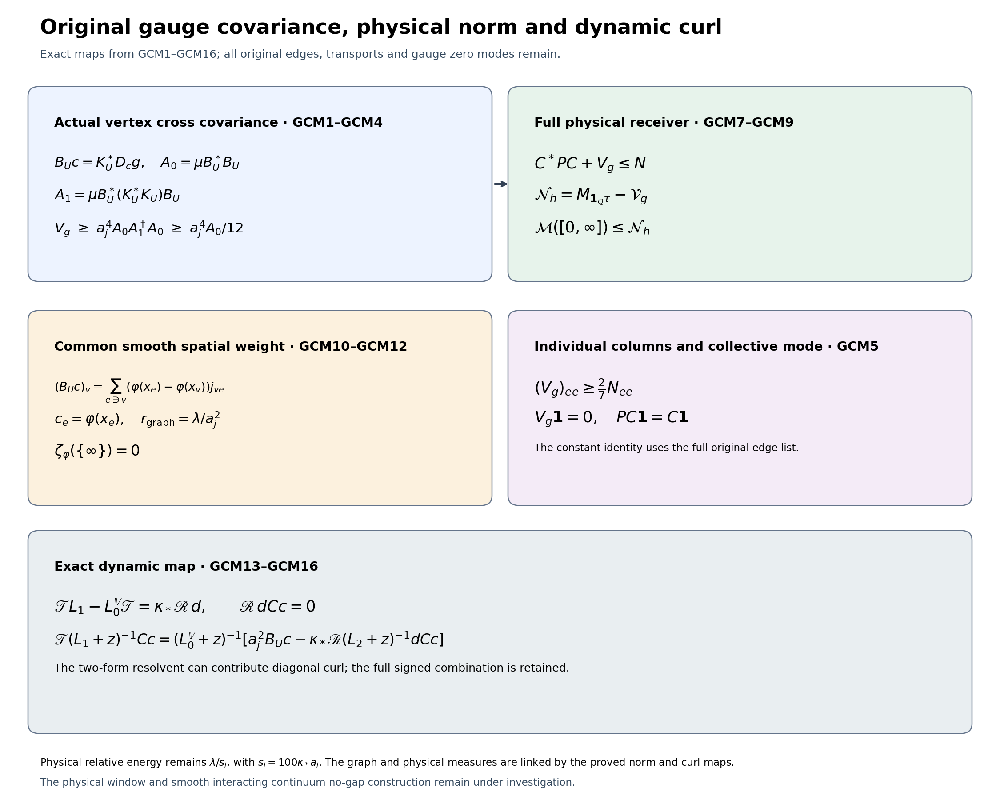

# Full gauge-current covariance and its surviving physical receiver

Reviewed calculation, 13 October 2026. The smooth interacting continuum no-gap endpoint remains the programme goal.

The calculation uses the complete original objects of GWH1–GWH15 and PSC1–PSC10. In particular \(a_j=(100j)^{-1}\), \(L_j=j^4\), \(g_j^2=\kappa_*a_j/2\), \(b_{{\rm pot},j}=(\kappa_*a_j^2)^{-1}\), \(s_j=100\kappa_*a_j\), \(w=\log\psi_j\), \(d\mu=\psi_j^2dU\), \(g_e=d_ew\), and \(T_e=\mu|g_e|^2\). The metric is \(\langle A,B\rangle=-2\operatorname{Tr}(AB)\) with \(T_\alpha=-i\sigma_\alpha/2\). Every vertex and positive edge of the original open cube remains. All displayed coefficient inner products are conjugate-linear in their first argument.

GWH proves, in the original right trivializations,
\[
(K_U\xi)_e=\xi_{s(e)}-\operatorname{Ad}_{U_e}\xi_{t(e)},\quad
\mathbb L_U=K_U^*K_U,\quad K_U^*g=0,\quad
\mathsf Cc=a_j^2D_cg,\quad \mathsf N=a_j^4\operatorname{diag}(T_e).
\]
The pseudoinverse of \(\mathbb L_U\) is zero on its kernel and \(1/\lambda\) on every positive eigenvalue, with no fixed-rank assumption. Write \(P_{\rm vert}=K_U\mathbb L_U^\dagger K_U^*\) and
\[
c^*\mathsf V_gc=a_j^4\mu\langle K_U^*D_cg,
\mathbb L_U^\dagger K_U^*D_cg\rangle.
\]
Unless a restricted list is stated, coefficients range over every original edge. Restriction to the original \(I_j\) always means extension by zero; every exterior contribution in the following sums remains.

Exact providers: [GWH1–GWH15](https://github.com/KokunoYumeto/yang-mills-interacting-workbench/blob/fc2f3e7ebc60ef655c0f65fe9a63c145b73eee59/yang-mills/continuations/20261011-central-signs-shrinking-window/GAUGE_HESSIAN_AND_COVARIANT_GRAPH.md), [PSC1–PSC10](https://github.com/KokunoYumeto/yang-mills-interacting-workbench/blob/fc2f3e7ebc60ef655c0f65fe9a63c145b73eee59/yang-mills/continuations/20261011-central-signs-shrinking-window/ACTUAL_PHYSICAL_SCORE_SPECTRAL_MEASURE.md), [PFR1–PFR19](https://github.com/KokunoYumeto/yang-mills-interacting-workbench/blob/fc2f3e7ebc60ef655c0f65fe9a63c145b73eee59/yang-mills/continuations/20261011-central-signs-shrinking-window/PHYSICAL_SCALAR_RECEIVER_AND_CURRENT_COVARIANCE.md), [PT9–PT14](https://github.com/KokunoYumeto/yang-mills-interacting-workbench/blob/fc2f3e7ebc60ef655c0f65fe9a63c145b73eee59/yang-mills/continuations/20261011-central-signs-shrinking-window/POSITIVE_TIME_COVARIANCE.md), [SG3–SG9 and SG25](https://github.com/KokunoYumeto/yang-mills-interacting-workbench/blob/fc2f3e7ebc60ef655c0f65fe9a63c145b73eee59/yang-mills/continuations/20261011-central-signs-shrinking-window/ACTUAL_GROUND_GRADIENT_TRIAL.md), [CSR9–CSR16](https://github.com/KokunoYumeto/yang-mills-interacting-workbench/blob/fc2f3e7ebc60ef655c0f65fe9a63c145b73eee59/yang-mills/continuations/20261011-central-signs-shrinking-window/FULL_CURRENT_SCHUR_AND_ENERGY_MEASURE.md). The source-use ledger records versions and actual reading coverage. The original-author provenance inherited from PT/PFR remains available there; this calculation makes no novelty claim.

## The complete local cross covariance

At each vertex set
\[
j_{ve}=
\begin{cases}
g_e,&s(e)=v,\\
-\operatorname{Ad}_{U_e}^*g_e,&t(e)=v,\\
0,&e\not\ni v,
\end{cases}
\qquad B_Uc=K_U^*D_cg,\qquad
(B_Uc)_v=\sum_e c_ej_{ve}.
\]
The original Gauss identity gives \(\sum_ej_{ve}=0\) at every configuration. Define the actual finite matrices
\[
\begin{gathered}
S^v_{ef}=\mu\langle j_{ve},j_{vf}\rangle,\qquad
\mathsf A_0=\mu B_U^*B_U=\sum_vS^v,\\
S^v\ge0,\quad S^v\mathbf1=0,\quad
(\mathsf A_0)_{ee}=2T_e,\quad
(\mathsf A_0)_{ef}=0\quad(e\ne f,\ e,f\text{ share no vertex}),\\
c^*\mathsf A_0c
=-\sum_v\sum_{\{e,f\}\subset\operatorname{star}(v)}
S^v_{ef}|c_e-c_f|^2 .
\end{gathered}\tag{GCM1}
\]
Here unordered pairs occur once. Each Gram matrix is positive because its quadratic form is the average squared norm of \(\sum_ec_ej_{ve}\). Its row sums vanish by the exact Gauss identity. The diagonal value follows from the two endpoints and the orthogonality of the original adjoint transport. For the last equality, expand every squared difference. The coefficient of \(|c_e|^2\) is \(-\sum_{f\ne e}S^v_{ef}=S^v_{ee}\); the two cross entries are \(S^v_{ef}\overline c_ec_f\) and its conjugate. This proves the equality for arbitrary complex raw lists.

The numbers \(S^v_{ef}\) are real, but the off-diagonal signs have not been assigned. Positivity of the entire Gram matrix does not authorize replacing these entries by nonnegative edge weights.

The component covariance also has its full original gauge meaning:
\[
\mu (j_{ve})_\alpha=0,\qquad
\mu (j_{ve})_\alpha(j_{vf})_\beta
=\frac{\delta_{\alpha\beta}}3S^v_{ef}.
\tag{GCM2}
\]
Under a gauge transformation at \(v\), every \(j_{ve}\) transforms by the same \(\operatorname{Ad}_{h_v}\). For an incoming edge, this follows explicitly from
\((\operatorname{Ad}_{h_sU_eh_v^{-1}})^*
\operatorname{Ad}_{h_s}g_e
=\operatorname{Ad}_{h_v}\operatorname{Ad}_{U_e}^*g_e\).
The actual measure is invariant. Its first moment is consequently fixed by every rotation and is zero. Its second matrix commutes with every rotation: rotations by \(\pi\) around the coordinate axes kill its off-diagonal entries, and rotations interchanging coordinate directions equate its three diagonal entries. The trace is \(S^v_{ef}\), proving exactly the displayed factor \(1/3\).

## A full matrix lower bound from two local moments

Retain the additional actual moment
\[
\begin{gathered}
\mathsf A_1=\mu B_U^*\mathbb L_U B_U,\\
(\mathsf A_1)_{eh}=
\mu\sum_{f\in\mathcal E_j}
\left\langle j_{s(f),e}-\operatorname{Ad}_{U_f}j_{t(f),e},
j_{s(f),h}-\operatorname{Ad}_{U_f}j_{t(f),h}\right\rangle .
\end{gathered}\tag{GCM3}
\]
The second formula follows by substituting \(\mathbb L_U=K_U^*K_U\) and then expanding \(K_UB_U\). It includes the two within-vertex terms and both transported cross terms for every original edge \(f\), including those outside the support of \(c\).

The original degrees satisfy \(\deg(v)\le6\). Therefore
\[
0\le\mathbb L_U\le12I,\qquad
0\le\mathsf A_1\le12\mathsf A_0,\qquad
\mathsf A_0\le12\operatorname{diag}(T_e).
\]
Indeed
\(\sum_f|\xi_s-\operatorname{Ad}_{U_f}\xi_t|^2
\le2\sum_v\deg(v)|\xi_v|^2\le12\sum_v|\xi_v|^2\).
The second inequality follows by applying it to \(B_Uc\) and averaging. The third follows from
\(\|K_U^*D_cg\|^2\le12\|D_cg\|^2\).

The complete inverse-moment estimate is
\[
\begin{gathered}
\begin{pmatrix}
a_j^{-4}\mathsf V_g&\mathsf A_0\\
\mathsf A_0&\mathsf A_1
\end{pmatrix}\ge0,\qquad
\ker\mathsf A_1=\ker\mathsf A_0,\\
\mathsf V_g\ge
a_j^4\mathsf A_0\mathsf A_1^\dagger\mathsf A_0
\ge\frac{a_j^4}{12}\mathsf A_0 .
\end{gathered}\tag{GCM4}
\]
To prove the block inequality, use the Gram matrix in \(L^2(\mu;\mathbb V)\) of the two column maps
\(\mathbb L_U^{\dagger/2}B_U\) and \(\mathbb L_U^{1/2}B_U\). Their cross product is \(B_U^*B_U\), since \(\operatorname{Ran}B_U\subset\operatorname{Ran}K_U^*=(\ker\mathbb L_U)^\perp\). The first map is square integrable by GWH10; the second is square integrable by the proved degree bound. This also justifies every average at changing gauge rank.

If \(c\in\ker\mathsf A_1\), then \(\mathbb L_U^{1/2}B_Uc=0\) almost everywhere. The stated range inclusion forces \(B_Uc=0\), so \(c\in\ker\mathsf A_0\). The converse follows directly from its averaged squared norm. The finite-dimensional kernels therefore agree, and \(\mathsf A_0c\) lies in \(\operatorname{Ran}\mathsf A_1\).
Insert the lower block vector \(-\mathsf A_1^\dagger\mathsf A_0c\) in the positive block form. This proves the first lower estimate. On the common kernel complement both matrices are positive definite. Conjugating \(\mathsf A_1\le12\mathsf A_0\) by \(\mathsf A_0^{-1/2}\), diagonalizing the resulting positive matrix, and inverting its positive eigenvalues proves
\(\mathsf A_1^{-1}\ge\mathsf A_0^{-1}/12\) there. Conjugate by \(\mathsf A_0\) and set both sides to zero on the common kernel to obtain the second lower estimate. No inverse of an unproved positive graph gap occurs.

## Every original single-edge contribution and its precise scope

For a single original edge \(e=(s,t)\), the vector \(B_U\delta_e\) has entries \(g_e\) at \(s\) and \(-\operatorname{Ad}_{U_e}^*g_e\) at \(t\). Thus
\[
\begin{gathered}
\|B_U\delta_e\|^2=2|g_e|^2,\qquad
\langle B_U\delta_e,\mathbb L_U B_U\delta_e\rangle
=(\deg(s)+\deg(t)+2)|g_e|^2,\\
(\mathsf V_g)_{ee}\ge
\frac{4a_j^4T_e}{\deg(s)+\deg(t)+2}
\ge\frac27 a_j^4T_e,\\
(\mathsf C^*P\mathsf C)_{ee}\le
\left(1-\frac4{\deg(s)+\deg(t)+2}\right)a_j^4T_e
\le\frac57 a_j^4T_e .
\end{gathered}\tag{GCM5}
\]
For the first graph-energy calculation, the original edge \(e\) contributes \(4|g_e|^2\). Its other incident edges contribute \((\deg(s)-1)|g_e|^2\) and \((\deg(t)-1)|g_e|^2\), respectively. No other edge contributes, and there is no second edge joining \(s,t\). This proves the full coefficient. The \(2\)-by-\(2\) diagonal submatrix of GCM4 gives
\((\mathsf V_g)_{ee}/a_j^4\ge(2T_e)^2/[(\deg(s)+\deg(t)+2)T_e]\) when \(T_e>0\); when \(T_e=0\) all terms vanish. GWH10 proves the physical upper bound. Summing it proves the corresponding trace inequality on any original finite support list.

The bound \(5/7\) is a diagonal and trace bound, not a Loewner bound on the full physical matrix. There is an exact original counterexample to that stronger inference: on the full edge list,
\[
B_U\mathbf1=K_U^*g=0,\quad
\mathsf V_g\mathbf1=0,\quad
\mathsf C\mathbf1=a_j^2dw,\quad
P\mathsf C\mathbf1=\mathsf C\mathbf1 .
\]
The latter is an exact invariant form. Hence
\(\mathbf1^*\mathsf C^*P\mathsf C\mathbf1
=\mathbf1^*\mathsf N\mathbf1>0\),
with strictness following from any strict interior edge's proved positive \(T_e\).
Thus \(\mathsf C^*P\mathsf C\le(5/7)\mathsf N\) would be false on this original full list. Local zero extensions need not share this constant null vector; the full cross matrices in GCM1–GCM4 specify their actual relation.

## The actual scalar and source receivers

Let \(\mathsf B_{\rm sc}c=\sum_ec_e(\Delta_ew+2|g_e|^2)\) as in PFR. Its exact physical inverse identity gives
\[
\begin{gathered}
\mathsf B_{\rm sc}^*\mathscr L_0^{-1}\mathsf B_{\rm sc}
=\frac{\mathsf C^*P\mathsf C}{\kappa_*a_j^4}
\le\frac{\operatorname{diag}(T_e)-a_j^{-4}\mathsf V_g}{\kappa_*}\\
\le\frac{\operatorname{diag}(T_e)-
\mathsf A_0\mathsf A_1^\dagger\mathsf A_0}{\kappa_*},\\
\mathsf A_{\rm sc}((0,\theta s_j])
\le\frac{\theta s_j}{\kappa_*}
\left(\operatorname{diag}(T_e)-
\mathsf A_0\mathsf A_1^\dagger\mathsf A_0\right).
\end{gathered}\tag{GCM6}
\]
The first two inequalities are GWH10 and GCM4 with the original \(\kappa_*a_j^4\) retained. The last integrates \(1\le\theta s_j/\lambda\) over the stated scalar spectral interval. Every right side is nonnegative because it bounds the actual positive inverse matrix. In particular its single-edge cutoff diagonal is at most
\((500/7)\theta\,a_jT_e\); the full matrix still contains all the original cross terms. The finite mean-zero scalar inverse is the one already constructed in PFR; no uniform scalar gap is assumed.

For a finite original test family let \(\mathsf V\gamma=\sum_\ell\gamma_\ell dX_\ell\),
\(\mathsf B=\mathsf C^*\mathsf V\), and
\(\mathsf E=\kappa_*\mathsf V^*\mathsf V\).
The complete horizontal Gram matrix gives
\[
\begin{gathered}
\begin{pmatrix}
\mathsf N-\mathsf V_g&\mathsf B\\
\mathsf B^*&\mathsf E/\kappa_*
\end{pmatrix}\ge0,\quad
\operatorname{Ran}\mathsf B\subset
\operatorname{Ran}(\mathsf N-\mathsf V_g),\\
\mathsf E\ge
\kappa_*\mathsf B^*(\mathsf N-\mathsf V_g)^\dagger\mathsf B .
\end{gathered}\tag{GCM7}
\]
Indeed take the columns \((I-P_{\rm vert})\mathsf C\) and \(\mathsf V\).
Every \(dX_\ell\) is invariant and horizontal, so their cross product is exactly \(\mathsf B\); the first Gram is \(\mathsf N-\mathsf V_g\). A vector killed by that Gram corresponds to a zero horizontal column, hence is orthogonal to every source column. This proves the range inclusion in finite dimension. Completing its square with the displayed pseudoinverse proves the inequality for every raw \(\gamma\). This retains the actual gauge loss in the first-energy receiver rather than inferring it from diagonal bounds.

## A common continuum receiver retaining the full correction

Use exactly PSC's cell maps \(\mathcal J_j,\mathcal A_j=a_j^{-3}\mathcal J_j^*\), cells of volume \(a_j^3\), and the same common subsequence. Define
\[
\begin{gathered}
\mathcal D_j=a_j\mathcal J_j\mathsf A_{0,j}\mathcal A_j,\qquad
\mathcal H_{g,j}=a_j\mathcal J_j
\mathsf A_{0,j}\mathsf A_{1,j}^\dagger\mathsf A_{0,j}\mathcal A_j,\\
0\le\mathcal D_j/12\le\mathcal H_{g,j}
\le\mathcal V_{g,j}\le M_{\tau_j}\mathcal P_j .
\end{gathered}
\]
The inequalities are GCM4 and GWH10 after the exact cell adjoint conversion; in particular every operator is uniformly bounded by the original kinetic root, and \(\mathcal D_j\le12\Theta_G(a_j)I\).
A further common bounded weak subsequence exists by the same countable matrix-element extraction as PSC1. It gives
\[
\begin{gathered}
0\le\mathcal D/12\le\mathcal H_g\le\mathcal V_g,\qquad
\mathcal M([0,\infty])\le
\mathcal N_h:=M_{\mathbf1_{\mathcal Q}\tau}-\mathcal V_g,\\
\mathcal N_h\le
M_{\mathbf1_{\mathcal Q}\tau}-\mathcal H_g
\le M_{\mathbf1_{\mathcal Q}\tau}-\mathcal D/12 .
\end{gathered}\tag{GCM8}
\]
Weak passage follows by testing each nonnegative finite inequality on fixed cell-space vectors, with KP's original kinetic multiplier convergence. PSC's total physical measure is injective on \(L^2(\mathcal Q;\mathbb C^3)\), so \(\mathcal N_h\) is injective there too. This is not a uniform lower bound.

Let \(\mathsf E_\infty\) be the actual finite-family first-energy limit already contained in PSC7's total source-energy block, and let
\(\mathcal T\gamma=\sum_\ell\gamma_\ell t^{(\ell)}\).
The cell version of GCM7 has cross map
\(a_j^{-3}\mathcal J_j\mathsf B_j\to-3\mathcal T/2\) strongly by the original source calculation. Consequently
\[
\begin{gathered}
\begin{pmatrix}
\mathcal N_h&-3\mathcal T/2\\
-3\mathcal T^*/2&\mathsf E_\infty/\kappa_*
\end{pmatrix}\ge0,\\
\mathcal T\gamma\in\operatorname{Ran}\mathcal N_h^{1/2},\qquad
\gamma^*\mathsf E_\infty\gamma
\ge\frac{9\kappa_*}{4}
\|\mathcal N_h^{-1/2}\mathcal T\gamma\|^2 .
\end{gathered}\tag{GCM9}
\]
Here the inverse is defined on the proved range inside the supported space.
To justify that domain, put \(q=-3\mathcal T\gamma/2\).
The positive block implies
\(|\langle h,q\rangle|^2\le
\langle h,\mathcal N_hh\rangle\,\gamma^*\mathsf E_\infty\gamma/\kappa_*\).
Thus \(\mathcal N_h^{1/2}h\mapsto\langle h,q\rangle\) is a well-defined bounded functional on its dense range. Its continuous extension has a unique representing vector \(u\), with
\(\|u\|^2\le\gamma^*\mathsf E_\infty\gamma/\kappa_*\).
Pairing against every \(h\) proves \(q=\mathcal N_h^{1/2}u\). Injectivity identifies \(u=\mathcal N_h^{-1/2}q\), proving the range assertion and bound. No unbounded inverse has been applied before its domain was proved.
Since \(\mathcal N_h\le3\sqrt{5/7}/(2\kappa_*)\), this retains and implies GWH6's original first-energy coefficient. It can encode a stronger actual bound through \(\mathcal V_g\), without assigning a uniform strict improvement that has not been evaluated.

## The exact graph scale for a common smooth spatial weight

Take an actual \(C^1\) complex function \(\varphi\) with compact support strictly inside \(\mathcal Q\). Let \(M_\varphi=\sup_x\|D\varphi(x)\|\), where this is the operator norm from \(\mathbb R^3\) to \(\mathbb C\). At every original edge midpoint and vertex retain
\[
x_e=o+a_j(z-L_j\mathbf1+e_d/2),\qquad
x_v=o+a_j(v-L_j\mathbf1),\qquad c_e=\varphi(x_e).
\]
For all sufficiently large \(j\), this list vanishes off the strict fitting edge set. The Gauss identity gives the exact commutator source
\[
\begin{gathered}
(\eta_\varphi)_v=(B_Uc)_v
=\sum_{e\ni v}[\varphi(x_e)-\varphi(x_v)]j_{ve},\\
a_j^4\mu\|\eta_\varphi\|^2
\le3M_\varphi^2\Theta_G(a_j)a_j^5N_Q .
\end{gathered}\tag{GCM10}
\]
The first equality subtracts the zero sum \(\varphi(x_v)\sum_ej_{ve}\), with every endpoint sign retained. If a difference in the sum is nonzero, its edge lies within one original mesh step of the support. The fixed positive distance from that support to the cube boundary ensures that all these edges lie in \(I_j\) for large \(j\). The original midpoint distance is exactly \(a_j/2\), so each difference has modulus at most \(a_jM_\varphi/2\). Cauchy–Schwarz gives
\[
|\eta_v|^2\le\deg(v)\frac{a_j^2M_\varphi^2}{4}
\sum_{\substack{e\ni v\\\text{difference nonzero}}}|g_e|^2.
\]
In the sum over vertices, an edge has total degree weight
\(\deg(s)+\deg(t)\le12\). Therefore
\(\mu\|\eta_\varphi\|^2\le3a_j^2M_\varphi^2\sum_{e\in I_j}T_e
\le3M_\varphi^2\Theta_G(a_j)a_jN_Q\).
Multiplication by \(a_j^4\) proves exactly GCM10.

Let \(E_{\mathbb L_U}\) be the original pointwise graph spectral resolution. Define a positive scalar measure on the compact \([0,\infty]\) by
\[
\zeta_{\varphi,j}(B)=a_j^4\mu\left\langle\eta_\varphi,
\mathbb L_U^\dagger
E_{\mathbb L_U}(\{\lambda>0:\lambda/a_j^2\in B\})
\eta_\varphi\right\rangle .
\]
Borel measurability follows by finite self-adjoint spectral calculus; the nonnegative inverse integrand is bounded in total by the original current norm, as in GWH10. Thus all the stated averages exist. Its exact total, first moment and tail are
\[
\begin{gathered}
\zeta_{\varphi,j}([0,\infty])=c^*\mathsf V_{g,j}c,\\
\int r\,d\zeta_{\varphi,j}(r)
=a_j^2\mu\|\eta_\varphi\|^2
\le3M_\varphi^2\Theta_G(a_j)a_j^3N_Q,\\
\zeta_{\varphi,j}([R_{\rm g},\infty])
\le\frac{3M_\varphi^2\Theta_G(a_j)a_j^3N_Q}{R_{\rm g}}
\quad(R_{\rm g}>0).
\end{gathered}\tag{GCM11}
\]
The first equality is the exact inverse-graph norm formula. For the second, multiplication by \(\lambda/a_j^2\) cancels only the displayed positive inverse eigenvalue, retaining \(a_j^2\); the kernel contributes zero because \(\eta_\varphi\perp\ker\mathbb L_U\). The last inequality integrates \(1\le r/R_{\rm g}\).

The total masses are bounded by
\(a_j^4\sum_eT_e|\varphi(x_e)|^2
\le\Theta_G(a_j)a_j^3\sum_e|\varphi(x_e)|^2\).
Hence further common weak scalar limits exist. Since \(a_j^3N_Q\to3R^3\), GCM11 implies
\[
\begin{gathered}
\zeta_\varphi(\{\infty\})=0,\qquad
\int_{[0,\infty)}r\,d\zeta_\varphi(r)
\le\frac{27M_\varphi^2R^3}{2\kappa_*}\sqrt{\frac57},\\
\zeta_\varphi([0,\infty))
=\langle(\varphi,\varphi,\varphi),
\mathcal V_g(\varphi,\varphi,\varphi)\rangle .
\end{gathered}\tag{GCM12}
\]
For the first two statements, integrate the continuous functions
\(\min(r,A)\), with value \(A\) at infinity. Their integrals are bounded by the uniform first-moment bound; pass to the limit and then increase \(A\). A nonzero infinity atom would contradict the bound, and monotone convergence gives the finite first moment. For the total identity, the sampled list and \(\mathcal A_j(\varphi,\varphi,\varphi)\) differ in the original cell norm by a quantity tending to zero. Indeed each cell has diameter \(\sqrt3a_j\), and the mean-value estimate bounds the pointwise difference by \(\sqrt3a_jM_\varphi/2\). Multiply its squared sum by \(a_j^3\), using the original finite count. The bound \(\mathsf V_{g,j}\le a_j^3\Theta_G(a_j)I\) makes the corresponding quadratic-form difference tend to zero by Cauchy–Schwarz. The total continuous kernel then gives the stated equality on the same actual subsequence.

This identifies a concrete scale in the part removed by the gauge projection: for a common smooth spatial coefficient, any surviving vertical norm has a finite graph-spectrum receiver at \(\lambda/a_j^2\), with a retained possible zero atom. The physical time-energy measure in PSC instead uses the weighted Hodge/scalar operator at \(\lambda/s_j\), \(s_j=100\kappa_*a_j\). Their exact connection proved here is the norm decomposition GWH10 and GCM8–GCM9. No commutation of \(P_{\rm vert}\) with that dynamics has been assumed.

## The exact weighted dynamic contraction and its curl term

The preceding graph-scale result leads to a concrete next calculation, which can be carried out without differentiating the rank-changing graph pseudoinverse. Retain PT12's full weighted one-form operator and the scalar operator on all functions:
\[
L_1=\kappa_*\{\nabla^*\nabla-2\nabla_g+
\operatorname{Ric}^{\#}-2H\},\qquad
L_0=-\kappa_*(\Delta+2g\cdot\nabla),\qquad
\operatorname{Ric}^{\#}=I/2,\quad H=(\nabla^2w)^\#.
\]
Here \(\nabla^*\nabla\) is the unweighted positive rough Laplacian; all metric, drift and Hessian contributions are retained. The component scalar operator below acts on vertex-Lie-valued functions in a fixed original Pauli basis. It is not restricted to invariant scalar functions.

Let \(K=K_v(A)\) be any one original vertex gauge generator, and let \(\alpha\) be a smooth complex one-form. The exact commutator is
\[
\iota_K L_1\alpha-L_0(\iota_K\alpha)
=\kappa_*\langle dK^\flat,d\alpha\rangle.
\tag{GCM13}
\]
The pairing on the right is the metric contraction of real \(dK^\flat\) with the complex two-form, so it is complex linear in \(\alpha\).

Here is the complete calculation. Put \(X=\alpha^\sharp\), and choose a normal orthonormal frame \(E_i\) at the point of calculation. Expanding the scalar Laplacian of \(\langle K,X\rangle\) and the drift of that product gives
\[
\begin{aligned}
\kappa_*^{-1}\{\iota_KL_1\alpha-L_0(\iota_K\alpha)\}
={}&\langle\operatorname{Ric}^{\#}K-2HK,X\rangle\\
&+\left\langle-\nabla^*\nabla K+2\nabla_gK,X\right\rangle
+2\sum_i\langle\nabla_{E_i}K,\nabla_{E_i}X\rangle .
\end{aligned}
\]
The gauge action preserves the original metric, so \(K\) is Killing. Its equation
\(\nabla_iK_j+\nabla_jK_i=0\), contracted and differentiated, gives
\(\operatorname{div}K=0\) and
\(\nabla^*\nabla K=\operatorname{Ric}^{\#}K\):
explicitly
\(\nabla^i\nabla_iK_j=-\nabla^i\nabla_jK_i
=-\operatorname{Ric}_{j\ell}K^\ell\), with the same Ricci sign as PT12's Hodge formula.
The derivative of \(K(w)=0\) is
\(HK=-(\nabla K)^*g=\nabla_gK\), using the skew symmetry of \(\nabla K\).
Thus both the full Ricci term and the full weight-Hessian term cancel against their displayed matching terms.
If \(A_{ij}=\langle\nabla_{E_i}K,E_j\rangle\), its skew symmetry gives
\[
2\sum_{i,j}A_{ij}\nabla_i\alpha_j
=\sum_{i,j}A_{ij}(d\alpha)_{ij}
=\langle dK^\flat,d\alpha\rangle,
\]
because \((dK^\flat)_{ij}=2A_{ij}\) and the two-form metric is
\(\langle\omega,\nu\rangle=\frac12\sum_{i,j}\overline{\omega_{ij}}\nu_{ij}\).
This proves GCM13 with its exact sign and factor.

Orient each right Lie frame by the original ordered basis
\((T_1,T_2,T_3)\), and denote by \(*_e\) the resulting three-dimensional Hodge star from \(\Lambda^2T_e^*\) to \(T_e^*\), followed by the metric identification. Put
\[
(\mathscr T\alpha)_v=(K_U^*\alpha^\sharp)_v,\qquad
(\mathscr S_U b)_v=
\sum_{s(e)=v}b_e+\sum_{t(e)=v}\operatorname{Ad}_{U_e}^*b_e .
\]
The two sums in \(\mathscr S_U\) have positive signs. The contraction map \(\mathscr T\) retains the negative target sign in \(K_U^*\). Write \(L_0^{\mathbb V}\) for the component scalar operator and define
\[
\begin{gathered}
\mathscr R\omega=\mathscr S_U
\bigl((*_e\omega_{ee})_e\bigr),\\
\mathscr T L_1\alpha-L_0^{\mathbb V}\mathscr T\alpha
=\kappa_*\mathscr R\,d\alpha,\\
\|\mathscr T\alpha\|_\mu^2\le12\|\alpha\|_\mu^2,\qquad
\|\mathscr R\omega\|_\mu^2
\le12\sum_e\|\omega_{ee}\|_\mu^2
\le12\|\omega\|_\mu^2 .
\end{gathered}\tag{GCM14}
\]
To obtain the exact map \(\mathscr R\), apply GWH1:
on an incident edge,
\(\nabla_yK_v(A)=\sigma_{ve}[Q_{ve}A,y]/2\).
Thus
\((dK_v(A)^\flat)_{ij}
=\sigma_{ve}\epsilon_{kij}(Q_{ve}A)_k\).
Contracting this with \(\omega_{ee}\), including the two-form factor \(1/2\), gives
\(\sigma_{ve}\langle Q_{ve}A,*_e\omega_{ee}\rangle\).
At a source, \(\sigma Q^*=I\); at a target,
\(\sigma Q^*=\operatorname{Ad}_{U_e}^*\). This proves both positive signs in \(\mathscr S_U\). There are no mixed-edge components of \(dK_v(A)^\flat\), since each gauge-generator component depends only on its own original edge. Summing GCM13 over the original vertex basis proves the operator identity.
The first norm bound is \(K_U^*K_U\le12I\). For the second, the adjoint of \(\mathscr S_U\) has edge entries
\(\xi_s+\operatorname{Ad}_{U_e}\xi_t\), whose squared sum is at most \(12\|\xi\|^2\) by the same full degree count. The Hodge stars are isometries and the diagonal two-form blocks are orthogonal parts of the full original exterior space. This proves every bound without a derivative of a graph inverse.

For the original current \(\alpha_c=\mathsf Cc=a_j^2D_cdw\), configuration differentiation does not act on the raw spatial coefficients. Its full curl is
\[
(d\alpha_c)_{(e,i),(f,k)}
=a_j^2(c_f-c_e)(H_{ef})_{ik}
\quad(e\ne f),\qquad (d\alpha_c)_{ee}=0 .
\]
Hence \(\mathscr R\,d\alpha_c=0\), and GCM14 gives the actual first dynamic identity and second-energy bound
\[
\begin{gathered}
\mathscr T L_1\mathsf Cc
=a_j^2L_0^{\mathbb V}(B_Uc),\\
a_j^4\|L_0^{\mathbb V}(B_Uc)\|_\mu^2
\le12\,c^*\mathsf Z^{(0)}c,\qquad
\mathsf Z^{(0)}=(L_1\mathsf C)^*L_1\mathsf C .
\end{gathered}\tag{GCM15}
\]
The mixed curl formula follows by subtracting the two original product covariant derivatives; the symmetry of the diagonal Hessian gives its zero diagonal blocks. The norm bound then applies the proved \(\mathscr T\) bound to \(L_1\mathsf Cc\). This directly receives the original second-energy matrix with all five previously retained Green moments. It does not assert an intertwining on the entire cyclic space of the current.

For \(z>0\), the finite compact weighted Hodge resolvent sends the smooth current to a smooth form
\(u_z=(L_1+z)^{-1}\mathsf Cc\). PT's full exterior construction gives
\(d(L_1+z)^{-1}=(L_2+z)^{-1}d\), where
\(L_2=\kappa_*(dd_\mu^*+d_\mu^*d)\) on the original two-form space. Its finite domain argument extends PT10 directly: the principal symbol of \(dd^*+d^*d\) on degree two is \(|\xi|^2I\), by
\(\xi\wedge\iota_{\xi^\sharp}+\iota_{\xi^\sharp}(\xi\wedge)=|\xi|^2I\).
The difference produced by the original smooth positive weight is first order, and all original curvature and lower-order coefficients are smooth and bounded on this finite compact product. Adding a sufficiently large finite scalar to its nonnegative form gives a norm equivalent to \(H^1\), by the covariant-gradient identity and interpolation. Smooth chart approximation closes that form. The same finite-chart second-derivative estimate as PT10, applied componentwise to this scalar principal symbol and retaining its bounded lower-order terms, gives operator domain \(H^2\). Iterating the local estimate gives smoothness for its resolvent on smooth input. All constants can depend on the regulator. On smooth forms the exterior intertwining follows by \(d^2=0\); applying the unique positive shifted resolvent with the established domains proves the stated resolvent identity. Applying GCM14 to \(u_z\) consequently gives
\[
\begin{gathered}
\mathscr T u_z=
(L_0^{\mathbb V}+z)^{-1}
\left[
a_j^2B_Uc-\kappa_*\mathscr R(L_2+z)^{-1}d\mathsf Cc
\right],\\
\|P_{\rm vert}u_z\|_\mu^2
=\mu\langle\mathscr T u_z,\mathbb L_U^\dagger\mathscr T u_z\rangle .
\end{gathered}\tag{GCM16}
\]
The two original source terms retain their sign and order. Although
\(\mathscr R d\mathsf Cc=0\), no such cancellation is assigned after the full two-form resolvent.
The complete combination on the first line lies in
\(\operatorname{Ran}K_U^*\) pointwise because it equals \(\mathscr T u_z\). The second line is the exact bounded vertical projection norm. It is finite. A separate inverse-graph norm for each of the two terms is not assumed: their combination is retained inside the rank-changing inverse. If a bounded expansion is needed, first replace \(\mathbb L_U^\dagger\) by
\((\mathbb L_U+\delta I)^{-1}\), retain the two diagonal terms and both cross terms together, and then let \(\delta\downarrow0\). The complete combination has zero kernel component, so its scalar spectral integral increases to the displayed finite norm. This does not authorize taking separate limits of the expanded terms.

GCM16 is now an exact dynamic map from the original mixed Hessian curl to the vertical part of the current resolvent. The next calculation is its two-form spectral receiver, its original \(Y/G_0/X\) mixed covariance, and the resulting physical three-shift window. No surviving physical window sign, interacting continuum reconstruction, or smooth global no-gap conclusion has been assumed.

## Reproducible figure and diagnostics

The finite current checks and independent right-flow derivative checks test the displayed universal algebra and signs. Their three-plaquette test function is not a substitute for the actual Yang–Mills ground state. The written actual-state substitutions and domain arguments establish the receiving results. Sources: check_gauge_current.py, check_gauge_dynamics.py and figure_gauge_current.py; exact reading record: GAUGE_CURRENT_SOURCE_USE_LEDGER.json.

