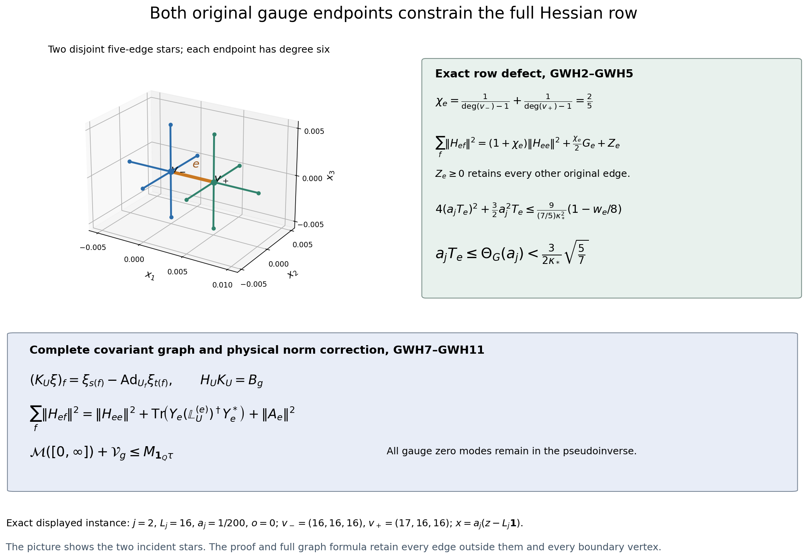

# Exact gauge Hessian rows and the original covariant graph
Reviewed derivation, 13 October 2026.

This calculation applies every original vertex gauge constraint to the actual logarithmic ground state. It supplies a stronger actual kinetic bound and an exact graph-inverse expression for the remaining Hessian-row energy. Its row minimizer is a linear-algebra receiver of the actual Hessian; it is not asserted to be the Hessian of a different state. The smooth interacting continuum no-gap target remains active.

Providers: [RH1–RH4](https://github.com/KokunoYumeto/yang-mills-interacting-workbench/blob/5e213261cc711e5ad2a5fcd9abecee1b8497baca/yang-mills/continuations/20261011-central-signs-shrinking-window/RAW_S6_HESSIAN_RECEIVING.md), [SG3–SG9](https://github.com/KokunoYumeto/yang-mills-interacting-workbench/blob/5e213261cc711e5ad2a5fcd9abecee1b8497baca/yang-mills/continuations/20261011-central-signs-shrinking-window/ACTUAL_GROUND_GRADIENT_TRIAL.md), [PFR9–PFR19](https://github.com/KokunoYumeto/yang-mills-interacting-workbench/blob/5e213261cc711e5ad2a5fcd9abecee1b8497baca/yang-mills/continuations/20261011-central-signs-shrinking-window/PHYSICAL_SCALAR_RECEIVER_AND_CURRENT_COVARIANCE.md), and [PSC1–PSC10](https://github.com/KokunoYumeto/yang-mills-interacting-workbench/blob/5e213261cc711e5ad2a5fcd9abecee1b8497baca/yang-mills/continuations/20261011-central-signs-shrinking-window/ACTUAL_PHYSICAL_SCORE_SPECTRAL_MEASURE.md). Exact source versions, actual coverage and disk-index routing are retained in GAUGE_HESSIAN_SOURCE_USE_LEDGER.json. No new external reading or novelty claim is made.

## Original objects, frames and vertex generators

Retain the original open cubic lattice with \(L_j=j^4\), all positive edges, every boundary vertex, probability Haar and the radius-two SU(2) metric. Use
\[
\begin{gathered}
a_j=(100j)^{-1},\quad g_j^2=\kappa_*a_j/2,\quad
b_{{\rm pot},j}=(\kappa_*a_j^2)^{-1},\quad s_j=100\kappa_*a_j,\\
U_p=U_d(z)U_k(z+e_d)U_d(z+e_k)^{-1}U_k(z)^{-1},\quad d<k,\\
D_p=2-\operatorname{Tr}U_p,\quad
V_j=b_{{\rm pot},j}\sum_pD_p
=2b_{{\rm pot},j}|\mathcal P_j|-b_{{\rm pot},j}\sum_p\operatorname{Tr}U_p,\\
H_j=-\kappa_*\Delta+V_j,\quad H_j\psi_j=E_{0,j}\psi_j,\quad
\psi_j>0,\quad\|\psi_j\|=1,\quad w=\log\psi_j,\quad d\mu=\psi_j^2dU .
\end{gathered}
\]
Gauge invariance of the unique positive ground follows from RH4. In particular
\(w((h_{s(e)}U_eh_{t(e)}^{-1})_e)=w((U_e)_e)\).

Identify each tangent space with \(\mathfrak{su}(2)\) by right trivialization \(Y_e=y_eU_e\). The metric is
\(\langle A,B\rangle=-2\operatorname{Tr}(AB)\), with
\(T_\alpha=-i\sigma_\alpha/2\) orthonormal and
\([T_\alpha,T_\beta]=\epsilon_{\alpha\beta\gamma}T_\gamma\).
The right-invariant fields \(R_A(U)=AU\) obey
\([R_A,R_B]=-R_{[A,B]}\). Their connection is
\(\nabla_{R_B}R_A=\tfrac12R_{[A,B]}\).
Indeed the bi-invariant metric has constant frame inner products; inserting this bracket in the Koszul formula gives this connection. Equivalently its three cyclic bracket terms give half the vector-field bracket. For left-invariant fields \(L_A(U)=UA\), the same formula gives \(\nabla_{L_B}L_A=\tfrac12L_{[B,A]}\). These signs agree with RH2's original differential convention.

For an original vertex \(v\) and Lie parameter \(A\), let \(K_v(A)\) be its infinitesimal gauge field. On an incident edge \(f\), its right coefficient is
\[
Q_{vf}A=
\begin{cases}
A,&v=s(f),\\
-\operatorname{Ad}_{U_f}A,&v=t(f).
\end{cases}
\]
Each \(Q_{vf}\) is an orthogonal map from the vertex Lie space to the right-trivialized edge Lie space. Put \(\sigma_{vf}=1\) at the source and \(-1\) at the target. Directly from the two connection formulas,
\[
(\nabla_{Y_f}K_v(A))_f
=\frac{\sigma_{vf}}2[Q_{vf}A,y_f]\,U_f .
\tag{GWH1}
\]
For a target, \(K_v(A)=-L_A\), so the derivative is
\(\tfrac12L_{[A,\operatorname{Ad}_{U_f}^{-1}y_f]}
=\tfrac12R_{[\operatorname{Ad}_{U_f}A,y_f]}\), exactly GWH1. Covariant derivatives in any other factor vanish by the original product connection.

## Both endpoint constraints and their complete positive defect

Let \(g_e=d_ew\) in the original right frame, \(G_e=|g_e|^2\), and let \(H_{ef}\) be the right-frame matrix of \(\nabla^2w\) mapping the \(f\) tangent space to the \(e\) tangent space. In particular \(H_{ee}\) is symmetric and
\(\operatorname{tr}H_{ee}=\Delta_ew\). Differentiate the exact invariant identity \(K_v(A)w=0\) in an arbitrary \(Y_e\):
\[
0=(\nabla^2w)(Y_e,K_v(A))+\langle dw,\nabla_{Y_e}K_v(A)\rangle .
\]
For \(e\) incident to \(v\), invariance of the Lie metric and GWH1 therefore give
\[
\sum_{f\ni v}H_{ef}Q_{vf}
=-\frac{\sigma_{ve}}2\operatorname{ad}_{g_e}Q_{ve},\qquad
\sum_{\substack{f\ni v\\f\ne e}}
H_{ef}Q_{vf}Q_{ve}^*
=-D_{ve},\quad
D_{ve}=H_{ee}+\frac{\sigma_{ve}}2\operatorname{ad}_{g_e}.
\tag{GWH2}
\]
Here \(\langle g,[k,y]\rangle=\langle[g,k],y\rangle\) fixes the sign. At a nonincident vertex the same calculation gives zero on the right.

Write \(e=(v_-,v_+)\), \(n_v=\deg(v)-1\), and
\(\chi_e=n_{v_-}^{-1}+n_{v_+}^{-1}\).
For the original cubic lattice \(3\le\deg(v)\le6\), hence
\(\chi_e\ge2/5\). The sets
\(\{f\ni v_-:f\ne e\}\) and \(\{f\ni v_+:f\ne e\}\) are disjoint because there are no parallel edges. They are not identified or collapsed.

For each endpoint put
\[
A_{vef}=H_{ef}Q_{vf}Q_{ve}^*,\qquad
Z_e=
\sum_{v\in\{v_-,v_+\}}\sum_{\substack{f\ni v\\f\ne e}}
\left\|A_{vef}+\frac{D_{ve}}{n_v}\right\|_{\rm HS}^2
+\sum_{f\notin\operatorname{star}(v_-)\cup\operatorname{star}(v_+)}
\|H_{ef}\|_{\rm HS}^2 .
\]
The finite variance identity for \(\sum_fA_{vef}=-D_{ve}\) gives
\(\sum_f\|A_{vef}\|^2=\|D_{ve}\|^2/n_v+
\sum_f\|A_{vef}+D_{ve}/n_v\|^2\).
Symmetric \(H_{ee}\) is orthogonal to the skew matrix \(\operatorname{ad}_{g_e}\).
In the original Pauli basis the latter is the cross-product matrix of \(g_e\), whose six off-diagonal squared entries sum to \(2G_e\). Thus the full pointwise row identity is
\[
\sum_f\|H_{ef}\|_{\rm HS}^2
=(1+\chi_e)\|H_{ee}\|_{\rm HS}^2+\frac{\chi_e}{2}G_e+Z_e,
\qquad Z_e\ge0 .
\tag{GWH3}
\]
Every remaining edge occurs in \(Z_e\); no exterior Hessian row is omitted.

## Actual ground-state averaging and the stronger root

Set \(T_e=\mu G_e\), \(m_e=|\{p:e\in\partial p\}|\le4\), and
\(w_e=\sum_{p\ni e}\mu D_p\). The original complete SG7–SG8 equation and compact integration are
\[
2\mu\sum_f\|H_{ef}\|^2+T_e
=\frac{3b_{\rm pot}}{4\kappa_*}(2m_e-w_e),\qquad
\mu\Delta_ew=-2T_e .
\]
The degree factor \(\chi_e\) depends only on the original graph, so it is constant under \(\mu\). Decompose
\(H_{ee}=H_{ee}^{\rm tf}+(\Delta_ew/3)I\).
Substituting GWH3 and
\(\mu(\Delta_ew)^2=4T_e^2+\operatorname{Var}_\mu(\Delta_ew)\)
gives the exact identity
\[
\begin{aligned}
\frac{9b_{\rm pot}}{8\kappa_*(1+\chi_e)}(2m_e-w_e)
-\frac32T_e-4T_e^2
={}&\operatorname{Var}_\mu(\Delta_ew)
+3\mu\|H_{ee}^{\rm tf}\|^2
+\frac3{1+\chi_e}\mu Z_e\ge0 .
\end{aligned}\tag{GWH4}
\]
All coefficients follow by multiplying the SG equation by \(3/[2(1+\chi_e)]\); the connection contribution \(\chi_e T_e\) is required to obtain exactly \(3T_e/2\) here.

For a strict interior edge, \(m_e=4\) and \(\chi_e=2/5\). With
\(\tau_e=a_jT_e\), retain the exact root
\[
\begin{gathered}
4\tau_e^2+\frac32a_j\tau_e
\le\frac{9}{\kappa_*^2(7/5)}\left(1-\frac{w_e}{8}\right),\\
\tau_e\le
\frac{-3a_j/2+\sqrt{9a_j^2/4+
(144/[\kappa_*^2(7/5)])(1-w_e/8)}}8
\le\Theta_G(a_j),\\
\Theta_G(a)=\frac{-3a/2+\sqrt{9a^2/4+144/[\kappa_*^2(7/5)]}}8
<\frac3{2\kappa_*}\sqrt{\frac57},\qquad
\Theta_G(a)\longrightarrow\frac3{2\kappa_*}\sqrt{\frac57}.
\end{gathered}\tag{GWH5}
\]
Actual strict-edge positivity was already proved in CFC20, so the first bound forces \(w_e<8\). At any full-lattice boundary edge, GWH4 with \(m_e\le4\), \(w_e\ge0\) and \(\chi_e\ge2/5\) gives the same universal upper bound. No positive boundary value is assumed merely to solve this upper quadratic. The strict ceiling follows by evaluating the left quadratic at \(3\sqrt{5/7}/(2\kappa_*)\); its positive linear term exceeds the permitted constant.

Put \(c_G=\sqrt{5/7}\) only as a displayed scalar abbreviation; all following formulas retain this value explicitly when needed. PFR11–PFR16 now give the receiving consequences
\[
\begin{gathered}
0\le Q_j\le a_j^2\bigl(3/\kappa_*+4\Theta_G(a_j)\bigr)I
<\frac{3+6\sqrt{5/7}}{\kappa_*}\,a_j^2I,\qquad\\
N_j\le a_j^3\Theta_G(a_j)I,\\
U_G(a)=\Theta_G(a)/a,\qquad\\
\mu D_p\ge
\ell_G(a)=
\frac{18}{9+16U_G(a)+4\sqrt{U_G(a)(9+16U_G(a))}},\qquad\\
\frac{\ell_G(a_j)}{a_j}\longrightarrow\frac{3\kappa_*}{8}\sqrt{\frac75},\\
\mathsf E_j\ge\frac{3\kappa_*^2}{2}\sqrt{\frac75}\,\mathsf J_t-\epsilon_jI,\quad
\epsilon_j\longrightarrow0,\qquad\\
\liminf_j\frac{\mathcal R_{X,j}(\theta s_j)}{a_j}
\ge\frac{3\kappa_*^2J_t}{4(1+2\sqrt{5/7})}.
\end{gathered}\tag{GWH6}
\]
For the first line substitute the actual root into the unchanged
\(Q=a_j^2\operatorname{diag}(3/\kappa_*-3w_e/(8\kappa_*)+4\tau_e)-D\),
\(D\ge0\), and the exact original diagonal \(N\).
For the second keep the complete PFR12 inequality
\(9(2-\mu D_p)^2/64\le T_e(\mu D_p-\mu D_p^2/4)\)
before applying \(T_e\le U_G\) and
\(\mu D_p^2\ge(\mu D_p)^2\). It gives the identical quadratic
\((9+16U_G)d_p^2-4(9+16U_G)d_p+36\le0\); its lower root is the displayed expression. Multiplying its denominator by \(a_j\) gives \(48\sqrt{5/7}/\kappa_*\), proving the limit.

For the first-energy matrix retain
\(\mathsf E_j\ge\kappa_*\mathsf B_{\rm source,j}^*N_j^{-1}\mathsf B_{\rm source,j}\)
and \(a_j^{-3}\mathsf B_{\rm source,j}^*\mathsf B_{\rm source,j}\to(9/4)\mathsf J_t\).
Their original ratio is \((9/4)\kappa_*/[(3/(2\kappa_*))\sqrt{5/7}]\), with raw coefficient error \(\epsilon_j\|\gamma_j\|^2\).
For the resolvent use the unchanged original trial \(h_e=t_d(x_e)\), overlap \(-3J_t/2\), exact potential trace coefficient \(3J_t/\kappa_*\), and
\(\limsup N_h\le3\sqrt{5/7}J_t/(2\kappa_*)\).
The complete energy upper coefficient is
\((3+6\sqrt{5/7})J_t/\kappa_*\).
Substitution in SG12, keeping \(a_j\theta s_jN_h=100\kappa_*\theta a_j^2N_h\to0\), proves the last bound.

## The full graph map behind the endpoint estimate

At each original configuration \(U\), put
\[
\mathbb V=\bigoplus_v\mathfrak{su}(2),\qquad
\mathbb E=\bigoplus_f\mathfrak{su}(2),
\]
with all original vertex and edge Lie metrics, and define
\[
(K_U\xi)_f=\xi_{s(f)}-\operatorname{Ad}_{U_f}\xi_{t(f)},\qquad
(B_g\xi)_f=-\frac12\operatorname{ad}_{g_f}
\bigl(\xi_{s(f)}+\operatorname{Ad}_{U_f}\xi_{t(f)}\bigr).
\]
The first is the exact differential of the original gauge action in the right frames. Invariance gives \(K_U^*g=0\); summing GWH2 over vertex parameters gives the complete connection-corrected Hessian identity
\[
H_UK_U=B_g,\qquad K_U^*H_U=B_g^* .
\tag{GWH7}
\]
Thus a vertical argument of the Hessian is not assigned zero: its value is the specified connection term. Symmetry of the actual Hessian proves the adjoint equality. These are pointwise finite-dimensional maps with every vertex constraint present.

Fix an original edge \(e=(s,t)\). Let \(K_U^{(e)}:\mathbb V\to\mathbb E_{\ne e}\) omit that edge's output only in this auxiliary constraint map, and put
\(\mathbb L_U^{(e)}=(K_U^{(e)})^*K_U^{(e)}\).
The physical lattice, Hamiltonian and actual Hessian are unchanged.
Its diagonal block at \(v\) is
\((\deg(v)-\mathbf1_{\{v=s\}}-\mathbf1_{\{v=t\}})I\).
For every remaining edge \(f=(v,w)\), its off-diagonal blocks are
\(-\operatorname{Ad}_{U_f}\) at \((v,w)\) and
\(-\operatorname{Ad}_{U_f}^*\) at \((w,v)\).
All scalar degrees, signs and transports follow by expanding
\(\sum_{f\ne e}|\xi_{s(f)}-\operatorname{Ad}_{U_f}\xi_{t(f)}|^2\).

Retain the complete row map \(H_{e,\ne e}\), and set
\[
Y_e=B_{g,e}-H_{ee}K_{U,e},\qquad
Y_e\xi=-\left(H_{ee}+\frac12\operatorname{ad}_{g_e}\right)\xi_s
+\left(H_{ee}-\frac12\operatorname{ad}_{g_e}\right)
\operatorname{Ad}_{U_e}\xi_t .
\]
GWH7 gives
\(H_{e,\ne e}K_U^{(e)}=Y_e\), hence
\(\ker K_U^{(e)}\subset\ker Y_e\).
Define the positive spectral pseudoinverse
\((\mathbb L_U^{(e)})^\dagger\) to equal \(1/\lambda\) on each positive eigenvalue and zero on its kernel. No invertibility or fixed rank is assumed. The exact row solution and its complete remainder are
\[
\begin{gathered}
F_e=Y_e(\mathbb L_U^{(e)})^\dagger(K_U^{(e)})^*,\qquad
A_e=H_{e,\ne e}-F_e,\qquad A_eK_U^{(e)}=0,\\
F_eK_U^{(e)}=Y_e,\qquad
\langle F_e,A_e\rangle_{\rm HS}=0,\\
\sum_f\|H_{ef}\|_{\rm HS}^2
=\|H_{ee}\|_{\rm HS}^2+
\operatorname{Tr}\bigl(Y_e(\mathbb L_U^{(e)})^\dagger Y_e^*\bigr)
+\|A_e\|_{\rm HS}^2 .
\end{gathered}\tag{GWH8}
\]
For the first identity use
\((\mathbb L^{(e)})^\dagger\mathbb L^{(e)}
=P_{(\ker K^{(e)})^\perp}\) and the proved kernel inclusion.
For orthogonality,
\(\operatorname{Tr}(F_eA_e^*)=
\operatorname{Tr}(Y_e(\mathbb L^{(e)})^\dagger(A_eK^{(e)})^*)=0\).
Finally
\(\|F_e\|^2=\operatorname{Tr}(Y_e(\mathbb L^{(e)})^\dagger
\mathbb L^{(e)}(\mathbb L^{(e)})^\dagger Y_e^*)\)
is the displayed trace. This proves the exact row decomposition, preserving the actual symmetric Hessian as its sum.

Moreover,
\[
\begin{gathered}
\operatorname{Tr}\bigl(Y_e(\mathbb L_U^{(e)})^\dagger Y_e^*\bigr)
=\min_{\{A:\,AK_U^{(e)}=Y_e\}}\|A\|_{\rm HS}^2
\ge\chi_e\left(\|H_{ee}\|_{\rm HS}^2+\frac12G_e\right),\\
\frac{9b_{\rm pot}}{8\kappa_*}(2m_e-w_e)-\frac32T_e-4T_e^2\\
=\operatorname{Var}_\mu(\Delta_ew)+3\mu\|H_{ee}^{\rm tf}\|^2
+3\mu\operatorname{Tr}\bigl(Y_e(\mathbb L_U^{(e)})^\dagger Y_e^*\bigr)
+3\mu\|A_e\|^2 .
\end{gathered}\tag{GWH9}
\]
Every solution is \(F_e\) plus a map killing \(K_U^{(e)}\), orthogonal to \(F_e\), which proves the minimum. For the lower bound, apply the two original endpoint constraints to any such \(A\). Their edge stars excluding \(e\) are disjoint; Cauchy–Schwarz gives separately
\(\|D_{se}\|^2/n_s\) and \(\|D_{te}\|^2/n_t\), with every other squared block nonnegative. The symmetric/skew computation in GWH3 gives the stated bound.
The second identity is the original SG equation and trace decomposition applied to GWH8; it retains the entire covariant graph trace.

The pseudoinverse is Borel measurable, including rank changes: spectrally,
\(\mathbb L^\dagger=\lim_{\varepsilon\downarrow0}\mathbb L(\mathbb L+\varepsilon I)^{-2}\).
The pointwise orthogonal decomposition bounds each squared receiver by the full original smooth Hessian-row norm. Their averages are therefore finite without any uniform lower graph eigenvalue. The minimum is only for the stated single row constraint; no compatibility of independently chosen row minimizers as a new global Hessian is assumed.

## Exact gauge loss from the physical current norm

The full gauge map also supplies an original physical norm correction. Put
\(\mathbb L_U=K_U^*K_U\) and
\(P_{{\rm vert},U}=K_U\mathbb L_U^\dagger K_U^*\).
Its spectral singular-value decomposition proves that it is the orthogonal projection onto \(\operatorname{Ran}K_U\), including at nonconstant rank. For a raw complex list \(c=(c_e)_{e\in I_j}\), extended by zero on every exterior edge, let \(D_cg=(c_eg_e)_e\). Define the full vertex source
\[
(\eta_c)_v=(K_U^*D_cg)_v
=\sum_{s(e)=v}c_eg_e-
\sum_{t(e)=v}c_e\operatorname{Ad}_{U_e}^*g_e .
\]
Both incidence signs and all outside zero coefficients remain. The current \(\mathsf C_jc\), after the metric identification with tangent vectors, is exactly \(a_j^2D_cg\). Consequently
\[
\begin{gathered}
\|P_{\rm vert}\mathsf C_jc\|_\mu^2
=a_j^4\mu\langle\eta_c,\mathbb L_U^\dagger\eta_c\rangle
=:c^*\mathsf V_{g,j}c,\qquad 0\le\mathsf V_{g,j}\le\mathsf N_j,\\
\mathsf C_j^*P\mathsf C_j+\mathsf V_{g,j}\le\mathsf N_j .
\end{gathered}\tag{GWH10}
\]
For the first equality, square the orthogonal projection and use
\(\mathbb L^\dagger\mathbb L\mathbb L^\dagger=\mathbb L^\dagger\).
For the second, first verify the relevant gauge invariance. Each current column is invariant under pullback by every original vertex gauge transformation, because the factor projections, metric and ground logarithm are invariant. That pullback is unitary in the weighted one-form space and preserves the closed space of exact forms: it commutes with the exterior derivative on smooth scalars and then with its closure. Its inverse does the same, so it commutes with the orthogonal exact-form projection. Thus every column of \(P\mathsf C_j\) is invariant. The explicit finite scalar inverse formula from PFR2 also writes it as the gradient of a smooth invariant scalar. Every such form is horizontal: \(dF(K_U\xi)=0\) for invariant \(F\). Consequently \(P\mathsf C_jc\) is orthogonal in \(L^2(\mu)\) to every pointwise vertical form. This assertion concerns the invariant current columns; it does not assert that all exact forms on the configuration manifold are horizontal. Their two squared norms sum to at most the full norm. The positive difference is exactly the norm in the remaining orthogonal complement, not an omitted term.

The measurable pointwise projection has norm at most one, so its global \(L^2\) realization is a bounded orthogonal projection, despite possible rank changes. No derivative of the pseudoinverse and no commutation with \(L_1\) is used. If \(c_e\) is the same scalar on every original edge, then \(\eta_c=cK_U^*g=0\); the exact map identifies that case without changing an arbitrary original support list.

With the original cell maps \(\mathcal J_j,\mathcal A_j\), set
\(\mathcal V_{g,j}=a_j^{-3}\mathcal J_j\mathsf V_{g,j}\mathcal A_j\).
On the common actual subsequence of PSC, take a further bounded weak operator limit \(\mathcal V_g\). GWH10 and PSC3 give
\[
\begin{gathered}
0\le\mathcal V_g,\qquad
\mathcal M([0,\infty])+\mathcal V_g
\le M_{\mathbf1_{\mathcal Q}\tau},\\
0<\tau_d\le\frac3{2\kappa_*}\sqrt{\frac57}
\quad\hbox{almost everywhere on }\mathcal Q .
\end{gathered}\tag{GWH11}
\]
The extraction is by the same countable bounded-form construction as PSC1; the uniform upper bound is \(\Theta_G(a_j)\). Weak passage to the exact kinetic multiplier follows from the original cell approximation in KP10. Its positivity is the previously proved reciprocal bound; its stronger ceiling follows by testing GWH5 against all nonnegative spatial tests. This is a precise connection from the original gauge graph to the actual physical spectral total, preserving both spectral endpoint atoms.

## Complete receiving constants and retained mixed terms

These are consequences for the actual original state, with the finite root retained:
\[
\begin{gathered}
A_G(a)=3/\kappa_*+4\Theta_G(a),\qquad
0\le\boldsymbol{\Gamma}\le\frac{A_G(a_j)}{\kappa_*a_j^2}I,\\
\mathsf B_{\rm sc}^*\mathscr L_0^{-1}\mathsf B_{\rm sc}
\le\frac{\Theta_G(a_j)}{\kappa_*a_j}I,\qquad
\mathsf A_{\rm sc}((0,\theta s_j])
\le100\theta\Theta_G(a_j)I,\\
\mathsf M_{\perp,j}([0,\theta s_j])
\le100\kappa_*\theta A_G(a_j)a_j^3I,\\
0\le\mathcal Q\le\frac{3+6\sqrt{5/7}}{\kappa_*}I,\qquad
\mathcal V([0,\infty])\le\frac{3+6\sqrt{5/7}}{\kappa_*}I,\\
\| \mathcal S^{(m)}_\theta\|
\le\frac{(3+6\sqrt{5/7})m!}{\kappa_*\theta^m}
\quad(m\ge1).
\end{gathered}\tag{GWH12}
\]
Here \(\mathsf M_{\perp,j}\) is CSR10's full complementary energy measure and \(\mathcal V\) is CSR13's inverse-energy measure, including both endpoints. They are different from the physical norm measure \(\mathcal M\). The first two bounds follow by inserting GWH6 into the unchanged exact PFR11 energy and inverse-energy inequalities. The scalar cutoff bound is the integral of \(1\le\theta s_j/\lambda\), preserving \(s_j=100\kappa_*a_j\). CSR10 gives \(\mathsf M_{\perp,j}([0,\Lambda])\le\Lambda\mathsf Q_j\), which proves its line. CSR13's total is at most the weak limit of the full \(\mathcal Q_j\). For derivatives, the full kernel satisfies
\[
\left|\partial_\theta^m\frac{\theta}{r+\theta}\right|
=m!\frac{r}{(r+\theta)^{m+1}}\le m!\theta^{-m};
\]
the endpoint constants have zero derivative, proving the stated bound. The original nonnegative finite norm terms in CSR15 and CSR19 are respectively at most
\(100\kappa_*\theta\Theta_G(a_j)a_j^2\) and
\(100\kappa_*\Theta_G(a_j)a_j^2\). Their original formulas and every raw coefficient error remain unchanged.

For the original fitting cube, keep all \(N_Q,M_Q,C_Q,\Lambda_Q,d_Q^-\) of PFR13, including every outside boundary term. Their stronger receivers are
\[
\begin{gathered}
d_Q^G=\max\{d_Q^-,M_Q\ell_G(a_j)\}\le d_Q,\\
T_Q\le\min\left\{N_QU_G(a_j),
\frac{b_{\rm pot}}{\kappa_*}(\Lambda_Q-d_Q^G)\right\},\\
\liminf_j a_j^2d_Q\ge\frac{9\kappa_*R^3}{8}\sqrt{\frac75},
\qquad
\limsup_j a_j^4T_Q\le\frac{9R^3}{2\kappa_*}\sqrt{\frac57},\\
\limsup_j a_j^2(\Lambda_Q-d_Q)
\le \mathsf L_R-\frac{9\kappa_*R^3}{8}\sqrt{\frac75}<K_R,\\
\mathfrak m_\sigma\ge\frac{3\kappa_*}{8}\sqrt{\frac75}\,dx,
\qquad \sum_\sigma\mathfrak m_\sigma
\ge\frac{9\kappa_*}{8}\sqrt{\frac75}\,dx .
\end{gathered}\tag{GWH13}
\]
Sum the individual GWH6 face floor for the first and fourth lines. The exact original budget and the separate pointwise kinetic ceiling give the second line. The counts \(a_j^3M_Q,a_j^3N_Q\to3R^3\) give the third. Subtract the new lower bound from the already evaluated \(a_j^2\Lambda_Q\to\mathsf L_R\). PFR13 proves \(\mathsf L_R-9\kappa_*R^3/8<K_R\); since \(\sqrt{7/5}>1\), the displayed strict improvement follows. Finally sum against every nonnegative continuous spatial test and use the original oriented face Riemann sums. No improved upper bound on \(\kappa_*^2a_j^4T_Q\) is assigned to the larger quantity \(a_j^2(\Lambda_Q-d_Q)\). The force/source upper constant \(K_R\) remains unchanged.

For the original sign trial from PFR16, with its full complex phase and raw
\(J_{\rm edge}=\sum_d\int|t_d|\), the same norm, potential trace and overlap calculation gives
\[
\begin{gathered}
\limsup N_h\le\frac{9R^3}{2\kappa_*}\sqrt{\frac57},\qquad
\limsup a_jq_1(\alpha_h)\le
\frac{9+18\sqrt{5/7}}{\kappa_*}R^3,\\
\liminf_j\frac{\mathcal R_{\mathbf f,j}(\theta s_j)}{a_j}
\ge\frac{\kappa_*^2J_{\rm edge}^2}
{4(1+2\sqrt{5/7})R^3}.
\end{gathered}\tag{GWH14}
\]
Indeed \(|h_e|\le1\) on all three original edge orientations gives the first count; the potential trace contributes \(9R^3/\kappa_*\) and \(4N_h\) contributes the remainder to the second. The actual overlap is still \(-3J_{\rm edge}/2\). Inserting its squared value and the complete energy denominator into SG12 gives the last coefficient, with \(a_j\theta s_jN_h\to0\).

The density-potential variance also improves by the complete endpoint defect:
\[
\begin{aligned}
36b_{\rm pot}^2\|Y_e\|_\mu^2
={}&\operatorname{Var}_\mu(\Delta_ew)\\
={}&\frac{9b_{\rm pot}}{8\kappa_*(1+\chi_e)}(2m_e-w_e)
-\frac32T_e-4T_e^2\\
&-3\mu\|H_{ee}^{\rm tf}\|^2
-\frac3{1+\chi_e}\mu Z_e .
\end{aligned}\tag{GWH15}
\]
The first equality is the original \(6b_{\rm pot}Y_e=\Delta_ew+2T_e\); the second is GWH4. Thus this remains an exact variance, with all other terms displayed. The four density/score-fluctuation terms of PFR7, its separate fluctuation variance bound and every mixed kernel are retained.

PSC2's covariance cutoff ceiling is now
\(100M\Theta_G(a_j)a_j^2I\); its covariance still has only the possible infinity atom at that order. PSC3 and PSC4 use the stronger original finite root and GWH11 for their physical total. PSC6's injectivity proof and its \(K_R\) coefficient stay valid. These statements follow by the same exact finite inequalities before their existing weak limits; they neither remove an endpoint atom nor determine the sign of PSC9's original three-shift integral.

The next actual calculation is the complete matrix of the gauge norm loss in GWH10, including the vertex cross covariances. The graph traces in GWH9 and GWH10 retain the actual holonomy matrices and all gauge zero modes. Their quantitative connection to the physical spectral total is established here; its allocation among relative energies and the interacting continuum reconstruction remain active work.

## Reproducible figure and diagnostics

The reproducible source is figure_gauge_hessian.py. The finite checks in check_gauge_hessian_rows.py use a specified gauge-invariant three-plaquette trace function, both flat and nonflat link configurations, all endpoint transport signs, the full original graph and the flat graph's three gauge zero modes. This function tests the universal gauge identity; the actual Yang–Mills state bounds follow from the written SG substitution. All GWH1–GWH15 proofs retain the original factors, support and boundary data.

