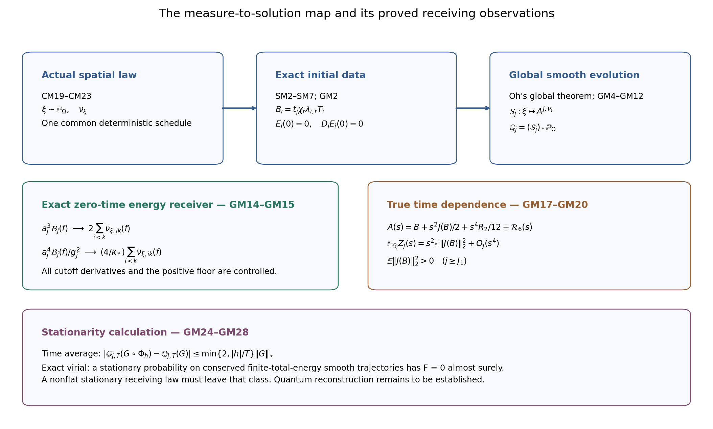

# Global source-free evolution receiving the actual spatial measure

The [spatial construction](SMOOTH_MEASURE_REALIZATION.md), SM1–SM12, and its [amplitude calculation](AMPLITUDE_ALGEBRA.md), AA1–AA20, give smooth compact initial connections for every positive Radon orientation triple. This note applies the established global Yang–Mills Cauchy theorem to those exact connections, constructs the solution law receiving the actual CM spatial measure, and calculates its energy and time derivatives. Every regulator, coupling, holonomy and original observable is retained. The resulting classical probability laws and their exact receiving observables are constructed below; equality with the finite quantum vacuum laws or a reconstructed quantum theory is not asserted.

## 1. Original data and the global theorem

Use the original spatial coordinates \(x\), center \(o\), time coordinate \(s=x^0=ct_{\rm phys}\), and Minkowski metric \(\operatorname{diag}(-1,1,1,1)\). Retain
\[
\begin{gathered}
T_i=-i\sigma_i/2,\quad [T_i,T_k]=\varepsilon_{ikq}T_q,\quad
|X|^2=-2\operatorname{Tr}(X^2),\\
a_j=(100j)^{-1},\quad L_j=j^4,\quad
g_j^2=\kappa_*a_j/2,\quad b_j=(\kappa_*a_j^2)^{-1},\quad
t_j=(\ell/a_j)^{3/4}.
\end{gathered}\tag{GM1}
\]
The symbol \(t_j\) is the original dimensionless amplitude from SM4, not the physical time. Given \(\nu=(\nu_{12},\nu_{13},\nu_{23})\), take exactly the SM2 mollified densities with floor \(\varepsilon_r=\sigma_*/r\), the three AA3 amplitudes, the cutoff \(\chi_r\), and the SM6 schedule. Write
\[
B_i^{j,\nu}(x)=t_j b_{i,r(j)}(x)T_i,\qquad
b_{i,r}=\chi_r\lambda_{i,r},\qquad
A_i^{j,\nu}(0)=B_i^{j,\nu},\quad E_i^{j,\nu}(0)=0 .
\tag{GM2}
\]
For the specified early indices \(j<J_1\), set \(B=0\) and use the zero solution. Every formula below involving \(r(j)\), and every strict positivity assertion, has domain \(j\ge J_1\). For the finitely many earlier indices the solution law is the point mass at zero and all its field observations vanish; omitting those indices changes none of the limits. All non-early initial data in GM2 are smooth and supported in \(K_{2r(j)}\). Consequently \(B\in H^m\cap L^3\) for every integer \(m\ge0\), and \(B\in\dot H^1\). The initial Gauss expression \(\sum_i(\partial_iE_i+[B_i,E_i])\) is identically zero.

Sung-Jin Oh's [finite-energy global well-posedness theorem, arXiv:1210.1557v2](https://arxiv.org/abs/1210.1557v2), Main Theorem in the subsection “Statement of the Main Theorem”, applies to exactly \((\dot H^1\cap L^3)\times L^2\) data satisfying this constraint. It gives a unique global admissible temporal-gauge solution and persistence of every indicated Sobolev derivative for smooth data. The original author TeX, lines783–850, was read together with its conventions at lines386–455. This is an application of that established theorem, with all its data hypotheses just verified; it is not a new proof of that global theorem.

The convention map is the identity on these matrix-valued connections and on the coordinate \(s\). Curvature, covariant derivative and gauge signs agree. Oh's matrix inner product is
\[
(X,Y)_{\rm Oh}=\operatorname{Tr}(XY^*)=-\operatorname{Tr}(XY)
=\tfrac12\langle X,Y\rangle,\qquad
\mathcal E_{\rm geom}=2\mathcal E_{\rm Oh},\qquad
\mathcal E_{\rm phys,j}=\mathcal E_{\rm geom}/g_j^2
=\frac{2\mathcal E_{\rm geom}}{\kappa_*a_j}.
\tag{GM3}
\]
The physical coupling changes the displayed energy factor, while the source-free classical equation for the retained connection is \(D^\mu F_{\mu i}=0\). We therefore obtain, for every original regulator and every input measure triple, a unique global smooth solution
\[
A_0^{j,\nu}=0,\qquad
\partial_sA_i^{j,\nu}=E_i^{j,\nu},\qquad
\partial_sE_i^{j,\nu}=\sum_kD_kF_{ki}^{j,\nu},\qquad
\sum_iD_iE_i^{j,\nu}=0.
\tag{GM4}
\]
Its connection as well as its curvature has finite Sobolev norms of every order on each bounded time interval. For the zeroth-order connection norm, which a homogeneous Sobolev assertion alone would not supply, use
\(\|A(s)\|_2\le\|B\|_2+|s|\sup_{|v|\le|s|}\|E(v)\|_2\).

## 2. Support, energy and the continuous solution map

Put \(M=(F_{23},F_{31},F_{12})\). The exact first-order system is
\[
\partial_s(A,E,M)=(E,-\operatorname{curl}_A M,\operatorname{curl}_A E),
\qquad
e=\tfrac12(|E|^2+|M|^2),\qquad
q_d=-\sum_{i,k}\varepsilon_{dik}\langle E_i,M_k\rangle .
\tag{GM5}
\]
Here all spatial and colour components remain in the tuple norm. Ad-invariance cancels the two connection contributions when GM5 is paired with \((E,M)\). The ordinary curl terms give \(\partial_se+\operatorname{div}q=0\). For every unit spatial vector \(n\), \(|q\cdot n|\le|E||M|\le e\), since the spatial cross-product by \(n\) has norm at most one. Integrating on a backward cone disjoint from the initial support gives zero curvature there: its shrinking-ball energy has derivative \(-\int_{\partial B}(e+q\cdot n)\le0\) and starts at zero. The vertical segment to any exterior point stays exterior, so integrating \(\partial_sA=E=0\), with initial \(B=0\) there, also gives zero connection. Reversing time proves
\[
\operatorname{supp}(A(s),E(s),M(s))
\subset\{x:\operatorname{dist}(x,K_{2r(j)})\le|s|\}.
\tag{GM6}
\]
Compact support on each bounded time interval now permits integration of the local energy identity without a boundary term. Both energies in GM3 are conserved. Equivalently the complete initial energy is
\[
\begin{gathered}
\mathcal D_r=\sum_{i<k}\int_{\mathbb R^3}
\bigl[(\partial_i b_{k,r})^2+(\partial_k b_{i,r})^2\bigr]\,dx,\qquad
\mathcal P_r=\sum_{i<k}\int_{\mathbb R^3}b_{i,r}^2b_{k,r}^2\,dx
=\frac4{\ell^3}\sum_{i<k}\int\chi_r^4\rho_{ik,r}\,dx,\\
\mathcal E_{\rm geom,j}
=\tfrac12t_j^2\mathcal D_r+\tfrac12t_j^4\mathcal P_r,\qquad
\mathcal E_{\rm phys,j}
=\frac{t_j^2\mathcal D_r+t_j^4\mathcal P_r}{\kappa_*a_j}.
\end{gathered}\tag{GM7}
\]
The vanishing cubic cross term follows from the exact orthogonality in AA9–AA10. Every derivative of \(\chi_r\lambda_{i,r}\), including the two mixed cutoff contributions, remains inside \(\mathcal D_r\).

We need a map of initial data, not merely separate existence for each input. Here is a direct continuity proof in the present matrix basis. On \(U=(A,E,M)\), define
\[
\begin{gathered}
\mathcal L U=(0,-\operatorname{curl}M,\operatorname{curl}E),\qquad
N_1(U)=(E,0,0),\\
Q(U,V)=\left(0,-\sum_{d,k}\varepsilon_{idk}[A_d(U),M_k(V)],
\sum_{d,k}\varepsilon_{idk}[A_d(U),E_k(V)]\right)_{i=1}^3 .
\end{gathered}\tag{GM8}
\]
Use the full Fourier Sobolev norm
\(\|f\|_{H^m}^2=(2\pi)^{-3}\int(1+|\xi|^2)^m|\widehat f(\xi)|^2\,d\xi\)
with \(\widehat f(\xi)=\int e^{-ix\cdot\xi}f(x)\,dx\).
The Fourier symbol of \(\mathcal L\) is skew-Hermitian, so its group is an isometry. For \(m\ge2\), convolution, Young's inequality and Cauchy–Schwarz give
\[
\begin{gathered}
\|fg\|_{H^m}\le C_m\|f\|_{H^m}\|g\|_{H^m},\qquad
C_m=2^m(2\pi)^{-3/2}
\left(\frac{\pi^{3/2}\Gamma(m-\tfrac32)}{\Gamma(m)}\right)^{1/2},\\
\|Q(U,V)\|_{H^m}\le72C_m\|U\|_{H^m}\|V\|_{H^m},\qquad
d_m(M_0)=\frac1{4(1+288C_mM_0)} .
\end{gathered}\tag{GM9}
\]
For completeness, the product estimate uses
\(\langle\xi\rangle^m\le2^{m-1}(\langle\eta\rangle^m+\langle\xi-\eta\rangle^m)\)
and
\(\int_{\mathbb R^3}(1+|\xi|^2)^{-m}d\xi
=\pi^{3/2}\Gamma(m-\tfrac32)/\Gamma(m)\);
the latter follows by polar coordinates and \(u=|\xi|^2\).
The two convolution terms give the displayed factor \(2^m\).
Each of the last two blocks of \(Q\) has 36 nonzero ordered scalar products, all of coefficient magnitude one because \([T_i,T_k]=\varepsilon_{ikq}T_q\). The triangle inequality for all 72 terms proves GM9; no quaternionic coefficient two has been substituted for this basis.

For \(M_0\ge\max(1,\|U(0)\|_{H^m})\), the Duhamel map
\[
U(s)=e^{s\mathcal L}U(0)+
\int_0^s e^{(s-v)\mathcal L}\{N_1(U(v))+Q(U(v),U(v))\}\,dv
\tag{GM10}
\]
maps the radius-\(2M_0\) ball on \([-d_m,d_m]\) into itself. Its size is at most \(M_0+d_m(2M_0+288C_mM_0^2)\le2M_0\), and its difference constant is at most \(d_m(1+288C_mM_0)\le1/4\). Subtracting the fixed-point equations proves continuous dependence in \(C([-d_m,d_m],H^m)\), with the data difference multiplied by at most \(4/3\). To verify compatibility, the magnetic curvature of \(A\) and the independent variable \(M\) both have derivative \(\operatorname{curl}_A E\), so their initially zero difference stays zero. Then
\[
\partial_s\sum_iD_iE_i
=\sum_{i,k}D_iD_kF_{ki}
=\tfrac12\sum_{i,k}[F_{ik},F_{ki}]=0.
\]
Here \(\sum_i[E_i,E_i]=0\); interchange of \(i,k\) gives the middle equality, including its factor one half. Thus Gauss propagates and the constructed solution agrees with the global theorem by uniqueness.

At a fixed smooth compact datum and a finite \(T\), the global \(H^m\) norm is bounded on \([-T,T]\). A finite covering by the preceding contraction intervals gives a neighborhood of that datum on which the solution map is continuous throughout this interval. Intersect the finitely many successive neighborhoods; uniqueness identifies their solutions on overlaps. Repeat for every \(m\). The first-order equation converts spatial convergence at higher \(m\) to convergence of all time derivatives, and Sobolev embedding gives continuity in the full \(C^\infty\) topology on compact space-time sets. For initial data supported in a fixed compact set, convergence in its \(C^\infty\) topology implies convergence in every \(H^m\), so the assertion applies directly to each fixed smoothing stage.

For a time-independent smooth gauge \(h\) equal to a constant outside a compact set, the initial transform \(B^h=hBh^{-1}-(dh)h^{-1}\) is again smooth compact data and its zero electric field remains zero. Expansion gives \(F^h=hFh^{-1}\), \(D^h(hXh^{-1})=h(DX)h^{-1}\), hence \(A(s)^h\) is a solution with these data. Uniqueness proves that the solution map commutes with this gauge transformation, retaining its derivative term.

## 3. The actual CM law and its global solution laws

Let \(\mathsf K\), \(\mathbb P_\Omega\) and \(\nu_\xi\) be exactly the compact character space, actual vacuum probability and orientation-triple measure constructed in [CM19–CM22](SIMULTANEOUS_CENTRAL_MEASURE.md). No new probability measure is selected. CM23 gives, for every \(\xi\), the deterministic bound
\[
\sum_{d<k}\nu_{\xi,dk}(K_{2r+2})
\le K_{(4r+4)\ell},\qquad
K_R=\frac{\mathsf L_R+\sqrt{\mathsf L_R^2-81\kappa_*^2R^6/4}}2,
\quad \mathsf L_R=24R^2+9\kappa_*R^3 .
\tag{GM11}
\]
Use SM3–SM6 with its mass \(S_r\) replaced in every upper bound by the displayed deterministic ceiling. This defines one common sequence \(J_r\) and one stage \(r(j)\) for all \(\xi\). The underlying densities, amplitudes and all actual input measures are unchanged: only the common sufficient bounds select the stage.

The map \(\xi\mapsto\nu_\xi\) is vague-continuous by CM20. The compactly supported convolution kernels and all their derivatives give continuity \(\xi\mapsto\rho_{\xi,r}\) in local \(C^\infty\): on a compact set of spatial points, the kernels have a common compact support; GM11 bounds every integral there; a finite covering and one more bounded derivative convert pointwise convergence to uniform convergence. The positive floor makes division and fourth roots continuous on that compact set. Thus \(\xi\mapsto B^{j,\nu_\xi}\) is continuous in the fixed-support smooth topology. The solution continuity just proved gives
\[
\mathcal S_j:\mathsf K\longrightarrow
C^\infty(\mathbb R^{1+3};\mathfrak{su}(2)^4),\qquad
\mathcal S_j(\xi)=A^{j,\nu_\xi},\qquad
\mathbb Q_j=(\mathcal S_j)_*\mathbb P_\Omega .
\tag{GM12}
\]
This is a continuous map from a compact space. Its image is compact in the indicated local smooth topology. Each \(\mathbb Q_j\) is consequently a Borel probability supported on globally smooth source-free solutions satisfying the original Gauss law, with finite energy and GM6 support. This compactness is asserted separately for each fixed \(j\), not uniformly in the regulator.

At any fixed time and each original finite edge, the holonomy is continuous in the connection by unitary Duhamel variation. Thus all finite time/edge/test observations are measurable under GM12. At zero time they have the exact receiving law
\[
\begin{split}
&\lim_{j\to\infty}\int
\prod_{v=1}^q\left[
a_j^2\sum_{p:\,d_p=d_v,\,k_p=k_v}
f_v(x_{p,j})D_p(A(0))\right]\,d\mathbb Q_j(A)\\
&\hspace{8mm}=
\int_{\mathsf K}\prod_{v=1}^q\nu_{\xi,d_vk_v}(f_v)\,
d\mathbb P_\Omega(\xi)
=\left\langle\Omega,
\prod_{v=1}^q S_{f_ve_{d_vk_v}}\Omega\right\rangle .
\end{split}\tag{GM13}
\]
Every finite \(q\), cross orientation and original signed compact test is included. SM7 proves the convergence for every \(\xi\); its local mass bound and GM11 give a deterministic integrable bound for the entire product, proving dominated convergence. Summing the three components recovers the original scalar \(a_jC_{f,j}\), with its factor \(a_j\) still displayed. The receiver on the right is the actual central spatial law. No equality of the constructed finite link law and the original \(\mu_j\) has been used.

## 4. Exact energy receiving map

For a compact real test \(f\), keep the original weighted magnetic energy on the zero-time slice,
\[
\mathcal B_j(f)=\frac12\sum_{i<k}\int f(x)|F_{ik}^{j,\nu}(0,x)|^2\,dx,\qquad
\mathcal D_r(f)=\sum_{i<k}\int f[(\partial_i b_{k,r})^2+
(\partial_k b_{i,r})^2]\,dx .
\]
The exact full curvature square gives
\[
a_j^3\mathcal B_j(f)
=\frac{\ell^{3/2}a_j^{3/2}}2\mathcal D_r(f)
+2\sum_{i<k}\int f\chi_r^4\rho_{ik,r}\,dx .
\tag{GM14}
\]
There are six derivative squares in \(\mathcal D_r\), each bounded by \(4L_r^2\), since SM3 defines \(L_r\ge\frac12\max|\partial b|\). Their support has volume at most \(V_r\). Hence the absolute value of the first term in GM14 is at most
\(12\|f\|_\infty\ell^{3/2}a_j^{3/2}L_r^2V_r\).
The fifth original error term in the common SM6 schedule says
\(16V_rL_r^2\ell^{3/2}a_j^{3/2}\le\tau_r/6\),
where \(\tau_r=\sigma_*\ell^3/r\). Therefore that full derivative contribution is at most \(\|f\|_\infty\tau_r/8\), and
\[
a_j^3\mathcal B_j(f)\longrightarrow
2\sum_{i<k}\nu_{ik}(f),\qquad
a_j^4\frac{\mathcal B_j(f)}{g_j^2}
\longrightarrow\frac4{\kappa_*}\sum_{i<k}\nu_{ik}(f).
\tag{GM15}
\]
The smoothing error is precisely
\(2\omega_f(\sqrt3h_r)\sum_{i<k}\nu_{ik}(K_{s+1})
+2\varepsilon_r\int|f|\)
for \(\operatorname{supp}f\subset K_s\) and sufficiently large \(r\). This proves GM15 with every derivative, floor and coupling contribution controlled. GM11 gives deterministic bounds, so all finite joint moments of these weighted energy quantities and the zero-time Wilson receivers also converge under the same \(\mathbb P_\Omega\). The energy rescalings in GM14–GM15 are explicit additional receiving maps; GM7 remains the full original energy.

## 5. Acceleration, the first correction and strict finite-regulator time dependence

Define the complete initial source
\[
J_i(B)=\sum_kD_k^BF_{ki}^B .
\]
SM9 and AA12–AA14 give every \(t_j,t_j^2,t_j^3\) coefficient and all cutoff derivatives of this expression. The true solution obeys \(A''(0)=J(B)\). Time reversal and uniqueness give \(A(-s)=A(s)\), \(E(-s)=-E(s)\). The exact linear derivative of the source is
\[
(J'_B V)_i=\sum_k\left[
D_k^B(D_k^BV_i-D_i^BV_k)+[V_k,F_{ki}^B]\right].
\tag{GM16}
\]
It follows by differentiating the displayed \(D_k^BF_{ki}^B\), retaining both the variation of \(D_k^B\) and of curvature. Put \(C=J(B)/2\) and \(R_2=J'_BC\), exactly as in SM10. Differentiating \(A''=J(A)\) twice at zero gives \(A^{(4)}(0)=J'_BJ(B)=2R_2\). Taylor's formula in every local Sobolev space therefore gives
\[
A(s)=B+\frac{s^2}{2}J(B)+\frac{s^4}{12}R_2+
\mathcal R_6(s),\qquad
\|\mathcal R_6(s)\|_{H^m(K)}
\le\frac{|s|^6}{720}
\sup_{|v|\le|s|}\|\partial_s^6A(v)\|_{H^m(K)} .
\tag{GM17}
\]
The supremum is finite by the applied persistence theorem. For a fixed \(j\), GM12 and compactness make it uniform over the actual character space on every fixed compact interval. Thus the previously computed polynomial-time section has a fully determined first correction to the actual source-free evolution, with the complete remainder retained.

The initial source is strictly nonzero for every non-early datum in this construction. Indeed vary the spatial connection in the direction \(B\). Curvature variation is the sum of its linear derivative part and twice its bracket part. Integrating by parts in the derivative of \(\frac12\int\sum_{i<k}|F_{ik}|^2\), and using the exact diagonal-colour orthogonality, gives
\[
\sum_i\int\langle B_i,J_i(B)\rangle
=-t_j^2\mathcal D_r-2t_j^4\mathcal P_r,\qquad
\|J(B)\|_2^2\ge
\frac{(t_j^2\mathcal D_r+2t_j^4\mathcal P_r)^2}
{t_j^2\sum_i\int b_{i,r}^2}>0 .
\tag{GM18}
\]
The denominator is positive and finite: all three amplitudes are positive on \(K_r\), and have compact support. Also
\(\mathcal P_r\ge(4/\ell^3)3\varepsilon_r\operatorname{Vol}(K_r)
=96\sigma_*r^2>0\).
With \(L_{\lambda,r}\) the full SM3 upper bound,
\(\sum_i\int b_{i,r}^2\le3L_{\lambda,r}^2(4r\ell)^3\).
Thus a uniform positive lower bound at the fixed stage is
\[
\|J(B)\|_2^2\ge
\frac{4t_j^6(96\sigma_*r^2)^2}
{3L_{\lambda,r}^2(4r\ell)^3}.
\tag{GM19}
\]
For the actual law use the common deterministic SM3 bound in this formula. It remains a statement at each fixed original regulator.

Choose a smooth compact weight \(\zeta_j\ge0\) equal to one on \(K_{2r}\). The gauge-invariant electric observation
\[
Z_j(s,A)=\int\zeta_j(x)\sum_i|F_{0i}^A(s,x)|^2\,dx
\]
has \(Z_j(0)=0\). Since \(E(s)=sJ(B)+O(s^3)\), with the remainder uniform on the fixed compact image GM12,
\[
\int Z_j(s,A)\,d\mathbb Q_j(A)
=s^2\int_{\mathsf K}\|J(B^{j,\nu_\xi})\|_2^2\,d\mathbb P_\Omega(\xi)
+O_j(s^4),\qquad
\int_{\mathsf K}\|J(B^{j,\nu_\xi})\|_2^2\,d\mathbb P_\Omega(\xi)>0 .
\tag{GM20}
\]
Uniformity and integrability follow from continuity of every derivative on that compact image; the lower bound is GM19. In physical time the leading coefficient is multiplied by \(c^2\). Hence the constructed solution law is not stationary under time translation: its electric observation is zero initially and positive at all sufficiently small nonzero times. This identifies a precise property still needed in a vacuum construction, with an actual observable and coefficient, rather than assuming stationarity from global smoothness.

## 6. A quantitative original-time receiving interval

The preceding source-free solution law has a complete small-time receiving map as well. For fixed \(j\), define the finite physical derivative bound
\[
K_j^{(2)}=\max_{\xi\in\mathsf K,\ |s|\le\ell,\ x\in K_{2r}+\overline B_\ell(0),\ i}
\|\partial_s^2A_i^{j,\nu_\xi}(s,x)\|_{\rm op}.
\tag{GM21}
\]
The maximum is finite by GM6 and the compact continuous map GM12. This is a defined quantity of the already constructed solutions, not an assumed regulator-uniform bound. Taylor's integral formula and \(A'(0)=0\) give
\(\max_i\|A_i(s)-B_i\|_\infty\le |s|^2K_j^{(2)}/2\)
for \(|s|\le\ell\), including outside the displayed compact set because both fields vanish there.

Unitary variation on each original edge bounds its transport difference by \(a_j\max_i\|A_i(s)-B_i\|_\infty\). Telescoping the four original factors, including inverses, gives a face matrix difference at most four times that quantity. The trace difference is at most twice the matrix operator norm. Therefore, for every original orientation test triple,
\[
\left|\sum_\sigma
\mathcal W_j^\sigma(A(s))(f_\sigma)
-\sum_\sigma\mathcal W_j^\sigma(B)(f_\sigma)\right|
\le4a_j^3 A_{1,\mathbf f,j}K_j^{(2)}s^2 .
\tag{GM22}
\]
The original \(A_{1,\mathbf f,j}=\sum_{\sigma,p:\sigma}|f_\sigma(x_p)|\) is retained; the bound uses no spatial derivative of the tests.

The total original number of faces is
\(M_j^{\rm all}=3(2L_j)^2(2L_j+1)\).
Set, using the reference quantities already fixed in SM1,
\[
\theta_j=\min\left\{\ell,
\left[\frac{\sigma_*\ell^3}
{j(1+4a_j^3M_j^{\rm all}K_j^{(2)})}\right]^{1/2}\right\}>0 .
\tag{GM23}
\]
The summand one has the same dimension as \(a_j^3K_j^{(2)}\); both are dimensionless. Since \(A_1\le F M_j^{\rm all}\), GM22 is at most \(F\sigma_*\ell^3/j\) throughout the original physical coordinate interval \(|s|\le\theta_j\). Thus the zero-time Wilson identities GM13 persist for arbitrary choices of times in this interval, using the same input \(\xi\). Their joint moments, also when multiplied by the zero-time energy quantities in GM15, converge to the same corresponding actual central moments. For this assertion GM15 is used only through its zero-time joint moments with Wilson observations; no time-dependent weighted-energy convergence is inferred from a holonomy estimate. Uniform boundedness for compact tests follows from SM7 plus GM22, so dominated convergence applies to every finite product.

This is an interval in the unchanged coordinate \(s=ct_{\rm phys}\), with its exact regulator-dependent size displayed. It does not provide a fixed positive-time limit. The strict time dependence GM20 and the derivative bound GM21 identify the next calculations needed to relate these classical solution laws to a stationary interacting state. The actual quantum covariance and low-window energy coefficients in CM and the current-fluctuation proof remain unchanged and are not evaluated by this classical construction.

## 7. Time averaging and the exact finite-energy stationarity defect

The next operation is available on these same solutions. Let
\(\Phi_uA(s,x)=A(s+u,x)\). Time translation is continuous in the local smooth topology, preserves temporal gauge and the source-free equation, and obeys \(\Phi_u\Phi_v=\Phi_{u+v}\). For \(T>0\), define
\[
\mathbb Q_{j,T}=\frac1{2T}\int_{-T}^{T}(\Phi_u)_*\mathbb Q_j\,du.
\tag{GM24}
\]
This is the pushforward of the product of \(\mathbb P_\Omega\) and uniform measure on \([-T,T]\) by the continuous map \((\xi,u)\mapsto\Phi_u\mathcal S_j(\xi)\). Thus it is a Borel probability on global smooth solutions, with compact image at each fixed \(j,T\). For every bounded Borel function \(G\) on the solution space, translation of the integration interval gives
\[
\left|\int G\circ\Phi_h\,d\mathbb Q_{j,T}
-\int G\,d\mathbb Q_{j,T}\right|
\le\min\{2,|h|/T\}\|G\|_\infty .
\tag{GM25}
\]
The two intervals have symmetric difference of length \(2|h|\) when \(|h|\le2T\), and length \(4T\) otherwise; division by \(2T\) proves every constant. Both original conserved energy laws in GM7 are exactly unchanged by GM24. This gives actual approximately stationary laws, without assuming convergence of their time averages.

There is a sharper restriction on any stationary limit retaining finite total classical energy. It follows directly from the full stress tensor in the same conventions. For every smooth source-free solution put
\[
\begin{gathered}
\mathcal T_{ik}=e\delta_{ik}
-\langle E_i,E_k\rangle-\langle M_i,M_k\rangle,\qquad
\sum_i\mathcal T_{ii}=e,\\
\partial_s q_i+\sum_k\partial_k\mathcal T_{ik}=0,\qquad
\|\mathcal T\|_{\rm op}\le e .
\end{gathered}\tag{GM26}
\]
Here \(\mathcal T\) is a real symmetric spatial matrix. To prove the differential identity, use GM5 and differentiate
\(q_i=-\sum_{d,k}\varepsilon_{idk}\langle E_d,M_k\rangle\).
Contraction of the two epsilon tensors gives, for any Lie-algebra-valued spatial vector \(X\),
\[
\bigl((\operatorname{curl}_A X)\mathbin{\times}X\bigr)_i
=\sum_k\langle X_k,D_kX_i\rangle
-\tfrac12\partial_i\sum_k|X_k|^2 .
\]
The cross product in this equation contracts colour by the invariant inner product. Gauss gives \(\sum_kD_kE_k=0\). The magnetic identity \(\sum_kD_kM_k=0\) follows by expanding the three cyclic derivatives of curvature: the second partial derivatives cancel in pairs, the mixed bracket derivatives cancel by antisymmetry, and the three double brackets cancel by Jacobi. Ad-invariance then changes each remaining covariant contraction to the derivative of the corresponding inner product. The two terms in \(\partial_s q\) are \((\operatorname{curl}_A M)\times M\) and \((\operatorname{curl}_A E)\times E\), giving precisely GM26. The Gram matrix subtracted from \(eI\) is positive and has trace \(2e\), so all its eigenvalues are in \([0,2e]\); this proves the operator-norm bound and the displayed trace.

Choose once and for all a smooth function \(\eta:\mathbb R^3\to[0,1]\) equal to one on the unit ball and zero outside the ball of radius two. Keep \(C_\eta=\|\nabla\eta\|_\infty\). For \(R>0\), put \(y=x-o\) and define the finite virial
\[
\begin{gathered}
V_R(s)=\int y_i\eta(y/R)q_i(s,x)\,dx,\qquad
|V_R(s)|\le2R\mathcal E_{\rm geom},\\
\frac{dV_R}{ds}
=\int\left[\eta(y/R)e+
\sum_{i,k}\frac{y_i}{R}(\partial_k\eta)(y/R)
\mathcal T_{ik}\right]dx,\\
\left|\frac{dV_R}{ds}\right|
\le(1+2C_\eta)\mathcal E_{\rm geom}.
\end{gathered}\tag{GM27}
\]
Repeated indices in the first integral are summed from one to three. Integrating GM26 against the compactly supported vector field \(y\eta(y/R)\) proves the derivative, with no term at infinity. The other two inequalities follow from \(|q|\le e\), GM26 and \(|y|/R\le2\) on the cutoff support.

Now take a time-translation-invariant Borel probability \(\mathbb P\) on global smooth source-free solutions whose original total energy is finite almost surely and conserved. This specifies the class of objects being tested; neither stationarity nor a limit of GM24 is being assumed for the constructed laws. First suppose \(\int\mathcal E_{\rm geom}\,d\mathbb P<\infty\). The first GM27 bound makes \(V_R\) integrable. Stationarity makes its expectation constant. The derivative bound justifies taking expectations of its integral identity and then its derivative, yielding expectation zero for the middle line of GM27. As \(R\to\infty\), its first integrand tends to \(e\), and its second tends to zero pointwise. Their absolute values are bounded by \((1+2C_\eta)e\), integrable in the product of \(\mathbb P\) and spatial volume. Dominated convergence gives \(\int\mathcal E_{\rm geom}\,d\mathbb P=0\).

The energy is Borel because it is the increasing limit of its integrals over finite spatial balls, each continuous in the local smooth topology. No finite first moment is needed for the conclusion. The measurable events
\(H_n=\{\mathcal E_{\rm geom}\le n\}\) are invariant because energy is conserved. Whenever \(\mathbb P(H_n)>0\), restricting and dividing by this probability gives a stationary law with expected energy at most \(n\). The preceding argument gives zero energy on \(H_n\). Their increasing union has probability one, so
\[
\mathbb P(\mathcal E_{\rm geom}=0)=1,\qquad
F_{\mu\nu}=0\quad\mathbb P\text{-almost surely}.
\tag{GM28}
\]
The last assertion follows from nonnegative energy and smoothness, at every time, using conservation and then continuity. This proves that a stationary law in this finite-total-energy class is supported on flat fields, even without an energy-moment assumption.

For completeness, these flat temporal-gauge fields have identity Wilson holonomy on every contractible loop in \(\mathbb R^3\). Indeed \(E=0\) makes the connection independent of time. Solve \(\partial_i h=-A_i h\) with prescribed \(h(o)\in SU(2)\) by parallel transport. The compatibility expression is \(-F_{ik}h=0\). Differentiating transport along a smooth path homotopy expresses its variation as the transported integral of that curvature, which vanishes; subdivision into coordinate rectangles gives the same conclusion directly from the compatibility equation. Since every loop in \(\mathbb R^3\) contracts, the transport is path independent and defines a global smooth \(SU(2)\)-valued \(h\). Thus \(A=-(dh)h^{-1}\) and every closed-loop transport is the identity. No decay of this gauge at infinity is required for this curvature conclusion.

GM24–GM28 specify the receiving spaces needed next. Their time averages have an exact vanishing stationarity defect, but a nonflat stationary limit cannot remain supported on finite-total-energy classical trajectories. The relevant enlarged space consists of global smooth source-free trajectories with finite energy on every compact spatial set and potentially infinite total energy, equipped with the local smooth topology and compactly supported observations. Time translation and the inclusion of the finite-energy solution space into this space are continuous by their definitions; both retain the same curvatures, Gauss equation and finite-edge holonomies. The inclusion intertwines \(\Phi_u\) exactly, and its pushforward takes GM24 to the same laws and the same bound GM25. GM28 identifies the precise part of this enlarged space on which nonflat stationary mass would have to lie. Establishing a nontrivial stationary measure there with the actual quantum receiving correlations, and reconstructing the intended quantum theory, remains a calculation rather than a consequence of classical time averaging. This virial argument makes no novelty claim.

The reproducible figure and bounded algebra checks are in check_global_measure.py. Exact primary-source versions and reading coverage are recorded in [the source-use ledger](SMOOTH_GLOBAL_SOURCE_USE_LEDGER.json).

## Stationary phase laws and exact quantum receiving tests

[HP1–HP40](STATIONARY_PHASE_RECEIVING.md) construct stationary global smooth homogeneous Yang–Mills laws and calculate their complete phase, spatial and time correlations. The actual CM lower bounds exclude this isotropic phase family, with an explicit continuous witness and a uniform interval-defect probability. The original finite Wilson observations retain a fully calculated shrinking-window weight under the specified auxiliary positive generator: the coefficient decays as j^(-63/4) for aC and j^(-55/4) for raw C, with a relative norm error of order j^(-4). Complete energy matrices and HP37 contrast this auxiliary spectrum with the actual quantum leading receiver, whose original first energy tends to zero. HP38–HP40 prove the exact composition-generator restriction and reflection-form comparisons, keeping the direct Euclidean interpretation distinct from analytic continuation. These comparisons do not assign the actual quantum window weight or establish the interacting no-gap endpoint.
