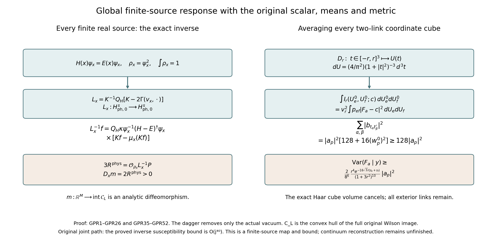

# The exact physical source inverse at every finite real source

11 October 2026. All statements below concern the original finite open cubic box. The Hamiltonian, Haar probability measure, vertex constraints, edge metric, face words, support relations and scalar energy are retained. The final estimates are evaluated on the original joint path. No closing physical gap or continuum Yang–Mills theorem is claimed.

The receiving definitions are Q1–Q5 and Q42–Q47 in [the complete fourth Schur coefficient](https://github.com/KokunoYumeto/yang-mills-interacting-workbench/blob/44548a167319316397e6874d8b2fc8f1d3491137/yang-mills/continuations/20261011-central-signs-shrinking-window/fourth_return/FOURTH_SCHUR_COEFFICIENT.md). The original labelled space and bilinear map are [G1–G23](https://github.com/KokunoYumeto/yang-mills-interacting-workbench/blob/fa79faff2cd697e16cfa3a7953f36810c22c8922/yang-mills/continuations/20260915-gauge-native-band/RESEARCH_NOTE.md). The local score calculation used below is reproduced, including its extension to signed sources, from [Spatial continuum, Section 10.1, equations (77)–(78)](https://github.com/KokunoYumeto/yang-mills-interacting-workbench/blob/7d5681ed53835433a5fb72d880b6292832f2efbf/yang-mills/continuations/20260930-s6-ns-moment-map-bridge/sources/spatial/spatial_continuum.tex#L1414). These are programme sources. No novelty or exhaustive-literature claim is made for elliptic perturbation theory, the ground-state transform, susceptibility, or convex duality. The existing canonical literature indexes were queried before this derivation; their hits are routing records only.

## 1. Original objects, vacuum and all Sobolev domains

Let \(L\ge2\) be an integer. Keep
\[
 V_L=\{-L,\ldots,L\}^3,\quad
 E_L=\{(n,i):n,n+e_i\in V_L\},\quad
 \mathcal P_L=\{(n;i,j):i<j,\ n,n+e_i,n+e_j,n+e_i+e_j\in V_L\}.
 \tag{GPR1}
\]
Write \(N=|E_L|=3(2L)(2L+1)^2\), \(M=|\mathcal P_L|=3(2L)^2(2L+1)\), and \(Q_L=SU(2)^{E_L}\), with product Haar probability \(dU\). On the original positive edges set
\[
\begin{split}
 W_{(n;i,j)}(U)&=\operatorname{Tr}[U_i(n)U_j(n+e_i)U_i(n+e_j)^{-1}U_j(n)^{-1}],\\
 T_\alpha&=-i\sigma_\alpha/2,\quad
 X_{e,\alpha}f=\left.\frac d{dt}f(\ldots,e^{tT_\alpha}U_e,\ldots)\right|_{t=0},\\
 K&=-\sum_{e,\alpha}X_{e,\alpha}^2,\qquad
 \Gamma(f,h)=\sum_{e,\alpha}(X_{e,\alpha}f)(X_{e,\alpha}h),\\
 H(x)&=\kappa K+V_x,\qquad
 V_x=\kappa\sum_{p\in\mathcal P_L}x_p(2-W_p),\quad
 x\in\mathbb R^M,\quad\kappa>0.
\end{split}\tag{GPR2}
\]
For complex functions the energy integrand is \(\Gamma(\bar f,f)\). Each original vertex, including every boundary vertex, acts by \(U_e\mapsto q_sU_eq_t^{-1}\). Its Haar average is the orthogonal projection \(\Pi\). A function or distribution is physical when \(\Pi f=f\). The action commutes with \(K\), \(H(x)\), and every Sobolev operator used below. The displayed potential contains its full scalar \(2\kappa\sum_p x_p\).

Define the Sobolev scale by
\[
 H^s(Q_L)=\{f:(I+K)^{s/2}f\in L^2(dU)\},\quad
 \|f\|_{H^s}=\|(I+K)^{s/2}f\|_2,
\quad
 H^s_{\rm ph,0}=\{f\in H^s:\Pi f=f,\ \langle f,1\rangle=0\}.
 \tag{GPR3}
\]
For negative \(s\) this is the distribution completion and the mean is its distribution pairing with the smooth function \(1\). The product-spin eigenvalues of \(K\) are \(c(j)=\sum_ej_e(j_e+1)\), with multiplicity bounded by \(\prod_e(2j_e+1)^2\). This gives the compact inclusions \(H^{s+1}\hookrightarrow H^s\): cut off the finitely many blocks with \(c(j)\le R\), and the remaining inclusion norm is at most \((1+R)^{-1/2}\). Smooth multiplication acts boundedly on every \(H^s\), and each \(X_{e,\alpha}\) maps \(H^s\to H^{s-1}\); for integer \(s\ge0\) these follow from the product rule and the Casimir derivative bounds, for negative integers from duality, and for intervening real indices from the spectral interpolation inequality. Thus all operator mappings used below have fixed, specified domains.

Every nonconstant physical product-spin block has \(c(j)\ge3\). Indeed, a degree-one vertex of its active edge graph would require a nonzero invariant in one nontrivial irreducible \(SU(2)\) representation. No such invariant exists. A nonempty finite graph without degree-one vertices contains a cycle. The original cubic graph has no cycle shorter than four, and every nontrivial edge spin contributes at least \(3/4\). A fundamental face trace attains \(3\). The complete physical Peter–Weyl decomposition therefore proves
\[
 K:H^s_{\rm ph,0}\longrightarrow H^{s-2}_{\rm ph,0}
 \text{ is an isomorphism},\qquad
 \|K^{-1}\|_{H^{s-2}\to H^s}\le4/3,
 \qquad KW_p=3W_p.
 \tag{GPR4}
\]
The factor \(4/3\) is \((1+c)/c\le4/3\). Distinct face traces are orthogonal and each has norm one: integrating a link present in only one face gives zero, and a face holonomy is Haar, with fundamental character square integral one. In particular \(\int W_p=0\).

The potential is real, smooth and bounded for every finite real \(x\), so \(H(x)\) is self-adjoint on \(H^2\), has form domain \(H^1\), and has compact resolvent. A lowest Rayleigh minimizer exists by compactness, and replacing it by its modulus cannot increase its kinetic form. The eigen-equation and elliptic regularity make that nonnegative minimizer smooth. The strong maximum principle for a bounded zeroth-order coefficient makes it strictly positive on the connected product. Denote it by \(\psi_x\), with \(\int\psi_x^2dU=1\), and its eigenvalue by \(E(x)\). One can see the required regularity directly by rewriting \(K\psi=(E-V_x)\psi/\kappa\) and successively applying the spectral inverse of \(I+K\); smooth multiplication preserves each successive Sobolev space.

For smooth \(F\), the product rule \(K(fh)=fKh+hKf-2\Gamma(f,h)\), the full vacuum equation, and integration by parts give
\[
 \langle\psi_xF,(H(x)-E(x))\psi_xF\rangle
 =\kappa\int\psi_x^2\Gamma(\bar F,F)dU.
 \tag{GPR5}
\]
Division by the positive smooth \(\psi_x\) preserves \(H^1\). If a second ground vector is divided by \(\psi_x\), (GPR5) makes all its first derivatives zero; connectedness makes it constant. Thus the ground eigenspace is one-dimensional. Every vertex gauge action fixes the positive unit vector, since it preserves \(H(x)\), positivity and norm. Consequently \(\psi_x\) is physical. This also proves that the physical and full ground energies coincide. At this fixed finite source the next physical eigenvalue is separated from \(E(x)\); write this actual positive difference as \(\delta(x)\).

Put
\[
 \rho_x=\psi_x^2,\quad d\mu_x=\rho_xdU,\quad
 P_Hf=\int f\,dU,\quad Q_H=I-P_H,\quad
 v_x=\log\psi_x-P_H\log\psi_x,\quad
 c_x=P_H\log\psi_x=-\tfrac12\log\int e^{2v_x}dU.
 \tag{GPR6}
\]
No normalization scalar is omitted. The full logarithmic equation and its Haar mean are
\[
 Kv_x=\sum_p x_pW_p+\Gamma(v_x,v_x)-\int\Gamma(v_x,v_x)dU,
 \qquad
 E(x)=2\kappa\sum_p x_p-\kappa\int\Gamma(v_x,v_x)dU.
 \tag{GPR7}
\]
They follow by dividing \(H\psi=E\psi\) by \(\psi=e^{v+c}\), using \(K(e^v)=e^v(Kv-\Gamma(v,v))\), and taking the original Haar integral.

## 2. The full inverse and its source dependence

Multiplication \(U_xF=\psi_xF\) is a unitary map from \(L^2(\mu_x)_{\rm ph}\) onto \(L^2(dU)_{\rm ph}\). Its operator and form domains are \(H^2_{\rm ph}\) and \(H^1_{\rm ph}\), respectively, under the unchanged coordinate Sobolev scale. The exact conjugate is
\[
 \mathcal L_x=K-2\Gamma(v_x,\cdot)
 =\kappa^{-1}\psi_x^{-1}(H(x)-E(x))\psi_x,
 \quad
 \int\mathcal L_xh\,d\mu_x=0.
 \tag{GPR8}
\]
The last identity holds first for smooth \(h\) by integration by parts and then for distributions by duality with the smooth density. In particular the only physical distributional solutions of \(\mathcal L_xh=0\) are constants: elliptic bootstrapping makes them smooth and (GPR5) applies.

Define on every real Sobolev index
\[
 \mathscr L_x
 =I-2K^{-1}Q_H\Gamma(v_x,\cdot)
 =K^{-1}Q_H\mathcal L_x:
 H^s_{\rm ph,0}\longrightarrow H^s_{\rm ph,0}.
 \tag{GPR9}
\]
The perturbation of the identity maps \(H^s\to H^{s+1}\), because its drift is first order and \(K^{-1}Q_H\) gains two derivatives. It is therefore compact on \(H^s_{\rm ph,0}\). If \(\mathscr L_xh=0\), repeated use of the same one-derivative gain makes \(h\) smooth. The equation says \(\mathcal L_xh=b\) for a constant \(b\). Its \(\mu_x\) mean gives \(b=0\). Equation (GPR5) makes \(h\) constant, and its Haar mean is zero. Hence \(h=0\). An identity minus a compact operator has index zero; its trivial kernel therefore gives a bounded bijection in (GPR9). This argument proves invertibility at every finite real source, with no small-source assumption.

Here is the complete formula. Let \(A_x=H(x)-E(x)\) and let \(A_x^\dagger\) be its inverse on \(\psi_x^\perp\cap L^2(dU)_{\rm ph}\), extended to annihilate \(\psi_x\). Then
\[
 \boxed{
 \mathscr L_x^{-1}f
 =Q_H\,\kappa\psi_x^{-1}A_x^\dagger\psi_x
       [Kf-\mu_x(Kf)] .}
 \tag{GPR10}
\]
For \(f\in H^2_{\rm ph,0}\), the bracket is in \(L^2\), and \(\psi_x[Kf-\mu_x(Kf)]\perp\psi_x\). Applying (GPR8) proves that the expression before \(Q_H\) solves \(\mathcal L_xh=Kf-\mu_x(Kf)\). Subtracting its Haar mean does not change that equation. Applying \(K^{-1}Q_H\) proves (GPR10). Conversely any solution of \(\mathscr L_xh=f\) must have \(\mathcal L_xh=Kf+b\); its \(\mu_x\) mean forces the specific scalar \(b=-\mu_x(Kf)\). Thus the two distinct means in (GPR10) are both necessary.

For arbitrary real \(s\), interpret \(\mu_x(Kf)=\langle Kf,\rho_x\rangle=\langle f,K\rho_x\rangle\). Extend \(A_x^\dagger:H^{s-2}_{\rm ph}\to H^s_{\rm ph}\) by its elliptic inverse with the rank-one vacuum projection removed. To check this extension without assuming it, apply (GPR9) to solve \(\mathcal L_xh=g-\mu_x(g)\) for \(g\in H^{s-2}_{\rm ph}\), setting \(f=K^{-1}Q_Hg\); the missing constant is fixed by the same mean identity. Multiplication by \(\psi_x\) then solves the distributional \(A_x\) equation, and subtraction of the \(\psi_x\) component fixes its unique inverse. This agrees with the \(L^2\) spectral inverse on the intersection of the domains by uniqueness. Consequently (GPR10) is a bounded inverse with exactly the claimed domains at every \(s\in\mathbb R\).

All of these maps depend real analytically on \(x\in\mathbb R^M\), locally as maps in their stated bounded-operator norms. At a fixed \(x_0\), take a circle enclosing only \(E(x_0)\). The bounded potential difference has norm at most \(4\kappa\sum_p|x_p-x_{0,p}|\); a sufficiently small complex neighbourhood makes the resolvent Neumann expansion uniform on that circle. Its contour integral is an analytic rank-one projection. Apply it to \(\psi_{x_0}\), and divide by the analytic square root of its bilinear integral \(\int\phi_x^2dU\), choosing the branch equal to one at \(x_0\). On real nearby sources this is the positive unit vacuum. The resolvent equation and successive Sobolev estimates make this dependence analytic in every \(H^r\). Sobolev embedding at \(r>3N/2+k\) gives it in \(C^k\). Positivity at \(x_0\) and the convergent power series of the logarithm give analytic \(v_x\in C^k\) on a smaller neighbourhood. Thus (GPR9) is analytic on \(H^s\); the ordinary local Neumann expansion around its already proved inverse proves analytic \(\mathscr L_x^{-1}\). Unique positive phases agree on overlaps. This is global real analytic dependence, meaning a compatible local analytic family at every real point; it does not assert a single complex power-series disk reaching all real sources.

## 3. The exact comparison with every original support label

For \(t\ge0\) let \(Y_t\) be the physical zero-Haar-mean Fourier space with
\[
 f=\sum_{j\ne0}\operatorname{Tr}(A_j\pi_j),\qquad
 \|f\|_{Y_t}=\sum_{j\ne0}c(j)^t\|A_j\|_1.
 \tag{GPR11}
\]
The original labelled Banach space \(\mathfrak B\) retains all nonempty edge labels \(S\subseteq E_L\) and all coefficients whose active spin support is contained in \(S\), including strict containment. Its norm and assembly are
\[
 \|F\|_{\rm loc}=\max_{e\in E_L}\sum_{S\ni e}\sum_{j\ne0}c(j)\|A_{S,j}\|_1,
 \quad
 \mathsf aF=\sum_j\operatorname{Tr}\!\left[\Big(\sum_{S\supseteq\operatorname{supp}j}A_{S,j}\Big)\pi_j\right].
 \tag{GPR12}
\]
Summing the anchor norms counts each original label at least once, so
\[
 \|\mathsf aF\|_{Y_1}\le N\|F\|_{\rm loc},\qquad
 \|\mathsf aF\|_{H^2}\le\tfrac43N\|F\|_{\rm loc}.
 \tag{GPR13}
\]
For the second inequality use the triangle inequality on the \(L^2\) functions and \((1+c)/c\le4/3\). Absolute coefficient convergence also gives \(\mathsf aF\in C^2\): zeroth coefficients have bound \(c/3\), first derivatives have \(j_e\le\sqrt c\), and each ordered second derivative has \(j_ej_f\le c\), including the case \(e=f\). Every component converges uniformly with these derivatives.

There is a bounded section \(\iota:Y_1\to\mathfrak B\): place each coefficient in the existing full original edge label \(E_L\). It has \(\|\iota f\|_{\rm loc}=\|f\|_{Y_1}\) and \(\mathsf a\iota=I\). This is a comparison map; it does not replace any existing support label. The relation \(F-\iota\mathsf aF\) is kept in \(\ker\mathsf a\), coefficient by coefficient. The original quotient is exactly
\[
 \overline{\mathsf a}:\mathfrak B/\ker\mathsf a\xrightarrow{\cong}Y_1,
 \quad
 \|[F]\|_{\rm quotient}\le\|\overline{\mathsf a}[F]\|_{Y_1}
 \le N\|[F]\|_{\rm quotient}.
 \tag{GPR14}
\]
The first inequality uses the explicit representative \(\iota\mathsf aF\); the second follows from (GPR13) and the infimum over representatives. Both constants depend on the original finite volume as displayed.

The original union-label bilinear map is
\[
 \mathcal B(F,G)_S=K^{-1}Q_H
       \sum_{S_1\cup S_2=S}\Gamma(F_{S_1},G_{S_2}).
\]
It obeys the exact intertwining
\[
 \mathsf a\mathcal B(F,G)=K^{-1}Q_H\Gamma(\mathsf aF,\mathsf aG),
 \qquad
 \mathsf a(I-2\mathcal B(V,\cdot))
 =\mathscr L_x\mathsf a\quad\text{when }\mathsf aV=v_x.
 \tag{GPR15}
\]
First verify this on finite coefficient families, where it is just the displayed sum over every original union. Then use the original G13 bilinear bound and (GPR13) to pass to the Banach completion and \(H^2\), respectively. The assembly kernel is invariant, since the right side vanishes on it.

In particular, in the previously proved labelled small-source disk, the original Neumann inverse and the physical inverse satisfy
\[
 \mathsf a(I-2\mathcal B(V(x),\cdot))^{-1}
 =\mathscr L_x^{-1}\mathsf a.
 \tag{GPR16}
\]
Both sides solve the same physical equation, and (GPR9) gives uniqueness. The same equation holds for the quotient inverse. This proves the inclusion and comparison, without extending the radius of convergence of the old labelled Taylor series.

One can prove more for the original finite-volume quotient, independently of that series. Smooth \(v_x\) belongs to every \(Y_t\). Indeed, trace-norm/Hilbert–Schmidt duality and Peter–Weyl Plancherel give
\[
 \sum_jc(j)^t\|A_j\|_1
 \le\left(\sum_j d_j^2\frac{c(j)^{2t}}{(1+c(j))^r}\right)^{1/2}\|v_x\|_{H^r},
 \tag{GPR17}
\]
where \(d_j=\prod_e(2j_e+1)\). The sum is finite when \(r>2t+3N/2\), by comparison with the product-spin lattice sum in dimension \(3N\). The missing constant coefficient of \(v_x\) is zero.

The original tensor-product trace-norm estimate and spin-generator norm give, for the drift coefficient product, a bound \(3\sum_e j_ek_e\le3\sqrt{c(j)c(k)}\). Any output spin has \(c(\ell)\le2(c(j)+c(k))\), since \(\ell_e\le j_e+k_e\) and \((j_e+k_e)(j_e+k_e+1)\le2[j_e(j_e+1)+k_e(k_e+1)]\). Keeping all three colour derivatives therefore proves
\[
 \|K^{-1}Q_H\Gamma(v_x,h)\|_{Y_{3/2}}
 \le3\sqrt2\big(\|v_x\|_{Y_1}\|h\|_{Y_{1/2}}
                  +\|v_x\|_{Y_{1/2}}\|h\|_{Y_1}\big).
 \tag{GPR18}
\]
The inverse Casimir cancels one power of the output weight. The remaining square root is bounded by \(\sqrt2(\sqrt{c(j)}+\sqrt{c(k)})\); this gives the two terms and the constant in (GPR18). Since \(\|h\|_{Y_{1/2}}\le3^{-1/2}\|h\|_{Y_1}\), this is a bounded map \(Y_1\to Y_{3/2}\). The inclusion \(Y_{3/2}\to Y_1\) is compact: only finitely many finite-dimensional matrix blocks lie below a Casimir cutoff, and the remaining inclusion norm is at most \(R^{-1/2}\). Hence \(\mathscr L_x\) is identity minus a compact operator on \(Y_1\). Its kernel embeds in the already trivial \(H^2\) kernel. The index-zero argument proves a bounded \(Y_1\) inverse at every finite real source. Formula (GPR10) and uniqueness identify it exactly with the Sobolev inverse on \(Y_1\).

Thus (GPR14) transports this independently proved inverse to the original assembly quotient at all finite real sources. The source \(v_x\) and this inverse are real analytic in that quotient, by (GPR17) and the Sobolev analytic result. This does not assert an inverse on the unquotiented relation kernel, a volume-uniform quotient norm, or continuation of the old Taylor series beyond its established disk. Every original relation remains present in (GPR12)–(GPR16).

## 4. Strict physical response, observation and global source coordinates

Set \(m_p(x)=\mu_x(W_p)\), \(z_q=\partial_{x_q}v_x\), and \(Z_q=z_q-\mu_x(z_q)\). Differentiating the full normalization and eigen-equation gives
\[
 \partial_{x_q}\psi_x=\psi_xZ_q,\qquad
 \partial_{x_q}E(x)=\kappa(2-m_q),\qquad
 A_x(\psi_xZ_q)=\kappa(W_q-m_q)\psi_x,
 \qquad \mathscr L_xz_q=W_q/3.
 \tag{GPR19}
\]
For the last equation differentiate (GPR7), apply \(K^{-1}Q_H\), and use \(KW_q=3W_q\). All derivatives exist by Section 2.

With \(r_p=(W_p-m_p)\psi_x\), the original physical response is
\[
 \begin{split}
 R^{\rm phys}_{pq}(x)
 &=\kappa\langle r_p,A_x^\dagger r_q\rangle_{L^2(dU)}
 =\mu_x[(W_p-m_p)z_q],\\
 \partial_{x_q}m_p&=2R^{\rm phys}_{pq},\qquad
 \partial_{x_p}\partial_{x_q}E=-2\kappa R^{\rm phys}_{pq}.
 \end{split}\tag{GPR20}
\]
These identities hold for every finite real source. The matrix is real symmetric and strictly positive definite. To prove strictness, let \(a\in\mathbb R^M\) be nonzero and \(F_a=\sum_pa_pW_p\). The source vector \(r_a=(F_a-\mu_xF_a)\psi_x\) cannot vanish: positivity of \(\psi_x\) and continuity would make \(F_a\) constant everywhere, whereas its Haar mean is zero and its Haar squared norm is \(\sum_pa_p^2>0\). The positive inverse of \(A_x\) on \(\psi_x^\perp\) therefore has strictly positive quadratic form at \(r_a\). The same conclusion for complex coefficient vectors follows by real and imaginary parts.

On \(H^s_{\rm ph,0}\), including distributional \(s\), retain the exact finite-rank observation
\[
 \mathcal O_{\rho_x}h
 =\sum_pW_p\{\langle h,\rho_xW_p\rangle
                       -m_p\langle h,\rho_x\rangle\},\qquad
 Ph=\sum_pW_p\langle h,W_p\rangle.
 \tag{GPR21}
\]
All paired functions are smooth. With the original Haar-orthonormal face basis, the global identity is
\[
 \boxed{3R^{\rm phys}(x)=\mathcal O_{\rho_x}\mathscr L_x^{-1}P.}
 \tag{GPR22}
\]
In the old labelled disk, (GPR16) identifies it with Q46 after assembly. The exact Q47 comparison with the fifth reference remains valid wherever its own inverse exists, with every operator understood through this inclusion. Its two corrections, the observation change and the higher-source resolvent term, remain necessary. At \(x=0\), \(\rho=1\), \(\mathscr L=I\), \(\mathcal O_\rho=P\), and \(R^{\rm phys}=I_M/3\).

There is also a complete global description of the expectation coordinates. Let
\[
 \mathcal C_L=\operatorname{conv}\{(W_p(U))_{p\in\mathcal P_L}:U\in Q_L\}\subset\mathbb R^M,
 \qquad \Lambda(x)=2\sum_px_p-E(x)/\kappa.
 \tag{GPR23}
\]
The convex hull is compact and has nonempty interior. If it were contained in an affine hyperplane, a nonzero \(a\) would make \(F_a\) constant, contrary to the Haar calculation above. Variationally, \(\Lambda(x)\) is the largest eigenvalue of \(-K+\sum_px_pW_p\); the equality retains rather than discards the scalar in \(H(x)\). By (GPR20), \(\nabla\Lambda=m(x)\) and \(D^2\Lambda=2R^{\rm phys}>0\).

For every finite \(x\), \(m(x)\in\operatorname{int}\mathcal C_L\). Otherwise a supporting hyperplane would give a nonconstant \(F_a\le h_{\mathcal C_L}(a)\) whose positive-density integral equals its maximum. Its continuous nonnegative deficit would then vanish everywhere, a contradiction. Strict Hessian positivity makes \(m\) injective, since for \(x\ne y\)
\[
 (x-y)\cdot(m(x)-m(y))
 =2\int_0^1(x-y)^tR^{\rm phys}(y+t(x-y))(x-y)\,dt>0.
 \tag{GPR24}
\]
It is onto this interior as well. Fix \(b\in\operatorname{int}\mathcal C_L\), and take \(\varepsilon>0\) with \(b+\varepsilon\overline B\subset\mathcal C_L\). For each unit vector \(u\), choose a configuration where \(F_u\) attains its maximum and a nonzero smooth bump supported where \(F_u>h_{\mathcal C_L}(u)-\varepsilon/4\). Its unit Rayleigh quotient for \(-K+tF_u\) is at least \(t[h_{\mathcal C_L}(u)-\varepsilon/4]-C_u\), with finite \(C_u=\int\Gamma(\bar\phi_u,\phi_u)dU\). Because \(\|W(U)\|\le2\sqrt M\), both the support function and these trial expectations are \(2\sqrt M\)-Lipschitz in \(u\). Finitely many neighbourhoods of these \(u\)'s cover the unit sphere. Their finite maximum kinetic cost \(C_\varepsilon\) gives, for every unit \(u\) and \(t\ge0\),
\[
 \Lambda(tu)-t\,u\cdot b\ge t\varepsilon/2-C_\varepsilon.
 \tag{GPR25}
\]
The variational inequality is valid in the full Hilbert space, whose largest eigenvalue here equals the physical one by ground positivity. Thus no gauge-variant trial is declared to be a physical state. Equation (GPR25) proves coercivity. The smooth strictly convex function \(\Lambda(x)-x\cdot b\) has a unique minimizer, and its derivative there is \(m(x)-b=0\). The analytic inverse-function theorem and uniqueness join the local inverses. Therefore
\[
 \boxed{m:\mathbb R^M\xrightarrow{\text{real analytic diffeomorphism}}
                   \operatorname{int}\mathcal C_L,\qquad
 D(m^{-1})=(2R^{\rm phys})^{-1}.}
 \tag{GPR26}
\]
This is a result about the actual finite-box ground state and the original joint Wilson image. It supplies no uniform limit of these convex bodies or inverses as \(L\to\infty\).

## 5. Explicit bounds, including a polynomial local bound

Set
\[
 s_e(x)=\sum_{p:e\in\partial p}|x_p|,\quad
 S(x)=2\left(\sum_es_e(x)^2\right)^{1/2},\quad
 \Omega(x)=8\pi\sum_es_e(x)=32\pi\sum_p|x_p|.
 \tag{GPR27}
\]
In the metric where the original \(X_{e,\alpha}\) are orthonormal, each factor is a radius-two three-sphere, with Ricci tensor one half its metric and diameter \(2\pi\). Write \(u=\log\psi_x\), \(\Delta=-K\), and \(w_e=|\nabla_eu|^2\). The full vacuum equation says \(\Delta u+|\nabla u|^2=(V_x-E)/\kappa\). Differentiating it and the squared partial gradient gives the complete product Bochner identity
\[
 (\Delta+2\nabla u\cdot\nabla)w_e
 =2\sum_f|\nabla_f\nabla_eu|_{\rm HS}^2+w_e
       +2\kappa^{-1}\langle\nabla_eu,\nabla_eV_x\rangle.
 \tag{GPR28}
\]
The factor-\(e\) curvature contributes \(2\operatorname{Ric}_e=w_e\); mixed factors have zero curvature. The derivative of \(-|\nabla u|^2\) cancels the displayed drift, retaining every mixed Hessian. For an original face containing \(e\), bi-invariance and inversion reduce its trace gradient to that of \(2u_0\) on the radius-two sphere, with squared norm \(1-u_0^2\le1\). Consequently \(\|\nabla_eV_x\|_\infty\le\kappa s_e\). At the maximum of \(w_e\), (GPR28) gives \(0\ge w_e-2s_e\sqrt{w_e}\). Thus
\[
 \|\nabla_e\log\psi_x\|_\infty\le2s_e,
 \quad\|\nabla_e\log\rho_x\|_\infty\le4s_e,
 \quad\|\nabla v_x\|_\infty\le S,
 \quad\frac{\max\rho_x}{\min\rho_x}\le e^\Omega.
 \tag{GPR29}
\]
The last inequality follows by moving each original link along a shortest geodesic. It uses \(\sum_es_e=4\sum_p|x_p|\), including boundary incidences. Normalization gives \(e^{-\Omega}\le\rho_x\le e^\Omega\).

Write \(m_\rho=\min\rho_x\), \(M_\rho=\max\rho_x\), \(q_\rho=M_\rho/m_\rho\le e^\Omega\). For physical \(h\in H^1\), minimize over the constant, then use the Haar mean and the exact physical gap \(3\):
\[
 \operatorname{Var}_{\mu_x}h
 \le M_\rho\int|h-P_Hh|^2dU
 \le\frac{M_\rho}{3m_\rho}\int\Gamma(\bar h,h)d\mu_x.
\]
Therefore
\[
 \gamma_x:=\delta(x)/\kappa\ge3/q_\rho\ge3e^{-\Omega},\qquad
 \|A_x^\dagger\|_{2\to2}\le e^\Omega/(3\kappa).
 \tag{GPR30}
\]
For the original zero-Haar-mean energy norm \(\|h\|_{\dot H^1_H}^2=\int\Gamma(\bar h,h)dU\), a quantitative inverse estimate follows directly from (GPR10). Test \(\mathcal L_xh=Kf-\mu_xKf\) against \(h-\mu_xh\), and integrate \(Kf\) in Haar measure with the full factor \(\rho_x\). The two terms are \(\int\rho_x\nabla\bar h\cdot\nabla f\) and \(2\int\rho_x(\bar h-\mu_x\bar h)\nabla v_x\cdot\nabla f\). Cauchy–Schwarz and (GPR30), followed by the conversion between weighted and Haar gradient norms, prove
\[
 \boxed{\|\mathscr L_x^{-1}\|_{\dot H^1_H\to\dot H^1_H}
 \le\sqrt{q_\rho}\left(1+\frac{2S}{\sqrt{\gamma_x}}\right)
 \le e^{\Omega/2}\left(1+\frac{2S}{\sqrt3}e^{\Omega/2}\right).}
 \tag{GPR31}
\]
The estimate is first proved for smooth \(f\) and then extends by density and the already proved inverse. Its two norms are fixed original Haar energy norms; no weighted norm has been substituted for them.

The next argument gives a much better bound for the finite face response inverse. Let \(F_a=\sum_pa_pW_p\), and fix one original face \(p\) and two distinct edges \(e,f\in\partial p\). No other elementary face contains both \(e\) and \(f\), since two distinct original faces share at most one edge. Conditional on all other links, \(F_a\), as a function of these two links, is
\[
 a_pW_p(U_e,U_f)+B_e(U_e)+B_f(U_f)+B_0,
 \tag{GPR32}
\]
where the \(B_e,B_f\) are finite sums of original single-occurrence trace words with fixed surrounding matrices. This is an exact decomposition, including every adjacent face and its coefficient. Under two-link Haar probability, \(W_p\) has squared norm one and is orthogonal to \(1,B_e,B_f\), by integration in the missing link. Hence, for every constant \(c\),
\[
 \int|F_a-c|^2dU_edU_f\ge |a_p|^2.
 \tag{GPR33}
\]
Let \(p_{ef}(U_e,U_f\mid y)\) be the actual conditional density, where \(y\) denotes every other original link. Its logarithmic derivatives in \(e,f\) obey (GPR29), since its denominator is independent of those links. Moving the two links proves a density ratio at most \(\exp[8\pi(s_e+s_f)]\), and its integral is one. This alone proves conditional variance at least
\[
 e^{-8\pi(s_e+s_f)}|a_p|^2.
 \tag{GPR34}
\]

A polynomial bound follows without replacing the actual density. Choose an arbitrary center \((U_e^0,U_f^0)\) for the two original links. Write its conditional density value as \(p_{ef}^0\). For each of the two links use its translated stereographic coordinates
\[
 U=U^0\frac{(1-|t|^2)I+2i\sum_{\alpha=1}^3t_\alpha\sigma_\alpha}{1+|t|^2},\qquad
 dU=\frac4{\pi^2}(1+|t|^2)^{-3}d^3t.
 \tag{GPR35}
\]
The exceptional point of this chart has Haar measure zero. Its distance from \(U^0\) in the original radius-two metric is \(4\arctan|t|\). For \(t\in[-r,r]^3\), this distance is at most \(4\sqrt3r\). Thus throughout the product of the two cubes the conditional density is at least
\[
 p_{ef}^0\exp[-16\sqrt3r(s_e+s_f)].
 \tag{GPR36}
\]
Every original occurrence of \(U\) or \(U^{-1}\) in (GPR32) has the common denominator \(1+|t|^2\) and a numerator of degree at most two. Consequently
\[
 P(t,t')=(1+|t|^2)(1+|t'|^2)(F_a-c)
 \tag{GPR37}
\]
is a real polynomial of degree at most two in each three-variable block and total degree at most four. Denote its coefficient vector by \(b\). Its nine coefficients of \(t_\alpha t'_\beta\) have a stronger bound than the estimate from its total degree. The first derivatives of both denominators vanish at the center, and the other terms in (GPR32) depend on only one link. Thus these nine coefficients are exactly \(a_p\partial_{t_\alpha}\partial_{t'_\beta}W_p(0,0)\).

To evaluate them with the original metric, each stereographic tangent in (GPR35) is \(-4T_\alpha\). Inversions contribute the corresponding minus sign and adjoint rotation. Move the fixed unitary factors around the trace and conjugate each generator through those factors. The two generator triples are changed only by real orthogonal adjoint matrices and orientation signs. Therefore the sum of squares of the nine mixed derivatives equals \(16^2\sum_{\alpha,\beta}|\operatorname{Tr}(T_\alpha T_\beta G_0)|^2\), where \(G_0\) is the original face holonomy at the chosen two-link center and the fixed exterior. Write \(G_0=q_0I+i\sum q_\gamma\sigma_\gamma\), with \(q_0^2+\sum q_\gamma^2=1\), and put \(w_p^0:=W_p(U_e^0,U_f^0,y)=\operatorname{Tr}G_0=2q_0\). The original Pauli product gives
\[
 \operatorname{Tr}(T_\alpha T_\beta G_0)
 =-\tfrac12q_0\delta_{\alpha\beta}
   +\tfrac12\sum_\gamma\varepsilon_{\alpha\beta\gamma}q_\gamma,
 \quad
 \sum_{\alpha,\beta}|\operatorname{Tr}(T_\alpha T_\beta G_0)|^2
 =\tfrac14(3q_0^2+2\sum_\gamma q_\gamma^2).
 \tag{GPR37a}
\]
The two orientations and fixed exterior factors have not been removed from the face word; their exact adjoint maps preserve this Frobenius sum. Consequently its actual mixed coefficient sum is
\[
 \sum_{\alpha,\beta}|b_{t_\alpha t'_\beta}|^2
 =|a_p|^2(128+16(w_p^0)^2)\ge128|a_p|^2.
 \tag{GPR37b}
\]
This calculation is uniform even when the base holonomy has trace zero or is central.

For the three monomials \(1,z,z^2\) on \([-1,1]\), the integral Gram matrix is
\[
 G=\begin{pmatrix}2&0&2/3\\0&2/3&0\\2/3&0&2/5\end{pmatrix}\ge\tfrac18I.
 \tag{GPR38}
\]
Indeed the middle diagonal after subtraction is \(13/24>0\), and the remaining \(2\times2\) block has first entry \(15/8>0\) and determinant \(41/576>0\). Tensoring six copies and restricting to the actual monomials gives, for \(0<r\le1\),
\[
 \int_{[-r,r]^6}|P|^2dt\,dt'
 \ge8^{-6}r^6\sum_\alpha|b_\alpha|^2r^{2|\alpha|}
 \ge128\,8^{-6}r^{10}|a_p|^2.
 \tag{GPR39}
\]
In the first inequality the coefficient of each monomial after \(t=rz\) is \(b_\alpha r^{|\alpha|}\). In the second inequality keep the nine mixed degree-two coefficients just evaluated; all other coefficient squares are nonnegative and remain present in the first expression. The Haar factors in (GPR35) and the squared denominator in (GPR37) contribute power five of each \(1+|t|^2\), giving the complete conditional bound
\[
 I_r(U_e^0,U_f^0;c):=
 \int_{U_e^0D_r\times U_f^0D_r}p_{ef}(U_e,U_f\mid y)|F_a-c|^2dU_edU_f
 \ge p_{ef}^0\frac{128(4/\pi^2)^2}{8^6}
       \frac{r^{10}e^{-16\sqrt3r(s_e+s_f)}}{(1+3r^2)^{10}}|a_p|^2,
 \tag{GPR40}
\]
where \(D_r\) is the stereographic image of \([-r,r]^3\) centered at the identity. Equation (GPR40) holds for every center, every \(r\in(0,1]\), all exterior links and every constant \(c\). Its mixed-derivative bound (GPR37b) is uniform in the center. This permits averaging rather than fixing a density maximum.

Integrate (GPR40) over both centers with their original Haar probability. The right side integrates \(p_{ef}^0\) to one. On the left, Fubini and Haar invariance give exactly
\[
 \int I_r(U_e^0,U_f^0;c)dU_e^0dU_f^0
 =v_r^2\int p_{ef}(U_e,U_f\mid y)|F_a-c|^2dU_edU_f,
 \qquad
 v_r=\frac4{\pi^2}\int_{[-r,r]^3}(1+|t|^2)^{-3}d^3t.
 \tag{GPR40a}
\]
Indeed write \(U_e=U_e^0q\), \(U_f=U_f^0q'\) with \(q,q'\in D_r\). For each fixed pair \(q,q'\), the two translations preserve Haar measure, so integrating the centers produces the same full conditional integral. Integrating \(q,q'\) contributes exactly \(v_r^2\). The upper bound \(v_r\le(4/\pi^2)8r^3\) retains the original Haar factor and gives, after division and minimization over \(c\),
\[
 \boxed{\operatorname{Var}(F_a\mid y)
 \ge\frac2{8^6}\frac{r^4e^{-16\sqrt3r(s_e+s_f)}}{(1+3r^2)^{10}}|a_p|^2,
 \qquad0<r\le1.}
 \tag{GPR40b}
\]
The factor two is \(128/8^2\); the two local Haar constants cancel only in this exact averaging identity. The power \(r^4\) is the squared degree-two mixed component, with the six-dimensional local volume canceled by \(v_r^2\). No independence of the actual vacuum links or modification of their density is used.

For a simple explicit choice, set
\[
 C_*:=\frac1{e\,2^{37}},\qquad
 t_p(x)=\min_{\substack{e,f\in\partial p\\e\ne f}}(s_e+s_f),\qquad
 \eta_p(x)=\max\left\{e^{-8\pi t_p},\ C_*(1+16\sqrt3t_p)^{-4}\right\}.
 \tag{GPR41}
\]
Choose the minimizing two original edges and \(r=(1+16\sqrt3t_p)^{-1}\) in (GPR40b). Its exponential is at least \(e^{-1}\), and \((1+3r^2)^{10}\le4^{10}\). Since \(2\cdot4^{-10}\cdot8^{-6}=2^{-37}\), this gives exactly the second entry of (GPR41). Combining it with (GPR34), conditional variance and the law of total variance proves \(\operatorname{Var}_{\mu_x}F_a\ge\eta_p|a_p|^2\) for each original face. Summing the resulting inequalities \( |a_p|^2\le\operatorname{Var}(F_a)/\eta_p\) gives
\[
 C(x):=[\operatorname{Cov}_{\mu_x}(W_p,W_q)]_{p,q}\ge c_0(x)I_M,
 \quad
 c_0(x)=\max\left\{e^{-\Omega(x)},\ \left(\sum_p\eta_p(x)^{-1}\right)^{-1}\right\}>0.
 \tag{GPR42}
\]
The first entry follows independently from \(\rho_x\ge e^{-\Omega}\) and Haar orthogonality. Retaining the maximum preserves both bounds. Equation (GPR40b) can be optimized further in \(r\) without changing the proof.

For the response estimate, put \(r_e=\#\{p:e\in\partial p\}\le4\) and
\[
 C_L^{\nabla}=\max_p\sum_{e\in\partial p}r_e\le16.
 \tag{GPR43}
\]
For each link, Cauchy–Schwarz in the actual incident face list and \(|\nabla_eW_p|\le1\) give
\[
 \Gamma(\bar F_a,F_a)\le\sum_er_e\sum_{p:e\in\partial p}|a_p|^2
 \le C_L^{\nabla}\sum_p|a_p|^2.
 \tag{GPR44}
\]
All boundary incidences are present; \(16\) is only an upper bound for the exact maximum. If \(F_a^0=F_a-\mu_xF_a\), spectral Cauchy–Schwarz for \(\mathcal L_x\) gives
\[
 \|F_a^0\|_{L^2(\mu_x)}^4
 \le\langle F_a^0,\mathcal L_x^\dagger F_a^0\rangle_{\mu_x}
       \langle F_a^0,\mathcal L_xF_a^0\rangle_{\mu_x}.
\]
The first factor is \(a^*R^{\rm phys}a\), by (GPR8) and (GPR20); the second is the integral in (GPR44). Thus
\[
 \boxed{R^{\rm phys}(x)\ge\frac{c_0(x)^2}{C_L^{\nabla}}I_M
          \ge\frac{c_0(x)^2}{16}I_M,\qquad
 \|(R^{\rm phys})^{-1}\|_{\ell^2\to\ell^2}
          \le16c_0(x)^{-2}.}
 \tag{GPR45}
\]
For an upper bound, \(|F_a|_\infty\le2\sqrt M\|a\|_2\) gives \(C(x)\le4MI_M\), while Haar comparison gives \(C(x)\le M_\rho I_M\). Consequently
\[
 R^{\rm phys}(x)\le\frac{\min(4M,M_\rho)}{\gamma_x}I_M
 \le\frac{4M}{3}e^\Omega I_M.
 \tag{GPR46}
\]
The distinct scales in (GPR31), (GPR45) and (GPR46) are part of the conclusions: the face response inverse has a polynomial bound from local conditioning; this does not bound the full physical spectral inverse by that same polynomial.

## 6. The exact joint path and what the bounds decide

Retain the original sequence, for all its admissible integers \(j\ge2\):
\[
\begin{gathered}
 L_j=j^4,\quad a_j=1/(100j),\quad g_j^2=\kappa_*/(200j),\quad
 \kappa_j=\kappa_*,\quad \xi_j=10000j^2/\kappa_*^2,\\
 N_j=3(2j^4)(2j^4+1)^2,\qquad
 M_j=3(2j^4)^2(2j^4+1),\qquad\kappa_*>0.
\end{gathered}\tag{GPR47}
\]
Every source is \(x_p=\xi_j\). Thus \(s_e=r_e\xi_j\), \(\sum_es_e=4M_j\xi_j\), and
\[
 \Omega_j=32\pi\xi_jM_j
 =\frac{320000\pi}{\kappa_*^2}j^2\,3(2j^4)^2(2j^4+1),\qquad
 S_j=2\xi_j\sqrt{\sum_er_e^2}\le8\xi_j\sqrt{N_j}.
 \tag{GPR48}
\]
Equations (GPR10), (GPR14)–(GPR18) and (GPR22) hold at every one of these points, even though they eventually lie outside the old series disk. Explicitly,
\[
 \delta_j\ge3\kappa_*e^{-\Omega_j},\qquad
 \|\mathscr L_j^{-1}\|_{\dot H^1_H\to\dot H^1_H}
 \le e^{\Omega_j/2}
       \left(1+\frac{16\xi_j\sqrt{N_j}}{\sqrt3}e^{\Omega_j/2}\right).
 \tag{GPR49}
\]
These finite bounds deteriorate along the path.

The local polynomial bound retains a very different dependence. Since \(t_p\le8\xi_j\), put
\[
 \eta_j=\max\left\{e^{-64\pi\xi_j},\ C_*(1+128\sqrt3\xi_j)^{-4}\right\},
 \qquad c_j=\max\{e^{-\Omega_j},\eta_j/M_j\}.
 \tag{GPR50}
\]
All original faces, including boundary faces, obey \(\eta_p\ge\eta_j\). Hence
\[
 \boxed{C(x_j)\ge c_jI_{M_j},\quad
 R^{\rm phys}(x_j)\ge\frac{C_*^2}{16M_j^2(1+128\sqrt3\,10000j^2/\kappa_*^2)^8}I_{M_j},}
 \tag{GPR51}
\]
and
\[
 \boxed{\|(R^{\rm phys}(x_j))^{-1}\|_{\ell^2\to\ell^2}
 \le16C_*^{-2}M_j^2
       (1+128\sqrt3\,10000j^2/\kappa_*^2)^8.}
 \tag{GPR52}
\]
For each fixed \(\kappa_*>0\), the right side is \(O(j^{40})\), with every coefficient retained in (GPR52): \(M_j^2=O(j^{24})\), and the other factor is \(O(j^{16})\). This is an explicit bound for the inverse susceptibility on the unchanged Euclidean face coefficient norm, rather than an assertion of a nonvanishing uniform response. The lower bound itself tends to zero.

An additional actual-vacuum bound retains the original weak-coupling energy calculation. For homogeneous \(\xi>0\), put \(D=\sum_p(2-W_p)\ge0\). A unit comparison vector with independent one-link factors proportional to \(e^{t u_0}\) has kinetic energy at most \(3Nt/8\) and expected \(D\le6M/t\). The latter follows from \(1-\mathbb E_tu_0\le3/(4t)\) and the ordered four-link expectation \(\mathbb E_tW_p=2(\mathbb E_tu_0)^4\). To verify the scalar bound, write \(z=1-u_0\): its tilted density is a gamma density proportional to \(e^{-2tz}z^{1/2}\), with mean \(3/(4t)\), multiplied by the decreasing factor \(\sqrt{2-z}\mathbf1_{[0,2]}(z)\). The two-copy covariance identity for an increasing and a decreasing function proves that this multiplier cannot increase its mean. Integration of \(\operatorname{div}(e^{2tu_0}\nabla u_0)\), using \(|\nabla u_0|^2=(1-u_0^2)/4\) and \(\Delta u_0=-3u_0/4\), gives the stated kinetic bound. Taking \(t=4\sqrt{\xi M/N}\) yields
\[
 E(\xi)\le3\kappa\sqrt{\xi NM},\qquad
 \mu_\xi(D)\le3\sqrt{NM}/\sqrt\xi.
 \tag{GPR53}
\]
The full and physical ground energies agree by Section 1, so using this comparison vector requires no change of physical state space.

Since \((2-W_p)^2\le4(2-W_p)\), Cauchy–Schwarz on the full face list gives
\[
 C(\xi)\le\min\{4M,12\sqrt{NM}/\sqrt\xi\}I_M,
 \quad
 R^{\rm phys}(\xi)\le\frac{e^{32\pi\xi M}}3
          \min\{4M,12\sqrt{NM}/\sqrt\xi\}I_M.
 \tag{GPR54}
\]
In particular at the exact path source the second covariance entry is \(3\kappa_*\sqrt{N_jM_j}/(25j)\). Also (GPR20) proves, at each fixed original box,
\[
 -\frac d{d\xi}\mu_\xi(D)=2\mathbf1^tR^{\rm phys}(\xi)\mathbf1>0,
 \quad
 \int_{\xi}^{\infty}\mathbf1^tR^{\rm phys}(t)\mathbf1\,dt
 =\tfrac12\mu_\xi(D)\le\frac{3\sqrt{NM}}{2\sqrt\xi}.
 \tag{GPR55}
\]
The endpoint limit \(\mu_t(D)\to0\) is proved by (GPR53), so this integral identity has no unproved endpoint assumption. It gives actual integrated homogeneous response; it does not select a new coupling in place of \(\xi_j\), and does not bound its derivative at \(\xi_j\) by the integral average.

The established next step beyond the small-source disk is therefore exact and quantitative: the physical Jacobian and the assembled original quotient are invertible at every path point, the Wilson expectation map has a global inverse onto its exact finite-box image, and the original finite face-response inverse grows at most by the explicit polynomial in (GPR52). These statements alone do not determine the low-energy spectral weight of the actual global phase states, the asymptotic excitation gap, a limiting Hilbert space or Hamiltonian, or continuum theory identification. In particular (GPR49) is a positive lower bound that tends to zero; that fact never proves a vanishing upper bound for the actual gap. The next spectral calculation must control the actual path vacuum observables and their spectral measures in the unchanged original Hamiltonian, using these inverses and response identities as available maps.

