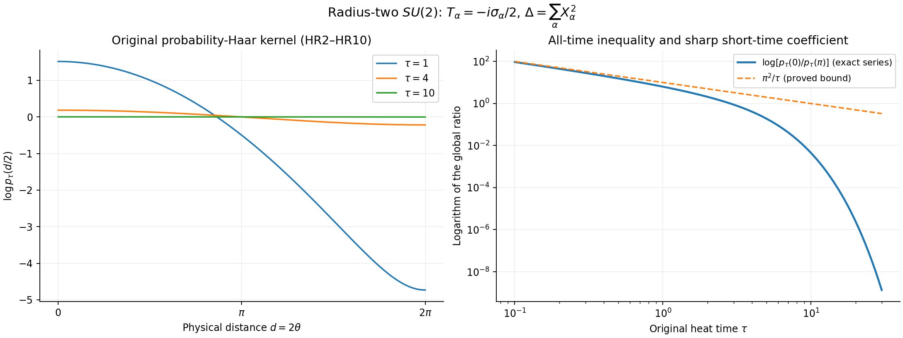

# The exact radius-two SU(2) heat-kernel ratio and its one-edge consequence

This independent derivation proves, for every real \(\tau>0\),
\[
 R(\tau):=\sup_{u,v,w\in SU(2)}
 \frac{p_\tau(u,w)}{p_\tau(v,w)}
 =\frac{p_\tau(0)}{p_\tau(\pi)}
 <\exp(\pi^2/\tau).                                      \tag{HR1}
\]
The constant \(\pi^2\) is the smallest constant \(C\) for which
\(R(\tau)\le e^{C/\tau}\) can hold at every positive time.
Here \(p_\tau\) is the kernel of the **original** generator
\(\Delta=\sum_{\alpha=1}^3X_\alpha^2\), with
\(T_\alpha=-i\sigma_\alpha/2\) orthonormal, relative to probability
Haar measure. The symbols \(0,\pi\) in the radial notation are the
angles \(d/2\); their physical distances are \(0,2\pi\).

The candidate LS12–LS16 establishes the necessary estimate only on
\(0<\tau\le\pi^2\). That range already suffices for the candidate's
square-root oscillation argument. Section HR5 below proves the additional
all-time assertion without assuming any extension of that range.

## HR2. Metric, Haar measure, generator and exact spectral series

Write
\[
 U=cI+\sum_{\alpha=1}^3q_\alpha T_\alpha,
 \qquad c^2+\tfrac14\sum_\alpha q_\alpha^2=1.
\]
The map \(U\mapsto(2c,q_1,q_2,q_3)\) maps \(SU(2)\) onto the
radius-two sphere in \(\mathbb R^4\). At the identity, the curve
\(\exp(tT_\alpha)\) maps to
\((2\cos(t/2),2\sin(t/2)e_\alpha)\), whose speed is one.
Left and right multiplication by unit quaternions act orthogonally on
these coordinates. Consequently the sphere metric is exactly the
bi-invariant metric making the three stated generators orthonormal.

Put \(c=\cos\theta\), \(q=2\sin\theta\,\omega\), with
\(0\le\theta\le\pi\) and \(\omega\in S^2\). The metric, volume,
probability Haar measure and radial generator are, respectively,
\[
 \begin{split}
 ds^2&=4\,d\theta^2+4\sin^2\theta\,ds_{S^2}^2,\\
 d\mathrm{vol}&=8\sin^2\theta\,d\theta\,d\omega,
 \qquad \mathrm{vol}(SU(2))=16\pi^2,\\
 dH&=\frac{\sin^2\theta}{2\pi^2}\,d\theta\,d\omega
   =\frac2\pi\sin^2\theta\,d\theta\,\frac{d\omega}{4\pi},\\
 \Delta_{\mathrm{rad}}&=\frac14
   (\partial_\theta^2+2\cot\theta\,\partial_\theta).
 \end{split}                                                   \tag{HR2}
\]
The last formula follows by applying the divergence formula to the
displayed metric and volume. In particular, \(d(I,U)=2\theta\), and
\(p_\tau=16\pi^2p_\tau^{\mathrm{vol}}\); this measure factor has not
been replaced by a different convention.

For each integer \(n\ge1\), set
\(\chi_{n-1}(\theta)=\sin(n\theta)/\sin\theta\), with its continuous
endpoint values. Direct differentiation and the sine orthogonality
integral give
\[
 \Delta\chi_{n-1}=-\frac{n^2-1}{4}\chi_{n-1},\qquad
 \frac2\pi\int_0^\pi\chi_{n-1}\chi_{m-1}\sin^2\theta\,d\theta
 =\delta_{nm},\qquad \chi_{n-1}(0)=n.                       \tag{HR3}
\]
Multiplication by \(\sin\theta\) identifies the radial weighted
\(L^2\) space with ordinary \(L^2(0,\pi)\), up to the displayed
constant \(2/\pi\). Completeness is therefore sine-series completeness.
The heat evolution of a radial smooth test function at the identity
has coefficient \(\chi_{n-1}(0)=n\), hence its exact kernel is
\[
 p_\tau(\theta)=\sum_{n=1}^{\infty}
   n e^{-\tau(n^2-1)/4}\frac{\sin(n\theta)}{\sin\theta}.
                                                               \tag{HR4}
\]
The conjugation average of any smooth test function has its original
value at the identity, so the same expression gives the point-source
kernel on the full group. Left translation gives
\(p_\tau(u,w)=p_\tau(d(u,w)/2)\). The finite identity
\[
 \frac{\sin(n\theta)}{\sin\theta}
 =e^{i(n-1)\theta}+e^{i(n-3)\theta}+\cdots+e^{-i(n-1)\theta}
                                                               \tag{HR5}
\]
gives \(|\chi_{n-1}|\le n\) including both endpoints. It also shows
that each angular derivative is bounded by a power of \(n\).
Thus the series and every fixed number of derivatives converge
uniformly when \(\tau\) stays bounded away from zero. The integral
against \(dH\) is one because only \(n=1\) has nonzero integral.

The maximum principle preserves nonnegative initial functions and the
constant function one. The associated heat kernel is therefore
nonnegative. It is strictly positive at each positive time: if the
nonnegative heat kernel vanished at an interior point of spacetime,
the strong parabolic maximum principle, applied from any earlier
positive time on the connected compact manifold, would force it to
vanish identically there, contrary to its integral one. This uses
only the usual local maximum principle for a smooth elliptic
Laplacian; there is no singular radial endpoint in this argument.

## HR3. The exact extrema

For \(\varepsilon>0\), let
\(f_\varepsilon(\theta)=a_\varepsilon e^{\cos\theta/\varepsilon}\),
where \(a_\varepsilon>0\) makes its Haar integral one. This is a
smooth radial density, \(f_\varepsilon'\le0\), and its probability
measures converge to \(\delta_I\). To check the last statement,
the mass outside any angular ball \(\theta<\eta\) is bounded by
a fixed volume ratio times
\(e^{(\cos\eta-\cos(\eta/2))/\varepsilon}\), which tends to zero.

Let \(u_\varepsilon=P_\tau f_\varepsilon\) and
\(v_\varepsilon=\partial_\theta u_\varepsilon\). Smoothness at the
two poles gives \(v_\varepsilon(\tau,0)=v_\varepsilon(\tau,\pi)=0\),
and differentiating HR2 gives
\[
 \partial_\tau v_\varepsilon
 =\frac14(v_\varepsilon''+2\cot\theta\,v_\varepsilon'
                         -2\csc^2\theta\,v_\varepsilon).       \tag{HR6}
\]
On a finite time strip, suppose there were a positive value. A
positive maximum over that strip cannot lie on either spatial
boundary or at initial time. At an interior spatial maximum and
a time of maximum up to that time, \(v'=0\), \(v''\le0\), and
\(\partial_\tau v\ge0\), whereas HR6 gives
\(\partial_\tau v\le-\tfrac12\csc^2\theta\,v<0\).
This is a contradiction. All coefficients used at that maximum are
finite, so the radial coordinate singularities do not require a
boundary assertion about their signs. Hence \(v_\varepsilon\le0\).

The smooth heat kernel and its first derivatives on a fixed
positive-time compact set can be integrated against the weakly
convergent measures \(f_\varepsilon dH\). The integrals converge
uniformly. Thus \(\partial_\theta p_\tau(\theta)\le0\).
In fact the inequality is strict for \(0<\theta<\pi\). If the
derivative vanished at an interior point at positive time, apply
the strong maximum principle to \(-\partial_\theta p\ge0\) on
compact subintervals of \((0,\pi)\), where HR6 has smooth bounded
coefficients. Overlapping such subintervals shows that the
derivative vanished on all of \((0,\pi)\) at earlier positive
times. This would make \(p\) constant, contradicting its nonzero
\(\chi_1\) coefficient \(2e^{-3\tau/4}\) in HR4.

Consequently the maximum is attained exactly when \(u=w\), and
the minimum exactly when \(v=-w\). Their ratio is
\[
 R(\tau)=
 \frac{\displaystyle\sum_{n\ge1}n^2e^{-\tau(n^2-1)/4}}
      {\displaystyle\sum_{n\ge1}(-1)^{n-1}n^2e^{-\tau(n^2-1)/4}}.
                                                               \tag{HR7}
\]
The denominator is strictly positive by the preceding heat-kernel
argument. It is an alternating spectral expression, not a sum
whose terms may be discarded as though all were positive.

## HR4. Image formula and both endpoint limits

The Fourier coefficient at integer \(n\) of
\(\sum_{k\in\mathbb Z}e^{-(\theta+2\pi k)^2/\tau}\) is
\(\sqrt{\pi\tau}\,e^{-\tau n^2/4}/(2\pi)\). Indeed, unfold the
integral over \([0,2\pi]\) to \(\mathbb R\). The Gaussian Fourier
integral follows by differentiating that integral with respect to
the frequency, integrating by parts, and solving
\(F'(s)=-\tau sF(s)/2\), with \(F(0)=\sqrt{\pi\tau}\).
The latter Gaussian integral follows by squaring it and using
polar coordinates. Thus
\[
 \sum_{n\in\mathbb Z}e^{-\tau n^2/4}e^{in\theta}
 =\frac{2\sqrt\pi}{\sqrt\tau}
       \sum_{k\in\mathbb Z}e^{-(\theta+2\pi k)^2/\tau}.
                                                               \tag{HR8}
\]
Both sides and all fixed derivatives converge absolutely. Differentiate
HR8, pair \(n\) with \(-n\), and insert the result in HR4 to obtain
\[
 p_\tau(\theta)=A_\tau
  \frac{S_\tau(\theta)}{\sin\theta},\qquad
 A_\tau=\frac{2\sqrt\pi e^{\tau/4}}{\tau^{3/2}},\qquad
 S_\tau(\theta)=\sum_{k\in\mathbb Z}
      (\theta+2\pi k)e^{-(\theta+2\pi k)^2/\tau}.              \tag{HR9}
\]
For \(\theta=0\), the terms \(k\) and \(-k\) cancel in \(S\).
For \(\theta=\pi\), pair \(k\) with \(-k-1\). Thus both endpoint
values of \(S\) are zero. Its derivative is
\[
 S_\tau'(\theta)=\sum_{k\in\mathbb Z}
 \left(1-\frac{2(\theta+2\pi k)^2}{\tau}\right)
                       e^{-(\theta+2\pi k)^2/\tau}.
\]
L'Hopital's rule at the two simple zeros of \(\sin\theta\) gives
the full limits, including the negative sign \(\cos\pi=-1\):
\[
 \begin{split}
 \frac{p_\tau(0)}{A_\tau}
 &=1+2\sum_{k=1}^{\infty}
       \left(1-\frac{8\pi^2k^2}{\tau}\right)e^{-4\pi^2k^2/\tau},\\
 \frac{p_\tau(\pi)}{A_\tau}
 &=2\sum_{k=0}^{\infty}
       \left(\frac{2(2k+1)^2\pi^2}{\tau}-1\right)
                                   e^{-(2k+1)^2\pi^2/\tau}.
 \end{split}                                                  \tag{HR10}
\]
For \(0<\tau\le\pi^2\), every correction in the first line is
negative, and every summand in the second line is positive.
The first line is therefore strictly less than one. Retaining
only the \(k=0\) summand of the second line yields
\[
 1<R(\tau)<
  \frac{e^{\pi^2/\tau}}{2(2\pi^2/\tau-1)}
  <e^{\pi^2/\tau}\qquad(0<\tau\le\pi^2).                    \tag{HR11}
\]
The left inequality follows from strict radial decrease; the
right inequality uses \(2(2\pi^2/\tau-1)\ge2\).

## HR5. A separate rigorous large-time estimate

Let
\[
 \delta(\tau)=\sum_{n=2}^{\infty}n^2e^{-\tau(n^2-1)/4}.
                                                               \tag{HR12}
\]
By HR5, \(|p_\tau(\theta)-1|\le\delta(\tau)\). For \(n=j+2\),
\(j\ge0\), one has
\[
 (j+2)^2\le4\,4^j,\qquad (j+2)^2-1\ge3+5j.
\]
The first inequality follows from \(j+2\le2^{j+1}\), whose
induction step is \(j+3\le2(j+2)\). The second inequality is
\(j(j-1)\ge0\) for integer \(j\ge0\). Hence, whenever the
displayed geometric ratio is below one,
\[
 \delta(\tau)\le
 D(\tau):=\frac{4e^{-3\tau/4}}{1-4e^{-5\tau/4}}.              \tag{HR13}
\]
For \(\tau\ge4\), this denominator is positive and
\[
 D(4)<\frac{1/4}{3/4}=\frac13.
\]
Here \(e^3>16\) follows already from
\(1+3+3^2/2+3^3/6+3^4/24=131/8>16\); also \(e^5>e^3>16\).
Every function \(\tau e^{-\tau(n^2-1)/4}\), \(n\ge2\), is
strictly decreasing for \(\tau\ge4\), because its derivative has
the sign of \(1-\tau(n^2-1)/4<0\). Thus
\[
 \delta(\tau)<\frac13,\qquad
 \tau\delta(\tau)\le4\delta(4)<\frac43\qquad(\tau\ge4).
\]
It follows that
\[
 \begin{split}
 \log R(\tau)
 &\le\log\frac{1+\delta(\tau)}{1-\delta(\tau)}\\
 &=\int_{-\delta(\tau)}^{\delta(\tau)}\frac{ds}{1+s}
 \le\frac{2\delta(\tau)}{1-\delta(\tau)}
 <3\delta(\tau)<\frac4\tau<\frac{\pi^2}\tau,
 \qquad \tau\ge4.                                           \tag{HR14}
 \end{split}
\]
Since \(4<\pi^2\), HR11 and HR14 cover every \(\tau>0\),
proving HR1. The small-time image series is not used outside
the range where its signs establish HR11.

## HR6. Sharp exponential coefficient and the antipodal asymptotic

In HR10, the omitted numerator terms are
\(O(\tau^{-1}e^{-4\pi^2/\tau})\) as \(\tau\downarrow0\).
To see this with a summable majorant, put \(x=\pi^2/\tau\ge1\),
factor out \(xe^{-4x}\), and bound the remaining series by a
constant times \(\sum_{k\ge1}(1+k^2)e^{-4(k^2-1)}\).
Similarly, the denominator terms with \(k\ge1\), relative to
the \(k=0\) term, are \(O(e^{-8\pi^2/\tau})\): factor out the
first exponent, use \(2x-1\ge x\), and dominate the remaining
sum by a constant times
\(\sum_{k\ge1}(2k+1)^2e^{-((2k+1)^2-9)}\).
Therefore the full endpoint asymptotics are
\[
 \begin{split}
 p_\tau(0)&=\frac{2\sqrt\pi e^{\tau/4}}{\tau^{3/2}}
       [1+O(\tau^{-1}e^{-4\pi^2/\tau})],\\
 p_\tau(\pi)&=\frac{2\sqrt\pi e^{\tau/4}}{\tau^{3/2}}
       2(2\pi^2/\tau-1)e^{-\pi^2/\tau}
       [1+O(e^{-8\pi^2/\tau})],\\
 R(\tau)&=\frac{e^{\pi^2/\tau}}{2(2\pi^2/\tau-1)}
       [1+O(\tau^{-1}e^{-4\pi^2/\tau})],\\
 \lim_{\tau\downarrow0}\tau\log R(\tau)&=\pi^2.
 \end{split}                                                  \tag{HR15}
\]
The last equality proves the optimality assertion following HR1:
any all-time exponent \(C/\tau\) requires
\(C\ge\lim_{\tau\downarrow0}\tau\log R(\tau)=\pi^2\).
It does not assert equality in HR1 at a positive time.

At large time, retaining the \(n=1,2,3\) terms in HR7 and bounding
the remainder by HR13 with its first terms removed gives
\[
 \begin{split}
 p_\tau(0)&=1+4e^{-3\tau/4}+9e^{-2\tau}+O(e^{-15\tau/4}),\\
 p_\tau(\pi)&=1-4e^{-3\tau/4}+9e^{-2\tau}+O(e^{-15\tau/4}),\\
 \log R(\tau)&=8e^{-3\tau/4}+O(e^{-9\tau/4}).
 \end{split}                                                  \tag{HR16}
\]
For the last line, set \(a=4e^{-3\tau/4}\),
\(b=9e^{-2\tau}\); expand
\(\log(1+a+b+\cdots)-\log(1-a+b+\cdots)\).
The quadratic even term cancels, the cubic term is
\(O(a^3)\), and \(ab=O(e^{-11\tau/4})\). All these bounds have
strictly smaller order than the displayed leading term.

## HR7. The original one-edge Feynman–Kac consequence

Retain the complete finite-volume Hamiltonian and all constants:
\[
 \begin{split}
 H&=-\kappa\sum_f\Delta_f+V,\qquad
 \kappa=2g^2/a,\quad b_{\rm mag}=1/(2g^2a),\quad a,g>0,\\
 V&=b_{\rm mag}\sum_p(2-\operatorname{tr}U_p),\qquad
 \xi=b_{\rm mag}/\kappa=1/(4g^4),\\
 H\psi&=E_0\psi,\qquad \psi>0,\qquad
 \int\psi^2\,dH^{\otimes N}=1.
 \end{split}                                                  \tag{HR17}
\]
Fix a physical link \(e\), write \(x=U_e\),
\(z=(U_f)_{f\ne e}\), and let \(r_e\) be the actual number of
incident faces. Split the original sum exactly into
\(V_e=b_{\rm mag}\sum_{p\ni e}(2-\operatorname{tr}U_p)\)
and \(V_{\bar e}=b_{\rm mag}\sum_{p\not\ni e}(2-\operatorname{tr}U_p)\).
Every \(SU(2)\) trace is in \([-2,2]\), so
\(0\le V_e\le4b_{\rm mag}r_e\). No scalar has been removed from
either potential or from \(E_0\).

Let independent link Brownian motions have generator
\(\kappa\sum_f\Delta_f\). The full eigenvalue equation and Ito's
formula give, for every physical time \(t>0\),
\[
 \psi(x,z)=e^{E_0t}\mathbb E_{x,z}
  \left[e^{-\int_0^tV(X_s,Z_s)ds}\psi(X_t,Z_t)\right].       \tag{HR18}
\]
Indeed the drift of the integrand with its time-dependent
exponential is \((E_0-V)\psi+\kappa\sum_f\Delta_f\psi=0\).
Compactness bounds the integrand on each finite time interval,
so the local martingale is a true martingale.

Condition on the complete outside path \(\zeta=(Z_s)_{0\le s\le t}\)
and define the common positive function
\[
 G_{t,z}(w)=\mathbb E_z^{\bar e}
 \left[e^{-\int_0^tV_{\bar e}(Z_s)ds}\psi(w,Z_t)\right].
\]
Independence before weighting, the bound on \(V_e\), and Tonelli's
theorem imply
\[
 e^{E_0t-4b_{\rm mag}r_et}P_{\kappa t}G_{t,z}(x)
 \le\psi(x,z)\le e^{E_0t}P_{\kappa t}G_{t,z}(x).             \tag{HR19}
\]
Thus the outside Brownian motion and every outside potential are
retained in the same \(G_{t,z}\). Dividing its positive integrals
gives the pointwise comparison
\[
 \frac{\psi(x,z)}{\psi(y,z)}
 \le e^{4b_{\rm mag}r_et}
       \sup_w\frac{p_{\kappa t}(x,w)}{p_{\kappa t}(y,w)}
 \le e^{4\beta\tau}R(\tau),\qquad
 \beta=r_e\xi,\quad \tau=\kappa t.                         \tag{HR20}
\]
The \(E_0\) factors cancel in this ratio of the full inequalities;
the scalar terms have not been omitted before obtaining HR19.
Consequently the exact consequence of this kernel comparison is
\[
 \sup_z\operatorname{osc}_x\log\psi(x,z)
 \le\inf_{\tau>0}\{4\beta\tau+\log R(\tau)\}
 \le4\pi\sqrt\beta.                                       \tag{HR21}
\]
For \(\beta>0\), the last bound follows by substituting
\(\tau=\pi/(2\sqrt\beta)\) into HR1. In original physical time,
\[
 t=\frac{\pi}{2\kappa\sqrt{r_e\xi}}
   =\frac{\pi a}{2\sqrt{r_e}}\qquad(r_e>0).                 \tag{HR22}
\]
The last equality uses exactly \(\kappa=2g^2/a\) and
\(\xi=1/(4g^4)\). If \(r_e=0\), let \(\tau\to\infty\) in
HR20; HR16 gives ratio at most one in either direction, so the
vacuum is independent of that link and HR21 gives zero.

For the physical density \(\rho_{\rm full}=\psi^2\), HR21 gives
\(\sup_z\operatorname{osc}_x\log\rho_{\rm full}\le8\pi\sqrt{r_e\xi}\).
For its conditional probability density
\(h_z(x)=\psi(x,z)^2/\int\psi(y,z)^2dH(y)\), probability Haar
measure and the ratio bound therefore give, pointwise,
\[
 e^{-8\pi\sqrt{r_e\xi}}\le h_z(x)
 \le e^{8\pi\sqrt{r_e\xi}}.                                \tag{HR23}
\]
To verify this last step, integrate
\(\psi(y,z)^2\le e^{8\pi\sqrt{r_e\xi}}\psi(x,z)^2\)
and its reverse inequality over \(y\); both Haar integrals have
total mass one.

## HR8. Source comparison and the source's unused second image formula

Fabrice Baudoin and Michel Bonnefont, *The subelliptic heat kernel
on SU(2): Representations, Asymptotics and Gradient bounds*,
[original author TeX, arXiv:0802.3320v1](https://arxiv.org/src/0802.3320v1),
Section 2 and Section 3.2, formula `spectralQ` and the first image
formula, supply an independent primary-source comparison for HR4
and HR9. The original author source was read at lines 155–200 and
414–496; its section structure was inspected. No PDF was used.
The source's basis is
\(X=-2T_2\), \(Y=-2T_1\), \(Z=-2T_3\), whence its complete
Riemannian Laplacian is exactly \(4\Delta\). The precise map is
\[
 p_\tau(\theta)=q_{\tau/4}(\cos\theta),\qquad
 \frac{\sqrt\pi e^{\tau/4}}{4(\tau/4)^{3/2}}
 =\frac{2\sqrt\pi e^{\tau/4}}{\tau^{3/2}}.                  \tag{HR24}
\]
The source's two-field subelliptic kernel is a different object
and is not used anywhere in HR1–HR23.

The immediately following, unused second image expression in
this v1 TeX has a sign error. Pairing the terms \(k\) and \(-k\)
in HR9 gives exactly, for \(0<\theta<\pi\),
\[
 \begin{split}
 S_\tau(\theta)
 =\theta e^{-\theta^2/\tau}
 \bigg[1+2\sum_{k\ge1}e^{-4\pi^2k^2/\tau}
 \bigg\{\cosh\frac{4\pi k\theta}{\tau}
 -\frac{2\pi k}{\theta}\sinh\frac{4\pi k\theta}{\tau}\bigg\}\bigg].
 \end{split}                                                  \tag{HR25}
\]
Indeed the paired unfactored terms are
\(e^{-\theta^2/\tau-4\pi^2k^2/\tau}
[(\theta+2\pi k)e^{-4\pi k\theta/\tau}
+(\theta-2\pi k)e^{4\pi k\theta/\tau}]\).
The coefficient of the hyperbolic sine is therefore negative.
The v1 source displays a plus sign in that second expression.
HR9 uses its first expression, independently derived in HR8–HR9;
none of HR1–HR24 uses the erroneous rewrite. This is a bounded
source correction to v1, with no assertion about another edition.

## HR9. Scope and reproducibility

`verify_heat_ratio.py` evaluates both complete series at high
precision on their stable ranges, checks overlapping evaluations,
checks the two endpoint limits and the exact Haar integral, and
produces `HEAT_RATIO_CHECKS.json`. Its finite samples support the
calculation; HR2–HR25 are the proof. The two original-source forms
retain the full multiplier and every image or spectral term in
the mathematical statements. Truncation is confined to the
numerical checks and explicitly recorded there.

`HEAT_RATIO_FIGURE.png` illustrates the original probability-Haar
kernel against the physical distance \(d=2\theta\), and the exact
ratio against HR1. The plotted curves are numerical samples of
HR4, HR9 and HR10; their inequalities are proved in HR11–HR14.
The geometry is already described exactly by HR2, so a three-dimensional
scene would add no mathematical information to these plots.

This note establishes the heat-ratio and one-edge oscillation
claims. It does not assert a continuum mass gap, a sign for a
complete spectral endpoint, or a score bound derived from
additional stochastic differentiation.

