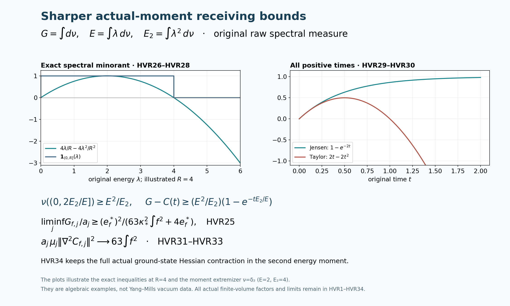

# Independent derivation of the actual-vacuum Hessian route

The proposed Hessian route and signed-test strengthening are correct.
This note derives the geometric identities and original-face constants
independently. It also proves three useful strengthenings: both roots
of the local uncertainty polynomial improve the receiving constants;
the original spectral-window certificate improves by a factor four;
and the actual expected squared Hessian of the original observable
has an exact leading coefficient.

The reviewed source is the complete current
ORIGINAL_SOURCE_COVARIANCE.md, OS1–OS40, together with its
DERIVATION_WORKING.md. Neither file is edited. The completed
PVC1–PVC50 proof remains sealed. All results below concern the
original actual state; no comparison vector is substituted for it.

## 1. Original space, all constants, and the curvature convention

Let \(m=2L\), with the original vertices \(z\in\{0,\ldots,m\}^3\),
positive physical edges \(e=(z,d)\), and geometric faces
\(p=(z;d,e)\), \(d<e\). Retain the ordered words
\[
 \begin{gathered}
 U_p=U_d(z)U_e(z+e_d)U_d(z+e_e)^{-1}U_e(z)^{-1},\\
 W_p=\operatorname{Tr}U_p,\quad D_p=2-W_p,\quad 0\le D_p\le4,\\
 T_\alpha=-i\sigma_\alpha/2,\qquad
 \Delta=\sum_{e,\alpha}X_{e,\alpha}^2,\quad K=-\Delta,\\
 H=\kappa K+V,\quad
 V=b\sum_pD_p=2bM-b\sum_pW_p,\quad
 \kappa=2g^2/a,\quad b=1/(2g^2a),\quad\kappa b=a^{-2}.
 \end{gathered}\tag{HVR1}
\]
Here \(M=3m^2(m+1)\), \(N=3m(m+1)^2\); every edge has
probability Haar measure and the round radius-two metric. The
configuration manifold is the compact boundaryless product
\(\mathcal M=(S^3_2)^N\), not a quotient with singular charts.
Physical vectors are invariant under all original vertex actions,
including boundary vertices.

The original positive unit vacuum is smooth and satisfies
\[
 H\psi=E_0\psi,\quad d\mu=\psi^2dU,\quad w=\log\psi,\quad
 \Delta w+|\nabla w|^2=(V-E_0)/\kappa,\qquad
 \mathscr L=\Delta+2\nabla w\cdot\nabla .
 \tag{HVR2}
\]
Compact ellipticity, the variational principle and the strong
maximum principle give a positive smooth lowest eigenfunction.
The product expansion
\(\langle F\psi,(H-E_0)F\psi\rangle=\kappa\mu|\nabla F|^2\)
implies its uniqueness on the connected configuration product.
Every gauge map fixes it by uniqueness and positivity, so the full
and physical ground energies coincide. Division by this smooth
strictly positive function preserves every finite-order Sobolev
domain at fixed finite volume. All differentiations below are
therefore on actual smooth functions before closure of the
self-adjoint operators on \(D(K)\).

Use the four-tensor convention
\[
 \mathscr R(v,z,v,z)=\frac14\sum_e
       (|v_e|^2|z_e|^2-\langle v_e,z_e\rangle^2),\qquad
 \operatorname{Ric}=\tfrac12g,\quad\nabla\operatorname{Ric}=0 .
 \tag{HVR3}
\]
This fixes \(\mathscr R_{ikjl}=\mathscr R(e_i,e_k,e_j,e_l)\).
Mixed product sections have zero curvature; a section contained
in one edge sphere has curvature \(1/4\). In particular
\(\mathscr R(v,\cdot,v,\cdot)\) is a nonnegative symmetric
form for every \(v\), including vectors with components on
several edges.

## 2. Full covariant Hessian equation and the eigenvalue minimum

Let \(h=\nabla^2w\). In a normal orthonormal frame the covector
commutator in convention (HVR3) reads
\[
 \nabla_i h_{jk}-\nabla_k h_{ij}
                   =\mathscr R_{ikjl}w_l .
 \tag{HVR4}
\]
This convention is also fixed directly by an ambient linear
coordinate \(q\) on \(S^3_2\), for which
\(h(q)=-(q/4)g\); the two sides of (HVR4) are then
\((\delta_{ij}q_k-\delta_{kj}q_i)/4\).
Twice differentiating the squared gradient, and using (HVR4)
on its third derivative, gives
\[
 (\nabla^2|\nabla w|^2)_{ij}
 =2h_{ik}h_{jk}+2w_k\nabla_kh_{ij}
                         +2\mathscr R_{ikjl}w_kw_l .
 \tag{HVR5}
\]
Thus the gradient-curvature term has a positive sign.

For clarity, the Laplacian commutation can be derived before
invoking parallel Ricci. The divergence identity is
\(\nabla^kh_{kj}=\nabla_j\Delta w+
\operatorname{Ric}_{jl}w_l\). Differentiate it and commute
the derivative \(\nabla_i\) through \(\nabla^k\), using
(HVR4) once for the remaining differentiated Hessian. One obtains
\[
 \begin{split}
 (\Delta h)_{ij}
 ={}&\nabla_i\nabla_j\Delta w
   +\operatorname{Ric}_{ik}h_{kj}
   +\operatorname{Ric}_{jk}h_{ik}
   -2\mathscr R_{ikjl}h_{kl}\\
 &+(\nabla_i\operatorname{Ric}_{jl}
       +\nabla_j\operatorname{Ric}_{il}
       -\nabla_l\operatorname{Ric}_{ij})w_l .
 \end{split}\tag{HVR6}
\]
Every last-line term is zero on the product in (HVR3). Adding
(HVR5) to the resulting expression for
\(\nabla^2\Delta w\), and differentiating the full equation
(HVR2), proves
\[
 \begin{split}
 \kappa^{-1}(\nabla^2V)_{ij}
 ={}&(\mathscr Lh)_{ij}+2h_{ik}h_{kj}
      +2\mathscr R_{ikjl}h_{kl}
      -\operatorname{Ric}_{ik}h_{kj}
      -\operatorname{Ric}_{jk}h_{ik}\\
    &+2\mathscr R_{ikjl}w_kw_l .
 \end{split}\tag{HVR7}
\]
The Laplacian and drift on \(h\) are covariant. The constant
\(2bM\) and energy \(E_0\) in (HVR2) have zero Hessian;
their differentiation does not remove either from the original
equation or from its ground vector.

Let \(\lambda\) be the global minimum of \(h(v,v)\) on the
unit tangent bundle. Compactness makes it attained at \((x,v)\).
If \(\lambda<0\), \(v\) is an eigenvector of \(h_x\)
with eigenvalue \(\lambda\). Extend it locally to a smooth unit
vector field with \(\nabla v=0\) at \(x\), for example by radial
parallel transport. The scalar \(h(v,v)\) has a minimum there.
When its Laplacian is expanded, the terms involving
\(\nabla v\) vanish; the remaining correction is
\(2h(v,\Delta v)=2\lambda\langle v,\Delta v\rangle=0\),
because the field is unit and \(\nabla v=0\) at the point.
The drift correction vanishes for the same reason. Therefore
\((\mathscr Lh)(v,v)\ge0\) without assuming a globally
parallel eigenvector field.

At the minimum, the curvature and Ricci terms in (HVR7)
combine exactly as
\[
 \begin{gathered}
 2\mathscr R_{vkv l}h_{kl}
       -2\lambda\operatorname{Ric}(v,v)
 =2\operatorname{tr}
       [\mathscr R(v,\cdot,v,\cdot)(h-\lambda g)]\ge0,\\
 2\mathscr R(v,\nabla w,v,\nabla w)\ge0,\qquad
 2h^2(v,v)=2\lambda^2,\qquad
 2\lambda^2\le\kappa^{-1}\nabla^2V(v,v).
 \end{gathered}\tag{HVR8}
\]
Both symmetric forms in the trace product are nonnegative;
diagonalizing the second proves its trace product is
nonnegative even when the forms do not commute.
This verifies every curvature sign in the proposed minimum
argument. The product's increasing dimension introduces no factor.

## 3. The original potential upper Hessian

For \(Y_e=\sum_\alpha y_{e,\alpha}T_\alpha\), the simultaneous
link path \(U_e(s)=e^{sY_e}U_e\) is a product geodesic and
\(|Y_e|=|y_e|\) in the original metric. Each of the four
factors of \(U_p(s)\) is direct or inverse according to
(HVR1). A direct factor has derivative \(Y_eU_e\);
an inverse factor has derivative \(-U_e^{-1}Y_e\).
Their second derivatives have the corresponding retained
order, with \(Y_e^2=-|y_e|^2I/4\).

Twice differentiating the full ordered trace produces four
same-factor terms and twelve ordered distinct-factor terms.
The former have absolute values at most \(|y_e|^2/2\).
Each unordered distinct pair contributes at most
\(|y_e||y_{e'}|\), including its factor two. This follows
from \(\|Y_e\|_{\rm op}=|y_e|/2\), unitarity of every
undifferentiated original factor, and
\(|\operatorname{Tr}A|\le2\|A\|_{\rm op}\).
Consequently
\[
 \begin{split}
 |\nabla^2D_p(Y,Y)|
 &\le\frac12\sum_{e\in\partial p}|y_e|^2+
                   \sum_{\{e,e'\}\subset\partial p}|y_e||y_{e'}|\\
 &=\frac12\left(\sum_{e\in\partial p}|y_e|\right)^2
 \le2\sum_{e\in\partial p}|y_e|^2,\\
 \nabla^2V(Y,Y)
 &\le2b\sum_e r_e|y_e|^2\le8b|Y|^2,\qquad
 r_e=|\{p:e\in\partial p\}|\le4 .
 \end{split}\tag{HVR9}
\]
All original boundary incidences are present in the first upper
bound. The estimate is on the full configuration manifold.
Combining (HVR8) and (HVR9), including the trivial case
\(\lambda\ge0\), proves
\[
 \boxed{\ \nabla^2\log\psi\ge
       -2\sqrt{b/\kappa}\,g=-\frac1{g^2}g.\ }
 \tag{HVR10}
\]
On the unchanged path \(a_j=(100j)^{-1}\),
\(g_j^2=\kappa_*a_j/2\), this is
\(-2/(\kappa_*a_j)g\). The claimed uniformity concerns
the number of lattice links, not the coupling tending to zero.

## 4. Exact mixed-face Hessian and weighted Bochner

For real \(f\in C_c(\mathbb R^3)\), retain every face
orientation, its original center \(x_p\), and
\[
 \begin{gathered}
 C_f=a\sum_pf(x_p)D_p=2aA_0-a\sum_pf_pW_p,\qquad
 A_0=\sum_pf_p,\quad A_2=\sum_pf_p^2,\quad F=\|f\|_\infty,\\
 m_f=\mu C_f,\quad u_f=(C_f-m_f)\psi,\quad
 G_f=\|u_f\|^2,\quad
 E_f=\langle u_f,(H-E_0)u_f\rangle=\kappa\mu\Gamma(C_f),\\
 E_{2,f}=\|(H-E_0)u_f\|^2 .
 \end{gathered}\tag{HVR11}
\]
The spatial values \(f_p\) are constants as configuration functions,
so every displayed observable is smooth, even for a merely
continuous spatial test.

On the diagonal edge block, the Levi–Civita connection removes
the antisymmetric part of two invariant derivatives. The Pauli
anticommutator
\(T_\alpha T_\beta+T_\beta T_\alpha
=-\delta_{\alpha\beta}I/2\) yields
\[
 (\nabla^2D_p)_{e\alpha,e\beta}
                     =(W_p/4)\delta_{\alpha\beta}
 \quad(e\in\partial p).
 \tag{HVR12}
\]
The same result follows from the geodesic second derivative
and polarization, so it is independent of whether the
chosen invariant fields are named by left or right multiplication.

For distinct physical edges, the product connection has no
mixed term. Their two derivative insertions in the trace can
be written, after a cyclic rotation, as
\(\pm\operatorname{Tr}(T_\alpha A T_\beta B)\).
Replace the second generator basis by its orthogonal adjoint
transport under \(A\). The product \(AB\) is a cyclic
representative of the full original face holonomy.
Inverses change only the recorded sign and orthogonal bases.
If \(U_p=x_0I-i x\cdot\sigma\), \(x_0^2+|x|^2=1\),
the resulting block for \(D_p\) has entries, up to those
isometries,
\((x_0\delta_{\alpha\beta}
+\epsilon_{\alpha\beta\gamma}x_\gamma)/2\).
The symmetric and antisymmetric parts are orthogonal in
Hilbert–Schmidt inner product. Thus
\[
 \|(\nabla^2D_p)_{e,e'}\|_{\rm HS}^2
   =\frac{3x_0^2+2|x|^2}{4}
   =\frac12+\frac{W_p^2}{16},\qquad e\ne e'.
 \tag{HVR13}
\]
Every surrounding link and inverse orientation is retained in
the reduction by orthogonal transports; none is discarded from
the original derivative.

Two distinct elementary cubic squares cannot share two distinct
physical edges. Two adjacent edges determine their unique unit
square, and two opposite edges do likewise. Hence distinct
faces have no common ordered off-diagonal edge block. Each
face supplies twelve such ordered blocks. Diagonal blocks
retain all face interference. The exact result is
\[
 \begin{split}
 \|\nabla^2C_f\|_{\rm HS}^2
 &=\frac{3a^2}{16}
          \sum_e\left(\sum_{p\ni e}f_pW_p\right)^2
    +a^2\sum_pf_p^2\left(6+\frac34W_p^2\right)\\
 &\le21a^2A_2 .
 \end{split}\tag{HVR14}
\]
Indeed Cauchy–Schwarz, \(r_e\le4\), \(W_p^2\le4\) and
four edges per face bound the first term by \(12a^2A_2\);
the second is at most \(9a^2A_2\).
The equality retains every boundary incidence and diagonal
overlap before either upper bound.

For a smooth scalar \(C\), scalar Bochner followed by the
product rule for the drift gives
\[
 \frac12\mathscr L\Gamma(C)-\Gamma(C,\mathscr LC)
   =\|\nabla^2C\|_{\rm HS}^2+
               (\operatorname{Ric}-2\nabla^2w)(\nabla C,\nabla C).
 \tag{HVR15}
\]
To check the drift sign directly, expand
\(\Gamma(C,2\Gamma(w,C))\). Its terms are
\(2\nabla^2w(\nabla C,\nabla C)
+2\nabla^2C(\nabla C,\nabla w)\).
The latter cancels the drift part of
\(\mathscr L\Gamma(C)/2\); the former is subtracted.
Weighted Haar integration gives
\(\mu\mathscr LF=0\) and
\(\mu\Gamma(F,G)=-\mu(F\mathscr LG)\).
Using
\((H-E_0)(C_f-m_f)\psi=-\kappa(\mathscr LC_f)\psi\)
therefore proves
\[
 \begin{split}
 E_{2,f}
 &=\kappa^2\mu\left[
    \|\nabla^2C_f\|_{\rm HS}^2+\tfrac12\Gamma(C_f)
           -2\nabla^2w(\nabla C_f,\nabla C_f)\right]\\
 &\le21\kappa^2a^2A_2+
             (\kappa/2+4\sqrt{\kappa b})E_f\\
 &=21\kappa^2a^2A_2+(\kappa/2+4/a)E_f .
 \end{split}\tag{HVR16}
\]
This verifies the second-energy bound on the actual vacuum.
There is no missing gauge projection: all multipliers are
physical, their ground transforms are physical, and the
geometric inequalities were proved on the larger smooth product.

## 5. Signed physical edges and both local uncertainty roots

Use the proved LC patch \(Q=v+\{0,\ldots,q\}^3\), with all
edges of each supported face inside \(Q\). Retain its exact
geometry and actual kinetic-plus-potential budget:
\[
 \begin{gathered}
 N_Q=3q(q+1)^2,\quad M_Q=3q^2(q+1),\\
 C_Q=2q(q+1)\sum_{d=1}^3
       [\mathbf1_{\{v_d>0\}}+\mathbf1_{\{v_d+q<m\}}],\\
 W_Q=\sum_{p\ {\rm inside}}D_p,\quad
 \Lambda_Q=\min\{2M_Q,6g^2\sqrt{N_QM_Q}\}+2C_Q,\\
 d_Q=\mu W_Q,\quad T_Q=\mu|\nabla_Qw|^2,\qquad
 \kappa T_Q+b d_Q\le b\Lambda_Q .
 \end{gathered}\tag{HVR17}
\]
LC proves this using every inside, outside and crossing term:
each crossing face has one inside edge, and the actual outside
ground's open three-edge path has zero matrix expectation under
its endpoint central gauge transformation. Its exact comparison
cost is \(2bC_Q\). This checked provider is the same one used
in sealed PVC25–PVC27; no local product structure of the
actual full state is assumed.

Here the two roots of the already proved PVC28 uncertainty
polynomial give a further useful consequence. Weighted Haar
integration, \(KW_Q=3W_Q-6M_Q\), and
\(\Gamma(W_Q)\le16W_Q\) prove
\[
 \begin{gathered}
 (6M_Q-3d_Q)^2\le64(b/\kappa)d_Q(\Lambda_Q-d_Q),\\
 A_Q=9+64b/\kappa,\quad B_Q=36M_Q+64(b/\kappa)\Lambda_Q,\quad
 \Delta_Q=B_Q^2-144A_QM_Q^2,\\
 d_Q^\pm=\frac{B_Q\pm\sqrt{\Delta_Q}}{2A_Q},\qquad
 0<d_Q^-\le d_Q\le d_Q^+\le\Lambda_Q,\qquad
 d_Q^-<\Lambda_Q .
 \end{gathered}\tag{HVR18}
\]
The actual \(d_Q\) proves the discriminant is nonnegative.
The root sum and product are positive. At
\(d=\Lambda_Q\), the polynomial is
\((6M_Q-3\Lambda_Q)^2\ge0\). Also \(\Lambda_Q>d_Q^-\):
equality would force \(d_Q=\Lambda_Q=2M_Q\), while in that
case the other root is \(18M_Q/(9+64b/\kappa)<2M_Q\).
Thus \(\Lambda_Q\) lies on or beyond the upper root. This
proves the final upper bound in (HVR18), including finite
patches and boundary classes.

Let physical edge centers be
\(x_{(z,d)}=o+a(z-L\mathbf1+e_d/2)\), and face centers
\(x_{(z;d,e)}=o+a(z-L\mathbf1+(e_d+e_e)/2)\).
Take
\(h_e=\operatorname{sgn}f(x_e)\) on inside edges, with sign
zero at zero, and \(h_e=0\) outside; put
\(\sigma_p=\sum_{e\in\partial p}h_e\).
The individual-edge Casimir, including the original scalar,
is \(K_eC_f=(3a/4)\sum_{p\ni e}f_p(D_p-2)\).
Thus the complete identity is
\[
 \begin{split}
 B_f
 &:=\frac{3a}{4}\sum_pf_p(\mu D_p-2)\sigma_p\\
 &=\mu\sum_eh_eK_eC_f
   =2\mu\sum_eh_e\Gamma_e(w,C_f),\\
 B_f^2&\le4T_Q E_f/\kappa,\qquad
 E_f\ge\frac{\kappa^2B_f^2}
                    {4b(\Lambda_Q-d_Q^-)} .
 \end{split}\tag{HVR19}
\]
The deterministic weights have no configuration derivatives,
so sign changes of the physical test introduce no omitted term.
Cauchy–Schwarz uses \(|h_e|\le1\) and precisely the inside
edge score. The denominator is positive by (HVR18); keeping
the actual \(d_Q\) first gives the stronger undivided inequality
\(4b(\Lambda_Q-d_Q)E_f\ge\kappa^2B_f^2\).

For an incident face-center and edge-center pair the Euclidean
distance is exactly \(a/2\). If their two test values have the
same nonzero sign, \(f_p\operatorname{sgn}f(x_e)=|f_p|\).
Otherwise \(|f_p|\le|f_p-f(x_e)|\), including a zero value.
Consequently, with the global modulus of continuity
\(\omega_f(r)=\sup_{|x-y|\le r}|f(x)-f(y)|\),
\[
 \begin{gathered}
 |f_p h_e-|f_p||\le2\omega_f(a/2)
       \quad(p\ {\rm supported},\ e\in\partial p),\\
 \left|a^2 B_f+6a^3\sum_p|f_p|\right|
 \le3a^3F d_Q+12a^3M_Q\omega_f(a/2),\\
 \mathfrak b_f
 :=a\left[6\sum_p|f_p|-3F d_Q^+
                      -12M_Q\omega_f(a/2)\right]_+
 \le|B_f|.
 \end{gathered}\tag{HVR20}
\]
The first term on the second line retains the actual
\(\mu D_p\) contribution and bounds it using
\(|\sigma_p|\le4\). The other term is the sum of the four
signed sampling errors, multiplied by the full coefficient
\(3/2\). Every supported face is inside \(Q\); all other
coefficients vanish. In particular the truncation of \(h_e\)
outside \(Q\) drops no term in (HVR19).

The preceding formulas yield wholly explicit finite estimates,
without needing the unknown individual means:
\[
 \begin{gathered}
 \underline E_f=
 \frac{\kappa^2\mathfrak b_f^2}
             {4b(\Lambda_Q-d_Q^-)},\qquad
 \overline E_f=16\kappa a^2F^2d_Q^+,\qquad
 \underline E_f\le E_f\le\overline E_f,\\
 P_f=21\kappa^2a^2A_2,\qquad Q_a=\kappa/2+4/a,\qquad
 E_{2,f}\le P_f+Q_a E_f .
 \end{gathered}\tag{HVR21}
\]
For the energy upper bound the original quaternion derivative
gives \(\Gamma(C_f)\le16a^2F^2W_Q\), followed by
\(d_Q\le d_Q^+\). No trial mean replaces \(d_Q\).

Use the unchanged \(L_j=j^4\), \(a_j=(100j)^{-1}\),
\(g_j^2=\kappa_*/(200j)\), \(b_j=10000j^2/\kappa_*\).
For a support cube \(\prod_d[c_d,c_d+R]\), retain the exact
LC prescription
\[
 \begin{gathered}
 v_{d,j}=L_j+\lfloor(c_d-o_d)/a_j\rfloor-1,\quad
 q_j=\lceil R/a_j\rceil+3,\quad Q_j=v_j+\{0,\ldots,q_j\}^3,\\
 \mathsf L_R=9\kappa_*R^3+24R^2,\quad
 \mathsf d_R^\pm=
 \frac{\mathsf L_R\pm
        \sqrt{\mathsf L_R^2-81\kappa_*^2R^6/4}}2,\\
 a_j^2\Lambda_{Q_j}\to\mathsf L_R,\qquad
 a_j^2d_{Q_j}^\pm\to\mathsf d_R^\pm,\qquad
 \mathsf d_R^+=\mathsf L_R-\mathsf d_R^- .
 \end{gathered}\tag{HVR22}
\]
The finite roots follow from (HVR18). Multiplying its polynomial
by \(a_j^6\) gives the limiting equation
\(x(\mathsf L_R-x)=81\kappa_*^2R^6/16\); its roots are
distinct and positive, giving the displayed limits directly.
The extra patch cells include all face and edge centers used
above. Since \(a_jL_j=j^3/100\), the patch is strictly
interior for large \(j\); finite boundary indicators remain in
(HVR17).

Set \(J_1=\int_{\mathbb R^3}|f|\), \(J_2=\int_{\mathbb R^3}f^2\).
The translated mesh cubes of each orientation give
\(a_j^3\sum|f_p|\to3J_1\) and
\(a_j^3A_{2,j}\to3J_2\); the quadrature errors tend to zero
by uniform continuity on a fixed support enlargement.
Since \(a_j^3d_Q=O(a_j)\) and
\(a_j^3M_Q\omega_f(a_j/2)\to0\), (HVR20) proves both the
requested limit and the following strengthened constants:
\[
 \begin{gathered}
 a_j^2B_{f,j}\longrightarrow-18J_1,\qquad
 a_j^2\mathfrak b_{f,j}\longrightarrow18J_1,\\
 e_f^*=\frac{81\kappa_*^3J_1^2}{\mathsf d_R^+},\quad
 E_f^*=16\kappa_*F^2\mathsf d_R^+,\quad
 H_f^*=63\kappa_*^2J_2,\\
 \underline E_{f,j}\to e_f^*,\qquad
 e_f^*\le\liminf_jE_{f,j}\le\limsup_jE_{f,j}\le E_f^*,\\
 \limsup_j a_jE_{2,f,j}\le H_f^*+4E_f^* .
 \end{gathered}\tag{HVR23}
\]
For every nonzero real continuous test, \(J_1,J_2>0\).
Thus this includes sign-changing tests with zero integral.
Both occurrences of \(\mathsf d_R^+<\mathsf L_R\)
strictly improve the estimates obtained by replacing the upper root with the full local budget. OS13a already retains the two-root improvement.
The original observable, scalar, full actual mean and all three
orientations remain unchanged.

## 6. Stronger variance, window and full-time receiving bounds

Let \(A=H-E_0\) on the original physical Hilbert space and
\(\nu_f(B)=\|\mathbf1_B(A)u_f\|^2\).
Its zero atom vanishes by uniqueness of the vacuum and
\(u_f\perp\psi\); its zeroth, first and second moments are
exactly \(G_f,E_f,E_{2,f}\). Cauchy–Schwarz and (HVR21)
give
\[
 G_f\ge\frac{E_f^2}{E_{2,f}}
       \ge\frac{E_f^2}{P_f+Q_aE_f}
       \ge\frac{\underline E_f^2}{P_f+Q_a\underline E_f}.
 \tag{HVR24}
\]
The last scalar function is increasing for \(E_f\ge0\),
since its derivative is
\(E_f(2P_f+Q_aE_f)/(P_f+Q_aE_f)^2\ge0\).
This retains the dependence of the second-energy bound on the
actual first energy before inserting a lower bound. Therefore
\[
 \liminf_j\frac{G_{f,j}}{a_j}
 \ge\frac{(e_f^*)^2}{H_f^*+4e_f^*}>0 .
 \tag{HVR25}
\]
This further improves the bound with denominator
\(H_f^*+4E_f^*\). It is a proved lower estimate, with no
claim that the actual variance has this exact asymptotic order.

There is an exact factor-four improvement of the proposed
finite spectral-window argument. For every \(R>0\),
\[
 \begin{gathered}
 \frac{4\lambda}{R}\left(1-\frac{\lambda}{R}\right)
       \le\mathbf1_{(0,R]}(\lambda)\quad(\lambda\ge0),\\
 \nu_f((0,R])\ge
         \max\left\{0,\frac{4E_f}{R}
                                  -\frac{4E_{2,f}}{R^2}\right\}.
 \end{gathered}\tag{HVR26}
\]
On \(0<\lambda\le R\) the quadratic is at most one;
for \(\lambda>R\) it is negative, and it is zero at zero.
Thus all tail terms have their correct sign. At
\(R=2E_{2,f}/E_f\), when \(E_f>0\), this gives
\[
 \nu_f((0,2E_{2,f}/E_f])\ge\frac{E_f^2}{E_{2,f}}.
 \tag{HVR27}
\]
This coefficient is four times the elementary first-moment tail coefficient; OS30 includes the same polynomial improvement.
The improvement is optimal from these two moments at this
window: the measure
\((E_f^2/E_{2,f})\delta_{E_{2,f}/E_f}\) attains equality.
It is an extremizer of the moment inequality, not a claimed
Yang–Mills spectral measure.

One may also avoid the unknown actual moment ratio. Whenever
\(\underline E_f>0\), put
\[
 \begin{gathered}
 \widehat R_f=2(P_f/\underline E_f+Q_a),\\
 \nu_f((0,\widehat R_f])
      \ge\frac{\underline E_f^2}{P_f+Q_a\underline E_f},\\
 R>2(H_f^*/e_f^*+4)
 \ \Longrightarrow\
 \liminf_j a_j^{-1}\nu_{f,j}((0,R/a_j])
      \ge\frac{(e_f^*)^2}{H_f^*+4e_f^*}.
 \end{gathered}\tag{HVR28}
\]
To prove the finite claim directly in (HVR26), insert
\(E_{2,f}\le P_f+Q_aE_f\). The remaining coefficient of
\(E_f\) is positive because \(\widehat R_f>Q_a\), so
inserting \(E_f\ge\underline E_f\) gives the displayed
value exactly. Its limit uses
\(a_jP_{f,j}\to H_f^*\), \(a_jQ_{a_j}\to4\) and
\(\underline E_{f,j}\to e_f^*\). These windows still
diverge in the original energy units.

For the original covariance
\(C_f(t)=\langle u_f,e^{-tA}u_f\rangle\), form the
probability measure \(\lambda\,d\nu_f/E_f\). Its mean is
\(E_{2,f}/E_f\). Convexity of \(e^{-s\lambda}\) and
integration in \(s\in[0,t]\) give, for all \(t\ge0\),
\[
 \begin{split}
 G_f-C_f(t)
 &=\int_0^t\int\lambda e^{-s\lambda}\,d\nu_f\,ds\\
 &\ge\frac{E_f^2}{E_{2,f}}
                 (1-e^{-tE_{2,f}/E_f}) .
 \end{split}\tag{HVR29}
\]
All integrals are finite and nonnegative; Fubini follows from
the finite first moment. This estimate is also sharp for
the one-point moment extremizer above. It strengthens the
quadratic Taylor estimate and stays positive for every
\(t>0\), with no upper restriction on the time parameter.

For explicit constants define
\(q_t(z)=\int_0^t e^{-sz}\,ds\), a positive decreasing
function for \(t>0\).
The right side of (HVR29) is
\(E_fq_t(E_{2,f}/E_f)\).
Use \(E_{2,f}/E_f\le Q_a+P_f/E_f\);
the resulting expression increases with \(E_f\), because
its positive first factor increases and its argument of the
decreasing \(q_t\) decreases. Thus it is at least
\(\underline E_fq_t(Q_a+P_f/\underline E_f)\).
On the unchanged time \(t=\tau a_j\), for every fixed
\(\tau>0\), this proves
\[
 \begin{gathered}
 \liminf_j\frac{G_{f,j}-C_{f,j}(\tau a_j)}{a_j}
 \ge\frac{(e_f^*)^2}{H_f^*+4e_f^*}
       \left[1-e^{-\tau(H_f^*/e_f^*+4)}\right]>0,\\
 \limsup_j\frac{G_{f,j}-C_{f,j}(\tau a_j)}{a_j}
                    \le\tau E_f^* .
 \end{gathered}\tag{HVR30}
\]
The upper bound uses \(1-e^{-t\lambda}\le t\lambda\).
Hence this actual short-time decrement has two-sided order
\(a_j\) bounds for every fixed \(\tau>0\). It is also
\(\|(I-e^{-\tau a_jA_j})^{1/2}u_{f,j}\|^2\).
No new observable, energy unit or continuum field has been defined.

## 7. Exact leading actual Hessian norm and the remaining contraction

The constant21 in (HVR14) has a precise actual receiving limit.
Define the deterministic original-face sum
\(P_e(f)=\sum_{p\ni e}f_p\), retaining all boundary incidences.
For every pair of faces,
\[
 |W_pW_q-4|
   =2(D_p+D_q)-D_pD_q\le2(D_p+D_q).
 \tag{HVR31}
\]
The equality and nonnegativity hold for \(D_p,D_q\in[0,4]\):
\(D_pD_q\le2(D_p+D_q)\), while \(W_pW_q\le4\).
This includes \(p=q\).
Consequently
\[
 \begin{split}
 \left|\left(\sum_{p\ni e}f_pW_p\right)^2
                     -4P_e(f)^2\right|
 &\le4\left(\sum_{p\ni e}|f_p|\right)
                  \left(\sum_{p\ni e}|f_p|D_p\right)\\
 &\le16F^2\sum_{\substack{p\ni e\\f_p\ne0}}D_p .
 \end{split}
\]
In the last expression supported faces alone suffice; zero
coefficients do not require defects from a larger patch.
Sum over edges, count four per supported face, and use
\(|W_p^2-4|=D_p(4-D_p)\le4D_p\) for the off-diagonal
part of (HVR14). The exact finite comparison error is
\[
 \left|
 a\mu\|\nabla^2C_f\|_{\rm HS}^2
   -a^3\left[\frac34\sum_eP_e(f)^2+9A_2\right]\right|
                  \le15a^3F^2d_Q .
 \tag{HVR32}
\]
The two constants contributing15 are12 from the diagonal
edge blocks and3 from the off-diagonal blocks. Signed test
coefficients are covered by the absolute values before the
estimate; no assumed cancellation enters.

Along the original path, every edge with \(f(x_e)\ne0\)
or \(P_e(f)\ne0\) is far from the original boundary for
large \(j\). It has four full incident faces, with centers
at distance \(a_j/2\). Thus
\(|P_e(f)-4f(x_e)|\le4\omega_f(a_j/2)\) and
\(|P_e(f)+4f(x_e)|\le8F\).
All these edges lie in a fixed physical support enlargement,
with count at most the exact \(N_{Q_j}=O(a_j^{-3})\)
after enlarging \(R\) if necessary. Their total comparison
error in \(a_j^3(3/4)\sum_eP_e(f)^2\) is at most
\(24F a_j^3N_{Q_j}\omega_f(a_j/2)\), which tends to zero.
The three edge-direction mesh sums give
\(a_j^3\sum_ef(x_e)^2\to3J_2\).
The face sum also tends to \(3J_2\).
Finally the actual error in (HVR32) vanishes since
\(a_j^3d_Q=O(a_j)\). It follows that
\[
 \boxed{\quad
 a_j\mu_j\|\nabla^2C_{f,j}\|_{\rm HS}^2
             \longrightarrow63J_2 .
 \quad}\tag{HVR33}
\]
In particular the leading constant in the Hessian-norm input
cannot be reduced for these unchanged continuous-test
observables merely by assuming small average plaquette
defects: the actual local defect budget already yields
the displayed leading value.

Equation (HVR16) consequently has the exact next form
\[
 a_jE_{2,f,j}
   =63\kappa_*^2J_2
      -2\kappa_*^2a_j\mu_j[
        \nabla^2w_j(\nabla C_{f,j},\nabla C_{f,j})]+o(1).
 \tag{HVR34}
\]
Here \((\kappa_*a_j/2)E_{f,j}\to0\) by (HVR23).
The full actual Hessian contraction remains unevaluated.
The lower Hessian bound in (HVR10) controls its negative
part sufficiently for the proved second-energy upper bound;
it does not set the contraction to zero or identify its limit.
This is the precise further coupling exposed by the sharper
Hessian calculation. The variance upper bound, mass in a
fixed finite original energy interval, and any continuum
identification remain outside the established conclusions.

HVR24–HVR34 retain the raw spectral measure, original energies and original times. The plots show the proved algebraic inequalities at the stated example parameters; they are not samples from the Yang–Mills vacuum.

Complete programme providers: [LC1–LC42](https://github.com/KokunoYumeto/yang-mills-interacting-workbench/blob/471aca39662dea6c221c8c9c8a3dfcee195c25b6/yang-mills/continuations/20261011-central-signs-shrinking-window/LOCAL_CURVATURE_BUDGET.md), [PVC1–PVC50](https://github.com/KokunoYumeto/yang-mills-interacting-workbench/blob/471aca39662dea6c221c8c9c8a3dfcee195c25b6/yang-mills/continuations/20261011-central-signs-shrinking-window/PHYSICAL_LOCAL_COVARIANCE.md), and [CP1–CP50](https://github.com/KokunoYumeto/yang-mills-interacting-workbench/blob/471aca39662dea6c221c8c9c8a3dfcee195c25b6/yang-mills/continuations/20261011-central-signs-shrinking-window/CURVATURE_PHASE_RECONSTRUCTION.md). Human-source identities, exact versions and actual reading coverage are recorded in [the source-use ledger](https://github.com/KokunoYumeto/yang-mills-interacting-workbench/blob/main/yang-mills/continuations/20261011-central-signs-shrinking-window/DISTRIBUTION_HESSIAN_SOURCE_USE_LEDGER.json).
