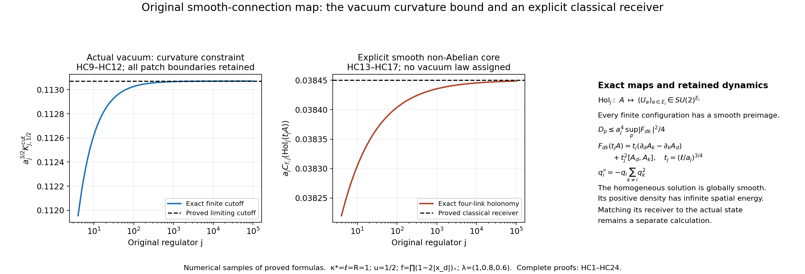

# Smooth connection holonomy, actual curvature growth, and a non-Abelian amplitude family

The original lattice observable has a direct receiving map from smooth connections. Its exact curvature bound, combined with the actual lower-energy tail, forces a quantitative curvature scale for smooth preimages of typical vacuum configurations. We then construct smooth non-Abelian connection families at that scale, compute their complete original plaquette receiver, and give an exact globally smooth homogeneous Yang–Mills evolution. The latter has infinite spatial total energy; it is a dynamical comparison with a specified domain, not an identification of the quantum vacuum or the compact-support Cauchy construction. Every original scalar, coupling, face orientation and error term remains below.

The connection and gauge conventions are related to those of the [retained higher-domain programme, Sections 2.1 and 7](https://github.com/KokunoYumeto/yang-mills-interacting-workbench/blob/50801f6c74543f26e6a227b831691290a0f7a3fc/yang-mills/continuations/20260930-s6-ns-moment-map-bridge/HIGHER_DOMAIN_PROGRAM.md) by the exact inversion dictionary below. The actual-vacuum inputs are the complete [BM1–BM69](https://github.com/KokunoYumeto/yang-mills-interacting-workbench/blob/50801f6c74543f26e6a227b831691290a0f7a3fc/yang-mills/continuations/20261011-central-signs-shrinking-window/BOUNDED_ENERGY_MULTIPLIER.md), especially BM4–BM9 and BM53–BM56. The exact source ledger records reading coverage and disk routing. The arguments below use no external theorem about the Yang–Mills vacuum and make no novelty claim.

## 1. The original connection-to-link map

Let \(T_\alpha=-i\sigma_\alpha/2\), so \([T_\alpha,T_\beta]=\varepsilon_{\alpha\beta\gamma}T_\gamma\) and \(-2\operatorname{Tr}(T_\alpha T_\beta)=\delta_{\alpha\beta}\). For \(X\in\mathfrak{su}(2)\) write
\[
 |X|^2=-2\operatorname{Tr}(X^2),\qquad
 \|X\|_{\mathrm F}^2=|X|^2/2,\qquad
 \|X\|_{\rm op}=|X|/2.
 \tag{HC1}
\]
The middle norm is the matrix Frobenius norm. The last equality follows because the eigenvalues of \(X=x\cdot T\) are \(\pm i|x|/2\). These are the original radius-two metric factors.

Use the original open box, spacing and physical coordinates
\[
 L_j=j^4,\quad a_j=(100j)^{-1},\quad
 x_z=o+a_j(z-L_j\mathbf1),\quad z\in\{0,\ldots,2L_j\}^3,
 \quad g_j^2=\kappa_*a_j/2,
 \quad b_j=(\kappa_*a_j^2)^{-1}.
 \tag{HC2}
\]
Let \(A=\sum_{d=1}^3A_d(x)dx^d\) be any smooth \(\mathfrak{su}(2)\)-valued one-form on \(\mathbb R^3\). Its exact positive-edge map is the terminal value of
\[
 \frac{d}{ds}U_d(x;s)=U_d(x;s)A_d(x+s e_d),\qquad
 U_d(x;0)=I,\qquad U_d(x)=U_d(x;a_j).
 \tag{HC3}
\]
The solution is unitary of determinant one: differentiation of \(UU^*\) and of the determinant uses \(A_d^*=-A_d\), \(\operatorname{Tr}A_d=0\). Existence on each finite edge follows from the linear integral equation, whose iterated integral series is bounded by the exponential of the integral of the coefficient norm. The inverse edge is \(U_d(x)^{-1}\). The complete face is precisely
\[
 \begin{gathered}
 U_p=U_d(x)U_k(x+a_j e_d)U_d(x+a_j e_k)^{-1}U_k(x)^{-1},\\
 d<k,\quad D_p=2-\operatorname{Tr}U_p,\qquad
 F_{dk}=\partial_dA_k-\partial_kA_d+[A_d,A_k].
 \end{gathered}\tag{HC4}
\]
Thus the map \(\operatorname{Hol}_j:C^\infty(\mathbb R^3,T^*\mathbb R^3\otimes\mathfrak{su}(2))\to SU(2)^{E_j}\) has exactly the original domain coordinates and codomain. It is continuous for uniform convergence of the coefficients on the finite union of edges: variation of the integral equation, with the two unitary propagators retained, bounds the terminal difference by the integral of the coefficient difference.

For smooth \(h:\mathbb R^3\to SU(2)\), put \(A^h=hAh^{-1}-(dh)h^{-1}\). Differentiating \(h(x)U_d(x;s)h(x+s e_d)^{-1}\) proves
\[
 \operatorname{Hol}_j(A^h)_e=h(s(e))\operatorname{Hol}_j(A)_e h(t(e))^{-1},
 \quad F^h_{dk}=hF_{dk}h^{-1},\quad D_p(A^h)=D_p(A).
 \tag{HC5}
\]
The curvature identity follows by expanding the two derivative terms and the commutator, using \(d(h^{-1})=-h^{-1}(dh)h^{-1}\); the terms containing one derivative of \(h\) cancel, and the two second derivatives cancel. The programme writes its gauge parameter as \(g\), with \(A^g=g^{-1}Ag+g^{-1}dg\) and endpoint action \(g(s)^{-1}Ug(t)\). The exact smooth bijection is \(h=g^{-1}\): differentiating \(gg^{-1}=I\) gives \(d(g^{-1})=-g^{-1}(dg)g^{-1}\), so substitution in HC5 gives both of those original expressions term by term. Inversion also reverses the order of the two gauge parameters, exactly as their two action conventions require; the complete composition calculation is HCR1. Hence the exact map intertwines the original vertex gauge action. Every finite vertex gauge assignment is the restriction of a smooth \(h\): choose disjoint small balls about the vertices, a logarithm \(X_v\in\mathfrak{su}(2)\) of each assigned value, and a bump \(\chi_v\) equal to one at its vertex; the product of \(\exp(\chi_vX_v)\) has the required values because these supports are disjoint.

Every finite link configuration has a smooth compactly supported preimage. Choose disjoint tubes around the middle half of each positive edge, with radius less than \(a_j/8\), avoiding every other edge. Choose a smooth longitudinal function with integral one and support in that middle half, and a transverse bump equal to one on the edge and supported in its tube. Their product times \(ds\) is a smooth compactly supported one-form \(\eta_e\), with integral one along \(e\) and zero along every other edge. If \(\exp X_e=U_e\), then
\[
 A[U]=\sum_{e\in E_j}X_e\eta_e,\qquad
 \operatorname{Hol}_j(A[U])=U.
 \tag{HC6}
\]
Along the edge there is only its own coefficient and it commutes with itself at all positions; HC3 therefore gives \(\exp(X_e\int_e\eta_e)=U_e\). The finite sum is smooth and compactly supported. A Borel choice of \(X_e\) exists explicitly: for \(U=\cos\theta I-i\sin\theta\,n\cdot\sigma\), \(0<\theta<\pi\), use \(X=2\theta n\cdot T\); choose \(X=0\) at \(I\) and \(X=2\pi T_1\) at \(-I\). This section is Borel in its finite coefficients, and no continuity or gauge equivariance of the section itself is asserted. Equivariance belongs to the exact forward map HC5.

## 2. A curvature bound with its original metric factor

For an individual square \(p\), define \(K_p(A)=\sup_{x\in p}|F_{dk}(x)|\). A gauge transformation on the square makes \(A_d=0\) on it and \(A_k=0\) on its left side. To construct it, first solve \(\partial_kh_0=h_0A_k\) on that left side, then solve \(\partial_dh=hA_d\) along each horizontal segment with initial value \(h_0\). These smooth ODE solutions have the prescribed properties by HC5. In this gauge,
\[
 A_k(a_j,y)=\int_0^{a_j}F_{dk}(s,y)\,ds,\qquad
 U_p-I=\int_0^{a_j}U_k(a_j;y)A_k(a_j,y)\,dy.
\]
All three other edge transports are the identity. Unitarity, the triangle inequality and HC1 give
\[
 \begin{gathered}
 D_p=\tfrac12\|I-U_p\|_{\mathrm F}^2,
 \qquad
 D_p\le\frac14\left(\int_p|F_{dk}(x)|\,d^2x\right)^2
       \le\frac{a_j^4}{4}K_p(A)^2 .
 \end{gathered}\tag{HC7}
\]
The equality uses \(\operatorname{Tr}U_p\in\mathbb R\) for \(SU(2)\): \(\|I-U_p\|_{\mathrm F}^2=4-2\operatorname{Tr}U_p\). Gauge conjugation preserves every norm and trace in HC7, so the estimate holds in the original gauge. No small-curvature assumption occurs.

Retain a nonzero original real \(f\in C_c(\mathbb R^3)\), its face centers \(x_{p,j}=o+a_j(z-L_j\mathbf1+(e_d+e_k)/2)\), coefficients \(f_p=f(x_{p,j})\), \(F_f=\|f\|_\infty\), \(A_{1,j}=\sum_p|f_p|\), and \(J_1=\int|f|>0\). For sufficiently large \(j\), \(A_{1,j}>0\). Define \(K_{f,j}(A)=\max_{p:f_p\ne0}K_p(A)\). The unchanged absolute and signed observables obey
\[
 \begin{gathered}
 Y_j=\sum_p|f_p|D_p,\qquad C_{f,j}=a_j\sum_pf_pD_p,\qquad
 |C_{f,j}|\le a_jY_j,\\
 Y_j(\operatorname{Hol}_jA)
 \le\frac{a_j^4A_{1,j}}4K_{f,j}(A)^2,\qquad
 |a_jC_{f,j}(\operatorname{Hol}_jA)|
 \le\frac{a_j^6A_{1,j}}4K_{f,j}(A)^2 .
 \end{gathered}\tag{HC8}
\]
Every summand and orientation remains in this inequality. In particular locally uniformly curvature-bounded connection families have \(a_jC_{f,j}\to0\), because \(a_j^3A_{1,j}\to3J_1\). This conclusion concerns the stated exact holonomy preimages; it does not identify a quantum field with a smooth connection.

## 3. The actual vacuum forces a curvature scale

Use the original support cube of side \(R>0\), its fitting patch \(Q=v+\{0,\ldots,q\}^3\), \(q=\lceil R/a\rceil+3\), and all counts \(N_Q=3q(q+1)^2\), \(M_Q=3q^2(q+1)\), \(C_Q=2q(q+1)\sum_d(\mathbf1_{v_d>0}+\mathbf1_{v_d+q<2L})\). The actual positive vacuum measure is \(\mu_j=\psi_j^2dU\). Its original outside operator has bottom \(E_{\rm out}\), and BM gives
\[
 \begin{gathered}
 \alpha=\kappa_*/b=\kappa_*^2a^2,\qquad
 e=F_f(E_0-E_{\rm out})/b,\qquad
 0<e\le\bar e:=F_f\Lambda_Q,\\
 \Lambda_Q=\min\{2M_Q,6g^2\sqrt{N_QM_Q}\}+2C_Q,\\
 c=9\alpha/64,\quad C_e=4cA_1^2,\quad B_e=e+4cA_1,\\
 r_-(e)=\frac{2C_e}{B_e+\sqrt{B_e^2-4(1+c)C_e}},\qquad
 p_0=\frac{3A_1}{8F_f},\\
 \mu_j\{Y_j\le u r_-(e)\}
 \le \exp[p_0(1-u+\log u)]\quad(0<u<1).
 \end{gathered}\tag{HC9}
\]
These are the actual BM53–BM56 square and lower-tail identities, not a comparison density. Its discriminant is strictly positive. Increasing \(e\) increases the denominator in \(r_-(e)\) and keeps the discriminant positive. Thus \(\bar r_j=r_-(\bar e_j)\le r_-(e_j)\) is an explicit positive lower threshold using the original finite counts.

For \(0<u<1\), put
\[
 K^{\rm cut}_{j,u}
 =\left(\frac{4u\bar r_j}{a_j^4 A_{1,j}}\right)^{1/2}.
 \tag{HC10}
\]
By HC8, every link configuration admitting a smooth preimage with \(K_{f,j}(A)\le K^{\rm cut}_{j,u}\) belongs to the measurable event \(\{Y_j\le u\bar r_j\}\). Its outer vacuum measure is therefore at most the right side of HC9. The outer-measure formulation requires no measurability assumption about the image of a family of connections. For the explicit Borel section HC6, \(K_{f,j}(A[U])\) is measurable: curvature is a polynomial in its finite matrix coefficients with fixed smooth functions, and its maximum over a compact finite union of faces is continuous in those coefficients. Hence
\[
 \mu_j\{K_{f,j}(A[U])\le K^{\rm cut}_{j,u}\}
 \le \exp[p_{0,j}(1-u+\log u)].
 \tag{HC11}
\]
The same statement holds for any measurable smooth-preimage choice, with its original curvature. It is a quantitative statement about the actual vacuum, valid without selecting a favorable section.

The full finite boundary expression yields
\[
 \begin{gathered}
 a_j^2\bar e_j\longrightarrow E_{\max}=F_f(9\kappa_*R^3+24R^2),\qquad
 a_j^4C_{e,j}\longrightarrow C_0=81\kappa_*^2J_1^2/16,\\
 a_j^2\bar r_j\longrightarrow
 \bar R_-:=\frac{2C_0}{E_{\max}+\sqrt{E_{\max}^2-4C_0}}>0,\\
 a_j^{3/2}K^{\rm cut}_{j,u}\longrightarrow
 \left(\frac{4u\bar R_-}{3J_1}\right)^{1/2},\qquad
 a_j^3p_{0,j}\longrightarrow\frac{9J_1}{8F_f}.
 \end{gathered}\tag{HC12}
\]
Indeed the patch is eventually strictly interior, so \(C_Q=12q(q+1)\); \(a^2 6g^2\sqrt{N_QM_Q}\to9\kappa_*R^3\), whereas \(a^2 2M_Q\to\infty\), and \(a^22C_Q\to24R^2\). Also \(J_1\le F_fR^3\), so \(E_{\max}>2\sqrt{C_0}=(9/2)\kappa_*J_1\). Substitution in the full rational root proves its limit. Because \(1-u+\log u<0\), HC11 tends to zero exponentially on the scale \(a^{-3}\). Thus local curvature bounds growing as \(o(a^{-3/2})\) cannot cover a nonvanishing actual-vacuum mass through the exact holonomy map. This establishes a precise constraint on the S6/NS-inspired smooth carrier; it does not end the construction problem.

## 4. An exact smooth family at the required non-Abelian scale

Fix a reference length \(\ell>0\) in the original spatial coordinates, and any smooth compactly supported one-form \(A=\sum A_d dx^d\). Keep
\[
 t_j=(\ell/a_j)^{3/4},\quad \delta_j=a_jt_j=\ell^{3/4}a_j^{1/4},\qquad
 A^{(j)}=t_jA,\qquad
 F^{(j)}_{dk}=t_j(\partial_dA_k-\partial_kA_d)+t_j^2[A_d,A_k].
 \tag{HC13}
\]
Both terms in this exact curvature formula remain; the reference length makes \(t_j\) dimensionless. This family changes the connection input, not the original lattice spacing, Hamiltonian, coupling or observable.

Choose a fixed compact neighborhood containing all faces meeting the support of \(f\) for sufficiently large \(j\). Let \(M=\max_d\sup\|A_d\|_{\rm op}\) and \(L_A=\max_{d,k}\sup\|\partial_k A_d\|_{\rm op}\) on this neighborhood. For a face centered at \(x_p\), each point on its four edges differs from \(x_p\) by coordinate distances whose sum is at most \(a_j\). The unitary Duhamel estimate for HC3 bounds each exact edge transport's difference from \(\exp(\delta_j A_d(x_p))\), or its corresponding inverse, by \(t_ja_j^2L_A\). Telescoping all four unitary factors gives error at most \(4t_ja_j^2L_A\) relative to the full constant-coefficient group commutator.

For \(X,Y\in\mathfrak{su}(2)\), set \(P(s)=e^{sX}e^{sY}e^{-sX}e^{-sY}\). Direct differentiation gives \(P(0)=I\), \(P'(0)=0\), \(P''(0)=2[X,Y]\). Its third derivative is the sum of the four-factor Leibniz terms; unitarity and the multinomial formula give \(\|P'''(s)\|_{\rm op}\le(2\|X\|_{\rm op}+2\|Y\|_{\rm op})^3\le64M^3\). The integral Taylor remainder is \(\int_0^{\delta}(\delta-s)^2P'''(s)ds/2\), whose norm is at most \(32M^3\delta^3/3\). Consequently the exact original face satisfies
\[
 \begin{gathered}
 C_p=[A_d(x_p),A_k(x_p)],\qquad
 U_p(A^{(j)})=I+\delta_j^2C_p+R_{p,j},\\
 \|R_{p,j}\|_{\rm op}\le r_j
 :=\frac{32}{3}M^3\delta_j^3+4t_ja_j^2L_A .
 \end{gathered}\tag{HC14}
\]
Here \(R_{p,j}\) is defined by the exact equality. The proof retains the full derivative error, four ordered transports and integral Taylor remainder. In particular it has not replaced the Wilson face by an exponential of curvature.

The exact deficit and a bound on its complete signed remainder are
\[
 \begin{gathered}
 D_p(A^{(j)})
 =\frac{\delta_j^4}{4}|C_p|^2
 +\delta_j^2\operatorname{Re}\operatorname{Tr}(C_p^*R_{p,j})
 +\tfrac12\|R_{p,j}\|_{\mathrm F}^2,\\
 \left|D_p(A^{(j)})-\frac{\ell^3a_j}{4}|C_p|^2\right|
 \le4M^2\delta_j^2r_j+r_j^2 .
 \end{gathered}\tag{HC15}
\]
Indeed \(\|C_p\|_{\rm op}\le2M^2\), and a two-by-two matrix has \(\|R\|_{\mathrm F}\le\sqrt2\|R\|_{\rm op}\). Insert these inequalities in the displayed full square; its mixed term is kept before taking the absolute bound. Because \(\delta_j^4=\ell^3a_j\), the remainder divided by \(a_j\) tends to zero, with leading bound of order \(a_j^{1/4}\) and every coefficient explicit in HC14–HC15.

For every original signed \(f\), therefore,
\[
 \begin{gathered}
 \left|a_jC_{f,j}(\operatorname{Hol}_j A^{(j)})
 -\frac{\ell^3}{4}a_j^3\sum_{p}f(x_{p,j})
                 |[A_{d_p}(x_{p,j}),A_{k_p}(x_{p,j})]|^2\right|
 \le a_j^2A_{1,j}(4M^2\delta_j^2r_j+r_j^2),\\
 \lim_j a_jC_{f,j}(\operatorname{Hol}_j A^{(j)})
 =\mathcal R_A(f):=\frac{\ell^3}{4}\int_{\mathbb R^3}
 f(x)\sum_{d<k}|[A_d(x),A_k(x)]|^2\,d^3x .
 \end{gathered}\tag{HC16}
\]
The error tends to zero because \(a_j^3A_{1,j}\to3J_1\) and the remaining deficit error divided by \(a_j\) tends to zero. For the Riemann sum, each orientation's face centers form a translated cubic mesh with cell volume \(a_j^3\). On a fixed compact neighborhood the integrand is uniformly continuous, so the difference from its cell integral is bounded by that neighborhood's volume times its modulus of continuity at \(\sqrt3a_j\). The box contains it eventually since \(a_jL_j=j^3/100\to\infty\). This proves the stated limit, with each of the three orientations retained individually. Replacing \(f\) by \(\lvert f\rvert\) gives the absolute receiver, and polarization of the exact deterministic values gives every product of these scalar receivers. No random law or vacuum covariance is assigned by this construction. The proof uses only the fixed compact neighborhood of the support of the test function. Thus HC14–HC16 also apply to any smooth connection on that neighborhood with the stated finite bounds, including the homogeneous connection below, irrespective of its behavior outside the neighborhood.

In a region where \(A_i=\lambda_iT_i\), all original derivative terms in HC13 vanish there and
\[
 \sum_{d<k}|[A_d,A_k]|^2=\sum_{d<k}\lambda_d^2\lambda_k^2,\qquad
 \mathcal R_A(f)=\frac{\ell^3}{4}
       \left(\sum_{d<k}\lambda_d^2\lambda_k^2\right)\int f
 \quad(\operatorname{supp}f\text{ inside that region}).
 \tag{HC17}
\]
Any three constants are realized on such a region by a smooth compactly supported one-form. If the retained divergence-free three-colour profile is wanted, take a smooth cutoff equal to one on a larger region, set vector potential \(V^{(i)}=\tfrac12\chi(x)(e_i\times x)\), and put \(u^{(i)}=\nabla\times V^{(i)}\). Then \(\nabla\cdot u^{(i)}=0\) by cancellation of mixed second derivatives and \(u^{(i)}=e_i\) where \(\chi=1\), by direct differentiation of the cross product. The connection \(A_d=\sum_i\lambda_i u_d^{(i)}T_i\) has precisely that core, with all cutoff contributions kept by HC13–HC16 outside it. This is a direct receiving construction from the existing three-colour profile space. It has a nonzero non-Abelian density whenever two of its core coefficients are nonzero.

## 5. The exact source and a globally smooth dynamical comparison

Use the original Minkowski coordinate \(x^0=ct\), metric \(\operatorname{diag}(-1,1,1,1)\), temporal gauge \(A_0=0\), and \(D_\mu=\partial_\mu+[A_\mu,\cdot]\). For the static compact family HC13, the full source is
\[
 \begin{aligned}
 (D^\mu F_{\mu0})^{(j)}&=0,\\
 (D^\mu F_{\mu i})^{(j)}
 &=t_j\sum_k\partial_k(\partial_kA_i-\partial_iA_k)\\
 &\quad+t_j^2\sum_k\{\partial_k[A_k,A_i]
                    +[A_k,\partial_kA_i-\partial_iA_k]\}\\
 &\quad+t_j^3\sum_k[A_k,[A_k,A_i]].
 \end{aligned}\tag{HC18}
\]
This follows by inserting HC13 into \(\sum_k(\partial_kF_{ki}^{(j)}+[t_jA_k,F_{ki}^{(j)}])\). On the constant core it equals \(-t_j^3\lambda_i\sum_{k\ne i}\lambda_k^2T_i\), because \([T_k,[T_k,T_i]]=-T_i\) for \(k\ne i\). Thus this static profile is generally sourced. Its zero electric initial datum does satisfy the exact Gauss constraint \(\sum_iD_iF_{0i}=0\); the temporal Yang–Mills equation prescribes the initial acceleration \(\partial_0^2A_i=\sum_kD_kF_{ki}\), including all three terms of HC18. This is the next dynamical equation, not a deletion of the static defect.

There is an explicit global source-free comparison on all of \(\mathbb R^{1+3}\). Let real \(q_i(\tau)\) solve
\[
 q_i''=-q_i\sum_{k\ne i}q_k^2,\qquad
 q_i(0)=\lambda_i,\quad q_i'(0)=0,
 \qquad
 \mathcal E_q=\tfrac12\sum_i(q_i')^2
                 +\tfrac12\sum_{i<k}q_i^2q_k^2 .
 \tag{HC19}
\]
Differentiation gives \(\mathcal E_q'=\sum_iq_i'(q_i''+q_i\sum_{k\ne i}q_k^2)=0\). Local existence and uniqueness follow by iteration of the integral equation for the six-component polynomial vector field on a bounded ball: its derivative is bounded there, so successive differences form a convergent geometric series for a sufficiently short interval. Conservation bounds each \(|q_i'|\le\sqrt{2\mathcal E_q(0)}\), hence on every finite interval \(|q_i(\tau)|\le|\lambda_i|+|\tau|\sqrt{2\mathcal E_q(0)}\). The vector field and its derivative stay bounded on that interval's resulting ball. The same local iteration then extends any putative finite endpoint, proving existence for all real \(\tau\). Differentiation of the equation proves smoothness of every order.

Define the exact homogeneous connection
\[
 \begin{gathered}
 \mathscr A_0^{(j)}=0,\qquad
 \mathscr A_i^{(j)}(x^0,x)=t_jq_i(t_jx^0)T_i,\\
 \mathscr F_{0i}^{(j)}=t_j^2q_i'(t_jx^0)T_i,\qquad
 \mathscr F_{ki}^{(j)}=t_j^2q_k(t_jx^0)q_i(t_jx^0)[T_k,T_i],\\
 D^\mu\mathscr F_{\mu i}^{(j)}
 =t_j^3\left[-q_i''-q_i\sum_{k\ne i}q_k^2\right](t_jx^0)T_i=0,
 \qquad D^\mu\mathscr F_{\mu0}^{(j)}=0.
 \end{gathered}\tag{HC20}
\]
For the last equality, spatial derivatives vanish and each individual \([\mathscr A_i,\mathscr F_{0i}]\) is zero. All original signs of the Minkowski contraction are displayed. The connection is globally smooth at each regulator. When \(\mathcal E_q(0)>0\), its geometric energy density is the positive spatial constant \(t_j^4\mathcal E_q(0)\), so its total energy on \(\mathbb R^3\) is infinite. No finite-energy or physical-vacuum claim follows from this homogeneous solution.

At the precisely specified time \(x^0_j=\tau/t_j\), HC14–HC16 apply with \(A_i=q_i(\tau)T_i\), zero spatial derivative error, and yield
\[
 \lim_j a_j C_{f,j}(\operatorname{Hol}_j\mathscr A^{(j)}(\tau/t_j))
 =\frac{\ell^3}{4}\left(\sum_{d<k}q_d(\tau)^2q_k(\tau)^2\right)
          \int f(x)\,d^3x .
 \tag{HC21}
\]
The bound is uniform on compact \(\tau\)-intervals because the preceding ODE bounds make \(M\) uniform there. The original physical time \(x^0=ct\) is still retained in HC20: HC21 explicitly samples \(t=\tau/(ct_j)\), and is not a fixed-physical-time limit. At fixed nonzero physical time the argument \(t_jx^0\) diverges, so no unproved time limit is assigned.

HC6–HC12 construct the exact smooth-preimage map and its actual-vacuum curvature constraint. HC13–HC17 then produce non-Abelian smooth families with a finite nonzero receiver of the original signed observable, retaining their full finite errors. HC18–HC21 calculate their source and an exact global dynamical comparison. Matching these classical receiving data to the actual interacting ground-state law, constructing the compact-support global state with the required limiting time behavior, and proving the reconstruction axioms remain active calculations. Neither a curvature obstruction nor this explicit classical construction is substituted for the no-gap quantum endpoint.

## 6. Exact finite identities behind the illustration

The illustration uses the dimensionless test
\(f(x)=\prod_{d=1}^3(1-2|x_d|)_+\), original origin \(o=0\),
\(\kappa_*=\ell=R=1\), \(u=1/2\), and a connection whose constant core
contains \([-1,1]^3\), with \((\lambda_1,\lambda_2,\lambda_3)=(1,0.8,0.6)\).
Its support lies in the original cube \([-1/2,1/2]^3\);
\(F_f=1\) and \(\int f=1/8\), by integrating each of its three factors.
For \(j\ge4\), every face with nonzero coefficient lies in the constant
core. Thus each of its four original edge transports is exactly a
constant matrix exponential.

For \(d\ne k\), set \(\alpha=\delta_j\lambda_d/2\) and
\(\beta=\delta_j\lambda_k/2\). Since \(T_d^2=-I/4\),
\(\exp(\delta_j\lambda_dT_d)=\cos\alpha I+2\sin\alpha T_d\).
Multiplying its conjugation of \(T_k\), using
\(T_dT_k=-T_kT_d\), gives
\(\cos(2\alpha)T_k+\sin(2\alpha)[T_d,T_k]\).
The trace pairing with \(T_k\) is \(-\cos(2\alpha)/2\);
the commutator is orthogonal to \(T_k\). Both single \(T_k\)
terms have trace zero. Hence the complete ordered product gives
\[
 \begin{gathered}
 \operatorname{Tr}
 \big(e^{\delta_j\lambda_dT_d}e^{\delta_j\lambda_kT_k}
      e^{-\delta_j\lambda_dT_d}e^{-\delta_j\lambda_kT_k}\big)
 =2\cos^2\beta+2\sin^2\beta\cos(2\alpha),\\
 D_{dk,j}=4\sin^2(\delta_j\lambda_d/2)
                  \sin^2(\delta_j\lambda_k/2).
 \end{gathered}\tag{HC22}
\]
This is the exact four-link deficit, with no remainder removed.

Put \(N=50j\), so \(a_j=1/(2N)\). The integer and half-integer
one-dimensional face meshes have the exact sums
\[
 \begin{gathered}
 \sum_{r\in\mathbb Z}(1-|r|/N)_+
 =1+2\sum_{r=1}^N(1-r/N)=N,\\
 \sum_{r\in\mathbb Z}(1-|r+1/2|/N)_+
 =2\sum_{r=0}^{N-1}(1-(r+1/2)/N)=N.
 \end{gathered}\tag{HC23}
\]
The displayed finite sums evaluate by
\(\sum_{r=1}^Nr=N(N+1)/2\) and
\(\sum_{r=0}^{N-1}(r+1/2)=N^2/2\).
Each face orientation has two half-shifted coordinates and one integer
coordinate. Its weighted sum is therefore \(N^3\), and
\(A_{1,j}=3N^3=3/(8a_j^3)\). The original box contains every nonzero
term for \(j\ge4\). A fitting patch has lower corner
\(v_d=j^4-50j-1\) and \(q=100j+3\), so both original boundary indicators
are one in every direction; all counts in HC9 remain exact.
Consequently the plotted observable and its limit are
\[
 \begin{gathered}
 a_jC_{f,j}(\operatorname{Hol}_j(t_jA))
 =\frac1{8a_j}\sum_{d<k}D_{dk,j},\\
 \lim_j a_jC_{f,j}(\operatorname{Hol}_j(t_jA))
 =\frac1{32}\sum_{d<k}\lambda_d^2\lambda_k^2
 =0.03845 .
 \end{gathered}\tag{HC24}
\]
The first equality uses \(a_j^2N^3=1/(8a_j)\).
The limit follows from \(\sin x/x\to1\) with
\(\delta_j^4=a_j\). The absolute curvature cutoff in the other panel
uses the complete finite formula HC9–HC10. Its scaled limit follows
from HC12, with \(E_{\max}=33\), \(C_0=81/(16\cdot64)\).

The first panel samples the proved actual-vacuum cutoff; the second
samples the exact classical holonomy formula HC24. Neither is a vacuum
simulation. The third panel records the complete curvature formula,
receiving map and globally smooth homogeneous dynamics.
The accompanying check_holonomy_curvature.py reproduces the figure and
checks the original metric, ordered commutator, full Taylor square,
Gauss-compatible source signs, exact mesh sums and conserved ODE energy.
Its 1002 bounded checks supplement the complete analytic proofs HC1–HC24.
The finite matrix and scalar maps are displayed directly; a
three-dimensional scene would not add geometric information here.

Complete source versions and reading coverage: [source-use ledger](HOLONOMY_TRACE_SOURCE_USE_LEDGER.json).

## Simultaneous spatial measure and current evaluation

[CM1–CM63](SIMULTANEOUS_CENTRAL_MEASURE.md) extend the original bounded-word maps to every orientation triple and construct their actual spatial measure. [CE1–CE50](CURRENT_COVARIANCE_EQUALITY.md) evaluate the current defect to zero and retain the exact geometric and outside-energy covariance terms. The further heat fluctuation survives for every positive parameter; its original-window norm and visible/escape maps are explicit, with the actual window-energy coefficient still to be evaluated.
