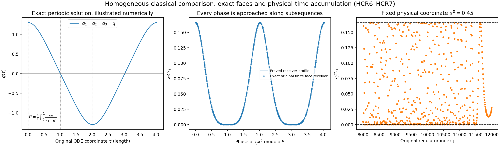

# Independent review of HC1–HC21

This independent derivation verifies [HC1–HC24](HOLONOMY_CURVATURE_RECEIVING.md), supplies its exact gauge dictionary and local extension, and proves further consequences for the actual curvature law, signed tests and classical time evolution. The reviewed original HC1–HC21 edition is preserved with its hash in the source-use ledger. All proofs below retain the original factors, signs, finite errors and domains.

## HCR1. Exact gauge-convention dictionary

The programme Section 2.1 retains the endpoint rule below. Its
corresponding connection action is displayed alongside it and is proved
by the dictionary in this section:

\[
 \operatorname{Hol}(A^g)_e=g(s(e))^{-1}\operatorname{Hol}(A)_e g(t(e)),
 \qquad A^g=g^{-1}Ag+g^{-1}dg.
\tag{HCR1.1}
\]

HC5 retains

\[
 A^h=hAh^{-1}-(dh)h^{-1},\qquad
 \operatorname{Hol}(A^h)_e=h(s(e))\operatorname{Hol}(A)_e h(t(e))^{-1}.
\tag{HCR1.2}
\]

The exact map is h=g⁻¹, a smooth bijection on the space of smooth
SU(2)-valued gauge functions, with the same inverse. Differentiating
gg⁻¹=I gives d(g⁻¹)=−g⁻¹(dg)g⁻¹. Substitution in every term of
(HCR1.2) therefore gives

\[
 hAh^{-1}-(dh)h^{-1}
 =g^{-1}Ag+g^{-1}dg,
 \qquad h(s)Uh(t)^{-1}=g(s)^{-1}Ug(t).
\tag{HCR1.3}
\]

The two original expressions remain individually identifiable. This
map also respects their action conventions: if Hh denotes (HCR1.2),
then Hh₂∘Hh₁=Hh₂h₁ by direct substitution, while Gg₂∘Gg₁=Gg₁g₂ for
(HCR1.1). Inversion sends (g₁g₂)⁻¹ to g₂⁻¹g₁⁻¹, exactly the required
composition. Restriction to the original finite vertex set commutes
with inversion. Thus the two endpoint actions and their curvature
conjugations agree through a proved map, without identifying g and h
as the same gauge parameter.

The right multiplication ODE U′=UA is consistent with these formulas:
for V(s)=h(x)U(s)h(x+se_d)⁻¹, differentiating gives
V′=V[hAh⁻¹−(∂dh)h⁻¹] at the moving point, and V(0)=I. This proves
the HC5 endpoint rule by uniqueness of the linear ODE. The curvature
sign is the original plus commutator in Fdk=∂dAk−∂kAd+[Ad,Ak].

The companion HC proof includes this exact dictionary; both original conventions and every sign are retained.

## HCR2. Exact holonomy, section, curvature and coefficient checks

**HC1–HC6.** For X=x·T with Tα=−iσα/2, the two eigenvalues are
±i|x|/2, and −2Tr X²=|x|². Consequently ||X||F²=|X|²/2 and ||X||op=|X|/2; these are the factors used subsequently. The linear
edge ODE preserves UU*=I, and then det U=1 follows by differentiating
the determinant with trace A=0. Its ordered integral series converges
absolutely on any finite edge. Variation between two skew-Hermitian
coefficients gives the norm bound ∫||A−B|| because the propagators on
both sides of the integrand are unitary. This proves the stated
holonomy continuity in the original coefficients.

The tubes in HC6 can be chosen pairwise disjoint. Their axes are middle
halves of distinct original cubic edges; they stay at distance at
least a/4 from other edges, and a radius smaller than a/8 suffices.
Longitudinal bumps vanish near the tube endpoints, so the forms extend
smoothly by zero. On its own edge the form is a scalar function times
the single constant Xe, and it is zero on every other edge. Its exact
ordered exponential is therefore exp Xe. The formula for the
logarithm away from ±I, and the two specified endpoint values, give a
Borel logarithm on SU(2), hence a Borel section into the finite linear
span of these smooth forms. Curvature is a quadratic polynomial in
those coefficients, with fixed smooth coefficient functions. Its sup
norm on each compact face depends continuously on the coefficients;
the maximum over finitely many relevant faces does as well. These
facts justify the section and measurability used in HC10–HC11.

**HC7.** The two-stage axial gauge solves ∂kh₀=h₀Ak on the left edge,
then ∂dh=hAd on each horizontal segment. It gives Ad^h=0 on the square
and Ak^h=0 on the left edge, so Fdk^h=∂dAk^h. The other three face
transport factors are exactly I. Hence

\[
 \|U_p-I\|_F\le\int_p\|F_{dk}^h\|_F
 =\frac1{\sqrt2}\int_p|F_{dk}|,
 \qquad
 D_p=\frac12\|I-U_p\|_F^2
 \le\frac14\left(\int_p|F_{dk}|\right)^2.
\tag{HCR2.1}
\]

The original 1/4 is correct and requires no small-field assumption.
Only a smooth gauge on the square is needed for this proof; no global
gauge choice or global axial gauge existence is being asserted.

**HC8–HC12.** Original BM4–BM9 and BM53–BM56 were checked in their
LaTeX source. The definitions e=Ff(E₀−Eout)/b, c=9α/64, Ce=4cA₁²,
Be=e+4cA₁, p₀=3A₁/(8Ff) agree exactly. The rational smaller-root
formula decreases with e: its denominator is Be+√(Be²−4(1+c)Ce),
both terms increasing for its strictly positive discriminant. Thus
the explicit larger energy bound gives the smaller valid lower
threshold r̄. The event inclusion in HC10 uses Y itself; it does not
replace its actual law by a comparison density.

For completeness, in the eventual interior patch C_Q=12q(q+1) and
√(N_QM_Q)=3q^(3/2)(q+1)^(3/2). With g²=κ*a/2 and aq→R,

\[
 a^2(6g^2\sqrt{N_QM_Q})\to9\kappa_*R^3,
 \quad a^2(2C_Q)\to24R^2,
 \quad a^2(2M_Q)\to+\infty.
\]

Since a³A₁→3J₁,
a⁴Ce→81κ*²J₁²/16 and a²(4cA₁)→0. Multiplying numerator and
denominator of r̄ by the appropriate powers of a gives precisely
HC12's root limit. J₁≤FfR³ makes its limiting discriminant strictly
positive, with all boundary terms retained. The threshold satisfies
a^(3/2)Kcut→√(4uR̄₋/(3J₁)), and a³p₀→9J₁/(8Ff). Its exponent
1−u+log u is strictly negative for 0<u<1, by differentiating or
integrating 1/u−1. The order a^(−3/2) curvature conclusion is correct.

**HC13–HC16.** At any point of a face edge, the sum of its coordinate
distances to the center is at most a. The derivative bound LA therefore
gives ||Ad(x)−Ad(center)||op≤aLA. Unitary variation over an edge of
length a gives ta²LA. The inverse transport has the same error,
since ||U⁻¹−V⁻¹||=||U−V|| for unitaries. Four-factor telescoping gives
the claimed 4ta²LA without exponential amplification.

The ordered constant product P(s)=e^(sX)e^(sY)e^(−sX)e^(−sY) has
P′(0)=0 and P″(0)=2[X,Y]. For the third derivative the multinomial
sum of norms is (2||X||+2||Y||)³≤64M³. The integral Taylor factor is
δ³/6, giving 32M³δ³/3 exactly. Thus HC14 retains both its third-order
commutator error and its full spatial derivative error.

The full Frobenius square is

\[
 \frac12\|\delta^2C+R\|_F^2
 =\frac{\delta^4}{4}|C|^2
 +\delta^2\operatorname{Re}\operatorname{Tr}(C^*R)
 +\frac12\|R\|_F^2.
\tag{HCR2.2}
\]

Its bound is 4M²δ²r+r² because ||C||op≤2M² and ||R||F≤√2r.
Writing a for the unchanged spacing and retaining t=(ell/a)^(3/4),
the entire error bound, before division by a, is

\[
 \frac{128}{3}M^5\ell^{15/4}a^{5/4}
 +16M^2L_A\ell^{9/4}a^{7/4}
 +\frac{1024}{9}M^6\ell^{9/2}a^{3/2}
 +\frac{256}{3}M^3L_A\ell^3a^2
 +16L_A^2\ell^{3/2}a^{5/2}.
\tag{HCR2.3}
\]

Every term divided by a tends to zero. Multiplication by a²A₁ gives
exactly the HC16 summed error. Each of the three orientations supplies
its own a³ Riemann sum, yielding the sum over d<k in the limit. The
signed f is retained throughout; no positivity of its integral is
assumed.

The proof is local to the fixed compact neighborhood of supp f.
Consequently HC14–HC16 hold for every smooth connection on that
neighborhood with the displayed finite M and LA, regardless of its
behavior outside. This proved extension justifies applying them to
the noncompact homogeneous connection in HC21. The companion HC proof states this local extension explicitly.

**Dimensions.** With coordinates of length, A has dimension length⁻¹,
F has length⁻², ell and a have length, and t is dimensionless.
δ=at has length, so δ²C and both terms of r are dimensionless.
For dimensionless f, aC_f has length²; the limit
ell³∫f|[Ad,Ak]|²d³x has exactly length². In HC19, τ has length,
q has length⁻¹, q′ has length⁻² and q″ has length⁻³, matching q³.
HC20's argument tx⁰ is dimensionally valid because x⁰=ct has length.

## HCR3. Stronger actual-vacuum curvature conclusion

The HC lower tail yields an almost-sure conclusion under any joint
coupling of its original marginal vacuum laws; no independence is
needed. This is an additional consequence of the actual-state result,
not a claim that a particular continuum coupling has been constructed.

Let (Uj) have any probability law with marginal μj at each j. For fixed
0<u<1, define Ej,u={Yj(Uj)≤u r̄j}. Since a_j=(100j)⁻¹ and
a_j³p₀,j→9J₁/(8Ff)>0, the upper bound in HC9 implies

\[
 \sum_j\mathbb P(E_{j,u})<\infty.
\tag{HCR3.1}
\]

Indeed the summands for all sufficiently large j are at most exp(−cuj³)
for a fixed cu>0, and their series converges by comparison with a
geometric series. The union bound gives
P(∪j≥NEj,u)≤∑j≥NP(Ej,u)→0; hence with probability one only finitely
many Ej,u occur. On the complementary event, HC8 gives, simultaneously
for every smooth A with Holj(A)=Uj,
Kf,j(A)>Kcut_j,u. Intersect these probability-one events for a countable
sequence of rational u increasing to 1 and use HC12. The result is

\[
 \boxed{\begin{gathered}
 \text{For almost every }(U_j),\\
 \text{ every smooth-preimage sequence }A_j\text{ satisfies }\\
 \liminf_j a_j^{3/2}K_{f,j}(A_j)
 \ge\sqrt{\frac{4\bar R_-}{3J_1}}>0.
 \end{gathered}}
\tag{HCR3.2}
\]

The quantifier over all preimages is allowed because the deterministic
event inclusion already holds for all preimages. No measurable choice
of that sequence is needed for this pathwise assertion. The random
event used in the proof is the countable intersection built from the
measurable Yj events.

For any measurable preimage choice and every p>0, the finite bound
E[K^p]≥(Kcut_j,u)^p[1−P(Ej,u)] gives further

\[
 \liminf_j a_j^{3p/2}\mathbb E[K_{f,j}(A_j)^p]
 \ge\left(\frac{4\bar R_-}{3J_1}\right)^{p/2}.
\tag{HCR3.3}
\]

This follows by taking the lower limit for fixed u and then increasing
u to 1; the expectation may be infinite. Both statements retain the
same original marginal vacuum laws and the same holonomy map.

## HCR4. Compact three-colour construction and nonzero signed receiver

For a constant vector e_i, direct differentiation gives
curl(e_i×x)=2e_i. Thus Vi=(1/2)χ(e_i×x) yields ui=curl Vi=ei in the
region where χ=1, while it is smooth, compactly supported, and has
divergence zero everywhere by commutation of second derivatives.
For Ad=∑iλiui_dTi this gives the stated core Ad=λdTd, with all cutoff
terms retained outside. The commutator norm is λd²λk² because
[Td,Tk] is the remaining unit generator up to sign. HC17 is exact.

There is also a constructive nonvanishing statement for every nonzero
original real continuous compactly supported f, including ∫f=0.
Choose a point where f is nonzero and a ball B on which f has its
fixed sign ε and |f|≥c>0. Choose a smaller ball B₀ compactly contained
in B and a smooth cutoff χ supported in B, equal to one on B₀. Use
the preceding curl construction with all three original calibrations
λ₁, λ₂, λ₃ nonzero. All Ad and their
commutators vanish outside B, their full squared commutator sum is
nonnegative everywhere, and on B₀ its value is
λ₁²λ₂²+λ₁²λ₃²+λ₂²λ₃². Hence

\[
 \varepsilon\mathcal R_A(f)
 \ge\frac{\ell^3}{4}c(\lambda_1^2\lambda_2^2+
 \lambda_1^2\lambda_3^2+\lambda_2^2\lambda_3^2)\operatorname{Vol}(B_0)>0.
\tag{HCR4.1}
\]

This preserves the original signed f and all cutoff
contributions. It does not require replacing f by its positive part
in the observable. At the core the curvature magnitude is exactly
t²|λ₁λ₂|=ell^(3/2)a^(−3/2)|λ₁λ₂|, establishing the stated scale for
this concrete family.

## HCR5. Static source and global ODE with all signs

For Fki^(j)=t(∂kAi−∂iAk)+t²[Ak,Ai], application of
∂k+[tAk,·] produces exactly the t, t² and t³ terms in HC18. On the
constant core,
[Tk,[Tk,Ti]]=−Ti for k≠i, so its source is
−t³λi∑k≠iλk²Ti. In temporal gauge with metric (−,+,+,+),
F0i=∂₀Ai and D⁰F0i=−∂₀²Ai. Hence the source-free acceleration is
∂₀²Ai=∑kDkFki, with the sign in HC18. The initial electric field is
zero, so the Gauss constraint holds exactly. This fact alone does not
make the static spatial profile source free.

For completeness, an elementary quantified existence argument for
HC19 uses the full six-component polynomial field

\[
 y=(q,p),\qquad
 F(y)=\left(p,\left(-q_i\sum_{k\ne i}q_k^2\right)_{i=1}^3\right).
 \tag{HCR5.1}
\]

In the supremum norm on
a ball |y|∞≤R, one has |F(y)|∞≤max(R,2R³) and ||DF(y)||∞≤max(1,6R²). Around an initial point y₀ choose
R>|y₀|∞+1 and an interval length h for which h max(R,2R³)≤1 and
h max(1,6R²)≤1/2. The integral map
y(τ)=y₀+∫₀^τF(y(s))ds maps the closed radius-one continuous-function
ball into itself and reduces successive differences by at least 1/2.
The resulting uniformly convergent iterates solve the integral
equation. The same difference estimate proves uniqueness. The equation
then implies differentiability and, by repeated differentiation,
smoothness.

The exact conserved quantity is
Eq=(1/2)∑p_i²+(1/2)∑i<kqi²qk²: its derivative is
∑ipi[pi′+qi∑k≠iqk²]=0. Thus |p_i|≤√(2Eq(0)) and |q_i(τ)|≤|λi|+|τ|√(2Eq(0)). On any finite interval these give a fixed
ball and hence a uniform local existence interval h. Approaching any
putative finite endpoint, bounded F also makes y uniformly Lipschitz,
so y has a limiting value there; the same local construction extends
it. This proves global existence in both directions. No boundedness
of q for all time is assumed for general initial data.

For A_i=tqi(tx⁰)Ti the two curvature formulas in HC20 follow by direct
differentiation. Their divergence is
t³[−qi″−qi∑k≠iqk²]Ti. The time equation also vanishes because
[Ai,F0i]=0 for each individual i. The geometric energy density is
t⁴Eq(0), which is spatially constant; it has infinite spatial integral
when Eq(0)>0. No original coupling factor is thereby identified with
a reconstructed quantum energy. The HC21 times x⁰=τ/t are the stated
physical times tphysical=τ/(ct), without a covert fixed-time limit.

## HCR6. Exact homogeneous face formula

For the same homogeneous connection at any given time, let qd,qk be
its two real scalar values and let δ=at. Its exact face is
e^(δqdTd)e^(δqkTk)e^(−δqdTd)e^(−δqkTk), d≠k. The identity

\[
 \boxed{D_p=4\sin^2\!\left(\frac{\delta q_d}{2}\right)
                 \sin^2\!\left(\frac{\delta q_k}{2}\right)}
\tag{HCR6.1}
\]

holds at every finite a, without a remainder. To prove it, write
exp(αTd)=cos(α/2)I+2sin(α/2)Td. Its adjoint action rotates Tk by
angle α about e_d, so the inner product of Ad_exp(αTd)Tk with Tk is
cosα. The scalar part of
exp(αTd)exp(βTk)exp(−αTd)exp(−βTk) is therefore
cos²(β/2)+sin²(β/2)cosα
=1−2sin²(α/2)sin²(β/2). Taking its two-dimensional trace and
subtracting from 2 proves (HCR6.1), including all angle and trace factors.
The adjoint rotation identity can equivalently be checked by multiplying
TiTk=−δikI/4+(1/2)εikℓTℓ twice.

This directly checks HC15's leading term
δ⁴qd²qk²/4 and gives a stronger finite receiver in the homogeneous
subfamily. It does not change HC15's general spatially varying result.

## HCR7. Periodic isotropic solution and the full fixed-time accumulation set

Take λ₁=λ₂=λ₃=λ>0 with the same zero velocities as HC19. Permuting
coordinates preserves the ODE and its initial data, so uniqueness gives
q₁=q₂=q₃=q. The exact scalar equation and conserved identity are

\[
 q''=-2q^3,\qquad q(0)=\lambda,\quad q'(0)=0,
 \qquad (q')^2+q^4=\lambda^4.
\tag{HCR7.1}
\]

While 0<q<λ after time zero, q′ is negative because q″<0 until the
first crossing. Its first zero occurs at

\[
 Q=\int_0^\lambda\frac{ds}{\sqrt{\lambda^4-s^4}}
   =\frac1\lambda\int_0^1\frac{du}{\sqrt{1-u^4}}<\infty.
\tag{HCR7.2}
\]

Indeed q′=−√(λ⁴−q⁴) there, giving the integral by separation. Its
integrability at λ follows from λ⁴−s⁴=(λ−s)(λ³+λ²s+λs²+s³), and
the other endpoint has nonzero denominator. The global solution
cannot stay positive forever: if its positive decreasing limit were
positive, q″ would stay strictly negative; if its limit were zero,
the energy identity would make q′ tend to −λ². Either contradicts
remaining positive for all time. Thus the crossing and its integral
are established, with q′(Q)=−λ².

The equation is odd in q and invariant under time reflection. Uniqueness
at the zero state implies q(Q+s)=−q(Q−s); hence q(2Q)=−λ and
q′(2Q)=0. Applying uniqueness again gives q(2Q+s)=−q(s), and therefore
q(4Q+s)=q(s). Thus P=4Q is a period. The trajectory decreases strictly
from λ to −λ on (0,2Q) and increases strictly on (2Q,4Q), so no smaller
positive period exists for q. In particular q takes every value in
[−λ,λ], and q⁴ takes every value in [0,λ⁴].

At any fixed nonzero original x⁰=ctphysical, the sampled argument is

\[
 \tau_j=t_jx^0=x^0(100\ell)^{3/4}j^{3/4}.
\tag{HCR7.3}
\]

The absolute values θj=|τj| increase to infinity, and
θj+1−θj→0, by the mean-value theorem applied to x^(3/4). For any target
phase r∈[0,P), choose the least j_m with θj_m≥mP+r. Then j_m→∞ and
0≤θj_m−(mP+r)≤θj_m−θj_m−1→0. Periodicity and continuity imply
q(θj_m)^4→q(r)^4. The initial zero derivative and uniqueness give
q(−τ)=q(τ), so negative x⁰ has exactly the same conclusion. Thus the
set of subsequential limits of q(τj)^4 is the whole [0,λ⁴].

This time statement passes through the original finite receiver with a
uniform error. Since |q(τ)|≤λ at every real time, HC14–HC16 apply
uniformly with M=λ/2 and LA=0. More directly, every face has the exact
deficit 4sin⁴(δjq(τj)/2) by HCR6, so

\[
 a_jC_{f,j}
 =4a_j^2\sin^4\!\left(\frac{\delta_jq(\tau_j)}2\right)\sum_pf_p
 =\frac{3\ell^3}{4}\,q(\tau_j)^4\int f+o(1),
\tag{HCR7.4}
\]

where the error is uniform in the full range |q|≤λ. The last equality
uses δj⁴=ell³aj, the original three-orientation Riemann sum
aj³∑pfp→3∫f, and the uniform Taylor limit sin z/z→1 at zero, defining
it as 1 at zero. Thus at every fixed nonzero physical time the complete
accumulation set of the original signed receiver is

\[
 \boxed{\left[
 \min\!\left(0,\frac{3\ell^3\lambda^4}{4}\int f\right),
 \max\!\left(0,\frac{3\ell^3\lambda^4}{4}\int f\right)
 \right].}
\tag{HCR7.5}
\]

When ∫f≠0 the receiver therefore has no fixed-nonzero-physical-time
limit. When ∫f=0 it tends to zero uniformly in this homogeneous
isotropic subfamily. At physical time zero its limit instead is
(3ell³λ⁴/4)∫f. All statements concern the exact classical source-free
homogeneous comparison with its infinite spatial energy. They do not
provide an actual vacuum law or the compact-support evolution sought
by the programme.

## HCR8. Findings, checked scope and integration instructions

The only identified convention defect is the opening omission repaired
by HCR1. The finite formulas HC1–HC21 pass the review. The local extension
of HC14–HC16 in HCR2 makes the homogeneous application explicit.

The proved underclaims are HCR3's almost-sure and moment curvature bounds,
HCR4's nonzero receiver for every original nonzero signed f, HCR6's exact
finite homogeneous plaquette formula, and HCR7's complete physical-time
accumulation set in the isotropic subfamily. They strengthen the
appropriate receiving claims while preserving the source's domains and
all original constants. The curvature conclusion still uses the actual
vacuum marginal laws; the explicit dynamics remains a classical
comparison. No identification between those objects is asserted.

Source coverage: complete HC1–HC21 draft; BM1–BM9 and BM53–BM56 in the
original local LaTeX; programme Sections 2.1, 7 and 7.1, including its
original nonzero calibrations and Minkowski source conventions. Existing disk-index routing
records were consulted before this derivation, and were not treated as
papers read. No external mathematical theorem or novelty claim is used.

The reproducible bounded script checks the Pauli commutator factors,
the exact finite homogeneous deficit, the complete error expansion,
and the periodic scalar ODE's energy and quarter-period. Its figure
identifies the exact period and the original fixed-time phase samples.
The numerical tests illustrate the analytic proofs; they are not proof
of a vacuum property. Figure inspection is recorded separately.

The displayed sample retains λ=1.3, ell=0.8, x⁰=0.45 and
f(x)=0.7∏i max(1−|xi−oi|/0.6,0), so ∫f=0.1512. These values are
numerical examples of the full formulas, not replacement definitions.
For the original aj=(100j)⁻¹, the ratio 0.6/aj is the integer 60j.
The one-dimensional sum of the hat on either the integer or the
half-integer grid equals 60j: summing its two arithmetic progressions
gives N in both cases when its support radius is N mesh steps.
Consequently ∑pfp=3(0.7)(60j)³ exactly when the original box contains
the support, as it does for every plotted j. HCR6 gives the exact
finite scalar receiver 12(0.1512)sin⁴(δjq(τj)/2)/aj used for the
points. The ODE values were evaluated numerically and checked against
the proved conserved energy. The lines display the proved periodic
limiting profile; HCR7, not the finite sample plot, proves its complete
accumulation set. No three-dimensional geometry is needed to clarify
this scalar time calculation.

Complete source versions and reading coverage: [source-use ledger](HOLONOMY_TRACE_SOURCE_USE_LEDGER.json).

## Global source-free evolution of the measure-realizing data

[GM1–GM28](GLOBAL_MEASURE_EVOLUTION.md) apply Sung-Jin Oh's global Cauchy theorem to the exact smooth compact data, construct continuous solution laws from the actual central spatial measure, and prove their zero-time Wilson and energy receiving maps. The complete time expansion, a strict electric-field stationarity defect, and time averages with an explicit invariance error are calculated. The exact virial proves that any stationary probability on conserved finite-total-energy smooth trajectories is supported on flat fields, without an energy-moment assumption. Its receiving space must therefore be enlarged to allow infinite total energy for a nonflat stationary classical law. Quantum reconstruction and the actual low-window coefficients remain to be established.
