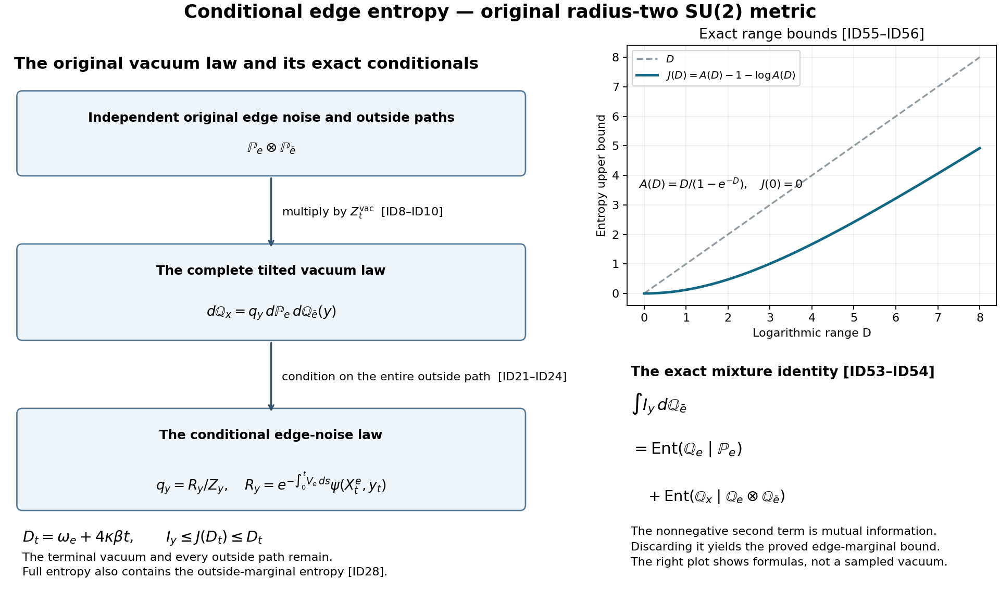

# Independent derivation of the conditional edge score

11 October 2026. The result of this derivation is that ESE1–ESE38 in [the complete edge-entropy proof](https://github.com/KokunoYumeto/yang-mills-interacting-workbench/blob/main/yang-mills/continuations/20261011-central-signs-shrinking-window/CONDITIONAL_EDGE_ENTROPY_AND_SCORE.md) are correct, with the scope stated there. In particular, the stochastic argument proves the unconditional constant \(C_\rho=10.8333216102394742\ldots\). It does not prove the separate proposed oscillation bound \(\omega_e\le4\pi\sqrt\beta\). The proof below reconstructs the stochastic law, every factor in the entropy estimate, the closure, and the receiving phase calculation. Two additional entropy identities are proved after the core calculation.

Source versions and actual reading coverage are recorded in the source-use ledger. Fundamental Itô integration and the Brownian Gaussian increment law are the stochastic framework.

## 1. Original metric, Hamiltonian, and edge potential

Retain \(L\ge2\), \(m=2L\), \(n=m+1\), the vertices \(o+a(i-L,k-L,l-L)\), \(0\le i,k,l\le m\), and every positively oriented original edge and face. Their counts are
\[
 N=3m(m+1)^2,\qquad M=3m^2(m+1),\qquad Q_L=SU(2)^{E_L}.
 \tag{ID1}
\]
The measure is product Haar probability. At every vertex, including the boundary, the gauge action on an edge \((s,t)\) is \(U_e\mapsto q_sU_eq_t^{-1}\). The three Lie generators and metric are
\[
 T_\alpha=-i\sigma_\alpha/2,\quad
 \langle v,w\rangle=-2\operatorname{tr}(vw),\quad
 v=\sum_\alpha v_\alpha T_\alpha,\quad |v|^2=\sum_\alpha v_\alpha^2,
 \quad X_{e,\alpha}f(U)=\left.\frac d{dh}f(\ldots,e^{hT_\alpha}U_e,\ldots)\right|_{h=0}.
 \tag{ID2}
\]
In quaternion coordinates \(U=cI+\sum_\alpha q^\alpha T_\alpha\), the equation for \(SU(2)\) is \(c^2+|q|^2/4=1\). Each \(T_\alpha\) has Euclidean quaternion length \(1/2\), while its length in (ID2) is one. Thus the given metric is the round three-sphere metric of radius two. Its diameter is \(2\pi\), sectional curvature \(1/4\), and Ricci tensor \((1/2)g\). The Laplacian and complete Hamiltonian are
\[
 \begin{split}
 K&=-\sum_{e,\alpha}X_{e,\alpha}^2,\qquad \Delta=-K,\\
 W_{(z;i,j)}&=\operatorname{tr}[U_i(z)U_j(z+e_i)U_i(z+e_j)^{-1}U_j(z)^{-1}],\\
 \kappa&=2g^2/a>0,\quad b_{\rm mag}=1/(2g^2a),\quad\xi=b_{\rm mag}/\kappa=1/(4g^4),\\
 V&=\kappa\xi\sum_p(2-W_p),\qquad H=\kappa K+V,\\
 H\psi&=E_0\psi,\qquad \psi>0,\qquad \int\psi^2dU=1,\qquad u=\log\psi,\quad\rho=\psi^2.
 \end{split}\tag{ID3}
\]
The finite product is compact and connected. For completeness, the lowest Rayleigh minimizer exists by compactness of the Sobolev inclusion; replacing a minimizer by its modulus cannot increase its kinetic form. The smooth bounded potential and the eigen-equation give smoothness by successive applications of \((I+K)^{-1}\) and Sobolev embedding. The nonnegative eigenfunction is strictly positive by the elliptic strong maximum principle. Uniqueness can then be checked without a positivity-improving assertion: writing any other ground vector as \(\psi F\), integration by parts and (ID3) give
\[
 \langle\psi F,(H-E_0)\psi F\rangle
       =\kappa\int\psi^2\sum_{e,\alpha}|X_{e,\alpha}F|^2dU.
 \tag{ID4}
\]
The right side vanishes only for constant \(F\). Gauge actions preserve the operator, positivity, and unit norm, and therefore fix \(\psi\). This establishes that this is the actual physical unit vacuum. Its positive minimum, finite maximum, and bounded derivatives will be used only at fixed finite volume.

For one original edge \(e\), let \(r_e\in\{2,3,4\}\) count its incident faces and put
\[
 \beta=r_e\xi,\quad
 V_e=\kappa\xi\sum_{p:e\in\partial p}(2-W_p),\quad
 V_{\bar e}=\kappa\xi\sum_{p:e\notin\partial p}(2-W_p),\quad V=V_e+V_{\bar e}.
 \tag{ID5}
\]
The full scalar \(2\kappa\xi M\) remains in \(V\). Since each face trace lies in \([-2,2]\), \(0\le V_e\le4\kappa\beta\). To compute its derivative constant, isolate an occurrence as \(A U_e B\) or \(A U_e^{-1}B\). Multiplication and inversion are isometries, so the gradient of that trace has the norm of the gradient of \(2c\) at the resulting group element. On the radius-two sphere the squared norm is \(1-c^2\). Each face contributes at most one, including its inverse occurrence. The full sum therefore satisfies
\[
 0\le V_e\le4\kappa\beta,\qquad
 |\nabla_eV|=|\nabla_eV_e|\le\kappa\beta.
 \tag{ID6}
\]

## 2. Product Wiener space and the exact vacuum tilt

Use one independent standard three-dimensional Brownian motion \(B^f\) per original edge. All calculations are on this product Wiener space with its completed natural filtration. Let \(X_0=x\) be an arbitrary full configuration and solve
\[
 dX_s^f=\sqrt{2\kappa}\sum_\alpha T_\alpha X_s^f\,dB_s^{f,\alpha}
                       -\frac{3\kappa}{4}X_s^f\,ds.
 \tag{ID7}
\]
The matrix coefficients are linear, giving a global strong solution. The equivalent Stratonovich equation has no drift, because \(\sum_\alpha T_\alpha^2=-3I/4\) and the conversion contributes \(\kappa\sum T_\alpha^2X\). Its product rule preserves \(X^*X=I\) and determinant one. On smooth functions its generator is exactly \(\kappa\Delta\). In particular each edge solution is a measurable function of that edge's Wiener noise and its initial edge value; independence is retained across edges.

Define, for \(0\le s\le t<\infty\),
\[
 Z_s=\frac{e^{E_0s-\int_0^sV(X_r)dr}\psi(X_s)}{\psi(x)}.
 \tag{ID8}
\]
The eigen-equation reads \(\kappa\Delta\psi=(V-E_0)\psi\). Applying Itô's product formula to (ID8) gives
\[
 dZ_s=\frac{\sqrt{2\kappa}\,e^{E_0s-\int_0^sV(X_r)dr}}{\psi(x)}
                  \sum_{f,\alpha}(X_{f,\alpha}\psi)(X_s)dB_s^{f,\alpha}.
 \tag{ID9}
\]
Every displayed coefficient is bounded by a deterministic finite constant on \([0,t]\); this follows from compactness and boundedness of \(E_0,V,\nabla\psi\), and \(\psi(x)>0\). Thus the stochastic integrals have zero expectation and are square-integrable. Consequently \(Z_s\) is a genuine positive martingale, \(\mathbb E Z_s=Z_0=1\), and
\[
 d\mathbb Q_x=Z_t\,d\mathbb P_x,\qquad
 \psi(x)=e^{E_0t}\mathbb E_x[e^{-\int_0^tV(X_s)ds}\psi(X_t)].
 \tag{ID10}
\]
This proves the needed vacuum Feynman–Kac identity while keeping \(E_0\), the terminal factor, and every potential term.

## 3. Derivation of the controlled group path law

Fix \(t>0\), a unit \(v=\sum v_\alpha T_\alpha\), and \(\epsilon\in\mathbb R\). Set
\[
 a_s=1-s/t,\quad g_s^\epsilon=e^{\epsilon a_sv},\quad
 Y_s^{e,\epsilon}=g_s^\epsilon X_s^e,\quad
 Y_s^{f,\epsilon}=X_s^f\ (f\ne e).
 \tag{ID11}
\]
The initial point is \(x_e^\epsilon=e^{\epsilon v}x_e\), while \(Y_t^\epsilon=X_t\) exactly as full configurations. This transformation preserves the terminal point without replacing the original edge path measure by a bridge.

Write \(\operatorname{Ad}_{g_s^\epsilon}T_\alpha=\sum_\gamma R_{s,\gamma\alpha}^\epsilon T_\gamma\). Invariance of the trace metric proves \(R_s^\epsilon(R_s^\epsilon)^{\mathsf T}=I\), and continuity from \(\epsilon=0\) proves determinant one. Since \(g_s^\epsilon\) is an exponential of \(v\),
\[
 R_s^\epsilon v=v,\qquad (R_s^\epsilon)^{\mathsf T}v=v.
 \tag{ID12}
\]
Define \(B_s^{e,\epsilon}=\int_0^sR_r^\epsilon dB_r^e\). This is a Gaussian process: its integrands are deterministic, and its increments over disjoint intervals use disjoint original increments. Its covariance is
\[
 d\langle B^{e,\epsilon,\alpha},B^{e,\epsilon,\gamma}\rangle_s
 =\delta_{\alpha\gamma}ds,\quad
 d\langle B^{e,\epsilon,\alpha},B^{f,\gamma}\rangle_s=0\ (f\ne e),
 \quad v\cdot B_s^{e,\epsilon}=v\cdot B_s^e.
 \tag{ID13}
\]
It is thus standard Brownian motion and independent of all outside noises. The inverse is \(B_s^e=\int_0^s(R_r^\epsilon)^{\mathsf T}dB_r^{e,\epsilon}\); deterministic stochastic-integral composition verifies this identity. The full completed filtrations before and after rotation coincide.

Since \(\partial_sg_s^\epsilon(g_s^\epsilon)^{-1}=-(\epsilon/t)v\), the Itô product rule, with no quadratic covariation against the deterministic \(g\), yields
\[
 dY_s^{e,\epsilon}
 =\sqrt{2\kappa}\sum_\alpha T_\alpha Y_s^{e,\epsilon}dB_s^{e,\epsilon,\alpha}
   -\frac{3\kappa}{4}Y_s^{e,\epsilon}ds
   -\frac\epsilon t vY_s^{e,\epsilon}ds.
 \tag{ID14}
\]
There is no \(\partial_sR\) correction. The integral defining \(B^{e,\epsilon}\) already contains its deterministic time dependence; the entire time derivative of \(g\) is the last term of (ID14).

Let \(\theta=\epsilon/(\sqrt{2\kappa}\,t)\) and
\[
 \Lambda_s^\epsilon
 =\exp\{\theta v\cdot B_s^{e,\epsilon}-\tfrac12\theta^2s\},\qquad
 \Lambda_t^\epsilon
 =\exp\left\{\frac{\epsilon v\cdot B_t^e}{\sqrt{2\kappa}\,t}
                      -\frac{\epsilon^2}{4\kappa t}\right\}.
 \tag{ID15}
\]
The quadratic variation of the exponent's martingale part is \(\epsilon^2s/(2\kappa t^2)\). Its compensator is therefore exactly \(-\epsilon^2s/(4\kappa t^2)\), and Gaussian integration gives expectation one.

Under \(d\mathbb P_\epsilon=\Lambda_t^\epsilon d\mathbb P_x\), the process
\[
 \widetilde B_s^{e,\epsilon}=B_s^{e,\epsilon}-\theta sv
 \tag{ID16}
\]
is standard Brownian motion. A direct verification needs no assumed change-of-measure theorem. On any finite partition, multiply the independent increment density by \(\prod_j\exp\{\theta v\cdot\Delta B_j-\theta^2\Delta s_j/2\}\). Completing the square shifts the mean of each increment to \(\theta v\Delta s_j\), retains covariance \(\Delta s_jI_3\), and retains independence. These partition distributions determine the continuous-path law. The likelihood depends only on the edge noise, so the outside Wiener noises keep their original joint law and remain independent of (ID16). The filtration equality after (ID13) gives the Brownian increment property in the full filtration as well.

Substitute \(dB^{e,\epsilon}=d\widetilde B^{e,\epsilon}+\theta vds\) into (ID14). The additional drift is \(+\sqrt{2\kappa}\theta vYds=+(\epsilon/t)vYds\), cancelling its negative counterpart. The remaining equation is exactly (ID7), started at \(x^\epsilon\). The strong solution law therefore proves
\[
 \mathcal L_{\mathbb P_\epsilon}(Y^\epsilon)
                  =\mathcal L_{\mathbb P_{x^\epsilon}}(X).
 \tag{ID17}
\]
Every sign, the original Itô correction, and the absence of a factor three in the directional variance have now been determined independently.

## 4. Global differentiation before disintegration

Apply (ID10) at \(x^\epsilon\), use (ID17), and then use \(Y_t^\epsilon=X_t\). This gives the exact identities
\[
 \begin{split}
 \psi(x^\epsilon)&=e^{E_0t}\mathbb E_x[\Lambda_t^\epsilon
                  e^{-\int_0^tV(Y_s^\epsilon)ds}\psi(X_t)],\\
 \frac{\psi(x^\epsilon)}{\psi(x)}
 &=\mathbb E_{\mathbb Q_x}\left[\Lambda_t^\epsilon
             e^{-\int_0^t[V(Y_s^\epsilon)-V(X_s)]ds}\right].
 \end{split}\tag{ID18}
\]
The second line divides by the exact vacuum normalization. The full scalar potential cancels in the difference of the same full function \(V\). It is still present in the first line and in \(Z_t\). Outside paths and the terminal vacuum factor remain inside the full measure \(\mathbb Q_x\).

For all real \(\epsilon\), the path \(\eta\mapsto e^{\eta a_sv}X_s^e\) has speed \(a_s\). By (ID6),
\[
 |V(Y_s^\epsilon)-V(X_s)|\le\kappa\beta|\epsilon|a_s,\qquad
 |\partial_\epsilon V(Y_s^\epsilon)|\le\kappa\beta a_s.
 \tag{ID19}
\]
For \(|\epsilon|\le\epsilon_0\), the absolute value of the derivative of the integrand in the second line of (ID18) is bounded by a finite constant times

\( (1+|v\cdot B_t^e|)\exp\{\epsilon_0|v\cdot B_t^e|/(\sqrt{2\kappa}\,t)\}.\)

This is integrable under the original centered Gaussian law. Also \(Z_t\) is bounded above and below by positive finite deterministic constants at fixed volume, \(x\), and \(t\), because \(V\) and \(\psi\) are bounded and \(\min\psi>0\). It follows that the same bound is integrable under \(\mathbb Q_x\). The dominated difference quotient thus justifies differentiation, with no uniform-in-volume domination asserted or needed. It yields
\[
 X_{e,v}\log\psi(x)
 =\mathbb E_{\mathbb Q_x}\left[
    \frac{v\cdot B_t^e}{\sqrt{2\kappa}\,t}
       -\int_0^t(1-s/t)X_{e,v}V(X_s)ds\right].
 \tag{ID20}
\]
The terminal derivative vanishes because the terminal equality held before differentiation. In particular, no derivative of a conditional normalization or an outside marginal has been discarded: (ID20) is established for the full law first.

## 5. Exact conditioning, entropy, and mixture

Let \(\mathbb P_e\) be the edge Wiener measure and \(\mathbb P_{\bar e}\) the law of all outside link paths. The joint law of the edge noise and those outside paths is \(\mathbb P_e\otimes\mathbb P_{\bar e}\), by the edgewise strong solution in (ID7). For an outside continuous link path \(y\) starting at \(x_{\bar e}\), define
\[
 R_y(B^e)=e^{-\int_0^tV_e(X_s^e,y_s)ds}\psi(X_t^e,y_t),\quad
 Z_y=\mathbb E_{\mathbb P_e}R_y,\quad q_y=R_y/Z_y.
 \tag{ID21}
\]
Here \(X^e\) is any measurable strong-solution version, completed arbitrarily on its null set. The explicit expressions define a probability density for each such continuous \(y\); assertions involving a conditional distribution of the full law hold for \(\mathbb Q_{\bar e}\)-almost every \(y\), as usual for disintegration. The stronger numerical bound below holds for every \(y\) in this version. Measurability follows by composing the measurable edge solution with the continuous potential and terminal function. With \(\psi_-=\min\psi>0\) and \(\psi_+=\max\psi\),
\[
 e^{-4\kappa\beta t}\psi_-\le R_y\le\psi_+,\qquad
 e^{-4\kappa\beta t}\psi_-\le Z_y\le\psi_+.
 \tag{ID22}
\]
Thus all the logarithms and all required conditional densities are bounded at fixed \(t\).

Define the outside density and conditional law by
\[
 h(y)=\frac{e^{E_0t}}{\psi(x)}
        e^{-\int_0^tV_{\bar e}(y_s)ds}Z_y,\quad
 d\mathbb Q_{\bar e}=h\,d\mathbb P_{\bar e},\quad
 d\mathbb Q_e^y=q_y\,d\mathbb P_e.
 \tag{ID23}
\]
Fubini and (ID10) give \(\int h\,d\mathbb P_{\bar e}=1\). Multiplying the two displayed densities reproduces \(Z_t\) exactly, so
\[
 d\mathbb Q_x=q_y\,d\mathbb P_e\,d\mathbb Q_{\bar e}(y).
 \tag{ID24}
\]
This explicitly proves the conditional law and its actual mixture. The outside marginal generally differs from its Brownian reference marginal.

Set the actual finite vacuum quantities
\[
 \omega_e=\max_z\{\max_Uu(U,z)-\min_Uu(U,z)\},\qquad
 M_e=\max_{x\in Q_L}|\nabla_eu(x)|.
 \tag{ID25}
\]
For fixed \(y\), the terminal term \(u(X_t^e,y_t)\) has oscillation at most \(\omega_e\). The integral of \(V_e\) takes values between zero and \(4\kappa\beta t\). Their sum in \(\log R_y\) therefore has essential oscillation at most
\[
 D_t=\omega_e+4\kappa\beta t.
 \tag{ID26}
\]
If \(m_y\) and \(M_y\) are its essential infimum and supremum, then \(e^{m_y}\le Z_y\le e^{M_y}\); it follows that \(e^{-D_t}\le q_y\le e^{D_t}\). The conditional relative entropy is consequently
\[
 0\le I_y:=\int q_y\log q_y\,d\mathbb P_e\le D_t.
 \tag{ID27}
\]
The lower bound follows by integrating \(q\log q-q+1\ge0\). The upper bound follows by integrating \(\log q_y\le D_t\) against its own probability density. This is the entropy of the edge noise after conditioning on the entire outside path, with the terminal vacuum present.

The full path entropy has instead the exact formula
\[
 \operatorname{Ent}(\mathbb Q_x\mid\mathbb P_e\otimes\mathbb P_{\bar e})
 =\operatorname{Ent}(\mathbb Q_{\bar e}\mid\mathbb P_{\bar e})
                  +\int I_y\,d\mathbb Q_{\bar e}(y).
 \tag{ID28}
\]
Indeed the full density is \(hq_y\); insert \(\log(hq_y)=\log h+\log q_y\) and integrate using \(\int q_y\,d\mathbb P_e=1\). All logarithms here are bounded, so no integrability qualification is hidden. The outside entropy is not estimated by (ID27).

For \(Z=v\cdot B_t^e\) under \(\mathbb P_e\), the variance is exactly \(t\) and the moment generating function is \(\mathbb E e^{\lambda Z}=e^{\lambda^2t/2}\). For the bounded positive density \(q_y\), Jensen's inequality gives
\[
 \lambda\mathbb E_{q_y}Z-I_y
 =\mathbb E_{q_y}\log(e^{\lambda Z}/q_y)
 \le\log\mathbb E_{\mathbb P_e}e^{\lambda Z}
 =\lambda^2t/2.
 \tag{ID29}
\]
All expectations are finite by the bound on \(q_y\). Choosing the sign of \(\lambda\) to agree with the mean and minimizing \(I_y/|\lambda|+|\lambda|t/2\) gives
\[
 |\mathbb E_{q_y}Z|\le\sqrt{2tI_y}.
 \tag{ID30}
\]
For \(I_y=0\), let \(|\lambda|\downarrow0\); the result still holds. The same inequality for arbitrary finite-entropy densities can be proved by truncation, but that additional generality is unnecessary for this bounded conditional law.

Integrating (ID30) against the actual marginal (ID23), rather than against the Brownian outside marginal, proves
\[
 \left|\mathbb E_{\mathbb Q_x}\frac{v\cdot B_t^e}{\sqrt{2\kappa}\,t}\right|
 \le\int\sqrt{\frac{I_y}{\kappa t}}\,d\mathbb Q_{\bar e}(y)
 \le\sqrt{\frac{\omega_e}{\kappa t}+4\beta}.
 \tag{ID31}
\]
Together with \(\int_0^t(1-s/t)ds=t/2\) and (ID6), this proves
\[
 |X_{e,v}u(x)|\le\sqrt{\frac{\omega_e}{\kappa t}+4\beta}
                       +\frac{\kappa\beta t}{2},\qquad
 M_e\le\sqrt{\frac{\omega_e}{\tau}+4\beta}+\frac{\beta\tau}{2},
 \quad\tau=\kappa t>0.
 \tag{ID32}
\]
Taking the supremum over all unit \(v\) is precisely the norm of the three-component gradient in (ID2). It adds no dimension factor.

## 6. Closing the bound and retaining the earlier bound

For fixed outside configuration \(z\), integrate \(du\) on a shortest one-edge geodesic between its minimum and maximum. Its length is at most \(2\pi\), so
\[
 \omega_e\le2\pi M_e.
 \tag{ID33}
\]
The numbers in (ID25) are finite before any estimate. Therefore, when \(\beta>0\) and \(M_e>0\), the choice \(\tau=cM_e/\beta\), \(0<c<2\), is a permitted positive time in (ID32). It gives
\[
 (1-c/2)M_e\le\sqrt{\beta(2\pi/c+4)},\qquad
 M_e^2\le\beta\Phi(c),\qquad
 \Phi(c)=\frac{2\pi/c+4}{(1-c/2)^2}.
 \tag{ID34}
\]
No fixed-time restriction exists in (ID32), and this selection does not assume the desired bound. The derivative is
\[
 \Phi'(c)=\frac{4c^2+3\pi c-2\pi}{c^2(1-c/2)^3}.
 \tag{ID35}
\]
Its numerator is strictly increasing for \(c>0\), negative at zero, positive at two. The function tends to infinity at both endpoints. Thus its unique minimizing point and constants are
\[
 c_* =\frac{\sqrt{9\pi^2+32\pi}-3\pi}{8},\quad
 C_\psi=\sqrt{\Phi(c_*)},\quad C_\rho=2C_\psi,
 \qquad M_e\le C_\psi\sqrt\beta,\quad
 |\nabla_e\log\rho|\le C_\rho\sqrt\beta.
 \tag{ID36}
\]
In particular \(c=1/2\) gives \(M_e\le(8/3)\sqrt{1+\pi}\sqrt\beta\), and the optimized density constant is \(10.8333216102394742\ldots\). If \(M_e=0\), the estimate is immediate. If \(\beta=0\), \(V\) is independent of the edge, left translations in that edge commute with \(H\), and uniqueness of the positive unit vacuum forces their invariance; then \(M_e=\omega_e=0\).

The earlier linear estimate follows directly from the same full equation. Set \(w_e=|\nabla_eu|^2\). In a product of geodesic orthonormal frames, twice differentiating this square gives its Hessian-square terms, the derivative of \(\Delta u\), and the Ricci commutator in factor \(e\):
\[
 \Delta w_e=2\sum_f|\nabla_f\nabla_eu|_{\rm HS}^2
           +2\langle\nabla_eu,\nabla_e\Delta u\rangle+w_e.
 \tag{ID37}
\]
Mixed factors have zero curvature, and \(2\operatorname{Ric}_e(\nabla_eu,\nabla_eu)=w_e\). Differentiating \(\Delta u+|\nabla u|^2=(V-E_0)/\kappa\) gives a term \(-2\langle\nabla_eu,\nabla_e|\nabla u|^2\rangle\). Symmetry of the scalar Hessian identifies this as \(-2\nabla u\cdot\nabla w_e\). Hence
\[
 (\Delta+2\nabla u\cdot\nabla)w_e
 =2\sum_f|\nabla_f\nabla_eu|_{\rm HS}^2+w_e
       +2\kappa^{-1}\langle\nabla_eu,\nabla_eV\rangle.
 \tag{ID38}
\]
At a global maximum of \(w_e\), the left side is nonpositive. By (ID6), \(0\ge M_e^2-2\beta M_e\), so \(M_e\le2\beta\). Keeping both estimates proves
\[
 |\nabla_e\log\rho|\le\min\{4r_e\xi,C_\rho\sqrt{r_e\xi}\}.
 \tag{ID39}
\]

For the full signed-source Hamiltonian \(H(x)=\kappa K+\kappa\sum_px_p(2-W_p)\), define \(\beta_e(x)=\sum_{p:e\in\partial p}|x_p|\). At fixed finite real \(x\), the potential is bounded, its incident part has global range length at most \(4\kappa\beta_e(x)\), and its edge gradient has norm at most \(\kappa\beta_e(x)\). In (ID22) the lower and upper potential endpoints replace zero and \(4\kappa\beta t\); their difference in (ID26) is still at most \(4\kappa\beta_e(x)t\). All other steps remain exactly as written, including the full scalar \(2\kappa\sum_px_p\), energy, and unit normalization. Therefore
\[
 |\nabla_e\log\rho_x|
      \le\min\{4\beta_e(x),C_\rho\sqrt{\beta_e(x)}\}.
 \tag{ID40}
\]

If one separately had \(\omega_e\le4\pi\sqrt\beta\), then substituting \(\tau=2/\sqrt\beta\) in (ID32) would give \((1+\sqrt{4+2\pi})\sqrt\beta\) for \(M_e\). This arithmetic does not establish its oscillation premise. Neither that premise nor its smaller constant is used in (ID36)–(ID40).

## 7. Exact receiving coefficient and unchanged phase path

The receiving phase is the complete \(F=\beta_0(\mathcal S-\mathcal S_{\mathcal R})\) of PRE10–PRE16, where
\[
 \begin{gathered}
 h=\pi/(2n),\quad v_0(l)=n^{-1/2},\quad
 v_1(l)=\sqrt{2/n}\cos(\pi(l+1/2)/n),\quad
 w_1(l)=-\sqrt{2/n}\sin(\pi(l+1)/n),\\
 a_{(i,k,l;2)}=-v_1(i)w_1(k)v_0(l)/\sqrt2,\quad a_{(i,k,l;3)}=0,\\
 b_{(i,k,l;2)}=v_0(i)w_1(k)v_1(l)/\sqrt2,\quad
 b_{(i,k,l;3)}=-v_0(i)v_1(k)w_1(l)/\sqrt2,\\
 Z_c=t_sU_ct_t^{-1},\quad q^\alpha(U)=-2\operatorname{tr}(T_\alpha U),\quad
 u_1=\sum_ca_cq(Z_c),\quad u_3=\sum_cb_cq(Z_c),\quad
 \mathcal S=u_1\cdot u_3,\quad \sigma_*=\sqrt8\sin h,\quad\beta_0=\sigma_*/(2g^2).
 \end{gathered}\tag{ID41}
\]
The chord sets remain \(\mathcal C_2=\{(i,k,l;2):1\le i\le m,0\le k<m,0\le l\le m\}\) and \(\mathcal C_3=\{(i,k,l;3):0\le i,k\le m,(i,k)\ne(0,0),0\le l<m\}\). The original tree root is \((0,0,0)\), with root paths in directions three, two, one. The reflection retains its reflected root and all inverse edge orientations. All constants and affine terms in PRE16 are included by these full words; no truncated phase is used.

Here is a verification of the precise degree fact used in ESE33. The quaternion product gives
\[
 q(U)\cdot q(V)=\operatorname{tr}(UV^{-1})-\operatorname{tr}(UV),\quad
 \mathcal S=\sum_{c,d}a_cb_d[\operatorname{tr}(Z_cZ_d^{-1})-\operatorname{tr}(Z_cZ_d)].
 \tag{ID42}
\]
For a chosen tree edge, let \(\epsilon_z\) indicate that its root path uses that edge. Its physical variation gives \(t_z(t)=C(t)^{\epsilon_z}t_z\), with \(C(t)=A_e e^{tT_\alpha}A_e^{-1}\). For an inverse traversal the conjugate subgroup has parameter \(-t\). In either case the complete chord becomes \(Z_c(t)=C(t)^{\epsilon_s}Z_cC(t)^{-\epsilon_t}\). For chords \(c=(s,t)\) and \(d=(u,w)\), cyclicity gives
\[
 \begin{split}
 \operatorname{tr}(Z_c(t)Z_d(t)^{-1})
 &=\operatorname{tr}[Z_cC(t)^{\epsilon_w-\epsilon_t}Z_d^{-1}C(t)^{\epsilon_s-\epsilon_u}],\\
 \operatorname{tr}(Z_c(t)Z_d(t))
 &=\operatorname{tr}[Z_cC(t)^{\epsilon_u-\epsilon_t}Z_dC(t)^{\epsilon_s-\epsilon_w}].
 \end{split}\tag{ID43}
\]
Every exponent is \(-1,0,1\), so there are at most two factors linear in \(\cos(t/2),\sin(t/2)\). A chord edge appears only in its own word, and at most twice in each trace pair, giving the same degree. Applying this to the reflected full tree proves the same property for \(\mathcal S_{\mathcal R}\). Thus the entire \(F\), including all its remainders, has trigonometric degree at most two in \(t/2\) along each original physical subgroup.

For a real function \(f\) with this degree, set \(z=\tan(t/4)\). Then
\[
 f(e^{tT_\alpha}U_e,\ldots)=\frac{P_U(z)}{(1+z^2)^2},\quad
 \deg P_U\le4,\quad P_U'(0)=4X_{e,\alpha}f(U),\quad dt=\frac{4\,dz}{1+z^2}.
 \tag{ID44}
\]
On \([-1,1]\), the five polynomials \(1,y,(3y^2-1)/2,(5y^3-3y)/2,(35y^4-30y^2+3)/8\) have pairwise zero integrals of products and squared norms \(2,2/3,2/5,2/7,2/9\); direct expansion and \(\int_{-1}^1y^{2k}dy=2/(2k+1)\) verify this. Only the degree-one and degree-three derivatives at zero survive, with values \(1,-3/2\). Cauchy–Schwarz for this derivative functional and rescaling the interval consequently give
\[
 |P'(0)|^2\le\frac{75}{8r^3}\int_{-r}^r|P(z)|^2dz.
 \tag{ID45}
\]
For \(0<r\le1/4\), retain the exact denominator in (ID44), bound \((1+z^2)^5\le(1+r^2)^5\), and divide by \(16\). The result is
\[
 |X_{e,\alpha}f(U)|^2
 \le\frac{75(1+r^2)^5}{512r^3}
        \int_{-4\arctan r}^{4\arctan r}|f(e^{tT_\alpha}U_e,\ldots)|^2dt.
 \tag{ID46}
\]
If the actual density satisfies \(|X_{e,\alpha}\log\rho|\le B\), integration of that derivative gives \(\rho(U)\le e^{B|t|}\rho(e^{tT_\alpha}U_e,\ldots)\). Multiply (ID46) by \(\rho(U)\), integrate the full original product Haar measure, use invariance of its translated edge, and bound the time factor by \(e^{4B\arctan r}\). The interval length is \(8\arctan r\). Hence
\[
 \mu(|X_{e,\alpha}f|^2)\le b_2(B;r)\mu(f^2),\quad
 b_2(B;r)=\frac{75}{64}(1+r^2)^5e^{4B\arctan r}\frac{\arctan r}{r^3}.
 \tag{ID47}
\]
Taking \(r_B=1/[2(B+2)]\), \(b_2(B)=b_2(B;r_B)\), one has \(Br_B\to1/2\), \((\arctan r_B)/r_B\to1\), and \(B^2r_B^2\to1/4\). Therefore
\[
 \lim_{B\to\infty}\frac{b_2(B)}{B^2}=\frac{75e^2}{16}.
 \tag{ID48}
\]
This verifies the entire ESE33 coefficient without relying on an unspecified norm comparison.

Define \(B_r(\xi)=\min\{4r\xi,C_\rho\sqrt{r\xi}\}\). For each of three edge directions there are \(m\) longitudinal positions; the two transverse coordinates have four corners, \(4(m-1)\) noncorner boundary points, and \((m-1)^2\) interior points. Their face-incidence numbers are respectively \(2,3,4\). Thus the multiplicities are exactly \(12m,12m(m-1),3m(m-1)^2\). Summing (ID47) for the three colour fields on every edge, with \(G=\mu(F^2)>0\) and \(C_F=\kappa\mu(|\nabla F|^2)\), proves
\[
 \frac{C_F}{G}\le\kappa\widetilde{\mathcal B}_L(\xi),\qquad
 \widetilde{\mathcal B}_L(\xi)
 =3[12m\,b_2(B_2(\xi))+12m(m-1)b_2(B_3(\xi))
                            +3m(m-1)^2b_2(B_4(\xi))].
 \tag{ID49}
\]
To check \(G>0\) for this specific function, put all links at identity except \(K_\circ=Z_{(1,L-1,0;2)}=e^{\pi T_1}\) in the original tree presentation. Its boundary products are identity; the two coefficients are \(a^\circ=\sqrt2n^{-3/2}\cos(3h)\cos h\) and \(b^\circ=-\sqrt2n^{-3/2}\cos^2h\), while their reflected values are \(-a^\circ,b^\circ\). Hence \(F=8\beta_0a^\circ b^\circ\ne0\), whereas \(F=0\) at the identity configuration. Positivity of \(\rho\) proves the strict mass inequality.

Finally retain precisely
\[
 L_j=j^4,\quad a_j=1/(100j),\quad g_j^2=\kappa_*/(200j),\quad
 \kappa_j=\kappa_*,\quad \xi_j=10000j^2/\kappa_*^2,\quad
 s_j=\kappa_*/j,\quad m_j=2j^4,\qquad j\ge2.
 \tag{ID50}
\]
For each \(r\in\{2,3,4\}\), eventually \(B_r(\xi_j)=C_\rho\sqrt{r\xi_j}\). The multiplicity of the \(r=4\) edges is \(3m_j(m_j-1)^2\sim24j^{12}\), their score square is \(40000C_\rho^2j^2/\kappa_*^2\), and there are three colour fields. Thus
\[
 \lim_{j\to\infty}\frac{\kappa_*\widetilde{\mathcal B}_{L_j}(\xi_j)}{j^{14}}
 =\frac{3\cdot24\cdot(75e^2/16)\cdot40000C_\rho^2}{\kappa_*}
 =\frac{13500000e^2C_\rho^2}{\kappa_*}.
 \tag{ID51}
\]
The \(r=2\) and \(r=3\) contributions have orders \(j^6\) and \(j^{10}\), and their exact values remain in (ID49). Dividing the quotient bound by \(s_j\) now gives
\[
 G_j-C_{F,j}/s_j\ge[1-j\widetilde{\mathcal B}_{L_j}(\xi_j)]G_j,\qquad
 \lim_{j\to\infty}\frac{j\widetilde{\mathcal B}_{L_j}(\xi_j)}{j^{15}}
 =\frac{13500000e^2C_\rho^2}{\kappa_*^2}.
 \tag{ID52}
\]
This upper quotient estimate has order \(j^{14}\); the lower endpoint coefficient in (ID52) eventually becomes negative. No conclusion about the sign of the actual endpoint or gaplessness follows from that negative lower bound.

## 8. Two additional entropy consequences

First, the actual unconditional edge-noise marginal has density
\[
 \bar q(B^e)=\int q_y(B^e)\,d\mathbb Q_{\bar e}(y),\qquad
 d\mathbb Q_e=\bar q\,d\mathbb P_e.
 \tag{ID53}
\]
It remains bounded above and below by \(e^{D_t}\) and \(e^{-D_t}\). Directly inserting \(\log q_y=\log\bar q+\log(q_y/\bar q)\) gives the exact additional relation
\[
 \int I_y\,d\mathbb Q_{\bar e}(y)
 =\operatorname{Ent}(\mathbb Q_e\mid\mathbb P_e)
  +\operatorname{Ent}(\mathbb Q_x\mid\mathbb Q_e\otimes\mathbb Q_{\bar e}).
 \tag{ID54}
\]
The last term is nonnegative by \(r\log r-r+1\ge0\). Consequently the unconditional edge-noise entropy, unlike the full path entropy, is also at most \(D_t\). Applying (ID29) to \(\bar q\) is another valid proof of (ID31). Formula (ID54) records the exact information lost by passing from the conditional laws to their mixture.

Second, the entropy estimate from a logarithmic range can be improved at every finite positive range. For any \(R>0\) whose essential logarithmic oscillation is at most \(D>0\), multiply \(R\) by a positive constant so its bounds become \(1\le R\le e^D\); this auxiliary multiplication leaves its probability density \(q=R/\mathbb ER\) exactly unchanged and does not replace any potential or vacuum. Write \(z=\mathbb ER\). The convex graph \(r\log r\) lies below its chord between \(1\) and \(e^D\), so
\[
 R\log R\le\frac{De^D}{e^D-1}(R-1).
 \tag{ID55}
\]
Let \(A(D)=D/(1-e^{-D})\). Dividing the expectation of (ID55) by \(z\) and subtracting \(\log z\) proves
\[
 \operatorname{Ent}(q\mid\mathbb P)
 \le A(D)(1-1/z)-\log z\le A(D)-1-\log A(D)=:J(D).
 \tag{ID56}
\]
Indeed \(1<A(D)<e^D\) follows from \(1-e^{-D}<D<e^D-1\); the derivative of \(A(D)(1-1/z)-\log z\) is \((A(D)-z)/z^2\), so its maximum on \([1,e^D]\) occurs at \(z=A(D)\). Equality is attained by a two-point \(R\) on \(\{1,e^D\}\), assigning upper probability \((A(D)-1)/(e^D-1)\). Hence (ID56) is the sharp range-only bound. Extend \(J(0)=0\) by continuity; its Taylor expansion begins \(D^2/8\). Every such density also obeys the earlier bound \(D\); the displayed maximum and its attaining positive two-point distribution show \(J(D)<D\) for \(D>0\), since \(\log q<D\) on both positive-probability points.

Applying (ID56) to the same \(R_y\) in (ID21) proves \(I_y\le J(D_t)\), and (ID20), (ID24), and (ID30) therefore strengthen (ID32) to
\[
 |X_{e,v}u(x)|\le\sqrt{\frac{J(\omega_e+4\kappa\beta t)}{\kappa t}}
                       +\frac{\kappa\beta t}{2}.
 \tag{ID57}
\]
The full Hamiltonian, outside mixture, and terminal vacuum are identical to those in the core proof. This finite-oscillation improvement is a proved consequence, not a repair required for ESE1–ESE38. No novelty claim is made.

## 9. Comparison and exact scope

The figure records the measure maps of ID8–ID10 and ID21–ID24, the entropy chain rule of ID28, and the marginal relation of ID53–ID54. Its graph plots the exact bounds \(D\) and \(J(D)\) proved in ID55–ID56; it does not depict sampled vacuum data. The original potential term and terminal vacuum are displayed in the conditional density. Reproducible sources are retained in entropy_figure.py and CONDITIONAL_ENTROPY.svg. These are illustrations of this independent calculation; no external theorem or novelty attribution is inferred from them.

ESE1–ESE6 are reconstructed in ID1–ID10; ESE7–ESE13 in ID11–ID17; ESE14–ESE15 in ID18–ID20; ESE16–ESE23 in ID21–ID32; ESE24–ESE31 in ID33–ID40; the arithmetic and scope of ESE32 follow after ID40; ESE33–ESE38 are reconstructed in ID41–ID52. ID53–ID57 are additional consequences. There is no mathematical correction needed to the candidate formulas in the stated finite-volume scope.

The path-space wording can be made more precise by saying that the displayed conditional-density version is defined and bounded for every continuous outside group path, and represents the actual conditional law almost everywhere. All dominated differentiation is at fixed finite volume and fixed positive time; the resulting score constants are independent of volume because their final formulas depend only on the actual local incidence \(r_e\), \(\xi\), and the retained edge metric. No volume-limit interchange is used.

The separate oscillation estimate discussed after ID40 is proved in [HR17–HR23](https://github.com/KokunoYumeto/yang-mills-interacting-workbench/blob/main/yang-mills/continuations/20261011-central-signs-shrinking-window/HEAT_RATIO_PROOF.md); [LS20–LS32](https://github.com/KokunoYumeto/yang-mills-interacting-workbench/blob/main/yang-mills/continuations/20261011-central-signs-shrinking-window/SQUARE_ROOT_LOCAL_SCORE.md) give the complete resulting smaller score constant. The independent entropy closure above remains valid with its own stated constant.
