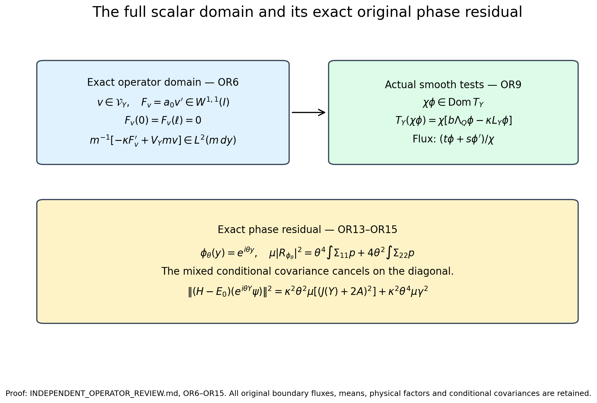

# Independent review of the scalar pushforward operator

The reviewed source is [the complete scalar operator proof](https://github.com/KokunoYumeto/yang-mills-interacting-workbench/blob/458d7cc7dbac2f4b7ee77cd9630a5b79b4344f5c/yang-mills/continuations/20261011-central-signs-shrinking-window/PUSHFORWARD_OPERATOR_RECEIVING.md). OP1–OP19 were read, with requested focus OP9–OP19. No mathematical defect was found in that scope. This note supplies the explicit associated-operator domain, proves the domain and action of every smooth scalar test, and records an exact phase residual which improves the general triangle bound in this case. The exact reviewed editions are recorded in the [source-use ledger](OPERATOR_REVIEW_SOURCE_USE_LEDGER.json).

## Exact data and closed-form domain

Keep the original open cubic lattice, radius-two product metric, all vertex gauge constraints, the complete original potential and scalar, and the actual positive unit ground vector:
\[
 H=-\kappa\Delta+b\sum_p(2-W_p),\quad H\psi=E_0\psi,
 \quad d\mu=\psi^2dU,\quad w=\log\psi.
 \tag{OR1}
\]
The observable in this scalar review is exactly
\[
 Y=\sum_p|f_p|(2-W_p),\quad A_1=\sum_p|f_p|>0,
 \quad F=\|f\|_\infty,\quad I=[0,\ell],\quad\ell=4A_1.
\]
It is not substituted for the separate signed observable \(C_f=a\sum_pf_p(2-W_p)\). Retain \(\gamma=\Gamma(Y)\), \(A=\Gamma(w,Y)\), \(J(y)=6A_1-3y\), and the actual conditional functions
\[
 Y_\#\mu=p\,dy,\quad h=\mathbb E[\gamma\mid Y],\quad
 \eta=\mathbb E[A\mid Y],\quad z=\mathbb E[Z_Q\mid Y],
 \quad s=hp,\quad t=\eta p.
 \tag{OR2}
\]
The established current identities give \(s,t\in W^{1,1}(\mathbb R)\) after zero extension, positive continuous \(s\) in the interior, \(s=t=0\) at both endpoints, \(s'=(J+2\eta)p\), and bounded locally absolutely continuous \(r=t/s\). Define, with the original interior base point,
\[
\begin{gathered}
 \chi(y)=\exp\!\left(\int_{y_0}^yr(v)dv\right),\quad m=p/\chi^2,
 \quad a_0=hm=s/\chi^2,\quad\tau=z-\eta^2/h\ge0,\\
 V_Y=bu+o+\delta_Q+\kappa\tau,\qquad
 u=\mathbb E[W_Q\mid Y],\quad\delta_Q=b\Lambda_Q-(E_0-E_{\rm out}),\\
 o=\kappa\mathbb E[|\nabla_{\rm out}w|^2\mid Y]
   +b\mathbb E[W_{\rm out}+W_\times\mid Y]-E_{\rm out}\ge0.
\end{gathered}\tag{OR3}
\]
The lower bound on \(o\) is the conditional outside quadratic-form inequality. Every term, including the outside ground energy and full crossing scalar, is retained. At each fixed regulator, \(h,V_Y,\chi,\chi^{-1},\chi',(\chi^{-1})'\) are bounded, \(m\) and \(a_0\) are integrable, and \(a_0\) is continuous and positive in every compact interior interval. No such bound is asserted uniform along the regulator path.

Let \(\mathcal V_Y\) be the closure of smooth functions on the closed interval in the form norm of
\[
 q_Y[v]=\kappa\int_Ia_0|v'|^2dy+\int_IV_Ym|v|^2dy
 \quad\text{on }L^2(I,m\,dy).
 \tag{OR4}
\]
The OP8 closability proof is valid: a form-Cauchy sequence tending to zero in \(L^2(m)\) has derivatives convergent in \(L^2(a_0)\). On a compact interior interval, \(a_0\) has a positive minimum and the weighted means tend to zero. The fundamental theorem of calculus bounds differences in the uniform norm by differences of the means plus the Lebesgue \(L^2\) derivative differences. The uniform limit is zero because \(m>0\) almost everywhere, so the derivative limit is zero distributionally there. Exhausting the interior and using bounded \(V_Y\) proves closability.

The same argument for a general form-Cauchy sequence shows that every \(v\in\mathcal V_Y\) has a locally absolutely continuous interior representative with derivative in \(L^2(a_0dy)\). This is the representative used below. No endpoint value of \(v\) is required.

## Multiplication and the exact operator domain

The multiplier assertion OP9 is correct. For \(v\) smooth,
\[
 \kappa\int a_0|(\chi v)'|^2
 \le2\|\chi\|_\infty^2\kappa\int a_0|v'|^2
 +2\kappa\|\chi'\|_\infty^2\|h\|_\infty\int m|v|^2.
 \tag{OR5}
\]
The potential term is bounded by \(\|\chi\|_\infty^2\int V_Ym|v|^2\). Extend the Lipschitz function \(\chi\) past the endpoints and mollify. Uniform convergence of the values, uniformly bounded derivatives, and almost-everywhere derivative convergence imply form convergence of the products with a fixed smooth \(v\), by dominated convergence against the integrable weights. Density extends multiplication to \(\mathcal V_Y\). Applying the same argument to \(\chi^{-1}\) gives the bounded inverse. Consequently \(\chi\in\mathcal V_Y\), and the functions \(\chi\phi\), \(\phi\) smooth, are form dense. This argument proves form density; no assertion that this class is an operator core is needed.

Write \(T_Y\) for the self-adjoint operator associated to OR4. Its exact domain has the following characterization:
\[
\boxed{\begin{split}
 \operatorname{Dom}T_Y=\{v\in\mathcal V_Y:\;&F_v=a_0v'\in W^{1,1}(I),
 \quad F_v(0)=F_v(\ell)=0,\\
 &f_v=m^{-1}[-\kappa F_v'+V_Ymv]\in L^2(m\,dy)\},
 \qquad T_Yv=f_v.
\end{split}}\tag{OR6}
\]
For the forward direction, the associated-operator weak identity on compactly supported interior smooth tests gives \(-\kappa F_v'+V_Ymv=mf_v\) distributionally. Both \(mv\) and \(mf_v\) are integrable by Cauchy–Schwarz and \(\int m<\infty\). Also \(F_v\in L^1\), since
\(\int|a_0v'|\le(\int a_0|v'|^2)^{1/2}(\int a_0)^{1/2}\).
Thus \(F_v\in W^{1,1}(I)\), including finite endpoint values. Integrating against an arbitrary smooth function on the closed interval then makes the remaining boundary expression
\(F_v(\ell)\overline{\zeta(\ell)}-F_v(0)\overline{\zeta(0)}\).
It vanishes for all independent endpoint values, proving both flux conditions. Conversely the displayed conditions give the associated-operator weak identity first for smooth tests, then for every element of \(\mathcal V_Y\) by form density. This proves OR6 in both directions, even when the density or diffusion coefficient has irregular values at a critical level. The global \(W^{1,1}\) flux has no jump or unrecorded interior boundary.

The actual current equations OP6 state
\[
 a_0\chi'=t/\chi,\quad
 -\kappa(a_0\chi')'+V_Ym\chi=b\Lambda_Qm\chi,
 \quad (a_0\chi')(0)=(a_0\chi')(\ell)=0.
 \tag{OR7}
\]
Since \(t\in W^{1,1}\) and \(\chi^{-1}\) is bounded Lipschitz, the flux in OR7 lies in \(W^{1,1}\). Its right-hand side is square integrable with weight \(m\), and OR6 proves \(\chi\in\operatorname{Dom}T_Y\), \(T_Y\chi=b\Lambda_Q\chi\). Expansion and integration of the exact cross derivative gives
\[
 q_Y[\chi\phi]-b\Lambda_Q\|\chi\phi\|_{L^2(m)}^2
 =\kappa\int_Ih|\phi'|^2p\,dy.
 \tag{OR8}
\]
This holds for complex smooth \(\phi\); the real cross term is the derivative of \(|\phi|^2\), and its boundary flux is zero by OR7. Form density extends nonnegativity to the entire domain. The identity \(\int\chi^2m=\int p=1\) fixes the unit norm, proving OP10 including its ground-energy statement.

There is an explicit operator-domain consequence. For every smooth complex \(\phi\) on \(I\),
\[
\begin{gathered}
 L_Y\phi=h\phi''+(J+2\eta)\phi'=p^{-1}(s\phi')',\\
 \chi\phi\in\operatorname{Dom}T_Y,\qquad
 T_Y(\chi\phi)=\chi[b\Lambda_Q\phi-\kappa L_Y\phi].
\end{gathered}\tag{OR9}
\]
Indeed the flux is
\(a_0(\chi\phi)'=(t\phi+s\phi')/\chi\), a \(W^{1,1}\) function with both endpoint values zero. Expanding its distributional derivative using OR7 and \(s'=(J+2\eta)p\) gives the displayed action. The resulting \(L_Y\phi\) is bounded at this regulator, since \(h,J,\eta\) and the two derivatives of \(\phi\) are bounded. It therefore supplies the \(L^2\) condition in OR6. This proves the scalar operator action, including at critical values, rather than only a formal differential expression.

## Original physical map and complete residual

The map \(\mathcal J(\chi\phi)=\phi(Y)\psi\) extends to an isometry from \(L^2(m)\) onto the closed physical subspace of measurable functions of \(Y\) multiplied by \(\psi\). Gauge invariance of \(Y\) and \(\psi\) verifies the codomain. The full original ground-transform form on this range equals OR8. Thus form convergence on the scalar side is exactly the corresponding convergence in the shifted original form; the closures are identified by the same isometry.

For smooth \(\phi\), \(\phi(Y)\psi\) is in the original operator domain because both factors are smooth on the compact configuration space. Direct differentiation gives
\[
\begin{gathered}
 (H-E_0)(\phi(Y)\psi)
 =-\kappa\psi[(L_Y\phi)(Y)+R_\phi],\\
 R_\phi=(\gamma-h(Y))\phi''(Y)+2(A-\eta(Y))\phi'(Y),
 \quad\mathbb E[R_\phi\mid Y]=0,\\
 \mathcal J^*(H-E_0)\mathcal J(\chi\phi)
 =(T_Y-b\Lambda_Q)(\chi\phi).
\end{gathered}\tag{OR10}
\]
For the adjoint, \(\mathcal J^*(\psi G)=\chi\mathbb E[G\mid Y]\), as verified by taking inner products with every \(\chi\phi\). This proves the last line using OR9. The orthogonal remainder is exactly \(-\kappa\psi R_\phi\), including its sign. These are operator identities on the stated smooth test class, plus the equality of complete closed forms. They do not assert that the entire scalar operator domain maps into the original operator domain or that the isometric range is invariant.

For a finite list of smooth complex tests, subtract their actual means. The exact original Gram and two energy matrices are
\[
\begin{aligned}
 G_{rs}&=\int\overline{\phi_r}\phi_sp
 -\overline{\int\phi_rp}\int\phi_sp,\\
 E_{rs}&=\kappa\int h\overline{\phi_r'}\phi_s'p,\\
 E_{2,rs}&=\kappa^2\int\overline{L_Y\phi_r}L_Y\phi_sp
 +\kappa^2\int d_{\phi_r}^*\Sigma d_{\phi_s}p,
 \qquad d_\phi=\binom{\phi''}{2\phi'},\\
 \Sigma&=\mathbb E\left[
 \binom{\gamma-h}{A-\eta}(\gamma-h,\ A-\eta)\,\middle|\,Y\right]\succeq0.
\end{aligned}\tag{OR11}
\]
Every original mean is retained. Orthogonality in OR10 makes the second-energy split an equality. Conditional nonnegativity of squares proves both \(\Sigma\succeq0\) and positivity of every integrated residual matrix. This verifies OP14–OP15, including conjugations and both factors two.

Let \(n_f\) be the original number of nonzero sampled face coefficients. The original incidence estimate and the fixed central-link isometry give
\[
 g_*(y)=\min\{16Fy-4y^2/n_f,
 16F(\ell-y)-4(\ell-y)^2/n_f\},\qquad0\le\gamma\le g_*(Y).
\]
This is nonnegative on the full original interval since \(A_1\le Fn_f\). Before conditioning, \(\gamma^2\le g_*\gamma\) and \(A^2\le\gamma Z_Q\le g_*Z_Q\). Consequently
\[
\begin{gathered}
 0\le\Sigma_{11}\le g_*h-h^2,\qquad
 0\le\Sigma_{22}\le g_*z-\eta^2,\qquad
 |\Sigma_{12}|^2\le\Sigma_{11}\Sigma_{22},\\
 \mu|R_\phi|^2\le
 \int\bigl(|\phi''|\sqrt{g_*h-h^2}
       +2|\phi'|\sqrt{g_*z-\eta^2}\bigr)^2p.
\end{gathered}\tag{OR12}
\]
The second estimate requires only the original pointwise inequality, with no conditional independence. Both square roots are nonnegative by the preceding inequalities. Expansion of the Hermitian quadratic form proves the last estimate for complex as well as real tests. Thus OP16–OP17 are correct.

## Exact phase specialization and physical-time dictionary

For the original scalar observable \(Y\), take \(\phi_\theta(y)=e^{i\theta y}\). The two derivative coefficients are \(-\theta^2\phi_\theta\) and \(2i\theta\phi_\theta\). Since \(\Sigma_{12}\) is real, their mixed term cancels exactly:
\[
\begin{gathered}
 \mu|R_{\phi_\theta}|^2
 =\theta^4\int\Sigma_{11}p+4\theta^2\int\Sigma_{22}p,\\
 \mu|R_{\phi_\theta}|^2
 \le\theta^4\int(g_*h-h^2)p
       +4\theta^2\int(g_*z-\eta^2)p.
\end{gathered}\tag{OR13}
\]
This is sharper for these actual phases than substituting absolute derivative values in the general triangle bound. For two possibly different real parameters the complete mixed residual is
\[
 \mu\overline{R_{\phi_{\theta_r}}}R_{\phi_{\theta_s}}
 =\int e^{i(\theta_s-\theta_r)y}
 [\theta_r^2\theta_s^2\Sigma_{11}+4\theta_r\theta_s\Sigma_{22}
 +2i\theta_r\theta_s(\theta_s-\theta_r)\Sigma_{12}]p.
 \tag{OR14}
\]
Combining OR13 with the scalar contribution in OR11 restores the entire original phase second moment:
\[
 \|(H-E_0)(e^{i\theta Y}\psi)\|^2
 =\kappa^2\theta^2\mu\bigl((J(Y)+2A)^2\bigr)
      +\kappa^2\theta^4\mu\gamma^2.
 \tag{OR15}
\]
To verify it, \(L_Y\phi_\theta=\phi_\theta[i\theta(J+2\eta)-\theta^2h]\). Add its squared norm to OR13 and use
\(\mathbb E[(J+2A)^2\mid Y]=(J+2\eta)^2+4\Sigma_{22}\) and \(\mathbb E[\gamma^2\mid Y]=h^2+\Sigma_{11}\). No scalar contribution or residual is discarded. For an affine test \(\phi(y)=y\), the exact residual is \(4\mu\operatorname{Var}(A\mid Y)\). The signed test \(C_f\) is not asserted to be a function of \(Y\); OR13–OR15 concern the specified phases of \(Y\).

The primary source of the conditional coefficients was checked in its intact original-author TeX: Frédéric Legoll and Tony Lelièvre, [*Effective dynamics using conditional expectations*, arXiv:0906.4865v1](https://arxiv.org/abs/0906.4865v1), `legoll_lelievre.tex`, with its exact source hash in the [source-use ledger](OPERATOR_REVIEW_SOURCE_USE_LEDGER.json). Actual reading covered lines 135–168, 393–541, and 680–750, including equations `eq:mu_z`, `eq:b`, `eq:sigma`, and `eq:y`. Its coefficients are
\(b_{\rm source}=\mathbb E[-\nabla V\cdot\nabla\xi+\beta^{-1}\Delta\xi\mid\xi]\),
\(\sigma_{\rm source}^2=\mathbb E[|\nabla\xi|^2\mid\xi]\), with noise coefficient \(\sqrt{2\beta^{-1}}\sigma\).

For \(N\) original links, the radius-two volume is \((16\pi^2)^N\). Set only for this density comparison
\[
 \beta_{\rm source}^{-1}=\kappa,\qquad V_{\rm density}=-2\kappa w,
 \qquad Z_{\rm density}=\int e^{-V_{\rm density}/\kappa}d\mathrm{vol}
 =(16\pi^2)^N.
 \tag{OR16}
\]
The last equality follows from \(\int\psi^2dU=1\) and \(dU=(16\pi^2)^{-N}d\mathrm{vol}\). Thus the source equilibrium measure is exactly \(\psi^2dU\), and substitution of \(\xi=Y\) gives
\[
\begin{gathered}
 -\nabla V_{\rm density}\cdot\nabla+\kappa\Delta
 =\kappa(\Delta+2\nabla w\cdot\nabla),\\
 b_{\rm source}=\kappa(J+2\eta),\quad
 \sigma_{\rm source}^2=h,\quad
 \mathcal L_{\rm scalar}=\kappa L_Y.
\end{gathered}\tag{OR17}
\]
No time rescaling is missing in OP18–OP19. The noise produces diffusion term \(\kappa h\partial_y^2\), with the displayed physical drift. The Hamiltonian residual is \(-\kappa R_\phi\psi\), whereas the generator residual is \(+\kappa R_\phi\). The source's positive lower bound on \(|\nabla\xi|\) fails for the actual \(Y\); none of its approximation or convergence theorems is imported. Critical levels are handled by the actual current and global flux identities OR2, OR6 and OR9. The derived density potential in OR16 is not substituted for the original Hamiltonian potential in OR1.

## Verdict and completed additions

OP9–OP19 have the correct domains as stated, factors, signs, conjugations, original means, and physical-time dictionary. OR6 and OR9 supply a complete explicit operator-domain characterization and the associated action on every stated smooth test. OR13–OR15 supply a stronger phase-specific residual receiver while preserving the entire second moment. Form closure and operator invariance are not identified. The accompanying bounded symbolic checks validate the differential and complex-matrix coefficients; the domain proofs are the exact arguments OR4–OR10. The receipt records the reviewed source version, original-author reading coverage and unchanged sealed-source hashes.

The upper panels display the domain and its actual smooth tests, including both endpoint fluxes (OR6–OR9). The lower panel displays the exact diagonal phase residual and full original second energy (OR13–OR15); the off-diagonal covariance remains present in OR14. Reproducible source: [draw_operator_domain.py](draw_operator_domain.py).
