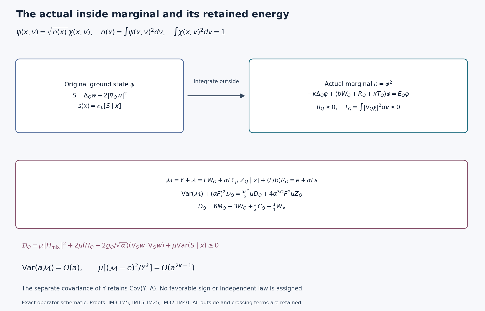

# The actual inside marginal and its evaluated retained-energy covariance

All expectations below belong to the original interacting positive ground state at source zero. The retained inside energy has an explicit variance of order \(a^{-1}\). Its difference from the original potential is kept as an actual nonnegative observable, whose covariance is evaluated without assigning it a sign. An inverse-weighted extension uses the proved actual lower-tail moments; no comparison density is substituted.

## Exact original decomposition and marginal equation

Keep the open cubic lattice, its positive coordinate links, all elementary faces in all three orientations, and every original vertex gauge constraint. Each link has probability Haar measure and the radius-two metric on \(SU(2)\). With \(T_\alpha=-i\sigma_\alpha/2\), let \(X_{e\alpha}\) differentiate \(e^{tT_\alpha}U_e\), and put \(\Delta=\sum X_{e\alpha}^2\). Retain
\[
\begin{gathered}
 U_p=U_d(z)U_e(z+e_d)U_d(z+e_e)^{-1}U_e(z)^{-1},\quad d<e,\\
 W_p=\operatorname{Tr}U_p,\quad D_p=2-W_p,\quad
 H=-\kappa\Delta+b\sum_pD_p=-\kappa\Delta+2bM-b\sum_pW_p,\\
 H\psi=E_0\psi,\quad\psi>0,\quad\|\psi\|=1,
 \quad w=\log\psi,\quad d\mu=\psi^2dU.
\end{gathered}\tag{IM1}
\]
The fixed inside cube \(Q=v+\{0,\ldots,q\}^3\) contains every edge of every face with a nonzero sampled coefficient. Inside edges have both endpoints in \(Q\). An elementary crossing face has exactly one inside edge. The original edge and face counts are
\[
\begin{gathered}
 N_Q=3q(q+1)^2,\quad M_Q=3q^2(q+1),\quad
 C_Q=2q(q+1)\eta_Q,\\
 \eta_Q=\sum_{d=1}^3(\mathbf1_{v_d>0}+\mathbf1_{v_d+q<2L}),\\
 W_Q=\sum_{p\text{ inside}}D_p,\quad
 W_\times=\sum_{p\text{ crossing}}D_p,\quad
 H=-\kappa\Delta_Q+bW_Q+H_{\rm out}+bW_\times,\\
 H_{\rm out}=-\kappa\Delta_{\rm out}+V_{\rm out},\quad
 V_{\rm out}=2b(M-M_Q-C_Q)-b\sum_{p\text{ outside}}W_p,\\
 H_{\rm out}\ge E_{\rm out}I,\quad E_Q=E_0-E_{\rm out},
 \quad\alpha=\kappa/b,\quad Z_Q=|\nabla_Qw|^2.
\end{gathered}\tag{IM2}
\]
Thus the inside scalar is \(2bM_Q\), and the crossing scalar is \(2bC_Q\). No scalar or outside ground energy is omitted.

Write inside coordinates as \(x\), outside coordinates as \(v\), and their product Haar as \(dx\,dv\). Define the actual marginal and normalized conditional vector
\[
\begin{gathered}
 n(x)=\int\psi(x,v)^2dv>0,\quad\varphi=\sqrt n,\quad u=\log\varphi,
 \quad\chi(x,v)=\psi(x,v)/\varphi(x),\quad\int\chi^2dv=1,\\
 B_x=H_{\rm out}-E_{\rm out}+bW_\times(x,\cdot),\quad
 R_Q(x)=\langle\chi,B_x\chi\rangle_{L^2(dv)}\ge0,\\
 T_Q(x)=\int|\nabla_Q\chi|^2dv\ge0,\quad
 z(x)=|\nabla_Qu|^2,\quad
 \overline Z(x)=\mathbb E_\mu[Z_Q\mid x]=z(x)+T_Q(x).
\end{gathered}\tag{IM3}
\]
All functions are smooth on the compact inside product. The nonnegativity of \(R_Q\) follows from the outside quadratic form for each fixed \(x\) and \(W_\times\ge0\); it does not give a pointwise sign to \(V_{\rm out}-E_{\rm out}\).

Differentiating \(\int\chi^2dv=1\) gives \(\int\chi\nabla\chi=0\) and \(\int\chi\Delta_Q\chi=-T_Q\). Expand \(\Delta_Q(\varphi\chi)\), multiply the full equation by \(\chi\), and integrate outside. The exact marginal equation is
\[
 \boxed{-\kappa\Delta_Q\varphi+
       (bW_Q+R_Q+\kappa T_Q)\varphi=E_Q\varphi.}
 \tag{IM4}
\]
Put \(V_{\rm eff}=bW_Q+R_Q+\kappa T_Q\). Dividing the original equation by \(\varphi\), and using IM4, also gives the complete conditional-vector equation
\[
 -\kappa(\Delta_Q\chi+2\nabla_Qu\cdot\nabla_Q\chi)
 +(B_x-R_Q-\kappa T_Q)\chi=0.
 \tag{IM5}
\]
The conditional vector is not assumed constant in \(x\).

For the original nonzero real compactly supported continuous test, keep its exact centers and all face orientations:
\[
\begin{gathered}
 x_p=o+a(z-L\mathbf1+(e_d+e_e)/2),\quad f_p=f(x_p),
 \quad F=\|f\|_\infty>0,\quad A_1=\sum_p|f_p|>0,\\
 Y=\sum_p|f_p|D_p=2A_1-\sum_p|f_p|W_p,\quad d=\mu Y,\\
 C_f=a\sum_pf_pD_p,\quad m_f=\mu C_f,\quad
 e=FE_Q/b,\quad J(Y)=\Delta_QY=6A_1-3Y,\quad
 \gamma=\Gamma(Y)\le16FY.
\end{gathered}\tag{IM6}
\]
The zero sampled test has no covariance and requires none of the divisions below. Define the actual nonnegative inside observable and the complete energy
\[
\begin{gathered}
 \mathcal A=FW_Q-Y+\alpha F\overline Z+(F/b)R_Q\ge0,\\
 \mathcal M=Y+\mathcal A=FW_Q+\alpha F\overline Z+(F/b)R_Q,\qquad
 s=\Delta_Qu+2z.
\end{gathered}\tag{IM7}
\]
IM4 gives the pointwise, rather than merely integrated, equality
\[
 \boxed{\mathcal M-e=\alpha F s,\qquad
 s={\Delta_Q n\over2n},\qquad\mu s=0.}
 \tag{IM8}
\]
For every real smooth inside function \(\Phi\), Haar integration of \(\Phi\Delta_Qn\) twice therefore proves
\[
 \mu[\Phi(\mathcal M-e)]={\alpha F\over2}\mu\Delta_Q\Phi,
 \quad\mu\mathcal A=e-d,\quad
 E_Q=b\mu W_Q+\kappa\mu Z_Q+\mu R_Q.
 \tag{IM9}
\]
All marginal integrals here equal the full original expectation. Original gauge actions preserve the inside and outside coordinate sets and their Haar measures. Their conditional changes of variables show that \(n,u,R_Q,T_Q,\mathcal A\) are inside gauge invariant. This argument does not factor the physical Hilbert space as a product.

## Inherited Hessian, explicit derivative terms, and the compression map

Let \(g=\nabla_Qw\). Differentiating the conditional density \(\chi^2\) covariantly in the inside coordinates gives
\[
\begin{gathered}
 \nabla_Qu=\mathbb E[g\mid x],\qquad
 \operatorname{Hess}_Qu
 =\mathbb E[\operatorname{Hess}_Qw\mid x]+2\mathcal C(x),\\
 \mathcal C_{ik}(x)=\mathbb E[(g_i-\mathbb E[g_i\mid x])
 (g_k-\mathbb E[g_k\mid x])\mid x]
 =\int(\nabla_i\chi)(\nabla_k\chi)dv,\quad
 \operatorname{tr}\mathcal C=T_Q.
\end{gathered}\tag{IM10}
\]
To see the factor two, differentiate an expectation: the derivative of \(\chi^2\) is \(2(g_i-\nabla_i u)\chi^2\). The connection term in the second derivative of \(u\) is precisely the conditional connection term of \(w\). The original proved metric bound \(\operatorname{Hess}w\ge-Kg\), \(K=2\sqrt{b/\kappa}=2/\sqrt\alpha\), thus implies
\[
 \operatorname{Hess}_Qu\ge-Kg_Q.
 \tag{IM11}
\]
No logconcavity has been assumed.

The actual outside derivatives can be written without a conditional-expectation placeholder. In an inside orthonormal frame, or equivalently using covariant sums at a normal-frame point, differentiating \(R_Q=\langle\chi,B_x\chi\rangle\) gives
\[
\begin{split}
 \Delta_QR_Q={}&2\langle\Delta_Q\chi,B_x\chi\rangle
 +2\sum_i\langle\nabla_i\chi,B_x\nabla_i\chi\rangle
 +4\sum_i\langle\nabla_i\chi,(\nabla_i B_x)\chi\rangle
 +\langle\chi,(\Delta_Q B_x)\chi\rangle,\\
 \nabla_iB_x={}&b\nabla_iW_\times,\qquad
 \Delta_QB_x=b(3C_Q/2-3W_\times/4),\\
 \Delta_QT_Q={}&2\|\nabla_Q^2\chi\|_{L^2(dv)}^2
 +2\sum_i\langle\nabla_i\chi,\nabla_i\Delta_Q\chi\rangle
 +T_Q.
\end{split}\tag{IM12}
\]
The last coefficient is \(2\operatorname{Ric}=g_Q\) for the radius-two metric. Every displayed form is finite, since the conditional vector is smooth on both compact factors. The first and third terms of \(\Delta R_Q\), and the derivative term of \(\Delta T_Q\), have no prescribed sign.

There is also an exact operator map. Define \(\mathcal J:L^2(dx)\to L^2(dx\,dv)\) by \((\mathcal Jh)(x,v)=h(x)\chi(x,v)\). It is an isometry, and for every smooth \(h\),
\[
\begin{gathered}
 \langle\mathcal Jh,(H-E_{\rm out})\mathcal Jh\rangle
 =\kappa\int|\nabla_Qh|^2dx+\int V_{\rm eff}|h|^2dx,\\
 (H-E_{\rm out})\mathcal Jh
 -\mathcal J(-\kappa\Delta_Q+V_{\rm eff})h
 =-2\kappa\sum_i(\nabla_i h-h\nabla_i u)\nabla_i\chi.
\end{gathered}\tag{IM13}
\]
For the form identity, the cross derivative vanishes by \(\int\chi\nabla\chi=0\). The second equality follows from IM5. Its right side is pointwise orthogonal to \(\chi\), so it is perpendicular to the isometric range. On gauge-invariant inside functions, \(\mathcal J\) maps into the original physical space. In particular, with \(\mathscr L_n=\Delta_Q+2\nabla_Qu\cdot\nabla_Q\),
\[
 \|(H-E_0)(\Phi\psi)\|^2
 =\kappa^2\mu(\mathscr L_n\Phi)^2
   +4\kappa^2\mu\mathcal C(\nabla_Q\Phi,\nabla_Q\Phi)
 \tag{IM14}
\]
for every smooth real inside \(\Phi\). The second term is an exact nonnegative operator defect, not an assumed invariant-sector approximation.

## The evaluated second score moment and every nonnegative remainder

Define the full inside divergence score
\(S=\Delta_Qw+2Z_Q\). Differentiating \(n=\int e^{2w}dv\) twice gives
\[
 s=\mathbb E[S\mid x],\qquad
 \mu S^2=\mu s^2+\mu\operatorname{Var}(S\mid x).
 \tag{IM15}
\]
For an inside scalar function \(u\) with density \(n=e^{2u}\), weighted integration by parts and the partial Bochner identity give exactly
\[
 \mu s^2=\mu\|\operatorname{Hess}_Qu\|^2+\tfrac12\mu z
     -2\mu\operatorname{Hess}_Qu(\nabla_Qu,\nabla_Qu).
 \tag{IM16}
\]
For detail, \(\mu s\Phi=-\mu\Gamma_Q(u,\Phi)\), and
\(\Delta_Q z/2=\|\operatorname{Hess}u\|^2+\Gamma(u,\Delta u)+z/2\).
Substitution of \(s=\Delta u+2z\) and \(\mu\Delta z=-2\mu\Gamma(u,z)\) proves IM16. The identical calculation in the inside coordinates while retaining the original outside variables proves
\[
 \mu S^2=\mu\|\operatorname{Hess}_Qw\|^2+\tfrac12\mu Z_Q
 -2\mu\operatorname{Hess}_Qw(g,g).
 \tag{IM17}
\]

The original ground equation now evaluates its Hessian term. Put \(V=b\sum_pD_p\) and \(\mathscr L=\Delta+2\nabla w\cdot\nabla\). Since the inside tangent distribution is parallel in the product metric, the full Bochner equation for \(Z_Q\) is
\[
 \mathscr L Z_Q
 =2\|\nabla_{\rm full}\nabla_Qw\|^2+Z_Q
      +{2\over\kappa}\Gamma_Q(w,V).
\]
Indeed differentiate \(\Delta w+|\nabla w|^2=(V-E_0)/\kappa\); the Hessian-gradient terms cancel the added drift term. Integrating \(\mathscr L Z_Q\) gives zero, and inside integration by parts gives \(2\mu\Gamma_Q(w,V)=-\mu\Delta_QV\). The exact result is
\[
\begin{gathered}
 \mu\|\nabla_{\rm full}\nabla_Qw\|^2+\tfrac12\mu Z_Q
 ={1\over2\alpha}\mu D_Q,\\
 D_Q=6M_Q-3W_Q+\tfrac32 C_Q-\tfrac34W_\times.
\end{gathered}\tag{IM18}
\]
Each inside face contributes \(6-3D_p\) and each crossing face, with one inside edge, contributes \(3/2-3D_p/4\); outside faces contribute zero. This proves every coefficient of \(D_Q\) directly from the original incidences.

Let \(H_Q=\operatorname{Hess}_Qw\) and \(H_{\rm mix}=\nabla_{\rm out}\nabla_Qw\), with each mixed component counted once. Combining IM15, IM17 and IM18, and inserting \(K=2/\sqrt\alpha\), proves the exact positive-remainder identity
\[
\boxed{\begin{split}
 \mu s^2+\mathcal D_Q
   &={1\over2\alpha}\mu D_Q+{4\over\sqrt\alpha}\mu Z_Q,\\
 \mathcal D_Q
   &=\mu\|H_{\rm mix}\|^2
    +2\mu(H_Q+Kg_Q)(g,g)
    +\mu\operatorname{Var}(S\mid x)\ge0.
\end{split}}\tag{IM19}
\]
The mixed Hessian term is the difference between the complete column norm in IM18 and the inside Hessian norm in IM17. All three differences are actual quantities in the original state. Thus the marginal Hessian formula is not used as a substitute for evaluating the full original Hessian energy.

Set
\[
\begin{gathered}
 B_{\rm act}=(\alpha F)^2\mu s^2
             =\operatorname{Var}_\mu\mathcal M,\\
 B_{\rm raw}={\alpha F^2\over2}\mu D_Q
              +4\alpha^{3/2}F^2\mu Z_Q.
\end{gathered}\tag{IM20}
\]
Then \(B_{\rm act}+(\alpha F)^2\mathcal D_Q=B_{\rm raw}\). The exact budget in IM9 gives
\[
 B_{\rm raw}={\alpha F^2\over2}
 [6M_Q-3\mu W_Q+3C_Q/2-3\mu W_\times/4]
 +4\sqrt\alpha F^2[E_Q/b-\mu W_Q-\mu R_Q/b].
 \tag{IM21}
\]
In particular the existing original local budget \(E_Q/b\le\Lambda_Q\) and original lower uncertainty root \(d_Q^-\le\mu W_Q\) give the fully explicit bound
\[
 0\le B_{\rm act}\le B_{\rm raw}\le
 B_Q^*=F^2\{\alpha(3M_Q+3C_Q/4-3d_Q^-/2)
       +4\sqrt\alpha(\Lambda_Q-d_Q^-)\}.
 \tag{IM22}
\]
For reference these original constants, including all crossing terms, are
\[
\begin{gathered}
 \Lambda_Q=\min\{2M_Q,6g^2\sqrt{N_QM_Q}\}+2C_Q,
 \quad \xi=b/\kappa,\quad A_Q=9+64\xi,\quad
 B_Q=36M_Q+64\xi\Lambda_Q,\\
 d_Q^-={72M_Q^2\over B_Q+\sqrt{B_Q^2-144A_QM_Q^2}}.
\end{gathered}\tag{IM23}
\]
The root follows by integrating \(\Delta_QW_Q=6M_Q-3W_Q\), then applying Cauchy–Schwarz, \(\Gamma(W_Q)\le16W_Q\), and \(\mu Z_Q\le(\Lambda_Q-\mu W_Q)/\alpha\). Expanding gives \((6M_Q-3d_Q)^2\le64d_Q(\Lambda_Q-d_Q)/\alpha\), exactly the polynomial with the displayed root. The trial bound for \(\Lambda_Q\), including its exact crossing cost, is FO5–FO6 and LR5–LR6; it is not changed here.

On the original path and original support placement,
\[
\begin{gathered}
 L_j=j^4,\quad a_j=(100j)^{-1},\quad g_j^2=\kappa_*a_j/2,
 \quad b_j=(\kappa_*a_j^2)^{-1},\quad\alpha_j=\kappa_*^2a_j^2,\\
 v_{d,j}=L_j+\lfloor(c_d-o_d)/a_j\rfloor-1,\quad
 q_j=\lceil R/a_j\rceil+3,\\
 \mathsf L_R=9\kappa_*R^3+24R^2,\quad
 \mathsf K_R={\mathsf L_R+\sqrt{\mathsf L_R^2-81\kappa_*^2R^6/4}\over2}.
\end{gathered}\tag{IM24}
\]
The patch is eventually interior. Its counts give \(a^3M_Q\to3R^3\), \(a^2C_Q\to12R^2\), and \(a^2\Lambda_Q\to\mathsf L_R\). Substituting in IM23 gives \(a^2d_Q^-\to\mathsf L_R-\mathsf K_R\). Hence
\[
 \boxed{\limsup_{j\to\infty}a_j B_{{\rm act},j}
 \le F^2[9\kappa_*^2R^3+4\kappa_*\mathsf K_R],\qquad
 \operatorname{Var}(a_j\mathcal M_j)=O(a_j).}
 \tag{IM25}
\]
The improved kinetic root \(\mathsf K_R\), rather than \(\mathsf L_R\), is retained. The crossing terms of IM21–IM23 have not been omitted; their contribution to the first term of \(a_jB_Q^*\) tends to zero, while the crossing budget persists in \(\mathsf K_R\).

## Evaluated signed contractions and exact original receiving maps

Put \(c_Y=\alpha F(3A_1-3d/2)\). Testing IM9 with \(Y-d\) and \(\mathcal A-\mu\mathcal A\), and using IM8, yields
\[
\boxed{\begin{gathered}
 \operatorname{Cov}(Y,\mathcal A)=c_Y-\operatorname{Var}Y,\\
 \operatorname{Var}\mathcal A-\operatorname{Var}Y=B_{\rm act}-2c_Y,\\
 \operatorname{Cov}(Y,\mathcal A)+\operatorname{Var}\mathcal A
 ={\alpha F\over2}\mu\Delta_Q\mathcal A=B_{\rm act}-c_Y,\\
 -c_Y\le {\alpha F\over2}\mu\Delta_Q\mathcal A\le B_Q^*-c_Y.
\end{gathered}}\tag{IM26}
\]
This is an evaluated signed interval, since \(B_Q^*\) is explicit and \(c_Y\) retains the actual mean. In particular the requested contraction is \(O(a^{-1})\), rather than an unspecified Laplacian of an outside conditional energy. The actual covariance in the first line remains signed.

To compare IM12 with that evaluation, the marginal ground equation and its Bochner identity give
\[
\begin{gathered}
 \mu(\Delta_QR_Q+\kappa\Delta_QT_Q)
 =2\kappa\mu\|\operatorname{Hess}_Qu\|^2+\kappa\mu z
       -b(6M_Q-3\mu W_Q),\\
 \mu\Delta_Qz=-4\mu\operatorname{Hess}_Qu(\nabla_Qu,\nabla_Qu),\\
 \mu\Delta_Q\mathcal A=-\mu J(Y)+2\alpha F\mu s^2.
\end{gathered}\tag{IM27}
\]
For the first equality differentiate \(V_{\rm eff}-E_Q=\kappa(\Delta_Qu+z)\), integrate, and use Bochner to obtain \(\mu\Delta_QV_{\rm eff}=2\kappa\mu\|\operatorname{Hess}_Qu\|^2+\kappa\mu z\). The last equality combines the first two with IM16. Thus all of the outside and conditional kinetic derivative terms enter the bound IM26 with their exact signs.

The exact lower-side relation can be measured in norm. Let \(L=(e-Y)_+\). Since \(\mathcal A\ge0\), positive-part contraction and IM8 show
\[
 \mu(L-\mathcal A)^2\le B_{\rm act}\le B_Q^*,\qquad
 \mu[(Y-e)_+^2]\le B_{\rm act},\qquad
 |\|L\|_2-\|\mathcal A\|_2|\le\sqrt{B_Q^*}.
 \tag{IM28}
\]
Also \((\mathcal A-\mu\mathcal A)+(Y-d)=\alpha Fs\) exactly. Thus the lower-side second moment is quantitatively received by the retained energy, and the centered sum has controlled variance. Neither line bounds the separate large variance by pretending this retained energy is constant. A further exact consequence is \(c_Y^2\le B_{\rm act}\operatorname{Var}Y\), by Cauchy–Schwarz applied to \(\operatorname{Cov}(Y,\mathcal M)=c_Y\).

For the unchanged signed original test, let \(Y_\pm=\sum_{\pm f_p>0}|f_p|D_p\). Define
\[
 \mathcal A_f=\mathcal A+2Y_-\ge0,\quad
 C_f+a\mathcal A_f=a\mathcal M,\quad
 \mu\mathcal A_f=e-m_f/a.
 \tag{IM29}
\]
Thus IM25 controls \(\operatorname{Var}(C_f+a\mathcal A_f)\) with the same constant. Its complete signed contraction is
\[
\begin{gathered}
 \operatorname{Cov}(C_f,a\mathcal M)
 ={a\alpha F\over2}\{6a\sum_pf_p-3m_f\},\\
 \operatorname{Var}(a\mathcal A_f)-\operatorname{Var}C_f
 =a^2B_{\rm act}-a\alpha F\{6a\sum_pf_p-3m_f\},\\
 \operatorname{Var}C_f=a^2\mu Y^2-m_f^2-4a^2\mu(Y_+Y_-).
\end{gathered}\tag{IM30}
\]
Every mean, signed coefficient and scalar term remains explicit. The new order-\(a\) result is for the specified compensated observable in IM29; it is not an order-\(a\) upper bound for the separate original covariance.

## Actual inverse moments and a weighted receiving calculation

The completed original lower-tail calculation LR10–LR26 was read and is used here in its exact form. A short derivation of the input is included. For \(d_t=\mu(Ye^{tY})/\mu e^{tY}\), the inside ground equation and its score square give
\[
 (1+c_0-4\alpha F^2t^2)d_t^2-(e+4c_0A_1)d_t+4c_0A_1^2\le0,
 \quad c_0=9\alpha/64.
 \tag{IM31}
\]
Indeed with \(h_t=\langle\gamma\rangle_t\), \(J_t=6A_1-3d_t\), integration gives \(2\langle\Gamma(w,Y)\rangle_t=-J_t-th_t\). Completing the square of \(\nabla_Qw+(t/2+J_t/(2h_t))\nabla Y\) and retaining the nonnegative outside, incidence, and kinetic terms gives
\(e\ge d_t+\alpha J_t^2/(64d_t)-4\alpha F^2t^2d_t\). Multiplication by \(d_t\) proves IM31.

Put \(B=e+4c_0A_1\), \(C=4c_0A_1^2\), \(D=B^2-4(1+c_0)C\), and \(r_-=2C/(B+\sqrt D)>0\). The root exists since IM31 holds at \(t=0\). For all real \(t\), including a negative quadratic coefficient, the positive lower root is
\(2C/(B+\sqrt{D+16\alpha F^2Ct^2})\), so
\[
 d_{-t}\ge{r_-\over1+(r_-/p_0)t},\quad
 p_0={3A_1\over8F},\quad
 \mu e^{-tY}\le(1+(r_-/p_0)t)^{-p_0}\quad(t\ge0).
 \tag{IM32}
\]
The root comparison follows from \(\sqrt{D+16\alpha F^2Ct^2}\le\sqrt D+4F\sqrt{\alpha C}\,t\); integration of the logarithmic derivative proves the Laplace inequality. Tonelli applied to the gamma integral for \(Y^{-k}\) therefore gives, for positive integers \(k<p_0\),
\[
 m_k:=\mu Y^{-k}\le\overline m_k
 :=r_-^{-k}\prod_{h=1}^k(1-h/p_0)^{-1},\quad m_0=\overline m_0=1.
 \tag{IM33}
\]
The beta integral follows by multiplying the gamma integrals and using \(x=ru,y=r(1-u)\). On the original path, \(A_1=\Theta(a^{-3})\), \(e=O(a^{-2})\), and the discriminant inequality in IM31 gives \(e=\Omega(a^{-2})\). Also \(C=\Theta(a^{-4})\), \(B=O(a^{-2})\), and \(r_-\le d\le e\), hence \(r_-=\Theta(a^{-2})\). Thus \(\overline m_k=O(a^{2k})\) for each fixed integer \(k\).

For \(p_0>k+1\), test IM9 with \((Y+\varepsilon)^{-k}\) and let \(\varepsilon\downarrow0\). The inverse moments and \(\gamma\le16FY\) dominate every derivative. The exact weighted energy identity is
\[
\begin{split}
 F\mu{W_Q\over Y^k}+\alpha F\mu{Z_Q\over Y^k}
       +{F\over b}\mu{R_Q\over Y^k}
 ={}&(e+3\alpha Fk/2)m_k-3\alpha FkA_1m_{k+1}\\
 &+{\alpha Fk(k+1)\over2}\mu{\gamma\over Y^{k+2}}.
\end{split}\tag{IM34}
\]
Since \(p_0>k+1\) implies \(6A_1>16F(k+1)\), the last two terms together are nonpositive. In particular, with \(t_k=\mu(Z_Q/Y^k)\) and \(w_k=\mu(W_Q/Y^k)\),
\[
\begin{gathered}
 0\le t_k\le\overline t_k:=(E_Q/\kappa+3k/2)\overline m_k,
 \qquad 0\le w_k\le\overline w_k:=(E_Q/b+3\alpha k/2)\overline m_k,\\
 \alpha Ft_k\le(e+3\alpha Fk/2)m_k-m_{k-1},\qquad
 t_k=O(a^{2k-4}),\quad w_k=O(a^{2k-2}).
\end{gathered}\tag{IM35}
\]
The second line additionally retains \(FW_Q\ge Y\). At \(k=1\), IM34 reproduces exactly the parent inverse equation: with \(\delta=16FY-\gamma\),
\[
 1+(3\alpha FA_1-16\alpha F^2)m_2-(e+3\alpha F/2)m_1
 +\mu(\mathcal A/Y)+\alpha F\mu(\delta/Y^3)=0.
 \tag{IM36}
\]

The next receiving calculation uses these moments in a weighted version of IM19. Let \(U_Q=W_Q+W_\times\). For any smooth positive inside weight \(\Phi\), full and partial Bochner integration give the exact identity
\[
\begin{split}
 &\mu(\Phi S^2)+\mu(\Phi\|H_{\rm mix}\|^2)
 +2\mu[\Phi(H_Q+Kg_Q)(g,g)]\\
 &\quad ={1\over2\alpha}\mu[\Phi D_Q+\Gamma_Q(\Phi,U_Q)]
 +{4\over\sqrt\alpha}\mu(\Phi Z_Q)
 -\mu[S\Gamma_Q(\Phi,w)].
\end{split}\tag{IM37}
\]
Here is the cancellation proving it. Weighted full Bochner gives
\(\mu\Phi(\|\nabla_{\rm full}\nabla_Qw\|^2+Z_Q/2)
=(2\kappa)^{-1}\mu[\Phi\Delta_QV+\Gamma_Q(\Phi,V)]-\mu H_Q(g,\nabla\Phi)\).
Weighted partial Bochner gives
\(\mu\Phi S^2=\mu\Phi(\|H_Q\|^2+Z_Q/2-2H_Q(g,g))
+\mu H_Q(g,\nabla\Phi)-\mu S\Gamma_Q(\Phi,w)\).
Adding cancels the Hessian-gradient term exactly and gives IM37, since \(\nabla_QV=b\nabla_QU_Q\). These formulas follow by integration against the original \(\psi^2\); no derivatives of a new density are introduced.

Fix an integer \(k\ge1\) with \(p_0>k+2\). Take \(\Phi=(Y+\varepsilon)^{-k}\) in IM37 and pass to zero. The fixed-regulator smoothness and IM33 dominate the original terms and their first derivatives. In the limiting formula \(\Gamma(\Phi,U_Q)=-k\Gamma(Y,U_Q)/Y^{k+1}\) and the last term is \(+k\mu[S\Gamma(w,Y)/Y^{k+1}]\), with its signed value retained.

The original inside-edge incidences imply
\(\Gamma_Q(U_Q)\le16W_Q+4W_\times\): each inside edge has at most four incident faces, inside faces occur four times, and crossing faces once. Also \(W_\times\le4C_Q\). Therefore
\[
 \left|\mu{\Gamma(Y,U_Q)\over Y^{k+1}}\right|
 \le4\sqrt F\sqrt{(16w_k+16C_Qm_k)m_{k+1}}
 \le\overline G_k,
 \quad\overline G_k=16\sqrt F\sqrt{(\overline w_k+C_Q\overline m_k)\overline m_{k+1}}.
 \tag{IM38}
\]
Write \(X_k=\mu(S^2/Y^k)\). Cauchy–Schwarz and \(\Gamma(w,Y)^2\le Z_Q\gamma\le16FY Z_Q\) bound the last term of IM37 by \(\sqrt{16Fk^2t_{k+1}X_k}\). Dropping only its explicitly nonnegative left terms and the negative potential terms in \(D_Q\), define
\[
\begin{gathered}
 \overline D_k={6M_Q+3C_Q/2\over2\alpha}\overline m_k
             +{k\over2\alpha}\overline G_k
             +{4\over\sqrt\alpha}\overline t_k,\qquad
 \overline L_k=16Fk^2\overline t_{k+1},\\
 X_k\le\overline D_k+\sqrt{\overline L_kX_k},\qquad
 X_k\le{1\over4}(\sqrt{\overline L_k}
                       +\sqrt{\overline L_k+4\overline D_k})^2.
\end{gathered}\tag{IM39}
\]
All constants on the right have been evaluated by the actual roots and original local energy. Conditional Jensen in IM15 applies with this inside weight, so the completed inverse-weighted receiver is
\[
\boxed{\begin{gathered}
 \mu{(\mathcal M-e)^2\over Y^k}
 \le{\alpha^2F^2\over4}
       (\sqrt{\overline L_k}+\sqrt{\overline L_k+4\overline D_k})^2
 =O(a^{2k-1}),\\
 \mu{((e-Y)_+-\mathcal A)^2\over Y^k}=O(a^{2k-1}).
\end{gathered}}\tag{IM40}
\]
For the exponent, \(\overline D_k=O(a^{2k-5})\), \(\overline L_k=O(a^{2k-2})\), and \(\alpha^2=\kappa_*^4a^4\). The potential-gradient and cross-score corrections in IM39 are three powers smaller before taking the quadratic root; none was assigned a favorable sign. At \(k=1\) the weighted squared error is \(O(a)\); at \(k=2\) it is \(O(a^3)\). This is the next actual lower-side receiving calculation after IM26, not a symbolic remainder.

## A compact positive-ground test of the covariance sign

A nonnegative retained energy and the displayed Hessian lower bound alone cannot justify \(\operatorname{Cov}(Y,\mathcal A)\ge0\). The following separate compact Schrödinger example tests precisely that proposed universal implication. It is not asserted to be the Wilson Hamiltonian IM1.

On two radius-two copies of \(SU(2)\), let \(x=\operatorname{Tr}U/2\), \(y=\operatorname{Tr}V/2\), and \(\psi=Z^{-1/2}e^{xy}\). Then \(\Gamma(x)=(1-x^2)/4\), \(\Delta x=-3x/4\), and the corresponding identities hold for \(y\). Set \(\kappa=b=F=1\), \(Y=W_Q=2-2x\), \(E_Q=6\), \(H_{\rm out}=-\Delta_y\), \(E_{\rm out}=0\), and
\[
 V_\times(x,y)=6-\tfrac32xy+\tfrac14(x^2+y^2-2x^2y^2)-(2-2x)\ge\tfrac12.
 \tag{IM41}
\]
The inequality uses \(|xy|\le1\), \(Y\le4\), and \(x^2+y^2-2x^2y^2=x^2(1-y^2)+y^2(1-x^2)\ge0\). The full Hamiltonian \(-\Delta_x-\Delta_y+Y+V_\times\) has the exact positive unit ground vector \(\psi\) with eigenvalue 6, because its potential is \(6+\Delta\psi/\psi\) and the ground transform is nonnegative. Its log Hessian is bounded below by \(-g/2\): each diagonal Hessian block is \(-xy g/4\), and the mixed block has norm at most \(1/4\), giving this lower bound by \(2ab\le a^2+b^2\). It consequently satisfies the weaker bound \(-2g\) as well.

The marginal \(n(x)=Z^{-1}\int e^{2xy}dv\) is even in \(x\). Hence \(\mu x=0\), \(\mu Y=2\), and \(s\) is even in \(x\), so \(\operatorname{Cov}(Y,s)=0\). IM7–IM9 apply to this displayed nonnegative decomposition with its own exact Laplacian \(\Delta_QY=3/2-3Y/4\). They give
\[
 \mathcal A=\overline Z+R_Q\ge0,\quad
 Y+\mathcal A=6+s,\quad
 \operatorname{Cov}(Y,\mathcal A)=-\operatorname{Var}Y<0.
 \tag{IM42}
\]
The variance is strictly positive because the ground density is positive and \(Y\) is nonconstant. This test rules out that universal sign inference while preserving an actual positive ground equation, positive outside/crossing form, compact radius-two geometry and the stated lower Hessian bound. It does not settle the sign for the original Wilson model, whose exact signed contraction remains IM26.

## Verification and sources

The diagram displays the exact maps and all three nonnegative remainders in IM19. Its inverse-weighted estimate is for each fixed positive integer \(k\), at the sufficiently fine regulators for which \(p_0>k+2\). Both the original and marginal measures are the actual ground-state measures. The rendered diagram was visually inspected; its reproducible source is `draw_inside_marginal.py`.

The original state and local inputs were read in FO1–FO7 and FO26–FO30 of [FO1–FO56](https://github.com/KokunoYumeto/yang-mills-interacting-workbench/blob/458d7cc7dbac2f4b7ee77cd9630a5b79b4344f5c/yang-mills/continuations/20261011-central-signs-shrinking-window/ACTUAL_PUSHFORWARD_OPTIMIZATION.md), and the actual lower-tail/inverse proofs in LR8–LR18 and LR25–LR37 of [LR1–LR58](LOWER_SIDE_RETAINED_ENERGY.md). The exact source versions, hashes and reading coverage are in [the source-use ledger](RETAINED_ENERGY_SOURCE_USE_LEDGER.json). Their source-zero identities are rederived above where received. No external literature result is imported, no auxiliary probability density is assigned to the original state, and no owner source is edited.

`check_inside_marginal.py` passed 88 checks of the algebraic contractions and the partial and weighted Bochner identities on actual smooth compact positive-ground test families. The largest numerical discrepancy was below \(2.7\times10^{-15}\); the covariance in the exact sign test was approximately \(-1.1246859476606448\). These bounded checks supplement IM1–IM42; they do not simulate the original interacting vacuum. The complete distinction between the order-\(a\) compensated covariance and the still separate original signed covariance is the exact receiving map IM29–IM30.

Complete programme providers: [FO1–FO56](https://github.com/KokunoYumeto/yang-mills-interacting-workbench/blob/458d7cc7dbac2f4b7ee77cd9630a5b79b4344f5c/yang-mills/continuations/20261011-central-signs-shrinking-window/ACTUAL_PUSHFORWARD_OPTIMIZATION.md), [PF1–PF53](https://github.com/KokunoYumeto/yang-mills-interacting-workbench/blob/458d7cc7dbac2f4b7ee77cd9630a5b79b4344f5c/yang-mills/continuations/20261011-central-signs-shrinking-window/ACTUAL_PUSHFORWARD.md), [OP1–OP19](https://github.com/KokunoYumeto/yang-mills-interacting-workbench/blob/458d7cc7dbac2f4b7ee77cd9630a5b79b4344f5c/yang-mills/continuations/20261011-central-signs-shrinking-window/PUSHFORWARD_OPERATOR_RECEIVING.md), [OS1–OS40](https://github.com/KokunoYumeto/yang-mills-interacting-workbench/blob/458d7cc7dbac2f4b7ee77cd9630a5b79b4344f5c/yang-mills/continuations/20261011-central-signs-shrinking-window/ORIGINAL_SOURCE_COVARIANCE.md) and [LC1–LC42](https://github.com/KokunoYumeto/yang-mills-interacting-workbench/blob/458d7cc7dbac2f4b7ee77cd9630a5b79b4344f5c/yang-mills/continuations/20261011-central-signs-shrinking-window/LOCAL_CURVATURE_BUDGET.md). Exact editions and actual use appear in the [source-use ledger](RETAINED_ENERGY_SOURCE_USE_LEDGER.json).

## Actual bounded energy and complete signed covariance

[BM1–BM69](BOUNDED_ENERGY_MULTIPLIER.md) and the independent [IB1–IB46](BOUNDED_MULTIPLIER_RECEIVING.md) construct the original shrinking-window vector and its central, visible and hidden limiting maps. The complete retained energy gives two-root support and exact heat-word receivers. BM66–BM68 receive the full signed observable and companion covariance with every cross term. Its limiting Gram remains to be evaluated; the original operator and signed observable are retained throughout.

## Conditional outside forcing and current moments

[OC1–OC24](https://github.com/KokunoYumeto/yang-mills-interacting-workbench/blob/main/yang-mills/continuations/20261011-central-signs-shrinking-window/OUTSIDE_FORCE_AND_CURRENT_MOMENTS.md) derive the actual conditional score equation, positive averaged potential Hessian and complete outside-current forcing, preserving the entire original kinetic quotient and every mixed Hessian. Exact first and second moments give a quantified resolvent improvement with both physical residuals. A crossing plaquette proves that the full-cube positive-weight current is nonzero, so the specified finite-regulator improvement is strictly positive. The full covariance, Hessian and force kernels coincide and retain inside gauge directions. The global oscillation comparison is evaluated on the original path; it supplies no vanishing filter coefficient. The limiting current moments and smooth interacting no-gap endpoint remain open calculations.
