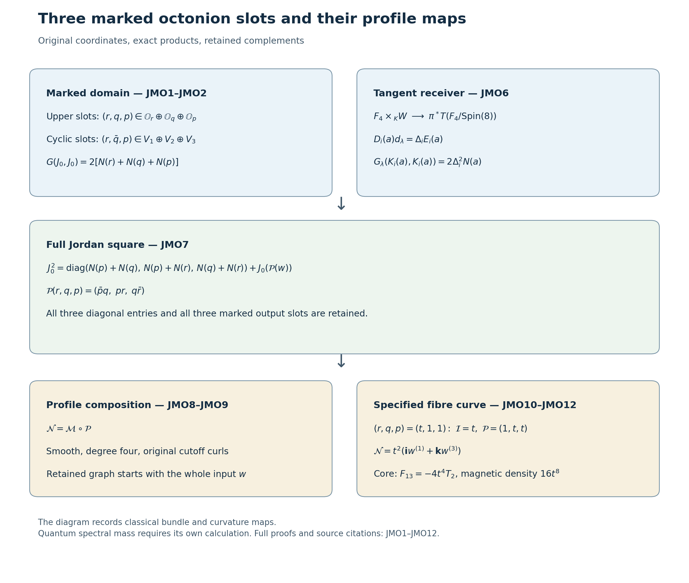

# Three marked octonion spaces and the Yang–Mills profile maps

The ordered Albert slots already belong to the programme's original
rank-24 domain. This note gives their exact coordinate map, their
three products and their receiving map on the 49-dimensional carrier.
It then calculates a quartic profile map obtained by composing those
products with the original quadratic quaternionic map. The original
profile and every original domain coordinate remain present.

The source is [the retained higher-rung TeX, lines 2104–2804 and
5400–5614](https://github.com/KokunoYumeto/yang-mills-interacting-workbench/blob/7b1c3a730c2db94891391d37c554b1f6085526ca/yang-mills/continuations/20260930-s6-ns-moment-map-bridge/sources/higher_rung/s6_higher_rung_24d_preprint.tex).
Its complete product, stabilizer, tangent and subgroup proofs are
retained there. The flag-manifold model is also described in
[Mare and Willems, *Topology of the octonionic flag manifold*,
Section 2.1](https://arxiv.org/abs/0809.4318).
The receiving maps are
[HC1–HC9](https://github.com/KokunoYumeto/yang-mills-interacting-workbench/blob/7b1c3a730c2db94891391d37c554b1f6085526ca/yang-mills/continuations/20260930-s6-ns-moment-map-bridge/HIGHER_CARRIER_AND_EVOLUTION.md)
and [the original profile theorem, Sections 4–8](https://github.com/KokunoYumeto/yang-mills-interacting-workbench/blob/7b1c3a730c2db94891391d37c554b1f6085526ca/yang-mills/continuations/20260930-s6-ns-moment-map-bridge/PROOF.md).
No novelty or quantum spectral conclusion is inferred from these maps.

## 1. The original coordinates, with both presentations retained

Use the source's real octonions
\[
\mathbb O=\mathbb H\oplus\mathbb H\ell,\qquad
(a,b)(c,d)=(ac-\bar d b,\;da+b\bar c),\qquad
\overline{(a,b)}=(\bar a,-b),
\]
with \(N(x)=x\bar x\) and \(h(x,y)=\operatorname{Re}(x\bar y)\).
Let \(J=\mathfrak h_3(\mathbb O)\), \(X\circ Y=(XY+YX)/2\),
and \(G(X,Y)=\operatorname{tr}(X\circ Y)\). Its upper-entry
presentation and its cyclic presentation are related by
\[
\begin{gathered}
J_0(r,q,p)=
\begin{pmatrix}0&p&q\\\bar p&0&r\\\bar q&\bar r&0\end{pmatrix},\\
E_1(a)=
\begin{pmatrix}0&0&0\\0&0&a\\0&\bar a&0\end{pmatrix},\quad
E_2(b)=
\begin{pmatrix}0&0&\bar b\\0&0&0\\b&0&0\end{pmatrix},\quad
E_3(c)=
\begin{pmatrix}0&c&0\\\bar c&0&0\\0&0&0\end{pmatrix},\\
\mathcal C:W_r\oplus W_q\oplus W_p\longrightarrow V_1\oplus V_2\oplus V_3,
\quad(r,q,p)\longmapsto(r,\bar q,p),\\
\mathcal C^{-1}(a,b,c)=(a,\bar b,c),\qquad
J_0(r,q,p)=E_1(r)+E_2(\bar q)+E_3(p).
\end{gathered}\tag{JMO1}
\]
All six spaces in this formula retain their labels. Conjugation
is real linear and preserves \(h\), so \(\mathcal C\) is an
isometry for the direct sums of \(h\). For the original trace metric,
\[
G(J_0(r,q,p),J_0(r',q',p'))
=2h(r,r')+2h(q,q')+2h(p,p').
\tag{JMO2}
\]
This follows by multiplying the two matrices and taking the real
diagonal trace. Thus \(J_0\) is an isometry from the direct sum
with metric \(2h\) to its off-diagonal image, and has the explicit
inverse reading entries \((2,3),(1,3),(1,2)\). It is not asserted
to be an isometry for the direct sum with metric \(h\).

## 2. Three exact products, the scalar tensor and their factors

For the three cyclic triples \((i,j,k)=(1,2,3),(2,3,1),(3,1,2)\)
the original Peirce table gives
\[
E_i(a)\circ E_j(b)=\tfrac12E_k(\overline{ab}),\qquad
\mu_{ij}:V_i\times V_j\longrightarrow V_k,\quad
\mu_{ij}(a,b)=\overline{ab}.
\]
For example the two entries of \(E_1(a)\circ E_2(b)\) are
\((1,2)=\bar b\bar a/2\) and \((2,1)=ab/2\).
The other two cyclic products give the same stated formula in
their own entries. Same-slot products are
\(E_i(a)\circ E_i(b)=h(a,b)(e_j+e_k)\); diagonal products are
\(e_i\circ e_j=\delta_{ij}e_i\),
\(e_i\circ E_i(a)=0\), and
\(e_j\circ E_i(a)=e_k\circ E_i(a)=E_i(a)/2\).
These formulas cover every pair of summands of \(J\).

Alternativity and \(\bar a=2\operatorname{Re}(a)-a\) give
\(\bar a(ab)=N(a)b\) and \((ab)\bar b=N(b)a\).
Consequently
\[
\begin{gathered}
N(\mu_{ij}(a,b))=N(a)N(b),\\
\mu_{ki}(\mu_{ij}(a,b),a)=N(a)b,\qquad
\mu_{jk}(b,\mu_{ij}(a,b))=N(b)a .
\end{gathered}\tag{JMO3}
\]
For fixed nonzero \(a\), the map \(b\mapsto\mu_{ij}(a,b)\)
is a real-linear isomorphism with inverse
\(c\mapsto\mu_{ki}(c,a)/N(a)\).
This division is confined to the stated nonzero-argument domain.
The bilinear map itself is defined also at zero.

The scalar tensor and its upper-entry expression are
\[
\tau(a,b,c)=\operatorname{Re}((ab)c),\qquad
\mathcal I(r,q,p)=\tau(r,\bar q,p)
=\operatorname{Re}((r\bar q)p).
\tag{JMO4}
\]
Polarizing \(N(ab)=N(a)N(b)\), and using the preceding inverse
identities, gives \(L_a^*=L_{\bar a}\), \(R_a^*=R_{\bar a}\).
Hence real parts of triple products are cyclic and associate,
while the octonionic products themselves need not associate.
It follows that
\[
\tau(a,b,c)=h(\overline{ab},c)
=G(E_1(a)\circ E_2(b),E_3(c)),\qquad
|\mathcal I(r,q,p)|^2\le N(r)N(q)N(p).
\]
For the complete Albert matrix the determinant is
\[
\det_J\left(\sum_i\xi_i e_i+J_0(r,q,p)\right)
=\xi_1\xi_2\xi_3-\xi_1N(r)-\xi_2N(q)-\xi_3N(p)
+2\mathcal I(r,q,p).
\tag{JMO5}
\]
Indeed the trace formulas obtained from the complete table are
\[
\begin{aligned}
\operatorname{tr}X&=\xi_1+\xi_2+\xi_3,\\
\operatorname{tr}(X^2)&=\sum_i\xi_i^2+2\sum_iN(a_i),\\
\operatorname{tr}(X\circ X^2)
&=\sum_i\xi_i^3+3\sum_{(i,j,k)\ {\rm cyclic}}
(\xi_j+\xi_k)N(a_i)+6\tau(a_1,a_2,a_3),
\end{aligned}
\]
where \((a_1,a_2,a_3)=(r,\bar q,p)\).
Substitution in
\(\det_J X=\operatorname{tr}(X\circ X^2)/3
-\operatorname{tr}X\,\operatorname{tr}(X^2)/2
+(\operatorname{tr}X)^3/6\) proves JMO5 with all terms.
In particular the off-diagonal restriction is \(2\mathcal I\).
The third mixed derivative of that restriction is \(2\tau\);
the symmetric trilinear polarization with diagonal value
\(\det_J X\) is \(\tau/3\) on the three separate slots.
Its factor six and the determinant's factor two are retained.

## 3. The exact bundle receiver

The source's ordered-frame stabilizer is
\[
H_\tau=\{(g_1,g_2,g_3)\in O(8)^3:
\tau(g_1a,g_2b,g_3c)=\tau(a,b,c)\}\cong\operatorname{Spin}(8).
\]
The proof in the cited TeX, lines 2376–2521, identifies this group
with the Jordan automorphisms fixing \(e_1,e_2,e_3\).
Invariance of \(h,\tau\) implies
\(\mu_{ij}(g_i a,g_j b)=g_k\mu_{ij}(a,b)\):
pair both sides with every \(g_kc\) in the Riesz identity above.
Thus these are three equivariant bilinear maps, with different
source and target labels.

Retain \(K=\rho(\operatorname{Sp}(1))\subset H_\tau\subset F_4\),
\(M=F_4/H_\tau\), \(D=F_4/K\), and
\(\pi:D\to M\). The original subgroup actions are
\[
B_u(a,b)=(ua\bar u,b),\quad
A_u(a,b)=(ua,b\bar u),\quad
D_u(a,b)=(a\bar u,b\bar u).
\]
The cyclic slots carry \((B_u,A_u,D_u)\); the upper-entry slots
\((r,q,p)\) carry \((B_u,D_u,D_u)\), since
\(\overline{D_u q}=A_u\bar q\).
This proves equivariance of JMO1 with its original conjugation.

For the original distinct \(\lambda_i\) with
\(\lambda_1+\lambda_2+\lambda_3=0\), put
\(\Delta_1=\lambda_2-\lambda_3\),
\(\Delta_2=\lambda_3-\lambda_1\),
\(\Delta_3=\lambda_1-\lambda_2\).
The complete source tangent construction uses
\[
D_i(a)=4[L_{E_i(a)},L_{e_j}],\qquad
D_i(a)d_\lambda=\Delta_i E_i(a),\qquad
\Xi_\lambda(gH_\tau)=gd_\lambda .
\]
Here \(D_i\) denotes a Jordan derivation, distinct from the subgroup
action \(D_u\). To see the differential factor, the Peirce table gives
\(D_i(a)e_i=0\), \(D_i(a)e_j=E_i(a)\),
\(D_i(a)e_k=-E_i(a)\). The derivation property follows by
polarizing the Jordan identity as in the source, lines 2611–2625.
Every tangent derivation has a unique sum of these three components
modulo one fixing the frame: differentiate \(e_i^2=e_i\) and
\(\sum e_i=I\), as in lines 2656–2664.
The inverse orbit map is the ordered pair of spectral idempotents
\[
p_i(z)=
\frac{(z-\lambda_j I)\circ(z-\lambda_k I)}
{(\lambda_i-\lambda_j)(\lambda_i-\lambda_k)}.
\]
Evaluation at \(d_\lambda\) gives \(e_i\); applying a Jordan
automorphism proves both inverse compositions.

Thus the existing map of the whole rank-24 bundle is
\[
\begin{aligned}
\Psi:F_4\times_K W&\longrightarrow\pi^*TM,\\
[\ell,w]&\longmapsto
\left(\ell K,(d\Xi_\lambda)^{-1}_{\ell H_\tau}
(\ell J_0(w))\right).
\end{aligned}\tag{JMO6}
\]
Replacing \((\ell k,w)\) by \((\ell,kw)\) leaves this expression
unchanged by JMO1 equivariance. Inverting \(d\Xi_\lambda\), then
reading the three matrix slots, proves its fibrewise inverse.
In the original cyclic tangent coordinates this inverse uses
\(a_i/\Delta_i\). The pullback trace metric has
\[
G_\lambda(K_i(a),K_i(b))=2\Delta_i^2h(a,b),
\qquad
G_\lambda(K_i(a)/\Delta_i,K_i(b)/\Delta_i)=2h(a,b).
\]
The three labels, signs and all spectral factors are therefore
part of the map. HC4–HC5 supply the map \(r_H:X\cong S^6\to D\)
and the bundle isomorphism
\(r_H^*(F_4\times_K W)\cong\mathcal W_H\).
Neither the rank-24 bundle nor its pullback is asserted equal to
the rank-49 tangent bundle \(TD\). The latter has the retained
rank-25 vertical kernel in the exact tangent sequence HC8.

## 4. The complete Jordan square as a map on the original domain

Entrywise multiplication gives the entire square
\[
\begin{gathered}
J_0(w)^2=
\operatorname{diag}(N(p)+N(q),\,N(p)+N(r),\,N(q)+N(r))
+J_0(\mathcal P(w)),\\
\mathcal P:W\longrightarrow W,\qquad
\mathcal P(r,q,p)=(\bar p q,\;pr,\;q\bar r).
\end{gathered}\tag{JMO7}
\]
For example the \((2,3),(1,3),(1,2)\) entries are
\(\bar p q,pr,q\bar r\), respectively. Conjugation of each
gives its opposite entry. The three diagonal entries are the
displayed sums of norms. Thus no diagonal term is lost from the
square. Its off-diagonal projection is the specified map
\(\mathcal P\), not an asserted inverse of squaring.

The mixed Peirce equivariance proves that \(\mathcal P\) is
\(H_\tau\)-equivariant in the upper-entry representation.
Consequently it descends as \([\ell,w]\mapsto[\ell,\mathcal P(w)]\)
on \(F_4\times_K W\), and on its original pullback.
The three diagonal norm sums descend as invariant scalar functions.
Each output norm obeys
\[
N(\bar p q)=N(p)N(q),\qquad
N(pr)=N(p)N(r),\qquad
N(q\bar r)=N(q)N(r).
\]
These exact identities retain the original norm; no input is
required to have length one.

## 5. The quartic profile and its exact zero set

Write \(q=(q_a,q_b)\), \(p=(p_a,p_b)\) in the original quaternionic
coordinates. The three selected left-line coordinates are
\(\alpha=\bar q_a,\beta=\bar q_b,\gamma=\bar p_a\);
the retained unused fourth line is \(\delta=\bar p_b\).
With the original cutoff curls \(w^{(1)},w^{(2)},w^{(3)}\)
from HC1, retain literally
\[
\mathcal M(w)=
(\alpha\mathbf i\bar\alpha)w^{(1)}
+(\beta\mathbf j\bar\beta)w^{(2)}
+(\gamma\mathbf k\bar\gamma)w^{(3)}.
\]
The additional map is the actual composition
\[
\mathcal N=\mathcal M\circ\mathcal P:
F_4\times_K W\longrightarrow
\mathcal A_D\otimes\underline{\mathcal V_{\mathrm{div},R}} .
\tag{JMO8}
\]
It is smooth, fibrewise homogeneous of degree four and
\(K\)-equivariant because both factors are. Each coefficient
depends only on the parameter fibre; the three fixed curls
therefore prove that \(\mathcal N\) is divergence-free and
supported in the same \(\overline{B_R(0)}\).

Let \(\pi_a:\mathbb O\to\mathbb H\) read the first quaternionic
coordinate. Linear independence of the three curls and
\(|ae\bar a|=|a|^2\) prove
\[
\begin{aligned}
\mathcal N(w)=0
&\Longleftrightarrow pr=0\quad\text{and}\quad
\pi_a(q\bar r)=0\\
&\Longleftrightarrow
r=0\quad\text{or}\quad
\bigl(r\ne0,\ p=0,\ \pi_a(q\bar r)=0\bigr).
\end{aligned}
\]
The second equivalence uses norm composition, so the product
of two nonzero octonions cannot vanish. At \(r=0\), both
conditions vanish for all \(p,q\). At \(r\ne0\), right
multiplication \(q\mapsto q\bar r\) is an isomorphism with
inverse \(z\mapsto(zr)/N(r)\); hence the remaining \(q\)-space
has real dimension four. The two pieces have dimensions
16 and 12 respectively, with their stated domains.

Keeping both maps, their simultaneous zero set is exactly
\[
\{w:\mathcal M(w)=\mathcal N(w)=0\}
=\{(r,0,0):r\in\mathbb O\}
\ \cup\
\{(0,0,(0,p_b)):p_b\in\mathbb H\}.
\tag{JMO9}
\]
Indeed \(\mathcal M=0\) first gives \(q=0,p_a=0\).
Then \(\mathcal N=0\) gives \(pr=0\), so either \(p=0\)
or \(r=0\). Both displayed pieces satisfy all equations.
They are invariant and meet only at the zero vector, so this
description descends fibrewise. It is a union of rank-eight
and rank-four subbundles, with their common zero section.

The full data map
\[
w\longmapsto
(w,J_0(w)^2,\mathcal I(w),\mathcal M(w),\mathcal N(w))
\]
is a smooth isomorphism onto its graph, with inverse the first
coordinate. Thus none of the three original marked spaces or
the square's diagonal information is discarded in retaining
these receiving maps. The profile maps alone are not claimed
to be injective.

## 6. A calculated coupling of the formerly unused slot

In one chosen fibre frame take the full input
\[
r=t\,1_{\mathbb O},\quad q=1_{\mathbb O},\quad
p=1_{\mathbb O},\quad t\in\mathbb R .
\]
Its original selected scalar is
\(|\alpha|^2+|\beta|^2+|\gamma|^2=2\), and
\(\mathcal M=\mathbf i\,w^{(1)}+\mathbf k\,w^{(3)}\)
for every \(t\). The exact Jordan values and new profile are
\[
\mathcal I=t,\qquad
\mathcal P=(1,t,t),\qquad
\mathcal N=t^2(\mathbf i\,w^{(1)}+\mathbf k\,w^{(3)}).
\tag{JMO10}
\]
They follow from real scalar multiplication and JMO7–JMO8,
including at \(t=0\). Thus the cubic invariant distinguishes
inputs that the original scalar and profile identify.
The new profile's differential along this curve is
\(2t(\mathbf i\,w^{(1)}+\mathbf k\,w^{(3)})\).

For completeness, put \(C_\mu=\varphi(\mathcal N_\mu|_{t=1})\)
for spatial \(\mu\), with
\(\varphi(\mathbf i)=2T_1,\varphi(\mathbf k)=2T_3\).
On all of space the actual spatial curvature of \(t^2C\) is
\[
F_{ij}(t^2C)=
t^2(\partial_i C_j-\partial_j C_i)+t^4[C_i,C_j].
\tag{JMO11}
\]
Both cutoff-derivative and commutator terms are retained.
On the core where the three curls are coordinate vectors,
\(C_1=2T_1,C_2=0,C_3=2T_3\). Therefore
\[
F_{13}=-4t^4T_2,\quad F_{12}=F_{23}=0,\qquad
-2\sum_{i<j}\operatorname{tr}(F_{ij}^2)=16t^8 .
\tag{JMO12}
\]
The sign follows from \([T_1,T_3]=-T_2\) and the coefficient
from \(-2\operatorname{tr}(T_2^2)=1\).
This is an explicit classical curvature effect of the
original \(r\)-coordinate. It proves neither a quantum
low-energy weight nor a reconstructed gapless state.

The original compact-support Cauchy construction can receive
the smooth profile \(\mathcal N(w)\) as initial connection with
zero electric field: the electric Gauss equation is then
identically zero, and every initial derivative is smooth
with compact support. The exact existing solution map
[CE1–CE45](https://github.com/KokunoYumeto/yang-mills-interacting-workbench/blob/7b1c3a730c2db94891391d37c554b1f6085526ca/yang-mills/continuations/20260930-s6-ns-moment-map-bridge/COMPACT_SUPPORT_CAUCHY_EVOLUTION.md)
is evaluated at \(\mathcal P(w)\), with its original support,
coupling, metric and time conventions. Its subsequent
holonomy map is the same composition at that input.
All its classical conclusions therefore follow on their
original domains. The next quantum calculation is the
physical projection and the actual spectral mass of the
resulting observables; the Jordan product does not supply
those values by itself.

## 7. The differential and the additional profile directions

The full derivative of JMO7 is
\[
d\mathcal P_{(r,q,p)}(\dot r,\dot q,\dot p)=
(\overline{\dot p}q+\bar p\dot q,\;
\dot p r+p\dot r,\;
\dot q\bar r+q\overline{\dot r}).
\tag{JMO13}
\]
This follows by the real bilinear product rule, with every
summand and conjugation retained. At \((r,q,p)=(t,1,1)\)
it becomes
\((\overline{\dot p}+\dot q,\ t\dot p+\dot r,\
t\dot q+\overline{\dot r})\).
In the ordered real octonion basis its real-coordinate block
and each of its seven imaginary-coordinate blocks are respectively
\[
\begin{pmatrix}0&1&1\\1&0&t\\1&t&0\end{pmatrix},
\qquad
\begin{pmatrix}0&1&-1\\1&0&t\\-1&t&0\end{pmatrix}.
\]
Their determinants are \(2t\) and \(-2t\). Grouping matching
coordinates applies the same permutation to the source and
target, so the entire determinant is
\((2t)(-2t)^7=-(2t)^8\). Hence this derivative is invertible
for every \(t\ne0\). In that case \(\mathcal N\) has vertical
rank six at the curve: its receiving input
\(\mathcal P(w)=(1,t,t)\) has exactly two nonzero selected
quaternionic coordinates, and the original moment-map
differential has rank three for each of them.

The combined profile map \((\mathcal M,\mathcal N)\) has
vertical rank ten there. Here is its entire kernel. Write
the two quaternionic components of each dotted octonion
with subscripts \(a,b\). For \(t\ne0\) it consists exactly of
\[
\begin{gathered}
\dot q_a=u\mathbf i,\qquad
\dot p_a=v\mathbf k,\qquad
\dot r_a=t(u\mathbf i-v\mathbf k),\qquad u,v\in\mathbb R,\\
\dot r_b,\dot q_b,\dot p_b\in\mathbb H
\quad\text{arbitrary}.
\end{gathered}\tag{JMO14}
\]
To prove this, at a nonzero real quaternion the kernel of
\(d(a\mapsto ae\bar a)\) is precisely \(\mathbb Re\):
the differential on \(s+\xi\) is a nonzero real multiple of
\(2se+[\xi,e]\), and its scalar and perpendicular parts
vanish exactly for \(s=0,\xi\in\mathbb Re\).
Conjugating the input leaves that kernel unchanged.
Thus \(d\mathcal M=0\) first gives
\(\dot q_a=u\mathbf i,\dot p_a=v\mathbf k\).
The selected middle line is zero on the curve and has zero
moment-map differential. For \(d\mathcal N=0\), JMO13
then requires
\(t\dot p_a+\dot r_a\in\mathbb R\mathbf i\) and
\(t\dot q_a+\overline{\dot r_a}\in\mathbb R\mathbf k\).
Solving their four real components gives exactly JMO14.
The three \(b\)-components enter no nonzero selected
moment-map differential at this input and remain arbitrary.
The kernel dimension is \(2+3\cdot4=14\), so its rank is
\(24-14=10\). The original profile has rank six there.
The additional four infinitesimal profile directions are
therefore established on the stated curve, without claiming
injectivity or a quantum interpretation.

The figure displays JMO1, JMO6–JMO12. The entire square includes
the three diagonal norm sums; the retained graph map includes
the original input. The curve in JMO10 is a specified fibre
curve, not a globally chosen frame.
