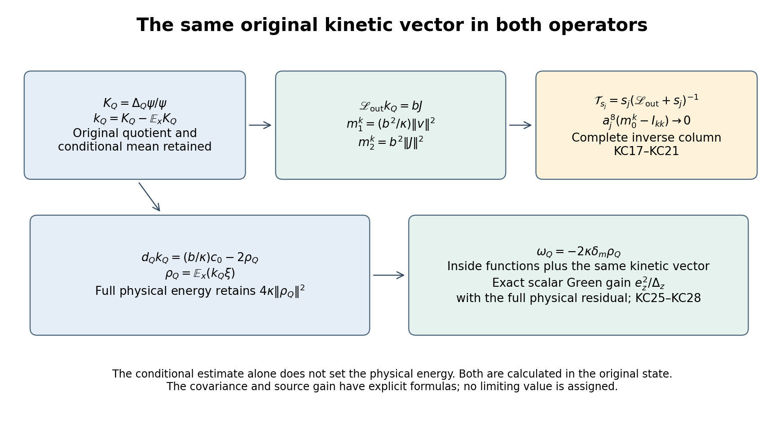
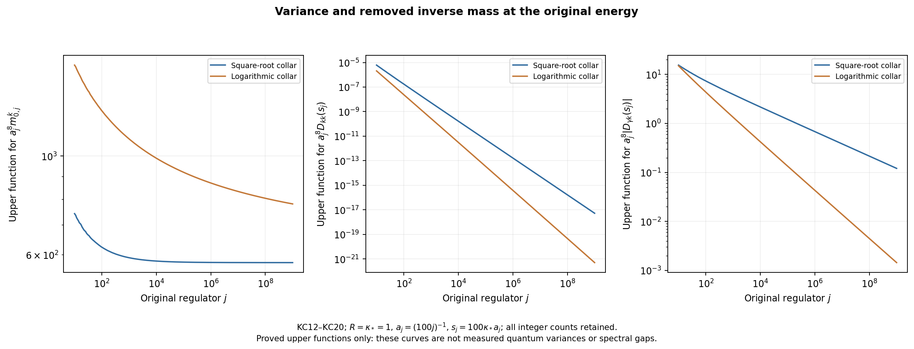

# The original kinetic current, its shrinking-window inverse and physical energy

This calculation continues [BD1–BD19](https://github.com/KokunoYumeto/yang-mills-interacting-workbench/blob/91bff5351f10b522f62e351ba717d5d861353f79/yang-mills/continuations/20261011-central-signs-shrinking-window/BOUNDARY_DIVERGENCE_AND_MARGINAL_MOMENTS.md). It evaluates the original conditional kinetic current, proves a complete variance bound with nonnegative remainders, and controls its entire column in the conditional inverse at the original shrinking energy. It also calculates its full physical energy and the remaining conditional covariance, then constructs the exact resulting enlargement of the physical scalar variational space. The covariance and the continuum spectral weight are not assigned values.

## 1. Original objects and conditional currents

Keep every original positively oriented lattice edge, vertex gauge action, ordered plaquette and radius-two \(\mathrm{SU}(2)\) metric with \(T_\alpha=-i\sigma_\alpha/2\) orthonormal. Haar has probability mass one on each edge. Retain
\[
\begin{gathered}
L_j=j^4,\quad a_j=(100j)^{-1},\quad
g_j^2=\kappa_*a_j/2,\quad b_j=(\kappa_*a_j^2)^{-1},
\quad s_j=\kappa_*/j=100\kappa_*a_j,\\
U_p=U_d(z)U_e(z+e_d)U_d(z+e_e)^{-1}U_e(z)^{-1},\quad d<e,\\
D_p=2-\operatorname{Tr}U_p,\quad V=b\sum_pD_p,\quad
H=-\kappa\Delta+V,\quad H\psi=E_0\psi,\\
\psi>0,\quad \int\psi^2dU=1,\quad w=\log\psi,\quad d\mu=\psi^2dU,\\
x_{p,j}=o+a_j\{z-L_j\mathbf1+(e_d+e_e)/2\},\quad
C_{\mathbf f,j}=a_j\sum_{\sigma,p}f_\sigma(x_{p,j})D_p .
\end{gathered}\tag{KC1}
\]
The real continuous compactly supported test functions and original offset remain. Only finite-regulator equations suppress \(j\), with \(\kappa=\kappa_*\). Use the same strict interior fitting cube \(Q\), containing every edge of each plaquette with a nonzero test value.

Write \(x,y\) for its inside and all outside variables. The original state disintegrates as
\[
\begin{gathered}
m(x)=\int\psi(x,y)^2dy,\quad \varphi=\sqrt m,\quad
\chi=\psi/\varphi,\quad \mathbb E_xf=\int f\chi^2dy,\\
g_Q=d_Qw,\quad \bar g=d_Q\log\varphi,\quad
\xi=g_Q-\bar g,\quad \mathbb E_x\xi=0,\\
K_Q=\Delta_Q\psi/\psi,\quad
\bar K_Q=\Delta_Q\varphi/\varphi,\quad
t(x)=\mathbb E_x|\xi|^2,\\
k_Q=K_Q-\mathbb E_xK_Q,\qquad r_Q=|\xi|^2-t(x).
\end{gathered}\tag{KC2}
\]
The original quotient \(K_Q\) has not been redefined. Both its original scalar and its exact conditional mean appear below.

Keep the full weighted exact projection \(P\) and inside cotangent projection \(E\) from [BQ2–BQ7](https://github.com/KokunoYumeto/yang-mills-interacting-workbench/blob/91bff5351f10b522f62e351ba717d5d861353f79/yang-mills/continuations/20261011-central-signs-shrinking-window/BOUNDARY_FORCE_PROJECTION.md):
\[
\begin{gathered}
\alpha=E\,d\mathcal W_\times,\quad
\mathcal W_\times=\sum_{p\ {\rm crossing}}D_p,\quad
c=EP\alpha,\quad u=E(I-P)\alpha,\quad v=E^\perp P\alpha,\\
J=\delta_Q u=\delta_{\rm out}v,\quad
\delta_\mu=-\operatorname{div}-2\,dw\mathbin{\lrcorner},\\
\kappa\,dK_Q=b\,d\mathcal W_Q+bP\alpha,\quad
d_{\rm out}K_Q=(b/\kappa)v,\quad
F=bu,\quad \mathbb E_xu=0,\\
\mathscr L_{\rm out}
=-\kappa(\Delta_{\rm out}+2g_{\rm out}\cdot d_{\rm out}),\quad
\mathscr L_{\rm out}\xi=-bu,\quad
X=\sum_{\substack{i\ {\rm inside}\\r\ {\rm outside}}}|H_{ri}|^2,\quad
H_{ri}=\nabla_r\nabla_iw .
\end{gathered}\tag{KC3}
\]
Here \(c\) is a one-form, not a scalar trial coefficient. Every projection and expectation uses the actual ground state. The domain and smoothness of the full conditional inverse are those proved in [CG23–CG27](https://github.com/KokunoYumeto/yang-mills-interacting-workbench/blob/91bff5351f10b522f62e351ba717d5d861353f79/yang-mills/continuations/20261011-central-signs-shrinking-window/CONDITIONAL_GROUND_CURRENT_TRIAL.md): at a fixed regulator all these functions are smooth on compact products, and the shifted positive inverse is defined on the whole weighted scalar space.

## 2. The complete quotient and score decomposition

The product rule for \(\psi=\varphi\chi\) gives
\[
\begin{gathered}
K_Q=\bar K_Q+\Delta_Q\chi/\chi+2\bar g\cdot\xi,\qquad
\mathbb E_xK_Q=\bar K_Q-t(x),\\
k_Q=\operatorname{div}_Q\xi+|\xi|^2+2\bar g\cdot\xi+t(x),\\
q^\gamma=2\bar g\cdot\xi,\quad
q^\delta=\operatorname{div}_Q\xi+2g_Q\cdot\xi
=k_Q+r_Q,\\
q_\theta=q^\gamma+\theta q^\delta
=q^\gamma+\theta k_Q+\theta r_Q,\qquad \theta\in\mathbb R .
\end{gathered}\tag{KC4}
\]
To prove the conditional mean formula, twice differentiate \(\int\chi^2dy=1\) inside and sum the original orthonormal directions. This gives
\(\mathbb E_x(\Delta_Q\chi/\chi)=-\mathbb E_x|\xi|^2=-t(x)\).
Also \(\Delta_Q\chi/\chi=\operatorname{div}_Q\xi+|\xi|^2\). Substitution proves every term and sign in (KC4). Each of \(q^\gamma,k_Q,r_Q\) has zero conditional mean.

Applying the outside generator to the complete quotients, and retaining its product rule, yields
\[
\begin{gathered}
d_{\rm out}k_Q=(b/\kappa)v,\qquad
\mathscr L_{\rm out}k_Q=bJ,\qquad \mathbb E_xJ=0,\\
d_{\rm out}r_Q=2H_{{\rm out},Q}\xi,\qquad
\mathscr L_{\rm out}r_Q=-2b\,\xi\cdot u-2\kappa X,\\
d_{\rm out}q^\gamma=2H_{{\rm out},Q}\bar g,\qquad
\mathscr L_{\rm out}q^\gamma=-2b\,\bar g\cdot u .
\end{gathered}\tag{KC5}
\]
For the first line use (KC3), then \(\mathscr L_{\rm out}=\kappa\delta_{\rm out}d_{\rm out}\). The mean of an outside divergence is zero in every fiber. For the second line \(t(x)\) is inside-only, and
\(\mathscr L_{\rm out}|\xi|^2
=2\langle\xi,\mathscr L_{\rm out}\xi\rangle
-2\kappa|d_{\rm out}\xi|^2\).
The last line uses the inside-only dependence of \(\bar g\). Adding the first two forcings gives the entire \(\mathscr F_1\) in BD17.

Thus the exact kinetic moments are
\[
m_0^k=\|k_Q\|_\mu^2,\qquad
m_1^k=\langle k_Q,\mathscr L_{\rm out}k_Q\rangle_\mu
=\frac{b^2}{\kappa}\|v\|_\mu^2,\qquad
m_2^k=b^2\|J\|_\mu^2 .
\tag{KC6}
\]
These are moments of the original conditional operator in its original units.

In the present original strict interior cube, \(m_0^k>0\). To prove this, suppose its value were zero. Positivity of the smooth full density would give \(K_Q(x,y)=K_*(x)\) everywhere. Every positive function \(\psi(\cdot,y)\) would then solve
\((-\Delta_Q+K_*)\psi(\cdot,y)=0\).
Fix one outside point \(y_0\). The inside ground-transform identity with the positive solution \(\psi(\cdot,y_0)\) shows that the quotient of any other solution by it has zero inside gradient; thus
\(\psi(x,y)=p(x)h(y)\).
The original ground equation would make
\(V=E_0+\kappa\Delta_Qp/p+\kappa\Delta_{\rm out}h/h\), with zero mixed inside-outside derivatives. But choose two distinct edges of a crossing face, one inside and one outside. They occur together in exactly that face. At the all-identity link configuration their original mixed derivative of \(V\) is
\((b/2)\varepsilon_e\varepsilon_r\delta_{\alpha\beta}\), where each \(\varepsilon\) is the retained forward or inverse traversal sign. It is nonzero for \(\alpha=\beta\). This is the explicit crossing calculation of [OC17–OC19](https://github.com/KokunoYumeto/yang-mills-interacting-workbench/blob/91bff5351f10b522f62e351ba717d5d861353f79/yang-mills/continuations/20261011-central-signs-shrinking-window/OUTSIDE_FORCE_AND_CURRENT_MOMENTS.md), and contradicts the product conclusion.

## 3. An actual variance bound with every energy remainder

Use the original full-Haar edge partition from [LC3–LC11](https://github.com/KokunoYumeto/yang-mills-interacting-workbench/blob/91bff5351f10b522f62e351ba717d5d861353f79/yang-mills/continuations/20261011-central-signs-shrinking-window/LOCAL_CURVATURE_BUDGET.md) and [IM1–IM5](https://github.com/KokunoYumeto/yang-mills-interacting-workbench/blob/91bff5351f10b522f62e351ba717d5d861353f79/yang-mills/continuations/20261011-central-signs-shrinking-window/INSIDE_MARGINAL_ENERGY.md):
\[
\begin{gathered}
H_{\rm in}=-\kappa\Delta_Q+b\mathcal W_Q,\qquad
H_{\rm out}=-\kappa\Delta_{\rm out}+V_{\rm out},\\
e_{\rm in}=\inf\sigma(H_{\rm in}),\quad
e_{\rm out}=\inf\sigma(H_{\rm out}),\\
A=H_{\rm in}-e_{\rm in},\quad B=H_{\rm out}-e_{\rm out},\quad
V_\times=b\mathcal W_\times,\quad D=A+B,\\
\varepsilon=E_0-e_{\rm in}-e_{\rm out},\quad
C_Q^\times=|\{p\ {\rm crossing}\}|,\quad
M_\times=2bC_Q^\times .
\end{gathered}\tag{KC7}
\]
These \(A,B,D\) are operators and are unrelated to BD3's derivative tensors. They act on the full Haar product, where \(A\) and \(B\) strongly commute, are nonnegative, and have product spectral resolutions. The physical subspace is not factored. Each sector retains its full potential scalar, and their sum is the original \(2b|\mathcal P|\).

One has the actual inequalities and equation
\[
0\le\mu V_\times\le\varepsilon\le M_\times,\qquad
0\le V_\times\le2M_\times,\qquad
D\psi=(\varepsilon-V_\times)\psi .
\tag{KC8}
\]
Here is a complete proof of the upper energy bound. Each separate sector has a smooth positive unique unit ground state by its elliptic ground equation and the ground-transform identity; division by that ground shows that a second ground vector has zero gradient and is constant on the connected configuration product. Restricted vertex gauge transformations therefore fix it. In a crossing plaquette the three outside links form an ordered open path between the distinct endpoints of its unique inside traversal. Applying the outside-restricted central transformation \(-I\) at one endpoint changes the sign of that path while preserving the outside ground measure. Its matrix expectation is zero, including all inverse traversals. Consequently the product of the inside and outside ground vectors has crossing deficit exactly \(2C_Q^\times\), so its Rayleigh energy is \(e_{\rm in}+e_{\rm out}+M_\times\). The full positive ground is gauge invariant by the same uniqueness argument, so the full variational comparison has the physical ground energy. Positivity of \(A+B\) gives \(\mu V_\times\le\varepsilon\); positivity of the full three summands gives \(\varepsilon\ge0\). The pointwise deficit bound \(0\le D_p\le4\) proves the remaining bound, and the full ground equation proves the last identity.

Put \(a_Q(x)=\mathbb E_x(\psi^{-1}A\psi)\), where \(A\psi\) means the operator applied to the original wavefunction. Since its inside potential is \(x\)-only, (KC2) gives
\[
\begin{gathered}
\psi^{-1}A\psi=b\mathcal W_Q-e_{\rm in}-\kappa K_Q,\\
a_Q(x)=b\mathcal W_Q-e_{\rm in}
-\kappa\bar K_Q+\kappa t(x)=\varepsilon-R_Q(x),\\
R_Q(x)=\langle\chi,(B+V_\times)\chi\rangle_{L^2(dy)}\ge0,\\
\kappa^2m_0^k=\|A\psi\|_{L^2(dU)}^2-\mu a_Q(x)^2 .
\end{gathered}\tag{KC9}
\]
The equality \(a_Q=\varepsilon-R_Q\) follows by conditionally averaging the entire ground equation; it also follows from the original marginal equation IM4. No pointwise positivity is claimed for \(a_Q\).

The variance has this complete positive-remainder identity:
\[
\begin{split}
\kappa^2m_0^k={}&M_\times^2
-(M_\times-\varepsilon)
  (M_\times+\varepsilon-2\mu V_\times)\\
&-\mu\{V_\times(2M_\times-V_\times)\}
-\|B\psi\|^2-2\langle A\psi,B\psi\rangle
-\mu a_Q(x)^2 .
\end{split}\tag{KC10}
\]
Indeed the original equation gives
\(\|D\psi\|^2=\varepsilon^2-2\varepsilon\mu V_\times+\mu V_\times^2\).
Subtract this from \(M_\times^2\) and factor the first two terms to obtain the first two remainders in (KC10). Next
\(\|D\psi\|^2-\|A\psi\|^2=\|B\psi\|^2+2\langle A\psi,B\psi\rangle\).
The mixed product is nonnegative: in the joint spectral resolution it is the integral of the product of the two nonnegative spectral coordinates against the spectral measure of \(\psi\). Smoothness gives the required operator domains. Finally use (KC9).
Every subtracted term is nonnegative by (KC8), including
\(M_\times+\varepsilon-2\mu V_\times\ge M_\times-\varepsilon\).
It follows, with the original boundary count, that
\[
m_0^k\le\frac{4b^2(C_Q^\times)^2}{\kappa^2}.
\tag{KC11}
\]
The exact original local energies, potential variance and conditional energy remainder in (KC10) remain available for a sharper calculation.

## 4. Finite collar bounds and their original powers

Use the same actual crossing-deficit minimizing cube selected in RD and BQ. Retain the fitting vertex and outer counts
\[
\begin{gathered}
v_{j,d}=L_j+\lfloor(c_d-o_d)/a_j\rfloor-1,\quad
q_j=\lceil R/a_j\rceil+3,\quad n=q_j+2K,\\
N=3n(n+1)^2,\quad M=3n^2(n+1),\quad C_{j,K}=12n(n+1),\\
\Lambda=\min\{2M,6g_j^2\sqrt{NM}\}+2C_{j,K},\\
C_{\rm heat}=2+2\sqrt{4+2\pi},\quad
G(a)=\min\{8/(\kappa_*^2a^2),C_{\rm heat}/(\kappa_*a)\},\quad
\mathcal A=NG(a_j)^2 .
\end{gathered}\tag{KC12}
\]
All six original boundary indicators are one. The selected cube satisfies
\[
\begin{gathered}
C_Q^\times\le C_{j,K},\quad
\|\alpha\|^2\le2\Lambda/K,\quad
\|v\|^2\le\Lambda/(2K),\quad |g_Q|^2\le\mathcal A,\\
T_Q^\delta:=\mu|\xi|^2\le\Lambda/(\kappa_*^2a_j^2),\quad
\mathcal O_Q:=\mu X\le
\sqrt2\Lambda/(\kappa_*^3a_j^3\sqrt K).
\end{gathered}\tag{KC13}
\]
These are the original [BQ7 and BQ12–BQ17](https://github.com/KokunoYumeto/yang-mills-interacting-workbench/blob/91bff5351f10b522f62e351ba717d5d861353f79/yang-mills/continuations/20261011-central-signs-shrinking-window/BOUNDARY_FORCE_PROJECTION.md) bounds, with the score constant proved in [SR65](https://github.com/KokunoYumeto/yang-mills-interacting-workbench/blob/91bff5351f10b522f62e351ba717d5d861353f79/yang-mills/continuations/20261011-central-signs-shrinking-window/SQUARE_ROOT_SCORE_RECEIVING_MAPS.md).

Equations (KC6), (KC11) and BD11 now prove
\[
\begin{gathered}
m_0^k\le\frac{4C_{j,K}^2}{\kappa_*^4a_j^4},\qquad
m_1^k\le\frac{\Lambda}{2\kappa_*^3a_j^4K},\\
m_2^k\le\frac1{\kappa_*^2a_j^4}
\left(2\sqrt{\frac{2\mathcal A\Lambda}{K}}
+\frac34\sqrt{C_{j,K}}\right)^2 .
\end{gathered}\tag{KC14}
\]
For \(r_Q\), conditional centering and \(|\xi|^2\le4\mathcal A\) give
\[
\begin{gathered}
m_0^r=\mu|\xi|^4-\mu t(x)^2
\le4\mathcal A T_Q^\delta
\le\frac{4\mathcal A\Lambda}{\kappa_*^2a_j^2},\\
m_1^r=4\kappa_*\mu|H_{{\rm out},Q}\xi|^2
\le16\kappa_*\mathcal A\mathcal O_Q
\le\frac{16\sqrt2\mathcal A\Lambda}
{\kappa_*^2a_j^3\sqrt K}.
\end{gathered}\tag{KC15}
\]
The first exact equality retains the full fourth-power term and conditional mean square. The pointwise score bound follows from
\(|g_Q-\bar g|^2\le2|g_Q|^2+2|\bar g|^2\) and conditional Jensen.

For both collars
\[
\begin{gathered}
K_j=\max\{1,\lfloor\sqrt{R/a_j}\rfloor\},\quad
\ell_j=\log(e+R/a_j),\quad
\widehat K_j=\max\{1,\lfloor R/(a_j\ell_j)\rfloor\},\\
\mathsf L_R=9\kappa_*R^3+24R^2,\qquad
\mathsf J_R=24C_{\rm heat}^2R^3\mathsf L_R/\kappa_*^2 ,
\end{gathered}
\]
the proved count limits yield
\[
\begin{gathered}
\limsup_j a_j^8m_0^k\le576R^4/\kappa_*^4,\\
\limsup_j a_j^6K m_1^k\le\mathsf L_R/(2\kappa_*^3),\quad
\limsup_j a_j^{11}K m_2^k\le\mathsf J_R/\kappa_*^2,\\
\limsup_j a_j^9m_0^r\le
12C_{\rm heat}^2R^3\mathsf L_R/\kappa_*^4,\\
\limsup_j a_j^{10}\sqrt K\,m_1^r\le
48\sqrt2C_{\rm heat}^2R^3\mathsf L_R/\kappa_*^4 .
\end{gathered}\tag{KC16}
\]
For completeness \(a_j^2C_{j,K}\to12R^2\), \(a_j^2\Lambda\to\mathsf L_R\), and \(a_j^5\mathcal A\to3C_{\rm heat}^2R^3/\kappa_*^2\). Multiplying (KC14)–(KC15) by the displayed factors proves every coefficient; the \(m_2^k\) coefficient uses BD12's square including its cross term. No unscaled vanishing is asserted.

## 5. The full conditional inverse at the original shrinking energy

Let \(\mathcal T_z=z(\mathscr L_{\rm out}+z)^{-1}\) and
\(\mathcal D_z=I-\mathcal T_z\). For the ordered real family
\((q^\gamma,k_Q,r_Q)\), define all Gram entries
\[
I_{ab}(z)=\langle a,\mathcal T_zb\rangle_\mu,\qquad
D_{ab}(z)=\langle a,\mathcal D_zb\rangle_\mu .
\]
The entire original scalar line receives
\[
\langle q_\theta,\mathcal T_zq_\theta\rangle
=I_{\gamma\gamma}+2\theta(I_{\gamma k}+I_{\gamma r})
+\theta^2(I_{kk}+2I_{kr}+I_{rr}).
\tag{KC17}
\]
This follows by expanding the original \(q_\theta\) in (KC4), without changing its coefficients or discarding any cross entry.

The positive spectral multiplier \(\lambda/(\lambda+z)\) gives
\[
0\le D_{kk}(z)=m_0^k-I_{kk}(z)\le m_1^k/z,\qquad
|D_{fk}(z)|^2\le D_{ff}(z)D_{kk}(z)\le m_0^f m_1^k/z .
\tag{KC18}
\]
The first inequality is integrated against the full kinetic spectral measure. The second is Cauchy–Schwarz after applying \(\mathcal D_z^{1/2}\). No lower conditional gap is used.

At the original \(z=s_j=100\kappa_*a_j\), (KC14) proves
\[
\begin{gathered}
0\le D_{kk}(s_j)\le
\frac{\Lambda}{200\kappa_*^4a_j^5K},\qquad
\limsup_j a_j^7K D_{kk}(s_j)\le
\frac{\mathsf L_R}{200\kappa_*^4},\\
a_j^8\{m_0^k-I_{kk}(s_j)\}\longrightarrow0 .
\end{gathered}\tag{KC19}
\]
For \(f=q^\gamma\) or \(r_Q\), BD14 and (KC15) both give
\(m_0^f\le4\mathcal A\Lambda/(\kappa_*^2a_j^2)\). Consequently
\[
\begin{gathered}
|D_{fk}(s_j)|\le
\sqrt{\frac{\mathcal A\Lambda^2}
{50\kappa_*^6a_j^7K}},\\
\limsup_j a_j^8\sqrt K\,|D_{fk}(s_j)|
\le\frac{C_{\rm heat}\mathsf L_R}{\kappa_*^4}
\sqrt{\frac{3R^3}{50}},\qquad
a_j^8D_{fk}(s_j)\longrightarrow0 .
\end{gathered}\tag{KC20}
\]
Multiply the squared finite bound by \(a_j^{16}K\), then apply the exact \(a_j^5\mathcal A\) and \(a_j^2\Lambda\) limits to prove its coefficient. Both collars have \(K\to\infty\).

Put \(w_\theta=q^\gamma+\theta r_Q\), retaining \(q_\theta=w_\theta+\theta k_Q\). There is the exact identity and explicit error bound
\[
\begin{gathered}
\langle q_\theta,\mathcal T_zq_\theta\rangle
=\langle w_\theta,\mathcal T_zw_\theta\rangle
+2\theta\langle w_\theta,k_Q\rangle+\theta^2m_0^k
-2\theta D_{w_\theta k}(z)-\theta^2D_{kk}(z),\\
|2\theta D_{w_\theta k}+\theta^2D_{kk}|
\le2|\theta|(\sqrt{m_0^\gamma}+|\theta|\sqrt{m_0^r})
\sqrt{m_1^k/z}+\theta^2m_1^k/z .
\end{gathered}\tag{KC21}
\]
Expand (KC17) and use (KC18) separately for both components of \(w_\theta\). At \(z=s_j\), the error multiplied by \(a_j^8\) tends to zero uniformly for \(\theta\) in any fixed bounded interval. The finite bound remains valid for arbitrary regulator-dependent coefficients; no boundedness has been assigned to the full CG optimizer. The actual \(m_0^k\), its signed unfiltered cross pairings, and the full two-by-two inverse Gram of \(q^\gamma,r_Q\) remain to be evaluated. These equations do not identify the physical spectral measure.

## 6. Exact physical energy of the same kinetic vector

The physical connection is obtained by differentiating the conditional mean in the original inside coordinates. Define
\[
\rho_Q(x)=\mathbb E_x(k_Q\xi),\qquad
c_0=c-\mathbb E_xc .
\]
Differentiating \(\mathbb E_xK_Q\) with
\(d_Q\chi^2=2\xi\chi^2\) gives
\[
d_Qk_Q=(b/\kappa)c_0-2\rho_Q,\qquad
\mathbb E_xc=\mathbb E_x\alpha,\qquad
\mathbb E_xd_Qk_Q=-2\rho_Q .
\tag{KC22}
\]
Indeed \(d_Q\mathbb E_xK_Q=\mathbb E_xd_QK_Q+2\mathbb E_x(k_Q\xi)\). The entirely inside \(b\,d\mathcal W_Q/\kappa\) in (KC3) cancels from the difference. Also \(c=\alpha-u\), and \(\mathbb E_xu=0\), proving the middle equality. The centered \(c_0\) is orthogonal in \(L^2(\mu)\) to every inside-only one-form, including \(\rho_Q\).

Multiplication \(\mathcal U f=\psi f\) is unitary from \(L^2(\mu)\) to full Haar space and restricts to the gauge-invariant physical space. Product expansion of the full original ground equation proves
\[
\mathcal U^{-1}(H-E_0)\mathcal U
=\mathscr L_0=-\kappa(\Delta+2dw\cdot d).
\]
The kinetic vector is smooth, invariant and vacuum orthogonal since \(\mu k_Q=0\). Its exact physical energy and norm are therefore
\[
\begin{gathered}
\|\psi k_Q\|^2=m_0^k,\qquad
\langle\psi k_Q,(H-E_0)\psi k_Q\rangle\\
=m_1^k+\kappa\|d_Qk_Q\|_\mu^2
=\frac{b^2}{\kappa}(\|v\|^2+\|c_0\|^2)
+4\kappa\,\mu|\rho_Q|^2 .
\end{gathered}\tag{KC23}
\]
The cross term vanishes by the stated conditional orthogonality, not a sign assumption. The full projection remainder from BQ7 gives
\[
\begin{gathered}
\|v\|^2+\|c_0\|^2
=\|\alpha\|^2-\|u\|^2-\|v\|^2-\|\mathbb E_xc\|^2
\le2\Lambda/K,\\
\frac{b^2}{\kappa}(\|v\|^2+\|c_0\|^2)
\le\frac{2\Lambda}{\kappa_*^3a_j^4K},\qquad
\mu|\rho_Q|^2\le4\mathcal A\,m_0^k .
\end{gathered}\tag{KC24}
\]
The last bound is conditional Cauchy–Schwarz using
\(\mathbb E_x|\xi|^2\le4\mathcal A\).
It is not asserted to be small. Equations (KC22)–(KC24) identify the additional exact quantity required to promote the conditional kinetic estimate into a physical low-energy estimate.

## 7. Its exact enlargement of the physical scalar trial space

The remaining covariance has a computable coupling to all inside functions. Let
\[
\bar{\mathscr L}=\kappa\delta_m d_Q,\qquad
\delta_m=-\operatorname{div}_Q-2\bar g\mathbin{\lrcorner},
\qquad \omega_Q=-2\kappa\delta_m\rho_Q .
\]
For any smooth invariant inside function \(f\), the same full transform gives
\[
\begin{gathered}
\mathscr L_0 f=\bar{\mathscr L}f-2\kappa\,\xi\cdot d_Qf,\\
\mathbb E_x(\mathscr L_0k_Q)=\omega_Q,\qquad
\langle f,\mathscr L_0k_Q\rangle_\mu
=\langle f,\omega_Q\rangle_{m\,dx}.
\end{gathered}\tag{KC25}
\]
For the second line integrate the full gradient form against \(f\), use (KC22), and then the original marginal adjoint relation:
\(\kappa\langle d_Qf,d_Qk_Q\rangle=-2\kappa\langle d_Qf,\rho_Q\rangle=\langle f,\omega_Q\rangle\).
This proves the conditional expectation identity by testing all inside functions. The mean of \(\omega_Q\) is zero. All operators and sources are smooth at fixed regulator and preserve gauge invariance.

For the original centered observable \(F_{\mathbf f}=C_{\mathbf f}-\mu C_{\mathbf f}\), put
\[
\begin{gathered}
A_z=\bar{\mathscr L}+z,\qquad
d_z=\langle k_Q,(\mathscr L_0+z)k_Q\rangle_\mu,\\
e_z=\langle\omega_Q,A_z^{-1}F_{\mathbf f}\rangle_m,\qquad
h_z=\langle\omega_Q,A_z^{-1}\omega_Q\rangle_m,\qquad
\Delta_z=d_z-h_z .
\end{gathered}
\]
Here \(A_z\) is a marginal scalar operator, distinct from (KC7)'s inside energy operator. If \(m_0^k>0\), then
\[
\Delta_z\ge z\{m_0^k+\|A_z^{-1}\omega_Q\|_m^2\}>0 .
\tag{KC26}
\]
To prove it, evaluate the full form of \(\mathscr L_0+z\) on
\(k_Q-A_z^{-1}\omega_Q\).
The inside and conditionally centered parts are orthogonal in norm. Equation (KC25) shows that the form value is \(d_z-h_z\); positivity of \(\mathscr L_0\) gives exactly (KC26).

The complete optimization over every inside \(f\) and every real coefficient \(\tau\) in \(f+\tau k_Q\) can now be performed:
\[
\begin{gathered}
f_z=A_z^{-1}F_{\mathbf f}
+(e_z/\Delta_z)A_z^{-1}\omega_Q,\qquad
\tau_z=-e_z/\Delta_z,\qquad
\Xi_z=f_z+\tau_z k_Q,\\
\mathcal G_{\mathbf f}(z):=
\langle F_{\mathbf f},(\mathscr L_0+z)^{-1}F_{\mathbf f}\rangle_\mu\\
=\langle F_{\mathbf f},A_z^{-1}F_{\mathbf f}\rangle_m
+\frac{e_z^2}{\Delta_z}
+\|(\mathscr L_0+z)^{1/2}
((\mathscr L_0+z)^{-1}F_{\mathbf f}-\Xi_z)\|_\mu^2 .
\end{gathered}\tag{KC27}
\]
For the full proof, the form on \(f+\tau k_Q\) is
\(\langle f,A_zf\rangle+2\tau\langle f,\omega_Q\rangle+\tau^2d_z\),
and its source pairing is \(\langle F_{\mathbf f},f\rangle\) because \(F_{\mathbf f}\) is inside-only. At fixed \(\tau\), completion of the \(A_z\) square gives the maximizing \(f=A_z^{-1}F_{\mathbf f}-\tau A_z^{-1}\omega_Q\). The remaining variational expression is
\(\langle F_{\mathbf f},A_z^{-1}F_{\mathbf f}\rangle-2\tau e_z-\tau^2\Delta_z\).
Its exact maximum is the first two terms of (KC27), attained at the displayed \(\tau_z\). Completing the full \(\mathscr L_0+z\) square proves the residual equality. Approximation in the positive shifted form norm extends the calculation to every inside form-domain function. If \(k_Q=0\), then \(\rho_Q=\omega_Q=0\); use only the marginal trial and its full residual, without any division by \(\Delta_z\).

This scalar Green function is connected to the earlier physical response by the exact original-unit identity
\[
\mathcal R_{\mathbf f}(z)
=\mu F_{\mathbf f}^2-z\mathcal G_{\mathbf f}(z).
\tag{KC28}
\]
Indeed the full ground-transform spectral calculus gives
\(\mathcal R_{\mathbf f}(z)=
\langle F_{\mathbf f},\mathscr L_0(\mathscr L_0+z)^{-1}F_{\mathbf f}\rangle\);
the identity follows from
\(\mathscr L_0(\mathscr L_0+z)^{-1}=I-z(\mathscr L_0+z)^{-1}\).
Thus a lower Green-function trial has the corresponding upper-response direction; its sign is not reversed. The earlier complete CG trial family and both of its physical residuals remain available independently.

The kinetic inverse column is now estimated at the original shrinking energy and has an exact full-Hamiltonian connection. The next actual quantities are the retained energy remainders in (KC10), the covariance \(\rho_Q\), its evaluated source coupling \(e_z\), and the remaining conditional inverse Gram in (KC21). Their calculation, the interacting continuum state, reconstruction, global smoothness, intended theory and no-gap result remain the programme.

Reproducible diagnostics and figure sources are in [check_kinetic_current.py](check_kinetic_current.py). Manufactured curved states, finite positive operators and diagnostic spectral multipliers are not original quantum samples. Exact versions and bounded reading coverage are in [the source-use ledger](KINETIC_CURRENT_SOURCE_USE_LEDGER.json).
