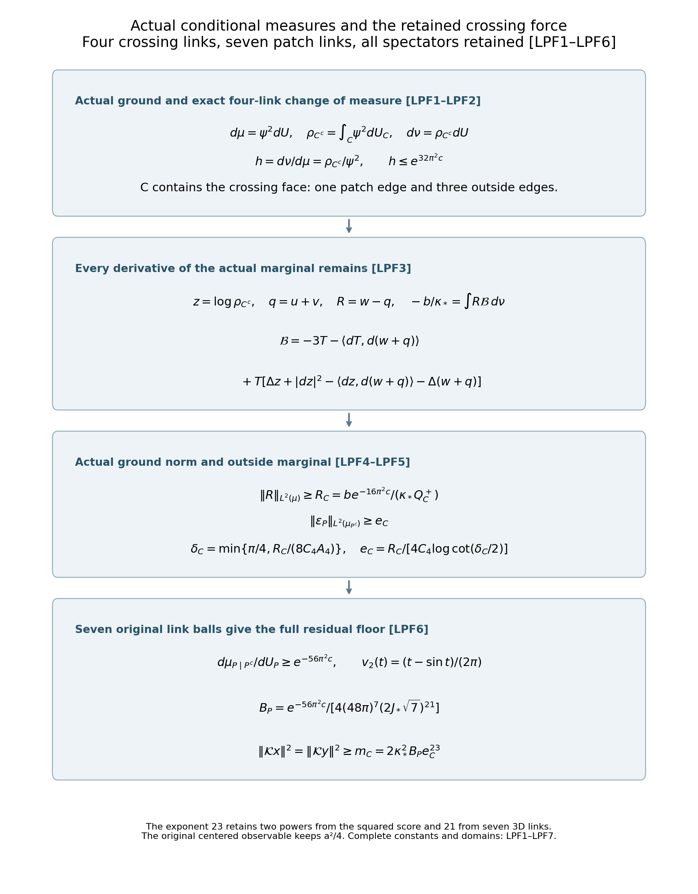
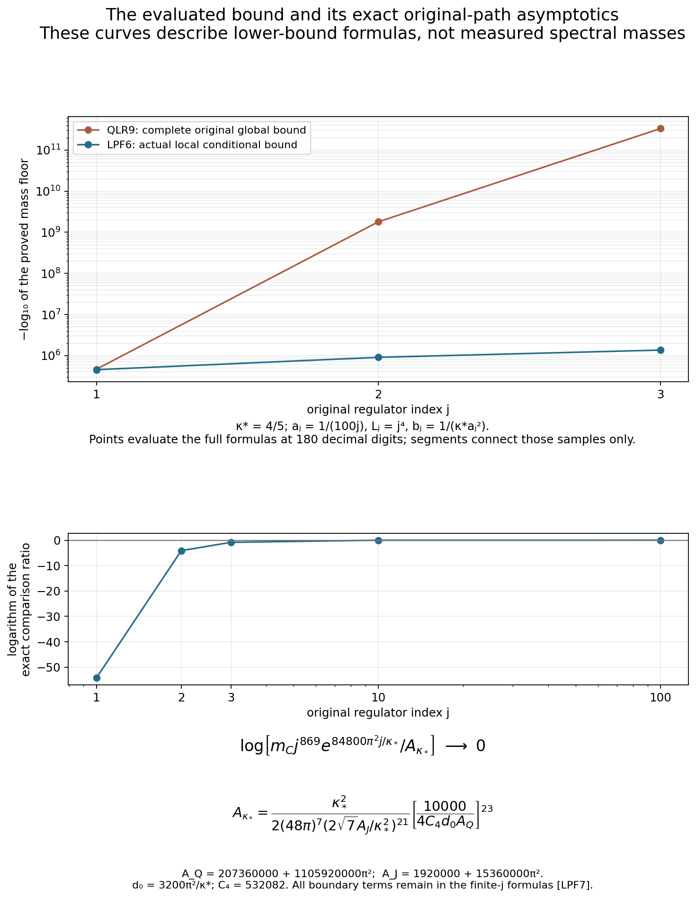

# The actual conditional crossing measure and a seven-link memory floor

Reviewed derivation, 14 October 2026. This continues the complete [QLR1–QLR10 proof](https://github.com/KokunoYumeto/yang-mills-interacting-workbench/blob/490c68879734e0f3988becf6f0f700ae643fde82/yang-mills/continuations/20261011-central-signs-shrinking-window/QUANTITATIVE_LOOP_RIGIDITY.md), especially QLR5–QLR10. The eight bounded index hits are routing records, not newly read literature. This source uses the same actual full ground and original crossing and patch maps. The complete LPF1–LPF7 proof, two figures and 194 independent diagnostics have been reviewed. No novelty or continuum conclusion is asserted.

## 1. Original objects and the conditional measures

Retain all original parameters and the full potential:
\[
\begin{gathered}
a=(100j)^{-1},\quad L=j^4,\quad g^2=\kappa_*a/2,\quad
b=(\kappa_*a^2)^{-1},\quad s=\kappa_*/j,\\
N=3(2L)(2L+1)^2,\quad M=3(2L)^2(2L+1),\\
H=-\kappa_*\Delta+V,\quad V=2bM-b\sum_pT_p,\quad
H\psi=E_0\psi,\quad\psi>0,\quad\int\psi^2dU=1,\quad0\le E_0\le2bM.
\end{gathered}
\]
The metric is the original product of radius-two SU(2) factors with orthonormal generators \(-i\sigma_a/2\), and dU is product probability Haar measure. Use the seven-link patch P and two-face trace map pi of FMP, the original actual density rho=Pi0psi2, and
\[
w=\log\psi,\quad u=\tfrac12\log(\rho\circ\pi),\quad\ell=w-u,
\quad v=\int\ell\,dU_P,\quad q=u+v,\quad R=w-q.
\]
Thus u depends on P and v on its full complementary set P^c. Keep \(r_x=\langle d\ell,dx\rangle\), \(r_y=\langle d\ell,dy\rangle\), \(\mathcal Kx=-2\kappa_*r_x\), and the actual full trace-complement operator D. All original centered observables retain the factor a/2 before taking their squared norms.

Let C be the four original edges of the crossing xz face at lower corner (0,0,0), with trace T and ordered traversal given in QLR6. Exactly one C edge belongs to P, and the other three belong to P^c. This set C is not the seven-link set P. Define
\[
\rho_{C^c}(U_{C^c})=\int\psi^2\,dU_C,\quad
z=\log\rho_{C^c},\quad
d\nu=\rho_{C^c}\,dU,
\quad h=\frac{d\nu}{d\mu}=\frac{\rho_{C^c}}{\psi^2},
\quad d\mu=\psi^2dU.
\tag{LPF1}
\]
All conditional functions are smooth: their Haar averages are integrals over compact groups of smooth functions on the original compact product, so every derivative can be taken under the integral. Their positive minimum follows from the positive minimum of the original ground. Thus z,w,u,v,q,R and the displayed density ratios are smooth, all integrations by parts below are on the full compact boundaryless link product, and all displayed conditional derivatives are defined. The complementary closed form and its smooth source domain are the actual ones proved in FMP9 and QLR10.

Both measures are probabilities. The measure ν keeps the actual ground marginal on C^c and uses the original Haar conditional probability on exactly C. The full density h is retained; ν is never identified with μ.

## 2. A local conditional density bound with its actual Hessian

Keep the exact QLR constants
\[
\begin{gathered}
c=2/(\kappa_*a),\quad G=4\pi^2Nc^2,\quad
W=(4bM-E_0)/\kappa_*+(3N-1)c,\\
W^+=4bM/\kappa_*+(3N-1)c,\quad
B_w=\max\{(4bM-E_0)/\kappa_*,E_0/\kappa_*+G\},\quad
B_w^+=4bM/\kappa_*+G,\\
Q=3+2(1+\sqrt2)\sqrt G+B_w+3NW+42G,\qquad
Q^+=3+2(1+\sqrt2)\sqrt G+B_w^++3NW^++42G,\\
J_*=2W^++4G+2c+4\sqrt G,\quad C_4=532082.
\end{gathered}
\]
RHB1 bounds the score on every individual original link by 2πc. With C^c fixed, the four-link gradient norm is at most 4πc and the original four-link diameter is 4π. Therefore the oscillation of w on that conditional product is at most 16π²c. If a positive function has oscillation of its logarithm at most A, its ratio to its probability mean lies between exp(-A) and exp(A): the mean lies between its minimum and maximum. Applying this to ψ2 proves
\[
e^{-32\pi^2c}\le\frac{\psi^2}{\rho_{C^c}}\le e^{32\pi^2c},
\qquad0<h\le e^{32\pi^2c}.
\tag{LPF2}
\]
This bound concerns four original links at fixed spectators and holds uniformly in all spectator values.

Averaging the four C-link translations is an average of isometries. The conditional Hessian computation in QLR5, now for \(\tfrac12z=\tfrac12\log\int_C e^{2w}\), gives
\[
|dz|\le2\sqrt G,\qquad
-2cg\le\nabla^2z\le2(W+2G)g.
\]
The function z is independent of C, so its Laplacian has precisely 3(N-4) possible tangent contributions. Since W>=c,
\[
|\Delta z|\le6(N-4)(W+2G),\qquad
\langle dz,dT\rangle=0.
\]
These statements also follow by differentiating the original four-link Haar integral: its logarithmic Hessian is twice the conditional mean of the Hessian of w plus four times the full conditional score covariance. The covariance is positive and bounded by Gg, exactly as in QLR5.

## 3. The complete crossing Fourier identity in the actual conditional measure

For every fixed C^c configuration, the original four-link Haar integral satisfies
\[
\int_C T=0,\qquad\int_C T^2=1,\qquad
\int_C VT=-b.
\]
For the last identity retain every plaquette of V. A plaquette other than the crossing face omits at least one of the four C edges; its boundary cannot equal that crossing boundary. Integrating the omitted edge in T sets its paired integral to zero. The crossing term contributes -b times its unit Haar squared norm. The constant 2bM contributes zero. The same integration annihilates every function of P alone and every function of P^c alone: integrate an outside C edge in the first case and the unique patch C edge in the second. These are conditional identities at each fixed C^c, not assertions that the actual marginal is Haar.

The original logarithmic equation, with its unchanged E0, is
\((V-E_0)/\kappa_*=\Delta w+|dw|^2\).
The expression \(\Delta q+|dq|^2\) is additively separated between P and P^c. Multiply the difference by T and integrate against ν. The conditional identities make the potential contribution -b/κ and kill E0 and the separated terms. Since \(|dw|^2-|dq|^2=\langle dR,d(w+q)\rangle\), integration by parts in the complete original Haar product gives
\[
-\frac b{\kappa_*}=\int R\,\mathcal B\,d\nu
=\int R h\mathcal B\,d\mu,
\tag{LPF3}
\]
where every derivative of the actual marginal density is
\[
\begin{aligned}
\mathcal B={}&-3T-\langle dT,d(w+q)\rangle\\
&+T\left[\Delta z+|dz|^2-\langle dz,d(w+q)\rangle
-\Delta(w+q)\right].
\end{aligned}
\]
To verify the two integrations explicitly,
\(\int e^zT\Delta R=\int R\Delta(e^zT)\), where
\(\Delta(e^zT)=e^z[\Delta T+2\langle dz,dT\rangle+T(\Delta z+|dz|^2)]\).
The middle term is zero because z and T use disjoint links. The other integral is
\(-\int R\operatorname{div}(e^zT\,d(w+q))\), which supplies the other three displayed terms. Finally ΔT=-3T in the original radius-two metric. Thus no outside derivative is discarded by changing the measure.

QLR7 gives \(|d(w+q)|\le(1+\sqrt2)\sqrt G\), \(|\Delta(w+q)|\le B_w+3NW+42G\). Also \(\|T\|_{L^2(\nu)}=1\) by the conditional unit norm, and \(|dT|\le2\). Consequently
\[
\begin{gathered}
\|\mathcal B\|_{L^2(\nu)}\le Q_C
:=Q+6(N-4)(W+2G)+(6+2\sqrt2)G,\\
Q_C\le Q_C^+
:=Q^++6(N-4)(W^++2G)+(6+2\sqrt2)G.
\end{gathered}
\]
The last G term keeps separately \(|dz|^2\le4G\) and
\(|\langle dz,d(w+q)\rangle|\le2(1+\sqrt2)G\) before adding them. By LPF2,
\(\|h\mathcal B\|_{L^2(\mu)}^2=\int h|\mathcal B|^2d\nu\le e^{32\pi^2c}(Q_C^+)^2\).
Apply Cauchy–Schwarz to LPF3 to obtain the actual-state floor
\[
\|R\|_{L^2(\mu)}\ge R_C
:=\frac{b\,e^{-16\pi^2c}}{\kappa_*Q_C^+}>0.
\tag{LPF4}
\]
The sharper Q_C still retains E0, and the independent upper function Q_C+ is displayed before use. This replaces the global density comparison in QLR7 by a four-link conditional comparison with all derivative terms retained.

## 4. Oscillation on the actual seven-link conditional measure

Let \(\rho_{P^c}=\int_P\psi^2dU_P\), \(d\mu_{P^c}=\rho_{P^c}dU_{P^c}\), and
\(d\mu_{P\mid P^c}=\psi^2dU_P/\rho_{P^c}\).
Every patch vertex isometry acts on each individual link by left and right multiplication, without mixing link factors. The conditional gradient formula for u therefore preserves the individual RHB1 bound: \(|d_eu|\le2\pi c\) on each patch link. On a selected face, ell consequently has gradient norm at most
\(A_4=8\pi c\), and each of its two trace derivatives has pointwise absolute value at most \(2A_4=16\pi c\).

At fixed outside links define
\(\varepsilon_x(U_{P^c})=\max_{U_P}|r_x|\),
\(\varepsilon_y(U_{P^c})=\max_{U_P}|r_y|\), and
\(\varepsilon_P=\max\{\varepsilon_x,\varepsilon_y\}\).
These functions are continuous: the original smooth functions are uniformly continuous on the compact product, so taking their maximum over the compact patch preserves continuity. Apply QLR4 first to the left face and then to the remaining three links of the right face, exactly as in QLR8. Since v is the patch Haar average of ell, it lies between the patch extrema. For every \(0<\delta\le\pi/4\),
\[
|R|\le4C_4A_4\delta
+2C_4\varepsilon_P\log\cot(\delta/2).
\]
Integrating the squared inequality via the triangle inequality in the actual probability measure μ yields
\[
\|R\|_{L^2(\mu)}
\le4C_4A_4\delta
+2C_4\log\cot(\delta/2)\|\varepsilon_P\|_{L^2(\mu_{P^c})}.
\]
Thus, with every constant specified,
\[
\begin{gathered}
\delta_C=\min\left\{\frac\pi4,\frac{R_C}{8C_4A_4}\right\},\qquad
e_C=\frac{R_C}{4C_4\log\cot(\delta_C/2)},\\
\|\varepsilon_P\|_{L^2(\mu_{P^c})}\ge e_C>0.
\end{gathered}\tag{LPF5}
\]
The first term in the preceding inequality is at most R_C/2, and LPF4 proves the last line. This is an estimate over the actual outside marginal; no minimum density over all outside links is used.

## 5. A seven-link ball bound and the full memory floor

At fixed outside links, the patch score norm of w is at most \(2\pi c\sqrt7\). The original patch diameter is \(2\pi\sqrt7\), so its oscillation is at most 28π²c. Exactly as in LPF2 this gives
\(d\mu_{P\mid P^c}/dU_P\ge e^{-56\pi^2c}\).
If epsilon_x is positive, use a maximum point of |r_x| on this patch. QLR5 bounds its patch Lipschitz constant by J*. On the ball of radius \(\varepsilon_x/(2J_*)\), its absolute value is at least epsilon_x/2. This radius is at most one: \(\varepsilon_x\le16\pi c\), whereas \(J_*\ge4\sqrt G=8\pi c\sqrt N\). The product of seven original link balls of radius \(\varepsilon_x/(2J_*\sqrt7)\) is contained in the patch ball. Keeping the exact original ball-volume function from QLR9 first gives
\[
\int_P|r_x|^2d\mu_{P\mid P^c}
\ge\frac{\varepsilon_x^2}{4}e^{-56\pi^2c}
\left[v_2\!\left(\frac{\varepsilon_x}{2J_*\sqrt7}\right)\right]^7,
\qquad v_2(t)=\frac{t-\sin t}{2\pi}.
\]
For 0<=t<=1, retain its original integral representation
\(v_2(t)=(2/\pi)\int_0^{t/2}\sin^2\theta\,d\theta\).
Here \(\sin\theta\ge\theta/2\): integration of cos<=1 gives sinθ<=θ, hence cosθ=1-integral_0^theta sin>=1-theta²/2>=7/8 on [0,1/2]; integrating this lower bound on cos gives the asserted weaker sine bound. Therefore \(v_2(t)\ge t^3/(48\pi)\). This is an inequality applied to the original function, not a replacement of its exact formula. It follows that
\[
\int_P|r_x|^2d\mu_{P\mid P^c}\ge B_P\varepsilon_x^{23},\qquad
B_P:=\frac{e^{-56\pi^2c}}{4(48\pi)^7(2J_*\sqrt7)^{21}}.
\]
The formula also holds when epsilon_x=0, and the same argument applies to y. Adding the two inequalities bounds the sum below by \(B_P\varepsilon_P^{23}\). Integrate over the actual outside probability marginal. Convexity of t raised to 23/2 on the nonnegative axis gives
\(\int\varepsilon_P^{23}d\mu_{P^c}\ge(\int\varepsilon_P^2d\mu_{P^c})^{23/2}\).
Using LPF5 and the full box reflection from FMP12, which makes the two actual residual squared norms equal, proves
\[
\|\mathcal Kx\|^2=\|\mathcal Ky\|^2
\ge m_C:=2\kappa_*^2B_Pe_C^{23}>0.
\tag{LPF6}
\]
The factor is exactly 2κ²: multiply the sum of the two r norms by 4κ² and divide it equally between x and y. The exponent 23 is exactly two from the squared trace derivative plus 21 from the seven original three-dimensional link balls.

Keep the earlier QLR9 floor m_* as well, and define \(m_{\rm both}=\max\{m_*,m_C\}\). The actual complementary energy bound remains \(E_*=4\kappa_*^3J_*^2\). QLR10's complete spectral-measure argument, with the same original D, proves
\[
\begin{gathered}
\langle\mathcal Kx,e^{-t\mathcal D}\mathcal Kx\rangle
\ge m_{\rm both}e^{-tE_*/m_{\rm both}},\qquad t\ge0,\\
\langle\mathcal Kx,(\mathcal D+\sigma)^{-1}\mathcal Kx\rangle
\ge\frac{m_{\rm both}^2}{E_*+\sigma m_{\rm both}},\qquad\sigma>0.
\end{gathered}
\]
The same statements hold for y. For the original centered single-face observable, multiply by the full a²/4. LPF6 keeps the actual outside marginal, uses only the four-link and seven-link conditional density costs, and retains every full-dimensional derivative bound inside Q_C+ and J*. It does not claim a positive uniform signed annular spectral weight or the intended continuum conclusion. The evaluated formula is carried below into its exact asymptotic comparison; the signed shrinking-window calculation remains active.

## 6. Exact asymptotics of this lower-bound formula

The following limit describes the proved lower-bound function m_C, not the actual residual mass. Keep every preceding original formula. For fixed positive kappa define
\[
\begin{gathered}
A_Q=207360000+1105920000\pi^2,\quad
A_J=1920000+15360000\pi^2,\quad d_0=3200\pi^2/\kappa_*,\\
A_{\kappa_*}
=\frac{\kappa_*^2}{2(48\pi)^7(2\sqrt7 A_J/\kappa_*^2)^{21}}
\left[\frac{10000}{4C_4d_0 A_Q}\right]^{23}>0.
\end{gathered}
\]
Then the complete LPF6 formula has the exact limit
\[
\lim_{j\longrightarrow\infty}
m_C\,j^{869}\exp(84800\pi^2j/\kappa_*)=A_{\kappa_*}.
\tag{LPF7}
\]
For proof the full original counts, including the boundary terms, are
\(N=24j^{12}+24j^8+6j^4\) and \(M=24j^{12}+12j^8\).
Insert these exact polynomials and the original b,c into the definitions. Division by the indicated powers, while keeping all lower terms in those definitions, gives
\[
\begin{gathered}
\frac{G}{j^{14}}\longrightarrow3840000\pi^2/\kappa_*^2,\qquad
\frac{W^+}{j^{14}}\longrightarrow960000/\kappa_*^2,\\
\frac{J_*}{j^{14}}\longrightarrow A_J/\kappa_*^2,\qquad
\frac{Q_C^+}{j^{26}}\longrightarrow A_Q/\kappa_*^2.
\end{gathered}
\]
The last coefficient contains the complete dominant terms 9NW+ and 12NG: their coefficients are 207360000 and 1105920000π². All other original terms have lower powers, including the square-root and boundary contributions, and therefore vanish in these quotient limits. No original parameter or finite-j formula is replaced.

It follows directly that \(R_Cj^{24}e^{d_0j}\longrightarrow10000/A_Q\). The ratio defining delta_C tends to zero, so eventually its stated minimum selects that ratio. Since \(A_4=1600\pi j/\kappa_*\),
\(\delta_Cj^{25}e^{d_0j}\longrightarrow10000\kappa_*/(12800\pi C_4 A_Q)\).
The elementary sine and cosine limits give \(\cot(\delta_C/2)\delta_C/2\longrightarrow1\); taking the logarithm of this positive identity yields
\(\log\cot(\delta_C/2)/j\longrightarrow d_0\).
Consequently \(e_Cj^{25}e^{d_0j}\longrightarrow10000/(4C_4d_0 A_Q)\).
The factor B_P has the limit
\[
B_Pj^{294}e^{11200\pi^2j/\kappa_*}
\longrightarrow\frac{1}{4(48\pi)^7(2\sqrt7 A_J/\kappa_*^2)^{21}}.
\]
Insert both limits into the exact identity \(m_C=2\kappa_*^2B_Pe_C^{23}\). The polynomial exponent is 294+23 times 25=869; the exponential coefficient is 11200+23 times 3200=84800. This proves LPF7, including its entire positive coefficient. In particular this lower-bound function still tends to zero. Its improved volume dependence does not assert that the actual spectral mass vanishes or that the signed shrinking window has been controlled.

The diagram records the actual probability measures and every derivative term in LPF1–LPF6. C is the four-link crossing face with one patch link and three outside links; P is the full seven-link selected patch. The conditional factors preserve the original outside marginal, and the bottom exponent retains all seven three-dimensional radius-two link balls and the two powers of the score. The complete proof supplies every constant and the original domains.

The upper graph evaluates the entire QLR9 and LPF6 formulas at kappa=4/5 and j=1,2,3, retaining a=1/(100j), L=j^4, b=1/(kappa a^2) and every boundary contribution. Its vertical coordinate is minus the decimal logarithm of each positive bound. Points are evaluated at 180 decimal digits; connecting segments are guides between those samples. The lower graph evaluates the precise comparison ratio proved in LPF7 at j=1,2,3,10,100, with its full coefficient displayed. Neither graph is a numerical computation of the actual ground or a conclusion about its spectral mass. Reproducible sources: [figure_local_memory.py](figure_local_memory.py) and [check_local_memory.py](check_local_memory.py).
