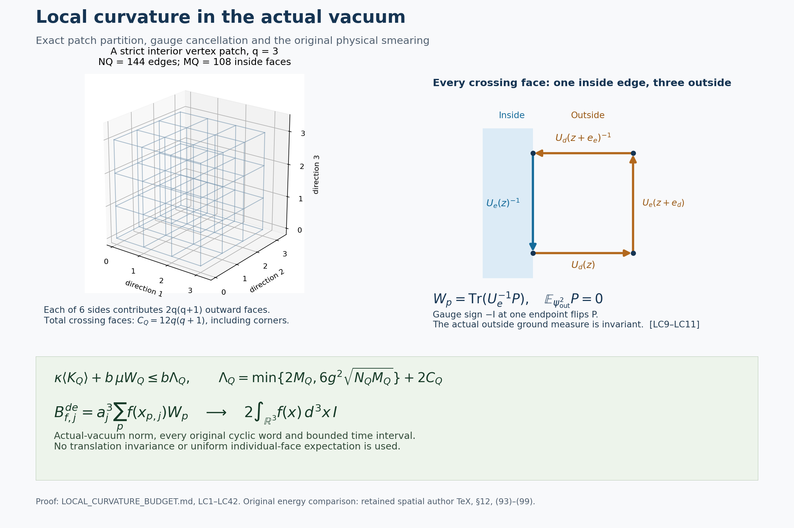

# Local actual-vacuum curvature and the original physical smearing

This note proves a local curvature budget in every induced cubic patch
of the original open lattice, without translation invariance. The
crossing-face trial cost is exactly \(2b\) per face. The resulting
actual-vacuum moments prove that the unchanged observable
\(B_{f,j}^{de}=a_j^3\sum_p f(x_{p,j})W_p\) acts on the original cyclic
reconstruction as \(2\int f\,I\). In particular its possible centered
zero-energy component is zero. All constants, crossing faces, gauge
actions and finite-volume receiving maps are retained below.

## 1. Original finite Hamiltonians and full/physical ground energies

Fix an integer \(m\ge1\), lattice spacing \(a>0\), and coupling \(g^2>0\).
The original vertices, edges and oriented faces are
\[
\begin{split}
 V&=\{0,\ldots,m\}^3,\\
 E&=\{(z,d):z,z+e_d\in V,\ d=1,2,3\},\\
 \mathcal P&=\{(z;d,e):d<e,\ z,z+e_d,z+e_e,z+e_d+e_e\in V\},\\
 U_{(z;d,e)}&=U_d(z)U_e(z+e_d)U_d(z+e_e)^{-1}U_e(z)^{-1},\\
 W_p&=\operatorname{Tr}U_p,\quad D_p=2-W_p,\quad
 N=3m(m+1)^2,\quad M=3m^2(m+1).
\end{split}\tag{LC1}
\]
Physical vertex positions are \(o+a(z-L\mathbf1)\), with \(m=2L\)
when the prescribed programme box is used. Every positively oriented
edge carries probability Haar measure on \(\mathrm{SU}(2)\). Its
metric is the round metric of radius two, with orthonormal left fields
\(X_{e,\alpha}\) generated by \(T_\alpha=-i\sigma_\alpha/2\).
The full Hilbert space is \(\mathcal H^{\rm full}=L^2(\mathrm{SU}(2)^E,dU)\).
The physical space is its invariant subspace under every vertex action
\(U_{st}\mapsto h_sU_{st}h_t^{-1}\), including boundary vertices.
Retain
\[
 \kappa={2g^2\over a},\qquad b={1\over2g^2a},\qquad
 H=-\kappa\sum_{e,\alpha}X_{e,\alpha}^2+b\sum_{p\in\mathcal P}D_p,
 \quad H\psi=\mathcal E\psi,\quad \psi>0,\quad
 \|\psi\|_2=1,\quad d\mu=\psi^2dU.
 \tag{LC2}
\]
In particular the potential contains the full scalar \(2bM\).
There is no boundary in the compact configuration manifold.

The full operator is self-adjoint on the second Sobolev domain and
has first Sobolev form domain. Indeed the product Casimir is elliptic,
has compact resolvent and nonnegative quadratic form, and its real
smooth potential is bounded. A lowest Rayleigh minimizer exists;
taking its modulus does not increase the kinetic form. Elliptic
regularity and the strong maximum principle make a nonnegative
minimizer smooth and strictly positive. For smooth \(f\), product
expansion, the full eigen-equation and Haar integration by parts give
\[
 \langle f\psi,Hf\psi\rangle-\mathcal E\mu(|f|^2)
       =\kappa\mu\!\left(\sum_{e,\alpha}|X_{e,\alpha}f|^2\right).
 \tag{LC3}
\]
The identity extends to the form domain by density because division
by a fixed positive smooth \(\psi\) preserves that domain. If a second
ground vector is divided by \(\psi\), (LC3) gives zero gradient;
connectedness of the configuration product makes the quotient constant.
The ground eigenspace is therefore one-dimensional. Every vertex
gauge map preserves Haar, the metric and all closed face traces.
It maps the positive unit ground vector to a positive unit ground
vector, hence fixes \(\psi\) itself, with no phase ambiguity.
Thus \(\psi\) is physical and the full and physical ground energies
are exactly equal. This proof justifies all unrestricted comparison
vectors below before they are used.

The same argument applies to any selected set of edge factors with
kinetic energy on every selected edge and potential consisting of
any chosen closed faces using only those edges. It does not require
the selected spatial graph to be connected: the configuration product
is connected. If the edge set is empty, its Hilbert space is
\(\mathbb C\), the Hamiltonian is zero and the unit ground vector is
the constant one.

## 2. Exact edge partition and every face class

Choose an integer \(q\ge1\) and a vector \(v\in\mathbb Z^3\) satisfying
\(0\le v_d\le m-q\). The vertex patch is
\[
 Q=v+\{0,\ldots,q\}^3,\qquad
 E_{\rm in}=\{(z,d)\in E:z,z+e_d\in Q\},\quad
 E_{\rm out}=E\setminus E_{\rm in}. \tag{LC4}
\]
Partition the faces by their actual edge lists:
\(\mathcal P_{\rm in}\) contains the faces with four inside edges,
\(\mathcal P_{\rm out}\) those with four outside edges, and
\(\mathcal P_\times\) all remaining faces. No face is omitted.
The inside counts are
\[
 N_Q=3q(q+1)^2,\qquad M_Q=3q^2(q+1). \tag{LC5}
\]
An inside face is exactly a face whose four vertices belong to \(Q\).

Every crossing face has exactly one inside edge and three outside
edges. To prove this, fix its coordinate plane. Two adjacent inside
edges supply three vertices of an axis-aligned unit square inside
the product of coordinate intervals defining \(Q\); the fourth
vertex has coordinate values already present among those three,
and therefore belongs to \(Q\). Two opposite inside edges already
supply all four vertices. Hence two or more inside edges imply
four, and a mixed face has precisely one.
The unique inside edge lies on one boundary plane of \(Q\).
The square extends outward in a perpendicular coordinate direction.
Conversely every such outward square that exists in the original
box is a crossing face. This identifies both orientations and all
boundary classes without assuming a spatial symmetry.

Define the exact outward-side indicators
\[
 \eta_d^-=\mathbf1_{\{v_d>0\}},\qquad
 \eta_d^+=\mathbf1_{\{v_d+q<m\}},\qquad
 \eta=\sum_{d=1}^3(\eta_d^-+\eta_d^+).
\]
On each available side normal to \(d\), each of the two tangent
directions contributes \(q(q+1)\) edges and hence that many crossing
faces. Their exact total and orientation-resolved counts are
\[
\begin{split}
 C_Q:=|\mathcal P_\times|&=2q(q+1)\eta,\\
 C_Q^{de}&=q(q+1)(\eta_d^-+\eta_d^++\eta_e^-+\eta_e^+),\\
 |\mathcal P_{\rm out}|&=M-M_Q-C_Q,\qquad |E_{\rm out}|=N-N_Q.
\end{split}\tag{LC6}
\]
For a strict interior patch, \(\eta=6\), so \(C_Q=12q(q+1)\)
and \(C_Q^{de}=4q(q+1)\).
If a patch touches an original box side, the corresponding
indicator is zero; its absent outward faces are not counted.
If \(Q=V\), all six indicators vanish.
An inside edge lying on two boundary planes may support two
distinct outward faces; they are retained separately. Distinct
outward sides never count the same crossing face because its
inside edge and its outward perpendicular direction are unique.

The Hilbert factorization and operator partition are exactly
\[
\begin{gathered}
 \mathcal H^{\rm full}
 =L^2(\mathrm{SU}(2)^{E_{\rm in}})\otimes
  L^2(\mathrm{SU}(2)^{E_{\rm out}}),\\
 H=H_{\rm in}\otimes I+I\otimes H_{\rm out}+bW_\times,\\
 H_{\rm in}=-\kappa\sum_{e\in E_{\rm in},\alpha}X_{e,\alpha}^2+bW_Q,
 \quad W_Q=\sum_{p\in\mathcal P_{\rm in}}D_p,\\
 H_{\rm out}=-\kappa\sum_{e\in E_{\rm out},\alpha}X_{e,\alpha}^2
                 +b\sum_{p\in\mathcal P_{\rm out}}D_p,\quad
 W_\times=\sum_{p\in\mathcal P_\times}D_p.
\end{gathered}\tag{LC7}
\]
The inside, outside and crossing potential scalars sum to
\(2bM_Q+2b(M-M_Q-C_Q)+2bC_Q=2bM\).
The tensor factorization concerns the full space. The physical
space need not factor across this cut, and no such assertion is used.

## 3. The actual outside ground and the exact crossing expectation

Let \(H_{\rm out}\psi_{\rm out}=\mathcal E_{\rm out}\psi_{\rm out}\)
be its positive unit full ground vector. Section 1 proves that
it is unique and invariant under the action of every original
vertex gauge transformation restricted to \(E_{\rm out}\).
Every all-outside face is still a closed loop under that restricted
action, so the assertion applies even at a vertex incident on inside
edges. Spectral calculus gives the operator/form inequality
\[
 I\otimes H_{\rm out}\ge\mathcal E_{\rm out}I. \tag{LC8}
\]

For a crossing face, cyclically start its trace at the initial
vertex of its unique inside traversal. Let that traversal be
\(U_e^\varepsilon\), from \(s\) to \(t\), with
\(\varepsilon=1\) or \(-1\) according to the original face
orientation. The other three factors form the actual ordered
outside path \(P_{t\to s}\), including their inverse traversals:
\[
 W_p=\operatorname{Tr}(U_e^\varepsilon P_{t\to s}),\qquad s\ne t.
 \tag{LC9}
\]
No outside transport is removed. Under the restricted vertex gauge
action, \(P_{t\to s}\mapsto h_tP_{t\to s}h_s^{-1}\).
Take \(h_s=-I\), with every other vertex gauge element equal to \(I\).
The outside probability measure \(\psi_{\rm out}^2dU_{\rm out}\)
is invariant, but this matrix changes sign. Thus its exact
entrywise expectation is zero:
\[
 \int P_{t\to s}\psi_{\rm out}^2\,dU_{\rm out}=0. \tag{LC10}
\]
The open-path endpoints are distinct even at a corner or on an
original boundary. A mixed face cannot exist when \(E_{\rm out}\)
is empty, so this case creates no exceptional path.

For any unit inside vector \(F\), integration in the outside
variables first in the tensor vector \(F\otimes\psi_{\rm out}\)
therefore proves
\[
 \langle W_p\rangle_{F\otimes\psi_{\rm out}}=0
 \quad(p\in\mathcal P_\times),\qquad
 \langle bW_\times\rangle_{F\otimes\psi_{\rm out}}=2bC_Q.
 \tag{LC11}
\]
This is the exact crossing cost, improving the pointwise upper
bound \(4bC_Q\). It does not assert that the actual full vacuum
has zero crossing trace expectation.
The tensor vector may fail full gauge invariance, but it is a
legitimate variational vector by the equality of full and physical
ground energies already proved. No trial measure replaces \(\mu\).

## 4. Exact inside comparison and local actual-vacuum energy

For \(x=\operatorname{Tr}U/2\), the probability Haar marginal is
\((2/\pi)\sqrt{1-x^2}\,dx\). Retain all comparison factors:
\[
 Z_t=\int e^{2tx}\,dU,\qquad f_t(U)=Z_t^{-1/2}e^{tx},\qquad
 q_t=Z_t^{-1}\int xe^{2tx}\,dU,\qquad
 F_t=\prod_{e\in E_{\rm in}}f_t(U_e),\quad t>0.
 \tag{LC12}
\]
Then \(0<q_t<1\). For \(z=1-x\), the squared-factor density is
proportional to
\(e^{-2tz}z^{1/2}\sqrt{2-z}\mathbf1_{[0,2]}\).
Relative to the gamma density \(e^{-2tz}z^{1/2}\) on
\([0,\infty)\), the extra factor is nonnegative decreasing.
For independent \(z,z'\) of the latter law,
\[
 2\operatorname{Cov}(z,w(z))
 =\mathbb E[(z-z')(w(z)-w(z'))]\le0.
\]
Integration by parts gives the gamma mean \(3/(4t)\), hence
\(1-q_t\le3/(4t)\). The original radius-two identities
\(\Gamma(x)=(1-x^2)/4\) and \(\Delta x=-3x/4\) give, by
integrating \(\operatorname{div}(e^{2tx}\nabla x)\), the exact
one-edge kinetic form \(3tq_t/8\).
Centrality gives \(\mathbb E_tU=\mathbb E_tU^{-1}=q_tI\).
Every inside face has four distinct edges, so its full original
ordered expectation in this comparison vector is \(2q_t^4\).
Consequently
\[
 \langle F_t,H_{\rm in}F_t\rangle
 ={3\kappa N_Qtq_t\over8}+2bM_Q(1-q_t^4)
 \le {3\kappa N_Q\over8}t+{6bM_Q\over t}. \tag{LC13}
\]
At \(t=4\sqrt{bM_Q/(\kappa N_Q)}\) the upper bound is
\(3\sqrt{N_QM_Q}/a\), because \(\kappa b=a^{-2}\).
The constant inside vector has energy exactly \(2bM_Q\).
Combining the better comparison with (LC11) and the variational
principle gives the finite inequality
\[
 0\le\mathcal E-\mathcal E_{\rm out}
 \le \min\left\{2bM_Q,{3\sqrt{N_QM_Q}\over a}\right\}
          +2bC_Q=:b\Lambda_Q,
\quad
 \Lambda_Q=\min\{2M_Q,6g^2\sqrt{N_QM_Q}\}+2C_Q.
 \tag{LC14}
\]
The lower inequality follows directly from (LC7)–(LC8), since
\(H_{\rm in}\) and \(W_\times\) are nonnegative.
For the actual full vacuum, the same partition gives
\[
\begin{split}
 0\le\langle\psi,H_{\rm in}\psi\rangle
 &\le\mathcal E-\mathcal E_{\rm out}\le b\Lambda_Q,\\
 \boxed{\quad
 \mu W_Q\le\min\{4M_Q,\Lambda_Q\}.
 \quad}
\end{split}\tag{LC15}
\]
This holds for every patch position satisfying (LC4). The outside
energy is not assumed known or translation invariant; its exact
spectral lower bound cancels its same value in the tensor trial.
In particular retain the kinetic term as its own receiving bound:
\[
 \kappa\langle\psi,K_Q\psi\rangle+b\mu W_Q\le b\Lambda_Q,\qquad
 K_Q=-\sum_{e\in E_{\rm in},\alpha}X_{e,\alpha}^2,\qquad
 \langle\psi,K_Q\psi\rangle
 \le {b\over\kappa}(\Lambda_Q-\mu W_Q)
 ={\,\Lambda_Q-\mu W_Q\,\over4(g^2)^2}.
 \tag{LC15a}
\]
The right side is nonnegative by (LC15). Thus the potential
contribution has not been discarded from the kinetic budget.
For a strict interior cube, (LC5)–(LC6) yield
\[
 {1\over M_Q}\sum_{p\in\mathcal P_{\rm in}}\mu D_p
 \le\min\left\{4,\,
     \min\left\{2,6g^2\sqrt{{q+1\over q}}\right\}
                       +{8\over q}\right\}.
 \tag{LC16}
\]
At an original boundary replace \(8/q\) by \(4\eta/(3q)\).
This is an average over the actual patch faces. It is not a
claim that the individual expectations, or the three orientation
sums in an off-center patch, are equal.

## 5. Stronger actual local moments and their exact tails

For one incident edge, the quaternion calculation in the original
generators gives
\[
 \sum_\alpha|X_{e,\alpha}D_p|^2
    =1-W_p^2/4=D_p-D_p^2/4\le D_p.
\]
The orientation sign and every surrounding adjoint transport preserve
this norm. An inside edge has at most four incident inside faces,
and each inside face has four edges. Keeping the full derivative
sum before Cauchy–Schwarz proves
\[
 \Gamma(W_Q)\le
 \sum_{e\in E_{\rm in}}r_e^Q\sum_{\substack{p\in\mathcal P_{\rm in}\\p\ni e}}
            (D_p-D_p^2/4)\le16W_Q. \tag{LC17}
\]
The derivative is zero on outside edges. Boundary incidences remain
in the first sum.

From (LC7)–(LC8),
\(H-\mathcal E_{\rm out}\ge bW_Q\) in quadratic form.
Apply this to \(f\psi\), use the exact ground-state identity (LC3),
then (LC14). This proves
\[
 b\mu(W_Q|f|^2)
 \le b\Lambda_Q\mu(|f|^2)+\kappa\mu\Gamma(f). \tag{LC18}
\]
There is no assumption on the conditional state inside the patch.
With \(f=(W_Q+\delta)^{k/2}\) and \(\delta\downarrow0\),
(LC17) bounds its gradient square by
\(4k^2W_Q(W_Q+\delta)^{k-2}\).
For \(k=1\) this is at most four; for \(k\ge2\) compactness
justifies the limit. Put
\[
\begin{gathered}
 m_k^Q=\mu(W_Q^k),\quad \rho=4g^2,\quad m_0^Q=1,\quad
 m_1^Q\le\min\{4M_Q,\Lambda_Q\},\\
 m_{k+1}^Q\le\Lambda_Qm_k^Q+\rho^2k^2m_{k-1}^Q,\quad k\ge1,\\
 U_0^Q=1,\quad U_1^Q=\Lambda_Q,\quad
 U_{k+1}^Q=\Lambda_QU_k^Q+\rho^2k^2U_{k-1}^Q.
\end{gathered}\tag{LC19}
\]
The coefficient \(\rho^2=16(g^2)^2=4\kappa/b\) retains both
original couplings. Induction and the pointwise bound give
\[
 m_k^Q\le\min\{(4M_Q)^k,U_k^Q\},\quad
 U_2^Q=\Lambda_Q^2+\rho^2,\quad
 U_3^Q=\Lambda_Q^3+5\Lambda_Q\rho^2.
 \tag{LC20}
\]
For any actual face subset \(\mathcal F\subset\mathcal P_{\rm in}\),
its defect sum is nonnegative and at most \(W_Q\), so all the
same moment upper bounds apply, with the additional pointwise cap
\((4|\mathcal F|)^k\). There is no division by three for a general
patch.

An explicit all-order majorant is
\[
 m_k^Q\le(\Lambda_Q+\rho k)^k.
 \tag{LC21}
\]
For its induction, the two terms in (LC19) are bounded by
\([\Lambda_Q(\Lambda_Q+\rho k)+\rho^2k^2]
(\Lambda_Q+\rho k)^{k-1}\le(\Lambda_Q+\rho k)^{k+1}\).
The next asserted majorant is larger. The initial cases hold
directly. For \(z\ge4\rho\), take
\(k=\lfloor z/(2\rho)\rfloor\ge z/(4\rho)\). Markov's inequality
and \(1-u\le e^{-u}\) then give
\[
 \mu(W_Q\ge\Lambda_Q+z)
 \le\exp\left[-{z^2\over8\rho(\Lambda_Q+z)}\right].
 \tag{LC22}
\]
This is actual-vacuum local concentration above the explicit budget.
It does not identify a mean or a limiting law at that budget.

The exact individual-face consequence of this route is
\(\mu D_p^k\le\min\{4^k,U_k^Q\}\) whenever \(p\) lies in \(Q\).
For the smallest strict interior cube, \(q=1\), the boundary part
of \(\Lambda_Q\) is \(48\), so this by itself does not improve
the bound \(4^k\) for a fixed individual face. Enlarging a strict
interior cube increases \(2C_Q\), so it does not remove that
limitation. The next calculation (LC23)–(LC29) receives the full
local moments into the original physical smearing, where the
coefficient \(a_j^3\) makes the exact budget vanish.

## 6. Unchanged path and fixed physical-region constants

Retain exactly
\[
 L_j=j^4,\quad m_j=2j^4,\quad a_j={1\over100j},\quad
 g_j^2={\kappa_*\over200j},\quad
 \kappa_j=\kappa_*,\quad b_j={10000j^2\over\kappa_*},\quad
 s_j={\kappa_*\over j}. \tag{LC23}
\]
Let \(f\in C_c(\mathbb R^3;\mathbb R)\), and choose a fixed
physical cube \(\prod_d[c_d,c_d+R]\), \(R>0\), containing its
support. For each \(j\), define
\[
 v_{d,j}=L_j+\left\lfloor{c_d-o_d\over a_j}\right\rfloor-1,\qquad
 q_j=\left\lceil{R\over a_j}\right\rceil+3,\qquad
 Q_j=v_j+\{0,\ldots,q_j\}^3. \tag{LC24}
\]
For sufficiently large \(j\), this patch is strictly interior to
the original box, whose physical half-side is \(j^3/100\).
Its physical lower corner lies between \(c_d-2a_j\) and \(c_d-a_j\);
its upper corner is at least \(c_d+R+a_j\).
Thus every face with center in \(\operatorname{supp}f\) has all
four vertices in \(Q_j\), including endpoints and both face
orientations. Also \(a_jq_j\to R\).

Let \(\Lambda_j\) be (LC14) for this precise \(Q_j\), and
\(\rho_j=4g_j^2=\kappa_*/(50j)\).
The exact large-\(j\) branch and constants are
\[
\begin{split}
 \Lambda_j&=18g_j^2[q_j(q_j+1)]^{3/2}
                       +24q_j(q_j+1),\\
 j{\Lambda_j\over M_{Q_j}}
       &\longrightarrow {3\kappa_*\over100}+{2\over25R},\\
 j a_j^3\Lambda_j&\longrightarrow
       C_R:={9\kappa_*R^3\over100}+{6R^2\over25},\\
 j a_j^3\sqrt{\Lambda_j^2+\rho_j^2}&\longrightarrow C_R.
\end{split}\tag{LC25}
\]
The formula retains \(q_j\), \(q_j+1\), the ceiling and floor
definitions, and the crossing surface term before taking limits.
For every fixed \(k\), (LC19) also implies
\(U_{k,j}^Q/\Lambda_j^k\to1\), since
\(\rho_j/\Lambda_j\to0\) and its recurrence has finitely many terms.
The exact kinetic coefficient and its path bound remain
\[
 \langle\psi_j,K_{Q_j}\psi_j\rangle
 \le {10000j^2\over\kappa_*^2}(\Lambda_j-\mu_jW_{Q_j}),\qquad
 \limsup_j j^{-4}\langle\psi_j,K_{Q_j}\psi_j\rangle
 \le {10^{10}C_R\over\kappa_*^2}.
 \tag{LC25a}
\]
Here \(\Lambda_j/j^2\to10^6C_R\); no actual kinetic
expectation is identified with its upper bound.

Fix an orientation \(de\). The original face centers and observable are
\[
\begin{gathered}
 x_{p,j}=o+a_j(z-L_j\mathbf1+(e_d+e_e)/2),\\
 B_{f,j}^{de}=a_j^3\sum_{p:\operatorname{type}p=de}
                      f(x_{p,j})W_p,\qquad
 I_{f,j}=a_j^3\sum_{p:\operatorname{type}p=de}f(x_{p,j}),\\
 S_{f,j}=a_j^3\sum_{p:\operatorname{type}p=de}|f(x_{p,j})|,\qquad
 R_{f,j}=a_j^6\sum_{p:\operatorname{type}p=de}|f(x_{p,j})|^2,\qquad
 I_f=\int_{\mathbb R^3}f(x)\,d^3x.
\end{gathered}\tag{LC26}
\]
All original factors are unchanged. The pointwise identity and bounds are
\[
\begin{gathered}
 B_{f,j}^{de}-2I_{f,j}
      =-a_j^3\sum_{p:\operatorname{type}p=de}f(x_{p,j})D_p,\qquad
 |B_{f,j}^{de}-2I_{f,j}|\le a_j^3\|f\|_\infty W_{Q_j},\\
 \|B_{f,j}^{de}\|_\infty\le2S_{f,j},\qquad
 \delta_{f,j}:=\|(B_{f,j}^{de}-2I_{f,j})\psi_j\|\\
 \le\|f\|_\infty a_j^3
     \min\{4M_{Q_j},\sqrt{\Lambda_j^2+\rho_j^2}\},\qquad
 \limsup_j j\delta_{f,j}\le\|f\|_\infty C_R.
\end{gathered}\tag{LC27}
\]
For any fixed positive integer \(k\), the exact further bound is
\[
 \|B_{f,j}^{de}-2I_{f,j}\|_{L^k(\mu_j)}
 \le\|f\|_\infty a_j^3
       \min\{4M_{Q_j},(U_{k,j}^Q)^{1/k}\}. \tag{LC28}
\]
The signed coefficients have not been replaced in the observable;
absolute values enter only its proved upper bound.

The orientation face centers form a shifted cubic lattice of mesh
\(a_j\). Its half-open centered mesh cubes partition physical space.
For sufficiently large \(j\), all cells relevant to the support
occur in the original box. If
\(\omega_f(r)=\sup_{|x-y|\le r}|f(x)-f(y)|\), comparison with the
integral on each such cell proves
\[
\begin{gathered}
 |I_{f,j}-I_f|\le(R+2a_j)^3\omega_f(\sqrt3a_j/2),\\
 S_{f,j}\longrightarrow\int|f|,\qquad
 {R_{f,j}\over a_j^3}\longrightarrow\int|f|^2,\\
 \|(B_{f,j}^{de}-2I_f)\psi_j\|
 \le\delta_{f,j}+2|I_{f,j}-I_f|\longrightarrow0.
\end{gathered}\tag{LC29}
\]
For the first inequality only cells where \(f\) or its sampled
value is nonzero contribute; their union lies in the enlarged cube
of side \(R+2a_j\), and center-to-point distance is at most
\(\sqrt3a_j/2\). The same argument applies to \(|f|\) and \(f^2\).
No rate for the quadrature error is imposed on a merely continuous
test function. If \(f\) has Lipschitz constant \(L_f\), the last
bound has the explicit rate
\[
 \limsup_j j\|(B_{f,j}^{de}-2I_f)\psi_j\|
 \le\|f\|_\infty C_R+{\sqrt3 L_fR^3\over100}.
 \tag{LC30}
\]

## 7. Exact multiplication, semigroup and spectral receiving bounds

Put \(A_j=H_j-\mathcal E_j\) on the original physical space.
For a real smooth multiplier \(h\), (LC3) gives the exact form
\(q_j(h\psi_j)=\kappa_*\mu_j\Gamma(h)\).
On each physical edge the full derivative of (LC26) is
\[
 X_{e,\alpha}B_{f,j}^{de}
 =a_j^3\sum_{\substack{p:\operatorname{type}p=de\\e\in\partial p}}
                f(x_{p,j})X_{e,\alpha}W_p.
\]
An edge has at most two incident faces of this orientation.
Each face has four edges and its one-edge squared derivative is
at most one, so
\[
 D_{f,j}^2:=\sup\Gamma(B_{f,j}^{de})\le8R_{f,j},\qquad
 q_j(B_{f,j}^{de}\psi_j)\le8\kappa_*R_{f,j}.
 \tag{LC31}
\]
Every overlap cross term is present before Cauchy–Schwarz.

For completeness, the finite semigroup commutator estimate is
\[
 \|[M_h,e^{-tA_j}]\|\le2\sqrt{2\kappa_*t/e}\,
                      \|\sqrt{\Gamma(h)}\|_\infty,\qquad t\ge0.
 \tag{LC32}
\]
To prove it with its full factors, let
\(u_r=e^{-(t-r)A_j}u\), \(v_r=e^{-rA_j}v\).
Differentiate \(\langle u_r,hv_r\rangle\) on \(0<r<t\).
Use (LC3) in polarized form; the potential and vacuum energy
cancel, and the remaining two integrands are
\[
 \kappa_*\left[
 {v_r\over\psi_j}\nabla{\overline u_r\over\psi_j}\cdot\nabla h
 -{\overline u_r\over\psi_j}\nabla h\cdot
          \nabla{v_r\over\psi_j}\right]d\mu_j.
\]
Their absolute integral is at most
\(\sqrt{\kappa_*}D_h[
q_j(u_r)^{1/2}\|v_r\|+\|u_r\|q_j(v_r)^{1/2}]\).
The spectral bound
\(\|A_j^{1/2}e^{-sA_j}\|\le(2es)^{-1/2}\) integrates on
both sides to \(2\sqrt{2\kappa_*t/e}D_h\).
Integrate first on \([\epsilon,t-\epsilon]\), then use strong
continuity and the integrable bounds at both endpoints. This
proves (LC32), including \(t=0\) by the zero commutator.
For the unchanged observable,
\[
 \|[B_{f,j}^{de},e^{-tA_j}]\|
 \le \eta_{f,j}(t):=8\sqrt{\kappa_*tR_{f,j}/e}
 =O(j^{-3/2})\quad(t\ {\rm fixed}). \tag{LC33}
\]

There is an explicit receiving estimate on every original finite
word vector. Let
\[
 w_j=C_{0,j}e^{-t_1A_j}C_{1,j}\cdots
                    e^{-t_kA_j}C_{k,j}\psi_j,
\]
where each \(C_{r,j}\) is an original bounded multiplication
operator, \(t_r\ge0\), and set \(P_{C,j}=\prod_{r=0}^k\|C_{r,j}\|\).
Put \(Q_{f,j}=B_{f,j}^{de}-2I_{f,j}\).
Commuting it through each multiplication is exact. At the
\(r\)-th semigroup retain the term
\[
 C_{0,j}e^{-t_1A_j}\cdots C_{r-1,j}
 [Q_{f,j},e^{-t_rA_j}]C_{r,j}\cdots
 e^{-t_kA_j}C_{k,j}\psi_j.
\]
The complete expansion is the sum of these \(k\) terms and the
original word applied to \(Q_{f,j}\psi_j\). Thus
\[
 \|(B_{f,j}^{de}-2I_f)w_j\|
 \le P_{C,j}\left[
 \delta_{f,j}+2|I_{f,j}-I_f|+\sum_{r=1}^k\eta_{f,j}(t_r)\right].
 \tag{LC34}
\]
No commutator or endpoint term is deleted.

For any Borel interval \(J\subset(0,\infty)\), its spectral
projection annihilates the original vacuum. Therefore
\[
\begin{split}
 \|\mathbf1_J(A_j)B_{f,j}^{de}\psi_j\|^2
 &\le\delta_{f,j}^2,\\
 \|\mathbf1_{[\alpha,\infty)}(A_j)B_{f,j}^{de}\psi_j\|^2
 &\le\min\{\delta_{f,j}^2,8\kappa_*R_{f,j}/\alpha\},
       \quad\alpha>0.
\end{split}\tag{LC35}
\]
In particular the first line applies to the original moving
window \((0,s_j]\), including its upper endpoint, without division
by a variance or a state norm.

## 8. Exact scalar on the existing cyclic reconstruction

Use the common actual Hilbert ultraproduct from ASL:
\(\mathcal H_{\mathcal U}\), \(\Omega=[\psi_j]\),
\(T(t)=[e^{-tA_j}]\), \(P=\lim_{t\downarrow0}T(t)\),
and the cyclic space \(\mathcal H_{\rm rec}\) generated by
the original bounded Wilson multiplication words and semigroups.
These are the actual spaces and operators; the vacuum has norm one.
The uniform multiplier bound (LC27) and the Riemann limit (LC29)
give a well-defined bounded operator
\[
 B_f^{de}=[B_{f,j}^{de}],\qquad
 \|B_f^{de}\|\le2\int|f|,\quad
 B_f^{de}\Omega=2I_f\Omega,\quad
 [B_f^{de},T(t)]=0. \tag{LC36}
\]
The last two assertions follow from the norm estimates (LC29)
and (LC33), respectively. Taking the strong limit \(t\downarrow0\)
shows that \(B_f^{de}\) commutes with \(P\). It also commutes
exactly with every original multiplication operator, because each
finite-\(j\) pair does. Move it through each cyclic word and
apply its known vacuum value. The words form a dense subspace,
so boundedness proves
\[
 \boxed{\quad
 B_f^{de}|_{\mathcal H_{\rm rec}}=2\left(\int f(x)\,d^3x\right)
                 I_{\mathcal H_{\rm rec}}.
 \quad} \tag{LC37}
\]
For real \(f\) the operator is self-adjoint, so the cyclic space
is reducing. The original compressed multiplication and semigroup
maps on that space therefore have no additional term:
\[
 (PB_f^{de}P)|_{\mathcal H_{\rm rec}}=2I_fI,\qquad
 (PB_f^{de}B_g^{ab}P)|_{\mathcal H_{\rm rec}}=4I_fI_gI,\qquad
 B_f^{de}e^{-tA_{\rm rec}}=2I_fe^{-tA_{\rm rec}}.
 \tag{LC38}
\]
All factors and orientations remain visible. The centered vector
in LEM27 is exactly zero:
\[
 \lim_j\mu_j(|B_{f,j}^{de}|^2)=4I_f^2,\quad
 \lim_j\mu_jB_{f,j}^{de}=2I_f,\quad
 \|(B_f^{de}-\langle\Omega,B_f^{de}\Omega\rangle)\Omega\|^2=0.
 \tag{LC39}
\]
Indeed (LC29) is actual norm convergence to the scalar vacuum
sequence, so it proves both ordinary scalar limits, independent
of ultrafilter. This closes the previously unevaluated possible
centered zero-energy component for this precise physical smearing.
It does not assert that the whole limiting vacuum is unique or
that \(B_f^{de}\) is scalar on the full ultraproduct complement
of the cyclic reconstruction. Formula (LC34) provides the exact
finite-\(j\) map behind (LC37), without adding any new observable
normalization.

## 9. Full-time and further local consequences

For the original stationary ground-state process, the generator is
\(\mathcal L=\kappa_*\sum X^2+2\kappa_*\sum(X\log\psi_j)X\).
For real \(h\) and horizon \(T\), its forward and reverse
martingales are
\[
\begin{split}
 M_t&=h(U_t)-h(U_0)-\int_0^t\mathcal Lh(U_r)\,dr,\\
 N_r&=h(U_{T-r})-h(U_T)-\int_0^r\mathcal Lh(U_{T-v})\,dv.
\end{split}
\]
Reversibility follows from Haar integration by parts against
\(\psi_j^2\); both drift summands are retained.
Subtracting the reverse identity at \(T\) and \(T-t\) cancels
the same integral and gives
\[
 h(U_t)-h(U_0)=M_t/2-(N_T-N_{T-t})/2,\qquad
 d\langle M\rangle,d\langle N\rangle
       \le2\kappa_*\|\Gamma(h)\|_\infty\,dt.
\]
The \(L^2\) martingale maximum inequality gives
\(\|M_*\|_2,\|N_*\|_2\le2\sqrt{cT}\),
\(\|N_T\|_2\le\sqrt{cT}\), where \(c=2\kappa_*\|\Gamma(h)\|_\infty\).
The triangle inequality therefore bounds the maximum increment
norm by \(5\sqrt{cT}/2\). Applying this to the unchanged \(B_{f,j}^{de}\)
and (LC31) yields
\[
\begin{split}
 \left\|\sup_{0\le t\le T}
 |B_{f,j}^{de}(U_j(t))-2I_{f,j}|\right\|_2
 &\le\delta_{f,j}+10\sqrt{\kappa_*TR_{f,j}},\\
 \limsup_j j^2\mathbb E\sup_{0\le t\le T}
 |B_{f,j}^{de}(U_j(t))-2I_{f,j}|^2
 &\le\|f\|_\infty^2C_R^2.
\end{split}\tag{LC40}
\]
Adding the deterministic quadrature error proves uniform-on-compact-time
convergence in squared maximum mean to \(2I_f\), also for merely
continuous compactly supported \(f\).

There is a stronger probabilistic calculation. The exponential
martingale stopped at its first crossing gives
\(\mathbb P(M_*\ge z)\le2e^{-z^2/(2cT)}\), and likewise for \(N\).
The preceding identity also bounds the maximum increment by
\(M_*/2+N_*\); hence its tail at \(r\) is at most
\(4e^{-2r^2/(9cT)}\).
If \(f\ne0\), put \(F=\|f\|_\infty>0\).
For fixed \(\epsilon,T>0\), use (LC22) with
\(z=\epsilon\Lambda_j/2\), and the increment tail with
\(r=\epsilon F a_j^3\Lambda_j/2\), to obtain eventually
\[
\begin{split}
 &\mathbb P\left(\sup_{t\le T}
 |B_{f,j}^{de}(U_j(t))-2I_{f,j}|
       >(1+\epsilon)F a_j^3\Lambda_j\right)\\
 &\quad\le
 \exp\left[-{\epsilon^2\Lambda_j\over
                    32\rho_j(1+\epsilon/2)}\right]
 +4\exp\left[-{\epsilon^2F^2a_j^6\Lambda_j^2\over
                    288\kappa_*TR_{f,j}}\right].
\end{split}\tag{LC41}
\]
The first exponent has order \(j^3\), because
\(\Lambda_j\) has order \(j^2\) and \(\rho_j\) order \(j^{-1}\).
The second has order \(j\), because
\(a_j^3\Lambda_j\) has order \(j^{-1}\) and \(R_{f,j}\)
order \(j^{-3}\); the latter constant is positive for nonzero
continuous \(f\). Thus these probabilities are summable.
If \(R_{f,j}=0\) at an exceptional finite \(j\), the observable
and its exact quadrature both vanish, and the increment event
is absent rather than evaluated by division by zero.
On any specified coupling of the original finite-\(j\) stationary
path laws, Borel–Cantelli gives
\[
 \limsup_j j\sup_{t\le T}
 |B_{f,j}^{de}(U_j(t))-2I_{f,j}|\le F C_R
 \quad\hbox{almost surely}. \tag{LC42}
\]
One may use the product coupling to make existence explicit;
independence is not used in the conclusion. A countable collection
of tests, orientations and integer time horizons shares the same
probability-one event. With (LC29), this also proves almost-sure
uniform-on-compact-time convergence to \(2I_f\).

The local concentration and scalar conclusion apply to the original
\(a_j^3\)-weighted traces. They do not assert a nonzero fluctuating
curvature field after a different scaling, or uniform control of
individual plaquettes or growing physical Wilson loops. The precise
new receiving result is the scalar action (LC37), backed by
the actual local moments, finite word estimate (LC34) and full-time
bounds (LC40)–(LC42).

The figure labels the unique inside edge and full outside path of
a crossing face, the six strict-interior boundary classes, the
original budget and the physical scalar receiving map.
Its reproducible source is draw_local_curvature.py.

The complete original comparison provider is [spatial TeX, Section 12, equations (93)–(100)](https://github.com/KokunoYumeto/yang-mills-interacting-workbench/blob/485b61423c1f4e1805deb453c1b6b342b27842b6/yang-mills/continuations/20260930-s6-ns-moment-map-bridge/sources/spatial/spatial_continuum.tex#L1742). The receiving spaces and earlier bounds are [ASL1–ASL66](https://github.com/KokunoYumeto/yang-mills-interacting-workbench/blob/991256abea9017b173dc953a710fd54c1da1e2d9/yang-mills/continuations/20261011-central-signs-shrinking-window/ACTUAL_SEMIGROUP_LIMIT.md), [LEM1–LEM55](https://github.com/KokunoYumeto/yang-mills-interacting-workbench/blob/991256abea9017b173dc953a710fd54c1da1e2d9/yang-mills/continuations/20261011-central-signs-shrinking-window/ACTUAL_LOW_ENERGY_MAPS.md), and [R1–R29](https://github.com/KokunoYumeto/yang-mills-interacting-workbench/blob/991256abea9017b173dc953a710fd54c1da1e2d9/yang-mills/continuations/20261011-central-signs-shrinking-window/WILSON_TIME_REVIEW.md). The human source for the symmetric reversal comparison is [Takeda–Trutnau, arXiv:1007.3900v1](https://arxiv.org/abs/1007.3900v1), Section 2, equation (1) and Remark (i). The exact source versions and bounded reading coverage are recorded in [LOCAL_CURVATURE_SOURCE_USE_LEDGER.json](LOCAL_CURVATURE_SOURCE_USE_LEDGER.json).
