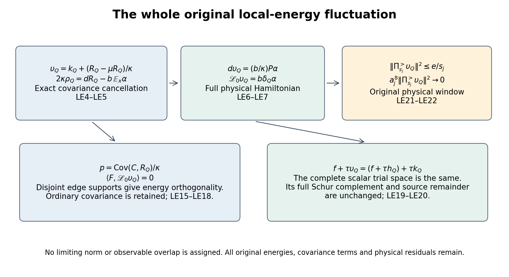
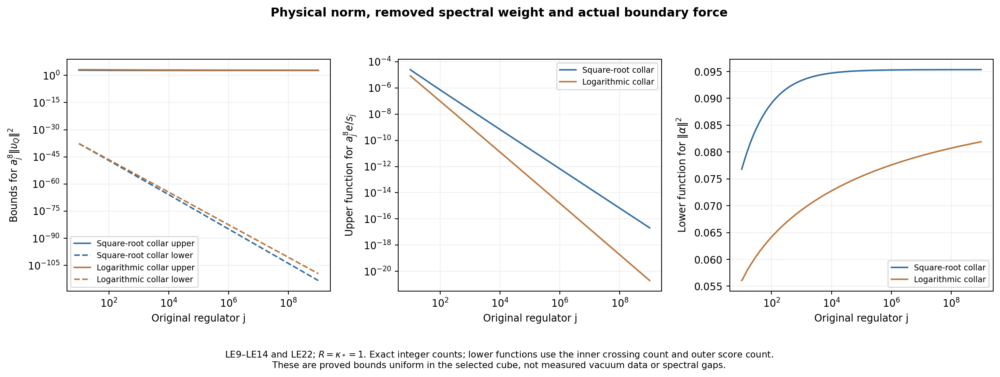

# Local energy, the full physical generator and shrinking spectral windows

This calculation continues [KC1–KC28](https://github.com/KokunoYumeto/yang-mills-interacting-workbench/blob/446840568db4185a313b193c3a8feb0fef5d9918/yang-mills/continuations/20261011-central-signs-shrinking-window/KINETIC_CURRENT_AND_PHYSICAL_ENERGY.md). It constructs the complete inside-energy fluctuation, calculates its full physical moments and source pairings, proves actual upper and lower bounds, and maps its scalar variational space exactly to the existing kinetic-current space. The spectral window is a window of the original physical Hamiltonian. A positive limiting mass is not assigned to it.

The exact providers are [BQ2–BQ7](https://github.com/KokunoYumeto/yang-mills-interacting-workbench/blob/446840568db4185a313b193c3a8feb0fef5d9918/yang-mills/continuations/20261011-central-signs-shrinking-window/BOUNDARY_FORCE_PROJECTION.md) for the projection, [LC4–LC11](https://github.com/KokunoYumeto/yang-mills-interacting-workbench/blob/446840568db4185a313b193c3a8feb0fef5d9918/yang-mills/continuations/20261011-central-signs-shrinking-window/LOCAL_CURVATURE_BUDGET.md) for the cube and crossing counts, [RD9–RD10](https://github.com/KokunoYumeto/yang-mills-interacting-workbench/blob/446840568db4185a313b193c3a8feb0fef5d9918/yang-mills/continuations/20261011-central-signs-shrinking-window/RETAINED_DERIVATIVE_AND_GOOD_BOUNDARIES.md) for the original fitting offsets, and [SR65](https://github.com/KokunoYumeto/yang-mills-interacting-workbench/blob/446840568db4185a313b193c3a8feb0fef5d9918/yang-mills/continuations/20261011-central-signs-shrinking-window/SQUARE_ROOT_SCORE_RECEIVING_MAPS.md) for the per-edge score bound.

## 1. Original state, energies and the physical vector

Retain the open cubic lattice, all positive edge orientations, all vertex gauge actions, Haar probability and the radius-two \(\mathrm{SU}(2)\) metric in which \(T_\alpha=-i\sigma_\alpha/2\) is orthonormal. In full original units,
\[
\begin{gathered}
L_j=j^4,\quad a_j=(100j)^{-1},\quad g_j^2=\kappa_*a_j/2,\quad
b_j=(\kappa_*a_j^2)^{-1},\quad s_j=100\kappa_*a_j,\\
U_p=U_d(z)U_e(z+e_d)U_d(z+e_e)^{-1}U_e(z)^{-1},\quad d<e,\\
D_p=2-\operatorname{Tr}U_p,\quad V=b\sum_pD_p,\quad
H=-\kappa\Delta+V,\quad H\psi=E_0\psi,\\
\psi>0,\quad\int\psi^2dU=1,\quad d\mu=\psi^2dU,\quad w=\log\psi,\\
x_{p,j}=o+a_j\{z-L_j\mathbf1+(e_d+e_e)/2\},\\
C=C_{\mathbf f,j}=a_j\sum_{\sigma,p}f_\sigma(x_{p,j})D_p,\qquad
F=C-\mu C .
\end{gathered}\tag{LE1}
\]
The original real continuous compactly supported tests and offset \(o\) remain. Suppression of \(j\) below is only at a fixed regulator, with \(\kappa=\kappa_*\). Use the same strict inside fitting cube \(Q\) selected in RD9–RD22 and BQ12–BQ17.

Retain every original scalar energy and the entire edge partition:
\[
\begin{gathered}
H_{\rm in}=-\kappa\Delta_Q+b\mathcal W_Q,\quad
H_{\rm out}=-\kappa\Delta_{\rm out}+V_{\rm out},\\
A=H_{\rm in}-e_{\rm in},\quad B=H_{\rm out}-e_{\rm out},\quad
\varepsilon=E_0-e_{\rm in}-e_{\rm out},\\
V_\times=b\mathcal W_\times,\quad C_Q^\times=|\{p\text{ crossing }Q\}|,\quad
M_\times=2bC_Q^\times,\\
m(x)=\int\psi(x,y)^2dy,\quad\varphi=\sqrt m,\quad\chi=\psi/\varphi,\quad
\mathbb E_x f=\int f\chi^2dy,\\
g_Q=d_Qw,\quad\bar g=d_Q\log\varphi,\quad\xi=g_Q-\bar g,\quad
K_Q=\Delta_Q\psi/\psi,\quad k_Q=K_Q-\mathbb E_xK_Q,\\
R_Q(x)=\langle\chi,(B+V_\times)\chi\rangle_{dy},\quad
\rho_Q=\mathbb E_x(k_Q\xi),\quad h_Q=(R_Q-\mu R_Q)/\kappa.
\end{gathered}\tag{LE2}
\]
The operators \(A,B\) strongly commute on the full Haar product; this does not factor the physical gauge-invariant space. KC7–KC10 prove \(A,B\ge0\), \(R_Q\ge0\), \(0\le\mu V_\times\le\varepsilon\le M_\times\), and
\(\mathbb E_x(\psi^{-1}A\psi)=\varepsilon-R_Q\).

Keep the full weighted gradient projection \(P\), inside one-form projection \(E\), and
\[
\begin{gathered}
\alpha=E\,d\mathcal W_\times,\quad c=EP\alpha,\quad
u=E(I-P)\alpha,\quad v=E^\perp P\alpha,\quad
\delta_\mu=-\operatorname{div}-2dw\mathbin{\lrcorner},\\
\kappa\,dK_Q=b\,d\mathcal W_Q+bP\alpha,\quad
\mathbb E_xu=0,\quad \mathbb E_xc=\mathbb E_x\alpha .
\end{gathered}\tag{LE3}
\]
These are BQ2–BQ7 and KC3, including their complete kinetic quotient and scalar energies.

The desired full scalar is
\[
\begin{gathered}
\upsilon_Q=k_Q+h_Q
=K_Q-\frac b\kappa\mathcal W_Q
+\frac{e_{\rm in}+\varepsilon-\mu R_Q}{\kappa}\\
=-\frac1\kappa\left(\frac{A\psi}{\psi}
-\langle\psi,A\psi\rangle\right),\qquad
\mu\upsilon_Q=0,\\
n:=\|\upsilon_Q\|_\mu^2
=\|k_Q\|_\mu^2+\frac{\operatorname{Var}_\mu R_Q}{\kappa^2}
=\frac{\|A\psi\|^2-\langle\psi,A\psi\rangle^2}{\kappa^2}>0 .
\end{gathered}\tag{LE4}
\]
KC9 gives the second presentation. The conditional mean of \(k_Q\) is zero, so its cross term with \(h_Q\) vanishes exactly. Strict positivity follows from the proved \(\|k_Q\|^2>0\) in KC Section 2: otherwise all positive inside quotients solve one inside ground equation and \(\psi\) factors, contradicting the nonzero original mixed crossing-face derivative of \(V\). The scalar, and the physical vector \(\psi\upsilon_Q\), are smooth and gauge invariant. Finite positivity here does not give a uniform limiting norm.

Differentiating
\(\kappa\mathbb E_xK_Q=b\mathcal W_Q-e_{\rm in}-\varepsilon+R_Q\)
uses the exact conditional derivative
\(d_Q\mathbb E_xK_Q=\mathbb E_xd_QK_Q+2\rho_Q\).
Together with (LE3), it proves
\[
2\kappa\rho_Q=d_QR_Q-b\,\mathbb E_x\alpha,\qquad
d\upsilon_Q=(b/\kappa)P\alpha .
\tag{LE5}
\]
In particular the KC22 derivative
\(d_Qk_Q=(b/\kappa)(c-\mathbb E_xc)-2\rho_Q\)
becomes \(d_Q\upsilon_Q=(b/\kappa)c\), while
\(d_{\rm out}\upsilon_Q=(b/\kappa)v\).
This is the exact covariance cancellation, with every term displayed.

## 2. Full physical moments and the retained variance

Multiplication \(\mathcal U f=\psi f\) is the original unitary from \(L^2(\mu)\) to Haar space, including its gauge-invariant restriction. The full ground equation gives
\[
\begin{gathered}
\mathscr L_0=\mathcal U^{-1}(H-E_0)\mathcal U
=-\kappa(\Delta+2dw\cdot d)=\kappa\delta_\mu d,\\
\mathscr L_0\upsilon_Q=b\,\delta_Q\alpha,\qquad
e:=\langle\upsilon_Q,\mathscr L_0\upsilon_Q\rangle_\mu
=\frac{b^2}{\kappa}\|P\alpha\|^2\\
=\frac{b^2}{\kappa}(\|c\|^2+\|v\|^2)
=\frac{b^2}{\kappa}(\|\alpha\|^2-\|u\|^2-\|v\|^2)>0 .
\end{gathered}\tag{LE6}
\]
The projection residual has zero weighted divergence, which proves the generator equality. Orthogonality of \(P\) and the inside/outside projections gives the last line. If \(e=0\), (LE6) and connectedness give constant \(\upsilon_Q\); its mean zero would contradict \(n>0\). All statements are in the full physical operator, not the outside conditional generator.

Every crossing face has one inside edge. Its original partial Casimir is
\(\Delta_QD_p=\tfrac34(2-D_p)\). Define
\(\tau=2C_Q^\times-\mathcal W_\times\). The entire second moment is
\[
\begin{gathered}
\delta_Q\alpha=-\tfrac34\tau-2g_Q\cdot\alpha,\\
q:=\|\mathscr L_0\upsilon_Q\|^2
=b^2\left\{\frac9{16}\mu\tau^2+
3\mu[\tau(g_Q\cdot\alpha)]+4\mu(g_Q\cdot\alpha)^2\right\},\\
\mu\tau^2=4(C_Q^\times)^2
-\mu[\mathcal W_\times(4C_Q^\times-\mathcal W_\times)] .
\end{gathered}\tag{LE7}
\]
Expanding the complete real square proves the sign and coefficient of the cross term. Its sign is not prescribed.

The full physical norm has the exact positive-remainder identity
\[
\begin{split}
\kappa^2 n={}&M_\times^2
-(M_\times-\varepsilon)(M_\times+\varepsilon-2\mu V_\times)\\
&-\mu[V_\times(2M_\times-V_\times)]
-\|B\psi\|^2-2\langle A\psi,B\psi\rangle
-(\varepsilon-\mu R_Q)^2 .
\end{split}\tag{LE8}
\]
Indeed add \(\operatorname{Var}R_Q\) to KC10 and use
\(\mu(\varepsilon-R_Q)^2=\operatorname{Var}R_Q+(\varepsilon-\mu R_Q)^2\).
Each subtraction is nonnegative: KC8 handles the first two, strong commuting positivity handles the mixed operator product, and the others are squared norms or real squares. No energy remainder is discarded from the identity.

## 3. Boundary counts, upper bounds and actual lower bounds

Keep the original fitting geometry and both collars:
\[
\begin{gathered}
v_{j,d}=L_j+\lfloor(c_d-o_d)/a_j\rfloor-1,\quad
q_j=\lceil R/a_j\rceil+3,\quad
Q_{j,k}:v_j-k\mathbf1+\{0,\ldots,q_j+2k\}^3,\\
n_{\rm side}=q_j+2K,\quad N=3n_{\rm side}(n_{\rm side}+1)^2,\quad
M=3n_{\rm side}^2(n_{\rm side}+1),\\
C_{\rm out}=12n_{\rm side}(n_{\rm side}+1),\quad
\Lambda=\min\{2M,6g_j^2\sqrt{NM}\}+2C_{\rm out},\\
K=\max\{1,\lfloor\sqrt{R/a_j}\rfloor\}
\quad\hbox{or}\quad
K=\max\{1,\lfloor R/(a_j\log(e+R/a_j))\rfloor\},\\
C_{\rm heat}=2+2\sqrt{4+2\pi},\quad
G(a)=\min\{8/(\kappa_*^2a^2),C_{\rm heat}/(\kappa_*a)\}.
\end{gathered}\tag{LE9}
\]
For each sufficiently large \(j\) both collars lie strictly in the original open lattice. Select the actual RD crossing-deficit minimizing cube among the \(K\) cubes; write its side as \(q_Q\). Then
\(C_Q^\times=12q_Q(q_Q+1)\), \(q_j\le q_Q\le n_{\rm side}\), and
\(\mu\mathcal W_\times\le\Lambda/K\).
The BQ Casimir estimate, with its retained negative and cross terms, gives
\(\|\alpha\|^2\le2\mu\mathcal W_\times\le2\Lambda/K\).

The inside edges supporting \(\alpha\) number exactly \(12q_Q^2\). In each edge direction there are
\(q_Q[(q_Q+1)^2-(q_Q-1)^2]=4q_Q^2\) edges in a boundary coordinate plane; there are three directions. The per-edge SR65 score bound therefore gives
\[
\begin{gathered}
\mathcal A_\partial=12q_Q^2G(a_j)^2,\quad
|g_Q\cdot\alpha|^2\le\mathcal A_\partial|\alpha|^2,\\
n\le\frac{4C_{\rm out}^2}{\kappa_*^4a_j^4},\qquad
e\le\frac{2\Lambda}{\kappa_*^3a_j^4K},\\
q\le\frac1{\kappa_*^2a_j^4}
\left\{\frac32 C_{\rm out}
+2\sqrt{\frac{2\mathcal A_\partial\Lambda}{K}}\right\}^2 .
\end{gathered}\tag{LE10}
\]
The second-moment bound follows by the triangle inequality in \(L^2(\mu)\) applied to (LE7), after retaining its complete expansion. The first two follow from (LE8) and (LE6).

There are also nonzero actual lower estimates. Integration of the weighted divergence in (LE7) yields
\[
\begin{gathered}
\mu(g_Q\cdot\alpha)=-\tfrac38(2C_Q^\times-\mu\mathcal W_\times),\\
\|\alpha\|^2\ge
\frac{9(2C_Q^\times-\mu\mathcal W_\times)^2}{64\mathcal A_\partial}
\ge \mathcal B_*,
\qquad
\mathcal B_*=\frac9{64\mathcal A_\partial}
\left(2C_Q^\times-\frac{\Lambda}{K}\right)_+^2 .
\end{gathered}\tag{LE11}
\]
Here \(t_+=\max\{t,0\}\). Cauchy–Schwarz and the pointwise restricted score bound prove the first inequality; using the positive part proves the second even if the finite lower trace is negative.

An edge meets at most four plaquettes in three dimensions. For each crossing face and each of its four edges,
\(|d_eD_p|^2=D_p-D_p^2/4\le D_p\).
Keeping the complete derivatives before bounding their sum gives
\[
\begin{gathered}
\|d\mathcal W_\times\|^2\le16\mu\mathcal W_\times
\le16\Lambda/K,\\
\langle P\alpha,d\mathcal W_\times\rangle
=\langle\alpha,d\mathcal W_\times\rangle=\|\alpha\|^2,\\
\|P\alpha\|^2\ge\frac{K\mathcal B_*^2}{16\Lambda},
\qquad
e\ge\frac{K\mathcal B_*^2}{16\kappa_*^3a_j^4\Lambda}.
\end{gathered}\tag{LE12}
\]
For the gradient bound, apply the inequality for a sum of at most four vectors separately at each edge, and then sum the four edge contributions of every original crossing face. The middle equality uses \(d\mathcal W_\times\) in the exact-gradient range of \(P\); the next inequality is Cauchy–Schwarz. No lower bound on an uncomputed projection was assumed.

At most \(4C_Q^\times\) edges support \(d\mathcal W_\times\), so put
\(\mathcal A_\times=4C_Q^\times G(a_j)^2\).
The full Laplacian has four edge contributions per crossing face:
\(\Delta\mathcal W_\times=3\tau\). Consequently
\[
\begin{gathered}
\|\mathscr L_0\mathcal W_\times\|
\le\kappa_*\left\{6C_{\rm out}
+8\sqrt{\mathcal A_\times\Lambda/K}\right\},\\
\langle\upsilon_Q,\mathscr L_0\mathcal W_\times\rangle
=b\|\alpha\|^2,\\
n\ge
\frac{\mathcal B_*^2}
{\kappa_*^4a_j^4
\left\{6C_{\rm out}+8\sqrt{\mathcal A_\times\Lambda/K}\right\}^2}.
\end{gathered}\tag{LE13}
\]
The first line follows by the full weighted generator, \(\|\tau\|\le2C_Q^\times\), and (LE12). The second uses (LE5) and the original Dirichlet form; Cauchy–Schwarz proves the last. This is a lower bound on the original physical norm, with all constants in its stated units.

For both collars, \(a_jq_Q\to R\), \(a_jn_{\rm side}\to R\),
\(a_j^2\Lambda\to\mathsf L_R=9\kappa_*R^3+24R^2\), and \(K\to\infty\), \(a_jK\to0\). Substitution, without changing the original observables, gives
\[
\begin{gathered}
\limsup a_j^8n\le576R^4/\kappa_*^4,\qquad
\limsup a_j^6Ke\le2\mathsf L_R/\kappa_*^3,\\
\limsup a_j^{10}Kq\le
96C_{\rm heat}^2R^2\mathsf L_R/\kappa_*^4,\\
\liminf\|\alpha\|^2\ge
\mathsf B_R:=27\kappa_*^2R^2/(4C_{\rm heat}^2),\\
\liminf (a_j^2/K)e\ge
729\kappa_*R^4/(256C_{\rm heat}^4\mathsf L_R),\\
\liminf n/(a_j^2K)\ge
243\kappa_*^2R^2/(16384C_{\rm heat}^6\mathsf L_R).
\end{gathered}\tag{LE14}
\]
For completeness, \(a_j^4\mathcal A_\partial\to12C_{\rm heat}^2R^2/\kappa_*^2\) and
\(a_j^4\mathcal A_\times\to48C_{\rm heat}^2R^2/\kappa_*^2\).
In (LE10)'s last square the trace square and its cross term disappear only after multiplication by the displayed power: their factors are \(a_j^2K\to0\) and \(a_j\sqrt K\to0\). The retained exact formula remains (LE7).
Equation (LE11) gives \(\mathsf B_R\); (LE12) gives \(\mathsf B_R^2/(16\kappa_*^3\mathsf L_R)\); (LE13) gives
\(\mathsf B_R^2/(3072\kappa_*^2C_{\rm heat}^2R^2\mathsf L_R)\).
Expanding these constants yields the final two lines. The lower norm scale \(a_j^2K\) tends to zero, whereas the upper norm scale is \(a_j^{-8}\); these bounds do not fix the actual norm asymptotics.

## 4. Exact observable and moment matrices

Let \(\mathcal I\) be all original edges of plaquettes with nonzero test value, and \(\mathcal B\) the inside edges supporting \(\alpha\).
Then \(\mathcal I\cap\mathcal B=\varnothing\).
Here are the fitting details for these observable edges, as well as the RD weight support. A plaquette center with nonzero value lies in \([c,c+R]^3\). Every vertex of that plaquette differs from its center in any coordinate by at most \(a_j/2\). The lower boundary of \(Q_{j,k}\) is at most \(c_d-a_j(1+k)\), and the upper boundary is at least \(c_d+R+a_j(1+k)\), by the floor, ceiling and the retained offsets in (LE9). Thus every such vertex is strictly between every pair of boundary coordinate planes. Every tested edge is interior, while each inside edge of a crossing face lies in one of those planes. This proves the disjointness.

Define the actual source scalars
\[
\begin{gathered}
m_F=\mu F^2,\quad d_F=\kappa\mu|dC|^2,\quad
q_F=\kappa^2\mu(\Delta C+2dw\cdot dC)^2,\\
p=\langle F,\upsilon_Q\rangle
=\kappa^{-1}\operatorname{Cov}_\mu(C,R_Q),\qquad
\langle F,\mathscr L_0\upsilon_Q\rangle
=b\langle dC,\alpha\rangle=0,\\
\eta=\langle\mathscr L_0F,\mathscr L_0\upsilon_Q\rangle
=-2\kappa b\,\mu\!
\sum_{\substack{r\in\mathcal B\\i\in\mathcal I}}
\langle\alpha_r,(\nabla_r\nabla_iw)(d_iC)\rangle .
\end{gathered}\tag{LE15}
\]
Conditional centering of \(k_Q\) proves the ordinary overlap. Support proves the zero energy overlap. To prove the last identity, integrate once to obtain
\(b\langle d(\mathscr L_0F),\alpha\rangle\).
In a boundary direction all derivatives of \(C\), of \(\Delta C\), and of each \(d_iC\) vanish, since the edge sets are disjoint. The only surviving derivative of
\(-\kappa\Delta C-2\kappa dw\cdot dC\) is the displayed mixed Hessian. Distinct edge factors have the product connection. This proves the formula without dropping any exterior correlation.

For the ordered pair \((F,\upsilon_Q)\), the complete matrices are therefore
\[
\mathsf G=\begin{pmatrix}m_F&p\\p&n\end{pmatrix},\quad
\mathsf E=\begin{pmatrix}d_F&0\\0&e\end{pmatrix},\quad
\mathsf Q=\begin{pmatrix}q_F&\eta\\\eta&q\end{pmatrix}.
\tag{LE16}
\]
Their entries are original physical norm, first moment and second moment entries. If \(F\ne0\), \(m_F,d_F>0\); conditional projection shows
\(m_Fn-p^2\ge m_F\|k_Q\|^2>0\).
Indeed \(p=\langle F,h_Q\rangle\) and \(n=\|k_Q\|^2+\|h_Q\|^2\). This also proves independence of the two vectors. If \(F=0\), all its entries vanish and no division by \(m_F\) or \(d_F\) is made.

For \(z>0\) and \(F\ne0\), put
\[
\begin{gathered}
a_z=d_F+zm_F,\quad
t_z=e+zn-z^2p^2/a_z>0,\quad
\beta_z=\frac{pd_F}{a_zt_z},\quad
\gamma_z=\frac{m_F-zp\beta_z}{a_z},\quad
X_z=\gamma_zF+\beta_z\upsilon_Q,\\
\langle F,(\mathscr L_0+z)^{-1}F\rangle
=\frac{m_F^2}{a_z}
+\frac{p^2d_F^2}{a_z^2t_z}
+\|(\mathscr L_0+z)^{1/2}
((\mathscr L_0+z)^{-1}F-X_z)\|^2 .
\end{gathered}\tag{LE17}
\]
The full shifted form on this ordered pair is \(\mathsf E+z\mathsf G\), which is positive definite. Its Schur complement is \(t_z\). At fixed coefficient of \(\upsilon_Q\), completing the scalar \(a_z\) square gives the source remainder \(p-zpm_F/a_z=pd_F/a_z\); completing the remaining square yields both coefficients and the first two terms. The full Hilbert-space square supplies the displayed residual. Thus the calculation includes the entire complementary physical space.

The residual in the original equation also has its fully specified norm. With \(\boldsymbol c_z=(\gamma_z,\beta_z)^T\) and \(\boldsymbol b=(m_F,p)^T\),
\[
\begin{gathered}
\|F-(\mathscr L_0+z)X_z\|^2
=m_F-2\boldsymbol c_z^T
\binom{d_F+zm_F}{zp}\\
\hspace{8mm}
+\boldsymbol c_z^T(\mathsf Q+2z\mathsf E+z^2\mathsf G)
\boldsymbol c_z,\\
\|(\mathscr L_0+z)^{1/2}
((\mathscr L_0+z)^{-1}F-X_z)\|^2
\le z^{-1}\|F-(\mathscr L_0+z)X_z\|^2 .
\end{gathered}\tag{LE18}
\]
Expansion proves the equality; the positive shifted inverse proves the inequality. This retains the off-diagonal second moment \(\eta\) and both operator orders.

## 5. Exact map to the existing complete scalar trial space

The representation in (LE4) does not enlarge the previously optimized space. It gives the explicit invertible coefficient map
\[
f+\tau\upsilon_Q=(f+\tau h_Q)+\tau k_Q,\qquad
(f,\tau)\longleftrightarrow(f+\tau h_Q,\tau).
\tag{LE19}
\]
At a fixed regulator \(h_Q\) is a smooth invariant inside function, so the map preserves the inside form domain and the full resulting vector.

More explicitly retain the original KC quantities
\[
\begin{gathered}
\bar{\mathscr L}=\kappa\delta_m d_Q,\quad A_z=\bar{\mathscr L}+z,\quad
\omega_Q=-2\kappa\delta_m\rho_Q,\quad
e_z=\langle\omega_Q,A_z^{-1}F\rangle_m,\\
d_z=\langle k_Q,(\mathscr L_0+z)k_Q\rangle,\quad
\Delta_z=d_z-\langle\omega_Q,A_z^{-1}\omega_Q\rangle_m .
\end{gathered}
\]
The coupling of the full vector to all inside functions is
\[
\begin{gathered}
\mathbb E_x\mathscr L_0\upsilon_Q
=b\,\delta_m\mathbb E_x\alpha
=\omega_Q+\bar{\mathscr L}h_Q,\quad
\mathbb E_x\upsilon_Q=h_Q,\\
\ell_z:=\mathbb E_x(\mathscr L_0+z)\upsilon_Q
=\omega_Q+A_zh_Q,\\
\langle\upsilon_Q,(\mathscr L_0+z)\upsilon_Q\rangle
-\langle\ell_z,A_z^{-1}\ell_z\rangle_m=\Delta_z,\\
\langle F,\upsilon_Q\rangle
-\langle\ell_z,A_z^{-1}F\rangle_m=-e_z .
\end{gathered}\tag{LE20}
\]
Test the first identity against every smooth inside function and use
\(\kappa d\upsilon_Q=bP\alpha\); the weighted integration gives
\(b\delta_m\mathbb E_x\alpha\).
Inserting \(\upsilon_Q=k_Q+h_Q\) and KC25 gives the other expression.
Expand both squares in the third line: the two \(h_Q,\omega_Q\) cross terms and the \(A_z\)-square cancel exactly. The last line uses
\(\langle F,\upsilon_Q\rangle=\langle F,h_Q\rangle\).
Thus the full optimized Green gain is exactly the existing \(e_z^2/\Delta_z\), with the same full residual after (LE19). The new boundary energy control is an estimate for a specific vector in that space.

## 6. Original physical windows and the actual missing mass

Let \(\Pi_s=\mathbf1_{(0,s]}(\mathscr L_0)\) and
\(\Pi_s^>=\mathbf1_{(s,\infty)}(\mathscr L_0)\) on the physical space.
The finite-regulator zero eigenspace consists of constants: zero Dirichlet energy gives zero gradient on the connected full configuration space. Hence neither \(F\) nor \(\upsilon_Q\) has a zero component. The spectral theorem and (LE6) prove
\[
\begin{gathered}
0\le n-\|\Pi_s\upsilon_Q\|^2
=\|\Pi_s^>\upsilon_Q\|^2\le e/s,\\
0\le n-\langle\upsilon_Q,s(\mathscr L_0+s)^{-1}\upsilon_Q\rangle
\le e/s,\\
|p-\langle\Pi_sF,\Pi_s\upsilon_Q\rangle|
\le\sqrt{m_Fe/s},\\
\|\Pi_sF\|^2\ge
\frac{(|p|-\sqrt{m_Fe/s})_+^2}{n}.
\end{gathered}\tag{LE21}
\]
For the first two lines bound the original spectral multipliers by \(\lambda/s\); for the third apply Cauchy–Schwarz to the high-energy cross pairing. The last applies it to the low-energy cross pairing and uses \(\|\Pi_s\upsilon_Q\|^2\le n\). These hold for the actual values, even when the final lower bound is zero.

At the original \(s=s_j=100\kappa_*a_j\),
\[
\begin{gathered}
e/s_j\le\frac{\Lambda}{50\kappa_*^4a_j^5K},\qquad
\limsup a_j^7K(e/s_j)\le\mathsf L_R/(50\kappa_*^4),\\
a_j^8\|\Pi_{s_j}^>\upsilon_Q\|^2\longrightarrow0,\qquad
a_j^8\left(n-\langle\upsilon_Q,
s_j(\mathscr L_0+s_j)^{-1}\upsilon_Q\rangle\right)\longrightarrow0 .
\end{gathered}\tag{LE22}
\]
The last limits use \(a_j/K\to0\). They refer to weights of the original unaltered vector with the displayed powers; no unit-norm replacement has been made.

All source constants can also be retained. Since \(0\le D_p\le4\),
\[
\begin{gathered}
S_j=\sum_{\sigma,p}|f_\sigma(x_{p,j})|,\quad
m_F\le16a_j^2S_j^2,\quad
a_j^3S_j\longrightarrow
\mathsf S_{\mathbf f}:=\sum_\sigma\int_{\mathbb R^3}|f_\sigma(x)|\,dx,\\
a_j^6\left|p-\langle\Pi_{s_j}F,\Pi_{s_j}\upsilon_Q\rangle\right|
\longrightarrow0 .
\end{gathered}\tag{LE23}
\]
The Riemann sums use the retained shifted plaquette centers and compact supports, which eventually lie in the original lattice. The bound uses
\(\operatorname{Var}C\le\mu C^2\le16a_j^2S_j^2\).
For the last line square (LE21)'s cross estimate after multiplication by \(a_j^6\); its upper function is
\((a_j^4m_F)(a_j^8e/s_j)\to0\).

These are full physical spectral estimates. Their remaining actual quantities are explicit: the variance with every remainder in (LE8), the source covariance in (LE15), and the whole physical residual in (LE17)–(LE18). The lower norm estimate (LE13) has a vanishing scale and does not establish a nonzero \(a_j^8n\) limit; (LE23) likewise does not assign a nonzero source covariance. The next calculation must evaluate these quantities or stronger receiving estimates in the original state, while retaining the zero-energy-collapse and high-energy-escape checks. Reconstruction, the interacting continuum state, global smoothness, theory identification and the intended no-gap result remain the research target.

Reproducible diagnostics and figures are in [check_local_energy.py](check_local_energy.py). Manufactured curved states and finite positive operators are not original quantum samples. Exact provider versions and bounded reading coverage are in [the source-use ledger](LOCAL_ENERGY_SOURCE_USE_LEDGER.json).
