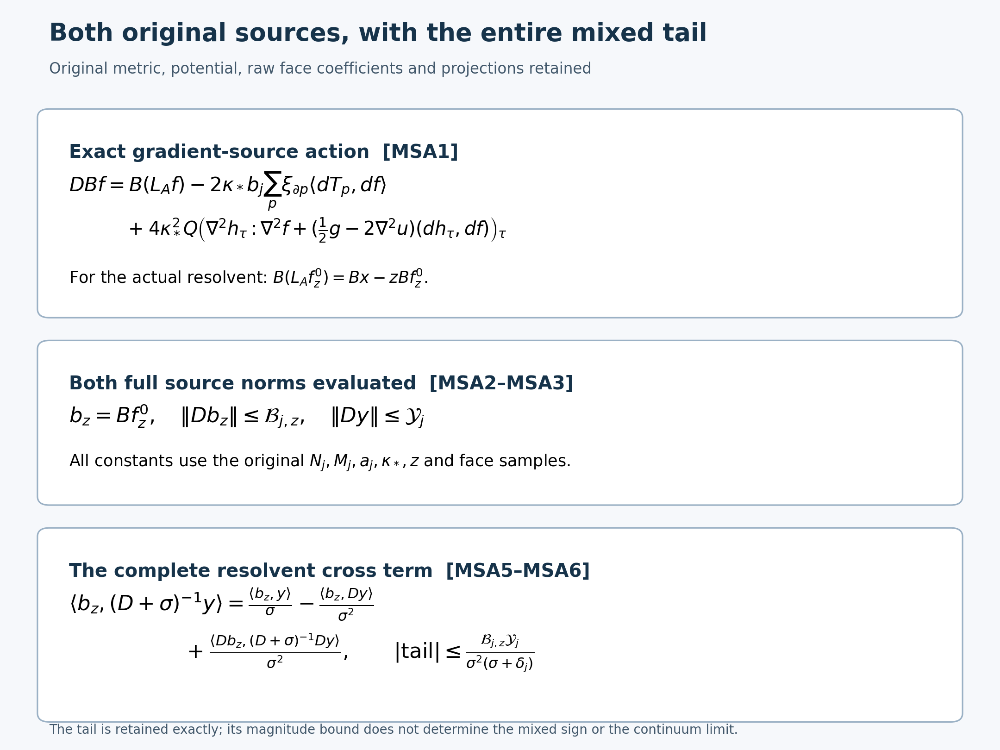

# The original mixed sources under the full complementary operator

Reviewed derivation, 14 October 2026. This continues the actual mixed-time remainder in [MTO19–MTO20](https://github.com/KokunoYumeto/yang-mills-interacting-workbench/blob/a1f8f95fc6c6c67cd139d8f8db3ec9544b44aac6/yang-mills/continuations/20261011-central-signs-shrinking-window/ACTUAL_MIXED_TIME_EVOLUTION.md). The smooth interacting global no-gap state remains the programme goal.

Retain the original full definitions, metric, domains and constants in [RHB1–RHB13](https://github.com/KokunoYumeto/yang-mills-interacting-workbench/blob/a1f8f95fc6c6c67cd139d8f8db3ec9544b44aac6/yang-mills/continuations/20261011-central-signs-shrinking-window/ACTUAL_RESOLVENT_HESSIAN.md), [CK7–CK24](https://github.com/KokunoYumeto/yang-mills-interacting-workbench/blob/a1f8f95fc6c6c67cd139d8f8db3ec9544b44aac6/yang-mills/continuations/20261011-central-signs-shrinking-window/CENTRAL_KINETIC_SOURCE.md) and MTO. In particular,
\[
\begin{gathered}
L_j=j^4,\ a_j=(100j)^{-1},\ g_j^2=\kappa_*a_j/2,\ b_j=(\kappa_*a_j^2)^{-1},\ s_j=\kappa_*/j,\\
N_j=3(2L_j)(2L_j+1)^2,\quad M_j=3(2L_j)^2(2L_j+1),\\
H=-\kappa_*\Delta+2b_jM_j-b_j\sum_pT_p,\quad H\psi=E_0\psi,
\quad\psi>0,\quad\int\psi^2dU=1,\\
A^2=2^{-N_j}\sum_\tau\psi(D_\tau U)^2,\quad
u=\log A,\quad h_\tau=\frac{\psi(D_\tau U)}{2^{N_j/2}A},\quad p_\tau=h_\tau^2,\\
L_A=-\kappa_*(\Delta+2du\cdot d),\quad
\mathcal M_\tau=L_A+v_\tau,\quad
v_\tau=V_\tau-\overline V-\kappa_*\mathcal F,\\
V_\tau=2b_jM_j-b_j\sum_p\chi_{\partial p}(\tau)T_p,\quad
\overline V=2b_jM_j-b_j\sum_p r_{\partial p}T_p,\quad
\mathcal F=\sum_\tau|dh_\tau|^2,\\
Q=I-hh^*,\quad Bf=-2\kappa_*(dh_\tau\cdot df)_\tau,\quad
D=Q\mathcal M\text{ on smooth physical }Q\text{ sections}.
\end{gathered}
\]
The metric is the original product of radius-two \(SU(2)\) factors, with probability Haar measure and all boundary vertex constraints. The Hilbert norm uses \(A^2dU\) and all \(2^{N_j}\) components. Metric contractions below are complex bilinear when an un-conjugated complex source occurs; every norm and Hilbert pairing is Hermitian. All identities hold at each original finite regulator, with the operator domains proved in CK19 and MTO12–MTO13. Seven new disk-index metadata hits are routing records, not source reading. No novelty claim is made.

## 1. Compute the full gradient-source commutator

For any smooth central-invariant physical scalar \(f\), let \(\mathcal H_\tau=\nabla^2h_\tau\), \(\mathcal H_f=\nabla^2f\), and \(K_u=\tfrac12g-2\nabla^2u\). The exact source action is
\[
\begin{aligned}
DBf={}&B(L_Af)
-2\kappa_*b_j\sum_p\xi_{\partial p}\langle dT_p,df\rangle\\
&+4\kappa_*^2Q\left(
\mathcal H_\tau:\mathcal H_f+K_u(dh_\tau,df)
\right)_\tau .
\end{aligned}\tag{MSA1}
\]
Here \(\xi_S=h(\chi_S-r_S)\) is the full MTO frame; the colon is the complete covariant Hessian contraction on all \(3N_j\) tangent directions. In particular no third derivative of the actual vacuum or of the resolvent remains unevaluated in this formula.

For the proof start with the full bilinear weighted Bochner product identity
\[
\begin{aligned}
L_A\langle da,df\rangle={}&
\langle dL_Aa,df\rangle+\langle da,dL_Af\rangle\\
&-2\kappa_*\nabla^2a:\nabla^2f
-2\kappa_*(\operatorname{Ric}-2\nabla^2u)(da,df).
\end{aligned}
\]
At a point choose a geodesic orthonormal frame. Differentiating \(\sum_i a_i f_i\) twice gives the two differentiated Laplacians and the cross term \(2\sum_{i,k}a_{ik}f_{ik}\). Commuting the derivative of each scalar Laplacian with its gradient contributes one Ricci contraction, giving the total \(2\operatorname{Ric}(da,df)\). The derivative of \(2du\cdot da\) introduces \(2\nabla^2u(da,df)\) from each of the two source terms. Subtracting these two contributions from the differentiated product yields \(2(\operatorname{Ric}-2\nabla^2u)\). Multiplication by \(-\kappa_*\) proves the display. On the radius-two product, \(\operatorname{Ric}=\tfrac12g\), as retained in RHB4. Linearity extends this real bilinear computation to complex \(f\).

Now insert the actual \(a=h_\tau\). CK7 says \(L_Ah_\tau=-v_\tau h_\tau\), including the original Wilson potential and the vacuum energy through its full ground transform. Thus
\[
\begin{aligned}
\mathcal M_\tau\langle dh_\tau,df\rangle
={}&-h_\tau\langle dv_\tau,df\rangle
+\langle dh_\tau,dL_Af\rangle\\
&-2\kappa_*\mathcal H_\tau:\mathcal H_f
-2\kappa_*K_u(dh_\tau,df).
\end{aligned}
\]
The term \(-v_\tau\langle dh_\tau,df\rangle\) from differentiating the ground equation and the full multiplication term \(+v_\tau\langle dh_\tau,df\rangle\) have been shown before their exact cancellation. Multiply by \(-2\kappa_*\) and apply \(Q\). The common contributions from \(-d\overline V-\kappa_*d\mathcal F\) multiply \(h\) and are annihilated by this same projection. The remaining differentiated original potential is
\[
dV_\tau=-b_j\sum_p\chi_{\partial p}(\tau)dT_p,
\qquad Q(h\chi_{\partial p})=\xi_{\partial p}.
\]
Also \(Qdh=dh\), since \(\sum h_\tau^2=1\). These exact identities prove MSA1 with every factor and the displayed negative potential sign. All fields have the original gauge and sign laws; hence the differential calculation lies in the physical domain of \(D\).

For the actual \(f=f_z^0=(L_A+z)^{-1}x\), the first term is exactly \(Bx-zBf_z^0\). This retains the original source equation and its shift, instead of prescribing the third derivative of a separately chosen function.

## 2. Compute the other original source

Keep
\[
X_\varphi=\frac{a_j}{2}\sum_p\varphi(x_p)(2-T_p-\mu(2-T_p)),\quad
x=\sum_\tau p_\tau X_\varphi(D_\tau U),\quad
y_\tau=h_\tau(X_\varphi(D_\tau U)-x).
\]
Every original position \(x_p=o+a_j(z_{\rm vertex}-L_j\mathbf1+(e_d+e_k)/2)\), face orientation and centering constant remains fixed. The full action is
\[
\begin{aligned}
Dy={}&3\kappa_*y-Bx\\
&+\kappa_*a_j\sum_p\varphi(x_p)
\left[\xi_{\partial p}\langle du,dT_p\rangle
+Q\big(\chi_{\partial p}(\tau)\langle dh_\tau,dT_p\rangle\big)_\tau\right].
\end{aligned}\tag{MSA2}
\]
To prove it, the full component product rule gives
\(\mathcal M_\tau(h_\tau Z_\tau)=h_\tau[-\kappa_*\Delta Z_\tau-2\kappa_*dw_\tau\cdot dZ_\tau]\), where \(Z_\tau=X_\varphi(D_\tau U)\) and \(w_\tau=\log(\psi\circ D_\tau)\). Retain \(w_\tau=u+\log h_\tau+\tfrac12\log(2^{N_j})\) in taking this derivative. The original face Casimir in MTO19 gives \(-\kappa_*\Delta Z_\tau=3\kappa_*(Z_\tau-d^X_\varnothing)\), where the empty coefficient contains all original centering constants. Its common empty contribution is killed by \(Qh=0\). The derivative \(dZ_\tau=-(a_j/2)\sum_p\varphi(x_p)\chi_{\partial p}(\tau)dT_p\) gives the two displayed drift terms. Finally subtract \(Q\mathcal M(hx)=Bx\). This proves MSA2. Under MTO12–MTO14, it is the complete same source action as \(D_Cd^X\) in MTO19, with all components and projections retained.

## 3. Evaluate both operator norms with the existing actual-state constants

Keep the full RHB constants
\[
\begin{gathered}
\Phi_1=\sum_p|\varphi(x_p)|,\quad Z_*=2a_j\Phi_1,\quad D_*=a_j\Phi_1,
\quad c_j=2/(\kappa_*a_j),\quad G_j=4\pi^2N_jc_j^2,\\
\widehat W_j=4b_jM_j/\kappa_*+(3N_j-1)c_j,\quad
\widehat C_j=\widehat W_j+G_j,\quad
\widehat H_j=2\widehat W_j+5G_j,\\
\alpha_j^+=\kappa_*(2\widehat C_j-\tfrac12),\quad
\mathcal X_{1,j}=D_*+2Z_*\sqrt{G_j},\\
M(\alpha,z)=\begin{cases}1,&\alpha\le2z,\\
\alpha^2/[4z(\alpha-z)],&\alpha>2z.
\end{cases}
\end{gathered}
\]
The actual vacuum energy remains in the exact RHB2 trace bound. Its proved nonnegativity is what permits the explicit upper functions above. Define the following fully evaluated source bounds:
\[
\begin{aligned}
\mathcal B_{j,z}={}&2\kappa_*\sqrt{G_j}\,\mathcal X_{1,j}\\
&+\left[8\kappa_*b_j\sqrt{N_j}
+4\kappa_*^2\sqrt{G_j}(\tfrac12+2\widehat C_j)\right]
\frac{Z_*}{2\sqrt{\kappa_*z}}\\
&+4\kappa_*\sqrt{3N_j}\,\widehat H_j Z_*\sqrt{M(\alpha_j^+,z)},\\
\mathcal Y_j={}&3\kappa_*Z_*+2\kappa_*\sqrt{G_j}\,\mathcal X_{1,j}
+4\kappa_*a_j\Phi_1\sqrt{G_j}.
\end{aligned}
\]
Then the actual original sources satisfy
\[
\|DBf_z^0\|\le\mathcal B_{j,z},\qquad
\|Dy\|\le\mathcal Y_j,\qquad
\|D\eta_z\|\le\mathcal Y_j+\mathcal B_{j,z}.
\tag{MSA3}
\]
Here is a term-by-term derivation. RHB gives \(\mathcal F\le G_j\), \(|du|\le\sqrt{G_j}\), \(\|\nabla^2u\|_{\rm op}\le\widehat C_j\), and \(\|\nabla^2h_\tau\|_{\rm op}\le h_\tau\widehat H_j\). Because the full tangent dimension is \(3N_j\), the Hilbert–Schmidt norm of this last Hessian is at most \(\sqrt{3N_j}h_\tau\widehat H_j\). Thus MSA1 implies
\[
\begin{aligned}
\|DBf\|\le{}&2\kappa_*\sqrt{G_j}\|dL_Af\|_A
+8\kappa_*b_j\sqrt{N_j}\|df\|_A\\
&+4\kappa_*^2\sqrt{3N_j}\widehat H_j\|\nabla^2f\|_A\\
&+4\kappa_*^2\sqrt{G_j}(\tfrac12+2\widehat C_j)\|df\|_A .
\end{aligned}
\]
For the potential term, each original link belongs to at most four faces, including the boundary cases, and \(|d_eT_p|=\sqrt{1-T_p^2/4}\le1\) on each incident link. Hence \(|d_eV_\tau|\le4b_j\), so \(|dV_\tau|\le4b_j\sqrt{N_j}\). Contraction against \(df\), summation with \(h_\tau^2=p_\tau\), and the norm-one projection \(Q\) give the displayed factor \(8\kappa_*b_j\sqrt{N_j}\). For the Hessian term use the complete Hilbert–Schmidt contraction followed by \(\sum h_\tau^2=1\). For the final term use the operator norm of \(K_u\) and \(\sum|dh_\tau|^2=\mathcal F\). These steps retain the dimension and all original boundary incidences.

The actual scalar resolvent spectral measure gives
\[
\begin{gathered}
\|dL_Af_z^0\|_A^2
=\kappa_*^{-1}\int\frac{\lambda^3}{(\lambda+z)^2}d\nu_x(\lambda)
\le\kappa_*^{-1}\int\lambda\,d\nu_x(\lambda)=\|dx\|_A^2,\\
\|df_z^0\|_A\le\frac{Z_*}{2\sqrt{\kappa_*z}},\qquad
\|\nabla^2f_z^0\|_A\le\frac{Z_*}{\kappa_*}\sqrt{M(\alpha_j^+,z)}.
\end{gathered}
\]
The first inequality is the pointwise scalar bound \(\lambda^2/(\lambda+z)^2\le1\), keeping the original \(\nu_x\). The other two are RHB5 and RHB8. Differentiating the actual conditional mean gives
\(dx=\sum p_\tau dZ_\tau+2\sum h_\tau(Z_\tau-x)dh_\tau\). Its exact conditional variance is at most \(Z_*^2\), so \(\|dx\|_A\le\mathcal X_{1,j}\). Substitution proves the first MSA3 bound without an unknown third derivative.

For MSA2, \(\|y\|\le Z_*\), \(\|Bx\|\le2\kappa_*\sqrt{G_j}\mathcal X_{1,j}\), \(\|\xi_{\partial p}\|_{\ell^2}^2=1-r_{\partial p}^2\le1\), and \(|dT_p|\le2\). Each of its two drift vectors has pointwise norm at most \(2\sqrt{G_j}\). Summing every \(|\varphi(x_p)|\) gives the displayed \(\mathcal Y_j\). Finally \(\eta_z=y-Bf_z^0\) and linearity give its bound. If every original face sample vanishes, all these sources and bounds are exactly zero; no division by that source mass is made.

## 4. The actual mixed-time remainders and entire resolvent tails

Set \(b_z=Bf_z^0\), retaining its source shift \(z\), and keep the proved physical lower bound \(D\ge\delta_jI\), \(\delta_j=3\kappa_*e^{-\Omega_j}\), \(\Omega_j=8\pi^2c_jN_j\). For the actual mixed pair \(H_z(t)=\langle b_z,e^{-tD}y\rangle\), MTO20 and MSA3 give
\[
\left|H_z(t)-\langle b_z,y\rangle+t\langle b_z,Dy\rangle\right|
\le\frac{\delta_jt-1+e^{-\delta_jt}}{\delta_j^2}
\mathcal B_{j,z}\mathcal Y_j .
\tag{MSA4}
\]
The full actual source \(F_z(t;f_z^0)=\langle b_z,e^{-tD}\eta_z\rangle\) satisfies the same formula with \(y\) replaced throughout by \(\eta_z\) and the right side replaced by \(\mathcal B_{j,z}(\mathcal Y_j+\mathcal B_{j,z})\). The diagonal kernel satisfies the version with \(y=b_z\) and \(\mathcal B_{j,z}^2\). These are direct applications to the original vectors, not independently chosen vectors with matched norms.

For a separate Laplace shift \(\sigma>0\), the full resolvent cross term is
\[
\begin{aligned}
\langle b_z,(D+\sigma)^{-1}y\rangle
={}&\frac{\langle b_z,y\rangle}{\sigma}
-\frac{\langle b_z,Dy\rangle}{\sigma^2}\\
&+\frac1{\sigma^2}\langle Db_z,(D+\sigma)^{-1}Dy\rangle,
\end{aligned}\tag{MSA5}
\]
and its entire last term is bounded in absolute value by
\[
\frac{\mathcal B_{j,z}\mathcal Y_j}{\sigma^2(\sigma+\delta_j)}.
\tag{MSA6}
\]
The scalar identity
\(1/(\lambda+\sigma)=1/\sigma-\lambda/\sigma^2+\lambda^2/[\sigma^2(\lambda+\sigma)]\)
holds at every \(\lambda\ge\delta_j\). Applying the spectral theorem to these smooth original vectors and moving one \(D\) to each source proves MSA5 without a discarded large-time or high-energy part. The operator norm of the remaining full inverse is at most \((\sigma+\delta_j)^{-1}\), proving MSA6. Equivalently, the exact Laplace integral of the MSA4 coefficient is \(1/[\sigma^2(\sigma+\delta_j)]\). The versions for \(\eta_z\) and \(b_z\) retain the same replacements as MSA4. At \(\sigma=z\) these are the entire original Schur-source terms in MTO5 and MTO15, not yet the inverse of the full Schur operator.

These computations evaluate both operator norms required by the existing finite-time remainder. The actual coefficients \(\langle b_z,y\rangle\), \(\langle b_z,Dy\rangle\), their signed three-shift combination, and the full Schur solution retain their original joint dependence. The next calculation is to use their exact source actions together, including the orientation of the mixed terms, rather than inferring that orientation from the diagonal kernel or these norm bounds. Their regulator dependence and the large-time spectral contribution must be calculated before a limiting annular-mass conclusion.

The figure retains every term of the actual gradient-source commutator and every term of the original resolvent cross identity. The source norm functions are explicitly evaluated in MSA3, with the full original dimension, couplings, lattice counts and face samples. The figure does not assert a sign for the cross term or a limiting spectral mass. Proof locators: MSA1–MSA6, with the full MTO and RHB source links above. Reproducible figure: [figure_mixed_source.py](figure_mixed_source.py). The inherited human center-multiplication provenance is L. Li and Y. Meurice, [arXiv:hep-lat/0410029v2](https://arxiv.org/abs/hep-lat/0410029v2), Sections II–IV and Appendix, through CS/CK's retained author-source record. No new external reading or novelty claim is made.

There are 305 supporting diagnostics. The continuous four-link calculation retains the full radius-two twelve-dimensional Hessian and Ricci contractions, all sixteen signs, its constructed ground potential and centered original face source. Its potential is explicitly different from the Wilson potential. The discrete original open-box calculation retains all 54 links and 36 oriented faces at j=1, every boundary incidence, each link's trace derivative and the entire Wilson-potential derivative. Complex positive-operator fixtures retain every term of the time and resolvent remainders. These are diagnostics of the complete proofs above, not Wilson-vacuum samples or a continuum construction.
