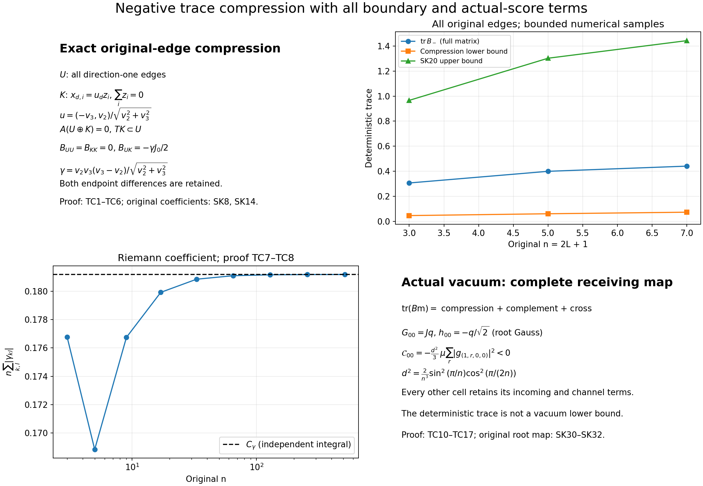

# Exact negative-trace compression and its actual vacuum receiver

This proof completes the compression of the original signed matrix. It proves
that its negative trace has order log n, and evaluates a strictly negative
actual-vacuum contribution at the original root cell. Every complementary
and mixed term in the actual covariance is retained. The full vacuum
contraction and the raw physical endpoint are not assigned a sign by this
calculation. There is no novelty claim.

The complete original provider is [SK1–SK39](https://github.com/KokunoYumeto/yang-mills-interacting-workbench/blob/50801f6c74543f26e6a227b831691290a0f7a3fc/yang-mills/continuations/20261011-central-signs-shrinking-window/SIGNED_KINETIC_TRACE.md). The independent [G1–G52](GAMMA_INTEGRAL.md) evaluates the exact coefficient. The [source-use ledger](HOLONOMY_TRACE_SOURCE_USE_LEDGER.json) records source versions and reading coverage. Every new proof appears below, with stable locators TC1–TC18.

## TC1. Original coordinates and all coefficients

Let L≥1, m=2L and n=m+1. The vertices are the original points
o+a(i−L,k−L,l−L), 0≤i,k,l≤m. An edge is (d,i,k,l), positively oriented
in direction d. Its d-coordinate ranges from 0 to m−1; its two other
coordinates range from 0 to m. There are N=3mn² edges. Every elementary
face of this open cube remains in the Hamiltonian.

Retain the original coefficients

\[
 v(r)=\sqrt{2/n}\cos\frac{\pi(r+1/2)}n\quad(0\le r\le m),
 \qquad w_1(r)=-\sqrt{2/n}\sin\frac{\pi(r+1)}n\quad(0\le r<m),
\]
\[
 V_1=0,\quad V_2(i,k,l)=\frac{w_1(k)v(l)}{\sqrt{2n}},
 \quad V_3(i,k,l)=-\frac{v(k)w_1(l)}{\sqrt{2n}}.
\tag{TC1.1}
\]

The root path first uses direction three from (0,0,0) to (0,0,l), then
direction two to (0,k,l), then direction one to (i,k,l), always in
increasing order. Its edge list is

\[
 t_{i,k,l}=\big((3,0,0,r)_{r<l},(2,0,r,l)_{r<k},
                    (1,r,k,l)_{r<i}\big).
\tag{TC1.2}
\]

Write f≺e when f belongs to the path to the starting vertex of e. This
is strict ancestry. With all original rows and columns present, put

\[
 A_{fe}=\mathbf1_{f\prec e}V_e,\quad
 p_{i,k,l}=\sum_{f\in t_{i,k,l}}V_f,\quad
 D_{ee}=V_e+p_{s(e)},\quad L=D+A,\quad T=A\operatorname{diag}(V),
\]
\[
 B=L^tL-\operatorname{sym}(L^2)
  =A^tA-A^2-(A^2)^t-\tfrac12(T+T^t).
\tag{TC1.3}
\]

Here sym X=(X+Xᵗ)/2. To verify the latter equality, an ancestor entry
satisfies (A²)fe=Ve(p_s(e)−p_t(f)) and Dff=p_t(f), hence
[D,A]=−A²−T. At a non-ancestor entry the chain and commutator are both
zero. Expanding LᵗL−sym L² then gives (TC1.3). Thus no part of the
original D or its commutator has been dropped. This is precisely the
matrix in SK9–SK11.

## TC2. An isometric subspace including the nodal cases

Let U be the entire coordinate space of direction-one edges. Let H be
the coordinate space of all direction-two and direction-three edges,
so that the full edge space is the orthogonal sum U⊕H. On a transverse
cell (k,l), denote the present coefficients by v₂,v₃. For a missing
direction-two channel at k=m set v₂=0 only as a coefficient convention;
for a missing direction-three channel at l=m set v₃=0. The missing edge
does not become a coordinate.

For each cell with both channels present, namely 0≤k,l<m, define

\[
 r_{kl}=\sqrt{v_2^2+v_3^2},\qquad
 u_{kl}=\frac{(-v_3,v_2)}{r_{kl}}\quad(r_{kl}>0),
 \qquad u_{LL}=(1,0)\quad(r_{LL}=0),
\]
\[
 Z_0=\{z\in\mathbb R^n:\sum_{i=0}^m z_i=0\},\quad
 (\iota_{kl}z)_{(d,i,k,l)}=u_dz_i\ (d=2,3),
 \qquad K=\bigoplus_{0\le k,l<m}\iota_{kl}Z_0.
\tag{TC2.1}
\]

All unspecified coordinates of ιklz are zero. Its norm is exactly the
original Euclidean edge norm, since |u|=1. Different cells have disjoint
supports. Thus dim K=m³ and dim(U⊕K)=mn²+m³. This is an isometric
inclusion into the original edge space, without a change in V.

Here are all exceptional cases. The sine entries w₁(r) are nonzero on
their entire stated support; v(r) vanishes exactly at r=L. On the row
l=L with k≠L the coefficient v₂ is zero and v₃ is nonzero; u selects
the present direction-two zero coefficient. On the column k=L with
l≠L the coefficient v₃ is zero and u selects the present direction-three
zero coefficient. At (L,L) both present coefficients vanish and the
declared choice u=(1,0) is a unit vector in a genuine coordinate plane.
On k=m or l=m we include no K cell; all present boundary coordinates
stay in its orthogonal complement. At (m,m) neither H channel exists.
Every U coordinate, including those boundary cells, stays in U. A zero
value v₂=v₃ at any further cell merely gives γ=0 in the formulas below;
no division by γ is ever used.

## TC3. The complete annihilation and receiving maps

The original direction-one rows, for any vector supported in the H
cell (k,l), are

\[
 (Ax)_{(1,r,k,l)}=\sum_{d=2,3}v_d\sum_{i>r}x_{d,i},
 \qquad (Tx)_{(1,r,k,l)}=\sum_{d=2,3}v_d^2\sum_{i>r}x_{d,i},
 \quad0\le r<m.
\tag{TC3.1}
\]

Only present columns occur. A direction-two tree row (2,0,r,l₀)
has entries 1_{l=l₀}1_{r<k}vd, independent of i; a direction-three
trunk row (3,0,0,r) has entries 1_{r<l}vd, independent of i. All other
H rows of A vanish because they are chords. The same statements with
vd² hold for T. These are the complete root-path possibilities in
(TC1.2), including the root and every far boundary.

If x=ιklz, the direction-one A sum vanishes because v₂u₂+v₃u₃=0.
Each H row vanishes because ∑izi=0. For T, every H row again vanishes,
whereas its direction-one coefficient is

\[
 v_2^2u_2+v_3^2u_3
 =\gamma_{kl}:=\frac{v_2v_3(v_3-v_2)}{\sqrt{v_2^2+v_3^2}}.
\tag{TC3.2}
\]

At the simultaneous zero define γ=0, and at missing-channel cells also
define γ=0 for sums only. The nodal cases have γ=0 by direct substitution
in the original sum, so the formula has no singular exception.

Let J:ℝⁿ→ℝᵐ have Jri=1_{r<i} for 0≤r<m and 0≤i≤m, and let
J₀ be its restriction to Z₀ with the inherited metric. If P is the
orthogonal projection onto U⊕K, the preceding calculations prove

\[
 AP=0,\quad A^2P=0,\quad T|_U=0,\quad
 T\iota_{kl}z=\gamma_{kl}J_0z\ \hbox{in its original U cell},
 \quad (I-P)TP=0.
\tag{TC3.3}
\]

The fact that A and T kill U follows from the original V₁=0 columns,
not from an assumption about its rows.

## TC4. The exact compression

All AᵗA and A² contributions to PBP vanish by (TC3.3). The remaining
term is −P(T+Tᵗ)P/2. Each both-present cell is therefore

\[
 B_{kl}^{\rm comp}=\begin{pmatrix}
 0&-\gamma_{kl}J_0/2\\-\gamma_{kl}J_0^t/2&0
 \end{pmatrix}
 \quad\hbox{on }\mathbb R^m\oplus Z_0.
\tag{TC4.1}
\]

Each other U cell has zero compression, because there is no K vector
there. Thus the full compression is the orthogonal direct sum of
(TC4.1) and those boundary zero blocks. This is a compression, not an
invariant-subspace assertion about B. Its coupling to the complement
is computed in TC10 below.

## TC5. Both endpoint differences and every singular value

For y=J₀z with ∑zi=0, successive differences give exactly

\[
 z_0=-y_0,\qquad z_i=y_{i-1}-y_i\ (1\le i<m),
 \qquad z_m=y_{m-1}.
\tag{TC5.1}
\]

Conversely these formulas give ∑zi=0 by telescoping and Jz=y, so
they prove that J₀ is a bijection Z₀→ℝᵐ. In the original metrics,

\[
 |J_0^{-1}y|^2=y_0^2+
       \sum_{i=1}^{m-1}(y_{i-1}-y_i)^2+y_{m-1}^2.
\tag{TC5.2}
\]

The Gram matrix is the m-by-m tridiagonal matrix with diagonal 2 and
adjacent entries −1. For k=1,…,m its vector with rth component
sin((r+1)kπ/n), 0≤r<m, has eigenvalue
2−2cos(kπ/n)=4sin²(kπ/(2n)). This follows from the sine addition
formula and the two boundary values sin0=sin(kπ)=0. These m positive
eigenvalues are distinct, so their eigenvectors form a basis. Taking
reciprocal square roots gives all singular values

\[
 \sigma_k(J_0)=\frac1{2\sin(k\pi/(2n))}\quad(1\le k\le m).
\tag{TC5.3}
\]

In particular the endpoint in (TC5.2) is different from the full-J
inverse Gram matrix in SK15. Neither formula may replace the other.

## TC6. Finite lower bound by an exact variational inclusion

If J₀qk=σkpk and J₀ᵗpk=σkqk are unit singular pairs, the two vectors
(pk,±qk)/√2 in (TC4.1) have opposite eigenvalues of magnitude |γkl|σk/2. If γkl=0, all those eigenvalues are zero. Consequently

\[
 \operatorname{tr}(PBP|_{\operatorname{ran}P})_-
 =\ell_n:=\frac12\Gamma_n S_n^0,\qquad
 \Gamma_n=\sum_{k,l=0}^{m-1}|\gamma_{kl}|,\quad
 S_n^0=\sum_{r=1}^{m}\frac1{2\sin(r\pi/(2n))}.
\tag{TC6.1}
\]

For every real symmetric matrix X,
tr X₋=max_{0≤Q≤I}(−tr QX). To prove this, diagonalize X. Each diagonal
entry of Q in that basis belongs to [0,1]; selecting the negative
spectral projection attains the maximum. Every 0≤Q≤I on ran P extends
by zero to an allowed matrix on the full space. Applying this inclusion
to X=B proves the exact finite lower bound

\[
 \boxed{\operatorname{tr}B_-\ge\ell_n.}
\tag{TC6.2}
\]

No principal-submatrix eigenvalue has been identified with an eigenvalue
of B. The variational inclusion is the required comparison.

## TC7. The full discrete prefactor and its positive limit

For 0≤k,l<m define

\[
 a_{n,kl}=-\sin\frac{\pi(k+1)}n\cos\frac{\pi(l+1/2)}n,
 \qquad b_{n,kl}=\cos\frac{\pi(k+1/2)}n\sin\frac{\pi(l+1)}n.
\]

Then v₂=√2 n^(−3/2)an, v₃=√2 n^(−3/2)bn. Retaining every factor,

\[
 n\Gamma_n=\frac2{n^2}\sum_{k,l=0}^{n-2}
 F(a_{n,kl},b_{n,kl}),\qquad
 F(a,b)=\begin{cases}|ab(b-a)|/\sqrt{a^2+b^2},&(a,b)\ne(0,0),\\
 0,&(a,b)=(0,0).
 \end{cases}
\tag{TC7.1}
\]

Since |ab|≤(a²+b²)/2 and |b−a|≤√2√(a²+b²), one has
0≤F(a,b)≤(a²+b²)/√2. This proves continuity at (0,0), while continuity
elsewhere follows from its nonzero denominator. It is uniformly
continuous on the compact square [−1,1]². The shifts of every sine or
cosine argument from πk/n or πl/n are at most π/n and tend uniformly
to zero. Uniform continuity makes the resulting change of (TC7.1)
tend to zero. Completing its n-by-n Riemann sum adds only 2n−1 bounded
terms multiplied by 2/n². Thus

\[
 \boxed{n\Gamma_n\longrightarrow C_\gamma
 =\frac2{\pi^2}\int_0^\pi\!\int_0^\pi
 \frac{|a(x,y)b(x,y)(b(x,y)-a(x,y))|}
 {\sqrt{a(x,y)^2+b(x,y)^2}}\,dx\,dy,}
\]
\[
 a(x,y)=-\sin x\cos y,\qquad b(x,y)=\cos x\sin y,
 \quad\hbox{with value zero at simultaneous zeros.}
\tag{TC7.2}
\]

The added Riemann terms are only a proof comparison; they do not add
boundary edges to the original sum. Positivity already follows on
[π/6,π/3]², where |a|,|b|≥1/4, b−a≥1/2 and √(a²+b²)≤√2. Hence
Cγ≥1/(576√2)>0.

The independent complete calculation G1–G52 evaluates this same object,
with the same factor 2/π². With Li₂(z)=∑r≥1 zʳ/r², it gives

\[
 C_\gamma=
 \frac{2+\sqrt2/2+3\log(2/(1+\sqrt2))
 -\operatorname{Li}_2(3-2\sqrt2)/(2\sqrt2)}{\pi^2}
 -\frac1{24\sqrt2},
\]
\[
 0.181178439743214882282299233973<C_\gamma
 <0.181178439743214882282299233974.
\tag{TC7.3}
\]

For orientation, its exact reduction is
Cγ=(4/π²)∫₀¹K(z)/√(1+z) dz with
K(z)=∫₀∞s/[(1+s)²(1+zs)²] ds. The full coordinate maps and both endpoint
terms are proved in G10–G35. The rational enclosures follow by two
independent series with proved errors in G39–G51; their script is
enclosed and was rerun in this directory. No numerical quadrature is
used as proof of positivity or of (TC7.3).

## TC8. Logarithmic growth with explicit constants

The function f(t)=1/[2sin(πt/2)]−1/(πt), initially 0<t≤1, extends
continuously to t=0 with value zero, as follows from
sin x=x−x³/6+O(x⁵). It is bounded on [0,1]. Therefore

\[
 S_n^0=\frac n\pi\sum_{r=1}^{n-1}\frac1r+O(n),
 \qquad \frac{S_n^0}{n\log n}\longrightarrow\frac1\pi.
\tag{TC8.1}
\]

Here the harmonic-sum limit follows directly by comparing its terms
with the integral of 1/t on [1,n]. Combining TC6 and TC7 gives

\[
 \frac{\ell_n}{\log n}\longrightarrow\frac{C_\gamma}{2\pi}>0.
\tag{TC8.2}
\]

The retained SK upper bound, with the original finite expressions, is

\[
 \begin{gathered}
 p_n=\frac{2m-1+(2/n)\cos^2(\pi/(2n))(m-1)}{4n},\quad
 f_n=\sqrt{\frac{9(2m-1)}{32n^3}},\\
 H_m=\sum_{r=1}^m\frac1{2\sin((2r-1)\pi/(4m+2))},
 \end{gathered}
\]
\[
 R_n=p_n+\frac12\left[\frac{H_m}{n}
              +f_n\big(\sqrt{mn-2}+\sqrt m\big)\right],\qquad
 \operatorname{tr}B_-\le R_n.
\tag{TC8.3}
\]

For completeness, the comparison to B comes from the exact square
B=(A−PₜAᵗ)ᵗ(A−PₜAᵗ)−APₜAᵗ−sym T, where Pₜ projects onto the
original direction-two tree and direction-three trunk edges. Its
negative variational trace is at most tr APₜAᵗ+tr(sym T)₊.
These terms are pₙ and at most ||T||*/2, respectively, because tr T=0.
The complete original row blocks give ||T||*≤Hₘ/n+fₙ(√(mn−2)+√m):
the direction-one blocks give Hₘ∑√(v₂⁴+v₃⁴)≤Hₘ/n; the direction-two
and three blocks have squared Frobenius norm fₙ² and ranks mn−2 and m.
The proof of these exact ranks, including both boundary losses, is
SK14–SK19 in the linked original SK proof. Cauchy–Schwarz on singular values
then gives each remaining nuclear bound. This supplies (TC8.3) without
removing any signed term.

The same bounded-difference comparison as in (TC8.1) shows
Hₘ=(2m+1)/π ∑r=1ᵐ1/(2r−1)+O(m). The odd harmonic sum is
(1/2)log m+O(1), obtained by subtracting half the mth harmonic sum
from the 2mth harmonic sum. Thus Hₘ/(n log n)→1/π.
The remaining terms of Rₙ are bounded: pₙ→1/2 and fₙ=O(n⁻¹), whereas
√(mn−2)=O(n). We have proved

\[
 \boxed{
 \frac{C_\gamma}{2\pi}
 \le\liminf_{n\to\infty,\ n\ \mathrm{odd}}\frac{\operatorname{tr}B_-}{\log n}
 \le\limsup_{n\to\infty,\ n\ \mathrm{odd}}\frac{\operatorname{tr}B_-}{\log n}
 \le\frac1{2\pi}.}
\tag{TC8.4}
\]

In particular tr B₋=Θ(log n). This notation asserts eventual positive
constant upper and lower bounds; it does not assert a limiting
coefficient for tr B₋. Since tr B=(3m−1)/2 exactly, it also proves
tr B₊−(3m−1)/2=Θ(log n).

## TC9. The unchanged original path

On nⱼ=2j⁴+1 the same matrix satisfies

\[
 \liminf_{j\to\infty}\frac{\operatorname{tr}(B_{n_j})_-}{\log j}
 \ge\frac{2C_\gamma}{\pi},\qquad
 \limsup_{j\to\infty}\frac{\operatorname{tr}(B_{n_j})_-}{\log j}
 \le\frac2\pi.
\tag{TC9.1}
\]

This uses log(2j⁴+1)/log j→4, without changing the original parameters
κⱼ=κ*, bⱼ=10000j²/κ*, ρⱼ=100j/κ*. It shows that an O(1) bound on the
negative trace of this deterministic B is impossible. It does not say
that its negative spectral space receives a comparable actual vacuum
covariance. The next sections calculate that covariance.

## TC10. The complete compression, complement and cross decomposition

Let Q=I−P, where P is the TC3 compression projection; P differs from
the tree projection Pₜ in TC8. From AP=A²P=0, QTP=0 and (TC1.3),

\[
 PBQ=-P(A^2+T/2)Q,\qquad
 QBQ=QA^tAQ-Q(A^2+(A^2)^t)Q-\tfrac12Q(T+T^t)Q.
\tag{TC10.1}
\]

The first equality follows term by term: PAᵗAQ=0 since AP=0;
P(A²)ᵗQ=0 since A²P=0; PTᵗQ=0 since QTP=0. No further term vanishes
by these reasons.

The original physical positive unit ground state satisfies
Hψ=E₀ψ for H=−κΔ+bW, W=∑p(2−tr Up), κ=2g²/a, b=1/(2g²a)>0,
on the full product of radius-two SU(2) link factors with probability
Haar. Set w=logψ, dμ=ψ²dU, and
g_e=(E_eαw)α=1³ in the original root frame. The actual scalar covariance
is m_ef=(1/3)μ(g_e·g_f), with 0≤m≤ρI, ρ=√(b/κ), by SK6–SK7.
Thus, exactly,

\[
 \boxed{\operatorname{tr}(B\mathsf m)=\mathcal C+\mathcal E+\mathcal X,}
\]
\[
 \mathcal C=\operatorname{tr}(PBP\mathsf m),\quad
 \mathcal E=\operatorname{tr}(QBQ\mathsf m),\quad
 \mathcal X=-2\operatorname{tr}\big(P(A^2+T/2)Q\mathsf m\big).
\tag{TC10.2}
\]

Indeed insert I=P+Q on both sides of B and use symmetry of B and m
to combine its two cross traces. For any matrix C on edges,
tr(Cm)=(1/3)μ∑ef C_ef g_e·g_f whenever C is symmetric, and the same
trace identity holds for arbitrary C by symmetry of the dot product.
This also gives the full random-score interpretation of every term
in (TC10.2), including the cross term.

## TC11. The exact chord receiver and its root constraint

For an original chord c define Zc=t_s(c)Uc t_t(c)⁻¹ and Rc=Ad_Zc.
The complete chord sets are

\[
 \mathcal C_2=\{(2,i,k,l):1\le i\le m,\ 0\le k<m,\ 0\le l\le m\},
\]
\[
 \mathcal C_3=\{(3,i,k,l):0\le i,k\le m,\ (i,k)\ne(0,0),\ 0\le l<m\}.
\tag{TC11.1}
\]

Changing tree variables and these chord words preserves product Haar,
by successive fixed left and right Haar multiplications. Gauge
invariance writes w=ŵ((Zc)c). Let jc be its left score vector. If
If(v)=1 when the tree edge f lies in the path to v and zero otherwise,
direct differentiation of both ends of the chord word gives

\[
 g_c=j_c,\qquad
 g_f=\sum_c\big[I_f(s(c))I-I_f(t(c))R_c^t\big]j_c.
\tag{TC11.2}
\]

Specifically a variation of f in root colour z differentiates the word
as If(s)(z·T)Zc−If(t)Zc(z·T). Right differentiation in z is left
differentiation in Rcz, giving precisely the transpose and minus sign.
Differentiating simultaneous root conjugation gives the pointwise
Gauss constraint

\[
 \sum_c(I-R_c^t)j_c=0.
\tag{TC11.3}
\]

If ℛ denotes all blocks of (TC11.2), including identity chord blocks,
each term of (TC10.2) is its exact configuration-dependent kernel
(1/3)μ jᵗℛᵗ(Cedge⊗I₃)ℛj with Cedge respectively PBP, QBQ and
−[P(A²+T/2)Q+Q((A²)ᵗ+Tᵗ/2)P]. This specifies every mixed chord
product; ℛ cannot be removed from the expectation. These are the
SK30–SK32 maps applied to the present compression.

## TC12. Every compressed cell as an actual-score contraction

For a both-present cell (k,l), define vector-valued arrays

\[
 G_r=g_{(1,r,k,l)}\quad(0\le r<m),\qquad
 h_i=u_2g_{(2,i,k,l)}+u_3g_{(3,i,k,l)}\quad(0\le i\le m),
 \quad\Pi_0h=h-\frac1n\sum_i h_i.
\tag{TC12.1}
\]

Projection onto K is ιklΠ₀h, so (TC4.1) gives exactly

\[
 \mathcal C_{kl}=-\frac{\gamma_{kl}}3
       \mu\sum_{r=0}^{m-1}G_r\cdot(J\Pi_0h)_r,
 \qquad \mathcal C=\sum_{k,l<m}\mathcal C_{kl}.
\tag{TC12.2}
\]

The two symmetric matrix entries contribute the full coefficient −γ,
and the remaining 1/3 is the original colour covariance factor.
Nothing about the sign of this expectation follows from γ alone.

## TC13. The next contraction: full incoming flux and channel difference

For i≥1, both transverse channels are chords whenever present. At
cell (k,l), write

\[
 j_i^{\rm out}=j_{(2,i,k,l)}+j_{(3,i,k,l)},\qquad
 j_i^{\rm in}=\mathbf1_{k>0}R_{(2,i,k-1,l)}^tj_{(2,i,k-1,l)}
 +\mathbf1_{l>0}R_{(3,i,k,l-1)}^tj_{(3,i,k,l-1)},
\]
\[
 q_i=j_i^{\rm out}-j_i^{\rm in}\quad(1\le i\le m),\qquad
 q_0=-\sum_{i=1}^m q_i.
\tag{TC13.1}
\]

All the indicated outgoing edges exist for k,l<m; the displayed
indicators omit only genuinely absent incoming edges. For a direction-one
tree edge f=(1,r,k,l), the two path indicators in (TC11.2) select
exactly the chords that start or end at this transverse cell with
i>r. Consequently

\[
 G=Jq,\qquad \sum_iq_i=0,\qquad
 q_0=-G_0,\ q_i=G_{i-1}-G_i\ (1\le i<m),\ q_m=G_{m-1}.
\tag{TC13.2}
\]

The value q₀ is specified here to give the unique mean-zero inverse;
it is not the removal of any original i=0 score. Those scores remain
inside h₀ below.

Set s=(u₂+u₃)/2 and t=(u₂−u₃)/2, and define the full defect array

\[
 \delta_i=h_i-sq_i,\qquad
 \delta_i=sj_i^{\rm in}+t(j_{(2,i,k,l)}-j_{(3,i,k,l)})\ (i\ge1),
 \qquad \delta_0=h_0+sG_0.
\tag{TC13.3}
\]

The first equality and the expressions that follow it are identical:
expand hᵢ=s(j₂+j₃)+t(j₂−j₃), substitute (TC13.1), and use q₀=−G₀.
Since Π₀q=q, the next exact contraction is

\[
 \boxed{\mathcal C_{kl}
 =-\frac{\gamma_{kl}s}{3}\mu\sum_r|G_r|^2
  -\frac{\gamma_{kl}}3\mu\sum_rG_r\cdot(J\Pi_0\delta)_r.}
\tag{TC13.4}
\]

When rkl>0 the first coefficient can also be retained as the full
identity −γs=v₂v₃(v₃−v₂)²/[2(v₂²+v₃²)]. At a nodal cell γ=0, both
terms vanish exactly, irrespective of the selected u. Formula
(TC13.4) records all incoming transport, channel difference and
original i=0 terms that obstruct a sign conclusion at a general cell.

This defect is an actual finite array with its exact receiving map,
not a missing assumption. Its mixed contribution obeys the proved
bound

\[
 \left|\mu\sum_rG_r\cdot(J\Pi_0\delta)_r\right|
 \le\sqrt{\mu\sum_r|G_r|^2}\,
       \sqrt{\mu\sum_r|(J\Pi_0\delta)_r|^2},
\tag{TC13.5}
\]

by Cauchy–Schwarz in L²(μ;ℝ³ᵐ). It has not been set to zero.

## TC14. Exact root-cell closure and strict negative sign

At (k,l)=(0,0) put

\[
 d=\frac{-w_1(0)v(0)}{\sqrt{2n}}>0,\quad
 v_2=-d,\ v_3=d,\ u=(-1,-1)/\sqrt2,\
 \gamma=-\sqrt2d^2,\quad s=-1/\sqrt2,\quad t=0,
\]
\[
 d^2=\frac2{n^3}\sin^2\frac\pi n\cos^2\frac\pi{2n}.
\tag{TC14.1}
\]

There are no incoming transverse edges, so δᵢ=0 for i≥1.
At the original root, local gauge invariance differentiates in its
three outgoing links and gives the exact vector identity

\[
 g_{(1,0,0,0)}+g_{(2,0,0,0)}+g_{(3,0,0,0)}=0.
\tag{TC14.2}
\]

All three starting root transports equal the identity there; there is
no incoming link. Equivalently, sum (TC11.2) over the three root edges;
each non-root vertex has exactly one of them in its path and no chord
starts at the root, yielding exactly (TC11.3). Thus
h₀=G₀/√2 and δ₀=h₀−G₀/√2=0. The root array therefore satisfies,
pointwise on the full configuration space,

\[
 h=-q/\sqrt2,\qquad \sum_i h_i=0,\qquad J\Pi_0h=-G/\sqrt2.
\]

Substituting into (TC12.2) gives the evaluated actual-state term

\[
 \boxed{\mathcal C_{00}=-\frac{d^2}{3}
            \mu\sum_{r=0}^{m-1}|g_{(1,r,0,0)}|^2<0.}
\tag{TC14.3}
\]

Here is a proof of strictness for the original b>0 Hamiltonian. If
μ|g_e|²=0 for any one edge, positivity of ψ and continuity of its
derivatives imply g_e=0 at every configuration. Orthogonality of its
root frame gives X_eαψ=0 for all three colours, hence ψ is independent
of that entire connected SU(2) link variable. Then Δψ is independent
of it as well: the same-edge part is zero and every other link
derivative acts on variables different from it. Dividing the
eigen-equation by the positive ψ would make bW independent of that
edge. This is false. Hold all other links at the identity and vary
U_e; each incident face has trace tr U_e or tr U_e⁻¹=tr U_e and
contributes 2−tr U_e. Every original edge belongs to at least one
face, including boundary edges. Their sum is nonconstant, and b>0.
This contradiction proves μ|g_e|²>0 for every original edge, and hence
the strict inequality in (TC14.3).

For n=3, m=2 and L=1. Of the four both-present cells, (0,1),(1,0)
are single coefficient nodes and (1,1) is the double node. Thus
γ vanishes on all of them, and (TC14.3) is the entire compressed
actual-state contribution C for that box. The complement and cross
terms of the full B contraction remain in (TC10.2).

## TC15. Exact modal covariance test

To connect the deterministic spectrum to actual moments without an
assumed covariance, take the singular pairs of TC5 and define random
colour vectors ak=∑r pk,r Gr and bk=∑i qk,i hi for one cell. Put
xk=(1/3)μ|ak|², yk=(1/3)μ|bk|² and zk=(1/3)μ(ak·bk). Their two edge
directions are orthonormal in the original space. Compression of
0≤m≤ρI gives

\[
 0\le\begin{pmatrix}x_k&z_k\\z_k&y_k\end{pmatrix}\le\rho I_2,
 \quad |z_k|\le\min\{\sqrt{x_ky_k},
                       \sqrt{(\rho-x_k)(\rho-y_k)}\}\le\rho/2,
\]
\[
 \mathcal C_{kl}=-\gamma_{kl}\sum_{k=1}^m\sigma_k z_k,
 \qquad |\mathcal C|\le\rho\ell_n.
\tag{TC15.1}
\]

The two square-root inequalities follow by taking the determinants
of the positive two-by-two matrices m₂ and ρI₂−m₂. To prove their
minimum is at most ρ/2, if x+y≤ρ use xy≤(x+y)²/4; otherwise use
(ρ−x)(ρ−y)≤(2ρ−x−y)²/4. The modal contraction follows by the singular
expansion of J₀. At the root (TC14) gives instead the exact mixed
moment zk=−μ|ak|²/(3√2σk), with its sign and magnitude fixed by the
actual score norm. Indeed h=−J₀⁻¹G/√2 implies bk=−ak/(√2σk).
This tests the receiver against the real Gauss relation and agrees
term by term with (TC14.3).

The deterministic lower trace in TC6 describes a spectral capacity.
Equality of an actual compression with ±ρℓₙ would require special
actual modal correlations. Neither the trace comparison nor the
Gauss identity assumes those correlations.

## TC16. Receiving consequences for the original kinetic quantity

For a fixed original colour z, SK22 and SK24 read

\[
 \operatorname{tr}(K_z\mathsf M)=2|z|^2(\mathcal C+\mathcal E+\mathcal X),
\]
\[
 \mathscr Q_z=4\kappa|z|^2(\mathcal C+\mathcal E+\mathcal X)
                      +b\mu Y_z^2W\ge0.
\tag{TC16.1}
\]

The root part of the kinetic contraction is exactly
−2|z|²d² μ∑r|g_(1,r,0,0)|²/3, with no unknown sign. The other terms
are the explicitly defined general-cell defect, complement, cross
and original potential terms. Positivity of the full double
commutator does not change the sign of its individual pieces.

The original physical raw phase and endpoint in SK34–SK39 are
unaltered. A fixed-colour score vector still has zero physical
root-gauge projection, and the physical variable-colour receiver
still includes its acceleration covariance. The present spectral
Θ(log n) statement cannot be inserted as an actual vacuum lower
bound or as a lower bound for that raw physical norm. It does close
the former deterministic O(1) possibility and proves an actual
negative root-cell term that any subsequent contraction must retain.

## TC17. Bounded independent checks and exact illustration

`check_negative_trace_compression.py` enumerates all original edges, path lists,
coefficients, D entries and missing channels for n=3,5,7. It computes B
both from the original L and from (TC1.3), tests the isometric inclusion,
AP=0, TP, the full compressed and cross blocks, all singular values
and both inverse endpoint terms. A separate positive random covariance
tests the complete three-term trace decomposition. Configuration-dependent
root rotations and scores projected onto their exact Gauss kernel
test TC11–TC15, including the root identity and every flux defect.
Those test scores check the algebra; they are not claimed to be samples
of the vacuum. The exact proofs above establish the actual-state claims.

Every assertion passed. The greatest recorded floating-point residual
is below 4.3×10⁻¹⁴. The original full negative traces at n=3,5,7 are
approximately 0.3067412939, 0.3997642542 and 0.4411646950; their finite
compression lower bounds are 0.0464731280, 0.0609948004 and 0.0734659185.
The exact integral certificate was independently rerun from its
enclosed copy using rational arithmetic.

The figure's first panel states the precise original inclusion and
receiving maps. The second displays numerical samples of the proved
finite upper and lower bounds against the full original matrix. The
third displays the original discrete coefficient with its established
limit. The final panel identifies the evaluated root-cell contraction
and the remaining terms. It illustrates TC1–TC16 and the provider
locators SK8–SK20 and SK30–SK32. It is not a vacuum simulation. Its
source is the same reproducible script; the rendered PNG was inspected
for signs, factors, labels and legibility. A three-dimensional scene
does not clarify this finite matrix inclusion, so no Blender scene is
needed for this result.

## TC18. Claim propagation and next exact quantity

The claim ledger strengthens the former upper-only SK20 statement to
TC8.4 and propagates the result to the original-path TC9.1 and the
positive trace excess. It also records TC14.3, its complete proof of
strictness, and the fact that the signed full-state contraction is not
determined by that one term.

The next actual quantities are now specified by exact maps rather
than by an assumed sign: the L² products in (TC13.4), the complete
complement and cross terms (TC10.2), and their physical contractions
in SK35–SK39. The next calculation was attempted here by expanding the
Gauss map into the incoming and channel arrays; it closes exactly at
the root and yields TC14.3. At a general cell it yields the explicit
defect (TC13.3) with the proved bound (TC13.5). None of those terms is
discarded, and no global spectral coefficient or vacuum positivity is
claimed without its calculation.

Complete source versions and reading coverage: [source-use ledger](HOLONOMY_TRACE_SOURCE_USE_LEDGER.json).
