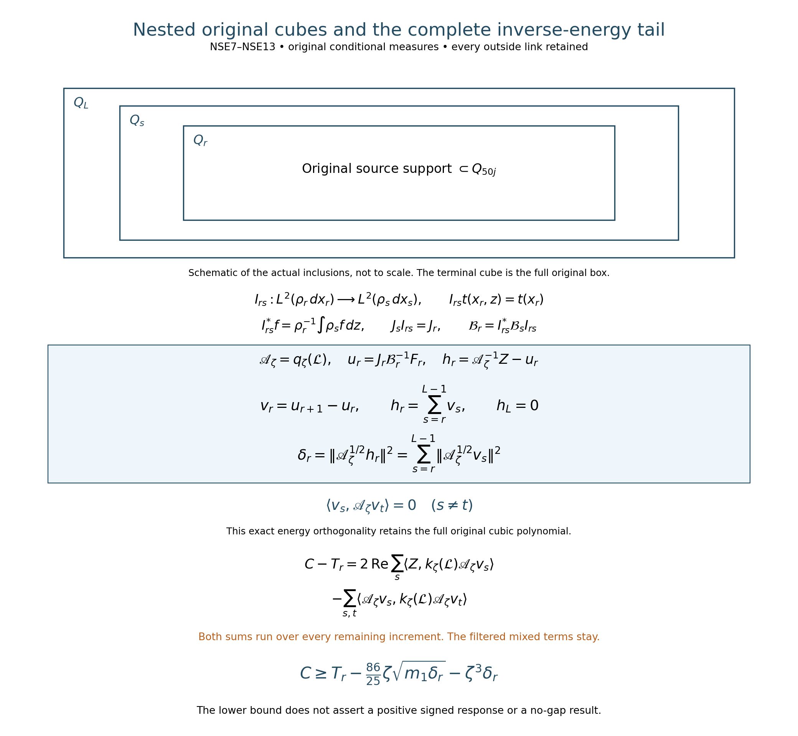
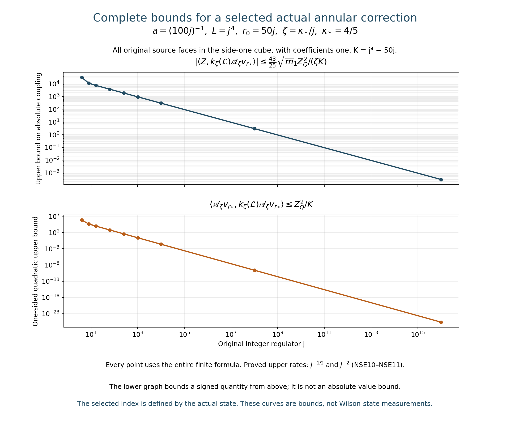

# Nested original cubes, inverse-energy defects and signed response

Reviewed derivation, 15 October 2026. The preceding CCJ upper estimate does not give surviving annular mass. This paper derives exact inverse-energy and signed-response comparisons, their maps between nested original cubes, and evaluated original-state bounds for annular source couplings. No positive shrinking-window response or smooth global no-gap conclusion is assumed.

The exact source and receiving operators are [FCC1–FCC11](https://github.com/KokunoYumeto/yang-mills-interacting-workbench/blob/b956d1089bbc05b70240a579e73c32c616d0163a/yang-mills/continuations/20261011-central-signs-shrinking-window/FULL_CUBIC_SOURCE_COMPRESSION.md); these sections were reread completely. The [typed maps and their Sobolev domains](https://github.com/KokunoYumeto/yang-mills-interacting-workbench/blob/b956d1089bbc05b70240a579e73c32c616d0163a/yang-mills/continuations/20261011-central-signs-shrinking-window/ORIGINAL_FRAME_CUBIC_RESIDUAL.md) were also reread. These proof sections retain the preceding d2971f6 edition's mathematics; the current source edition additionally contains the CCJ receiving note. Nine bounded disk-index hits are recorded privately as routing metadata only; no external source was read or used and no novelty is claimed.

## 1. Exact inverse energy, with its original residual

Keep the original radius-two SU(2) product, probability Haar measure, full potential and vacuum energy:
\[
H=-\kappa_*\Delta+2bM-b\sum_p T_p,\quad H\psi=E_0\psi,
\quad\mathcal L=\psi^{-1}(H-E_0)\psi,\quad d\mu=\psi^2dU.
\]
The complete original parameters and oriented traces are
\[
\begin{gathered}
a=(100j)^{-1},\quad L=j^4,\quad g^2=\kappa_*a/2,\quad
b=(\kappa_*a^2)^{-1},\quad \zeta=\theta\kappa_*/j,\\
N=3(2L)(2L+1)^2,\quad M=3(2L)^2(2L+1),\\
U_p=U_d(z)U_k(z+e_d)U_d(z+e_k)^{-1}U_k(z)^{-1},\quad
T_p=\operatorname{Tr}U_p,\quad d<k,\\
Z_p=a(\mu T_p-T_p)/2,\quad
Z\varphi=\sum_p\varphi_p Z_p .
\end{gathered}
\]
The original physical source centers are
\(x_p=o+a(z-L\mathbf1+(e_d+e_k)/2)\).
The full ground satisfies \(\psi>0,\int\psi^2dU=1\).
Keep the entire source cube Q, \(\rho=\int\psi^2dy\),
\(J:L^2(\rho dx)\to L^2(\mu)\), and
\(J^*f=\rho^{-1}\int\psi^2fdy\). The full source is \(Z=JF\), with F smooth and its original raw norm. For this calculation fix the already used filter parameters \(\varepsilon=1/4,R_{\rm win}=4\). Thus
\[
\begin{gathered}
q_\zeta(\lambda)=(\lambda+\zeta)(\lambda+\zeta/4)(\lambda+4\zeta),\qquad e_3=\zeta^3,\\
\mathscr A_\zeta=q_\zeta(\mathcal L),\quad
\mathcal B_\zeta=J^*\mathscr A_\zeta J,\quad
t=\mathcal B_\zeta^{-1}F,\quad u=Jt,\\
Y=\mathscr A_\zeta u=Z+W,\qquad J^*W=0,\\
h=\mathscr A_\zeta^{-1}Z-u=-\mathscr A_\zeta^{-1}W .
\end{gathered}
\]
All displayed vectors are smooth at the finite regulator by FCC4–FCC5. The positive operator has domain H6 and form domain H3 on the original full product. Define the actual scalar
\[
\delta_Q(F)=\|\mathscr A_\zeta^{1/2}h\|_\mu^2 .
\]
The exact identities and bounds are
\[
\begin{gathered}
\delta_Q(F)=\langle W,\mathscr A_\zeta^{-1}W\rangle_\mu
=\langle Z,\mathscr A_\zeta^{-1}Z\rangle_\mu
-\langle F,\mathcal B_\zeta^{-1}F\rangle_\rho,\\
0\le\delta_Q(F)\le
\min\left\{\zeta^{-3}\|W\|_\mu^2,
\zeta^{-3}\|F\|_\rho^2-\langle F,\mathcal B_\zeta^{-1}F\rangle_\rho\right\}.
\end{gathered}\tag{NSE1}
\]
Proof: \(\mathscr A_\zeta h=-W\), and
\(\langle u,\mathscr A_\zeta h\rangle=-\langle t,J^*W\rangle=0\).
Expand the entire squared form norm of \(u+h\); its cross terms are zero by this identity. Also
\(\langle u,\mathscr A_\zeta u\rangle=\langle F,\mathcal B_\zeta^{-1}F\rangle\).
This proves both equalities. Apply \(0<\mathscr A_\zeta^{-1}\le\zeta^{-3}I\) to the two separate complete expressions to prove both bounds. The source and residual have not been rescaled.

## 2. Bounds for the complete signed multiplier

Keep the three original terms and both negative tails:
\[
k_\zeta(\lambda)=\frac{\zeta\lambda}{(\lambda+\zeta)^2}
-\frac{16}{25}\frac{(\zeta/4)\lambda}{(\lambda+\zeta/4)^2}
-\frac{16}{25}\frac{(4\zeta)\lambda}{(\lambda+4\zeta)^2}.
\]
For the purpose of proving the following scalar inequalities only, use the exact bijection \(x=\lambda/\zeta:[0,\infty)\to[0,\infty)\), whose inverse is \(\lambda=\zeta x\). Retain the comparison factors
\(q_\zeta(\lambda)=\zeta^3q_1(x)\) and \(k_\zeta(\lambda)=k_1(x)\).
The original functions remain in every operator formula.
\[
\begin{gathered}
q_1(x)=x^3+\frac{21}{4}x^2+\frac{21}{4}x+1,\\
k_1(x)=\frac{x}{(x+1)^2}-\frac{4x}{25(x+1/4)^2}
-\frac{64x}{25(x+4)^2},\\
q_1(x)k_1(x)=-\frac{43}{25}x^2+\frac{953}{100}x-\frac{63}{2}
+\frac{\frac{1881}{16}x^2+\frac{1233}{8}x+\frac{63}{2}}{q_1(x)} .
\end{gathered}
\]
The last identity follows by multiplying through by q1; it retains the full rational remainder. Its numerator is at most \((63/2)q_1\), because their difference is exactly
\[
\frac{63}{2}x^3+\frac{765}{16}x^2+\frac{45}{4}x\ge0 .
\]
Completing the remaining quadratic square therefore proves
\[
q_\zeta(\lambda)k_\zeta(\lambda)
\le c_0\zeta^3,\qquad c_0=\frac{908209}{68800}.
\]
For the second bound use the full triangle inequality after retaining all three terms. For r equal to 1,1/4,4, respectively,
\[
\frac{q_1(x)x}{(x+r)^4}
=\frac{x}{x+r}\prod_{s\in\{1,1/4,4\}\setminus\{r\}}
\frac{x+s}{x+r}\le 4,64,1,
\]
since each ratio is at most \(\max\{1,s/r\}\).
Thus
\(\sqrt{q_1(x)/x}\,|k_1(x)|\le2+(4/25)8+64/25=146/25\)
for x positive; x=0 is checked in the original formula. Restoring every power of zeta gives
\[
q_\zeta(\lambda)k_\zeta(\lambda)^2
\le c_1\zeta^2\lambda,\qquad c_1=(146/25)^2 .
\tag{NSE2}
\]
These are upper inequalities for the complete signed multiplier and its square, respectively; neither removes a negative spectral interval.

## 3. An actual lower bound for the signed source response

Set
\[
C(F)=\langle Z,k_\zeta(\mathcal L)Z\rangle_\mu,\quad
T(F)=\langle Y,k_\zeta(\mathcal L)Y\rangle_\mu,\quad
m_1(F)=\langle Z,\mathcal LZ\rangle_\mu .
\]
The last quantity equals the complete original energy form
\(\kappa_*\int\rho|d_QF|^2dx\). Expanding \(Y=Z-\mathscr A_\zeta h\) in its original order gives
\[
C(F)=T(F)+2\operatorname{Re}\langle Z,k_\zeta(\mathcal L)\mathscr A_\zeta h\rangle
-\langle\mathscr A_\zeta h,k_\zeta(\mathcal L)\mathscr A_\zeta h\rangle .
\]
The two cross terms are retained. Spectral calculus, NSE2 and Cauchy–Schwarz give
\[
\begin{gathered}
|\langle Z,k_\zeta(\mathcal L)\mathscr A_\zeta h\rangle|
\le\|\mathscr A_\zeta^{1/2}k_\zeta(\mathcal L)Z\|\sqrt{\delta_Q(F)}
\le\sqrt{c_1}\,\zeta\sqrt{m_1(F)\delta_Q(F)},\\
\langle\mathscr A_\zeta h,k_\zeta(\mathcal L)\mathscr A_\zeta h\rangle
\le c_0\zeta^3\delta_Q(F).
\end{gathered}
\]
Consequently
\[
C(F)\ge T(F)-\frac{292}{25}\zeta\sqrt{m_1(F)\delta_Q(F)}
-\frac{908209}{68800}\zeta^3\delta_Q(F).
\tag{NSE3}
\]
All quantities belong to the actual finite-regulator state, and every term on the right is defined and finite. NSE3 is a proved lower bound; this note does not assert that its right side is positive.

For the entire unmodified face-source column map Z, set
\[
\mathsf D_Q=Z^*\mathscr A_\zeta^{-1}Z-F^*\mathcal B_\zeta^{-1}F,\qquad
\mathsf M_1=Z^*\mathcal LZ.
\]
Here F maps the original coefficient space into \(L^2(\rho dx)\), with Z=JF. NSE1 implies \(\mathsf D_Q\ge0\). For every positive scalar eta, the scalar inequality \(2ab\le\eta a^2+\eta^{-1}b^2\), applied to every unchanged coefficient vector, proves the full matrix order
\[
\mathsf C\ge\mathsf T-\eta c_1\zeta^2\mathsf M_1
-(\eta^{-1}+c_0\zeta^3)\mathsf D_Q .
\tag{NSE4}
\]
No matrices commute in this argument; every mixed face entry remains. Eta is an explicit comparison parameter, not a source rescaling.

## 4. Receiving the original source and its complete defect

The calculation gives a separate comparison using the exact inverse-energy form, with the proved map \(h=-\mathscr A_\zeta^{-1}W\); the original unweighted residual and all previous estimates remain. The source first-energy matrix has original-state bounds in SMP. Sections 6–9 below compute the exact defect decomposition for nested actual cubes and apply the complete original source bounds to its annular terms. The full signed response is retained rather than inferred positive from NSE3 or from finite-regulator invertibility.

The initial 88 checks verify the exact rational multiplier identities and twelve noncommuting positive matrix compressions with a retained vacuum. They check both defect equalities, full signed cross terms, and the matrix lower bound. These examples are not Wilson-state samples and do not evaluate the desired actual response. The continuation below strengthens the scalar bounds and evaluates original-state annular quantities without replacing the total defect by a selected increment.

## 5. Stronger constants from the complete rational functions

Retain every term of the preceding rational functions and set
\[
P(x)=-\frac{43}{25}x^4+\frac12x^3+\frac{3801}{400}x^2
+\frac12x-\frac{43}{25}.
\]
Direct multiplication gives \(k_1=xP/q_1^2\). For the first bound let
\[
R(x)=400[q_1(x)-xP(x)]
=688x^5-200x^4-3401x^3+1900x^2+2788x+400.
\]
The following table gives every Bernstein coefficient of R on each interval. For an interval \([a,b]\), these coefficients mean the exact identity
\(R(a+(b-a)t)=\sum_{i=0}^5 B_i\binom5i t^i(1-t)^{5-i}\), with \(0\le t\le1\).

| Interval | B0 | B1 | B2 | B3 | B4 | B5 |
|---|---|---|---|---|---|---|
| [0,1] | 400 | 4788/5 | 8526/5 | 23027/10 | 2370 | 2175 |
| [1,3/2] | 2175 | 4155/2 | 76577/40 | 137541/80 | 1566 | 12725/8 |
| [3/2,2] | 12725/8 | 6461/4 | 145421/80 | 46683/20 | 16812/5 | 5184 |

Each identity is checked by expansion. More generally, if the ordinary coefficients after the stated affine substitution are \(c_k\), expansion of \((t+(1-t))^{5-k}\) proves
\(B_i=\sum_{k=0}^i c_k\binom ik/\binom5k\), which gives the table. All entries are positive. For the remaining interval put \(x=2+t\), retaining the inverse \(t=x-2\), and expand
\[
R(2+t)=688t^5+6680t^4+22519t^3+31734t^2+18216t+5184>0.
\]
Thus R is positive for every x nonnegative, proving \(q_1k_1<1\).

For the second bound the entire polynomial difference is
\[
\begin{aligned}
\left(\frac{43}{25}\right)^2q_1(x)^3-xP(x)^2
={}&\frac{120787}{2500}x^8+\frac{3236561}{10000}x^7
+\frac{36737113}{40000}x^6\\
&+\frac{244058747}{160000}x^5+\frac{64571959}{40000}x^4
+\frac{38345957}{40000}x^3\\
&+\frac{4687}{16}x^2+\frac{109091}{2500}x+\frac{1849}{625}>0 .
\end{aligned}
\]
The degree-nine terms cancel by equality of their exact coefficients. Division by the positive q1-cubed and the identity \(q_1k_1^2/x=xP^2/q_1^3\) prove the second bound for x positive; the original value at zero is zero. Restoring the complete original functions and all zeta factors gives
\[
q_\zeta(\lambda)k_\zeta(\lambda)\le\zeta^3,\qquad
q_\zeta(\lambda)k_\zeta(\lambda)^2
\le\left(\frac{43}{25}\right)^2\zeta^2\lambda .
\tag{NSE5}
\]
The second constant is the smallest possible constant in that inequality: the exact rational quotient tends to \((43/25)^2\) as \(x\to\infty\). This is a statement about the entire scalar multiplier, not the spectral support of the actual state. The coefficient one in the first inequality is a proved ceiling, not claimed optimal.

Using NSE5 in the full cross-term proof of NSE3–NSE4 gives
\[
\begin{gathered}
C(F)\ge T(F)-\frac{86}{25}\zeta\sqrt{m_1(F)\delta_Q(F)}
-\zeta^3\delta_Q(F),\\
\mathsf C\ge\mathsf T-\eta\left(\frac{43}{25}\right)^2\zeta^2\mathsf M_1
-(\eta^{-1}+\zeta^3)\mathsf D_Q,\qquad\eta>0 .
\end{gathered}\tag{NSE6}
\]
These strengthen the earlier constants while retaining all original matrices, both negative tails and both mixed terms.

## 6. Exact typed maps between nested original cubes

Fix the original integer j at least four, set \(L=j^4\), and use
\[
r_0=50j,\quad Q_r=(L-r)\mathbf1+\{0,\ldots,2r\}^3,
\qquad r_0\le r\le L .
\]
The original source is supported in Qr0. All boundaries, crossing faces and original link variables are retained. For r less than L its counts are
\[
N_r=6r(2r+1)^2,\quad M_r=12r^2(2r+1),\quad C_r=24r(2r+1).
\]
At r=L its inside counts are exactly the original N,M and its crossing count is zero, because all six outward-side indicators vanish. The last transition retains this actual boundary change.

Write \(\rho_r=\int\psi^2dy_r\),
\(\mathscr H_r=L^2(\rho_r dx_r)\), and \(J_r:\mathscr H_r\to\mathscr H_\mu\).
For r<s split \(x_s=(x_r,z)\), where z consists of the original additional inside links. Define
\[
\begin{gathered}
I_{rs}:\mathscr H_r\to\mathscr H_s,\qquad
(I_{rs}t)(x_r,z)=t(x_r),\\
I_{rs}^*f=\rho_r^{-1}\int\rho_s(x_r,z)f(x_r,z)dz,\\
J_sI_{rs}=J_r,\quad I_{rs}^*I_{rs}=I,\quad
J_r^*=I_{rs}^*J_s^*,\quad I_{rt}=I_{st}I_{rs}\quad(r<s<t).
\end{gathered}\tag{NSE7}
\]
Fubini gives \(\rho_r=\int\rho_s dz\), the isometry, the adjoint and every composition identity. The two Haar integrations give the same full original integral, proving the adjoint tower. Positive smooth densities on each finite compact product make all multiplication factors and their derivatives bounded, so these maps preserve the original integer Sobolev domains. Changing the integrated original Haar variables under a vertex gauge transformation proves equivariance and hence their restrictions to the physical invariant subspaces. This does not assume a tensor factorization of the physical Hilbert space.

Let \(\mathcal B_r=J_r^*\mathscr A_\zeta J_r\) be the closed compression form. Its form domain is H3 and its operator domain H6 as in FCC4–FCC5. NSE7 proves, as closed forms and on their smooth operator core,
\[
\mathcal B_r=I_{rs}^*\mathcal B_s I_{rs}.
\]
Define \(F_r=J_r^*Z\), \(t_r=\mathcal B_r^{-1}F_r\),
\(u_r=J_rt_r\), \(Y_r=\mathscr A_\zeta u_r=Z+W_r\), and
\(h_r=\mathscr A_\zeta^{-1}Z-u_r\).
Since the original source is Qr0-measurable, \(I_{rs}F_r=F_s\) and \(Z=J_rF_r\) for every r. All raw source means and coefficients are unchanged. The constant function belongs to every cube space, and \(\mathcal B_r1=\zeta^3\); hence centered sources give centered t,u,Y,W,h throughout.

## 7. Compute every inverse increment and the entire remaining defect

For r<s put \(v_{rs}=u_s-u_r\). The complete exact relation is
\[
\begin{gathered}
v_{rs}=-J_s\mathcal B_s^{-1}J_s^*W_r,\qquad
\langle J_rf,\mathscr A_\zeta v_{rs}\rangle_\mu=0\quad(f\in H^3),\\
\delta_r(F)-\delta_s(F)
=\|\mathscr A_\zeta^{1/2}v_{rs}\|_\mu^2
=\langle J_s^*W_r,\mathcal B_s^{-1}J_s^*W_r\rangle_{\rho_s}\\
=\langle F_s,\mathcal B_s^{-1}F_s\rangle_{\rho_s}
-\langle F_r,\mathcal B_r^{-1}F_r\rangle_{\rho_r}.
\end{gathered}\tag{NSE8}
\]
Indeed \(\mathcal B_sI_{rs}t_r=F_s+J_s^*W_r\), which proves the first line by applying the inverse. Pair the defining equations for us and ur with any vector in the smaller form subspace; their right sides are both its pairing with Z, proving form orthogonality. Also \(h_s\) is form-orthogonal to the larger subspace, including vrs. Expand \(h_r=h_s+v_{rs}\) in the full form norm to prove the defect difference. The equation for vrs and the two NSE1 identities give the other equalities. All form pairings extend from smooth vectors by their closed form continuity.

At the terminal cube \(Q_L\), \(J_L=I\), \(\rho_L=\psi^2\) and \(\mathcal B_L=\mathscr A_\zeta\), so \(h_L=W_L=0\). Write \(v_r=v_{r,r+1}\) and
\(d_r=\|\mathscr A_\zeta^{1/2}v_r\|^2\). For every r one consequently has the exact finite tail
\[
h_r=\sum_{s=r}^{L-1}v_s,\qquad
\delta_r(F)=\sum_{s=r}^{L-1}d_s,\qquad
\langle v_s,\mathscr A_\zeta v_t\rangle=0\quad(s\ne t).
\tag{NSE9}
\]
The vector sum telescopes. For s<t the earlier increment belongs to the t cube subspace, so NSE8 proves the last equality; expanding the complete squared norm proves the middle one. For source columns the same argument, polarized in the unchanged raw coefficients, gives the matrix identities
\[
\mathsf D_r=\sum_{s=r}^{L-1}\mathsf V_s^*\mathscr A_\zeta\mathsf V_s,
\qquad \mathsf D_r-\mathsf D_{r+1}\ge0,
\]
where \(\mathsf V_s\) is the linear map from original face coefficients to vs. Every mixed face entry remains. These statements give exact finite-regulator defects, not uniform continuum convergence rates.

## 8. Evaluate an original-state annular source coupling

Use the existing complete source bounds [SCR8–SCR10](https://github.com/KokunoYumeto/yang-mills-interacting-workbench/blob/b956d1089bbc05b70240a579e73c32c616d0163a/yang-mills/continuations/20261011-central-signs-shrinking-window/COMMON_CUBIC_SPATIAL_RESPONSE.md). For the original cube Qr0 set
\[
\begin{gathered}
\Phi_1=\sum_p|\varphi_p|,\quad\Phi_2=\sum_p|\varphi_p|^2,
\quad\Phi_\infty=\max_p|\varphi_p|,\\
\Lambda_Q=\min\{2M_Q,6g^2\sqrt{N_QM_Q}\}+2C_Q,\quad
B_Q=\min\{4M_Q,\Lambda_Q\},\\
U_{2,Q}=\min\{(4M_Q)^2,\Lambda_Q^2+16(g^2)^2\},\\
Z_Q^2=\min\{a^2\Phi_1^2,a^2\Phi_2B_Q,
a^2\Phi_\infty^2U_{2,Q}/4\},\qquad\|Z\|^2\le Z_Q^2.
\end{gathered}
\]
Every minimum keeps all its original finite entries. The exact [SMP2](https://github.com/KokunoYumeto/yang-mills-interacting-workbench/blob/b956d1089bbc05b70240a579e73c32c616d0163a/yang-mills/continuations/20261011-central-signs-shrinking-window/ACTUAL_SPATIAL_MOMENT_MATRICES.md) shared-link energy and the actual incident counts prove
\[
\begin{aligned}
m_1&=\frac{\kappa_*a^2}{4}\sum_e
\mu\left|\sum_{p\ni e}\epsilon_{p,e}\varphi_pv_p\right|^2\\
&\le4\kappa_*a^2\sum_p|\varphi_p|^2\mu(D_p-D_p^2/4)\\
&\le\overline m_1:=4\kappa_*a^2\min\{\Phi_2,\Phi_\infty^2B_Q\}.
\end{aligned}
\]
For the first inequality use Cauchy–Schwarz with the actual count at each edge, at most four, and then count the four edges of each face. For the last use \(0\le D_p-D_p^2/4\le1\) and \(D_p-D_p^2/4\le D_p\), with the actual local deficit bound. No mixed term is set to zero.

There are exactly \(K=L-r_0=j^4-50j>0\) increments. Choose the smallest integer \(r_*\) at which the actual nonnegative dr is minimal. This defines an index from the actual state, including ties. NSE1 and NSE9 give
\[
d_{r_*}\le\frac{Z_Q^2}{\zeta^3K}.
\]
NSE5 applied to Z and \(v_{r_*}\) now proves the evaluated bounds
\[
\begin{gathered}
\left|\langle Z,k_\zeta(\mathcal L)\mathscr A_\zeta v_{r_*}\rangle\right|
\le\frac{43}{25}\sqrt{\frac{\overline m_1Z_Q^2}{\zeta K}},\\
\langle\mathscr A_\zeta v_{r_*},k_\zeta(\mathcal L)\mathscr A_\zeta v_{r_*}\rangle
\le\frac{Z_Q^2}{K}.
\end{gathered}\tag{NSE10}
\]
The second estimate is one-sided because the full filter has negative tails; no absolute-value estimate is asserted for it. The selected index depends on the full original source, not just the cube counts.

For samples bounded by a fixed \(\Phi\) on the original side-one cube, retain \(a=(100j)^{-1}\) and \(\zeta=\theta\kappa_*/j\). SCR10 gives
\(a^2\Lambda_Q\to\Lambda_1=9\kappa_*+24\),
\(a^4U_{2,Q}\to\Lambda_1^2\). The full ceilings therefore yield
\[
\begin{gathered}
\limsup_j\sqrt j\,
\left|\langle Z,k_\zeta(\mathcal L)\mathscr A_\zeta v_{r_*}\rangle\right|
\le\frac{172\Phi^2\Lambda_1^{3/2}}{\sqrt\theta},\\
\limsup_j j^2\,
\langle\mathscr A_\zeta v_{r_*},k_\zeta(\mathcal L)\mathscr A_\zeta v_{r_*}\rangle
\le2500\Phi^2\Lambda_1^2 .
\end{gathered}\tag{NSE11}
\]
To check every factor, \(\overline m_1\) has upper limit \(4\kappa_*\Phi^2\Lambda_1\),
\(Z_Q^2/j^2\) has upper limit \(2500\Phi^2\Lambda_1^2\), and
\(\zeta K/j^3\to\theta\kappa_*\). Substitution in NSE10 gives 172 and 2500. These are bounds for actual selected annular couplings at the unchanged shrinking spectral window; no finite expression has been replaced by its limit.

## 9. Common choices for several sources and the retained spectral defect

For any specified finite family of original raw source vectors \(Z^{(a)}\), minimize the actual sum \(\sum_a d_r^{(a)}\) over r, with the same smallest-index rule. Since
\(\sum_r\sum_a d_r^{(a)}\le\zeta^{-3}\sum_a Z_{Q,a}^2\), the resulting single index satisfies simultaneously
\[
d_{r_*}^{(a)}\le\frac{\sum_b Z_{Q,b}^2}{\zeta^3K},\quad
\left|\langle Z^{(a)},k_\zeta(\mathcal L)\mathscr A_\zeta v_{r_*}^{(a)}\rangle\right|
\le\frac{43}{25}\sqrt{\frac{\overline m_{1,a}\sum_bZ_{Q,b}^2}{\zeta K}}.
\tag{NSE12}
\]
The family-size and amplitude dependence is explicit. For the entire face basis, minimizing the trace gives instead
\(\mathsf V_{r_*}^*\mathscr A_\zeta\mathsf V_{r_*}
\le\operatorname{Tr}(S)/(\zeta^3K)\,I\): every positive matrix is bounded by its trace times I, and the total matrix sum is at most \(\zeta^{-3}S\). This retains the full dimension cost rather than claiming the scalar index works for every coefficient vector.

The exact remaining signed defect is
\[
\begin{aligned}
C(F)-T_r(F)
={}&2\operatorname{Re}\sum_{s=r}^{L-1}
\langle Z,k_\zeta(\mathcal L)\mathscr A_\zeta v_s\rangle\\
&-\sum_{s,t=r}^{L-1}
\langle\mathscr A_\zeta v_s,k_\zeta(\mathcal L)\mathscr A_\zeta v_t\rangle .
\end{aligned}\tag{NSE13}
\]
Substitute the complete finite tail NSE9 into the exact signed expansion before NSE3. This proves the formula with both orders of every mixed term. Orthogonality in NSE9 concerns the weight q alone; it does not remove the double sum with weight q-squared times k. NSE10–NSE12 bound selected contributions, not that entire tail. The total inverse-energy defect, this full signed double sum, surviving annular mass, continuum reconstruction and the smooth global no-gap construction remain active calculations.

The nested rectangles are a schematic of the actual original cube inclusions, not a change of metric or a new physical space. NSE7 proves each typed map; NSE8–NSE9 prove the full inverse increments and their energy orthogonality. The lower part displays every term of the signed tail NSE13. The complete original filter retains both negative spectral tails.

Each point evaluates every term of NSE10 for the unchanged original path, kappa=4/5, theta=1, and coefficients one on all original faces of the side-one cube. The second graph is an upper bound for a signed quantity and is not a bound on its absolute value. The index is defined by the actual minimizing increment; neither its location nor an actual Wilson spectral sample is plotted. NSE11 proves the displayed rates with the full numerical factors 172 and 2500. Sources: [figure_nested_energy.py](figure_nested_energy.py) and the complete finite calculation in [check_nested_energy.py](check_nested_energy.py).

The 217 diagnostics comprise 88 exact rational checks of NSE1–NSE4 in [check_signed_energy.py](check_signed_energy.py) and 129 additional checks in [check_nested_energy.py](check_nested_energy.py). They retain complete rational multiplier polynomials, every Bernstein coefficient, noncommuting nested matrix compressions, their vacuum, all filtered mixed terms, and the original finite path formulas. The matrix examples are algebra diagnostics, not Yang–Mills ground states. The complete written arguments above prove the original-state statements.
