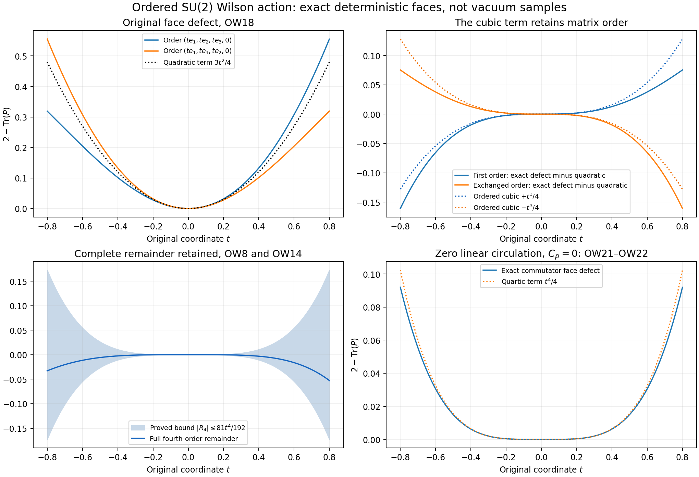
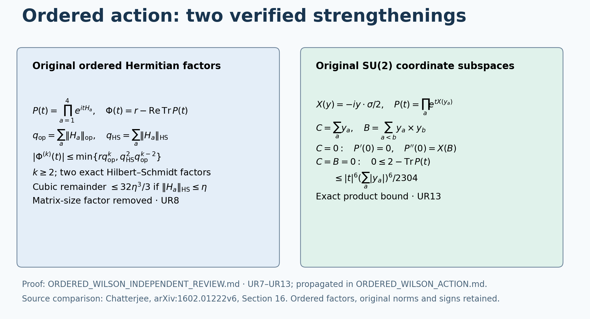

# The ordered Wilson action through its cubic term

This note reads and repairs three local proof defects in Sourav Chatterjee's original author source, [*The leading term of the Yang–Mills free energy*, arXiv:1602.01222v6](https://arxiv.org/abs/1602.01222v6), Section 16, Lemmas 16.1–16.2 and Theorem 16.3 (source labels `huerr`, `utohlmm`, `utohthm`). The complete comparison below is proved directly. No free-energy theorem, Gaussian approximation of the actual vacuum, or change of the original Hamiltonian is inferred from it.

## OW1. Original ordered matrices and the source step

For Hermitian matrices \(H_1,H_2,H_3,H_4\) of order \(r\), keep the ordered product
\[
 P(t)=e^{itH_1}e^{itH_2}e^{itH_3}e^{itH_4},\qquad
 \Phi(t)=r-\operatorname{Re}\operatorname{Tr}P(t),\qquad
 A=H_1+H_2+H_3+H_4.                                      \tag{OW1}
\]
For a face the four matrices are respectively the positive first edge, positive second edge, negative opposite first edge, and negative opposite second edge. These signs are part of their definitions. Products in OW1 are not commuted. The source's norm is the Hilbert–Schmidt norm; write \(\|\cdot\|_{\rm HS}\) and \(\|\cdot\|_{\rm op}\) separately here.

Two printed source definitions require coordinate corrections before making this comparison. At author-source line 1762, the last two edges in the definition of \(H(x,j,k)\) run from \(x+e_j+e_k\) through \(x+e_j\) to \(x\). They backtrack along the first two edges. Their displayed sum is therefore \(H_1+H_2-H_2-H_1=0\) for every assignment. The actual face returns through \(x+e_k\). Line 1832 gives the same backtracking coordinates in the definition of \(R(x,j,k)\). In contrast, the four matrices listed at lines 1848–1851 use the intended face coordinates. The exact repairs at lines 1762 and 1832 replace both occurrences of the intermediate return vertex \(x+e_j\) by \(x+e_k\); OW1 uses that complete oriented face. The earlier Wilson face definition at lines 235–241 also uses this intended face.

This is a nonzero mathematical defect, not an innocuous alternate path: assign a nonzero Hermitian matrix to the first positive face edge and zero to the other three. The intended circulation equals that matrix, whereas the printed backtracking sum is zero. The two paths and their quadratic forms are thus explicitly compared. This note does not silently attribute the repaired path to the printed definition.

Independently of those coordinate errors, the source defines \(\phi(U)=\operatorname{Re}\operatorname{Tr}(I-U)\). For a unitary matrix \(U\),
\[
 \phi(U)=\tfrac12\|I-U\|_{\rm HS}^{2}.
\]
For an arbitrary square matrix \(R\), the exact identity instead is
\[
 \tfrac12\|I-R\|_{\rm HS}^{2}
 =\phi(R)+\tfrac12\operatorname{Tr}(R^*R-I).              \tag{OW2}
\]
Expansion of \((I-R)^*(I-R)\) proves OW2 term by term. At author-source lines 1843–1844, equation `phiur` identifies \(\phi(P)-\phi(R)\) with half the difference of these squared norms, where \(R\) is a product of the quadratic Taylor polynomials. Such \(R\) need not be unitary. For example, set \(H_1=\operatorname{diag}(x,-x)\) and \(H_2=H_3=H_4=0\), for real \(x\ne0\). Then
\[
 R=I+iH_1-H_1^2/2,\quad
 R^*R=(1+x^4/4)I,\quad
 \phi(R)=x^2,\quad
 \tfrac12\|I-R\|_{\rm HS}^{2}=x^2+x^4/4.                 \tag{OW3}
\]
Thus that equality has a nonzero defect even with traceless Hermitian matrices and the intended face coordinates. It also fails if the backtracking definition is retained: in the same assignment that definition gives \(R_{\rm back}=(1+x^4/4)I\), so \(\phi(R_{\rm back})=-x^4/2\), while \(\|I-R_{\rm back}\|_{\rm HS}^2/2=x^8/16\). The cubic-order conclusion can be retained after the coordinate repair: directly,
\[
 |\phi(P)-\phi(R)|
 =|\operatorname{Re}\operatorname{Tr}(R-P)|
 \le\sqrt r\,\|R-P\|_{\rm HS}.                          \tag{OW4}
\]
Cauchy–Schwarz against the identity matrix proves the last inequality. The following calculation supplies a complete alternative proof, explicit constants and the ordered cubic contribution, so it does not depend on the invalid intermediate equality. The correction is to this v6 proof step, not a claim that the paper's free-energy theorem is false.

## OW2. Exact Taylor coefficients and integral remainders

Put \(q=\sum_{a=1}^4\|H_a\|_{\rm op}\). For every integer \(k\ge0\), the product rule gives
\[
 P^{(k)}(t)=\sum_{k_1+\cdots+k_4=k}
 \frac{k!}{k_1!k_2!k_3!k_4!}
 \prod_{a=1}^4\big[(iH_a)^{k_a}e^{itH_a}\big].          \tag{OW5}
\]
Every product is in the original order. Since each exponential is unitary for real \(t\), submultiplicativity and the scalar multinomial formula prove
\[
 \|P^{(k)}(t)\|_{\rm op}\le q^k,\qquad
 |\Phi^{(k)}(t)|\le r q^k\quad(k\ge1).                 \tag{OW6}
\]
The trace bound follows by summing the \(r\) diagonal matrix elements in an orthonormal basis. No smallness assumption on the \(H_a\) is used.

At zero, \(\Phi(0)=\Phi'(0)=0\). The full quadratic and cubic coefficients before taking the real trace are
\[
 \begin{split}
 P(t)={}&I+itA-t^2\left[\tfrac12\sum_aH_a^2+
                  \sum_{a<b}H_aH_b\right]-it^3 B_3
                  +\text{the exact fourth-order integral remainder},\\
 B_3={}&\tfrac16\sum_aH_a^3+
 \tfrac12\sum_{a<b}(H_a^2H_b+H_aH_b^2)
                  +\sum_{a<b<c}H_aH_bH_c .
 \end{split}                                               \tag{OW7}
\]
This follows by selecting all ordered degree partitions in OW5 for \(k=1,2,3\). The traces of \(H_a^3\), \(H_a^2H_b\), and \(H_aH_b^2\) are real: take the adjoint and use cyclicity of the trace. Similarly \(\operatorname{Tr}(H_aH_b)=\operatorname{Tr}(H_bH_a)\), so the quadratic trace is \(\operatorname{Tr}(A^2)/2\). Consequently the scalar identity with its entire remainder is
\[
 \boxed{\Phi(1)=\tfrac12\operatorname{Tr}(A^2)
 -\sum_{a<b<c}\operatorname{Im}\operatorname{Tr}(H_aH_bH_c)
 +\mathcal R_4,\quad
 \mathcal R_4=\frac16\int_0^1(1-t)^3\Phi^{(4)}(t)\,dt,\quad
 |\mathcal R_4|\le\frac{r q^4}{24}.}                     \tag{OW8}
\]
Taylor's integral formula follows by integrating the fourth derivative four times; \(\int_0^1(1-t)^3dt=1/4\) gives the stated constant. Keeping instead the third derivative gives the complete quadratic comparison
\[
 \boxed{\Phi(1)=\tfrac12\|A\|_{\rm HS}^{2}+\mathcal R_3,
 \quad \mathcal R_3=\tfrac12\int_0^1(1-t)^2\Phi'''(t)\,dt,
 \quad |\mathcal R_3|\le\frac{r q^3}{6}.}                \tag{OW9}
\]
If all four original Hilbert–Schmidt norms are at most \(\eta\), then \(q\le4\eta\), and OW9 gives the explicit constant \(32r\eta^3/3\). This holds for every \(\eta\ge0\), strengthening the small-radius scope of the source lemma. The integral remainders remain the original remainders; their bounds do not replace them in identities.

For completeness, the ordered imaginary trace is the exact commutator term
\[
 \operatorname{Im}\operatorname{Tr}(H_aH_bH_c)
 =\frac{1}{2i}\operatorname{Tr}(H_a[H_b,H_c]).            \tag{OW10}
\]
Indeed the complex conjugate of the first trace is \(\operatorname{Tr}(H_cH_bH_a)=\operatorname{Tr}(H_aH_cH_b)\). Subtraction proves OW10 and retains its order and sign.

## OW3. Exact map to the original SU(2) link coordinates

Retain the programme generators \(T_\alpha=-i\sigma_\alpha/2\), with their radius-two metric. For every original positive link choose a vector \(x_e\in\mathbb R^3\) and put
\[
 X_e=\sum_{\alpha=1}^3x_e^\alpha T_\alpha,
 \qquad U_e=e^{X_e},\qquad H_e=-\tfrac12\sum_\alpha x_e^\alpha\sigma_\alpha,
 \qquad iH_e=X_e.                                        \tag{OW11}
\]
This is the original exponential map on all of \(\mathbb R^3\), without an injectivity assertion. It is a one-to-one coordinate chart on \(|x_e|<2\pi\) with image \(SU(2)\setminus\{-I\}\): the formula \(e^{X_e}=\cos(|x_e|/2)I+2\sin(|x_e|/2)X_e/|x_e|\), with its continuous value at zero, identifies the angle in \([0,\pi)\) and its direction uniquely. On a reverse edge use \(-x_e\) and \(U_e^{-1}\).

On the positively oriented original face \((z;d,e)\), \(d<e\), let
\[
 y_1=x_{(z;d)},\quad y_2=x_{(z+e_d;e)},\quad
 y_3=-x_{(z+e_e;d)},\quad y_4=-x_{(z;e)},\quad
 C_p=y_1+y_2+y_3+y_4,\quad q_p=\tfrac12\sum_{a=1}^4|y_a|.
                                                               \tag{OW12}
\]
All positive, negative and boundary edges are retained in this definition. The Pauli multiplication rule \((\sigma\cdot u)(\sigma\cdot v)=(u\cdot v)I+i\sigma\cdot(u\times v)\) gives
\[
 \operatorname{Tr}(H_aH_b)=\tfrac12y_a\cdot y_b,\quad
 \operatorname{Tr}(H_aH_bH_c)=-\tfrac{i}{4}y_a\cdot(y_b\times y_c),
 \quad \|H_a\|_{\rm op}=|y_a|/2.                         \tag{OW13}
\]
Insert every factor in OW8–OW9 to obtain, for the actual face defect \(D_p=2-\operatorname{Tr}P_p\),
\[
 \boxed{D_p=\tfrac14|C_p|^2+
 \tfrac14\sum_{a<b<c}y_a\cdot(y_b\times y_c)+R_{4,p},
 \qquad |R_{4,p}|\le\frac{(\sum_a|y_a|)^4}{192}.}        \tag{OW14}
\]
Here \(R_{4,p}\) is exactly the integral in OW8 for the four matrices in OW11–OW12. The comparison with only the quadratic term is
\[
 D_p=\tfrac14|C_p|^2+R_{3,p},\qquad
 |R_{3,p}|\le\frac{(\sum_a|y_a|)^3}{24}.                 \tag{OW15}
\]
Both statements hold for all selected exponential representatives, not only in a small-field event. The cubic term includes all four triples \(123,124,134,234\). It is not zero in general. Reversing the face replaces the list by \((-y_4,-y_3,-y_2,-y_1)\); the change of sign from each triple and the reversal of its order cancel. Thus OW14 has the same cubic scalar on the reversed face, as required by \(D(P^{-1})=D(P)\).

The full original Hamiltonian remains
\[
 H=\kappa K+b\sum_pD_p,\qquad
 \kappa=2g^2/a,\quad b=1/(2g^2a),\quad
 K=-\sum_{e,\alpha}X_{e,\alpha}^2.
\]
Consequently the exact potential, including its original scalar contribution, is
\[
 \boxed{b\sum_pD_p=\frac b4\sum_p|C_p|^2+
 \frac b4\sum_p\sum_{a<b<c}y_a\cdot(y_b\times y_c)+b\sum_pR_{4,p}.}
                                                               \tag{OW16}
\]
This is equality to the original \(b\sum_p(2-\operatorname{Tr}P_p)\); it has not discarded \(2bM\) from the operator or its vacuum equation. The electric operator is untouched. In particular, replacing it by a constant-coordinate Laplacian is not part of OW16.

For any selected representatives, OW16 and the triangle inequality prove the actual-vacuum comparison
\[
 \left|b\mu\sum_pD_p-
 \frac b4\mu\sum_p|C_p|^2-
 \frac b4\mu\sum_p\sum_{a<b<c}y_a\cdot(y_b\times y_c)\right|
 \le\frac b{192}\mu\sum_p\left(\sum_a|y_a|\right)^4.    \tag{OW17}
\]
One may use the principal chart outside the measure-zero link set \(U_e=-I\), assigning any representative on that set. The smooth positive vacuum is absolutely continuous with respect to product Haar, so these assignments do not change any expectation. The chart gives \(|x_e|<2\pi\) almost everywhere and makes all terms integrable. This supplies a finite exact bound, not an assertion that its right side is small. No independence or Gaussian law is used.

## OW4. Two fully evaluated original-coordinate tests

First set the ordered face list to \((t e_1,t e_2,t e_3,0)\). Direct quaternion multiplication gives
\[
 D_+(t)=2-2\cos^3(t/2)+2\sin^3(t/2),\quad
 D_-(t)=2-2\cos^3(t/2)-2\sin^3(t/2),                    \tag{OW18}
\]
where \(D_-\) uses the list \((t e_1,t e_3,t e_2,0)\). Both have quadratic term \(3t^2/4\), whereas their cubic terms are \(+t^3/4\) and \(-t^3/4\). Their exact difference is \(4\sin^3(t/2)\). This is an ordered nonabelian test, not a gauge-field probability measure. The remainder bound in each case is \(81t^4/192\), by OW14. Reversing an entire face preserves its defect; exchanging two entries is a different operation, and OW18 computes its effect.

Second retain the complete configuration CW42, with \(m=2L\), \(n=m+1\), \(\theta_i=\pi i/(2m)\), \(T=T_1\),
\[
 U_1=I,\qquad U_2(i,k,l)=e^{2\theta_iT},\qquad
 U_3(i,k,l)=e^{2\theta_kT},\qquad \alpha=\pi/(2m).
\]
All logarithm vectors are parallel. Each of the \(m^2n\) original 12 faces and \(m^2n\) original 23 faces has \(C_p=2\alpha e_1\); every 13 face has \(C_p=0\). Therefore every cubic term is zero, and direct multiplication, retaining all faces, gives
\[
 W=4m^2n(1-\cos\alpha),\quad
 W_{\rm quad}=2m^2n\alpha^2,\quad
 -\frac{m^2n\alpha^4}{6}\le W-W_{\rm quad}\le0.          \tag{OW19}
\]
For a proof of the bound, \(1-\cos\alpha\le\alpha^2/2\) follows by integrating \(\sin t\le t\); Taylor's fourth-order integral bound gives \(1-\cos\alpha\ge\alpha^2/2-\alpha^4/24\). Multiply both by \(4m^2n\). This uses the full commuting face sum, so its remainder is smaller than a bound based on four separate large link coordinates.

On the unchanged path \(m_j=2j^4\), \(a_j=1/(100j)\), \(g_j^2=\kappa_*/(200j)\), \(b_j=10000j^2/\kappa_*\), the finite potential comparison and its limits are
\[
 \begin{gathered}
 b_jW_{{\rm quad},j}=\frac{5000\pi^2}{\kappa_*}j^2(2j^4+1),\\
 -\frac{10000j^2}{\kappa_*}\frac{\pi^4(2j^4+1)}{384j^8}
 \le b_j(W_j-W_{{\rm quad},j})\le0,\\
 \frac{b_jW_j}{j^6}\longrightarrow\frac{10000\pi^2}{\kappa_*},\qquad
 j^2b_j(W_j-W_{{\rm quad},j})\longrightarrow-\frac{625\pi^4}{12\kappa_*}.
 \end{gathered}                                             \tag{OW20}
\]
Indeed \((1-\cos\alpha)-\alpha^2/2=-\alpha^4/24+O(\alpha^6)\), with the sixth derivative uniformly bounded by one; thus the omitted sixth-order contribution after multiplication by \(j^2b_jm_j^2n_j\) tends to zero. Substituting the displayed \(m_j,n_j,b_j,\alpha_j\) yields every constant in OW20. These are values on the explicit CW configuration, not expectations in the vacuum.

## OW5. The exact quartic term when the linear face circulation vanishes

Retain all four signed vectors and define \(B_p=\sum_{a<b}y_a\times y_b\). Direct expansion gives
\[
 \sum_{a<b<c}y_a\cdot(y_b\times y_c)=C_p\cdot B_p.       \tag{OW21}
\]
Terms with a repeated index vanish. For any distinct ordered triple \(a<b<c\), the remaining terms have coefficients \(+1,-1,+1\), so their sum is its one displayed triple product. This proves OW21 without a reordering of the matrix product. In particular the complete cubic term vanishes on the explicitly defined vector space \(C_p=0\).

On this vector space the leading fourth-order coefficient can also be calculated exactly. Let \(P_p(t)=c(t)I+2\sum_\alpha v^\alpha(t)T_\alpha\), with \(c(t)^2+|v(t)|^2=1\). Ordered quaternion multiplication of the four exponentials gives \(v(t)=tC_p/2+t^2B_p/4+O(t^3)\). This follows by choosing either one linear vector term or two linear vector terms; the vector part of the latter is their cross product in the original order. For \(C_p=0\), \(c(t)\to1\), and hence
\[
 2-2c(t)=\frac{2|v(t)|^2}{1+c(t)}
       =\frac{t^4}{16}|B_p|^2+O(t^5).
\]
This identifies the fourth derivative at zero; it does not replace a finite value by a truncated series. Taylor's exact fifth-order integral formula and OW6 give the full equality
\[
 \boxed{C_p=0:\quad D_p=\frac{|B_p|^2}{16}+R_{5,p},\qquad
 R_{5,p}=\frac1{24}\int_0^1(1-t)^4\Phi^{(5)}(t)\,dt,
 \quad |R_{5,p}|\le\frac{(\sum_a|y_a|)^5}{1920}.}        \tag{OW22}
\]
The denominator is \(120\cdot2^5/2=1920\), retaining the matrix dimension two and each original half-angle. For example the four-edge list \((t e_1,t e_2,-t e_1,-t e_2)\) has \(C_p=0\), \(B_p=2t^2e_3\). Direct quaternion multiplication gives its exact defect \(4\sin^4(t/2)\), whose quartic term is \(t^4/4\). Thus vanishing linear circulation does not remove the original magnetic defect. OW22 describes this exact space of configurations; it does not assume the actual vacuum is supported there.

## OW6. The exact positive defect of the ordered Taylor product

The omitted term in OW2 can itself be calculated without assuming unitarity. For the four original Hermitian matrices define \(Q_a=I+iH_a-H_a^2/2\), \(R=Q_1Q_2Q_3Q_4\), and \(Q_{>a}=Q_{a+1}\cdots Q_4\), with \(Q_{>4}=I\). Multiplication gives \(Q_a^*Q_a=I+H_a^4/4\). Telescoping in the original order therefore proves
\[
 \begin{split}
 R^*R-I&=\tfrac14\sum_{a=1}^4Q_{>a}^*H_a^4Q_{>a},\\
 \Delta(R):=\tfrac12\operatorname{Tr}(R^*R-I)
 &=\tfrac18\sum_{a=1}^4\|H_a^2Q_{>a}\|_{\rm HS}^2\ge0,\\
 \phi(P)-\phi(R)
 &=\tfrac12\big(\|I-P\|_{\rm HS}^2-\|I-R\|_{\rm HS}^2\big)
       +\Delta(R),\qquad P=e^{iH_1}e^{iH_2}e^{iH_3}e^{iH_4}.
 \end{split}                                               \tag{OW23}
\]
To see the telescoping identity, first insert \(Q_1^*Q_1-I\) inside the remaining three factors, then do the same with \(Q_2,Q_3,Q_4\); no two factors are interchanged. Taking traces identifies each summand as the displayed squared norm. If \(\|H_a\|_{\rm HS}\le\eta\) for every \(a\), then \(\|H_a^2\|_{\rm HS}^2\le\eta^4\) and \(\|Q_a\|_{\rm op}^2\le1+\eta^4/4\). Summing the resulting geometric series gives
\[
 0\le\Delta(R)\le\tfrac12\big[(1+\eta^4/4)^4-1\big].
\]
For \(\eta=0\) the same conclusion follows directly. Each \(Q_a\) is invertible because \(Q_a^*Q_a\ge I\). Hence every tail \(Q_{>a}\) is invertible, and the sum of squares in OW23 vanishes exactly when every \(H_a=0\). Thus the Taylor product used in the intended face is unitary only in that zero case. OW23 both quantifies and characterizes the defect in the source equality, while OW4 and OW8–OW9 repair the action comparison independently of it.

## OW7. Receiving calculation and source scope

OW14–OW17 supply the exact cubic and fourth-order quantities required for a weak-field comparison on the original programme objects. Their values under the actual vacuum remain part of the research calculation. The field words in [CW42–CW49](https://github.com/KokunoYumeto/yang-mills-interacting-workbench/blob/dbbcbaf7e8d50e41f7491dc9bbed1c0c6ed54b0c/yang-mills/continuations/20261011-central-signs-shrinking-window/CURVATURE_ROOTED_WORDS.md) are an explicit test of the comparison and preserve the large original odd phase proved in CW47–CW49. They do not establish that the actual vacuum concentrates near those configurations or follows a Gaussian law.

OW21–OW22 go one step further: on the exact zero-linear-circulation space the ordered commutator sum supplies the quartic magnetic energy. Its next receiving calculation is the actual-vacuum distribution of these original full terms, not an assumption that the cubic or quartic contribution can be omitted.

The source's lattice model is a Euclidean \(U(r)\) Wilson Gibbs measure. Its free-energy theorem is not an identification of the programme's continuous-time \(SU(2)\) Hamiltonian vacuum. The exact common map used here is the restriction of its intended ordered matrix expression to the traceless Hermitian matrices in OW11, with the printed coordinate repairs recorded above, followed by the unchanged original face map OW12 and coefficient \(b\) in OW16. Every comparison actually used is proved above, rather than importing a change of state.

Reading coverage: original v6 author TeX lines 187–430 for identity, definitions and statements, and 1756–1888 for the complete ordered action comparison and its proofs. The free-energy proof as a whole has not been read or applied. The downloaded v3 archive was retained for provenance but was not used as the source of a mathematical claim. Both archives remain intact; source hashes, the three exact v6 proof defects and their propagation are recorded in the private reading and claim ledgers. No claim of novelty is made.

## 8. Propagated improvements from the complete independent calculation

The complete derivation in [UR1–UR15](ORDERED_WILSON_INDEPENDENT_REVIEW.md) proves two strengthenings while retaining every earlier valid bound. For the general Hermitian matrices of OW5, put \(q_{\rm op}=\sum_a\|H_a\|_{\rm op}\) and \(q_{\rm HS}=\sum_a\|H_a\|_{\rm HS}\). Then
\[
 |\Phi^{(k)}(t)|\le\min\{r q_{\rm op}^k,
                  q_{\rm HS}^2q_{\rm op}^{k-2}\},\quad k\ge2,
 \qquad
 |R_3|\le q_{\rm HS}^2q_{\rm op}/6,\quad
 |R_4|\le q_{\rm HS}^2q_{\rm op}^2/24.
 \tag{OW24}
\]
To prove it without reordering the product, index its k differentiations by ordered derivative labels. In each term choose the first two differentiation labels for Hilbert–Schmidt estimates; every other differentiated factor uses its operator norm. Move factors only cyclically inside the trace and apply the Hilbert–Schmidt inner-product inequality to those two factors, retaining all intervening unitary matrices. Summing over all derivative labels factors the bound into the exact displayed product of norm sums. The other member of the minimum is OW6. Integration of the full third and fourth derivatives proves both remainder bounds. In particular \(\|H_a\|_{\rm HS}\le\eta\) gives \(|R_3|\le32\eta^3/3\), independently of r. The original SU(2) specialization has \(q_{\rm HS}=\sqrt2q_{\rm op}\), so its constants in OW14–OW17 stay exactly as stated.

On the exact original-coordinate locus \(C=\sum_a y_a=0\), \(B=\sum_{a<b}y_a\times y_b=0\), there is the stronger sixth-order estimate
\[
 0\le 2-\operatorname{Tr}\prod_{a=1}^4e^{tX(y_a)}
 \le \frac{|t|^6(\sum_a|y_a|)^6}{2304},\qquad t\in\mathbb R.
 \tag{OW25}
\]
Indeed \(P'(0)=X(C)=0\) and, by expanding the entire ordered second derivative, \(P''(0)=\sum_{a<b}[X(y_a),X(y_b)]=X(B)=0\). The third derivative has operator norm at most \(q_{\rm op}^3\), with \(q_{\rm op}=\sum_a|y_a|/2\). Its exact integral remainder gives \(\|P(t)-I\|_{\rm op}\le|t|^3q_{\rm op}^3/6\). The original product is unitary, so \(2-\operatorname{Tr}P=\tfrac12\|I-P\|_{\rm HS}^2\le\|I-P\|_{\rm op}^2\) in dimension two. Squaring and keeping the factor \(2^6\) proves (OW25). This is a calculation on the displayed coordinate locus, with no claim that the actual vacuum concentrates on it.

In OW17 the selected representatives must be measurable with finite fourth moments for its stated expectations. The supplied principal representatives \(|x_e|<2\pi\), with any measurable choice on the Haar-null exceptional set, satisfy this requirement. An arbitrary unbounded or nonmeasurable selection is not covered. This qualification does not change the original potential, vacuum or principal-chart calculation.

The figure records OW24–OW25 and UR8/UR13. It is a schematic of exact bounds, with no numerical or vacuum-concentration data. The complete original human source comparison remains OW1–OW4 and UR1–UR6; draw_ordered_review.py reproduces the figure.
