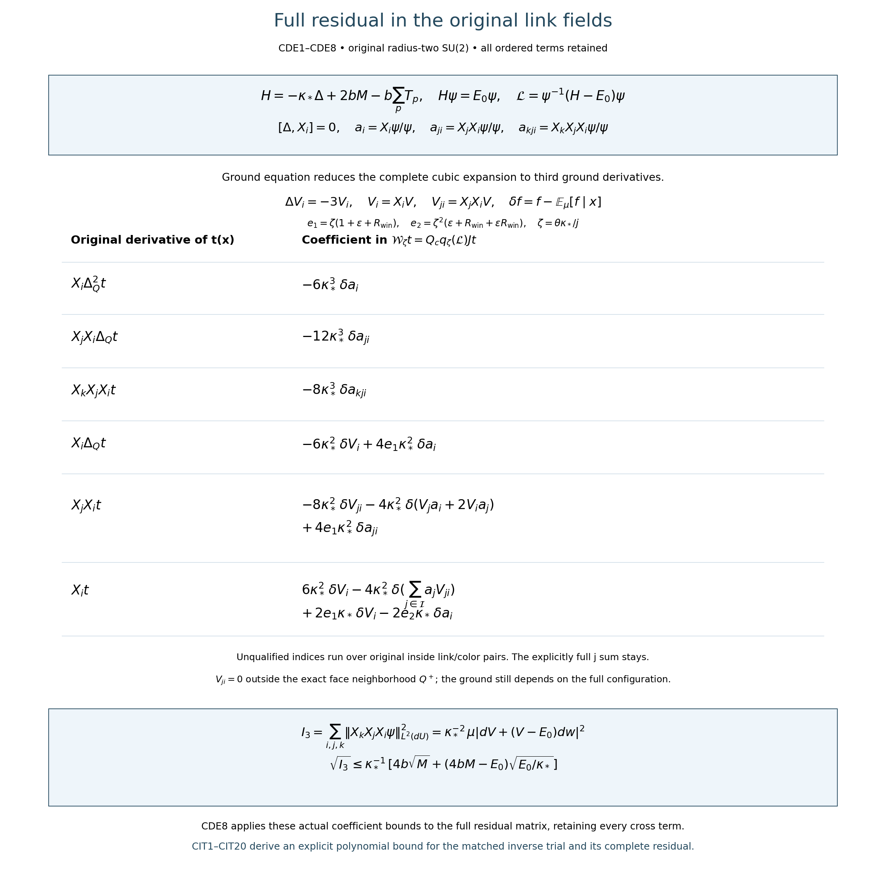

# Original-frame cubic residual and third ground derivatives

Derivation, 15 October 2026. The complete original differential expansion, its typed maps and ground derivative moments are proved below. CDE8 retains actual trial derivative norms and is not itself an evaluated bound from regulator data. The companion CIT1–CIT20 derives a complete residual upper estimate using weighted L2 graph bounds and the exact marginal unitary, retaining every outside component. Conditional expectation here is the stated integral operator, with no missing estimate assumed. The smooth interacting global no-gap result remains the programme goal.

The receiving construction is [FCC1–FCC13](https://github.com/KokunoYumeto/yang-mills-interacting-workbench/blob/059609ba52648a8c384db79df959c0e839f37ff0/yang-mills/continuations/20261011-central-signs-shrinking-window/FULL_CUBIC_SOURCE_COMPRESSION.md). The original score bound is [RHB1](https://github.com/KokunoYumeto/yang-mills-interacting-workbench/blob/059609ba52648a8c384db79df959c0e839f37ff0/yang-mills/continuations/20261011-central-signs-shrinking-window/ACTUAL_RESOLVENT_HESSIAN.md), with its use and ground-energy bounds in [QLR5](https://github.com/KokunoYumeto/yang-mills-interacting-workbench/blob/059609ba52648a8c384db79df959c0e839f37ff0/yang-mills/continuations/20261011-central-signs-shrinking-window/QUANTITATIVE_LOOP_RIGIDITY.md). HCB1 and the full original potential are retained. The index queries produced thirteen routing hits; none was read or used as an external mathematical source. No novelty is claimed.

## 1. Original fields, potential and ground equation

Keep the complete original regulator:
\[
\begin{gathered}
a=(100j)^{-1},\quad L=j^4,\quad g^2=\kappa_*a/2,\quad
b=(\kappa_*a^2)^{-1},\quad s_j=\kappa_*/j,\\
N=3(2L)(2L+1)^2,\quad M=3(2L)^2(2L+1),\\
V=2bM-b\sum_pT_p,\qquad
H=-\kappa_*\Delta+V,\qquad
H\psi=E_0\psi,\quad \psi>0,\quad\int\psi^2dU=1,\\
\mu=\psi^2dU,\quad w=\log\psi,\qquad
\mathcal L=\psi^{-1}(H-E_0)\psi .
\end{gathered}
\]
Every link has the radius-two metric, probability Haar measure and generators
\(T_\alpha=-i\sigma_\alpha/2\). Use the original left-multiplication fields
\[
(X_{e,\alpha}f)(U)=
\left.\frac{d}{dt}f(\ldots,\exp(tT_\alpha)U_e,\ldots)\right|_{t=0}.
\]
They are orthonormal and have bracket
\([X_{e,\alpha},X_{e,\beta}]=
-\sum_\gamma\epsilon_{\alpha\beta\gamma}X_{e,\gamma}\);
fields on different links commute. The bracket sign follows by differentiating the linear vector fields \(U\mapsto T_\alpha U\): their commutator is \((T_\beta T_\alpha-T_\alpha T_\beta)U\). No derivative word is reversed. Write \(i=(e,\alpha)\), with the full index set \(\mathcal I\), and
\(\Delta=\sum_{i\in\mathcal I}X_i^2\).
For each field,
\[
[\Delta,X_i]=0.
\]
Indeed the only contributing block is its own link. Its commutator is the contraction of the antisymmetric structure constants with
\(X_\alpha X_\gamma+X_\gamma X_\alpha\), which is zero after interchanging \(\alpha,\gamma\). This proves the commutation with every ordered word as well.

Keep the original source cube Q and its inside indices \(I\subset\mathcal I\).
For a smooth t depending only on its inside links,
\(\Delta t=\Delta_Qt\). Every derivative word below is ordered as written; it is not a symmetric covariant derivative.

Define the actual ratios with their exact inverse maps:
\[
a_i=\frac{X_i\psi}{\psi},\quad
a_{ji}=\frac{X_jX_i\psi}{\psi},\quad
a_{kji}=\frac{X_kX_jX_i\psi}{\psi};
\qquad
\psi a_{ji}=X_jX_i\psi,\quad
\psi a_{kji}=X_kX_jX_i\psi .
\]
Thus \(a_i=X_iw\), but higher a's are derivatives of the full ground, not higher derivatives of w alone. Also write
\(V_i=X_iV,\ V_{ji}=X_jX_iV\).
The constants \(2bM\) and \(E_0\) remain in the original equation. Their differentiated commutators vanish because they are constants.

## Typed maps for the original state and the retained complement

Let \(\mathscr H_\mu=L^2(\psi^2dU)\) on the full original link product and
\(\mathscr H_\rho=L^2(\rho(x)dx)\) on the original inside product, with
\(\rho(x)=\int\psi(x,y)^2dy\). All maps below also restrict to the subspaces fixed by the original gauge group; its action on inside functions is the restriction of the original vertex action. No quotient metric or factorization of the physical Hilbert space is used.

The ground multiplication and its inverse are
\[
\mathsf U:\mathscr H_\mu\longrightarrow L^2(dU),
\quad f\longmapsto\psi f,\qquad
\mathsf U^{-1}:L^2(dU)\longrightarrow\mathscr H_\mu,
\quad v\longmapsto v/\psi .
\]
They are unitary because \(\|\psi f\|_{L^2(dU)}^2=\int|f|^2d\mu\), and \(\psi\) is positive everywhere at the fixed original regulator. Smooth multiplication by \(\psi,\psi^{-1}\) preserves every integer Sobolev space. On their original operator domains,
\[
\mathcal L=\mathsf U^{-1}(H-E_0)\mathsf U,\qquad
q_\zeta(\mathcal L)=\mathsf U^{-1}q_\zeta(H-E_0)\mathsf U .
\]
The second equality follows by multiplying the first equality three times on \(H^6\), preserving all polynomial coefficients.

The inside inclusion and its actual adjoint are
\[
\begin{aligned}
J:\mathscr H_\rho&\longrightarrow\mathscr H_\mu,
& (Jt)(x,y)&=t(x),\\
J^*:\mathscr H_\mu&\longrightarrow\mathscr H_\rho,
& (J^*f)(x)&=\rho(x)^{-1}\int\psi(x,y)^2f(x,y)\,dy .
\end{aligned}
\]
Fubini proves \(\langle Jt,f\rangle_\mu=\langle t,J^*f\rangle_\rho\) and
\(J^*J=I_{\mathscr H_\rho}\). Thus
\[
P=JJ^*:\mathscr H_\mu\to J\mathscr H_\rho,\qquad
Q_c=I-P:\mathscr H_\mu\to\ker J^*,\qquad
f=JJ^*f+Q_cf .
\]
The summands are orthogonal because \(J^*Q_cf=0\). In particular the word “conditional” names this explicitly defined integral operator. It is not an additional unproved hypothesis.

For completeness the gauge restrictions commute with these maps. A vertex gauge transformation sends inside links to inside links and outside links to outside links. The original positive unique ground is invariant. Changing the outside Haar variables proves invariance of \(\rho\) and intertwining of \(J^*\); the inclusion identity proves intertwining of J. Hence P, \(Q_c\) and the displayed decomposition preserve the physical invariant subspace.

The complete source fits in \(J\mathscr H_\rho\): for each original source face,
\[
F_p(x)=a(\mu T_p-T_p(x))/2\in\mathscr H_\rho,\qquad
Z_p=JF_p\in\mathscr H_\mu .
\]
This does not say that all full-system states lie in that subspace. The full Hamiltonian coupling to \(\ker J^*\) is retained.

FCC4–FCC5 prove the domains and smooth inverse for
\[
\mathcal B_\zeta:
H^6(Q,\rho dx)\longrightarrow\mathscr H_\rho,\qquad
\mathcal B_\zeta t=J^*q_\zeta(\mathcal L)Jt .
\]
Here \(H^6(Q,\rho dx)\) denotes the sixth Sobolev space on the full original inside link product, not a spatial continuum domain. The original source cube determines that product. At each fixed regulator smooth positive weights give the same Sobolev class with equivalent norms. Its inverse is a bounded map
\(\mathcal B_\zeta^{-1}:\mathscr H_\rho\to H^6(Q,\rho dx)\);
this statement does not assign a uniform inverse Sobolev bound along j.

Consequently the full trial and residual maps have types
\[
\begin{aligned}
\mathcal T_\zeta=J\mathcal B_\zeta^{-1}
&:\mathscr H_\rho\longrightarrow H^6(\text{full},\mu),\\
\mathcal W_\zeta
&:H^6(Q,\rho dx)\longrightarrow\ker J^*\subset\mathscr H_\mu,\\
\mathcal W_\zeta t&=Q_cq_\zeta(\mathcal L)Jt .
\end{aligned}
\]
CDE1–CDE4 are identities of maps on \(C^\infty(Q)\) into
\(C^\infty(\text{full})\), within these operator domains. Their original-field expansion proves that every complementary term is retained.

For an actual source column put \(t_p=\mathcal B_\zeta^{-1}F_p\) and
\(u_p=Jt_p\). The exact full equation and inverse correction are
\[
q_\zeta(\mathcal L)u_p=Z_p+\mathcal W_\zeta t_p,\qquad
q_\zeta(\mathcal L)^{-1}Z_p
=u_p-q_\zeta(\mathcal L)^{-1}\mathcal W_\zeta t_p .
\]
Applying \(J^*\) proves the compressed equation, and applying \(Q_c\) produces its complete complementary residual. Multiplying the full equation by the entire inverse proves the second equality. Setting this residual to zero would require additional mathematics; it has not been set to zero here.

## 2. Expand the full Schrödinger powers without fifth ground derivatives

For every ordered word \(X_J\) and every smooth f, the product rule and ground equation give
\[
\begin{split}
(H-E_0)((X_J\psi)f)
={}&-\kappa_*(X_J\psi)\Delta f
-2\kappa_*\sum_{h\in\mathcal I}(X_hX_J\psi)X_hf\\
&+[V,X_J]\psi\,f .
\end{split}\tag{CDE1}
\]
The Casimir commutation proves
\((H-E_0)X_J\psi=[V,X_J]\psi\).
In particular
\[
[V,X_i]\psi=-V_i\psi,\qquad
[V,X_jX_i]\psi=-V_jX_i\psi-V_{ji}\psi-V_iX_j\psi .
\]
No derivative order is interchanged in the second formula.

Apply CDE1 first to \(\psi t\) and then to its two resulting types of terms:
\[
\begin{aligned}
\mathcal Lt={}&-\kappa_*\Delta_Qt
-2\kappa_*\sum_{i\in I}a_iX_it,\\
\mathcal L^2t={}&\kappa_*^2\Delta_Q^2t
+4\kappa_*^2\sum_{i\in I}a_iX_i\Delta_Qt\\
&+4\kappa_*^2\sum_{i,j\in I}a_{ji}X_jX_it
+2\kappa_*\sum_{i\in I}V_iX_it .
\end{aligned}\tag{CDE2}
\]
For example applying \(H-E_0\) to
\(-2\kappa_*(X_i\psi)X_it\) gives the second copy of
\(2\kappa_*^2(X_i\psi)X_i\Delta_Qt\), the displayed second-derivative term and the positive \(2\kappa_*V_i\psi X_it\).
The two first-derivative copies add to the factor four.

Applying CDE1 once more gives the complete ordered formula
\[
\begin{aligned}
\mathcal L^3t={}&-\kappa_*^3\Delta_Q^3t
-6\kappa_*^3\sum_{i\in I}a_iX_i\Delta_Q^2t\\
&-12\kappa_*^3\sum_{i,j\in I}a_{ji}X_jX_i\Delta_Qt
-8\kappa_*^3\sum_{i,j,k\in I}a_{kji}X_kX_jX_it\\
&-6\kappa_*^2\sum_{i\in I}V_iX_i\Delta_Qt
-8\kappa_*^2\sum_{i,j\in I}V_{ji}X_jX_it\\
&-4\kappa_*^2\sum_{i,j\in I}(V_ja_i+2V_ia_j)X_jX_it\\
&-2\kappa_*^2\sum_{i\in I}(\Delta V_i)X_it
-4\kappa_*^2\sum_{\substack{i\in I\\j\in\mathcal I}}a_jV_{ji}X_it .
\end{aligned}\tag{CDE3}
\]
Here is the complete coefficient accounting. The first term of CDE2 gives coefficients \(-1,-2\) for \(\Delta_Q^3t,a_iX_i\Delta_Q^2t\). Its second term gives \(-4,-8,-4\) for \(a_iX_i\Delta_Q^2t,a_{ji}X_jX_i\Delta_Qt,V_iX_i\Delta_Qt\), each with the indicated power of \(\kappa_*\). Its third term gives \(-4,-8\) for \(a_{ji}X_jX_i\Delta_Qt,a_{kji}X_kX_jX_it\), and the three commutator contributions
\(-4\kappa_*^2(V_ja_i+V_{ji}+V_ia_j)X_jX_it\).
Finally the fourth term of CDE2 gives
\[
\begin{split}
&-2\kappa_*^2(\Delta V_i)X_it
-4\kappa_*^2\sum_jV_{ji}X_jX_it
-2\kappa_*^2V_iX_i\Delta_Qt\\
&\quad-4\kappa_*^2\sum_j a_jV_{ji}X_it
-4\kappa_*^2\sum_j a_jV_iX_jX_it .
\end{split}
\]
In terms containing \(X_jX_it\), the outside j terms vanish. They do not vanish in the term \(a_jV_{ji}X_it\). Adding these contributions gives exactly CDE3.

The original Wilson potential satisfies
\[
\Delta V=6bM-3V,\qquad \Delta V_i=-3V_i .
\]
Each of the four face links contributes the original Casimir \(3/4\), so
\(\Delta T_p=-3T_p\); differentiating the entire resulting potential identity, using the proved Casimir commutation, proves the second equality. Thus the penultimate line of CDE3 becomes
\(+6\kappa_*^2\sum_{i\in I}V_iX_it\).
This substitution has been proved for the actual potential, rather than assigned to an auxiliary state.

Only third ordered ground derivatives occur. In particular the fifth derivatives produced by differentiating the logarithmic drift twice have been eliminated by the original ground equation, with every potential contribution retained.

## 3. Project the actual complete cubic residual

Use precisely FCC's conditional expectation
\[
\mathbb E[f\mid x]=\rho(x)^{-1}\int\psi(x,y)^2f(x,y)dy,\quad
\delta f=f-\mathbb E[f\mid x],
\quad \rho(x)=\int\psi(x,y)^2dy .
\]
The symbol \(\delta\) does not commute through derivatives. It is applied only after the full coefficients in CDE3 have been computed.
Let \(Q_c=I-JJ^*\) and retain
\[
q_\zeta(\lambda)=\lambda^3+e_1\lambda^2+e_2\lambda+e_3
=(\lambda+\zeta)(\lambda+\varepsilon\zeta)(\lambda+R_{\rm win}\zeta).
\]
Here \(e_1=\zeta(1+\varepsilon+R_{\rm win})\),
\(e_2=\zeta^2(\varepsilon+R_{\rm win}+\varepsilon R_{\rm win})\),
\(e_3=\varepsilon R_{\rm win}\zeta^3\), and
\(\zeta=\theta\kappa_*/j\) on the original target path.
All derivatives of t are inside-measurable. Conditional projection of CDE2–CDE3 therefore gives
\[
\begin{aligned}
\mathcal W_\zeta t={}&
-6\kappa_*^3\sum_i\delta a_i\,X_i\Delta_Q^2t
-12\kappa_*^3\sum_{i,j}\delta a_{ji}\,X_jX_i\Delta_Qt\\
&-8\kappa_*^3\sum_{i,j,k}\delta a_{kji}\,X_kX_jX_it\\
&-6\kappa_*^2\sum_i\delta V_i\,X_i\Delta_Qt
-8\kappa_*^2\sum_{i,j}\delta V_{ji}\,X_jX_it\\
&-4\kappa_*^2\sum_{i,j}\delta(V_ja_i+2V_ia_j)\,X_jX_it\\
&+6\kappa_*^2\sum_i\delta V_i\,X_it
-4\kappa_*^2\sum_i\delta\!\left(\sum_{j\in\mathcal I}a_jV_{ji}\right)X_it\\
&+e_1\left[
4\kappa_*^2\sum_i\delta a_i\,X_i\Delta_Qt
+4\kappa_*^2\sum_{i,j}\delta a_{ji}\,X_jX_it
+2\kappa_*\sum_i\delta V_i\,X_it\right]\\
&-2\kappa_*e_2\sum_i\delta a_i\,X_it .
\end{aligned}\tag{CDE4}
\]
All indices without an explicit qualification belong to I. This is the same
\(\mathcal W_\zeta=Q_cq_\zeta(\mathcal L)J\) as FCC5, proved directly in the original link fields. The bare \(\Delta_Q^3t,\Delta_Q^2t,\Delta_Qt,t\) terms have zero complement because they are inside-measurable; their original coefficients were retained before applying the projection.

The outside derivative in the fourth line is essential. Let \(Q^+\) consist of Q's links and every outside link sharing an original face with an inside link. Then \(V_{ji}=0\) when \(i\in I\) and j is outside \(Q^+\). Consequently only that exact face neighborhood contributes there. The actual ground derivatives still depend on the full configuration; no finite-range dependence of the ground is asserted.

## 4. Full ground derivative norms through order three

Let \(C=-\Delta\) on the original Haar space and define
\[
I_m=\sum_{i_1,\ldots,i_m\in\mathcal I}
\int\left|\frac{X_{i_m}\cdots X_{i_1}\psi}{\psi}\right|^2d\mu
=\sum_{i_1,\ldots,i_m}
\|X_{i_m}\cdots X_{i_1}\psi\|_{L^2(dU)}^2 .
\]
Integration by parts in each original Haar field, followed by its commutation with C, gives \(I_m=\langle\psi,C^m\psi\rangle\). To verify the induction, sum the outermost differentiated squared norm to obtain C on the remaining word; commute C to the undifferentiated argument and repeat. There is no replacement of ordered derivatives by symmetric tensors. The ground equation gives
\[
\begin{gathered}
I_1=\frac{E_0-\mu V}{\kappa_*},\qquad
I_2=\frac{\mu[(V-E_0)^2]}{\kappa_*^2},\\
I_3=\frac1{\kappa_*^2}
\mu\left|dV+(V-E_0)dw\right|^2\\
=\frac1{\kappa_*^2}
\mu\left[(V-E_0)^2|dw|^2-(V-E_0)(6bM-3V)\right].
\end{gathered}\tag{CDE5}
\]
Indeed \(C\psi=(E_0-V)\psi/\kappa_*\). Thus
\(I_3=\|d(C\psi)\|_{L^2(dU)}^2\), proving the first expression. Weighted integration of
\(\operatorname{div}((V-E_0)dV)\) gives
\(2\mu[(V-E_0)\langle dV,dw\rangle]
=-\mu[|dV|^2+(V-E_0)\Delta V]\).
Substituting this in the square proves the second expression, including its sign and the entire potential scalar.

The constant trial function gives \(0\le E_0\le2bM\); nonnegativity of the original potential gives \(\mu V\le E_0\). Set
\[
A_0=4bM-E_0.
\]
The original potential range \(0\le V\le4bM\) implies
\(|V-E_0|\le A_0\). For each edge,
\(|d_eT_p|^2=1-T_p^2/4\le1\) when e belongs to p.
Writing \(r_e\le4\) for its actual face incidence,
\[
|dV|^2\le b^2\sum_e r_e^2
\le4b^2\sum_e r_e=16b^2M .
\]
It follows, without substituting a reference density, that
\[
\begin{gathered}
I_1\le E_0/\kappa_*,\qquad I_2\le A_0^2/\kappa_*^2,\\
\sqrt{I_3}\le
\frac{4b\sqrt M+A_0\sqrt{(E_0-\mu V)/\kappa_*}}{\kappa_*}
\le
\frac{4b\sqrt M+A_0\sqrt{E_0/\kappa_*}}{\kappa_*}.
\end{gathered}\tag{CDE6}
\]
All these are finite evaluated original-state coefficient bounds. They have no inverse-\(\zeta\) factor. They need not be small as j increases. Restricting any derivative sum to inside indices can only lower it.

The original energy remains in CDE5–CDE6. Eliminating it only for independent upper functions gives
\[
\begin{gathered}
\sqrt{I_1}\le\sqrt{2bM/\kappa_*},\quad
\sqrt{I_2}\le4bM/\kappa_*,\\
\sqrt{I_3}\le
\kappa_*^{-1}[4b\sqrt M+4bM\sqrt{2bM/\kappa_*}]\\
=\frac{40000j^2\sqrt{24j^{12}+12j^8}}{\kappa_*^2}
+\frac{40000\sqrt{20000}\,j^3(24j^{12}+12j^8)^{3/2}}{\kappa_*^3}.
\end{gathered}
\]
Both summands and their original finite-regulator counts remain. This is an upper bound with leading growth \(j^{21}\), not the growth of the actual derivative norm and not a small-residual estimate.

## 5. Original incidence bounds for every potential coefficient

For original edges e,f, let \(n_{ef}\) be the number of faces containing both, including e=f. Let \(r_e^\times,n_{ef}^\times\) count only faces crossing Q's link partition. Define the actual finite constants
\[
\begin{gathered}
P_{1,Q}=b\left(\sum_{e\in Q}r_e^2\right)^{1/2},\qquad
P_{1,\times}=b\left(\sum_{e\in Q}(r_e^\times)^2\right)^{1/2},\\
P_{2,\times}=\frac{3b}{2}
\left(\sum_{e,f\in Q}(n_{ef}^\times)^2\right)^{1/2},\qquad
P_{2,+}=\frac{3b}{2}
\left(\sum_{\substack{e\in Q\\f\in Q^+}}n_{ef}^2\right)^{1/2},\\
A_Q=2\pi c\sqrt{N_Q},\quad A_+=2\pi c\sqrt{|Q^+|},\quad
c=\frac2{\kappa_*a}.
\end{gathered}
\]
The last two are the original per-link score bound from HCB1/RHB1. For completeness, restriction of w to any original closed unit-speed link geodesic gives \(w''\ge-c\) with period \(4\pi\). If its derivative at zero is m, then \(w'(t)\ge m-ct\) on \([0,4\pi]\); zero total integral yields \(m\le2\pi c\). Reversing direction gives the lower bound. Taking a geodesic in the gradient direction proves \(|d_ew|\le2\pi c\); sum over the actual selected links.

Every ordered second derivative of a face trace has modulus at most \(1/2\) when its two links belong to that face: differentiating inserts two original matrices \(T_\alpha\), each of norm \(1/2\), into a unitary word, and \(|\operatorname{Tr}A|\le2\|A\|\). This remains true for two derivatives on the same link and for an inverse factor, with all original signs retained before bounding. Therefore the factor nine from the two color indices gives exactly the coefficient \(3b/2\) above.

Conditional centering is an orthogonal projection in the actual \(L^2(\mu)\). Internal potential terms are inside-measurable, while outside potential terms have zero inside derivative. Thus
\[
\begin{gathered}
\|\delta(V_i)_{i\in I}\|_2\le P_{1,\times},\qquad
\|\delta(V_{ji})_{i,j\in I}\|_2\le P_{2,\times},\\
\|\delta(V_ja_i+2V_ia_j)_{i,j\in I}\|_2
\le3P_{1,Q}A_Q,\\
\left\|\delta\left(\sum_{j\in\mathcal I}a_jV_{ji}\right)_{i\in I}\right\|_2
\le P_{2,+}A_+ .
\end{gathered}\tag{CDE7}
\]
For the third line, the two outer products have norms
\(|d_QV||d_Qw|\) and \(2|d_QV||d_Qw|\); their sum is bounded by the displayed factor three. For the last line use the complete rectangular derivative matrix with its exact neighborhood support from CDE4, its Hilbert–Schmidt bound and the original score norm on \(Q^+\). These estimates do not assert independence or delete a covariance.

## 6. Unfinished residual calculation: trial derivative norms remain unevaluated

For every smooth t define its actual derivative sizes
\[
D_{m,r}(t)=
\sup_x\left(\sum_{i_1,\ldots,i_m\in I}
|X_{i_m}\cdots X_{i_1}\Delta_Q^r t(x)|^2\right)^{1/2}.
\]
These are finite at each regulator for the FCC solutions; they are not assumed to have a prescribed size. Put
\[
\begin{gathered}
B_1=\min\{\sqrt{E_0/\kappa_*},A_Q\},\qquad B_2=A_0/\kappa_*,\\
B_3=\kappa_*^{-1}
[4b\sqrt M+A_0\sqrt{E_0/\kappa_*}].
\end{gathered}
\]
CDE5–CDE6 and conditional projection bound the L2 norms of the centered inside ground derivative arrays by \(B_1,B_2,B_3\), respectively. Applying Cauchy–Schwarz to each entire array in CDE4, then the triangle inequality, proves
\[
\begin{aligned}
\|\mathcal W_\zeta t\|_2\le\mathcal R_\zeta(t):={}&
6\kappa_*^3B_1D_{1,2}(t)
+12\kappa_*^3B_2D_{2,1}(t)
+8\kappa_*^3B_3D_{3,0}(t)\\
&+6\kappa_*^2P_{1,\times}D_{1,1}(t)
+8\kappa_*^2P_{2,\times}D_{2,0}(t)\\
&+12\kappa_*^2P_{1,Q}A_QD_{2,0}(t)\\
&+6\kappa_*^2P_{1,\times}D_{1,0}(t)
+4\kappa_*^2P_{2,+}A_+D_{1,0}(t)\\
&+e_1[4\kappa_*^2B_1D_{1,1}(t)
+4\kappa_*^2B_2D_{2,0}(t)
+2\kappa_*P_{1,\times}D_{1,0}(t)]\\
&+2\kappa_*e_2B_1D_{1,0}(t).
\end{aligned}\tag{CDE8}
\]
Every original term of CDE4 is represented, including the outside-score term. This inequality retains the full complementary forcing and original incidence constants, but does not evaluate its size from the original input data. It still contains the actual derivatives of the matched inverse trial \(t_p=\mathcal B_\zeta^{-1}F_p\).

In FCC notation it gives
\[
|R_{pq}|\le\mathcal R_\zeta(t_p)\mathcal R_\zeta(t_q),\qquad
\varphi^*R\varphi
\le\left(\sum_p|\varphi_p|\mathcal R_\zeta(t_p)\right)^2
\le\left(\sum_p\mathcal R_\zeta(t_p)^2\right)\sum_p|\varphi_p|^2 .
\]
These bounds retain raw coefficients and all possible cross-face terms. They do not assign a small value to R. For its exact entries, write CDE4 as a finite sum
\(\mathcal W_\zeta t=\sum_A\delta c_A\,d_A t\), with each coefficient and ordered derivative taken from its displayed terms, including all original numerical factors. Then
\[
R_{pq}
=\int\rho(x)\sum_{A,B}
\overline{d_A t_p(x)}
\left(\mathbb E[\overline{c_A}c_B\mid x]
-\overline{\mathbb E[c_A\mid x]}\mathbb E[c_B\mid x]\right)
d_Bt_q(x)\,dx .
\]
This follows by substituting both full sums and performing the original outside integration. It is the precise conditional covariance map for the new derivative representation. No term in its A,B sum is removed.

CDE8 leaves the actual derivative estimate for \(\mathcal B_\zeta^{-1}F_p\) in these original norms, using its now explicit coefficients and the full marginal state. The existence of smooth inverse solutions and the positive lower bound \(e_3\) alone do not evaluate these derivative sizes along j. The signed trial matrix and filtered cross terms in FCC11–FCC13 also remain. No annular spectral mass, reconstructed continuum state or global no-gap conclusion is asserted.

The exact rational diagnostic uses a positive function
\(\psi=1+x_0/5+x_1/7\) on the original quaternion sphere and its constructed potential
\(V=E+\kappa_*\Delta\psi/\psi\). It checks CDE2–CDE3 before the Wilson-only substitution, the noncommuting Casimir, the complete three-shift polynomial and the ground equation. This fixture is not a Wilson vacuum and supplies no estimate of its spectral measure.

Additional exact Haar moments check every ordered derivative through order three, retaining the unit-state norm. An explicit positive two-link fixture verifies a nonzero outside-index contribution, which vanishes at the outside identity and therefore is not inside-measurable. These checks support the coefficient and order audit; they do not replace the written proof.

The coefficient table contains every term of CDE4, with the original ordered derivatives and full outside-index sum. The lower panel gives the actual full-state third derivative identity and its explicit bound. The final line points to CIT1–CIT20, which bounds the complete residual by a proved weighted L2 graph estimate; it does not substitute unproved values for CDE8's supremum norms. Figure source: [figure_cubic_differential.py](figure_cubic_differential.py). Exact rational diagnostics: [check_cubic_differential.py](check_cubic_differential.py). The rendered figure was inspected after correcting its plot limits; no potential, source or spectral mass is simulated.

## Evaluated inverse-trial receiver

[CIT1–CIT20](https://github.com/KokunoYumeto/yang-mills-interacting-workbench/blob/main/yang-mills/continuations/20261011-central-signs-shrinking-window/CUBIC_INVERSE_TRIAL_BOUNDS.md) retain the full CDE4 differential expression, derive actual ground derivative ceilings through order six, and estimate the matched trial in the original weighted L2 graph norms. The exact marginal unitary includes every derivative of its inverse multiplier. This proves an explicit polynomial upper bound for the entire residual and both source-matrix consequences. Its original-path growth is also evaluated; the bound remains too large to establish surviving spectral mass. CDE8 and all its original terms remain as a separate valid inequality.

## Full cubic flux and stronger residual energy bound

[WCR1–WCR15](https://github.com/KokunoYumeto/yang-mills-interacting-workbench/blob/main/yang-mills/continuations/20261011-central-signs-shrinking-window/FULL_CUBIC_FLUX_AND_RESIDUAL_ENERGY.md) retain every original cubic coefficient, conditional covariance and outside flux. The exact typed divergence map has an isometric resolvent right inverse, and
\[
\begin{gathered}
\mathfrak b_r=\|(\widetilde{\mathcal F},\widetilde{\mathcal S})\|_{\mathscr V}^2
-\|(\widetilde{\mathcal F},\widetilde{\mathcal S})-\mathfrak JW_r\|_{\mathscr V}^2,\\
\mathsf B_{{\rm res},50j}\le\Xi_\zeta^{\rm best}\mathsf S,\qquad
\Xi_\zeta^{\rm best}=\min\{\Xi_\zeta,\widehat{\mathfrak P}_\zeta^2/\zeta\}.
\end{gathered}
\]
All six coefficient divergences and complete finite derivative bounds are proved. The new upper coefficient has exact growth degree76, compared with degree91 for the inherited one; its full leading constant and every finite term are retained. WCR15 propagates the bound through both signed matrix orders. These upper functions do not establish vanishing tail error or measure actual residual growth. The smooth global no-gap result remains the programme goal.
