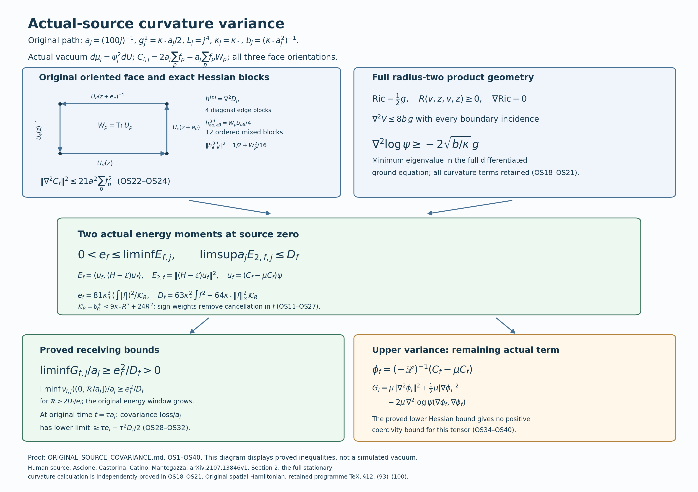

# Actual-source curvature variance and the full ground-state Hessian

All results below concern the original finite-volume positive vacuum.
The observable is \(C_{f,j}=a_j\sum_p f(x_{p,j})(2-W_p)\), with all
three original face orientations. Its scalar summand \(2a_j\sum_p f(x_{p,j})\)
is retained. The proof gives a direct lower bound of order \(a_j\) for
its centered variance for every nonzero real continuous compactly
supported \(f\). It also bounds the second energy moment by order
\(a_j^{-1}\), and proves explicit original-time and spectral receiving
estimates. It does not identify this observable with a continuum field
or prove a variance upper bound of order \(a_j\).

## 1. Original configuration, scalar, metric and actual vacuum

For an integer \(m\ge1\), use precisely
\[
\begin{split}
 V&=\{0,\ldots,m\}^3,\\
 E&=\{(z,d):z,z+e_d\in V,\ d=1,2,3\},\\
 \mathcal P&=\{(z;d,e):d<e,\ z,z+e_d,z+e_e,z+e_d+e_e\in V\},\\
 U_p&=U_d(z)U_e(z+e_d)U_d(z+e_e)^{-1}U_e(z)^{-1},\\
 W_p&=\operatorname{Tr}U_p,\qquad D_p=2-W_p,\qquad
 N=3m(m+1)^2,\quad M=3m^2(m+1).
\end{split}\tag{OS1}
\]
Every edge has probability Haar measure on \(\mathrm{SU}(2)\).
The fields \(X_{e,\alpha}\) generated by \(T_\alpha=-i\sigma_\alpha/2\)
are orthonormal for the round radius-two metric. On
\(\mathcal M=\mathrm{SU}(2)^E\), write
\[
\begin{gathered}
 \Delta=\sum_{e,\alpha}X_{e,\alpha}^2,\quad K=-\Delta,\quad
 \Gamma(F,G)=\sum_{e,\alpha}(X_{e,\alpha}F)(X_{e,\alpha}G),\\
 \kappa=\frac{2g^2}{a},\quad b=\frac1{2g^2a},\quad
 H=\kappa K+V,\quad V=b\sum_pD_p=2bM-b\sum_pW_p,\quad
 \kappa b=a^{-2},\\
 H\psi=\mathcal E\psi,\quad \psi>0,\quad\|\psi\|_{L^2(dU)}=1,
 \quad d\mu=\psi^2dU,\quad w=\log\psi .
\end{gathered}\tag{OS2}
\]
There is no configuration boundary. The physical subspace consists
of vectors fixed by every vertex action \(U_{st}\mapsto h_sU_{st}h_t^{-1}\),
including original boundary vertices.

For completeness, the elliptic operator \(H\) has compact resolvent;
its lowest Rayleigh quotient has a minimizer. Taking the absolute value
does not increase its first Sobolev quadratic form. Elliptic regularity
and the strong maximum principle give a smooth strictly positive
minimizer. Product expansion and Haar integration by parts give
\[
 \langle F\psi,(H-\mathcal E)F\psi\rangle
       =\kappa\mu\Gamma(F,\overline F).                 \tag{OS3}
\]
Division by the positive smooth \(\psi\) preserves the form domain.
Applying (OS3) to the quotient of any second ground vector proves
uniqueness, since zero gradient on the connected product means a
constant. Gauge transformations preserve the metric, Haar and every
closed face trace. They therefore fix the positive unit \(\psi\).
In particular full and physical ground energies coincide. The same
argument applies to any subset of edges with potential a sum of
closed faces using those edges; the empty product is \(\mathbb C\).
No trial vector below replaces the actual measure \(\mu\).

The actual ground transform on smooth functions is
\[
 \psi^{-1}(H-\mathcal E)(F\psi)=-\kappa\mathscr L F,\qquad
 \mathscr L=\Delta+2\nabla w\cdot\nabla,\qquad
 \mu(F(-\mathscr L G))=\mu\Gamma(F,G).                 \tag{OS4}
\]
Multiplication by \(\psi\) is a unitary map from \(L^2(\mu)\) to
the full Hilbert space and restricts to the physical subspaces.
All operators in (OS4) use their self-adjoint closures; the
identities first hold on smooth functions and extend in their
stated form or operator domains.

## 2. The retained local kinetic and potential budget

Let \(Q=v+\{0,\ldots,q\}^3\subset V\). Its inside edges have both
endpoints in \(Q\); inside faces have four inside edges. Write
\[
\begin{gathered}
 N_Q=3q(q+1)^2,\quad M_Q=3q^2(q+1),\\
 \eta=\sum_{d=1}^3
 [\mathbf1_{\{v_d>0\}}+\mathbf1_{\{v_d+q<m\}}],\quad
 C_Q=2q(q+1)\eta,\\
 K_Q=-\sum_{e\ {\rm inside},\alpha}X_{e,\alpha}^2,\quad
 W_Q=\sum_{p\ {\rm inside}}D_p,\\
 \Lambda_Q=\min\{2M_Q,6g^2\sqrt{N_QM_Q}\}+2C_Q,\quad
 d_Q=\mu W_Q,\quad T_Q=\mu|\nabla_Q w|^2 .
\end{gathered}\tag{OS5}
\]
These are exactly the LC quantities. Here is a proof of the input
needed below. A mixed elementary square has exactly one inside
edge: two adjacent inside edges give three inside vertices and
the interval-product property gives the fourth; two opposite
inside edges already give all four. For each available outward
side there are \(2q(q+1)\) tangent edges, proving \(C_Q\). Thus
\[
 H=\kappa K_Q+bW_Q+H_{\rm out}+bW_\times,\qquad
 H_{\rm out}\ge\mathcal E_{\rm out}I.                 \tag{OS6}
\]
Every crossing word, cyclically started at its unique inside traversal,
is \(\operatorname{Tr}(U_e^\varepsilon P_{t\to s})\), with its three
actual ordered outside factors, their inverse orientations, and
distinct endpoints \(s,t\). The positive outside ground density is
invariant under the restricted gauge action at every original vertex.
Taking \(h_s=-I\), and all other \(h\)'s equal to \(I\), negates
\(P_{t\to s}\). Its outside expectation is zero. Consequently a tensor
of any unit inside vector and the actual outside ground has crossing
potential exactly \(2bC_Q\). This reasoning includes box boundaries,
corners and the case of no crossing faces.

For the inside comparison put \(x=\operatorname{Tr}U/2\) and
\[
 Z_t=\int e^{2tx}dU,\quad f_t=Z_t^{-1/2}e^{tx},\quad
 q_t=Z_t^{-1}\int xe^{2tx}dU,\quad F_t=\prod_{e\ {\rm inside}}f_t(U_e).
\]
The probability Haar marginal is \((2/\pi)\sqrt{1-x^2}\,dx\).
For \(z=1-x\), the squared comparison density is proportional to
\(e^{-2tz}z^{1/2}\sqrt{2-z}\mathbf1_{[0,2]}\). Relative to the gamma
density \(e^{-2tz}z^{1/2}\), the additional factor is decreasing.
The identity
\(2\operatorname{Cov}(z,r(z))=\mathbb E[(z-z')(r(z)-r(z'))]\le0\)
and integration of that gamma density give \(1-q_t\le3/(4t)\).
Symmetry gives \(0<q_t<1\). The radius-two formulas
\(\Gamma(x)=(1-x^2)/4,\ \Delta x=-3x/4\), integrated against
\(e^{2tx}\), give the exact one-edge kinetic form \(3tq_t/8\).
Centrality gives \(\mathbb E_tU=\mathbb E_tU^{-1}=q_tI\), hence the
inside face trace expectation \(2q_t^4\), with all four factors.
Thus
\[
 \langle F_t,(\kappa K_Q+bW_Q)F_t\rangle
 =\frac{3\kappa N_Qtq_t}{8}+2bM_Q(1-q_t^4)
 \le\frac{3\kappa N_Qt}{8}+\frac{6bM_Q}{t}.
\]
Choose \(t=4\sqrt{bM_Q/(\kappa N_Q)}\), or the constant vector
whose inside energy is \(2bM_Q\). Using the full/physical equality
already proved and (OS6) gives, for the actual vacuum,
\[
 \boxed{\ \kappa T_Q+b d_Q
 \le\mathcal E-\mathcal E_{\rm out}\le b\Lambda_Q,\qquad
 T_Q\le\frac b\kappa(\Lambda_Q-d_Q).\ }                \tag{OS7}
\]
The scalar terms in (OS6) are respectively \(2bM_Q\),
\(2b(M-M_Q-C_Q)\), and \(2bC_Q\), summing to \(2bM\).

For later use, one-edge quaternion differentiation gives
\(\sum_\alpha(X_{e,\alpha}D_p)^2=D_p-D_p^2/4\le D_p\).
Every face has four edges and every edge at most four incident
faces, including boundary incidences. Therefore
\(\Gamma(W_Q)\le16W_Q\). Apply (OS6) to \(F\psi\), retain the
inside kinetic part, use (OS3) and (OS7), and then discard that
kinetic part only for the following scalar consequence:
\[
 \mu(W_Q|F|^2)\le\Lambda_Q\mu|F|^2+
                         \frac\kappa b\mu\Gamma(F).
\]
Taking \(F=\sqrt{W_Q+\epsilon}\), and then decreasing \(\epsilon\)
to zero, yields
\[
 \mu W_Q^2\le\Lambda_Qd_Q+\rho^2,\qquad
 \rho^2=\frac{4\kappa}{b}=16(g^2)^2,\qquad
 \operatorname{Var}_\mu W_Q\le d_Q(\Lambda_Q-d_Q)+\rho^2.
                                                               \tag{OS8}
\]
No individual-face equality or translation invariance is used.

The full \(KW_Q=3W_Q-6M_Q\) identity supplies a useful refinement
already derived in PVC28--PVC29. Its proof here is immediate from
weighted integration by parts, \(\Gamma(W_Q)\le16W_Q\), and (OS7):
\[
\begin{gathered}
 (6M_Q-3d_Q)^2\le64(b/\kappa)d_Q(\Lambda_Q-d_Q),\\
 \xi=b/\kappa,\quad A_Q=9+64\xi,\quad
 B_Q=36M_Q+64\xi\Lambda_Q,\quad
 \Delta_Q=B_Q^2-144A_QM_Q^2,\\
 d_Q^-=\frac{B_Q-\sqrt{\Delta_Q}}{2A_Q}
       =\frac{72M_Q^2}{B_Q+\sqrt{\Delta_Q}}
 \le d_Q\le d_Q^+=\frac{B_Q+\sqrt{\Delta_Q}}{2A_Q}.
\end{gathered}\tag{OS8a}
\]
The actual \(d_Q\) satisfies \(A_Qd_Q^2-B_Qd_Q+36M_Q^2\le0\);
hence the discriminant is nonnegative. Both roots are positive
because their sum and product are positive. Moreover \(d_Q^-<\Lambda_Q\):
equality would force \(d_Q=\Lambda_Q=2M_Q\), whose other quadratic
root is \(18M_Q/(9+64\xi)<2M_Q\), contradicting that it is the
lower root. This proves every division used below is legitimate
when the explicit lower root replaces the actual mean.

## 3. Actual first energy, including sign-changing smearings

Fix real \(f\in C_c(\mathbb R^3)\). Face and edge centers are,
respectively,
\[
 x_{(z;d,e)}=o+a(z-L\mathbf1+(e_d+e_e)/2),\qquad
 x_{(z,d)}=o+a(z-L\mathbf1+e_d/2).
\]
Choose \(Q\) containing all edges of all faces with nonzero \(f_p=f(x_p)\).
Set
\[
\begin{gathered}
 F_\infty=\|f\|_\infty,\quad A_0=\sum_p f_p,\quad
 A_1=\sum_p|f_p|,\quad A_2=\sum_p f_p^2,\\
 C_f=a\sum_p f_pD_p=2aA_0-a\sum_p f_pW_p,\quad m_f=\mu C_f,\quad
 u_f=(C_f-m_f)\psi,\\
 G_f=\|u_f\|^2,\quad
 E_f=\langle u_f,(H-\mathcal E)u_f\rangle=\kappa S_f,\quad
 S_f=\mu\Gamma(C_f),\\
 E_{2,f}=\|(H-\mathcal E)u_f\|^2.
\end{gathered}\tag{OS9}
\]
All sums over \(p\) retain all three \(d<e\) orientations. The
observable and its centered version are physical. Direct differentiation,
with every transported edge derivative before Cauchy--Schwarz, gives
\[
\begin{gathered}
 KC_f=3C_f-6aA_0,\quad |m_f|\le aF_\infty d_Q,\\
 \Gamma(C_f)
 \le a^2\sum_e r_e^f\sum_{p\ni e}f_p^2(D_p-D_p^2/4)
 \le16a^2\sum_p f_p^2D_p\le16a^2F_\infty^2W_Q,\\
 0\le E_f\le16\kappa a^2F_\infty^2d_Q
                 \le16\kappa a^2F_\infty^2\Lambda_Q .
\end{gathered}\tag{OS10}
\]
Here \(r_e^f\le4\) is the number of nonzero coefficient faces at \(e\);
zero coefficients may instead be retained in the first sum with the
full incidence \(r_e\). The scalar \(6aA_0\) has not been dropped.

There is a stronger integration identity than using \(KC_f\) alone.
Choose any deterministic real edge weights \(|h_e|\le1\), zero off
inside edges, and define
\[
 \sigma_p=\sum_{e\in\partial p}h_e,\qquad
 B_f(h)=\frac{3a}{4}\sum_p f_p(\mu D_p-2)\sigma_p .
\]
The individual-edge Casimir gives \(K_eC_f=(3a/4)\sum_{p\ni e}f_p(D_p-2)\).
Integrating it against \(\psi^2\) proves the exact identity and bound
\[
\begin{split}
 B_f(h)&=\mu\sum_e h_eK_eC_f
       =2\mu\sum_e h_e\Gamma_e(w,C_f),\\
 B_f(h)^2&\le4T_Q S_f,\qquad
 \boxed{\ E_f\ge
 \frac{\kappa^2B_f(h)^2}{4b(\Lambda_Q-d_Q)}.\ }
\end{split}\tag{OS11}
\]
When the denominator vanishes, the preceding undivided inequality
implies \(B_f(h)=0\); no division by zero is asserted. Below it is
strictly positive for all sufficiently large \(j\). Each weighted
Casimir and the vector field \(\sum_eh_e\nabla_e w\) respect the
gauge action, since its weights depend on spatial centers only.
Their lack of spatial smoothness causes no configuration derivative.

Retain the exact original path
\[
 L_j=j^4,\quad m_j=2j^4,\quad a_j=(100j)^{-1},\quad
 g_j^2=\frac{\kappa_*}{200j}=\frac{\kappa_*a_j}{2},\quad
 \kappa_j=\kappa_*,\quad b_j=(\kappa_*a_j^2)^{-1},\quad
 s_j=\kappa_*/j.                                      \tag{OS12}
\]
Enclose the support of \(f\) in a fixed coordinate cube
\(\prod_d[c_d,c_d+R]\), \(R>0\), and set
\[
 v_{d,j}=L_j+\lfloor(c_d-o_d)/a_j\rfloor-1,\quad
 q_j=\lceil R/a_j\rceil+3,\quad Q_j=v_j+\{0,\ldots,q_j\}^3.
\]
The one-cell margin and the extra three cells include all vertices
of every supported face and edge center. The physical box radius
\(a_jL_j=j^3/100\) diverges, so \(Q_j\) is strict interior eventually.
As \(a_jq_j\to R\), (OS5) gives the exact limit
\[
 a_j^2\Lambda_{Q_j}\longrightarrow
 \mathcal L_R:=9\kappa_*R^3+24R^2.                    \tag{OS13}
\]
Indeed the smaller inside term is eventually \(6g_j^2\sqrt{N_QM_Q}\);
its product with \(a_j^2\) tends to \(9\kappa_*R^3\), and
\(a_j^2(2C_Q)=24a_j^2q_j(q_j+1)\to24R^2\).
No change of spatial or coupling scale has occurred.

Both roots, not only the lower one, in (OS8a) have explicit limits.
Indeed \(a_j^3M_Q\to3R^3\) and
\(\xi_j=(\kappa_*^2a_j^2)^{-1}\); multiply the root formulas by
\(a_j^2\), or divide their quadratic by its leading coefficient.
This gives
\[
\begin{gathered}
 a_j^2d_{Q_j}^{\pm}\longrightarrow
 \mathfrak d_R^\pm
 =\frac{\mathcal L_R\pm
       \sqrt{\mathcal L_R^2-81\kappa_*^2R^6/4}}2,\\
 0<\mathfrak d_R^-\le\liminf a_j^2d_Q
 \le\limsup a_j^2d_Q\le\mathfrak d_R^+<\mathcal L_R,\qquad
 \limsup a_j^2(\Lambda_Q-d_Q)\le\mathfrak d_R^+,\\
 \mathcal K_R:=\mathfrak d_R^+=\mathcal L_R-\mathfrak d_R^- .
\end{gathered}\tag{OS13a}
\]
The discriminant is strictly positive because
\(\mathcal L_R\ge9\kappa_*R^3\), and is strictly smaller than
\(\mathcal L_R^2\), so both strict inequalities hold. The upper-root
consequence improves the potential upper bound as well as the
kinetic denominator. It is obtained from the actual quadratic,
without a new hypothesis.

Use \(h_e=\operatorname{sgn}f(x_e)\) inside \(Q_j\), with sign zero
at zero, and \(h_e=0\) outside. Put \(J_1=\int|f|,\ J_2=\int f^2\).
For every incident center pair,
\[
 \big|f(x_p)\operatorname{sgn}f(x_e)-|f(x_p)|\big|
       \le2|f(x_p)-f(x_e)|
       \le2\omega_f(a_j),
                                                               \tag{OS14}
\]
where \(\omega_f\) is the uniform modulus of continuity (the actual
distance is \(a_j/2\)). This also holds at zeros and sign changes.
There are \(O(a_j^{-3})\) supported faces. The ordinary translated
Riemann sums for each of the three orientations therefore give
\[
 a_j^3\sum_p f_p\sigma_p\to12J_1,\quad
 a_j^3 A_2\to3J_2,\quad
 \left|\frac{3a_j}{4}\sum_p f_p\mu D_p\,\sigma_p\right|
       \le3a_jF_\infty d_Q=O(a_j^{-1}).
\]
Consequently \(a_j^2B_f(h)\to-18J_1\). For \(f\ne0\), \(J_1>0\).
Equations (OS10)--(OS13) now prove
\[
 \boxed{\quad
 0<e_f:=\frac{81\kappa_*^3J_1^2}{\mathcal K_R}
 \le\liminf_j E_{f,j}\le\limsup_j E_{f,j}
 \le16\kappa_*F_\infty^2\mathcal K_R .
 \quad}                                                \tag{OS15}
\]
The finite stronger denominator remains in (OS11). Its completely
explicit valid replacement is \(\Lambda_Q-d_Q^-\) from (OS8a);
(OS13a) supplies \(\mathcal K_R\) in the limit. This proves the
assertion also when \(\int f=0\).

As another actual receiving consequence, combine the undivided
(OS11) with the first upper bound in (OS10):
\[
 d_Q(\Lambda_Q-d_Q)\ge
       \frac{\kappa B_f(h)^2}{64ba^2F_\infty^2},\qquad
 \liminf_j a_j^2d_Q\ge
 \frac{81\kappa_*^2J_1^2}{16F_\infty^2\mathcal K_R},\quad
 \liminf_j a_j^2(\Lambda_Q-d_Q)\ge
 \frac{81\kappa_*^2J_1^2}{16F_\infty^2\mathcal K_R}.
                                                               \tag{OS16}
\]
The last two bounds use respectively the limiting upper bounds on
\(a_j^2(\Lambda-d_Q)\) and \(a_j^2d_Q\) in (OS13a).
They concern the actual local energy
allocation; they do not equate the budget with the actual mean.

## 4. A dimension-independent lower bound on the actual log Hessian

The product metric has parallel Ricci tensor
\(\operatorname{Ric}=\tfrac12g\) and nonnegative sectional curvature.
Use the curvature convention
\[
 R(v,z,v,z)=\tfrac14\sum_{e\in E}
       (|v_e|^2|z_e|^2-\langle v_e,z_e\rangle^2)\ge0 .
                                                               \tag{OS17}
\]
In an orthonormal frame, \(R_{ikjl}=R(e_i,e_k,e_j,e_l)\).
For \(h=\nabla^2w\), the differentiated ground equation is exactly
\[
\begin{split}
 \kappa^{-1}(\nabla^2V)_{ij}
 ={}&(\mathscr L h)_{ij}+2h_{ik}h_{kj}
       +2R_{ikjl}h_{kl}
       -\operatorname{Ric}_{ik}h_{kj}
       -\operatorname{Ric}_{jk}h_{ik}\\
    &+2R_{ikjl}w_kw_l .
\end{split}                                                    \tag{OS18}
\]
Here \(\mathscr L h\) means the rough covariant Laplacian plus
covariant drift; it is not entrywise differentiation in a moving frame.
To verify every curvature sign, divide the original equation by
\(\psi\):
\(\Delta w+|\nabla w|^2=(V-\mathcal E)/\kappa\).
At a normal orthonormal frame, the covector commutator gives
\[
 \nabla_i h_{jk}-\nabla_k h_{ij}=R_{ikjl}w_l .
\]
Twice differentiating the gradient square consequently gives
\[
 \nabla_i\nabla_j|\nabla w|^2
 =2h_{ik}h_{jk}+2w_k\nabla_kh_{ij}+2R_{ikjl}w_kw_l.
\]
Commuting two derivatives of the scalar Laplacian, by applying that
same covector commutator to each index of \(h\), gives
\[
 \nabla_i\nabla_j\Delta w
 =(\Delta h)_{ij}+2R_{ikjl}h_{kl}
   -\operatorname{Ric}_{ik}h_{kj}-\operatorname{Ric}_{jk}h_{ik}.
\]
More explicitly, the contractions at the normal frame are
\[
\begin{split}
 \nabla_kh_{kj}&=\nabla_j\Delta w+\operatorname{Ric}_{j\ell}w_\ell,\\
 (\nabla_k\nabla_i-\nabla_i\nabla_k)h_{kj}
   &=\operatorname{Ric}_{i\ell}h_{\ell j}-R_{ikj\ell}h_{k\ell},\\
 \Delta h_{ij}
   &=\nabla_k\nabla_i h_{kj}
                  -\nabla_k(R_{ikj\ell}w_\ell).
\end{split}
\]
Substitution supplies the two Ricci terms and the two
\(-R_{ikj\ell}h_{k\ell}\) terms in \(\Delta h-\nabla^2\Delta w\).
The radius-two product is locally symmetric, so \(\nabla R=0\);
equivalently the contracted derivative terms vanish by parallel Ricci.
The three derivative-of-Ricci terms are zero because \(\nabla\operatorname{Ric}=0\).
Adding the last two formulas proves (OS18). Tracing it gives the
scalar Bochner identity, which also fixes the curvature contractions.

Let \(\lambda\) be the minimum of \(h(v,v)\) over unit tangent
vectors on the compact product. If \(\lambda<0\), attain it at
\((x,v)\). The tensor \(h-\lambda g\) is nonnegative everywhere
and annihilates \(v\) at \(x\). Extend \(v\) by parallel transport
along radial geodesics at \(x\). Its first covariant derivatives
are zero there and its second derivative along each such geodesic
is zero. The scalar \(h(v,v)\) has a local minimum, so
\((\mathscr L h)(v,v)\ge0\) at \(x\).
The Ricci contractions there equal \(2\lambda\operatorname{Ric}(v,v)\);
therefore their combination with the \(R*h\) term is
\[
 2\operatorname{tr}\{R(v,\cdot,v,\cdot)(h-\lambda g)\}\ge0.
                                                               \tag{OS19}
\]
Both factors are nonnegative symmetric matrices, so their trace
product is nonnegative. The last term of (OS18) is
\(2R(v,\nabla w,v,\nabla w)\ge0\), and \(2h^2(v,v)=2\lambda^2\).
It follows that \(2\lambda^2\le\kappa^{-1}\nabla^2V(v,v)\).

To evaluate the latter original potential, use a product geodesic
\(U_e(t)=\exp(tY_e)U_e\), \(Y_e=\sum_\alpha y_{e,\alpha}T_\alpha\).
The full face word has four factors, each direct or inverse;
differentiating twice retains four same-factor terms and twelve
ordered distinct-factor terms. Since \(\|Y_e\|_{\rm op}=|y_e|/2\)
and \(|\operatorname{Tr}A|\le2\|A\|_{\rm op}\),
\[
 |\nabla^2D_p(y,y)|
 \le\tfrac12\Big(\sum_{e\in\partial p}|y_e|\Big)^2
 \le2\sum_{e\in\partial p}|y_e|^2,\qquad
 \nabla^2V\le8b\,g.                                  \tag{OS20}
\]
Every incidence at original boundaries is included and \(r_e\le4\).
Thus, also when the minimum eigenvalue is nonnegative,
\[
 \boxed{\quad \nabla^2\log\psi\ge-2\sqrt{b/\kappa}\,g
              =-\frac1{g^2}g .\quad}                 \tag{OS21}
\]
This is an estimate on the actual vacuum, not an assumed convexity
or drift bound. Its constant has no box-size factor. On (OS12) it
is \(-2/(\kappa_*a_j)\). Gauge directions have not been removed;
proving the stronger statement on the full smooth product avoids
any singular quotient geometry.

The matrix maximum-principle method has a literature precedent in
Ascione--Castorina--Catino--Mantegazza, *A matrix Harnack inequality
for semilinear heat equations*, original author TeX
[arXiv:2107.13846v1](https://arxiv.org/abs/2107.13846v1),
Section 2. That paper treats a different equation. Its manifold
curvature calculation is not supplied there in full; (OS18)--(OS21)
provide the required full stationary potential calculation here.
No theorem for its nonlinear heat equation is substituted for (OS2).

## 5. Exact Wilson-face Hessian blocks and the second energy moment

The Levi--Civita connection for the bi-invariant edge metric is
\(\nabla_{X_\alpha}X_\beta=\tfrac12[X_\alpha,X_\beta]\).
The Pauli anticommutator therefore gives, for each incident edge,
\[
 (\nabla^2D_p)_{e\alpha,e\beta}=(W_p/4)\delta_{\alpha\beta}.
                                                               \tag{OS22}
\]
For two different incident edges, their derivatives commute.
Cyclically rearranging the trace reduces the block, up to independent
orthogonal adjoint transports and signs, to
\(-\operatorname{Tr}(T_\alpha T_\beta U_p)\).
Indeed before the rearrangement it has the form
\(-\operatorname{Tr}(T_\alpha A T_\beta B)\), and
\(A T_\beta A^{-1}\) is an orthogonal change in its \(\beta\) basis.
Inverses insert \(-T_\alpha\) on the appropriate side and require
only the same adjoint changes; none changes the squared block norm.
Writing \(U_p=x_0I-i\sum_\gamma x_\gamma\sigma_\gamma\),
\(x_0^2+|x|^2=1\), that matrix has entries
\((x_0\delta_{\alpha\beta}+\epsilon_{\alpha\beta\gamma}x_\gamma)/2\),
up to the just specified changes. Hence
\[
 \sum_{\alpha,\beta}|(\nabla^2D_p)_{e\alpha,e'\beta}|^2
 =\frac{3x_0^2+2|x|^2}{4}
 =\frac12+\frac{W_p^2}{16},\qquad e\ne e'.             \tag{OS23}
\]
No two different elementary cubic faces share two distinct physical
edges. Adjacent shared edges fix their unit square; opposite shared
edges also fix that square. Therefore different faces have disjoint
ordered off-diagonal edge blocks. There are twelve such blocks
per face. Diagonal blocks retain all face interference terms:
\[
 \boxed{\quad
 \|\nabla^2 C_f\|_{\rm HS}^2
 =\frac{3a^2}{16}\sum_e\Big(\sum_{p\ni e}f_pW_p\Big)^2
       +a^2\sum_p f_p^2\Big(6+\frac34W_p^2\Big)
 \le21a^2A_2 .\quad}                                  \tag{OS24}
\]
For the last inequality the diagonal part is at most
\((3a^2/16)\,4\sum_e\sum_{p\ni e}4f_p^2=12a^2A_2\).
The other part is at most \(9a^2A_2\). Boundary incidences are
retained in the displayed exact equality, before the upper bound.

For any smooth real \(C\), applying the scalar Bochner formula to
\(\mathscr L=\Delta+2\nabla w\cdot\nabla\) gives
\[
 \tfrac12\mathscr L\Gamma(C)-\Gamma(C,\mathscr LC)
 =\|\nabla^2C\|_{\rm HS}^2+
          (\operatorname{Ric}-2\nabla^2w)(\nabla C,\nabla C).
\]
Here the drift derivative is \(2\nabla^2w\); its sign is negative
after subtracting \(\Gamma(C,\mathscr LC)\).
Integrating against \(\mu\), using \(\mu\mathscr L\Gamma(C)=0\)
and (OS4), proves the exact identity
\[
 E_{2,f}=\kappa^2\mu\left[
   \|\nabla^2C_f\|_{\rm HS}^2+\tfrac12\Gamma(C_f)
                   -2\nabla^2w(\nabla C_f,\nabla C_f)\right].
                                                               \tag{OS25}
\]
Combining the proved (OS21) and (OS24) yields, for every finite box,
\[
 E_{2,f}\le
 21\kappa^2a^2A_2+
       \big(\kappa/2+4\sqrt{\kappa b}\big)E_f
 =21\kappa^2a^2A_2+(\kappa/2+4/a)E_f.                \tag{OS26}
\]
The equality \(\sqrt{\kappa b}=1/a\) holds for the original couplings,
even before restricting to the original path. Thus on (OS12),
\[
 \boxed{\quad
 \limsup_j a_j E_{2,f,j}\le
 D_f:=63\kappa_*^2J_2+64\kappa_*F_\infty^2\mathcal K_R .
 \quad}                                                \tag{OS27}
\]
Neither a pointwise score estimate with a volume factor nor a source
average has entered (OS25)--(OS27).

## 6. Direct variance, original semigroup and spectral receiving maps

Let \(A=H-\mathcal E\) on the physical Hilbert space, and let
\(\nu_f(B)=\|\mathbf1_B(A)u_f\|^2\) for Borel sets \(B\subset[0,\infty)\).
This is a finite positive spectral measure in the original energy
units. The unique zero vector is \(\psi\), and \(u_f\perp\psi\), so
\[
 \nu_f(\{0\})=0,\quad
 G_f=\int d\nu_f,\quad E_f=\int\lambda\,d\nu_f,\quad
 E_{2,f}=\int\lambda^2\,d\nu_f,\quad
 \langle u_f,e^{-tA}u_f\rangle=\int e^{-t\lambda}d\nu_f .
                                                               \tag{OS28}
\]
Cauchy--Schwarz gives \(E_f^2\le G_fE_{2,f}\). In particular,
for every nonzero real continuous compactly supported \(f\),
\[
 \boxed{\quad
 \liminf_j\frac{\operatorname{Var}_{\mu_j}(C_{f,j})}{a_j}
 \ge\frac{e_f^2}{D_f}>0 .
 \quad}                                                \tag{OS29}
\]
The proof covers zero integral and sign-changing \(f\); \(f=0\)
has all quantities zero. It asserts a lower bound, not an equality
or an upper bound of that order. A finite bound without limits is
\(G_f\ge E_f^2/[21\kappa^2a^2A_2+(\kappa/2+4/a)E_f]\);
this expression increases with \(E_f\), so any proved positive
lower bound in (OS11) can be inserted as well.

There is a stronger spectral consequence than a lower variance alone.
For any \(\mathcal R>0\), the polynomial \(\lambda(1-\lambda/\mathcal R)\)
is nonpositive for \(\lambda>\mathcal R\) and at most \(\mathcal R/4\)
on \([0,\mathcal R]\).
There is no zero spectral atom. Integrating these pointwise
inequalities and then taking \(R_f=2E_{2,f}/E_f\), when \(E_f>0\),
proves
\[
 \nu_f((0,\mathcal R])\ge\frac4{\mathcal R}
                   \left(E_f-\frac{E_{2,f}}{\mathcal R}\right),
 \qquad
 \nu_f((0,R_f])\ge\frac{E_f^2}{E_{2,f}}.             \tag{OS30}
\]
For every fixed \(\mathcal R>2D_f/e_f\), eventually \(R_f<\mathcal R/a_j\);
hence the fully specified original energy window satisfies
\[
 \liminf_j a_j^{-1}\nu_{f,j}((0,\mathcal R/a_j])
       \ge\frac{e_f^2}{D_f}.                         \tag{OS31}
\]
This window diverges in the original units. It does not assert
positive mass below a fixed finite energy or a spectral endpoint.

The scalar inequality \(1-e^{-x}\ge x-x^2/2\), \(x\ge0\), follows
by differentiating twice or integrating \(e^{-x}\le1-x+x^2/2\).
Applying it to (OS28), for every fixed \(\tau>0\), proves
\[
\begin{split}
 G_{f,j}-\langle u_{f,j},e^{-\tau a_j A_j}u_{f,j}\rangle
 &\ge \tau a_jE_{f,j}-\tfrac12\tau^2a_j^2E_{2,f,j},\\
 \liminf_j a_j^{-1}
  \left[G_{f,j}-\langle u_{f,j},e^{-\tau a_j A_j}u_{f,j}\rangle\right]
 &\ge\tau e_f-\tfrac12\tau^2D_f .
\end{split}                                                    \tag{OS32}
\]
For \(0<\tau<2e_f/D_f\) the latter is positive; at
\(\tau=e_f/D_f\) it is \(e_f^2/(2D_f)\).
By spectral calculus the bracket is also
\(\|(I-e^{-\tau a_jA_j})^{1/2}u_{f,j}\|^2\).
These are exact maps on the unchanged physical vectors and original
semigroup. The quotients in the estimates do not define a new field.

## 7. Next actual-source calculations and the remaining upper-variance term

The lower variance estimate does not justify assigning a source-averaged
upper estimate to source zero. The available direct upper estimate is
\[
 G_f\le\min\{4a^2A_1^2,\ a^2F_\infty^2
                       (\Lambda_Qd_Q+\rho^2)-m_f^2\}=O(a^{-2}).
                                                               \tag{OS33}
\]
Indeed the oscillation of \(C_f\) is at most \(4aA_1\), so its
variance is at most one quarter of that square; also
\(|C_f|^2\le a^2F_\infty^2W_Q^2\), and (OS8) applies.
The exact mean \(m_f\) is retained.

One can calculate an additional actual weighted kinetic term rather
than estimating the drift by its supremum. Apply the full kinetic
version of (OS6) to \(\sqrt{W_Q+\epsilon}\psi\), use (OS3), and
expand the inside derivatives. The identical
\(\mu\Gamma(W_Q)/(4(W_Q+\epsilon))\) terms cancel on the two sides.
The remaining cross term is
\(\mu\Gamma(w,W_Q)=\tfrac12\mu KW_Q=(3d_Q-6M_Q)/2\).
Monotone convergence for its first term and bounded convergence for
the other terms give the finite exact bound
\[
 \boxed{\quad
 \mu[W_Q|\nabla_Qw|^2]
 \le\frac b\kappa(\Lambda_Qd_Q-\mu W_Q^2)
                   +3M_Q-\tfrac32d_Q .
 \quad}                                                \tag{OS34}
\]
Thus, with \(A_f=\Gamma(w,C_f)\),
\[
 \mu A_f^2\le16a^2F_\infty^2
   \left[\frac b\kappa(\Lambda_Qd_Q-\mu W_Q^2)
                   +3M_Q-\tfrac32d_Q\right].          \tag{OS35}
\]
Every scalar and negative term remains in these formulas. On the
original path this bounds \(\mu A_f^2\) by \(O(a^{-4})\);
it is weaker for \(E_{2,f}\) than (OS26), but is an independent
evaluation of the actual drift receiving term.
Its relation to variance is exactly
\[
\begin{gathered}
 \mu A_f=(3m_f-6aA_0)/2,\qquad
 \operatorname{Cov}_\mu(C_f,A_f)=(3G_f-S_f)/2,\\
 E_{2,f}/\kappa^2=6S_f-9G_f+4\operatorname{Var}_\mu(A_f).
\end{gathered}                                                    \tag{OS36}
\]
For the middle identity integrate \(KC_f\) against \(C_f\psi^2\);
it gives \(3\mu C_f^2-6aA_0m_f=S_f+2\mu(C_fA_f)\).
The last identity expands
\(-\mathscr LC_f=3(C_f-m_f)-2(A_f-\mu A_f)\).
This shows explicitly why an uncentered score estimate cannot
give the sought small upper variance by a sign deletion.

There is also a direct local Hessian calculation. Set
\(Z_Q=|\nabla_Q w|^2\), with the original inside edge projection.
The product connection preserves that projection, and its Ricci
term is \(\tfrac12|\nabla_Qw|^2\). Differentiating the ground
equation once gives
\[
 \mathscr L Z_Q
 =2\|\nabla\nabla_Q w\|_{\rm HS}^2+Z_Q
                  +(2/\kappa)\langle\nabla_Qw,\nabla_Q V\rangle.
\]
Integrate and use
\(\mu\Delta_QV=-2\mu\langle\nabla_Qw,\nabla_QV\rangle\).
For each face let \(n_p^Q\) be its number of inside edges
(exactly \(4,1,0\) for inside, crossing, outside). Then
\[
\begin{split}
 2\kappa\mu\|\nabla\nabla_Qw\|_{\rm HS}^2+\kappa T_Q
 &=\mu\Delta_QV
   =\frac{3b}{4}\sum_p n_p^Q\,\mu W_p\\
 &=6bM_Q+\tfrac32bC_Q
      -3b d_Q-\tfrac34b\sum_{p\in\mathcal P_\times}\mu D_p\\
 &\le6bM_Q+\tfrac32bC_Q .
\end{split}                                                     \tag{OS37}
\]
Thus the actual local squared Hessian, including its derivatives
in outside directions, is bounded by
\((3b/\kappa)M_Q+(3b/(4\kappa))C_Q=O(a^{-5})\).
The crossing defect sum and the kinetic term in the exact equality
are retained; no independence of conditional link laws is needed.

Finally the specific missing upper-variance receiving term can be
written exactly at source zero, without using a source derivative.
For each finite box the strictly positive spectral gap on constants'
orthogonal complement makes the mean-zero smooth solution
\[
 \phi_f=(-\mathscr L)^{-1}(C_f-m_f),\qquad \mu\phi_f=0
\]
well-defined. Elliptic regularity makes it smooth. Let
\(T_\phi=\mu|\nabla\phi_f|^2\), \(H_\phi=\mu\|\nabla^2\phi_f\|^2\),
and decompose the actual symmetric Hessian \(h=h_+-h_-\) by its
nonnegative positive and negative parts at every configuration.
The exact integrated identities are
\[
\begin{gathered}
 G_f=\mu\Gamma(C_f,\phi_f),\qquad G_f^2\le S_fT_\phi,\\
 G_f=H_\phi+\tfrac12T_\phi+
     2\mu h_-(\nabla\phi_f,\nabla\phi_f)
     -2\mu h_+(\nabla\phi_f,\nabla\phi_f).
\end{gathered}                                                    \tag{OS38}
\]
This is the precise original-source curvature term left in the
upper-variance calculation. Formula (OS21) bounds \(h_-\), which
gave (OS26); it does not supply a positive lower bound on
\(\tfrac12g-2h\) along \(\nabla\phi_f\).

The next maximum-eigenvalue calculation confirms the distinction.
At a positive maximum eigenvalue \(\lambda\), the rough-Laplacian
term in (OS18) is nonpositive, and the term in (OS19) is also
nonpositive, while \(2R(v,\nabla w,v,\nabla w)\) is nonnegative.
They cannot be discarded together. The exact trace equation and
the proved minimum bound instead give, in dimension \(n=3N\),
\[
 h\le\left[\frac{4bM}{\kappa}
             +2(n-1)\sqrt{b/\kappa}\right]g,          \tag{OS39}
\]
since \(\operatorname{tr}h=(V-\mathcal E)/\kappa-|\nabla w|^2\),
\(\mathcal E\ge0\), \(V\le4bM\), and the other \(n-1\)
eigenvalues are at least \(-2\sqrt{b/\kappa}\).
This computed upper bound makes the corresponding lower bound on
\(\tfrac12g-2h\) negative. The local improvement (OS37) controls a
different, evaluated squared-Hessian moment, while \(\phi_f\) is
not confined to the spatial support of \(f\). No such confinement
has been asserted.

For clarity the remaining term also has a precise spectral form.
For any \(\delta>0\), using the same \(\nu_f\) as (OS28),
\[
 G_f=\nu_f((0,\delta])+\nu_f((\delta,\infty)),\qquad
 \nu_f((\delta,\infty))\le E_f/\delta.                 \tag{OS40}
\]
The new second-moment and variance estimates calculate positive
mass in a window of order \(a^{-1}\); they do not remove the
original low-energy mass in (OS40). Equations (OS34)--(OS39)
are additional completed calculations of the actual receiving
quantities, not assumed coercivity or source monotonicity.

## 8. Sources, relation to earlier bounds and checks

The original Hamiltonian and comparison factors are from the retained
original spatial TeX, Section 12, equations (93)--(100),
[pinned source beginning at line 1742](https://github.com/KokunoYumeto/yang-mills-interacting-workbench/blob/485b61423c1f4e1805deb453c1b6b342b27842b6/yang-mills/continuations/20260930-s6-ns-moment-map-bridge/sources/spatial/spatial_continuum.tex#L1742).
The local derivation LC15a is reconstructed in (OS5)--(OS8).
The other current derivation's first-energy calculation and
source-averaged covariance estimate are not claimed as new here.
Equations (OS11)--(OS16) strengthen the first calculation to all
nonzero real \(f\), while (OS18)--(OS32) derive the new direct
source-zero bounds. No formal source-response argument is duplicated.

The original-author TeX archive for arXiv:2107.13846v1 is retained
intact with its receipt; its actual reading coverage and limitation
are in SOURCE_USE_LEDGER.md. The canonical index queries preceded
the further source acquisition. No PDF was read. No claim of
novelty or exhaustive literature coverage is made.

CHECKS.json, STRENGTHENED_CHECKS.json and their two check scripts record reproducible exact
checks of the Pauli block formulas, original orientations,
incidence geometry, the covariant curvature signs, and the
finite-to-asymptotic receiving constants. The proof is the analytic
argument above; finite checks do not stand in for the minimum
principle or an infinite-volume assertion. The inspected diagram
and its generator display the actual maps and the unresolved
upper-variance term without depicting a trial vacuum.

The figure displays the full product geometry and OS18–OS30, with all original coefficients retained. [HVR1–HVR34](https://github.com/KokunoYumeto/yang-mills-interacting-workbench/blob/main/yang-mills/continuations/20261011-central-signs-shrinking-window/HESSIAN_RECEIVING_REVIEW.md) independently rederive the Hessian bound, sharpen the variance and spectral receiving constants, extend the heat bound to every positive time, and compute the leading face-Hessian contraction.

Complete programme providers: [LC1–LC42](https://github.com/KokunoYumeto/yang-mills-interacting-workbench/blob/471aca39662dea6c221c8c9c8a3dfcee195c25b6/yang-mills/continuations/20261011-central-signs-shrinking-window/LOCAL_CURVATURE_BUDGET.md), [PVC1–PVC50](https://github.com/KokunoYumeto/yang-mills-interacting-workbench/blob/471aca39662dea6c221c8c9c8a3dfcee195c25b6/yang-mills/continuations/20261011-central-signs-shrinking-window/PHYSICAL_LOCAL_COVARIANCE.md), and [CP1–CP50](https://github.com/KokunoYumeto/yang-mills-interacting-workbench/blob/471aca39662dea6c221c8c9c8a3dfcee195c25b6/yang-mills/continuations/20261011-central-signs-shrinking-window/CURVATURE_PHASE_RECONSTRUCTION.md). Human-source identities, exact versions and actual reading coverage are recorded in [the source-use ledger](https://github.com/KokunoYumeto/yang-mills-interacting-workbench/blob/main/yang-mills/continuations/20261011-central-signs-shrinking-window/DISTRIBUTION_HESSIAN_SOURCE_USE_LEDGER.json).
