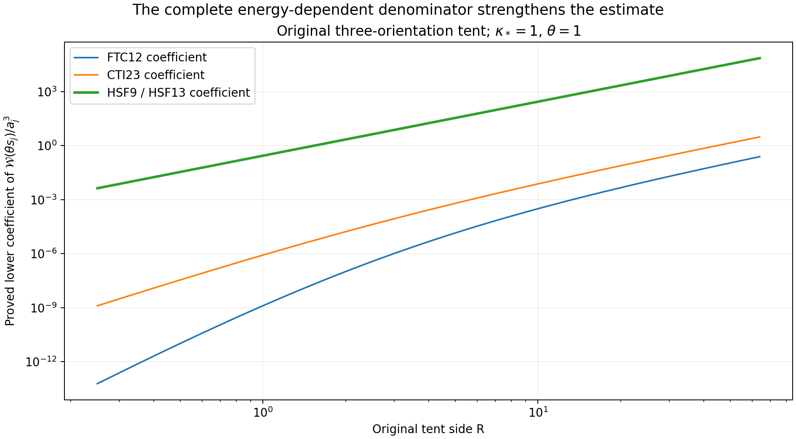
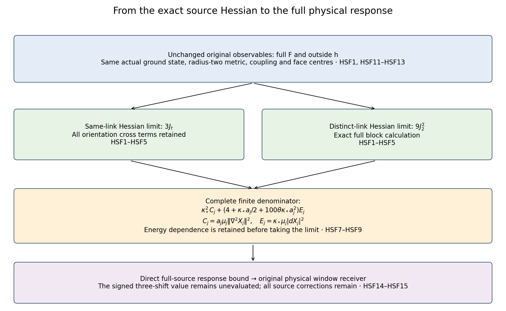

# Original source Hessian and the energy-dependent filter denominator

This calculation evaluates the full source-Hessian limit in the original interacting state and strengthens the filtered-response coefficient by retaining the energy dependence of the complete finite denominator. It applies both to the outside source and directly to the original Wilson observable. All cross terms and finite source corrections remain. No original Yang–Mills vacuum values have been sampled, and no surviving shrinking-window mass is inferred.

Providers: [FTC3, FTC10–FTC12](https://github.com/KokunoYumeto/yang-mills-interacting-workbench/blob/2b33a43bc393750fbc636b4eafddf37c04abb8d7/yang-mills/continuations/20261011-central-signs-shrinking-window/ACTUAL_FILTERED_CURRENT_AND_TAIL.md), [SOM13, SOM18–SOM22](https://github.com/KokunoYumeto/yang-mills-interacting-workbench/blob/2b33a43bc393750fbc636b4eafddf37c04abb8d7/yang-mills/continuations/20261011-central-signs-shrinking-window/ACTUAL_SCORE_MOMENTS_AND_SECOND_ENERGY.md), and [CTI20–CTI26, CTI38–CTI39](https://github.com/KokunoYumeto/yang-mills-interacting-workbench/blob/2b33a43bc393750fbc636b4eafddf37c04abb8d7/yang-mills/continuations/20261011-central-signs-shrinking-window/CURRENT_TAILS_AND_RETAINED_SOURCE.md). These sources were read directly. No further author-source reading or novelty claim is made.

Retain the original nonzero real continuous compactly supported orientation triple, all original face centres and radius-two SU(2) metrics, \(a_j=(100j)^{-1}\), \(b_j=(\kappa_*a_j^2)^{-1}\), \(s_j=100\kappa_*a_j\), the full actual state \(\mu_j=\psi_j^2dU\), and original outside source \(h_{e_0}=a_j\sum_{p\not\ni e_0}f_p(D_p-\mu_jD_p)\). In the following sums set \(u_p=f_p\mathbf1_{\{p\not\ni e_0\}}\). This retains the removed faces as an explicit correction; it does not change \(f\).

For each edge let \(A_e=\sum_{p\ni e}u_p\), \(B_e=\sum_{p\ni e}u_pD_p\), and \(S_e=\sum_{p\ni e}u_pW_p=2A_e-B_e\), where \(W_p=2-D_p\). The letter \(S_e\) here is a face sum, distinct from the weighted divergence denoted by the same letter in SG22. FTC11 gives the full exact identity
\[
\begin{aligned}
\mu\|\nabla^2h_{e_0}\|_{\rm HS}^2
=a^2\bigg\{&
\frac34\sum_eA_e^2+9\sum_pu_p^2
-\frac34\sum_eA_e\,\mu B_e+\frac3{16}\sum_e\mu B_e^2\\
&-3\sum_pu_p^2\mu D_p+\frac34\sum_pu_p^2\mu D_p^2\bigg\}.
\end{aligned}
\tag{HSF1}
\]
Every original same-link cross term is contained in \(A_eB_e\) and \(B_e^2\); every distinct-link contribution remains in the last two terms. The equation follows by expanding \((2A_e-B_e)^2\) and \((2-D_p)^2\), with no term suppressed.

For the strictly fitted cube \(Q\), put \(d_Q=\mu\sum_{p\text{ inside }Q}D_p\), with the same complete budget \(\Lambda_Q\) as CTI38. At most four faces meet an edge. Thus
\[
\begin{gathered}
|A_e|\le4M_f,\quad |S_e|\le8M_f,\quad
|B_e|\le M_f\sum_{\substack{p\ni e\\u_p\ne0}}D_p,\\
|S_e^2-4A_e^2|
\le16M_f^2\sum_{\substack{p\ni e\\u_p\ne0}}D_p,\qquad
|W_p^2-4|=D_p(4-D_p)\le4D_p .
\end{gathered}
\tag{HSF2}
\]
The first difference factors as \((S_e-2A_e)(S_e+2A_e)\). Sum its bound, retaining the at-most-four edge multiplicity of each face. The complete finite error is
\[
\left|a\,\mu\|\nabla^2h_{e_0}\|_{\rm HS}^2
-a^3\left\{\frac34\sum_eA_e^2+9\sum_pu_p^2\right\}\right|
\le15a^3M_f^2d_Q .
\tag{HSF3}
\]
The coefficient is \(12+3\): \(3/16\) times \(16\) times four for the same-link term, plus \(3/4\) times four for the distinct-link term. This compares with the full signed identity HSF1, without assigning signs to its separate cross terms.

For an edge \((z,d)\), use its original centre \(x_e=o+a(z-L_j\mathbf1+e_d/2)\), and let \(\omega_{\mathbf f}(r)=\max_\sigma\sup_{|x-y|\le r}|f_\sigma(x)-f_\sigma(y)|\). The two face centres in each of the two incident orientations are at distance \(a/2\). Before removing the incident star, the full sum differs from \(2t_d(x_e)\) by at most \(4\omega_{\mathbf f}(a/2)\). Removing the star changes the edge vector by squared norm at most \(m_{e_0}(m_{e_0}+3)M_f^2\): its central edge contributes at most \(m_{e_0}^2M_f^2\), and the other three edges of each incident face are distinct and contribute at most \(3m_{e_0}M_f^2\). Therefore
\[
\begin{gathered}
\|(A_e-2t_d(x_e))_{e\in E_Q^\circ}\|_{\ell^2}
\le4\omega_{\mathbf f}(a/2)\sqrt{|E_Q^\circ|}
+\sqrt{m_{e_0}(m_{e_0}+3)}M_f,\\
a_j^3\sum_e A_e^2\longrightarrow4J_t,\qquad
a_j^3\sum_pu_p^2\longrightarrow J_2^\Sigma .
\end{gathered}
\tag{HSF4}
\]
The absolute change in the face-square sum is at most \(m_{e_0}M_f^2\). Every nonzero incident edge is in the strict fitted interior for sufficiently large regulators. Riemann sums for the unchanged continuous functions, \(a^3|E_Q^\circ|=O(1)\), and the displayed norm error prove both limits, uniformly in the choice of removed edge. Since \(d_Q=O(a^{-2})\), HSF3 proves the actual evaluated limit
\[
a_j\,\mu_j\|\nabla^2h_{e_0}\|_{\rm HS}^2
\longrightarrow C_{\mathbf f}:=3J_t+9J_2^\Sigma.
\tag{HSF5}
\]

For a fixed finite list of tests, polarizing the exact blocks gives a direct multi-source formula. In the same-link block,
\(S_{e,r}S_{e,s}-4A_{e,r}A_{e,s}
=-B_{e,r}S_{e,s}-2A_{e,r}B_{e,s}\);
its absolute value is at most \(16M_rM_s\sum_{p\ni e,\ p\text{ in either support}}D_p\). The distinct-link term has the same coefficient-three bound with \(M_rM_s\). Use one original fitted cube containing the finite union of supports. This proves
\[
a_j\mu_j\langle\nabla^2h_r,\nabla^2h_s\rangle_{\rm HS}
\longrightarrow3\sum_d\int t_{r,d}t_{s,d}
+9\sum_\sigma\int f_{r,\sigma}f_{s,\sigma}.
\tag{HSF6}
\]
This is convergence of the actual matrix entries and hence of the finite matrix in norm; no entrywise order is inferred.

FTC10 retains the energy inside its denominator. Put \(C_j=a_j\mu_j\|\nabla^2h_{e_0}\|^2\), \(E_j=\kappa_*\mu_j|dh_{e_0}|^2\), and \(z=\theta s_j\), \(\theta>0\). The entire finite expression is
\[
\frac{\mathcal W_{h_{e_0}\psi_j}(\theta s_j)}{a_j^3}
\ge\frac{100\theta\kappa_*E_j^3}
{\{\kappa_*^2C_j+
(4+\kappa_*a_j/2+100\theta\kappa_*a_j^2)E_j\}^2}.
\tag{HSF7}
\]
In particular, the terms \(\kappa_*a_j/2\) and \(100\theta\kappa_*a_j^2\) have not been omitted at finite regulator. For \(c\ge0,d>0,E>0\),
\[
\frac{d}{dE}\frac{E^3}{(c+dE)^2}
=\frac{E^2(3c+dE)}{(c+dE)^3}>0 .
\tag{HSF8}
\]
Use CTI22–CTI23, \(e'_{\mathbf f}=\max\{e_{\mathbf f},3\kappa_*^2J_t/4\}>0\), and HSF5. For any \(0<\eta<e'_{\mathbf f}\), eventually \(E_j\ge e'_{\mathbf f}-\eta\) and \(C_j\le C_{\mathbf f}+\eta\). The rational expression increases with \(E_j\) and decreases with \(C_j\). Insert these two bounds in HSF7, take the liminf, and then let \(\eta\downarrow0\). This proves
\[
\liminf_j\frac{\mathcal W_{h_{e_0}\psi_j}(\theta s_j)}{a_j^3}
\ge\frac{100\theta\kappa_*(e'_{\mathbf f})^3}
{\{\kappa_*^2(3J_t+9J_2^\Sigma)+4e'_{\mathbf f}\}^2}.
\tag{HSF9}
\]
All original \(e_{\mathbf f},U_{\mathbf f},D_{\mathbf f},K_R\) remain available; the full finite formula explains why this particular lower estimate can use \(e'_{\mathbf f}\) inside its denominator. CTI25 gives \(J_t=J_2^\Sigma+\int(f_{12}+f_{13}+f_{23})^2\le4J_2^\Sigma\). Since \(e'_{\mathbf f}\le\liminf E_j\le U_{\mathbf f}\), the new denominator is no larger than \(21\kappa_*^2J_2^\Sigma+4U_{\mathbf f}=D_{\mathbf f}\). This is a proved strengthening of CTI23 and FTC12.

For the unchanged three-orientation tent of CTI26, the strict energy comparison gives \(e'_{\mathbf f}=\kappa_*^2R^3/3\), \(J_t=4R^3/9\), \(J_2^\Sigma=R^3/9\), and \(C_{\mathbf f}=7R^3/3\). Therefore HSF9's coefficient equals
\[
\frac{100\theta\kappa_*^3R^3}{363}.
\tag{HSF10}
\]
Every original parameter is retained. The factor \(a_j^3\) remains in the unscaled lower bound.

## Direct application to the full original observable

Take \(u_p=f_p\) in HSF1–HSF3. These identities apply to the full \(F_j=a_j\sum_pf_p(D_p-\mu_jD_p)\), because its centering constant has zero configuration derivative. The star correction in HSF4 is now absent, and the same Riemann sums give the same full Hessian limit. CTI21–CTI23 also give \(\liminf E_{F,j}\ge e'_{\mathbf f}\). To see the finite source directly, compact weighted integration gives
\[
\begin{gathered}
\langle a_j^2\Pi_edw_j,dF_j\rangle_{\mu_j}
=-\frac{a_j^2}{2}\mu_j\Delta_eF_j
=\frac{3a_j^3}{8}\sum_{p\ni e}f_p(\mu_jD_p-2),\\
E_{F,j}\ge\frac{\kappa_*^2}{3a_j^3}
\sum_{e\in E_Q^\circ}
\left|\frac{3a_j^3}{8}\sum_{p\ni e}f_p(\mu_jD_p-2)\right|^2 .
\end{gathered}
\tag{HSF11}
\]
Here \(\Delta_eD_p=3(2-D_p)/4\) on an incident edge; all four orientation incidences remain. The second line is Bessel's inequality with the unchanged actual trial norm of CTI20. The source-vector limit in SOM21–SOM22 applies with the explicit removed-star error set to zero.

For every real smooth centered invariant configuration function \(X\), including the actual \(F_j\), the ground-state transform and exact physical one-form unitary in FTC6–FTC7 prove
\[
\begin{gathered}
\mathcal W_{X\psi_j}(z)
=z\kappa_*\|(\mathscr L_1+zI)^{-1}dX\|_{\mu_j}^2,\\
\mathcal W_{X\psi_j}(z)\ge
\frac{zE_X^3}
{\{\kappa_*^2\mu_j\|\nabla^2X\|^2+
(\kappa_*/2+4/a_j+z)E_X\}^2},\qquad
E_X=\kappa_*\mu_j|dX|^2>0 .
\end{gathered}
\tag{HSF12}
\]
For completeness, the full actual operator satisfies
\(\mathscr L_1+zI\le T_z
=\kappa_*\nabla_\mu^*\nabla+(\kappa_*/2+4/a_j+z)I\),
by the proved Hessian lower bound retained in FTC8. Inverse order and Cauchy–Schwarz give
\(\langle dX,(\mathscr L_1+zI)^{-1}dX\rangle
\ge\|dX\|^4/\langle dX,T_zdX\rangle\).
A second Cauchy–Schwarz inequality bounds the squared resolvent norm below by this pairing squared divided by \(\|dX\|^2\). Multiplication by \(z\kappa_*\) yields exactly the second line, including all three finite scalar terms. For \(E_X=0\), \(dX=0\) and the undivided zero identity applies. Every \(F_j\) and \(h_{e_0,j}\) is smooth in configuration variables even for continuous spatial tests, since the finite lattice samples are fixed coefficients.

Consequently HSF7–HSF10 hold with \(h_{e_0,j}\) replaced by \(F_j\):
\[
\begin{gathered}
a_j\mu_j\|\nabla^2F_j\|^2\longrightarrow3J_t+9J_2^\Sigma,\\
\liminf_j\frac{\mathcal W_{F_j\psi_j}(\theta s_j)}{a_j^3}
\ge
\frac{100\theta\kappa_*(e'_{\mathbf f})^3}
{\{\kappa_*^2(3J_t+9J_2^\Sigma)+4e'_{\mathbf f}\}^2}.
\end{gathered}
\tag{HSF13}
\]
This proves the estimate directly on the requested original observable. It does not use the amplitude error in PLF23 to transfer an order-\(a_j^3\) lower bound.

The exact map between the two filtered sources also retains every correction. Let \(q_{e_0}=F-h_{e_0}\) and
\(\beta_X(z)=(\mathscr L_1+zI)^{-1}dX\). Linearity gives
\[
\begin{aligned}
\mathcal W_{F\psi}(z)
={}&\mathcal W_{h_{e_0}\psi}(z)
+2z\kappa_*\operatorname{Re}\langle\beta_{h_{e_0}}(z),\beta_{q_{e_0}}(z)\rangle_\mu\\
&+z\kappa_*\|\beta_{q_{e_0}}(z)\|_\mu^2 .
\end{aligned}
\tag{HSF14}
\]
For \(0<\varepsilon<1<R_{\rm win}\), set
\(c_\varepsilon=4\varepsilon/(1+\varepsilon)^2\),
\(c_{R_{\rm win}}=4R_{\rm win}/(1+R_{\rm win})^2\), and
\(\mathcal C_X(z)=\mathcal W_{X\psi}(z)
-c_\varepsilon\mathcal W_{X\psi}(\varepsilon z)
-c_{R_{\rm win}}\mathcal W_{X\psi}(R_{\rm win}z)\).
Applying PLF25 directly to the same full \(F\) proves
\[
\|1_{[\varepsilon s_j,R_{\rm win}s_j]}(H_j-E_{0,j})(F_j\psi_j)\|^2
\ge4[\mathcal C_{F_j}(s_j)]_+ .
\tag{HSF15}
\]
The subscript \(R_{\rm win}\) distinguishes this window ratio from the original support-cube side \(R\). The exact difference \(\mathcal C_F-\mathcal C_h\) is the right-hand correction in HSF14 at \(z\), minus \(c_\varepsilon\) times that correction at \(\varepsilon z\), minus \(c_{R_{\rm win}}\) times it at \(R_{\rm win}z\). Thus no cross term has been discarded in passing to the direct full-source receiver. Its signed value remains to be evaluated.

## Complete original geometry and constants

The support cube, coupling and face sampling used above are unchanged:
\[
\begin{gathered}
L_j=j^4,\quad g_j^2=\kappa_*a_j/2,\quad
U_p=U_d(z)U_k(z+e_d)U_d(z+e_k)^{-1}U_k(z)^{-1},\quad d<k,\\
x_p=o+a_j(z-L_j\mathbf1+(e_d+e_k)/2),\quad
f_p=f_{dk}(x_p),\quad D_p=2-\operatorname{Tr}U_p,\\
H_j=-\kappa_*\Delta+b_j\sum_pD_p,\quad
H_j\psi_j=E_{0,j}\psi_j,\quad\psi_j>0,\quad\|\psi_j\|_{L^2(dU)}=1,\\
Q_j=v+\{0,\ldots,q\}^3,\quad
q=\lceil R/a_j\rceil+3,\quad
v_d=L_j+\lfloor(c_d^{\rm cube}-o_d)/a_j\rfloor-1,\\
N_Q=3q(q+1)^2,\quad M_Q=3q^2(q+1),\quad
|E_Q^\circ|=3q(q-1)^2,\\
C_Q=2q(q+1)\sum_d
[\mathbf1_{\{v_d>0\}}+\mathbf1_{\{v_d+q<2L_j\}}],\\
0\le d_Q\le\Lambda_Q=
\min\{2M_Q,6g_j^2\sqrt{N_QM_Q}\}+2C_Q .
\end{gathered}
\tag{HSF16}
\]
Here the original support cube is \(c^{\rm cube}+[0,R]^3\). It lies strictly inside the original open lattice for all sufficiently large regulators. The finitely many earlier regulators are handled by the exact finite identities; none is needed in the stated limits. The scalar \(2b_j|\mathcal P_j|\) in the potential and the full \(E_{0,j}\) are retained by these definitions.

All original test constants are
\[
\begin{gathered}
t_1=f_{12}+f_{13},\quad t_2=f_{12}+f_{23},\quad t_3=f_{13}+f_{23},\\
J_t=\sum_d\int t_d^2,\quad J_2^\Sigma=\sum_\sigma\int f_\sigma^2,\quad
J_{\rm edge}=\sum_d\int|t_d|,\quad M_f=\max_\sigma\|f_\sigma\|_\infty,\\
\chi=4+4\sum_\sigma\|f_\sigma\|_\infty/M_f,\quad
\mathsf L_R=9\kappa_*R^3+24R^2,\quad
K_R=\frac{\mathsf L_R+\sqrt{\mathsf L_R^2-81\kappa_*^2R^6/4}}2,\\
e_{\mathbf f}=\frac{9\kappa_*^3J_{\rm edge}^2}{4K_R},\quad
U_{\mathbf f}=\kappa_*\chi M_f^2K_R,\quad
D_{\mathbf f}=21\kappa_*^2J_2^\Sigma+4U_{\mathbf f},\\
e'_{\mathbf f}=\max\{e_{\mathbf f},3\kappa_*^2J_t/4\},\quad
C_{\mathbf f}=3J_t+9J_2^\Sigma .
\end{gathered}
\tag{HSF17}
\]
All integrals here are over the original \(\mathbb R^3\). Nonzero \(\mathbf f\) implies \(J_t>0\), since the inverse orientation map is
\(f_{12}=(t_1+t_2-t_3)/2\),
\(f_{13}=(t_1+t_3-t_2)/2\),
\(f_{23}=(t_2+t_3-t_1)/2\).

What would reach the next spectral target using this finding? The missing quantity is still the signed PLF25–PLF26 three-shift response, including both CTI33 remainders. HSF9 supplies an improved lower value at each separate shift. It gives no upper value for the two subtracted shifts. The next calculation is an upper estimate using the same full source and evaluated Hessian, with the exact low-energy and high-energy spectral pieces retained, or an actual evaluation of the retained-source inverse and its residual at all three shifts. No separate lower bounds may be subtracted as though they were exact values.

Reproducible [diagnostics and figures](check_source_hessian.py) and [source-use record](SOURCE_HESSIAN_SOURCE_USE_LEDGER.json). Independent group derivatives, incidence samples and spectral models are algebraic diagnostics, not original Yang–Mills vacuum measurements.

## Complete residual and exact stereographic current

[TCR1–TCR21](https://github.com/KokunoYumeto/yang-mills-interacting-workbench/blob/main/yang-mills/continuations/20261011-central-signs-shrinking-window/TWO_SIDED_CURRENT_RESIDUAL.md) give complete two-sided bounds for the original filtered response and its signed three-shift window. They retain the actual least-squares defect and the original uncut trial metric. Projection orthogonality and a direct singular-value estimate prove
\[
\|\widetilde c\|\le\sqrt{2q_R/\gamma},\qquad
\sqrt{\kappa_*/z}\,\epsilon_R\|\widetilde c\|
=O\!\left(a_j^{\rho-3}\sqrt{\log(1/a_j)}\right).
\]
With the original CTI13 cutoff, every \(\rho>9/2\) makes this cutoff contribution \(o(a_j^{3/2})\); the interacting residual remains to be evaluated.

[SC1–SC24](https://github.com/KokunoYumeto/yang-mills-interacting-workbench/blob/main/yang-mills/continuations/20261011-central-signs-shrinking-window/STEREOGRAPHIC_CURRENT_AND_CUBIC.md) supply the exact stereographic coordinate, density, radius-two metric and state maps for those integrals. Gauge invariance proves that each unfixed original link has a Haar marginal: its stereographic moments are finite exactly below order three. SC8–SC15 retain every rational face term and prove that the local density approximation in Chatterjee, [arXiv:2401.10507v4](https://arxiv.org/abs/2401.10507v4), label “approxdens”, omits a cubic nonabelian contribution. The full-density counterexample and corrected expression are proved without claiming that the source's main scaling theorem fails. This extends OW's ordered-action comparison and prevents an invalid polynomial-moment substitution in the current calculation. Actual window values, reconstruction, intended-theory identification and the smooth global no-gap endpoint remain active work.

The subsequent calculation [SC18–SC24](https://github.com/KokunoYumeto/yang-mills-interacting-workbench/blob/main/yang-mills/continuations/20261011-central-signs-shrinking-window/STEREOGRAPHIC_CURRENT_AND_CUBIC.md) evaluates all five rational action terms in the actual vacuum, including with bounded gauge-invariant score multipliers. Its original four-link tensor average is
\[
\mu(q_1^a q_2^b q_3^c q_4^d)
=\frac{\mu\operatorname{Tr}U_p}{128}\,
\frac12\operatorname{Tr}(E_aE_bE_cE_d).
\]
This determines every signed term in SC10 and their exact cancellation on the original coupling path. SC24 also gives the full force pairing in original staple-loop and two-plaquette expectations, with all orientations, original coefficients and remaining mixed score moments retained. These identities evaluate gauge averages; they do not yet evaluate the complete residual or establish the no-gap endpoint.

## Actual spatial moment matrices and the polynomial covariance floor

[SMP1–SMP13](https://github.com/KokunoYumeto/yang-mills-interacting-workbench/blob/main/yang-mills/continuations/20261011-central-signs-shrinking-window/ACTUAL_SPATIAL_MOMENT_MATRICES.md) use the actual conditional density on at most four original links to prove a first-energy floor for every complex raw face coefficient vector. The original shared-link correlations, full source Hessian and vacuum log-Hessian remain in the calculation. The full source covariance matrix satisfies
\[
S\ge
\frac{64\kappa_*^2a^4}
{(32+7\kappa_*a)(736+155\kappa_*a)}\,I .
\]
This evaluated bound is independent of the total box volume and the number of selected faces. It retains arbitrary support and coefficient growth. The proof compares its smooth-test refinement with the stronger earlier HSF result and applies the polynomial floor to missing directions in the exact common-cubic trial space. It does not locate spectral mass in the shrinking annulus; that actual signed response and the smooth global no-gap programme remain active.
