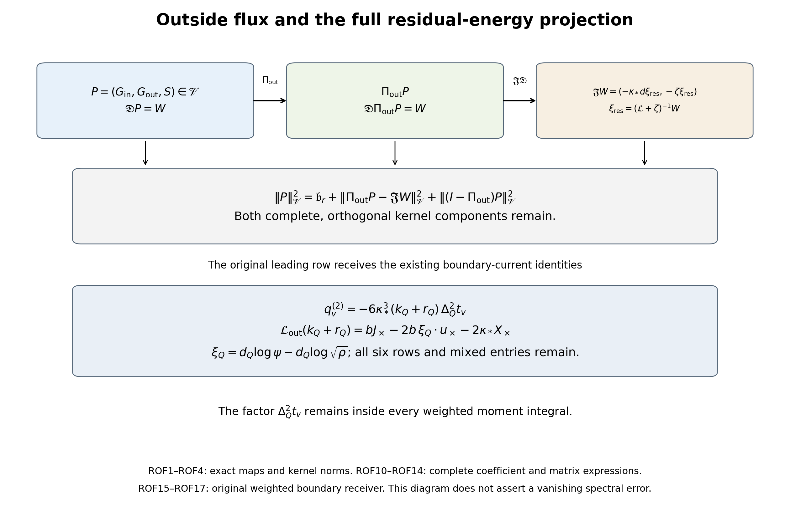

# Outside flux, complete cubic moments and boundary forcing

The full cubic residual admits an orthogonal projection in its original flux-and-scalar space. This paper constructs that projection and its exact kernel remainders, calculates every outside derivative and generator coefficient in the six original rows, and derives two-sided moment matrix estimates without commuting the matrices or discarding their kernels. The highest derivative row is identified with the original conditional kinetic-plus-score fluctuation. Its boundary forcing and all trial-dependent weights are retained. These identities and bounds do not establish a vanishing signed error or a continuum no-gap result.

The receiving mathematical sources are [WCR1–WCR15: original cubic flux, typed spaces and residual energy](https://github.com/KokunoYumeto/yang-mills-interacting-workbench/blob/fbcca1fbd1e0251a32307dcd9d0036907e95a8d0/yang-mills/continuations/20261011-central-signs-shrinking-window/FULL_CUBIC_FLUX_AND_RESIDUAL_ENERGY.md), [CG23–CG34: full conditional outside generator and minimizer](https://github.com/KokunoYumeto/yang-mills-interacting-workbench/blob/fbcca1fbd1e0251a32307dcd9d0036907e95a8d0/yang-mills/continuations/20261011-central-signs-shrinking-window/CONDITIONAL_GROUND_CURRENT_TRIAL.md), [OC5–OC16: conditional gap comparison, exact counts and scalar moment identities](https://github.com/KokunoYumeto/yang-mills-interacting-workbench/blob/fbcca1fbd1e0251a32307dcd9d0036907e95a8d0/yang-mills/continuations/20261011-central-signs-shrinking-window/OUTSIDE_FORCE_AND_CURRENT_MOMENTS.md), [BQ1–BQ14: original kinetic quotient, full gradient projection and boundary force](https://github.com/KokunoYumeto/yang-mills-interacting-workbench/blob/fbcca1fbd1e0251a32307dcd9d0036907e95a8d0/yang-mills/continuations/20261011-central-signs-shrinking-window/BOUNDARY_FORCE_PROJECTION.md), [KC1–KC14: conditional kinetic and score fluctuations and their exact forcing](https://github.com/KokunoYumeto/yang-mills-interacting-workbench/blob/fbcca1fbd1e0251a32307dcd9d0036907e95a8d0/yang-mills/continuations/20261011-central-signs-shrinking-window/KINETIC_CURRENT_AND_PHYSICAL_ENERGY.md). The scalar moment comparison is already proved in OC14–OC16; the formulas below apply it to the original cubic residual and retain the complete matrix projection. No novelty claim is made.

## Original state, source and full operators

Keep the original SU(2) product with radius-two metric, probability Haar measure, generators \(T_\alpha=-i\sigma_\alpha/2\), and ordered left-multiplication fields \(X_{e,\alpha}\). All operators below restrict to the original gauge-invariant physical subspace. The complete state is
\[
\begin{gathered}
a=(100j)^{-1},\quad L=j^4,\quad g^2=\kappa_*a/2,\quad
b=(\kappa_*a^2)^{-1},\quad\zeta=\theta\kappa_*/j,\quad j\ge4,\\
N=3(2L)(2L+1)^2,\qquad M=3(2L)^2(2L+1),\\
V=2bM-b\sum_pT_p,\quad H=-\kappa_*\sum_{i\in\mathcal I}X_i^2+V,\quad
H\psi=E_0\psi,\quad \psi>0,\quad\int\psi^2dU=1,\\
d\mu=\psi^2dU,\quad w=\log\psi,\quad
\mathcal L=\psi^{-1}(H-E_0)\psi,\quad\mathscr H_\mu=L^2(\mu).
\end{gathered}
\]
The original oriented plaquette and raw centered source are
\[
\begin{gathered}
U_p=U_d(z)U_k(z+e_d)U_d(z+e_k)^{-1}U_k(z)^{-1},\qquad
T_p=\operatorname{Tr}U_p,\\
Z_p=a(\mu T_p-T_p)/2,\qquad Z=\sum_p\varphi_p Z_p .
\end{gathered}
\]
Every original face, orientation, source center and coefficient stays fixed.
Let \(Q_r=(L-r)\mathbf1+\{0,\ldots,2r\}^3\), \(50j\le r\le L\), with the original source supported in \(Q_{50j}\). Write
\(\rho_r(x_r)=\int\psi(x_r,y_r)^2dy_r\) and
\(\mathscr H_r=L^2(\rho_r dx_r)\). The exact maps are
\[
J_r:\mathscr H_r\to\mathscr H_\mu,\quad J_rf=f(x_r),\qquad
J_r^*f=\rho_r^{-1}\int\psi^2 f\,dy_r,\qquad J_r^*J_r=I.
\]
Their full complement \(R_r=I-J_rJ_r^*\) is retained.
Here conditional means integration against the actual density
\(\psi(x_r,y_r)^2/\rho_r(x_r)\). It introduces no assumption about an
unconstructed continuum state. The full typed transformation is
\[
\begin{gathered}
\mathcal U_r:\mathscr H_\mu\longrightarrow
\mathscr H_r\oplus\ker J_r^*,\qquad
\mathcal U_rf=(J_r^*f,R_rf),\\
\mathcal U_r^{-1}(g,h)=J_rg+h,\qquad
\|f\|_\mu^2=\|J_r^*f\|_r^2+\|R_rf\|_\mu^2 .
\end{gathered}
\]
To prove every assertion, weighted Cauchy–Schwarz on each outside fiber
gives \(\|J_r^*f\|_r\le\|f\|_\mu\); direct integration gives
\(\|J_rg\|_\mu=\|g\|_r\) and the stated adjoint formula.
Hence \(J_rJ_r^*\) is an orthogonal projection,
\(J_r^*R_r=0\), and
\(\langle J_rJ_r^*f,R_rf\rangle_\mu=0\).
These equations prove the norm identity. For \(h\in\ker J_r^*\),
\(J_r^*(J_rg+h)=g\) and \(R_r(J_rg+h)=h\); the reverse
composition is \(J_rJ_r^*f+R_rf=f\). Thus the displayed map is a
unitary isomorphism, with its full inverse proved.
The original generator is transported to
\(\mathcal U_r\mathcal L\mathcal U_r^{-1}\) on precisely
\(\mathcal U_rD(\mathcal L)\). This follows by applying the inverse
before \(\mathcal L\), so the full operator and its domain are retained.
The first component alone is a projection and is not asserted to
represent the whole state. The constants \(\kappa_*,\theta\) are positive. Use the original filter parameters \(1/4,4\) and every term of
\[
\begin{gathered}
q_\zeta(\lambda)=(\lambda+\zeta)(\lambda+\zeta/4)(\lambda+4\zeta),\\
k_\zeta(\lambda)=\frac{\zeta\lambda}{(\lambda+\zeta)^2}
-\frac{16}{25}\frac{(\zeta/4)\lambda}{(\lambda+\zeta/4)^2}
-\frac{16}{25}\frac{4\zeta\lambda}{(\lambda+4\zeta)^2}.
\end{gathered}
\]
Define the positive full cubic \(\mathscr A_\zeta=q_\zeta(\mathcal L)\), with domain H6 and form domain H3, and its closed compression \(\mathcal B_r=J_r^*\mathscr A_\zeta J_r\), with the same original inside Sobolev orders. Put
\[
\begin{gathered}
F_r=J_r^*Z,\quad t_r=\mathcal B_r^{-1}F_r,\quad u_r=J_rt_r,\quad
Y_r=\mathscr A_\zeta u_r=Z+W_r,\quad J_r^*W_r=0,\\
h_r=\mathscr A_\zeta^{-1}Z-u_r=-\mathscr A_\zeta^{-1}W_r,\quad
\delta_r=\|\mathscr A_\zeta^{1/2}h_r\|_\mu^2,\\
C(F)=\langle Z,k_\zeta(\mathcal L)Z\rangle_\mu,\quad
T_r(F)=\langle Y_r,k_\zeta(\mathcal L)Y_r\rangle_\mu,\quad
m_1(F)=\langle Z,\mathcal LZ\rangle_\mu .
\end{gathered}
\]
NSE7–NSE9 prove smoothness of the displayed finite-regulator vectors, their gauge restrictions, and
\[
v_s=u_{s+1}-u_s,\quad
d_s=\|\mathscr A_\zeta^{1/2}v_s\|_\mu^2,\quad
h_r=\sum_{s=r}^{L-1}v_s,\quad
\delta_r=\sum_{s=r}^{L-1}d_s,\quad
\langle v_s,\mathscr A_\zeta v_t\rangle=0\quad(s\ne t).
\]
The terminal cube has \(J_L=I\), \(W_L=h_L=0\) and crossing count zero. These identities retain the entire finite tail and its original terminal boundary.

For every real Sobolev order s, the original shifted scale is
\[
\mathscr H_\zeta^s=D((\mathcal L+\zeta)^{s/2})\quad(s\ge0),\qquad
\|f\|_{s,\zeta}=\|(\mathcal L+\zeta)^{s/2}f\|_\mu ;
\]
for negative s use the completion in that norm, equivalently the dual of the positive space with the original L2 pairing. All constants here are at the fixed regulator unless a complete j-dependent bound is displayed. In particular
\[
\mathfrak b_r(F)=\langle W_r,(\mathcal L+\zeta)^{-1}W_r\rangle_\mu,
\qquad
\mathsf B_{{\rm res},r}[v,v]=\mathfrak b_r(F_v).
\]
The matrix is indexed by the unchanged raw face coefficients. The full space of field-component arrays used below carries the original product metric and its gauge-covariant action; its components are not asserted to be invariant scalar observables. The scalar outputs restrict to the physical subspace. The gradient, weighted adjoint and resolvent intertwine these actions, so the displayed divergence and right inverse restrict to the corresponding physical scalar and covariant-array spaces.

## 1. Retain every original coefficient in six rows

Fix the original source cube Q, its inside field indices I, the full field indices \(\mathcal I\), and \(t=\mathcal B_\zeta^{-1}F\). Keep
\(\delta c=c-\mathbb E[c\mid x]\) with its original \(\psi^2\)-weighted outside integral, and
\(a_{hi}=X_hX_i\psi/\psi\), \(a_{hji}=X_hX_jX_i\psi/\psi\).
For the original filter \(e_1=21\zeta/4,e_2=21\zeta^2/4,e_3=\zeta^3\).
Define the following complete uncentered coefficients:
\[
\begin{aligned}
c_{h,2}&=-6\kappa_*^3a_h,\\
c_{h,1}&=4e_1\kappa_*^2a_h-6\kappa_*^2V_h,\\
c_{h,0}&=-2\kappa_*e_2a_h+(6\kappa_*^2+2e_1\kappa_*)V_h
-4\kappa_*^2\sum_{j\in\mathcal I}a_jV_{jh},\\
c_{hi,1}&=-12\kappa_*^3a_{hi},\\
c_{hi,0}&=4e_1\kappa_*^2a_{hi}-8\kappa_*^2V_{hi}
-4\kappa_*^2(V_ha_i+2V_ia_h),\\
c_{hji,0}&=-8\kappa_*^3a_{hji}.
\end{aligned}\tag{WCR1}
\]
All indices except the explicitly full j in the third row range over I. In particular the outside contribution in that row remains.
The exact CDE4 forcing is
\[
\begin{aligned}
W={}&\sum_h\left[
\delta c_{h,2}X_h\Delta_Q^2t
+\delta c_{h,1}X_h\Delta_Qt+\delta c_{h,0}X_ht\right]\\
&+\sum_{h,i}\left[
\delta c_{hi,1}X_hX_i\Delta_Qt+\delta c_{hi,0}X_hX_it\right]
+\sum_{h,j,i}\delta c_{hji,0}X_hX_jX_it .
\end{aligned}
\]
Substitute WCR1 and collect the full original CDE4 terms. Each derivative word is unchanged; only the names of summed indices change. The constants \(2bM,E_0\) remain in the ground equation used by CDE4. Their zero derivatives do not remove the potential or energy from the original state.

For later use define six inside-measurable derivative words
\[
B_{h,2}=\Delta_Q^2t,\quad B_{h,1}=\Delta_Qt,\quad B_{h,0}=t,\quad
B_{hi,1}=X_i\Delta_Qt,\quad B_{hi,0}=X_it,\quad
B_{hji,0}=X_jX_it .
\]
Thus each row of W is \((\delta c_{h,\nu})X_h B_{h,\nu}\), where the finite index \(\nu\) includes all remaining ordered indices. This notation includes every one of the six displayed rows; it does not commute any word.

## 2. Full map on the unchanged pair space

Write \(d_{\rm in},d_{\rm out}\) for the two disjoint component arrays of the original gradient. Their weighted adjoints use the same original \(\mu=\psi^2dU\). Retain the WCR pair space
\[
\|(G_{\rm in},G_{\rm out},S)\|_{\mathscr V}^2
=\kappa_*^{-1}(\|G_{\rm in}\|_\mu^2+\|G_{\rm out}\|_\mu^2)
+\zeta^{-1}\|S\|_\mu^2 .
\]

The full pair space is
\(\mathscr V=L^2(\mu;T_Q^*)\oplus
L^2(\mu;T_{\rm out}^*)\oplus L^2(\mu)\), with the displayed weighted norm.
Its exact forcing map, including its codomain, is
\[
\mathfrak D:\mathscr V\longrightarrow\mathscr H_\zeta^{-1},
\qquad
\mathfrak D(G_{\rm in},G_{\rm out},S)
=-d_Q^{*,\mu}G_{\rm in}-d_{\rm out}^{*,\mu}G_{\rm out}-S .
\]
The adjoints and this formula are interpreted by pairing with
\(\mathscr H_\zeta^1\). Cauchy–Schwarz with the original form
\(\kappa_*\|df\|_\mu^2+\zeta\|f\|_\mu^2\) proves
\(\|\mathfrak DP\|_{-1,\zeta}\le\|P\|_{\mathscr V}\).
For \(W\in\mathscr H_\zeta^{-1}\), the full form resolvent gives
\[
\begin{gathered}
\xi_{\rm res}=(\mathcal L+\zeta)^{-1}W\in\mathscr H_\zeta^1,\\
\mathfrak J:\mathscr H_\zeta^{-1}\longrightarrow\mathscr V,\qquad
\mathfrak JW=(-\kappa_*d_Q\xi_{\rm res},
-\kappa_*d_{\rm out}\xi_{\rm res},-\zeta\xi_{\rm res}),\\
\mathfrak D\mathfrak JW=W,\qquad
\|\mathfrak JW\|_{\mathscr V}^2=\|W\|_{-1,\zeta}^2 .
\end{gathered}
\]
Indeed \(\mathcal L=\kappa_*d^{*,\mu}d\) proves the right-inverse
identity, and testing its form equation with \(\xi_{\rm res}\) proves
the norm identity. For \(P\in\ker\mathfrak D\), integration by parts
gives \(\langle\mathfrak JW,P\rangle_{\mathscr V}=0\).
Consequently \(\mathfrak J\mathfrak D\) is the orthogonal projection
onto \((\ker\mathfrak D)^\perp\), with its entire complementary
component retained in ROF2.

The original outside generator is the CG23 operator
\[
\mathcal L_{\rm out}=\kappa_*d_{\rm out}^{*,\mu}d_{\rm out}
=-\kappa_*\left(\Delta_{\rm out}
+2\sum_{o\ {\rm outside}}a_oX_o\right).
\]
It acts on the actual conditional fibers and then their direct integral. In particular its scalar space has measure \(\rho(x)dx\,\chi(x,y)^2dy\), with \(\chi=\psi/\sqrt\rho\); no physical tensor factorization is made.

For an arbitrary pair in \(\mathscr V\), interpret
\(q=S+d_{\rm out}^{*,\mu}G_{\rm out}\) as a functional on the outside H1 form space. Put
\[
\eta=(\mathcal L_{\rm out}+\zeta)^{-1}q,\qquad
\Pi_{\rm out}(G_{\rm in},G_{\rm out},S)
=(G_{\rm in},\kappa_*d_{\rm out}\eta,\zeta\eta).
\tag{ROF1}
\]
The right side belongs to \(\mathscr V\). To prove this without a regularity assumption, Cauchy–Schwarz gives
\[
|\langle f,q\rangle|
\le(\kappa_*\|d_{\rm out}f\|^2+\zeta\|f\|^2)^{1/2}
(\kappa_*^{-1}\|G_{\rm out}\|^2+\zeta^{-1}\|S\|^2)^{1/2}.
\]
The strictly positive closed form defines the displayed inverse from its dual into the form space. Substituting its solution gives
\[
\kappa_*\|d_{\rm out}\eta\|^2+\zeta\|\eta\|^2
=\langle q,(\mathcal L_{\rm out}+\zeta)^{-1}q\rangle
\le\kappa_*^{-1}\|G_{\rm out}\|^2+\zeta^{-1}\|S\|^2.
\]
This proves boundedness of \(\Pi_{\rm out}:\mathscr V\to\mathscr V\), with norm at most one, on the full indicated domain. For the actual smooth WCR coefficients the CG23 parameter-dependent equation proves that \(\eta\) is smooth in every original variable.

## 3. Orthogonal kernel decomposition and the full residual

Define the closed subspace
\[
\mathscr K_{\rm out}
=\{(0,v,s)\in\mathscr V:d_{\rm out}^{*,\mu}v+s=0
\text{ in the outside form dual}\}.
\]
Closedness follows from boundedness of the displayed map into that dual. Every vector in this subspace is also in the full WCR divergence kernel. The difference
\[
(I-\Pi_{\rm out})P
=(0,G_{\rm out}-\kappa_*d_{\rm out}\eta,S-\zeta\eta)
\]
belongs to \(\mathscr K_{\rm out}\), because
\(q-(\mathcal L_{\rm out}+\zeta)\eta=0\).
For every \((0,v,s)\in\mathscr K_{\rm out}\), dual integration by parts gives
\[
\langle\Pi_{\rm out}P,(0,v,s)\rangle_{\mathscr V}
=\langle d_{\rm out}\eta,v\rangle+\langle\eta,s\rangle
=\langle\eta,d_{\rm out}^{*,\mu}v+s\rangle=0.
\]
Thus \(\Pi_{\rm out}\) is precisely the orthogonal projection onto
\(\mathscr K_{\rm out}^{\perp}\), with the stated typed formula. It preserves the complete scalar forcing:
\[
\mathfrak D\Pi_{\rm out}P=\mathfrak DP.
\]
It also intertwines the original gauge actions, since the metric, full state, inside/outside gradient split and conditional equation do; uniqueness of the form solution proves intertwining of its inverse.

The full WCR right inverse \(\mathfrak JW=(-\kappa_*d\xi_{\rm res},-\zeta\xi_{\rm res})\), \(\xi_{\rm res}=(\mathcal L+\zeta)^{-1}W\), lies in \(\mathscr K_{\rm out}^{\perp}\): its outside part has ROF1 form with \(\eta=-\xi_{\rm res}\), and the inside part is retained. Consequently
\[
\begin{aligned}
\|P\|_{\mathscr V}^2
={}&\mathfrak b_r
+\|\Pi_{\rm out}P-\mathfrak JW\|_{\mathscr V}^2
+\|(I-\Pi_{\rm out})P\|_{\mathscr V}^2,\\
\mathfrak b_r
\le{}&\|\Pi_{\rm out}P\|_{\mathscr V}^2
\le\|P\|_{\mathscr V}^2 .
\end{aligned}\tag{ROF2}
\]
Both squared remainders are retained and orthogonal. This follows by applying WCR4 to the projected pair and the proved projection identity. It holds also for the complete raw-source Gram matrices by polarization; no face cross entry is dropped.

## 4. Apply the projection to every original cubic row

Take \(P=(\widetilde{\mathcal F},\widetilde{\mathcal S})\) from WCR5–WCR7. Retain all six exact coefficients \(c_{h,\nu}\), their full conditional means and the same inside derivative words \(B_\nu\). Since \(X_oB_\nu=0\) for outside o,
\[
\begin{aligned}
q&=\widetilde{\mathcal S}
+d_{\rm out}^{*,\mu}\widetilde{\mathcal F}_{\rm out}\\
&=\sum_{\substack{h\ {\rm inside}\\\nu}}
(X_h+2a_h)\delta c_{h,\nu}\,B_\nu,\qquad
\mathbb E[q\mid x]=0 .
\end{aligned}\tag{ROF3}
\]
The first equality uses the full pair, and the second follows from
\(d_{\rm out}^{*,\mu}\widetilde{\mathcal F}_{\rm out}
=-\sum_{o,\nu}(X_o+2a_o)\delta c_{o,\nu}B_\nu\).
It cancels the exactly corresponding outside terms of the scalar forcing. The former inside-only scalar in WCR3 is therefore the precise forcing received by the outside resolvent. WCR2 proves its zero conditional mean. Neither its inside derivatives nor the original outside flux have been declared zero.

ROF1–ROF2 now prove the complete bound
\[
\mathfrak b_r\le
\kappa_*^{-1}\|\widetilde{\mathcal F}_{\rm in}\|^2
+\langle q,(\mathcal L_{\rm out}+\zeta)^{-1}q\rangle
\le\|P\|_{\mathscr V}^2 .
\tag{ROF4}
\]
The exact improvement over the old pair norm is
\[
\kappa_*^{-1}\|
\widetilde{\mathcal F}_{\rm out}
-\kappa_*d_{\rm out}(\mathcal L_{\rm out}+\zeta)^{-1}q\|^2
+\zeta^{-1}\|
\widetilde{\mathcal S}
-\zeta(\mathcal L_{\rm out}+\zeta)^{-1}q\|^2 .
\]
It vanishes exactly when both displayed differences vanish. No strict positivity for the actual state is assumed.

## 5. Evaluate the available regulator comparison

The original cube \(Q_{50j}\) is strictly inside the full box for j at least 4. It has \(N_Q=300j(100j+1)^2\). Put \(m=2j^4\). OC8's exact outside counts therefore give
\[
n_2=12m,\quad n_3=12m(m-1),\quad
n_4=3m(m-1)^2-N_Q ,
\]
with \(n_2+n_3+n_4=N-N_Q\). Apply OC7 with the unchanged \(a=(100j)^{-1}\):
\[
\begin{gathered}
B_{\rm out}
=\sum_{\ell=2}^4 n_\ell
\min\{\ell/(\kappa_*^2a^2),\sqrt\ell/(\kappa_*a)\},\\
\lambda_{\rm cmp}=(3\kappa_*/4)e^{-8\pi B_{\rm out}}>0,\\
\langle q,(\mathcal L_{\rm out}+\zeta)^{-1}q\rangle
\le\frac{\|q\|^2}{\zeta+\lambda_{\rm cmp}},\\
B_{\rm out}/j^{13}\longrightarrow4800/\kappa_*,
\qquad
\lambda_{\rm cmp}/\zeta
=\frac{3j}{4\theta}e^{-8\pi B_{\rm out}}\longrightarrow0.
\end{gathered}\tag{ROF5}
\]
The means in ROF3 permit this application. The positive density comparison, original radius-two constant and complete count proof are OC5–OC9; its inside count has the required order \(j^3\). The last limit shows that this attempted scalar comparison gives a coefficient asymptotic to \(1/\zeta\), so it does not supply a vanishing factor on this path. This describes the evaluated comparison function, not the actual conditional gap. The exact improvement in ROF4 still remains.

## 6. Calculate the actual first and second moments receiving the improvement

Set \(r_0=\|q\|^2\), \(r_1=\kappa_*\|d_{\rm out}q\|^2\), and
\(r_2=\|\mathcal L_{\rm out}q\|^2\). These are the complete original scalar moments with every mixed row and face term. They have the following explicit derivative inputs, not assumed regularity constants:
\[
\begin{aligned}
X_oq
&=\sum_{h\ {\rm inside},\nu}
\big[(X_h+2a_h)X_oc_{h,\nu}
+2(X_oa_h)\delta c_{h,\nu}\big]B_\nu,\\
\mathcal U_{\rm out}
&=V-E_0-\kappa_*\Delta_Q\psi/\psi
=\kappa_*\Delta_{\rm out}\psi/\psi,\qquad
\mathcal E_h=X_h\mathcal U_{\rm out},\\
\mathcal L_{\rm out}q
&=\sum_{h\ {\rm inside},\nu}
\left[(X_h+2a_h)\mathcal L_{\rm out}c_{h,\nu}
-2\mathcal E_h\delta c_{h,\nu}
-2\kappa_*\sum_{o\ {\rm outside}}
(X_oa_h)X_oc_{h,\nu}\right]B_\nu .
\end{aligned}\tag{ROF6}
\]
Proof: outside and inside fields commute, and outside derivatives of a conditional mean and of every \(B_\nu\) vanish. Differentiating the full original product gives the first line. The ground equation gives the second line, retaining the entire potential and vacuum energy. Differentiate the outside ground equation in an inside field to get
\(\mathcal L_{\rm out}a_h=-\mathcal E_h\).
For any smooth f the full product commutator is
\[
[\mathcal L_{\rm out},X_h+2a_h]f
=-2\mathcal E_hf
-2\kappa_*\sum_o(X_oa_h)X_of.
\]
Indeed \([\mathcal L_{\rm out},X_h]=2\kappa_*\sum_o(X_ha_o)X_o\), while
\([\mathcal L_{\rm out},2a_h]f=2(\mathcal L_{\rm out}a_h)f-4\kappa_*\sum_o(X_oa_h)X_of\).
The mixed derivatives \(X_ha_o=X_oa_h\) coincide because the underlying fields are on disjoint link sets. Their two gradient terms give the retained coefficient minus2. Apply the commutator to \(\delta c\), noting that \(\mathcal L_{\rm out}\delta c=\mathcal L_{\rm out}c\), and sum to prove ROF6.

For \(q\ne0\), the connected-fiber kernel and its zero conditional mean give \(r_1>0\). Spectral Cauchy–Schwarz on its original positive measure proves
\[
\begin{gathered}
r_1^2\le
\langle q,\mathcal L_{\rm out}(\mathcal L_{\rm out}+\zeta)^{-1}q\rangle
(r_2+\zeta r_1),\\
\mathfrak b_r\le
\kappa_*^{-1}\|\widetilde{\mathcal F}_{\rm in}\|^2+
\frac1\zeta\left(r_0-\frac{r_1^2}{r_2+\zeta r_1}\right).
\end{gathered}\tag{ROF7}
\]
For the first line apply Cauchy–Schwarz to
\(\sqrt{\lambda/(\lambda+\zeta)}\) and \(\sqrt{\lambda(\lambda+\zeta)}\).
For the second use the full identity
\((\mathcal L_{\rm out}+\zeta)^{-1}
=\zeta^{-1}[I-\mathcal L_{\rm out}(\mathcal L_{\rm out}+\zeta)^{-1}]\)
in ROF4. For \(q=0\), both sides of the scalar contribution are zero and the displayed fraction is assigned its exact zero value separately. At the terminal cube all centered coefficients and both original fluxes vanish, so the residual and these expressions are zero.

## 7. Every original outside derivative and generator coefficient

Keep the six WCR1 coefficients, with h,i,j inside and the contracted index l over the full original field set. The outside index o always runs over complete outside link/color triples. Define the following ratios and derivatives of the unchanged objects:
\[
\begin{gathered}
a_J=\psi^{-1}X_J\psi,\quad a_\varnothing=1,\qquad
D_{o;J}=a_{oJ}-a_o a_J=X_oa_J,\\
\mathcal U=V-E_0-\kappa_*\psi^{-1}\Delta_Q\psi,\quad
\mathcal U_J=X_J\mathcal U,\qquad
R_J=\mathcal L_{\rm out}a_J .
\end{gathered}
\]
Here a word J is ordered from its leftmost differential operator to its rightmost one. For every subset S of its ordered positions, \(J_S\) and \(J_{S^c}\) retain their original order. Then
\[
R_J=-\sum_{\varnothing\ne S\subseteq\{1,\ldots,|J|\}}
\mathcal U_{J_S}a_{J_{S^c}} .
\tag{ROF8}
\]
The empty-word value is zero. This is a calculation for every original full field, including outside fields; it does not assume that J is inside. Indeed \(\Delta_{\rm out}\) is a sum of whole link Casimirs. It commutes with each original field: on a link outside it is the central Casimir, and on an inside link it differentiates a different factor. The full outside ground equation
\[
(-\kappa_*\Delta_{\rm out}+\mathcal U)\psi=0
\]
therefore gives
\[
\mathcal L_{\rm out}a_J
=\psi^{-1}[\mathcal U,X_J]\psi .
\]
The complete ordered product rule gives ROF8, including every subset contribution. Its three needed lengths are
\[
\begin{aligned}
R_h&=-\mathcal U_h,\\
R_{hi}&=-\mathcal U_{hi}-\mathcal U_h a_i-\mathcal U_i a_h,\\
R_{hji}&=-\mathcal U_{hji}-\mathcal U_{hj}a_i
-\mathcal U_{hi}a_j-\mathcal U_{ji}a_h\\
&\quad-\mathcal U_h a_{ji}-\mathcal U_j a_{hi}-\mathcal U_i a_{hj}.
\end{aligned}
\]
No reversal of an ordered derivative word is used.

For the original potential write \(V_J=X_JV\) and
\[
E_J=\mathcal L_{\rm out}V_J
=-\kappa_*\sum_o(V_{ooJ}+2a_oV_{oJ}).
\]
It includes the complete original outside drift. The exact plaquette version is
\[
\begin{gathered}
n_{\rm out}(p)=|\partial p\setminus Q|,\qquad
\Delta_{\rm out}V_J
=\frac{3b}{4}\sum_p n_{\rm out}(p)X_JT_p,\\
E_J=-\frac{3\kappa_*b}{4}\sum_p n_{\rm out}(p)X_JT_p
-2\kappa_*\sum_o a_oV_{oJ}.
\end{gathered}\tag{ROF9}
\]
Each differentiated original link contributes its radius-two Casimir \(3/4\) to the trace. Applying \(X_J\) to the entire sum is permitted by the proved Casimir commutation. For a strict interior induced cube, \(n_{\rm out}\) is0,3,4 on inside, crossing, outside faces, respectively. When J contains an inside field, all wholly outside derivatives in the first sum vanish; wholly inside terms have coefficient zero. The remaining first sum has exactly the crossing count 3. The drift term still carries its full outside score. These assertions describe the original support and signs, rather than imposing an outside Laplacian eigenvalue on a different potential.

Set \(d_{o;h,\nu}=X_oc_{h,\nu}\) and \(e_{h,\nu}=\mathcal L_{\rm out}c_{h,\nu}\). Their complete first derivative table is
\[
\begin{aligned}
d_{o;h,2}&=-6\kappa_*^3D_{o;h},\\
d_{o;h,1}&=4e_1\kappa_*^2D_{o;h}-6\kappa_*^2V_{oh},\\
d_{o;h,0}&=-2\kappa_*e_2D_{o;h}
+(6\kappa_*^2+2e_1\kappa_*)V_{oh}\\
&\quad-4\kappa_*^2\sum_l(D_{o;l}V_{lh}+a_lV_{olh}),\\
d_{o;hi,1}&=-12\kappa_*^3D_{o;hi},\\
d_{o;hi,0}&=4e_1\kappa_*^2D_{o;hi}-8\kappa_*^2V_{ohi}\\
&\quad-4\kappa_*^2(V_{oh}a_i+V_hD_{o;i}
+2V_{oi}a_h+2V_iD_{o;h}),\\
d_{o;hji,0}&=-8\kappa_*^3D_{o;hji}.
\end{aligned}\tag{ROF10}
\]
The complete generator table is
\[
\begin{aligned}
e_{h,2}&=-6\kappa_*^3R_h,\\
e_{h,1}&=4e_1\kappa_*^2R_h-6\kappa_*^2E_h,\\
e_{h,0}&=-2\kappa_*e_2R_h+(6\kappa_*^2+2e_1\kappa_*)E_h\\
&\quad-4\kappa_*^2\sum_l
\left[R_lV_{lh}+a_lE_{lh}
-2\kappa_*\sum_oD_{o;l}V_{olh}\right],\\
e_{hi,1}&=-12\kappa_*^3R_{hi},\\
e_{hi,0}&=4e_1\kappa_*^2R_{hi}-8\kappa_*^2E_{hi}\\
&\quad-4\kappa_*^2\left[
E_ha_i+V_hR_i-2\kappa_*\sum_oV_{oh}D_{o;i}\right.\\
&\hspace{38mm}\left.+2E_ia_h+2V_iR_h
-4\kappa_*\sum_oV_{oi}D_{o;h}\right],\\
e_{hji,0}&=-8\kappa_*^3R_{hji}.
\end{aligned}\tag{ROF11}
\]
To verify every row, the original weighted product identities are
\[
X_o(fg)=(X_of)g+fX_og,\qquad
\mathcal L_{\rm out}(fg)
=(\mathcal L_{\rm out}f)g+f\mathcal L_{\rm out}g
-2\kappa_*\sum_o(X_of)(X_og).
\]
The three single-ratio rows follow from ROF8. The potential rows receive ROF9. Applying the displayed product rule to each of \(a_lV_{lh}\), \(V_ha_i\), and \(2V_ia_h\) gives exactly the two cross-gradient sums and their factors in ROF10–ROF11. These are all products present in WCR1, so the tables exhaust its six rows.

For completeness all subsequent inside derivatives are fixed by explicit finite rules. For any full ordered word J,
\[
\begin{aligned}
X_hD_{o;J}
={}&a_{hoJ}-a_ha_{oJ}
-(a_{ho}-a_ha_o)a_J-a_o(a_{hJ}-a_ha_J),\\
(X_h+2a_h)R_J
={}&-\sum_{\varnothing\ne S}
\left[\mathcal U_{hJ_S}a_{J_{S^c}}
+\mathcal U_{J_S}(a_{hJ_{S^c}}+a_ha_{J_{S^c}})\right],\\
X_hE_J
={}&-\frac{3\kappa_*b}{4}\sum_p n_{\rm out}(p)X_hX_JT_p\\
&-2\kappa_*\sum_o\left[
(a_{ho}-a_ha_o)V_{oJ}+a_oV_{hoJ}\right].
\end{aligned}
\]
The convention \(a_\varnothing=1\) makes the second formula correct also when its complementary word is empty: the two occurrences of \(a_h\) give the original weighted drift coefficient 2. If explicit ground derivatives are desired in \(\mathcal U_J\), the exact equation is
\[
\mathcal U_J=V_J-E_0X_J1
-\kappa_*\sum_{i\ {\rm inside}}X_Ja_{ii}.
\]
Expand each \(X_ha_K=a_{hK}-a_ha_K\) in the original order and each product with its entire product rule. This finite recursion retains the inside trace and every factor; it is an evaluation rule for the full original expressions, with no unproved bound introduced.

## 8. The complete moment matrices and their retained remainders

Let raw coefficient space be \(\mathbb C^{\mathcal P_{\rm src}}\), with its given face labels. The original source map sends \(v\) to \(F_v\), the inverse gives \(t_v=\mathcal B_\zeta^{-1}F_v\), and the six derivative words \(B_{\nu,v}\) are exactly those of WCR1. Define three actual finite-column maps
\[
\begin{aligned}
\mathcal Qv
&=\sum_{h\ {\rm inside},\nu}(X_h+2a_h)\delta c_{h,\nu}\,B_{\nu,v},\\
(\mathcal A_1v)_o
&=\sum_{h,\nu}\left[(X_h+2a_h)d_{o;h,\nu}
+2D_{o;h}\delta c_{h,\nu}\right]B_{\nu,v},\\
\mathcal A_2v
&=\sum_{h,\nu}\left[(X_h+2a_h)e_{h,\nu}
-2\mathcal U_h\delta c_{h,\nu}
-2\kappa_*\sum_oD_{o;h}d_{o;h,\nu}\right]B_{\nu,v}.
\end{aligned}
\]
ROF6 and the complete tables prove \(\mathcal A_1=d_{\rm out}\mathcal Q\) and
\(\mathcal A_2=\mathcal L_{\rm out}\mathcal Q\), as maps into the original weighted array and scalar spaces. At fixed regulator the finite source columns are smooth. Hence every displayed column lies in all operator domains used below. Their complete matrices are
\[
\mathsf M_0=\mathcal Q^*\mathcal Q,\qquad
\mathsf M_1=\kappa_*\mathcal A_1^*\mathcal A_1
=\mathcal Q^*\mathcal A_2,\qquad
\mathsf M_2=\mathcal A_2^*\mathcal A_2 .
\tag{ROF12}
\]
Every product is the full ordered row and face sum. The inner products include the unchanged actual conditional density. These equalities evaluate the differential inputs to every entry; they do not assign numerical values to their still unevaluated interacting integrals.

Put \(T=\mathcal L_{\rm out}\) on its original mean-zero space, and
\[
\mathsf H=\mathsf M_2+\zeta\mathsf M_1,\qquad
\mathsf K=\mathsf M_1+\zeta\mathsf M_0,\qquad
\mathsf I=\mathcal Q^*(T+\zeta)^{-1}\mathcal Q .
\]
The following identities retain the full noncommuting matrix order and singular directions:
\[
\begin{aligned}
\mathsf M_0-\zeta\mathsf I
={}&\mathsf M_1\mathsf H^+\mathsf M_1
+(\mathcal A-\mathcal B\mathsf H^+\mathsf M_1)^*
(\mathcal A-\mathcal B\mathsf H^+\mathsf M_1),\\
\mathsf I
={}&\mathsf M_0\mathsf K^+\mathsf M_0
+(\mathcal C-\mathcal D\mathsf K^+\mathsf M_0)^*
(\mathcal C-\mathcal D\mathsf K^+\mathsf M_0),\\
\mathcal A&=T^{1/2}(T+\zeta)^{-1/2}\mathcal Q,\qquad
\mathcal B=T^{1/2}(T+\zeta)^{1/2}\mathcal Q,\\
\mathcal C&=(T+\zeta)^{-1/2}\mathcal Q,\qquad
\mathcal D=(T+\zeta)^{1/2}\mathcal Q .
\end{aligned}\tag{ROF13}
\]
Here the superscript+ is the finite-dimensional Moore–Penrose inverse, with its zero eigenvalues retained. To prove the first equality, \(\mathcal B^*\mathcal B=\mathsf H\) and
\(\mathcal B^*\mathcal A=\mathsf M_1\). If \(v\in\ker\mathsf H\), then \(\mathcal Bv=0\), so \(v^*\mathsf M_1=0\). Thus \(\operatorname{ran}\mathsf M_1\subseteq\operatorname{ran}\mathsf H\). Expanding the full residual square and using \(\mathsf H^+\mathsf H\mathsf H^+=\mathsf H^+\) proves the identity. Also \(\mathcal A^*\mathcal A=\mathsf M_0-\zeta\mathsf I\), directly from the exact multiplier.
For the second equality use \(\mathcal D^*\mathcal D=\mathsf K\), \(\mathcal D^*\mathcal C=\mathsf M_0\), and the identical kernel/range argument. No two moment matrices are commuted.

The entire original residual therefore obeys
\[
\begin{gathered}
\mathsf M_0\mathsf K^+\mathsf M_0
\le\mathsf I\le
\zeta^{-1}(\mathsf M_0-\mathsf M_1\mathsf H^+\mathsf M_1),\\
\mathsf B_{\rm res}\le\mathsf E_{\rm proj}
\le\mathsf E_{\rm mom},\qquad
\mathsf E_{\rm proj}=\kappa_*^{-1}\mathcal F_{\rm in}^*\mathcal F_{\rm in}+\mathsf I,\\
\mathsf E_{\rm mom}=\kappa_*^{-1}\mathcal F_{\rm in}^*\mathcal F_{\rm in}
+\zeta^{-1}(\mathsf M_0-\mathsf M_1\mathsf H^+\mathsf M_1).
\end{gathered}\tag{ROF14}
\]
ROF2 proves the first comparison to the actual residual and gives its full positive remainder; ROF13 gives the second comparison and its full residual Gram divided by \(\zeta\). The projection bound is also at most the full WCR pair Gram. The moment bound need not be below that pair Gram, since it is a further upper bound on the projection; no such order is claimed.

This matrix moment upper bound is at least as strong as applying ROF7 separately to a fixed original coefficient vector. Indeed the projection of \(\mathcal Av\) onto the full range of \(\mathcal B\) has norm squared \(v^*\mathsf M_1\mathsf H^+\mathsf M_1v\). Projection only onto the line through \(\mathcal Bv\) has norm squared \((v^*\mathsf M_1v)^2/(v^*\mathsf Hv)\) when its denominator is nonzero. The full range contains that line, so its projection norm is larger. In the zero case \(\mathcal Bv=0\) gives zero first moment as well. This proves the comparison without changing v or its raw source.

For the complete signed response in PST10, every positive matrix upper bound \(\mathsf E\) proved above gives
\[
-\mathsf X_\tau\le\mathsf C-\mathsf T_r\le\mathsf X_\tau,\qquad
\mathsf X_\tau=\tau(43/25)^2\mathsf M_1^{\rm source}
+(\tau^{-1}+43\zeta/25)\mathsf E,\qquad\tau>0.
\]
The source first-energy matrix here is \(\mathsf M_1^{\rm source}=Z^*\mathcal LZ\), not the outside-current matrix \(\mathsf M_1\). This follows by substituting the proved matrix order into PST10, whose positive coefficient is displayed. Both negative tails and every mixed source entry remain.

## 9. The highest original row is the existing kinetic and score fluctuation

The first coefficient row has \(c_{h,2}=-6\kappa_*^3a_h\). Put
\[
\xi_Q=d_Qw-d_Q\log\sqrt\rho,\quad
K_Q=\Delta_Q\psi/\psi,\quad
k_Q=K_Q-\mathbb E[K_Q\mid x],\quad
r_Q=|\xi_Q|^2-\mathbb E[|\xi_Q|^2\mid x].
\]
These are the actual KC2 objects on this same cube and state. Direct expansion gives
\[
\begin{gathered}
\sum_{h\ {\rm inside}}(X_h+2a_h)(a_h-\bar a_h)=k_Q+r_Q,\\
q^{(2)}_v=-6\kappa_*^3(k_Q+r_Q)\Delta_Q^2t_v,\qquad
(\mathcal F^{(2)}_{{\rm in},v})_h
=-6\kappa_*^3(\xi_Q)_h\Delta_Q^2t_v .
\end{gathered}\tag{ROF15}
\]
For the first line let \(\alpha=\sqrt\rho\). The left side is
\(\Delta_Qw-\Delta_Q\log\alpha+2|d_Qw|^2-2d_Qw\cdot d_Q\log\alpha\).
This equals \(K_Q-\Delta_Q\alpha/\alpha+|\xi_Q|^2\), because the complete gradient-square terms on both sides agree. Twice differentiating the full conditional identity \(\int(\psi/\alpha)^2dy=1\) proves
\(\mathbb E[K_Q\mid x]=\Delta_Q\alpha/\alpha-\mathbb E[|\xi_Q|^2\mid x]\).
Substitution gives exactly \(k_Q+r_Q\). Multiplying by the original row factor and unchanged derivative word proves both remaining equalities.

Retain the BQ/KC boundary fields, using a new letter for the weighted gradient projection to avoid confusing it with the scalar conditional projection:
\[
\begin{gathered}
\mathsf P_\nabla:L^2(\mu;T^*)\to\overline{dH^1},\qquad
E_Q=d_Q\text{-component projection},\\
\alpha_\times=E_Qd\mathcal W_\times,\quad
u_\times=E_Q(I-\mathsf P_\nabla)\alpha_\times,\quad
v_\times=(I-E_Q)\mathsf P_\nabla\alpha_\times,\\
J_\times=d_Q^{*,\mu}u_\times=d_{\rm out}^{*,\mu}v_\times,\qquad
X_\times=\sum_{o,h}|X_oa_h|^2 .
\end{gathered}
\]
The precise identities BQ3–BQ7 and KC3–KC5 give
\[
\begin{aligned}
\mathcal U_h&=b(u_\times)_h,\\
d_{\rm out}(k_Q+r_Q)
&=(b/\kappa_*)v_\times+2H_{{\rm out},Q}\xi_Q,\\
T(k_Q+r_Q)
&=bJ_\times-2b\,\xi_Q\cdot u_\times-2\kappa_*X_\times .
\end{aligned}\tag{ROF16}
\]
Here \(H_{oh}=X_oa_h\) is an exact mixed Hessian entry: the product connection between an inside and outside link has zero mixed connection coefficient. The original derivation is also short. BQ3 projects the complete inside potential gradient to obtain \(\kappa_*dK_Q=b\,d\mathcal W_Q+b\mathsf P_\nabla\alpha_\times\). Its outside part gives the first term in the second line, and the generator gives \(Tk_Q=bJ_\times\). The mean subtractions are inside-only. Since \(T\xi_Q=-b u_\times\), the full weighted product rule gives
\(Tr_Q=-2b\,\xi_Q\cdot u_\times-2\kappa_*X_\times\).
Differentiating its complete square gives \(d_{\rm out}r_Q=2H_{{\rm out},Q}\xi_Q\). Adding proves ROF16. Every wholly inside force cancellation is thus an exact consequence of the original gradient projection. The crossing interaction and the original kinetic quotient remain.

The leading row's full matrix entries, with \(B_v=\Delta_Q^2t_v\), are consequently
\[
\begin{aligned}
\mathsf M^{22}_{0}[v,z]
&=36\kappa_*^6\int\mu\,\overline{B_v}B_z\,|k_Q+r_Q|^2,\\
\mathsf M^{22}_{1}[v,z]
&=36\kappa_*^7\int\mu\,\overline{B_v}B_z
\left|(b/\kappa_*)v_\times+2H_{{\rm out},Q}\xi_Q\right|^2,\\
\mathsf M^{22}_{2}[v,z]
&=36\kappa_*^6\int\mu\,\overline{B_v}B_z
\left|bJ_\times-2b\,\xi_Q\cdot u_\times-2\kappa_*X_\times\right|^2 .
\end{aligned}\tag{ROF17}
\]
These formulas contain the complete square in each row, including its mixed terms and original raw B factors. All other row-pair entries remain those of ROF12. In particular the full moment is not replaced by this diagonal row.

The earlier integrated KC moment bounds cannot be multiplied by \(\|B_v\|_{L^2(\rho)}^2\) to bound these weighted integrals. They are bounds on unweighted integrals over x as well as y; B is an x-dependent function from the actual compressed inverse. For example the exact first row is
\(\int\rho\,\overline{B_v}B_z\,\mathbb E[|k_Q+r_Q|^2\mid x]\,dx\).
This identifies the precise conditional moment multiplier to estimate. No independence of B and that multiplier is available from the identities.

The next original-state calculation is therefore the conditional boundary/current moment matrix with these exact B weights, together with its five remaining rows and cross terms. The full projection, finite moment bounds and original comparison ROF5 above remain valid; none yet establishes a vanishing signed error on the original path.

## 10. Geometry of the exact pair projection

The diagram represents the exact typed maps ROF1–ROF4. The projection removes a vector in the outside divergence kernel, while the remaining global kernel component is retained separately. Both squared norms appear in ROF2. The lower panel records ROF15–ROF17: the original highest derivative word multiplies the complete kinetic and score fluctuation, whose forcing has the indicated boundary expression. It is one of six rows; the other rows and every cross entry are included in ROF10–ROF14. The arrows are exact algebraic and Hilbert-space maps, not a numerical trajectory or a physical state sample.

The reproducible diagnostics in [check_outside_flux.py](check_outside_flux.py) check the ordered coefficient identities with exact rational arithmetic on two original radius-two SU(2) factors and a constructed positive ground with its own potential. They also check the leading conditional quotient identity, original edge counts, and complex matrix projection identities with vacuum and singular source directions. These fixtures are algebra checks and do not evaluate the original Wilson spectral moments. The proof uses the full original state and the source identities cited above.

## Weighted kinetic variance and complete cubic derivative estimates

[WKM1–WKM15](https://github.com/KokunoYumeto/yang-mills-interacting-workbench/blob/main/yang-mills/continuations/20261011-central-signs-shrinking-window/TRIAL_WEIGHTED_VARIANCE_AND_CUBIC_DERIVATIVES.md) retain the actual inverse-trial multiplier in the conditional kinetic and score variances. The four positive energy remainders, the complete source Gram matrices and the full first-derivative cost are explicit. The original commutators and ten-row cubic equation give
\[
D_{3,0}(t)\le t^\sharp_{3,0}\|F\|_\rho,\quad
D_{2,1}(t)\le t^\sharp_{2,1}\|F\|_\rho,\quad
D_{1,2}(t)\le t^\sharp_{1,2}\|F\|_\rho,\quad
D_{0,3}(t)\le t^\sharp_{0,3}\|F\|_\rho .
\]
Every finite coefficient is retained in WKM9–WKM12. All six residual rows and their mixed entries give
\[
\mathsf B_{\rm res}\le\Xi_*\mathsf S,\qquad
\Xi_*=\min\{\Xi_\zeta^{\rm best},\Xi_{\rm dir}^\sharp,\Xi_{\rm wt}^\sharp\}.
\]
WKM13 carries this order through both signed filter bounds. The direct upper function has exact leading coefficient \(\kappa_*^5r_6^2/\theta\) at power \(j^{76}\), with every constituent of \(r_6\) given in WKM14. This coefficient comparison does not establish vanishing signed error, positive surviving mass or the continuum no-gap result.
