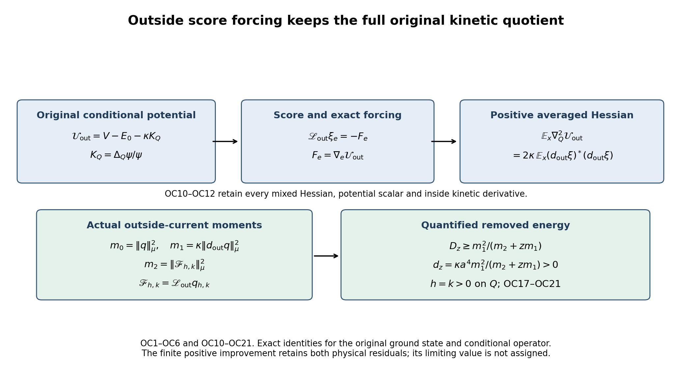
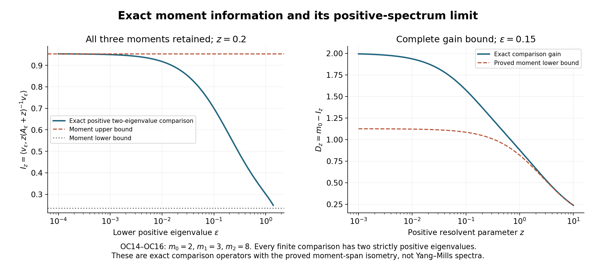

# Conditional outside forces and evaluated current moments

This continuation evaluates the actual conditional outside current in [CG23–CG34](https://github.com/KokunoYumeto/yang-mills-interacting-workbench/blob/f68cf012cb8e61169df939c3f210df710ab99be8/yang-mills/continuations/20261011-central-signs-shrinking-window/CONDITIONAL_GROUND_CURRENT_TRIAL.md), using the same ground state and the retained derivatives in [RD1–RD22](https://github.com/KokunoYumeto/yang-mills-interacting-workbench/blob/f68cf012cb8e61169df939c3f210df710ab99be8/yang-mills/continuations/20261011-central-signs-shrinking-window/RETAINED_DERIVATIVE_AND_GOOD_BOUNDARIES.md). It proves its score-forcing equation, a positive averaged potential-Hessian identity, complete first and second spectral moments, and a strict finite-regulator improvement for a specified physical trial. The remaining moments retain their actual ground-state values; their continuum asymptotics are not assumed.

## 1. Original state and conditional operator

Use the open cubic lattice with vertices \(\{0,\ldots,2L_j\}^3\), every positively oriented edge and every vertex gauge transformation. The link metric is the original radius-two \(\mathrm{SU}(2)\) metric, with \(T_\alpha=-i\sigma_\alpha/2\) orthonormal and Haar probability measure. Retain
\[
\begin{gathered}
L_j=j^4,\quad a_j=(100j)^{-1},\quad
g_j^2=\kappa_*a_j/2,\quad b_j=(\kappa_*a_j^2)^{-1},\quad
s_j=\kappa_*/j,\\
U_p=U_d(z)U_k(z+e_d)U_d(z+e_k)^{-1}U_k(z)^{-1},\quad d<k,\\
D_p=2-\operatorname{Tr}U_p,\qquad
V_j=b_j\sum_pD_p,\qquad H_j=-\kappa_*\Delta+V_j,\\
x_{p,j}=o+a_j\{z-L_j\mathbf1+(e_d+e_k)/2\},\qquad
C_{\mathbf f,j}=a_j\sum_{\sigma,p}f_\sigma(x_{p,j})D_p,\\
H_j\psi_j=E_{0,j}\psi_j,\quad \psi_j>0,\quad
\int\psi_j^2dU=1,\quad w_j=\log\psi_j,\quad d\mu_j=\psi_j^2dU .
\end{gathered}\tag{OC1}
\]
The three tests \(f_\sigma\) are real, continuous and compactly supported; the original physical offset \(o\) is retained. Suppress \(j\) only in finite-regulator calculations. Let \(Q\) be the complete inside-edge set of an original fitting cube, strictly inside the full lattice, and write \(x,v\) for inside and outside link variables. Keep
\[
\begin{gathered}
m(x)=\int\psi(x,v)^2dv,\quad \varphi=\sqrt m,\quad
\chi=\psi/\varphi,\quad w_Q=\log\varphi,\quad
\mathbb E_xF=\int F\chi^2dv,\\
g_e=\nabla_ew,\quad \bar g_e=\nabla_ew_Q,\quad
\xi_e=g_e-\bar g_e=\nabla_e\log\chi,\quad
H_{er}=\nabla_r\nabla_ew,\quad e\in Q,\ r\notin Q,\\
K_Q=\frac{\Delta_Q\psi}{\psi}
=\Delta_Qw+\sum_{e\in Q}|g_e|^2,\qquad
\mathcal U_{\rm out}=V-E_0-\kappa K_Q
=\kappa\frac{\Delta_{\rm out}\chi}{\chi},\\
A_{\rm out}=-\kappa\Delta_{\rm out}+\mathcal U_{\rm out},\quad
A_{\rm out}\chi=0,\quad
\mathscr L_{\rm out}=\chi^{-1}A_{\rm out}\chi
=-\kappa(\Delta_{\rm out}+2\nabla_{\rm out}w\cdot\nabla_{\rm out}).
\end{gathered}\tag{OC2}
\]
These are CG24's full original Hamiltonian terms. In particular \(\mathcal U_{\rm out}\) is not IM's marginal effective potential. All original scalar face terms, \(E_0\), and the entire inside kinetic quotient \(K_Q\) occur before differentiation. Multiplication by \(\chi\) is unitary from the conditional weighted space to outside Haar space. CG23 proves the finite-regulator direct-integral domains and parameter regularity. No tensor decomposition of the physical gauge-invariant Hilbert space is asserted.

## 2. Exact score forcing and a positive averaged Hessian

Define the inside force covector \(F_e=\nabla_e\mathcal U_{\rm out}\). The exact score equation and force mean are
\[
\mathscr L_{\rm out}\xi_e=-F_e,\qquad
\mathbb E_x\xi_e=0,\qquad \mathbb E_xF_e=0 .
\tag{OC3}
\]
To prove the first equation, differentiate \(A_{\rm out}\chi=0\) in an inside direction. The outside principal part is independent of \(x\), so
\(A_{\rm out}\nabla_e\chi=-F_e\chi\).
Use \(\nabla_e\chi=\chi\xi_e\) and the exact conjugation in (OC2). Differentiating \(\int\chi^2dv=1\) proves the score mean. Conditional integration of \(\mathscr L_{\rm out}\xi_e\) gives zero, proving the force mean. The connection on the inside tangent space is independent of \(v\), so this is a covariant vector identity.

For any inside tangent vectors \(u,t\) at \(x\), put
\(\xi_u=\sum_e\langle u_e,\xi_e\rangle\),
\(F_u=\sum_e\langle u_e,F_e\rangle\). Then
\[
\begin{gathered}
\mathbb E_x(\nabla_Q^2\mathcal U_{\rm out})(u,t)
=-2\mathbb E_x(\xi_tF_u)
=2\kappa\mathbb E_x\sum_{r\notin Q}
\langle\nabla_r\xi_u,\nabla_r\xi_t\rangle,\\
\mathbb E_x\nabla_Q^2\mathcal U_{\rm out}\ge0,\qquad
\mathbb E_x\Delta_e\mathcal U_{\rm out}
=2\kappa\mathbb E_x\sum_{r\notin Q}\|H_{er}\|_{\rm HS}^2 .
\end{gathered}\tag{OC4}
\]
For the first equality differentiate \(\mathbb E_xF_u=0\) along \(t\), extending \(u,t\) covariantly constant at the point. The derivative of the conditional density is \(2\xi_t\chi^2\), giving the first expression. Substitute (OC3) and integrate by parts in the original outside metric to obtain the second. Every outside edge remains in the sum. Its diagonal is a squared norm, proving positivity. Tracing over an orthonormal frame of the original edge \(e\) proves the last formula. This is positivity of the averaged Hessian of this exact conditional potential; it does not assign a sign to the different full-minus-marginal contractions in RD6.

## 3. Finite-regulator inverses and their actual comparison scale

Let
\[
\Omega_j=\sup_x\{\max_v w_j(x,v)-\min_v w_j(x,v)\},
\qquad
\lambda_{{\rm osc},j}=\frac{3\kappa_*}{4}e^{-2\Omega_j}>0 .
\tag{OC5}
\]
On every mean-zero conditional fiber, and consequently on its direct integral,
\(\mathscr L_{\rm out}\ge\lambda_{{\rm osc},j}I\).

Here are the constants in this assertion. For Haar measure on the radius-two three-sphere, integrated Bochner and
\(\|\nabla^2f\|^2\ge(\Delta f)^2/3\) give
\(\int(\Delta f)^2\ge(3/4)\int|\nabla f|^2\).
Applying this to each nonconstant Laplace eigenfunction on the compact sphere proves the Poincare constant \(4/3\). The coordinate eigenfunctions in GS2 attain it. Tensor products of their complete spectral decompositions give the same constant for any nonempty outside product. For a positive density \(\rho=\chi(x,\cdot)^2\), the infimum-over-constants formula gives
\[
\operatorname{Var}_{\rho dv}f
\le(\max\rho)\operatorname{Var}_{dv}f
\le\frac43\frac{\max\rho}{\min\rho}
\int|\nabla_{\rm out}f|^2\rho\,dv .
\]
Its ratio is \(e^{2\operatorname{osc}_v w(x,\cdot)}\); the marginal factor cancels in this ratio but remains in the state (OC2). Compactness gives the finite \(\Omega_j\). Multiplication by \(\kappa_*\) proves (OC5). This establishes bounded inverses for the following finite-regulator identities; it does not give a bound uniform in \(j\).

Consequently the score covariance and averaged Hessian have the exact force representations
\[
\begin{gathered}
\mathcal G_x(u,t):=\mathbb E_x(\xi_u\xi_t)
=\langle F_u,\mathscr L_{\rm out}^{-2}F_t\rangle_x,\\
\mathbb E_x(\nabla_Q^2\mathcal U_{\rm out})(u,t)
=2\langle F_u,\mathscr L_{\rm out}^{-1}F_t\rangle_x .
\end{gathered}\tag{OC6}
\]
All inverse operators here act on the conditional mean-zero space. Equation (OC3) proves the first equality; (OC4) proves the second. This retains the complete conditional force, rather than replacing it by the bare derivative of \(V\).

An explicit comparison lower function can be evaluated on the original path. The already proved original-state slice bound [SR64](https://github.com/KokunoYumeto/yang-mills-interacting-workbench/blob/f68cf012cb8e61169df939c3f210df710ab99be8/yang-mills/continuations/20261011-central-signs-shrinking-window/SQUARE_ROOT_SCORE_RECEIVING_MAPS.md) is
\(\operatorname{osc}_e w\le4\pi\min\{\beta_e,\sqrt{\beta_e}\}\),
where \(\beta_e=r_e/(\kappa_*^2a_j^2)\) and \(r_e\) is the full original incident-face count. Change the outside edges one at a time, keeping their original coordinates. This proves
\[
\begin{gathered}
B_{{\rm out},j}
=\sum_{e\notin Q}\min\left\{
\frac{r_e}{\kappa_*^2a_j^2},
\frac{\sqrt{r_e}}{\kappa_*a_j}\right\},\qquad
\Omega_j\le4\pi B_{{\rm out},j},\\
\lambda_{{\rm cmp},j}
=\frac{3\kappa_*}{4}e^{-8\pi B_{{\rm out},j}}
\le\lambda_{{\rm osc},j},\qquad
\langle q,s_j(\mathscr L_{\rm out}+s_j)^{-1}q\rangle_\mu
\le\frac{s_j}{s_j+\lambda_{{\rm cmp},j}}\|q\|_\mu^2
\quad(\mathbb E_xq=0).
\end{gathered}\tag{OC7}
\]
No outside edge is removed from \(B_{\rm out}\). The original minimum is retained.

For the RD fitting cubes and both proved collar choices, let \(m_j=2L_j\) and \(N_Q=3q_Q(q_Q+1)^2\). Strict inclusion in the original box makes every inside edge have degree four. The exact outside multiplicities are
\[
n_{2,j}=12m_j,\qquad
n_{3,j}=12m_j(m_j-1),\qquad
n_{4,j}=3m_j(m_j-1)^2-N_Q .
\tag{OC8}
\]
For one fixed edge orientation, its longitudinal coordinate has \(m_j\) choices. Each transverse coordinate contributes one incident face at an endpoint \(0,m_j\) and two at an interior coordinate. Both transverse endpoints give four pairs and degree two; exactly one endpoint gives \(4(m_j-1)\) pairs and degree three; two interior coordinates give \((m_j-1)^2\) pairs and degree four. Multiply by three orientations and \(m_j\), then subtract the exact inside-edge count from the last class. This proves all counts and their boundary contributions.

Thus \(B_{\rm out}\) in (OC7) is exactly the sum of its three displayed minimum functions with coefficients \(n_2,n_3,n_4\). Eventually every minimum selects its square-root branch, and
\[
\begin{gathered}
B_{{\rm out},j}
=\frac{\sqrt2\,n_{2,j}+\sqrt3\,n_{3,j}+2n_{4,j}}
{\kappa_*a_j}\quad\hbox{for all sufficiently large }j,\\
\frac{B_{{\rm out},j}}{j^{13}}\longrightarrow\frac{4800}{\kappa_*},
\qquad
\frac{-\log[\lambda_{{\rm cmp},j}/(3\kappa_*/4)]}{j^{13}}
\longrightarrow\frac{38400\pi}{\kappa_*},\\
\frac{\lambda_{{\rm cmp},j}}{s_j}
=\frac{3j}{4}e^{-8\pi B_{{\rm out},j}}\longrightarrow0,\qquad
\frac{s_j}{s_j+\lambda_{{\rm cmp},j}}\longrightarrow1 .
\end{gathered}\tag{OC9}
\]
Indeed \(n_4/j^{12}\to24\), \(n_3/j^{12}\to0\), \(n_2/j^{12}\to0\), and \(N_Q=O(j^3)\) for both collars. The original \(a_j^{-1}=100j\) gives the coefficient \(4800/\kappa_*\). This evaluates the proved comparison function. It does not say that the actual conditional gap has that asymptotic value. The bound (OC7) therefore supplies no vanishing upper coefficient at the required shrinking scale; the following actual-current calculation keeps additional information.

## 4. Complete outside derivative and forcing of the original current

For deterministic real or complex weights \(h,k\) on \(Q\), retain
\[
\begin{gathered}
S_e=\Delta_ew+2|g_e|^2,\quad
s_e=\Delta_ew_Q+2|\bar g_e|^2,\quad p_e=\langle\bar g_e,\xi_e\rangle,\\
q_{h,k}=2p_h+t_k
=\sum_{e\in Q}k_e(S_e-s_e)+2\sum_{e\in Q}(h_e-k_e)p_e,
\qquad\mathbb E_xq_{h,k}=0,\\
\nabla_rq_{h,k}
=\sum_{e\in Q}k_e\Delta_eg_r
+\sum_{e\in Q}H_{re}\{4k_eg_e+2(h_e-k_e)\bar g_e\},
\qquad r\notin Q .
\end{gathered}\tag{OC10}
\]
The currents \(p_e,t_e\) are exactly CG4's. The second line follows by substituting \(S_e-s_e=2p_e+t_e\). For the last line, \(\nabla_rs_e=0\);
\(\nabla_r\Delta_ew=\Delta_e\nabla_rw=\Delta_eg_r\) because \(e,r\) are distinct product factors; and
\(\nabla_r|g_e|^2=2H_{re}g_e\).
Also \(\nabla_rp_e=H_{re}\bar g_e\). This proves every term, with no exterior or third derivative omitted.

The complete scalar forcing is
\[
\begin{gathered}
\mathscr F_{h,k}:=\mathscr L_{\rm out}q_{h,k}\\
=-\sum_{e\in Q}k_e\Delta_e\mathcal U_{\rm out}
-\sum_{e\in Q}
\langle4k_eg_e+2(h_e-k_e)\bar g_e,F_e\rangle
-2\kappa\sum_{\substack{e\in Q\\r\notin Q}}
k_e\|H_{er}\|_{\rm HS}^2 .
\end{gathered}\tag{OC11}
\]
Here products with complex weights mean the complex-linear extension of the displayed real contractions. To prove this formula, first take the single-edge equal-weight current
\[
S_e-s_e
=\operatorname{div}_e\xi_e+4\langle\bar g_e,\xi_e\rangle+2|\xi_e|^2 .
\]
The operator depends on \(x\) only through its outside drift. Consequently
\[
\begin{gathered}
\mathscr L_{\rm out}(\operatorname{div}_e\xi_e)
=\operatorname{div}_e(\mathscr L_{\rm out}\xi_e)
+2\kappa\sum_{r\notin Q}\|H_{er}\|_{\rm HS}^2,\\
\mathscr L_{\rm out}p_e=-\langle\bar g_e,F_e\rangle,\qquad
\mathscr L_{\rm out}|\xi_e|^2
=-2\langle\xi_e,F_e\rangle
-2\kappa\sum_{r\notin Q}\|H_{er}\|_{\rm HS}^2 .
\end{gathered}
\]
For the commutator, in covariantly constant inside frames at the point,
\([\mathscr L_{\rm out},\nabla_e]f
=2\kappa\sum_r H_{er}\nabla_rf\); trace it on \(\xi_e\).
The last identity is the full weighted product rule, including its negative quadratic-gradient term. Insert (OC3), add the three contributions, and then use the second line of (OC10). Their Hessian coefficients are \(2\kappa-4\kappa=-2\kappa\), proving (OC11).

There is also a completely expanded original-potential form. Put
\(v_e^{h,k}=4k_eg_e+2(h_e-k_e)\bar g_e\) and
\(\sigma_{k,p}=\sum_{e\in\partial p\cap Q}k_e\). Then
\[
\begin{aligned}
\mathscr F_{h,k}
={}&-\frac{3b}{4}\sum_{p:\,\partial p\cap Q\ne\varnothing}
\sigma_{k,p}(2-D_p)
+b\sum_{e\in Q}
\left\langle v_e^{h,k},
\sum_{p:\,e\in\partial p}\nabla_e\operatorname{Tr}U_p\right\rangle\\
&+\kappa\Delta_kK_Q
+\kappa\sum_{e\in Q}\langle v_e^{h,k},\nabla_eK_Q\rangle
-2\kappa\sum_{\substack{e\in Q\\r\notin Q}}
k_e\|H_{er}\|_{\rm HS}^2 .
\end{aligned}\tag{OC12}
\]
Use \(\Delta_eD_p=\tfrac34(2-D_p)\) and
\(\nabla_eV=-b\sum_{p\ni e}\nabla_e\operatorname{Tr}U_p\) in (OC11).
The derivatives of the ordered holonomy in (OC1) insert \(T_\alpha\) in a positively oriented factor, or the derivative
\(-U_e^{-1}T_\alpha\) in its inverse factor when \(U_e\) is varied by \(e^{tT_\alpha}U_e\). Thus all face orientations and the scalar 2 remain specified. The configuration-independent \(E_0\) differentiates to zero only after the exact equation (OC2) is used. The full quotient \(K_Q=\Delta_Qw+\sum|g_e|^2\) is still present, including every inside derivative that it generates.

## 5. First and second spectral moments, with complete remainders

Let \(q=q_{h,k}\), and take the full outside operator on the conditional mean-zero direct-integral space. Define
\[
\begin{gathered}
m_0=\mu|q|^2,\qquad
m_1=\langle q,\mathscr L_{\rm out}q\rangle_\mu
=\kappa\mu\sum_{r\notin Q}|\nabla_rq|^2,\qquad
m_2=\|\mathscr L_{\rm out}q\|_\mu^2
=\mu|\mathscr F_{h,k}|^2,\\
I_z=\langle q,z(\mathscr L_{\rm out}+zI)^{-1}q\rangle_\mu,\qquad
D_z=m_0-I_z
=\langle q,\mathscr L_{\rm out}(\mathscr L_{\rm out}+zI)^{-1}q\rangle_\mu .
\end{gathered}\tag{OC13}
\]
All first-moment summands are evaluated by (OC10), and all second-moment terms by (OC11) or (OC12). The squared sums include their complete cross terms; no diagonal approximation is taken. Smoothness on the fixed compact product proves finiteness and membership in the needed operator domains.

If \(q\ne0\), (OC5) gives \(m_0,m_1,m_2>0\), and the exact identities are
\[
\begin{gathered}
D_z=\frac{m_1^2}{m_2+zm_1}
+\left\|
\mathscr L_{\rm out}^{1/2}(\mathscr L_{\rm out}+z)^{-1/2}q
-\frac{m_1}{m_2+zm_1}
\mathscr L_{\rm out}^{1/2}(\mathscr L_{\rm out}+z)^{1/2}q
\right\|_\mu^2,\\
I_z=\frac{zm_0^2}{m_1+zm_0}
+z\left\|
(\mathscr L_{\rm out}+z)^{-1/2}q
-\frac{m_0}{m_1+zm_0}
(\mathscr L_{\rm out}+z)^{1/2}q
\right\|_\mu^2,\\
\frac{zm_0^2}{m_1+zm_0}
\le I_z\le m_0-\frac{m_1^2}{m_2+zm_1}.
\end{gathered}\tag{OC14}
\]
Expand the first squared norm: its three terms are
\(D_z\), \(-2m_1^2/(m_2+zm_1)\), and \(m_1^2/(m_2+zm_1)\).
For the second, its terms after multiplication by \(z\) are
\(I_z\), \(-2zm_0^2/(m_1+zm_0)\), and \(zm_0^2/(m_1+zm_0)\).
This proves both identities and both inequalities with their full residuals. When \(q=0\), all five quantities in (OC13) are zero and the identities are read as that separate zero case.

The first two moments alone permit no uniformly smaller upper function than the last expression in (OC14), even after excluding a zero spectral atom. Here is its exact finite-dimensional comparison and moment map. For \(m_0m_2>m_1^2\) and \(0<\epsilon<m_1/m_0\), set
\[
\begin{gathered}
d_\epsilon=m_2-2\epsilon m_1+\epsilon^2m_0,\qquad
\lambda_\epsilon=\frac{m_2-\epsilon m_1}{m_1-\epsilon m_0},\\
a_\epsilon=\frac{m_0m_2-m_1^2}{d_\epsilon},\qquad
b_\epsilon=\frac{(m_1-\epsilon m_0)^2}{d_\epsilon},\qquad
A_\epsilon=\operatorname{diag}(\epsilon,\lambda_\epsilon),\quad
v_\epsilon=(\sqrt{a_\epsilon},\sqrt{b_\epsilon}),\\
\|v_\epsilon\|^2=m_0,\quad
\langle v_\epsilon,A_\epsilon v_\epsilon\rangle=m_1,\quad
\|A_\epsilon v_\epsilon\|^2=m_2,\\
\lim_{\epsilon\downarrow0}
\langle v_\epsilon,z(A_\epsilon+z)^{-1}v_\epsilon\rangle
=m_0-\frac{m_1^2}{m_2+zm_1}.
\end{gathered}\tag{OC15}
\]
Both weights and both eigenvalues are strictly positive.
Indeed \(d_\epsilon=(m_0m_2-m_1^2)/m_0+
m_0(\epsilon-m_1/m_0)^2>0\); also
\(m_2-\epsilon m_1>m_1(m_1/m_0-\epsilon)>0\).
Adding the weights gives \(m_0\), and direct substitution proves the two weighted eigenvalue sums. Their limits are a zero-endpoint weight \(m_0-m_1^2/m_2\) and weight \(m_1^2/m_2\) at \(m_2/m_1\), which proves the displayed limit without putting a zero eigenvalue into any \(A_\epsilon\).

The map
\[
u q+v\mathscr L_{\rm out}q
\longmapsto u v_\epsilon+vA_\epsilon v_\epsilon
\tag{OC16}
\]
is an isometry of the two-dimensional spans, because their complete Gram matrices are both
\(\left(\begin{smallmatrix}m_0&m_1\\m_1&m_2\end{smallmatrix}\right)\).
It maps \(q\) and its first operator image exactly; it does not identify the full operators or physical states. When \(m_0m_2=m_1^2\), the actual vector has
\(\|(\mathscr L_{\rm out}-m_1/m_0)q\|^2=0\), and both bounds in (OC14) equal its exact value. This supplies the precise comparison behind the moment limitation and specifies which further actual spectral data must enter.

## 6. The original positive-weight current is nonzero

For real deterministic \(h_e>0\) on every inside edge, the original equal-weight current satisfies
\[
q_{h,h}=S_h-s_h\ne0,\qquad
m_1(h,h)>0,\qquad m_2(h,h)>0 .
\tag{OC17}
\]
This uses the actual crossing interaction, not a generic nondegeneracy assumption.

Suppose \(q_{h,h}=0\). Full support and smoothness make this equality pointwise. Write \(\rho=\psi^2=m\chi^2\), and
\(\Delta_h=\sum_{e\in Q}h_e\Delta_e\). Since
\(S_h=\Delta_h\rho/(2\rho)\) and \(s_h=\Delta_hm/(2m)\),
the conditional density \(n_v(x)=\chi(x,v)^2\) satisfies
\[
\Delta_hn_v+
2\sum_{e\in Q}h_e\langle\nabla_e\log m,\nabla_en_v\rangle=0 .
\]
Multiply by \(n_vm^2\), integrate over the full inside product, and integrate each term by parts. The drift cancels the derivative of \(m^2\), leaving
\(\sum_e h_e\int m^2|\nabla_en_v|^2dx=0\).
Every summand is nonnegative and every \(h_e\) is positive. Connectedness gives \(n_v(x)=n(v)\). Thus
\(\psi(x,v)=\varphi(x)\sqrt{n(v)}\), and its original ground equation would force
\[
V(x,v)=E_0+
\kappa\frac{\Delta_Q\varphi(x)}{\varphi(x)}
+\kappa\frac{\Delta_{\rm out}\sqrt{n(v)}}{\sqrt{n(v)}} .
\tag{OC18}
\]
This is contradicted by a specific original crossing face. Such a face has exactly one inside edge \(e\); choose an adjacent perpendicular outside edge \(r\) in that face. They belong together to exactly one elementary face. At the configuration where all original links are the identity, mixed differentiation in directions \(T_\alpha,T_\beta\) gives
\[
(X_{e,\alpha}X_{r,\beta}V)(I)
=-b\,\varepsilon_e\varepsilon_r\operatorname{Tr}(T_\alpha T_\beta)
=\frac b2\,\varepsilon_e\varepsilon_r\delta_{\alpha\beta}\ne0
\quad(\alpha=\beta).
\tag{OC19}
\]
Here \(\varepsilon_e,\varepsilon_r\in\{1,-1\}\) are the signs of their appearances in the original ordered plaquette word. All other faces have zero mixed derivative because they do not contain both edges. The right side of (OC18) has zero mixed derivative in those variables. This contradiction proves \(q_{h,h}\ne0\). The fixed-regulator positive operator on its mean-zero space then proves the moment assertions. Thus the defect specified by zero conditional current has been identified exactly as a product density, and the original crossing interaction supplies its explicit nonzero obstruction.

## 7. Strict quantified improvement for a specified physical trial

Take \(h_e=k_e=1\) on every edge of \(Q\). Let
\(\eta=\gamma_{\mathbf1}+\delta_{\mathbf1}=a^2d_Qw\),
\(q=q_{\mathbf1,\mathbf1}\), \(s=s_{\mathbf1}\), and retain the original full norm \(N=\|\eta\|_\mu^2\). The source \(C_{\mathbf f}=a\sum_{\sigma,p}f_\sigma(x_p)D_p\) has all its plaquette edges inside \(Q\). Put
\[
\begin{gathered}
\ell=\langle dC_{\mathbf f},\eta\rangle_\mu
=\frac{3a^3}{2}\sum_{\sigma,p}f_\sigma(x_p)(\mu D_p-2),\\
E_{{\rm old},z}=\kappa a^4\mu|s|^2+zN+\kappa a^4m_0,\qquad
E_{{\rm new},z}=\kappa a^4\mu|s|^2+zN+\kappa a^4I_z,\\
d_z=\frac{\kappa a^4m_1^2}{m_2+zm_1}>0,\qquad
0<E_{{\rm new},z}\le E_{{\rm old},z}-d_z<E_{{\rm old},z}.
\end{gathered}\tag{OC20}
\]
The source identity is CG7 summed over the four original edges of every supported face. The energies are exactly CG28 at this pair before and after its entire outside minimization. Equation (OC17) proves strict positivity of \(d_z\); the norm term proves the positive denominator, since \(N=0\) would make every inside derivative of \(w\) vanish and hence make \(q=0\).

Let
\(\Theta_z=\eta+\kappa a^2d_{\rm out}(\mathscr L_{\rm out}+z)^{-1}q\),
\(c_z=\ell/E_{{\rm new},z}\),
\(\beta_z=(\mathscr L_1+z)^{-1}dC_{\mathbf f}\), and let
\(P_{\mathcal G}\) be the original physical exact-one-form projection. With the same full operator and response as CG30,
\(\mathscr L_1=\kappa(\nabla_\mu^*\nabla+I/2-2\nabla^2w)\) and
\(\mathcal R_{\mathbf f}(z)=\kappa\langle dC_{\mathbf f},
(\mathscr L_1+z)^{-1}dC_{\mathbf f}\rangle_\mu\),
\[
\begin{gathered}
\mathcal R_{\mathbf f}(z)
=\frac{\kappa\ell^2}{E_{{\rm new},z}}
+\kappa\|(\mathscr L_1+z)^{1/2}
(\beta_z-c_zP_{\mathcal G}\Theta_z)\|_\mu^2
+\kappa zc_z^2\|(I-P_{\mathcal G})\Theta_z\|_\mu^2,\\
\mathcal R_{\mathbf f}(z)
\ge\frac{\kappa\ell^2}{E_{{\rm old},z}-d_z}
=\frac{\kappa\ell^2}{E_{{\rm old},z}}
+\frac{\kappa\ell^2d_z}
{E_{{\rm old},z}(E_{{\rm old},z}-d_z)} .
\end{gathered}\tag{OC21}
\]
The first identity is the complete physical variational square, using
\(\langle dC,\Theta_z\rangle=\ell\) and
\(q_1(P_{\mathcal G}\Theta_z)+z\|\Theta_z\|^2=E_{{\rm new},z}\).
The second follows from (OC20); its last equality is exact fraction subtraction. Both physical residuals remain. This compares this specified direction with its own unrelaxed direction; CG30 separately retains the optimization over all \(h,k\).

There is an unconditional nonzero source limit for the original nonnegative, nonzero compact tests. Suppose each original \(f_\sigma\ge0\) and
\(J=\sum_\sigma\int_{\mathbb R^3}f_\sigma(x)\,dx>0\).
This specifies a class of existing test observables, not a substitute state. Let \(F=\max_\sigma\|f_\sigma\|_\infty\), and use any RD fitting cube or either of its two collars. The actual original deficit bound gives
\[
\begin{gathered}
-3a_j^3\sum_{\sigma,p}f_\sigma(x_{p,j})
\le\ell_j
\le-3a_j^3\sum_{\sigma,p}f_\sigma(x_{p,j})
+\frac{3a_j^3F}{2}\Lambda_{Q_j},\\
a_j^3\sum_{\sigma,p}f_\sigma(x_{p,j})\longrightarrow J,\qquad
a_j^3\Lambda_{Q_j}\longrightarrow0,\qquad
\ell_j\longrightarrow-3J<0 .
\end{gathered}\tag{OC22}
\]
The first line follows from \(0\le\sum f_\sigma D_p\le F\mathcal W_Q\) and CE4. The second line is the original translated midpoint Riemann sum for continuous compact support; covering the support by its lattice cubes and applying uniform continuity proves its convergence, with the exact half-face offsets in (OC1). RD17 and RD21 give \(a_j^2\Lambda_{Q_j}\to9\kappa_*R^3+24R^2\), so multiplying by \(a_j\) proves the other limit. Consequently the improvement term in (OC21) is strictly positive for all sufficiently large original regulators, including at \(z=s_j\).

This finite positivity does not assign a nonzero limiting value to that term. Its complete remaining quantities are the original moments (OC10)–(OC13), the marginal current energy and the full physical residuals (OC21). The oscillation comparison was explicitly evaluated and found insufficient at \(s_j\); the forcing identities and actual moment bound now specify the next calculation without replacing the original state, kinetic quotient or spectral measure. The interacting continuum construction, reconstruction, global smoothness and no-gap endpoint remain the active research goal.

## 8. Complete common kernel and force-projection remainder

The score covariance and averaged conditional potential Hessian have exactly the same degeneracy directions; this also identifies their relation to the full force Gram. At each fixed \(x\), use the original inside metric to identify tensors with symmetric operators and set
\[
\begin{gathered}
\mathcal G_x=\mathbb E_x(\xi\otimes\xi),\qquad
\mathcal H_x=\mathbb E_x\nabla_Q^2\mathcal U_{\rm out},\qquad
\mathcal Q_x=\mathbb E_x(F\otimes F),\\
\ker\mathcal G_x=\ker\mathcal H_x=\ker\mathcal Q_x
=\{u:\xi_u=0\text{ on the entire outside fiber}\},\\
2\lambda_{{\rm osc},j}\mathcal G_x\le\mathcal H_x,\qquad
\operatorname{ran}\mathcal H_x=\operatorname{ran}\mathcal G_x .
\end{gathered}\tag{OC23}
\]
If \(\mathcal G_x(u,u)=0\), full support makes \(\xi_u=0\) everywhere; (OC3) then gives \(F_u=0\). If \(\mathcal Q_x(u,u)=0\), the same argument makes \(F_u=0\), so (OC3), the outside kernel and the zero conditional mean give \(\xi_u=0\). If \(\mathcal H_x(u,u)=0\), (OC4) makes its outside gradient zero, and the same mean-zero argument applies. These implications prove the whole kernel equality. Equation (OC5) applied to \(\xi_u\) in (OC4) proves the operator inequality. Finite-dimensional orthogonal complementation gives the range equality.

With the Moore–Penrose inverse at this fixed \(x\), the entire force component outside the score span has Gram
\[
\begin{gathered}
\mathcal Q_x-\tfrac14\mathcal H_x\mathcal G_x^+\mathcal H_x\\
=\mathbb E_x\left[
\left(F+\tfrac12\mathcal H_x\mathcal G_x^+\xi\right)
\otimes
\left(F+\tfrac12\mathcal H_x\mathcal G_x^+\xi\right)
\right]\ge0 .
\end{gathered}\tag{OC24}
\]
Indeed (OC4) says
\(\mathbb E_x(F\otimes\xi)=\mathbb E_x(\xi\otimes F)=-\mathcal H_x/2\).
Expand the right side, and use
\(\mathcal G_x^+\mathcal G_x\mathcal G_x^+=\mathcal G_x^+\).
Its two cross terms each equal
\(-\mathcal H_x\mathcal G_x^+\mathcal H_x/4\), and its last term equals
\(\mathcal H_x\mathcal G_x^+\mathcal H_x/4\), proving the formula.
Its residual is orthogonal in the conditional space to every score component, because the range equality in (OC23) gives
\(-\mathcal H_x/2+\mathcal H_x\mathcal G_x^+\mathcal G_x/2=0\).
No differentiability of a varying-rank pseudoinverse is used.

These kernels retain the original gauge geometry. At an original lattice vertex whose six incident edges all belong to \(Q\), an infinitesimal vertex gauge transformation is an inside tangent vector \(u\). It changes no outside link. Both \(\psi(x,v)\) and its marginal \(\varphi(x)\) are invariant under this transformation: the first by the original gauge symmetry, the second by integrating that identity over the unchanged outside variables. Thus \(\chi=\psi/\varphi\) is invariant, and \(\xi_u=0\). Equations (OC23)–(OC24) place this exact gauge direction in all three kernels. No assertion that these gauge directions exhaust the kernels is needed; the displayed fiber condition describes the full remaining space.

Complete reproducible diagnostics and figure sources are in [check_outside_force.py](check_outside_force.py). Manufactured curved densities, finite Galerkin force checks and comparison matrices are not samples of the original Yang–Mills ground. Exact provider editions and bounded reading coverage are in [the source-use ledger](OUTSIDE_FORCE_SOURCE_USE_LEDGER.json).

## Exact boundary projection and actual current-moment bounds

[BQ1–BQ18](https://github.com/KokunoYumeto/yang-mills-interacting-workbench/blob/main/yang-mills/continuations/20261011-central-signs-shrinking-window/BOUNDARY_FORCE_PROJECTION.md) prove that the derivative of the original inside kinetic quotient is the full weighted exact projection of the inside potential gradient. Every wholly inside face derivative cancels from the conditional force; the complete crossing field and original ground-state projection remain. Exact projection and Casimir-gradient remainders give actual force and mixed-Hessian bounds on both established collars, including \(a_j^6\|F_j\|^2\to0\) and \(a_j^5\mathcal O_{Q_j}\to0\). The first current moment is computed without third kinetic derivatives and has a quantitative upper estimate. The second moment retains its weighted boundary divergence and all six signed covariance terms. Unscaled limiting spectral mass and the smooth interacting no-gap endpoint remain active calculations.

## Boundary divergence and marginal second moments

[BD1–BD19](https://github.com/KokunoYumeto/yang-mills-interacting-workbench/blob/main/yang-mills/continuations/20261011-central-signs-shrinking-window/BOUNDARY_DIVERGENCE_AND_MARGINAL_MOMENTS.md) prove an exact mixed derivative and two-square identity for the full projected boundary field. Weighted integration removes its mixed-Hessian contraction from the divergence estimate while retaining the inside score and every original crossing derivative. Both established collars give \(\smash{a_j^7\|J_j\|^2\to0}\) with explicit rates. The existing marginal-gradient block has complete first and second moments and \(\smash{a_j^{11}m_{2,j}^\gamma\to0}\), again with explicit collar constants. The arbitrary-weight force map, full scalar trial line, signed second-moment cross term, exact scalar optimizer and both physical residuals remain. The full-gradient mixed-Hessian fluctuation and limiting physical spectral weight still require evaluation.

## Original kinetic current and its full physical energy

[KC1–KC28](https://github.com/KokunoYumeto/yang-mills-interacting-workbench/blob/main/yang-mills/continuations/20261011-central-signs-shrinking-window/KINETIC_CURRENT_AND_PHYSICAL_ENERGY.md) retain the original kinetic quotient and its complete conditional mean, and decompose the full current into kinetic and score fluctuations. The actual kinetic variance has a boundary-count bound with all nonnegative energy remainders. Its first two moments control the full kinetic column of the conditional inverse at the original shrinking energy. Differentiating its conditional mean gives the exact full physical energy, including a retained conditional covariance. That covariance supplies an explicit enlargement of the physical scalar trial space, an exact Green-function gain and its full residual. The source gain and limiting physical spectral weight remain unevaluated; the complete earlier current family remains available.
