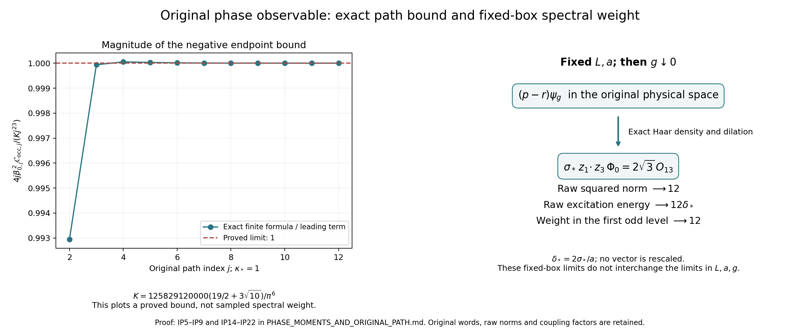

# Original phase moments and the unchanged shrinking window

This independent derivation uses the actual vacuum and original rooted
words throughout. Its original-path result is the explicit bound (IP8).
Its additional fixed-box results are (IP15)–(IP20). The fixed-box limits
do not establish the sign of the expression in (IP1) on the prescribed
joint path. No smaller selected coupling is substituted for that path.

## 1. Original objects and source locations

The finite open box has vertex indices `(i,k,l)` in `{0,...,m}^3`, where
`m=2L`, `n=m+1`, and `L>=2`. The physical vertex remains
`o+a(i-L,k-L,l-L)`. It has
\[
 N=3m(m+1)^2,\qquad M=3m^2(m+1).
\]
The root is `(0,0,0)`. The root path goes in direction three, then two,
then one. The tree has every direction-one edge, direction-two edges
with first coordinate zero, and direction-three edges with first two
coordinates zero. For a chord `c=(s,t)`, retain the whole word
\(Z_c=t_sU_ct_t^{-1}\). No common segment is erased when occurrences
are counted below. The Lie generators are
\(T_\alpha=-i\sigma_\alpha/2\), and
\(q_c^\alpha=-2\operatorname{tr}(T_\alpha Z_c)\).

Write
\[
 h={\pi\over2n},\quad c=\cos h,\quad C=\cot h,\quad
 v_0(l)=n^{-1/2},\quad
 v(l)=\sqrt{2/n}\cos{\pi(l+1/2)\over n},\quad
 w(l)=-\sqrt{2/n}\sin{\pi(l+1)\over n}.
\]
The complete chord sets and the original first and third rows are
\[
\begin{split}
\mathcal C_2&=\{(i,k,l;2):1\le i\le m,\ 0\le k<m,\ 0\le l\le m\},\\
\mathcal C_3&=\{(i,k,l;3):0\le i,k\le m,\ (i,k)\ne(0,0),\ 0\le l<m\},\\
a_{(i,k,l;2)}&=-v(i)w(k)v_0(l)/\sqrt2,\qquad a_{(i,k,l;3)}=0,\\
b_{(i,k,l;2)}&=v_0(i)w(k)v(l)/\sqrt2,\\
b_{(i,k,l;3)}&=-v_0(i)v(k)w(l)/\sqrt2.
\end{split}
\]
Thus \(u_1=\sum_ca_cq_c\), \(u_3=\sum_cb_cq_c\),
\(\mathcal S=u_1\cdot u_3\), and
\(\mathcal S_{\mathcal R}=\mathcal S\circ\mathcal R\), with the
original direction-one graph reflection, all reversed edges and all
reflected root words. Put
\[
\sigma_*=\sqrt8\sin h,\quad \beta_0={\sigma_*\over2g^2},\quad
p=\beta_0\mathcal S,\quad r=\beta_0\mathcal S_{\mathcal R},\quad
F=p-r.
\]

The Hamiltonian and its actual positive unit vacuum are
\[
 H=\kappa H_0+bW,\quad H_0=-\sum_{e,\alpha}X_{e,\alpha}^2,
 \quad\kappa={2g^2\over a},\quad b={1\over2g^2a},\quad
 W=\sum_{\text{all faces }p}(2-\operatorname{tr}U_p),\quad H\psi=E_0\psi.
\]
In particular the constant \(2bM\) is retained in the potential and
vacuum equation. Let \(d\mu=\psi^2dU\), \(\mathcal A=H-E_0\),
\(G=\mu(F^2)\), \(C_F=\kappa\mu(|\nabla F|^2)\). Reflection makes
\(F\psi\) odd and vacuum orthogonal. The original expression is
\[
\begin{split}
\mathscr E(s)&=G-C_F/s\\
 &=2\beta_0^2(\mathcal Q_4-\mathcal Q_{4,\mathcal R})
 -{2\kappa\beta_0^2\over s}(\mathcal K_1-\mathcal K_{\mathcal R}),
\end{split}\tag{IP1}
\]
with every expectation and reflected gradient as in PK202.
The raw measure is
\(\nu_F(B)=\langle F\psi,\mathbf1_B(\mathcal A)F\psi\rangle\);
\(\nu_F((0,s])\ge\max\{0,\mathscr E(s)\}\).

The receiving source is the retained [programme manuscript](https://github.com/KokunoYumeto/yang-mills-interacting-workbench/blob/485b61423c1f4e1805deb453c1b6b342b27842b6/yang-mills/continuations/20260930-s6-ns-moment-map-bridge/PERIOD_COUPLING_AND_PHYSICAL_KERNELS.md#L2440), PK103–PK108, PK139,
PK143a–PK174, PK177a–PK177f, PK178–PK202 and PK207–PK227.
The cited proof edition is pinned at commit
`485b61423c1f4e1805deb453c1b6b342b27842b6`.
The fixed-box vacuum and cluster transport used in Section 4 is exactly
the retained [PK104–PK105](https://github.com/KokunoYumeto/yang-mills-interacting-workbench/blob/485b61423c1f4e1805deb453c1b6b342b27842b6/yang-mills/continuations/20260930-s6-ns-moment-map-bridge/PERIOD_COUPLING_AND_PHYSICAL_KERNELS.md#L2480) and [PK112](https://github.com/KokunoYumeto/yang-mills-interacting-workbench/blob/485b61423c1f4e1805deb453c1b6b342b27842b6/yang-mills/continuations/20260930-s6-ns-moment-map-bridge/PERIOD_COUPLING_AND_PHYSICAL_KERNELS.md#L2632). It is not asserted to be
uniform in the box. The weighted-tail input is proved again in Section 3
from retained [original TeX, equations (205)–(214), Section 17.4–17.5](https://github.com/KokunoYumeto/yang-mills-interacting-workbench/blob/485b61423c1f4e1805deb453c1b6b342b27842b6/yang-mills/continuations/20260930-s6-ns-moment-map-bridge/sources/spatial/spatial_continuum.tex#L3875). Both pinned files were retrieved and matched byte for byte to the local files used here. Source identities and reading coverage are in the
separate source ledger; index hits are not reading evidence.

## 2. Exact original-word sums and an actual-vacuum endpoint bound

Let \(n_{ce}\) count both orientations of link \(e\) in the full
word \(Z_c\). Put
\[
 S_1=\sum_c|a_c|=\sqrt{2/n}\,C(C-c),\qquad
 S_3=\sum_c|b_c|=\sqrt{2/n}[(2-1/n)C^2-(c/n)C].
\]
These are the complete PK162 sums. Define, without changing them,
\[
 D_{1e}=\sum_c|a_c|n_{ce},\quad D_{3e}=\sum_c|b_c|n_{ce},\quad
 K_e=2S_3D_{1e}+2S_1D_{3e},\quad
 \mathcal C=3\sum_eK_e^2.\tag{IP2}
\]
The three colours and all original physical links remain in this sum.
PK151–PK153 give pointwise \(|\nabla\mathcal S|^2\le\mathcal C\).

For either chord based at `(i,k,l)`, its original length is
\(\ell_c=2(i+k+l+1)\). For a direction-two chord the two root paths
share exactly \(k+l\) physical edges; for a direction-three chord they
share exactly \(l\). A shared edge occurs twice, once in each root
path; every other root edge and the chord occur once. Consequently
\[
\begin{array}{c|cc}
 &\sum_en_{ce}&\sum_en_{ce}^2\\ \hline
c\in\mathcal C_2&2(i+k+l+1)&2i+4k+4l+2\\
c\in\mathcal C_3&2(i+k+l+1)&2i+2k+4l+2.
\end{array}\tag{IP3}
\]
This calculation preserves the repeated root occurrences. The count
\(\sum n^2\) differs from \(\sum n\) precisely by twice the number
of shared edges, because \(2^2-2=2\).

Define \(L_\mu=\sum_c|\mathsf M_{\mu c}|\ell_c\) and
\(A_\mu=\sum_c|\mathsf M_{\mu c}|\sum_en_{ce}^2\), for \(\mu=1,3\).
Their exact values are
\[
\begin{split}
 L_1&=\sqrt{2/n}\,C[(3m+1)C-(2m+1)c],\\
 L_3&=\sqrt{2/n}[(6m+1/n)C^2-cC],\\
 A_1&=m\sqrt{2/n}\,C(5C-4c),\\
 A_3&={m\over n}\sqrt{2/n}[(9m+5)C^2-2cC].
\end{split}\tag{IP4}
\]
Here \(A_\mu\) are occurrence sums; they are unrelated to the
amplitude parameter or the operator \(\mathcal A\).

For a full summation proof, set
\(V=\sum_{i=0}^m|v(i)|=\sqrt{2/n}C\),
\(V_0=\sum_{i=1}^m|v(i)|=\sqrt{2/n}(C-c)\), and
\(W_1=\sum_{k=0}^{m-1}|w(k)|=\sqrt{2/n}C\).
Reflection gives the first absolute moments
\[
\sum_{i=0}^m i|v(i)|={mV\over2},\quad
\sum_{k=0}^{m-1}k|w(k)|={(m-1)W_1\over2},\quad
\sum_{i=0}^m i={mn\over2}.
\]
Removing \(i=0\) from the first moment leaves its numerator unchanged.
Thus the first-row averages of `(i,k,l)` are
\(mC/[2(C-c)],(m-1)/2,m/2\). Inserting these into (IP3)
gives both first-row formulas in (IP4).

The third row's direction-two absolute mass is
\(S_{3,2}=\sqrt{2/n}(m/n)C^2\), and the corresponding coordinate
averages are \((m+1)/2,(m-1)/2,m/2\). Its contributions to
\(L_3,A_3\) are respectively \((3m+2)S_{3,2}\) and
\((5m+1)S_{3,2}\).
The unexcluded direction-three rectangle has mass
\(S_{3,3}^{\rm all}=\sqrt{2/n}C^2\), coordinate averages
\(m/2,m/2,(m-1)/2\), and contributions
\((3m+1)S_{3,3}^{\rm all},4mS_{3,3}^{\rm all}\).
Its excluded corner `(i,k)=(0,0)` has mass
\(X=\sqrt{2/n}(cC/n)\), length average \(m+1\) and squared-occurrence
average \(2m\). Subtracting exactly \((m+1)X,2mX\), respectively,
gives the two third-row formulas in (IP4), including every endpoint.

Cauchy–Schwarz with the original absolute coefficient measure gives
\[
 \sum_eD_{\mu e}^2
 \le S_\mu\sum_c|\mathsf M_{\mu c}|\sum_en_{ce}^2=S_\mu A_\mu.
\]
The triangle inequality in the finite link Euclidean space, applied
to (IP2), now proves the full explicit bound
\[
\boxed{\quad
\mathcal C\le\mathcal C_{\rm occ}:=
12\left[S_3\sqrt{S_1A_1}+S_1\sqrt{S_3A_3}\right]^2.
\quad}\tag{IP5}
\]
There is also the independent length bound
\[
 \mathcal C\le48S_1S_3(S_3L_1+S_1L_3).\tag{IP6}
\]
Indeed \(0\le n_{ce}\le2\) implies
\(K_e\le8S_1S_3\), while
\(\sum_eK_e=2S_3L_1+2S_1L_3\); multiply these and then by three.
Both bounds are for the same full occurrence sum, not reduced words.

Since reflection is unitary for the actual vacuum energy form,
\(\|\nabla(\mathcal S-\mathcal S_{\mathcal R})\|_{L^2(\mu)}^2
\le4\|\nabla\mathcal S\|_{L^2(\mu)}^2\).
For detail, its even and odd parts are form orthogonal: applying
reflection changes the cross term's sign while preserving its value.
The odd projection therefore contracts the form, and
\(\mathcal S-\mathcal S_{\mathcal R}=2P_-\mathcal S\).
The same argument in norm and \(|u_\mu|\le2S_\mu\) prove
\[
0<G\le64\beta_0^2S_1^2S_3^2,\qquad
0<C_F\le4\kappa\beta_0^2\mathcal C_{\rm occ}.\tag{IP7}
\]
Strict positivity is the finite-regulator PK202 statement. No positive
lower bound uniform in the regulator has been inserted.

On precisely the requested path, for integers \(j\ge2\),
\[
 L_j=j^4,\quad a_j={1\over100j},\quad
 g_j^2={\kappa_*\over200j},\quad s_j={\kappa_*\over j},\quad
 m_j=2j^4,\quad n_j=2j^4+1,\quad
 \beta_{0,j}={200\sqrt2j\over\kappa_*}\sin{\pi\over4j^4+2},
\]
the actual expression (IP1) obeys
\[
\boxed{
 -4j\beta_{0,j}^2\mathcal C_{{\rm occ},j}
 \ \le\ \mathscr E_j(s_j)
 \ \le\ 64\beta_{0,j}^2S_{1,j}^2S_{3,j}^2.
}\tag{IP8}
\]
Every quantity at the endpoints is the displayed finite trigonometric
formula. This is a direct bound on the actual-vacuum expression, without
an electric cutoff or a change of vector.

For its exact growth constants, let \(\tau=19/2+3\sqrt{10}\).
The finite formulas give
\[
\begin{gathered}
 {S_1\over n^{3/2}}\to{4\sqrt2\over\pi^2},\quad
 {S_3\over n^{3/2}}\to{8\sqrt2\over\pi^2},\quad
 {A_1\over nS_1}\to5,\quad {A_3\over nS_3}\to{9\over2},\\
 {\mathcal C_{\rm occ}\over n^7}\to{49152\tau\over\pi^8},\quad
 {\mathcal C_{\rm occ}\over192NS_1^2S_3^2}\,n^2\to{\tau\over48},\\
 {4j\beta_{0,j}^2\mathcal C_{{\rm occ},j}\over j^{23}}
 \to {125829120000\tau\over\kappa_*^2\pi^6},\\
 {64\beta_{0,j}^2S_{1,j}^2S_{3,j}^2\over j^{18}}
 \to {83886080000\over\kappa_*^2\pi^6}.
\end{gathered}\tag{IP9}
\]
For example, the first line follows from \(C/n\to2/\pi\), \(c\to1\)
in (IP4), with no finite term removed. Substitution into (IP5) gives
\(12\cdot4096(\sqrt5+3/\sqrt2)^2/\pi^8\), the second line.
Then \(n_j/j^4\to2\) and
\(j^6\beta_{0,j}^2\to5000\pi^2/\kappa_*^2\) give the last lines.
The earlier bound PK177 grows as \(n^9\); (IP5) grows as \(n^7\).
Thus the negative loss bound improves by eight powers of \(j\).
Its sign remains negative and its magnitude grows. This result does
not prove positivity, decay, or growth of the actual expression itself.

## 3. The next calculation: control the unbounded phase moments

The obstacle to using PK148 for \(F=p-r\) is that \(p,r\) contain
\(g^{-2}\). Strong convergence of the vacuum alone does not control
these multipliers. We now calculate the needed tails from the actual
vacuum equation.

For a face set \(D_p=2-\operatorname{tr}U_p\), so \(W=\sum_pD_p\).
Holding the other links fixed and writing the face product as a unit
quaternion gives
\(\sum_\alpha|X_{e,\alpha}D_p|^2=D_p-D_p^2/4\le D_p\)
for every incident link. Conjugations preserve the three-colour norm;
inverse traversals give the same result by the original bi-invariant
metric. Each edge has \(r_e\le4\) incident faces, and every face has
four edges. Cauchy–Schwarz over its incident faces therefore gives
\(|\nabla W|^2\le16W\), including the boundary.

For any real smooth multiplier \(f\), expansion of all product
derivatives and Haar integration by parts yield
\[
 q_H[f\psi]-E_0\mu(f^2)=\kappa\mu(|\nabla f|^2).
\]
The potential and its constant are retained until the vacuum equation
is inserted. The kinetic term in \(q_H\) is nonnegative. With
\(M_k=\mu(W^k)\), \(M_0=1\), this implies
\[
 bM_{k+1}\le E_0M_k+4\kappa k^2M_{k-1}\quad(k\ge1),\qquad
 M_1\le E_0/b.
\]
For \(k=1\), use \(f=(W+\epsilon)^{1/2}\), whose gradient square
is at most four, and pass to \(\epsilon\downarrow0\). For every
higher odd power use the same positive regularization; compactness
and the bound on \(|\nabla W|^2\) justify convergence. For even powers
ordinary differentiation suffices. The retained variational bound is
\(E_0\le K=3\sqrt{NM}/a\), at every positive coupling. Thus, with
\(U_g=W/g^2\),
\[
\begin{gathered}
 \mu(U_g^k)\le B_k,\quad
 B_0=1,\quad B_1=6\sqrt{NM},\quad
 B_{k+1}=6\sqrt{NM}B_k+16k^2B_{k-1},\\
 B_2=36NM+16,\qquad
 B_3=216(NM)^{3/2}+480\sqrt{NM}.
\end{gathered}\tag{IP10}
\]
All factors here come from the original \(b,\kappa,a,g\).

The ordered non-Abelian face fillings PK177a–PK177e give the pointwise
bound \(|u_\mu|^2\le4T_\mu w_\mu W\), where
\[
 T_1={mC^2\over\sqrt{2n}},\quad T_3=3T_1,\quad
 w_1={\sqrt2c(C-c)\over n^{3/2}},\quad w_3=nw_1.
\]
It follows that, with \(P_{\rm fill}=T_1T_3w_1w_3\),
\[
 |\mathcal S|\le4\sqrt{P_{\rm fill}}\,W,\quad
 |\mathcal S_{\mathcal R}|\le4\sqrt{P_{\rm fill}}\,W,\quad
 |p|,|r|\le2\sigma_*\sqrt{P_{\rm fill}}\,U_g,\quad
 |F|^2\le16\sigma_*^2P_{\rm fill}\,U_g^2.\tag{IP11}
\]
Reflection preserves the whole potential \(W\); that is why the same
constant applies to its full reflected word.

There is an equally explicit derivative domination. Set
\[
 D_W=12\sum_e
 \left[\sqrt{T_3w_3}D_{1e}+\sqrt{T_1w_1}D_{3e}\right]^2.
\]
For each of the three generators,
\(|X\mathcal S|\le|u_3|D_{1e}+|u_1|D_{3e}\).
Square the face bounds and sum all generators to obtain
\[
\begin{gathered}
 |\nabla\mathcal S|^2\le D_W W,\qquad
 |\nabla(\mathcal S-\mathcal S_{\mathcal R})|^2\le4D_WW,\\
 \kappa|\nabla p|^2,\ \kappa|\nabla r|^2
       \le{\sigma_*^2D_W\over2a}U_g,\qquad
 \kappa|\nabla F|^2\le{2\sigma_*^2D_W\over a}U_g,\\
 D_W\le12\left[
 \sqrt{T_3w_3S_1A_1}+\sqrt{T_1w_1S_3A_3}\right]^2.
\end{gathered}\tag{IP12}
\]
For the second bound use \(|v-w|^2\le2|v|^2+2|w|^2\)
and reflection invariance of the pointwise metric and \(W\).
The last bound follows from the same finite-link Cauchy–Schwarz as
(IP5). These are actual all-coupling bounds for the original global
functions, including the region beyond a logarithm chart.

At fixed box, the chord potential vanishes only at the identity chord
configuration. To verify this, every rooted chord is the ordered product
of conjugates of the faces in its filling; if every face is identity,
so is every chord. Conversely identity chords are flat. Its quadratic
form there is \(\frac14\sum_\alpha\|Cy^\alpha\|^2\), with
\(C^*C>0\) on the chord coordinates. Therefore a radius \(\rho>0\)
and positive constants \(c_*,c_\rho\) exist such that
\(W(y)\ge c_*|y|^2\) when \(|y|<\rho\), and
\(W\ge c_\rho\) outside that neighborhood. Positivity of the first
constant follows from the least eigenvalue and the Taylor remainder;
positivity of the second follows by compactness and the just-proved
unique zero. They depend on this fixed box.

For the exact transported coordinate \(y=gx\), any integer \(k\ge0\)
satisfies
\[
 \int_{|x|>R} U_g^k\,|\mathcal B_g\psi_g|^2dx
 \le B_{k+1}\left({1\over c_*R^2}+{g^2\over c_\rho}\right).
 \tag{IP13}
\]
The notation in this equation means multiplication by
\(U_g(\exp(gx))\) inside the exact density/dilation transport;
the integrand is zero outside its original domain \(\Omega_g\).
On the part \(|gx|<\rho\), \(U_g\ge c_*R^2\), so
\(U_g^k\le U_g^{k+1}/(c_*R^2)\). On the other part
\(U_g\ge c_\rho/g^2\), and use the other summand. (IP10)
and the exact isometry prove (IP13).

## 4. Exact fixed-box phase matrices and their degeneration

Use the exact retained coordinate maps
\(z^\alpha=O^{\mathsf T}G_{\rm kin}^{-1/2}x^\alpha\), where here
\(G_{\rm kin}=TT^*\) is the original quotient kinetic matrix (not the
scalar raw norm \(G\) in (IP1)). No constant-Jacobian map is suppressed:
it is the unitary coordinate change already specified in PK103–PK105.
The symbol \(G_{\rm kin}\) will denote this same matrix below.
The actual vacuum transport converges strongly to the original Gaussian
\(\Phi_0\). The first and third selected modes have component variance
\(2/\sigma_*\) and are independent. Put
\[
 q_0(z)={\sigma_*\over2}z_1\cdot z_3,\qquad
 \delta_*={2\sigma_*\over a}.
\]
The local exact word expansion gives, together with every first
derivative on compact sets,
\[
 p(\exp(gx))\longrightarrow q_0(z),\qquad
 r(\exp(gx))\longrightarrow-q_0(z).\tag{IP14}
\]
Indeed \(q_c(\exp(gx))=g x_c+O(g^3|x_c|^3)\) locally;
the original reflected chord map has derivative taking the first mode
to its negative and the third to itself. Its nonlinear remainder is
retained until the limit, and differentiation of its analytic word
formula has the corresponding locally uniform remainder.

For every fixed polynomial \(P(x,y)\), (IP11), (IP10), and (IP13)
prove
\[
 \mathcal B_g[P(p,r)\psi_g]
       \longrightarrow P(q_0,-q_0)\Phi_0
       \quad\hbox{strongly in }L^2,\qquad g\downarrow0
       \quad(L,a\hbox{ fixed}).\tag{IP15}
\]
Here is the full tail argument. Each degree-\(d\) monomial is bounded
in absolute value by \((2\sigma_*\sqrt{P_{\rm fill}})^d U_g^d\),
using the exact scalar \(P_{\rm fill}=T_1T_3w_1w_3\) from (IP11).
For a polynomial, sum its finitely many such bounds and square using
finite Cauchy–Schwarz. Formula (IP13) with powers up to \(2d\), hence
the actual moment bounds up to \(B_{2d+1}\), makes its transported
squared tails uniformly small by first taking \(g\downarrow0\),
then \(R\to\infty\). On a fixed ball, (IP14) gives uniform multiplier
convergence, and the actual vacuum converges strongly. The limit is a
polynomial times a Gaussian and has an integrable squared tail. Adding
the ball and its two tails proves (IP15).

The actual energy forms of any two fixed such polynomials also converge.
The gradient of a constant monomial is zero. To verify the other tails,
for a degree-\(d\ge1\) monomial its gradient is a sum
of \(d\) terms, each consisting of a phase gradient times \(d-1\)
phase factors. The complete two-phase chain rule and (IP11)–(IP12)
bound its \(\kappa|\nabla\cdot|^2\) by a finite fixed-box constant
times \(U_g^{2d-1}\). Mixed products follow by Cauchy–Schwarz. (IP13)
therefore controls every energy tail as well, using one more actual
moment. On a fixed ball the original quotient fields have coefficient
matrix tending to \(G_{\rm kin}\otimes I_3\) and
\(\kappa=2g^2/a\); the derivative dilation supplies \(g^{-2}\).
Thus the exact limiting form is
\((2/a)\int\sum_\alpha(\nabla_{x^\alpha}f)^*
G_{\rm kin}\nabla_{x^\alpha}h\,|\Phi_0|^2dx\), which becomes
\((2/a)\int\nabla_zf\cdot\nabla_zh\,|\Phi_0|^2dz\)
under the full constant-Jacobian unitary. Multiplication density factors
cancel in the original ground-state form before this calculation;
none are differentiated or dropped from the Hamiltonian.

Define the exact moments
\[
 M_{2k}^{(0)}={(2k)!(3/2)_k\over k!},\qquad M_{2k+1}^{(0)}=0.
 \tag{IP16}
\]
To prove these constants, set
\(X=\sqrt{\sigma_*/2}\,z_1\), \(Y=\sqrt{\sigma_*/2}\,z_3\)
only inside the Gaussian integral, with its full Jacobian and density.
They are independent standard three-dimensional normal variables, and
\(q_0=X\cdot Y\). Conditional integration over \(Y\) gives
\(\mathbb E e^{itq_0}=\mathbb E e^{-t^2|X|^2/2}
=(1+t^2)^{-3/2}\). Taylor differentiation at zero yields (IP16),
or the same coefficients follow by Gaussian integration of each monomial.
This is an integral calculation; it does not rescale any physical vector.

For the original indices \(a=(p,q)\), \(b=(s,t)\), put
\(d_a=(-1)^q-(-1)^p\), \(n_a=p+q\), and analogously for \(b\).
The full fixed-box Gram and energy limits are
\[
\boxed{
\begin{split}
 \mathcal G_{ab}&\longrightarrow
   d_ad_b M^{(0)}_{n_a+n_b},\\
 \mathcal C_{ab}&\longrightarrow
 \delta_*d_ad_b n_an_b(n_a+n_b+1)M^{(0)}_{n_a+n_b-2}.
\end{split}}\tag{IP17}
\]
The least possible sum of degrees is two, so no negative moment occurs.
The first line follows from (IP15). For the second, differentiate
\(d_aq_0^{n_a}\) in the limiting form just proved. Since
\(|\nabla_zq_0|^2=(\sigma_*^2/4)(|z_1|^2+|z_3|^2)\), its coefficient
becomes \((\delta_*/2)(|X|^2+|Y|^2)\). Gaussian integration by parts
gives, for every integer \(r\ge0\),
\[
 \mathbb E[|X|^2q_0^r]=(3+r)\mathbb E q_0^r,
 \quad
 \mathbb E[|Y|^2q_0^r]=(3+r)\mathbb E q_0^r.
\]
For example sum
\(\mathbb E[X_i^2q_0^r]=\mathbb E[q_0^r]
+\mathbb E[X_i\partial_{X_i}q_0^r]\) over all three coordinates;
Euler's identity contributes \(r\mathbb E q_0^r\). Gaussian decay
justifies every boundary term. Substitute \(r=n_a+n_b-2\) to prove
the second line with its factor \(n_a+n_b+1\).

For the full original family \(0\le q<p\le R\), the limiting Gram
matrix has rank exactly \(R\) and nullity \(R(R-1)/2\).
Indeed even total degrees have \(d_a=0\), while all odd degrees
\(1,3,\ldots,2R-1\) occur and have nonzero coefficient \(d_a=\pm2\).
The resulting distinct odd monomials are linearly independent in the
Gaussian dot-product distribution: every nonempty real interval has
positive probability, as is seen by conditioning on any nonzero \(X\),
where \(X\cdot Y\) is a nondegenerate normal variable. A polynomial
zero almost everywhere must therefore vanish identically. This proves
the rank and exact nullity. The finite-\(g\) matrices remain positive
definite by PK205; their smallest eigenvalues need not have a positive
limit. The nullity concerns the actual fixed-box limit, not a deletion
of those finite-regulator vectors.

For \(P_{10}=x-y\), the especially simple conclusions are
\[
\boxed{
 G\longrightarrow12,\quad C_F\longrightarrow12\delta_*,\quad
 \mu(F^4)\longrightarrow720,\quad
 \mathscr E(s)\longrightarrow12\left(1-{\delta_*\over s}\right)
 \quad(s>0\hbox{ fixed}).
}\tag{IP18}
\]
The fourth moment is \(2^4M_4^{(0)}=16\cdot45\), justified by
(IP15) applied to \((x-y)^2\), including its squared tail.
The limiting vector is \(\sigma_*z_1\cdot z_3\Phi_0
=2\sqrt3\,O_{13}\). It belongs entirely to the first physical odd
oscillator eigenspace, of excitation energy \(\delta_*\).
The retained actual cluster projection convergence PK112 and (IP15)
therefore give the additional raw spectral statement
\[
 \left\|\mathbf1_{\{E_-(g)-E_0(g)\}}(\mathcal A)F\psi_g\right\|^2
 \longrightarrow12.\tag{IP19}
\]
For completeness, projection convergence and vector convergence imply
this by adding and subtracting the limiting projection of the limiting
vector and using both projections' norm one. The actual odd cluster
is exactly the two-dimensional space specified in PK112 for all
sufficiently small positive \(g\) at this fixed box. The limit uses the
complete original vector, not a unit-vector replacement.

For \(R=2\), in original order `(1,0),(2,0),(2,1)`, (IP17) evaluates to
\[
 \mathcal G\longrightarrow
 \begin{pmatrix}12&0&-180\\0&0&0\\-180&0&6300\end{pmatrix},\qquad
 \mathcal C\longrightarrow\delta_*
 \begin{pmatrix}12&0&-180\\0&0&0\\-180&0&11340\end{pmatrix}.
 \tag{IP20}
\]
On the two-dimensional quotient their generalized eigenvalues are
\(\delta_*\) and \((12/5)\delta_*\). To verify the second without
removing any matrix entry, eliminate the first off-diagonal term in
both forms: the remaining Gram entry is
\(6300-180^2/12=3600\), and the remaining energy entry divided by
\(\delta_*\) is \(11340-180^2/12=8640\). Their ratio is \(12/5\).
These are limiting phase variational values, not claimed additional
eigenvalues of the original full Hamiltonian.

## 5. What the additional calculation proves on the specified path

At the fixed boxes \(L_j=j^4,a_j=1/(100j)\), but taking the inner
limit \(g\downarrow0\) before varying \(j\), (IP18) gives exactly
\[
 \lim_{g\downarrow0}\mathscr E_{L_j,a_j,g}(\kappa_*/j)
 =12\left[1-{400\sqrt2j^2\over\kappa_*}
                         \sin{\pi\over4j^4+2}\right],
 \qquad
 \lim_{j\to\infty}\lim_{g\downarrow0}
          \mathscr E_{L_j,a_j,g}(\kappa_*/j)=12.\tag{IP21}
\]
This is an iterated limit of the actual expression. It does not evaluate
\(\mathscr E_{L_j,a_j,g_j}(s_j)\). Every original factor in the comparison
frequency \(\delta_{*,j}=400\sqrt2j\sin[\pi/(4j^4+2)]\) is retained.

The tail constants show precisely why the preceding proof supplies no
uniform replacement. In (IP11), the squared phase-tail bound uses
\(16\sigma_*^2P_{\rm fill}B_3\), which obeys
\[
 {16\sigma_*^2P_{\rm fill}B_3\over n^{12}}
 \longrightarrow {35831808\over\pi^4}\quad(n=2L+1\to\infty).
 \tag{IP22}
\]
Indeed \(\sigma_*^2 n^2\to2\pi^2\),
\(P_{\rm fill}/n^5\to192/\pi^6\), and
\(B_3/n^9\to5832\), using the full
\(N=3(n-1)n^2\), \(M=3(n-1)^2n\) in (IP10).
Multiplication gives the displayed constant. This is the coefficient
in the proved tail bound, not a lower bound on the true tail.
The additional constants \(c_*,c_\rho\) also depend on the box.
Consequently there is no proved rate allowing the inner limit in
(IP21) to be replaced by the prescribed \(g_j^2=\kappa_*/(200j)\).

The concrete next calculation was therefore carried out: we derived
all actual potential moments, obtained global phase and derivative
domination, proved full polynomial norm and energy convergence, and
evaluated the first two phase matrices. It closes the unbounded-
multiplier gap in the fixed-box argument. The unresolved joint-path
terms remain exactly
\(\mathcal Q_{4,j}-\mathcal Q_{4,\mathcal R,j}\) and
\(\mathcal K_{1,j}-\mathcal K_{\mathcal R,j}\) in (IP1), or a bound
on their cancellation with accuracy sufficient after division by
\(s_j=\kappa_*/j\). The geometric estimate (IP8) does not close that
cancellation. No mass-gap, continuum, or positive-window conclusion
is inferred from these results.

The left panel evaluates the finite bound in IP8 divided by its full leading coefficient in IP9. The right panel shows the exact density-and-dilation receiving map and the raw limits in IP18–IP19. The order of limits is fixed-box throughout that panel. Reproducible source: phase_moments_figure.py.

## Full raw-phase Hessian and a sharper physical conjugate estimate

[RH1–RH51, including RH36a and RH41a](RAW_S6_HESSIAN_RECEIVING.md), prove the complete root-frame connection, reflected raw-phase Hessian, and two-by-two Gram, first-energy and second-energy matrices. The original physical conjugate has an exact acceleration cancellation. Its remaining score variance contains a signed covariance contraction of rank at most three. Evaluating every root coefficient yields an explicit upper function of order j^13, with coefficient 102400/(kappa_* pi^4), improving the earlier j^25 function. The ratio of new to old bound, multiplied by j^12, tends to 1/72. These are bound functions, not asserted asymptotics of the actual variance.

RH48 retains the complete higher-row covariance hierarchy. RH50–RH51 calculate why substitution of the two unsigned bounds does not certify the original shrinking window. The signed block and the full original Gram/energy differences remain the next actual-state calculations; the raw phase and its norm are unchanged.
