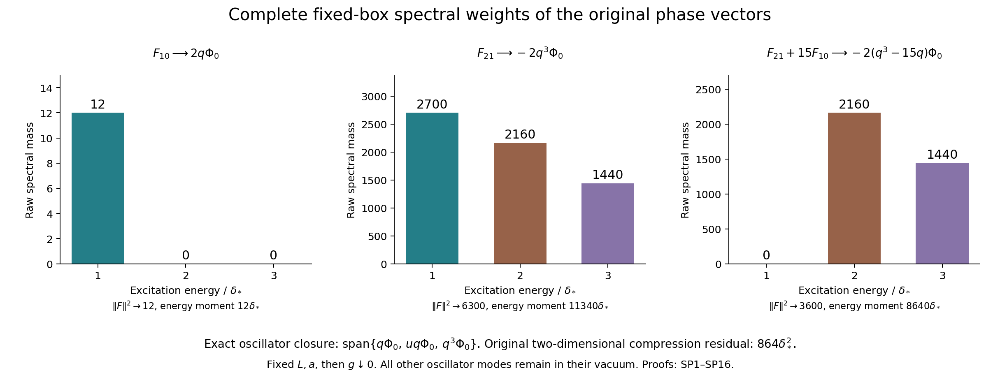

# Complete fixed-box spectral weights of the original phase family

The phase Gram and energy limits IP17 determine two moments. Here the same original vectors give every limiting spectral weight. This also computes the exact part of the oscillator action leaving the degree-three phase space. The calculation retains the fixed-box order of limits; it does not exchange it with the prescribed growing-box path.

The complete providers are [PK102–PK112](https://github.com/KokunoYumeto/yang-mills-interacting-workbench/blob/485b61423c1f4e1805deb453c1b6b342b27842b6/yang-mills/continuations/20260930-s6-ns-moment-map-bridge/PERIOD_COUPLING_AND_PHYSICAL_KERNELS.md#L2434), including the full Haar/dilation map, and [IP10–IP20](https://github.com/KokunoYumeto/yang-mills-interacting-workbench/blob/256d0fb1988e810df3fcb796c54077c564d48672/yang-mills/continuations/20261011-central-signs-shrinking-window/PHASE_MOMENTS_AND_ORIGINAL_PATH.md), including actual polynomial-vector convergence and its moment proof. These are retained programme derivations. No novelty claim is made for the Gaussian or Hermite methods used below; their needed identities are proved here.

## 1. Original operator, coordinates and receiving vectors

Fix the original open box \(L\ge2\) and \(a>0\), and let \(g\downarrow0\). Retain
\[
 H_g={2g^2\over a}H_0+{1\over2g^2a}\sum_p(2-W_p),\qquad
 A_g=H_g-E_{0,g},\qquad \|\psi_g\|=1,\quad\psi_g>0.
 \tag{SP1}
\]
The exact isometry is
\[
 (\mathcal B_g f)(x)=\mathbf1_{\Omega_g}(x)g^{3d_L/2}
 (16\pi^2)^{-d_L/2}\prod_c{\sin(g|x_c|/2)\over g|x_c|/2}
 f(\exp(gx)),\quad \Omega_g=\{x:|x_c|<2\pi/g\ \forall c\}.
 \tag{SP2}
\]
The sinc factors are positive on this chart and have value one at zero. The map extends by zero. In each colour the original linear map is \(z=O^TG^{-1/2}x\), with absolute Jacobian \((\det G)^{3/2}\) for all colours. The limiting oscillator and its full vacuum are
\[
\begin{split}
 H_{\rm osc}&=\sum_{\nu=1}^{d_L}
 \left[-{2\over a}\Delta_{z_\nu}+{\sigma_\nu^2\over8a}|z_\nu|^2\right],
 &\mu_0&={3\over2a}\sum_{\nu=1}^{d_L}\sigma_\nu,\\
 \Phi_0(x)&=(\det G)^{-3/4}
 \prod_{\nu=1}^{d_L}\left({\sigma_\nu\over4\pi}\right)^{3/4}
 \exp\left[-{1\over8}\sum_{\nu=1}^{d_L}\sigma_\nu|z_\nu|^2\right].
\end{split}\tag{SP3}
\]
All other modes remain in their vacuum. The two selected modes have
\(\sigma_1=\sigma_3=\sigma_* =\sqrt8\sin(\pi/[2(2L+1)])\).
Put
\[
 q={\sigma_*\over2}z_1\cdot z_3,\qquad
 \delta_*={2\sigma_*\over a},\qquad
 X=\sqrt{\sigma_*/2}\,z_1,\quad Y=\sqrt{\sigma_*/2}\,z_3,
 \quad u=|X|^2+|Y|^2.
 \tag{SP4}
\]
The last variables are only integration coordinates. The squared vacuum, with the full Jacobians in SP2–SP3, makes \(X,Y\) independent standard three-dimensional Gaussian vectors. Indeed the factor \((\det G)^{-3/2}\) cancels exactly against \(dx=(\det G)^{3/2}dz\), and each selected density \((\sigma_*/4\pi)^{3/2}e^{-\sigma_*|z|^2/4}dz\) becomes \((2\pi)^{-3/2}e^{-|X|^2/2}dX\). No raw state is replaced or divided by its norm.

For the original index \(b=(p,q_b)\), \(0\le q_b<p\le R\), write
\[
 n_b=p+q_b,\qquad d_b=(-1)^{q_b}-(-1)^p,\qquad
 F_{b,g}=P_{p q_b}(p_g,r_g)\psi_g,
 \quad P_{p q_b}(x,y)=x^py^{q_b}-x^{q_b}y^p.
 \tag{SP5}
\]
Here \(p_g,r_g\) are precisely the original phases, with \(r_g=p_g\circ\mathcal R\). IP15 proves \(\mathcal B_gF_{b,g}\to d_bq^{n_b}\Phi_0\) strongly, including the tails of these unbounded multipliers. The coefficient \(d_b\) is zero for even \(n_b\); these finite-regulator vectors are retained even when their limiting vector is zero.

## 2. Exact finite spectral expansion

Conjugating the original oscillator by its positive vacuum gives, on polynomials in the six displayed Gaussian coordinates,
\[
 \Phi_0^{-1}(H_{\rm osc}-\mu_0)\Phi_0
 ={\delta_*\over2}\mathcal N,\qquad
 \mathcal N=-\Delta_X-\Delta_Y+X\cdot\nabla_X+Y\cdot\nabla_Y.
 \tag{SP6}
\]
To check every factor, a selected \(z\)-gradient becomes \(\sqrt{\sigma_*/2}\) times an \(X\)-gradient. The kinetic coefficient therefore becomes \(\sigma_*/a=\delta_*/2\). Expanding the vacuum derivative gives the same coefficient on \(X\cdot\nabla_X\). The constant is exactly the subtracted contribution to \(\mu_0\).

Define the real polynomials \(\operatorname{He}_j\) by
\(e^{tx-t^2/2}=\sum_{j\ge0}\operatorname{He}_j(x)t^j/j!\).
Differentiating this identity gives
\(( -d^2/dx^2+x\,d/dx)\operatorname{He}_j=j\operatorname{He}_j\).
For standard Gaussian \(Z\), integration of the product of two generating functions gives \(\mathbb E[e^{tZ-t^2/2}e^{sZ-s^2/2}]=e^{ts}\); hence
\(\mathbb E[\operatorname{He}_j(Z)\operatorname{He}_k(Z)]=j!\mathbf1_{j=k}\).
Differentiation and integration are justified on a neighbourhood of the origin by the Gaussian density and then identify polynomial coefficients. Multiplying the generating function by \(e^{t^2/2}\) also proves the full finite identity
\[
 x^n=\sum_{h=0}^{\lfloor n/2\rfloor}
 {n!\over2^h h!(n-2h)!}\operatorname{He}_{n-2h}(x).
 \tag{SP7}
\]
Thus each \(q^n\Phi_0\) is a finite sum of orthogonal exact oscillator eigenvectors, with no assumption about a truncated invariant phase space.

For multi-indices \(h,k\in\mathbb N_0^3\), put
\[
 c_n(h,k)=
 \sum_{\substack{\alpha\in\mathbb N_0^3,\ |\alpha|=n\\
                 \alpha_i\ge h_i,k_i;\ \alpha_i-h_i,\alpha_i-k_i\in2\mathbb N_0}}
 {n!\over\alpha!}
 \prod_{i=1}^3
 {\alpha_i!\over2^{(\alpha_i-h_i)/2}((\alpha_i-h_i)/2)!h_i!}
 {\alpha_i!\over2^{(\alpha_i-k_i)/2}((\alpha_i-k_i)/2)!k_i!}.
 \tag{SP8}
\]
The sum over an empty set is zero. Expanding \((\sum_iX_iY_i)^n\) by the multinomial formula and applying SP7 to each of its six factors proves that \(c_n(h,k)\) is its complete Hermite coefficient. In particular \(|h|\) and \(|k|\) have the parity of \(n\). For odd \(n\), both are at least one. Define
\[
 W_\ell(n,m)=
 \sum_{\substack{h,k\in\mathbb N_0^3\\ |h|+|k|=2\ell}}
 c_n(h,k)c_m(h,k)h!k! .
 \tag{SP9}
\]
Each sum is finite; it vanishes for \(\ell>\min(n,m)\), and for \(\ell=0\) when either index is odd. SP6–SP8 prove that this is exactly the cross Gram entry of the two vectors' projections onto excitation \(\ell\delta_*\). Consequently the original phase-family spectral matrices are
\[
 (\mathsf W_\ell)_{bc}=d_bd_c W_\ell(n_b,n_c),\qquad
 \mathcal G^{(0)}=\sum_\ell\mathsf W_\ell,\quad
 \mathcal C^{(0)}=\delta_*\sum_\ell\ell\mathsf W_\ell,\quad
 \mathcal D^{(0)}=\delta_*^2\sum_\ell\ell^2\mathsf W_\ell.
 \tag{SP10}
\]
The simultaneous colour rotations commute with the full oscillator, so each spectral component of the invariant original vector is still physical; no individual noninvariant Hermite tensor is being declared physical. Every \(\mathsf W_\ell\) is positive semidefinite, since SP9 is a weighted Gram formula, including the original signs \(d_b\). The last matrix is the full oscillator second moment. No convergence of the unbounded actual second moments is being inferred merely from norm convergence.

For a useful closed generating expression set \(z=e^{-t\delta_*}\), \(t\ge0\). Then
\[
 \sum_{n,m\ge0}{v^nw^m\over n!m!}
       \sum_{\ell\ge0}W_\ell(n,m)z^\ell
 =\left[1-v^2-w^2-2zvw+(1-z)^2v^2w^2\right]^{-3/2}.
 \tag{SP11}
\]
Here the equality holds analytically for \(v,w\) sufficiently small, and equivalently as a formal power series. Its proof retains every determinant term. Couple \(X' =\rho X+\sqrt{1-\rho^2}\,\widehat X\) and \(Y'=\rho Y+\sqrt{1-\rho^2}\,\widehat Y\), with four independent standard triples and \(\rho=e^{-t\delta_*/2}\). Conditional integration of the Hermite generating function gives \(\mathbb E[\operatorname{He}_h(X')\mid X]=\rho^h\operatorname{He}_h(X)\) in each coordinate. Thus the left side is \(\mathbb E e^{vX\cdot Y+wX'\cdot Y'}\).
For one colour rotate to \(A=(X+Y)/\sqrt2\), \(B=(X-Y)/\sqrt2\) and their primed partners. The two resulting pairs are independent and each has covariance \(C=\left(\begin{smallmatrix}1&\rho\\\rho&1\end{smallmatrix}\right)\). Gaussian integration of the positive and negative quadratic forms gives the two determinants
\(\det(I-C\operatorname{diag}(v,w))=1-v-w+(1-\rho^2)vw\) and
\(\det(I+C\operatorname{diag}(v,w))=1+v+w+(1-\rho^2)vw\).
This follows directly by completing the quadratic form in its Gaussian integral; its determinant factor has power \(-1/2\). Multiply both determinants, then take the product over the three independent colours. This gives SP11 with \(z=\rho^2\). At \(\rho=1\) the same formula follows by a limit of the integrable Gaussian exponential, or direct integration with \(X'=X,Y'=Y\).

## 3. Every actual fixed-box cluster weight

For each of the finitely many \(\ell\) with \(\mathsf W_\ell\ne0\), choose an interval \(I_\ell\) around \(\ell\delta_*\) containing no other oscillator excitation value and with endpoints outside its spectrum. The complete oscillator is discrete at fixed box, so these intervals exist even if other modes share the same central eigenvalue. The retained norm convergence of finite spectral projections and SP5 imply
\[
 \langle F_{b,g},\mathbf1_{I_\ell}(A_g)F_{c,g}\rangle
       \longrightarrow(\mathsf W_\ell)_{bc},\qquad
 \left\|\left(I-\sum_\ell\mathbf1_{I_\ell}(A_g)\right)F_{b,g}\right\|^2
       \longrightarrow0.
 \tag{SP12}
\]
For the first assertion apply the transported projection to each convergent vector; add and subtract its limiting projection and use norm at most one. For the second, the intervals are disjoint, so the squared complement norm is the full norm minus the finite sum of its projected squared norms. SP5 and SP10 make its limit zero. No individual equality or degeneracy of the higher interacting eigenvalues is asserted: each interval includes its entire actual cluster.

These identities also prove weak convergence of the actual finite spectral measures for all bounded continuous test functions. To see this directly, given a finite linear combination of the original vectors, shrink each interval so the test function differs from its central value by at most a prescribed tolerance. The omitted complement mass tends to zero by SP12; the contribution in the intervals is bounded by that tolerance times the bounded total raw norm. Polarization proves the cross-measure statement. In particular all original phase-family Laplace matrices converge to \(\sum_\ell e^{-t\ell\delta_*}\mathsf W_\ell\) for each \(t\ge0\). This conclusion retains fixed \(L,a\); no volume-independent rate follows.

## 4. The exact degree-three return to the missing radial variable

In original order \((1,0),(2,0),(2,1)\), the limiting vectors are \(2q\Phi_0,0,-2q^3\Phi_0\). Their complete spectral matrices are
\[
 \mathsf W_1=\begin{pmatrix}12&0&-180\\0&0&0\\-180&0&2700\end{pmatrix},\quad
 \mathsf W_2=\begin{pmatrix}0&0&0\\0&0&0\\0&0&2160\end{pmatrix},\quad
 \mathsf W_3=\begin{pmatrix}0&0&0\\0&0&0\\0&0&1440\end{pmatrix}.
 \tag{SP13}
\]
All other matrices are zero. Here is an independent full polynomial derivation. The original differential operator gives
\[
 \mathcal N q=2q,\quad
 \mathcal N(uq)=4uq-20q,\quad
 \mathcal N(q^3)=6q^3-6uq.
 \tag{SP14}
\]
For example \(\Delta u=12\), \(\nabla u\cdot\nabla q=4q\), \(|\nabla q|^2=u\) and \(\Delta q=0\), so every contraction and coefficient in SP14 is explicit. The three nonzero orthogonal eigenpolynomials are
\[
 e_1=q,\qquad e_2=uq-10q,\qquad
 e_3=q^3-3uq+15q,\qquad q^3=15e_1+3e_2+e_3,
 \tag{SP15}
\]
with excitation energies \(\delta_*,2\delta_*,3\delta_*\), respectively. Their squared Gaussian norms are \(3,60,360\). To verify these without omitting moments, conditional Gaussian integration gives \(\mathbb E q^2=3\), \(\mathbb E q^4=45\), \(\mathbb E q^6=1575\). Gaussian integration by parts gives \(\mathbb E(uq^2)=30\). In six-dimensional polar coordinates the radius square \(u\) has density proportional to \(u^2e^{-u/2}\), while \(q^2\) is homogeneous of degree four; the ratio of its two radial integrals gives \(\mathbb E(u^2q^2)=120\mathbb E q^2=360\). Thus \(\|e_2\|^2=360-20\cdot30+100\cdot3=60\). Orthogonality follows from the self-adjoint oscillator and its distinct energies; all vectors are polynomials times its Gaussian and in its domain. Finally \(\|e_3\|^2=1575-15^2\cdot3-3^2\cdot60=360\). SP13 follows by retaining the factors \(2,-2\).

The full second oscillator moment and the exact energy-compression defect are therefore
\[
 \mathcal D^{(0)}=\delta_*^2
 \begin{pmatrix}12&0&-180\\0&0&0\\-180&0&24300\end{pmatrix},\qquad
 \mathcal D^{(0)}-\mathcal C^{(0)}(\mathcal G^{(0)})^+
                      \mathcal C^{(0)}
 =\delta_*^2\begin{pmatrix}0&0&0\\0&0&0\\0&0&864\end{pmatrix}.
 \tag{SP16}
\]
The superscript \(+\) is the Moore–Penrose inverse on this explicitly known limiting Gram matrix, including its zero row. It does not replace any finite-regulator inverse or assert convergence of those inverses. To prove the defect geometrically, let \(V\) map the three original coefficient coordinates to the three displayed oscillator vectors, and let \(\Pi\) be the orthogonal projection onto their span. Then \(\mathcal G^{(0)}=V^*V\), \(\mathcal C^{(0)}=V^*A_{\rm osc}V\), \(\Pi=V(\mathcal G^{(0)})^+V^*\), and the difference is exactly \(V^*A_{\rm osc}(I-\Pi)A_{\rm osc}V\). Thus SP16 is the squared norm of an actual connecting operator, not merely the nonidentity of two spaces.

The original combination \(F_{21}+15F_{10}\) has limiting squared norm \(3600\), energy moment \(8640\delta_*\), and spectral masses \(2160,1440\) at \(2\delta_*,3\delta_*\). Its energy quotient is \((12/5)\delta_*\); its spectral variance divided by the same raw norm is \((6/25)\delta_*^2\). The omitted radial direction is therefore essential. In fact SP14–SP15 prove that the smallest oscillator-invariant linear space containing \(q^3\Phi_0\) is exactly \(\operatorname{span}\{q\Phi_0,uq\Phi_0,q^3\Phi_0\}\): three distinct nonzero projections require dimension at least three, and the displayed span is invariant. These are exact maps and norms of the original limiting vectors.

The resulting next calculation on the joint path still requires estimates uniform in the growing box for the actual interacting vacuum and cluster maps. SP9–SP16 supply the complete fixed-box target matrices, including their complementary return. They do not provide that uniform estimate or identify the continuum theory.

The three panels show the exact raw masses in SP13–SP16, with separate vertical scales. The third panel retains the original coefficient 15. Its two occupied energies produce the quotient 12δ*/5. The full original oscillator and its vacuum remain SP3. Reproducible source: phase_spectrum_figure.py.
