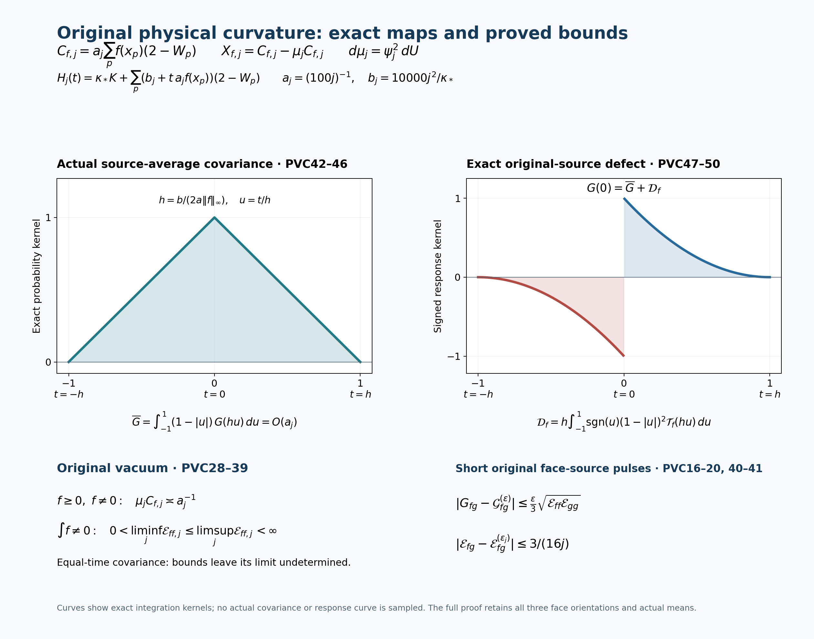

# Physical curvature, actual covariance, and the remaining local source response

This calculation uses the original actual vacuum. Its new receiving conclusions are a two-sided order estimate for the actual local mean defect, positive finite bounds for the centered curvature's first energy moment, uniform short-pulse covariance and energy maps, and a collapsing source-averaged covariance together with its exact signed defect at the original source. The equal-time covariance at the original source is not evaluated by the source average.

The general source-response identities already occur in PRE17–PRE22; they are providers, not claimed advances here. The local inside/outside/crossing proof belongs to LOCAL_CURVATURE_BUDGET.md. Its completed LC1–LC25 were read and checked before use, including the kinetic part of LC15. That proof is not duplicated. Its exact statements, parameters and receiving substitutions are given below. No Gaussian model or harmonic comparison replaces the actual state.

## 1. Original face observable, its scalar, and its mean

At the original regulator, \(L\ge2\), \(m=2L\), vertices are
\(o+a(z-L\mathbf1)\), \(z\in\{0,\ldots,m\}^3\). There are
\(N=3m(m+1)^2\) positive edges and \(M=3m^2(m+1)\) geometric faces.
Reverse traversal uses the inverse of the same physical link. For
\(p=(z;d,e)\), \(d<e\), retain
\[
 \begin{gathered}
 U_p=U_d(z)U_e(z+e_d)U_d(z+e_e)^{-1}U_e(z)^{-1},\\
 W_p=\operatorname{Tr}U_p,\quad D_p=2-W_p,\quad 0\le D_p\le4,\qquad
 x_p=o+a(z-L\mathbf1+(e_d+e_e)/2),\\
 T_\alpha=-i\sigma_\alpha/2,\quad
 K=-\sum_{e,\alpha}X_{e,\alpha}^2,\quad
 \Gamma(h,k)=\sum_{e,\alpha}(X_{e,\alpha}h)(X_{e,\alpha}k),\\
 H=\kappa K+b\sum_pD_p,\quad
 \kappa=2g^2/a,\quad b=1/(2g^2a),\quad \kappa b=a^{-2}.
 \end{gathered}\tag{PVC1}
\]
Haar measure on every link has mass one. The metric for these fields is the radius-two metric. The physical Hilbert space is the invariant subspace under every vertex action, including boundary vertices. The Hamiltonian's positive unit vacuum satisfies
\[
 H\psi=E_0\psi,\qquad d\mu=\psi^2dU,\qquad \|\psi\|=1.
 \tag{PVC2}
\]
It is the unrestricted as well as the physical ground state: compact ellipticity, positivity improvement and uniqueness make the positive full ground vector invariant under every gauge transformation. This is proved in LC1–LC3.

Fix real continuous compactly supported \(f,g\) on physical space, and let
\(f_p=f(x_p)\), \(g_p=g(x_p)\). Every one of the three face orientations is included in the following sums. Write
\[
 \begin{gathered}
 C_f=a\sum_p f_pD_p
       =2a\sum_pf_p-a\sum_pf_pW_p
       =a^3\sum_pf_p\,\frac{D_p}{a^2},\\
 m_f=\mu C_f
       =2a\sum_pf_p-a\sum_pf_p\,\mu W_p,\qquad
 X_f=C_f-m_f,\qquad u_f=X_f\psi,\\
 G_{fg}=\langle u_f,u_g\rangle
   =a^2\sum_{p,q}f_pg_q[\mu(D_pD_q)-\mu D_p\,\mu D_q],\\
 {\cal E}_{fg}=\langle u_f,(H-E_0)u_g\rangle
                    =\kappa\mu\Gamma(C_f,C_g).
 \end{gathered}\tag{PVC3}
\]
The functions of links are smooth even when the physical test is only continuous: the finitely many sampled values are fixed scalar coefficients. The full constant \(2a\sum f_p\), the full actual mean \(m_f\), and the scalar \(2bM\) in \(H\) are retained. No division by \(G_{ff}\) is made. The last equality follows by expanding both derivatives of \(X_f\psi\), integrating against Haar, and inserting the complete equation (PVC2).

Define
\[
 F_f=\|f\|_\infty,\quad A_{0,f}=\sum_pf_p,\quad
 A_{1,f}=\sum_p|f_p|,\quad A_{2,f}=\sum_pf_p^2.
 \tag{PVC4}
\]
If \(f=0\), all its quantities below are zero, and source formulas involving \(F_f^{-1}\) are not used.

## 2. Spatial sources with their complete vacuum projections

For a real vector of face couplings \(c=(c_p)\), set
\[
 H(c)=\kappa K+\sum_pc_pD_p
      =\kappa K+2\sum_pc_p-\sum_pc_pW_p .
 \tag{PVC5}
\]
At fixed finite regulator this is a bounded real multiplication perturbation of \(\kappa K\), with common operator domain \(D(K)\), common form domain \(D(K^{1/2})\), compact resolvent and a simple smooth positive unit vacuum \(\psi_c\). Positivity improvement also holds when some \(c_p\) are negative, since the potential is still bounded; its Feynman–Kac weight remains strictly positive.

Here and below put
\[
 A_c=H(c)-E(c),\quad P_c=|\psi_c\rangle\langle\psi_c|,\quad
 Q_c=I-P_c,\quad R_c=Q_c(A_c|_{Q_c{\cal H}_{\rm phys}})^{-1}Q_c.
 \tag{PVC6}
\]
Every projection is on the full physical Hilbert space. There is no observable-span inverse. Explicit finite-volume bounds are
\[
 \Omega(c)=\frac{32\pi}{\kappa}\sum_p|c_p|,\qquad
 A_c\ge\delta(c)Q_c,\quad
 \delta(c)=3\kappa e^{-\Omega(c)},\quad
 \|R_c\|\le\delta(c)^{-1},\quad
 \|H(c)R_c\|\le1+|E(c)|/\delta(c).
 \tag{PVC7}
\]
To prove them, the full logarithmic vacuum equation and the partial Bochner identity on a radius-two edge give
\(\|\nabla_e\log\psi_c\|_\infty
\le2\kappa^{-1}\sum_{p\ni e}|c_p|\).
At a maximum of its squared norm, the Hessian term is nonnegative, the Ricci term is one half its square, and the potential derivative has norm at most \(\kappa^{-1}\sum_{p\ni e}|c_p|\); this gives the stated bound directly. Changing every edge along a geodesic of length at most \(2\pi\) bounds \(\operatorname{osc}\log\psi_c^2\) by \(\Omega(c)\), since every face has four edges. A physical nonconstant electric spin component contains a cycle of at least four nonzero-spin edges, each costing at least \(3/4\); a fundamental face attains the resulting electric gap three. Weighted Haar Poincaré comparison then gives \(\operatorname{Var}_{\mu_c}h\le e^{\Omega(c)}\mu_c\Gamma(h,h)/3\). The complete ground-state form (PVC3) proves the gap. Spectral calculus proves both inverse bounds in (PVC7), including \(R_c:L^2\to D(H(c))\).

Use the original spatial source directions
\[
 c_p(t,s)=b+t\,a f_p+s\,a g_p,\qquad
 H(t,s)=H+tC_f+sC_g.
 \tag{PVC8}
\]
The scalar part is \(2bM+2taA_{0,f}+2saA_{0,g}\). On a resolvent circle of radius \(\delta(c)/2\) about the simple vacuum eigenvalue, the resolvent Neumann series converges when the norm of the bounded potential perturbation is less than \(\delta(c)/4\). Its contour integral gives an analytic rank-one projection. Taking its positive real unit vector gives analytic \(E,\psi\), locally at every real finite \(c\). Elliptic regularity gives the same derivatives in every fixed Sobolev space. This proves differentiability and domains before the next formulas are used.

At any base source, drop \(c\) from notation, center with that actual base state, and write \(B_f=C_f-m_f\). Differentiation of the full eigenvalue equation and unit norm gives
\[
 \begin{gathered}
 E_f=m_f,\qquad \psi_f=-Ru_f,\qquad
 E_{fg}=-2\langle u_f,Ru_g\rangle,\\
 P_f=-|Ru_f\rangle\langle\psi|-|\psi\rangle\langle Ru_f|,\\
 R_f=-RB_fR+R^2C_fP+PC_fR^2,\\
 \psi_{fg}=R[B_fRu_g+B_gRu_f]
                         -\langle Ru_f,Ru_g\rangle\psi .
 \end{gathered}\tag{PVC9}
\]
All scalar products here are real; polarization supplies the complex sesquilinear versions. To verify the reduced-inverse derivative, differentiate \(AR=RA=Q\) and \(R\psi=0\). The \(Q\)-to-\(Q\) block is \(-RB_fR\); the \(P\)-to-\(Q\) block is \(R^2C_fP\), and self-adjointness gives the other block. The displayed normalization component of \(\psi_{fg}\) follows from \(\partial_{fg}\langle\psi,\psi\rangle=0\). These projection terms do not vanish unless proved to do so.
For face parameters themselves, replace \(C_f,C_g\) by \(D_p,D_q\); then the first derivative is the entire \(\mu D_p=2-\mu W_p\), and the second derivative retains the corresponding centered vectors and the same full \(R\).

For any fixed real multiplier \(h\),
\[
 \partial_f\mu h=-2\langle(h-\mu h)\psi,Ru_f\rangle .
 \tag{PVC10}
\]
A varying \(h\) adds \(\mu(\partial_fh)\). In particular
\[
 \partial_hG_{fg}
 =-2\langle Q(X_fX_g)\psi,Ru_h\rangle .
 \tag{PVC11}
\]
The derivatives of both centering constants have been included: their contributions have zero mean because \(\mu X_f=\mu X_g=0\). The \(Q\) in (PVC11) keeps the full covariance subtraction.

The static source Hessian is an integrated covariance, not the equal-time covariance. Indeed spectral calculus gives
\[
 \chi_{fg}:=-E_{fg}
  =2\langle u_f,Ru_g\rangle
  =2\int_0^\infty
             \langle u_f,e^{-tA}u_g\rangle\,dt.
 \tag{PVC12}
\]
The gap in (PVC7) makes the integral absolutely convergent. For \(f=g\),
\[
 G_{ff}^{\,2}\le{\cal E}_{ff}\chi_{ff}/2.
 \tag{PVC13}
\]
This is Cauchy–Schwarz between \(A^{1/2}u_f\) and \(A^{-1/2}u_f\). Its direction will be retained.

For comparison with PRE22, set \(w=\log\psi\) and
\[
 J_f=KC_f-2\Gamma(w,C_f),\qquad
 Au_f=\kappa J_f\psi,\qquad \mu J_f=0.
 \tag{PVC14}
\]
If the entire functions \(J_f,J_g\) are frozen at the base source when differentiating a new bounded source, then
\[
 G_{fg}=-\frac{\kappa}{2}E''[C_f,J_g],\qquad
 {\cal E}_{fg}=-\frac{\kappa^2}{2}E''[J_f,J_g].
 \tag{PVC15}
\]
Insert \(RJ_g\psi=u_g/\kappa\) into (PVC9) to prove the first equality, and apply it again for the second. These are the existing complete Poisson receiving maps with the present original curvature. They do not compute the unknown score. The next section instead gives an equal-time receiving map using only the original face-coupling sources (PVC8).

## 3. Short physical source pulses and exact equal-time covariance

For a duration \(\epsilon>0\), keep the base vacuum and energy fixed and define
\[
 Z_\epsilon(t,s)=
 e^{\epsilon E_0}
 \langle\psi,e^{-\epsilon(H+tC_f+sC_g)}\psi\rangle,\qquad
 Z_\epsilon(0,0)=1.
 \tag{PVC16}
\]
This is a source applied for a finite time interval, with exactly the spatial couplings (PVC8) and their constant terms. Bounded Duhamel differentiation is justified by the norm-convergent ordered expansion, after factoring the unperturbed heat. Its first derivative is \(-\epsilon m_f\). Its mixed logarithmic derivative is
\[
 {\cal G}_{fg}^{(\epsilon)}
 :=\epsilon^{-2}\partial_{ts}\log Z_\epsilon(0,0)
 =\frac{2}{\epsilon^2}\int_0^\epsilon(\epsilon-r)
                   C_{fg}(r)\,dr,\quad
 C_{fg}(r)=\langle u_f,e^{-rA}u_g\rangle.
 \tag{PVC17}
\]
The two time orders give the factor two. The vacuum factors outside the ordered insertions supply exactly the shift \(A=H-E_0\). The product of the two first derivatives of \(Z\) subtracts \(\epsilon^2m_fm_g\); this is precisely the connected covariance. For real functions the two ordered scalar products agree by self-adjointness, so (PVC17) also holds for mixed \(f,g\).

The spectral inequality \(0\le(1-e^{-rA})/A\le rI\) on \(Q\) proves
\[
 |G_{fg}-C_{fg}(r)|\le r\sqrt{{\cal E}_{ff}{\cal E}_{gg}},\qquad
 |G_{fg}-{\cal G}_{fg}^{(\epsilon)}|
       \le\frac{\epsilon}{3}\sqrt{{\cal E}_{ff}{\cal E}_{gg}}.
 \tag{PVC18}
\]
The second constant is \(2\epsilon^{-2}\int_0^\epsilon(\epsilon-r)r\,dr=\epsilon/3\). These estimates will be uniform in \(j\) after the local receiving energy estimate below.

A second pulse derivative difference receives the actual energy without requiring \(G\) as separate input:
\[
 {\cal E}_{fg}^{(\epsilon)}
   =\frac6\epsilon
       \left({\cal G}_{fg}^{(\epsilon/2)}
                         -{\cal G}_{fg}^{(\epsilon)}\right).
 \tag{PVC19}
\]
If \(\mathfrak B_f\ge\|Au_f\|\), \(\mathfrak B_g\ge\|Au_g\|\), then
\[
 |{\cal E}_{fg}-{\cal E}_{fg}^{(\epsilon)}|
                  \le\frac{3\epsilon}{8}\mathfrak B_f\mathfrak B_g.
 \tag{PVC20}
\]
For the diagonal case, \(0\le{\cal E}_{ff}^{(\epsilon)}
\le{\cal E}_{ff}\). To prove all statements, write
\({\cal G}^{(\epsilon)}=\int_0^1 2(1-v)C(\epsilon v)\,dv\).
The difference in (PVC19) integrates the energy correlation
\(\langle A^{1/2}u_f,e^{-rA}A^{1/2}u_g\rangle\)
over \(\epsilon v/2\le r\le\epsilon v\).
The total leading weight is
\(6\int_0^1v(1-v)dv=1\).
Its difference from the energy at zero has absolute value at most
\(r\|Au_f\|\|Au_g\|\).
The integrated error constant is
\[
 \frac{12}{\epsilon}\int_0^1(1-v)
       \int_{\epsilon v/2}^{\epsilon v}r\,dr\,dv
 =\frac{3\epsilon}{8}.
\]
No time-continuum or growing-box interchange is used in these identities.

## 4. Every original shared-link contribution

For an incidence of a positive physical edge \(e\) on the original face
\(p\), write its cyclic word as \(\operatorname{Tr}(A U_e^\sigma B)\).
The factors \(A,B\) contain the other three links in their original
order and orientation. Define the insertion holonomy and coordinates by
\[
 L_{p,e}=
 \begin{cases}U_eBA,&\sigma_{p,e}=+1,\\
 BAU_e^{-1},&\sigma_{p,e}=-1,\end{cases}
 \qquad q_\alpha(L)=-2\operatorname{Tr}(T_\alpha L).
 \tag{PVC21}
\]
The two cases follow respectively by differentiating
\(e^{sT_\alpha}U_e\) and \(U_e^{-1}e^{-sT_\alpha}\) inside the
original word. They give \(X_{e,\alpha}D_p=\sigma_{p,e}q_\alpha(L_{p,e})/2\).
If \(L=cI+2T\cdot v\), then \(q(L)=2v\).
Multiplication of the Pauli matrices proves
\[
 \begin{split}
 \Gamma_e(D_p,D_q)
 &=\frac{\sigma_{p,e}\sigma_{q,e}}4
   [\operatorname{Tr}(L_{p,e}L_{q,e}^{-1})
                         -\operatorname{Tr}(L_{p,e}L_{q,e})],\\
 \Gamma_e(D_p,D_p)&=1-W_p^2/4=D_p-D_p^2/4,\\
 {\cal E}_{fg}
 &=\kappa a^2\sum_e\sum_{\substack{p\ni e\\q\ni e}}
                  f_pg_q\Gamma_e(D_p,D_q).
 \end{split}\tag{PVC22}
\]
An edge absent from a face gives zero derivative. Thus (PVC22) retains
every diagonal, every shared-edge pair and both orientation signs.
No independence or cancellation in the actual vacuum is asserted.

On one link, \(-\sum_\alpha T_\alpha^2=3I/4\); the inverse
matrix coefficients have the same eigenvalue. Each original face has
four distinct links. Haar integration also kills each trace and each
product of distinct face traces: two distinct geometric squares have
an edge appearing in only one of them, whose fundamental matrix
integral is zero. For the diagonal, integrating one link gives
\(\int(\operatorname{Tr}U)^2dU=1\), either from the radius-one quaternion
coordinates or the same Pauli formula. Consequently
\[
 KW_p=3W_p,\qquad KC_f=3C_f-6aA_{0,f},\qquad
 \operatorname{Var}_{dU}C_f=a^2A_{2,f}.
 \tag{PVC23}
\]
The scalar on the middle right is essential.

Let \(r_e^f\) be the number of incident faces with nonzero sampled
coefficient \(f_p\). Cauchy–Schwarz is applied only after retaining
their vector sum in (PVC22):
\[
 \begin{split}
 \Gamma(C_f)
 &\le a^2\sum_e r_e^f\sum_{\substack{p\ni e\\f_p\ne0}}
                    f_p^2(D_p-D_p^2/4)\\
 &\le16a^2\sum_p f_p^2D_p,\qquad
 \Gamma(C_f)\le16a^2 A_{2,f}.
 \end{split}\tag{PVC24}
\]
Here \(r_e^f\le4\) and each face has four edges. These constants
include all three orientations, as does the original candidate.

## 5. Local kinetic budget and a new actual lower mean

Use an induced patch \(Q=v+\{0,\ldots,q\}^3\) whose inside faces
contain every face with nonzero sampled test value. Keep the exact
LC4–LC6 data:
\[
 \begin{gathered}
 N_Q=3q(q+1)^2,\quad M_Q=3q^2(q+1),\\
 \eta=\sum_{d=1}^3
       [\mathbf1_{\{v_d>0\}}+\mathbf1_{\{v_d+q<m\}}],\qquad
 C_Q=2q(q+1)\eta,\\
 W_Q=\sum_{p\ {\rm inside}\ Q}D_p,\qquad
 K_Q=-\sum_{e\ {\rm inside}\ Q,\alpha}X_{e,\alpha}^2,\\
 \Lambda_Q=\min\{2M_Q,6g^2\sqrt{N_QM_Q}\}+2C_Q.
 \end{gathered}\tag{PVC25}
\]
The scalar \(W_Q\) is the defect sum, whereas \(W_p\) denotes the
individual trace; both source notations are retained with their
definitions. Every mixed face has one inside edge and three outside
edges. The completed LC proof establishes the actual partition
\(H=H_{\rm in}+H_{\rm out}+bW_\times\), the spectral lower
bound \(H_{\rm out}\ge E_{\rm out}\), and a tensor comparison
with crossing expectation exactly \(2bC_Q\). The latter follows
from the gauge-invariant outside ground: the ordered outside
three-edge open path changes sign under the central gauge element
at one of its distinct endpoints. It is a statement about that
comparison vector, not about the actual full vacuum.

LC13–LC15a therefore give the following full actual inequality,
including its kinetic contribution:
\[
 \begin{gathered}
 d_Q=\mu W_Q,\qquad
 T_Q=\langle\psi,K_Q\psi\rangle
       =\mu\sum_{e\ {\rm inside}\ Q}|\nabla_e\log\psi|^2,\\
 0\le E_0-E_{\rm out}\le b\Lambda_Q,\qquad
 \kappa T_Q+b d_Q\le b\Lambda_Q,\qquad
 0\le d_Q\le\min\{4M_Q,\Lambda_Q\}.
 \end{gathered}\tag{PVC26}
\]
In particular \(H-E_{\rm out}\ge bW_Q\) as a quadratic form.
For a smooth multiplier \(h\), inserting the original ground-state
identity gives \(b\mu(W_Qh^2)\le b\Lambda_Q\mu h^2+
\kappa\mu\Gamma(h)\). Since \(\Gamma(W_Q)\le16W_Q\) by
(PVC24), apply this to \((W_Q+\delta)^{k/2}\), then let
\(\delta\downarrow0\). The gradient contribution is bounded by
\(4k^2W_Q(W_Q+\delta)^{k-2}\); for \(k=1\) it is at most
four, and for \(k\ge2\) compactness permits passage to the limit.
This proves the LC19 receiving recurrence and the explicit terms
needed here:
\[
 \begin{gathered}
 \mu W_Q^{k+1}\le\Lambda_Q\mu W_Q^k+
              \rho^2 k^2\mu W_Q^{k-1},\quad
 \rho^2=4\kappa/b=16(g^2)^2,\\
 U_2=\Lambda_Q^2+\rho^2,\qquad
 U_4=\Lambda_Q^4+14\Lambda_Q^2\rho^2+9\rho^4,\qquad
 \mu W_Q^2\le U_2,\quad \mu W_Q^4\le U_4.
 \end{gathered}\tag{PVC27}
\]
The recurrence is valid from \(k=1\), with \(\mu W_Q^0=1\)
and \(\mu W_Q\le\Lambda_Q\). This explains all terms in \(U_4\).

There is an additional lower estimate in the actual state. Haar
integration by parts against \(\psi^2\) says
\(\mu Kh=2\mu\Gamma(\log\psi,h)\). Use
\(KW_Q=3W_Q-6M_Q\), Cauchy–Schwarz over precisely the inside
edges, (PVC24), and then the unaltered joint budget (PVC26):
\[
 (6M_Q-3d_Q)^2
 \le4T_Q\mu\Gamma(W_Q)
 \le64T_Qd_Q
 \le64\frac b\kappa d_Q(\Lambda_Q-d_Q).
 \tag{PVC28}
\]
No equality between a comparison mean and \(d_Q\) enters this
inequality. Put
\[
 \begin{gathered}
 \xi=b/\kappa,\quad A_Q=9+64\xi,\quad
 B_Q=36M_Q+64\xi\Lambda_Q,\\
 \Delta_Q=B_Q^2-144A_QM_Q^2,\qquad
 d_Q^-
 =\frac{B_Q-\sqrt{\Delta_Q}}{2A_Q}
 =\frac{72M_Q^2}{B_Q+\sqrt{\Delta_Q}},\\
 0<d_Q^-\le d_Q\le
              \frac{B_Q+\sqrt{\Delta_Q}}{2A_Q}.
 \end{gathered}\tag{PVC29}
\]
Indeed (PVC28) is exactly
\(A_Qd_Q^2-B_Qd_Q+36M_Q^2\le0\).
The existence of this actual real \(d_Q\) proves
\(\Delta_Q\ge0\); its two roots are positive because their sum
and product are positive. The second formula avoids cancellation
in the lower root and proves it is strictly positive.
Also \(d_Q^-<\Lambda_Q\). If equality held, (PVC28) would
force \(d_Q=2M_Q=\Lambda_Q\) and \(d_Q^-\) to be the larger
root: the other root is \(18M_Q/(9+64\xi)<2M_Q\), a
contradiction. This strict inequality will permit division by the
explicit positive quantity \(\Lambda_Q-d_Q^-\).

Retain the original path and the LC24 patch prescription exactly:
\[
 \begin{gathered}
 a_j=(100j)^{-1},\quad L_j=j^4,\quad m_j=2j^4,\quad
 g_j^2=\kappa_*/(200j),\\
 \kappa_j=\kappa_*,\quad b_j=10000j^2/\kappa_*,
 \quad s_j=\kappa_*/j,\\
 v_{d,j}=L_j+\left\lfloor(c_d-o_d)/a_j\right\rfloor-1,
 \qquad q_j=\left\lceil R/a_j\right\rceil+3.
 \end{gathered}\tag{PVC30}
\]
Here the fixed physical cube \(\prod_d[c_d,c_d+R]\) contains
the supports. For all sufficiently large \(j\), \(Q_j\) is
strictly interior and contains every required face together with
its four vertices. The exact floors, ceilings and \(q_j+1\)
factors in (PVC25) are retained at every finite \(j\).
On the smaller branch of \(\Lambda_j\), which is the eventual
branch since \(g_j^2\to0\), one obtains
\[
 \begin{gathered}
 \Lambda_j=18g_j^2[q_j(q_j+1)]^{3/2}
                       +24q_j(q_j+1),\\
 a_j^3M_{Q_j}\longrightarrow3R^3,\qquad
 a_j^2\Lambda_j\longrightarrow
 {\mathsf L}_R=9\kappa_*R^3+24R^2=100C_R,\\
 C_R=\frac{9\kappa_*R^3}{100}+\frac{6R^2}{25},\qquad
 j a_j^3\Lambda_j\longrightarrow C_R .
 \end{gathered}\tag{PVC31}
\]
Multiply (PVC28) by \(a_j^6\), use
\(b_j/\kappa_*=(\kappa_*^2a_j^2)^{-1}\), and note that
\(a_j^2d_{Q_j}\) is bounded by (PVC31). Every subsequential
limit \(x\) therefore satisfies
\(x({\mathsf L}_R-x)\ge81\kappa_*^2R^6/16\).
Equivalently the explicit root in (PVC29) has the limit
\[
 \begin{gathered}
 a_j^2d_{Q_j}^-\longrightarrow
 {\mathsf d}_R^-=
 \frac{{\mathsf L}_R-
     \sqrt{{\mathsf L}_R^2-81\kappa_*^2R^6/4}}2>0,\\
 {\mathsf d}_R^-\le\liminf_j a_j^2d_{Q_j}
             \le\limsup_j a_j^2d_{Q_j}\le{\mathsf L}_R.
 \end{gathered}\tag{PVC32}
\]
The discriminant is strictly positive because
\({\mathsf L}_R\ge9\kappa_*R^3\). The positive lower root
follows because the subtracted square root is strictly smaller
than \({\mathsf L}_R\). Thus \(d_{Q_j}\) has two-sided
order \(a_j^{-2}\) bounds, with no claimed limiting coefficient.

For continuous nonnegative nonzero \(f\), choose a closed physical
cube inside the open set \(\{f>0\}\), and a positive number
\(f_{\min}\) no larger than the minimum there. Use a slightly
smaller concentric cube for the LC24 prescription; for large \(j\)
every face of its patch remains in the first cube. Positivity of
every original \(D_p\), the lower bound just proved, and an outer
support patch give
\[
 a_j f_{\min}d_{Q_j^{\rm inner}}
       \le m_{f,j}\le a_jF_f\Lambda_{Q_j^{\rm outer}},
 \qquad
 0<\liminf_j a_jm_{f,j}
       \le\limsup_j a_jm_{f,j}<\infty .
 \tag{PVC33}
\]
Hence the actual mean of the original curvature candidate grows
at order \(a_j^{-1}\). Centering requires this full actual mean,
not its upper bound or its leading order. For a signed test,
\(|m_{f,j}|\le a_jF_f\Lambda_j\) still holds.

## 6. What is proved about energy and equal-time covariance

Applying the same weighted integration by parts to \(C_f\) gives
\((3m_f-6aA_{0,f})^2\le4T_Q{\cal E}_{ff}/\kappa\).
Retain the potential term in (PVC26), and then insert the proved
lower root (PVC29). The result is the entirely explicit pair
\[
 \frac{\kappa^2(3m_f-6aA_{0,f})^2}
            {4b(\Lambda_Q-d_Q^-)}
       \le{\cal E}_{ff}
       \le16\kappa a^2F_f^2\Lambda_Q .
 \tag{PVC34}
\]
The first inequality follows without dividing by \(T_Q\):
first multiply by \({\cal E}_{ff}\ge0\) in the bound
\(T_Q\le(b/\kappa)(\Lambda_Q-d_Q^-)\), whose right side
is strictly positive. This also covers a vanishing numerator.
Before replacing \(d_Q\) by \(d_Q^-\), the stronger coupled
inequality is
\(4b(\Lambda_Q-d_Q){\cal E}_{ff}
\ge\kappa^2(3m_f-6aA_{0,f})^2\).

The face centers for each orientation are a shifted cubic lattice.
Partition into their centered half-open mesh cubes and use uniform
continuity on a fixed support enlargement. The error is at most
the volume of that enlargement times
\(\omega_f(\sqrt3a_j/2)\), for each of the three orientations.
It follows, with every orientation retained, that
\(a_j^3A_{0,f,j}\to3I_f\), where \(I_f=\int f(x)\,d^3x\).
Together with \(|m_{f,j}|=O(a_j^{-1})\), (PVC31)–(PVC34) give
\[
 \frac{81\kappa_*^3I_f^2}{{\mathsf L}_R-{\mathsf d}_R^-}
 \le\liminf_j{\cal E}_{ff,j}
 \le\limsup_j{\cal E}_{ff,j}
 \le16\kappa_*F_f^2{\mathsf L}_R .
 \tag{PVC35}
\]
The lower constant is positive whenever \(I_f\ne0\).
It strengthens the valid but smaller
\(81\kappa_*^3I_f^2/{\mathsf L}_R\) obtained by dropping the
potential from the kinetic budget. A sign-changing test with
zero integral has no positive lower constant from this calculation.
The upper estimate and polarization apply to every real compactly
supported test. These are first energy moment bounds for the
unnormalized centered vectors \(u_{f,j}\); they are not a claim of
nonzero weight in any fixed spectral interval.
At any fixed regulator with \(A_{2,f}>0\), (PVC23) proves
that \(C_f\) is nonconstant. Strict positivity of the smooth
actual density then gives both \(G_{ff}>0\) and
\({\cal E}_{ff}>0\), even when \(I_f=0\). This finite-volume
fact supplies no uniform positive constant for zero-integral tests.

For the actual covariance, the available local moment estimates
instead give
\[
 0\le G_{ff}\le
 \min\{4a^2A_{1,f}^2,\ a^2F_f^2U_2-m_f^2\}.
 \tag{PVC36}
\]
For the first bound, the range of \(C_f\) has length at most
\(4aA_{1,f}\), and a real variable in an interval of length \(l\)
has variance at most \(l^2/4\): integrate
\((Y-\inf Y)(\sup Y-Y)\ge0\) and maximize the resulting
quadratic in its mean. For the second bound use
\(|C_f|\le aF_fW_Q\), keep its full squared mean, and apply
(PVC27). The latter is \(O(a_j^{-2})\), so it does not prove
uniform boundedness of \(G_{ff,j}\). Replacing a local mean by
the global mean divided by the box volume would require a
translation symmetry absent from this open box.

There is also an explicit positive lower bound. The completed
independent entropy proof, ID33–ID39, gives at the original
positive couplings
\[
 \begin{gathered}
 c_*=\frac{\sqrt{9\pi^2+32\pi}-3\pi}{8},\qquad
 C_\psi=\sqrt{\frac{2\pi/c_*+4}{(1-c_*/2)^2}},\\
 r_e=|\{p:p\ni e\}|,\qquad
 M_e=\min\{2r_e\xi,C_\psi\sqrt{r_e\xi}\},\quad \xi=b/\kappa,\\
 \|\nabla_e\log\psi\|_\infty\le M_e,\qquad
 {\mathsf M}_Q=\left(\sum_{e\ {\rm inside}\ Q}M_e^2\right)^{1/2},
 \quad {\mathsf L}_Q={\mathsf M}_Q+\sqrt{{\mathsf M}_Q^2+3},\\
 {\mathsf M}_Q^2\le C_\psi^2\xi(4M_Q+C_Q).
 \end{gathered}\tag{PVC37}
\]
The last count includes all full-lattice faces incident on an
inside edge: an inside face is counted four times, a crossing face
once, and an outside face zero times. This retains the original
boundary incidence classes. The entropy provider proves its
square-root score from the actual conditional path law; no
assumption on a product state is introduced here.

Using \(KX_f=3X_f+(3m_f-6aA_{0,f})\) and \(\mu X_f=0\),
the same Haar integration by parts gives the exact equation
\[
 \frac{{\cal E}_{ff}}{\kappa}
   =3G_{ff}-2\mu[X_f\Gamma(\log\psi,C_f)],
 \qquad
 {\cal E}_{ff}\le\kappa{\mathsf L}_Q^2G_{ff}.
 \tag{PVC38}
\]
To prove the inequality, the absolute value of the last integral
is at most \({\mathsf M}_Q\sqrt{G_{ff}{\cal E}_{ff}/\kappa}\).
If \(G_{ff}=0\), this makes the energy zero. Otherwise divide
by \(G_{ff}\) and solve
\(y^2\le3+2{\mathsf M}_Qy\) for
\(y=\sqrt{{\cal E}_{ff}/(\kappa G_{ff})}\).
Thus the exact energy lower bound implies the finite-\(j\) lower
variance \(G_{ff}\ge{\cal E}_{ff}/(\kappa{\mathsf L}_Q^2)\).
Since \({\mathsf L}_Q^2=O(a_j^{-5})\), the positive energy
constant in (PVC35) yields a certified lower bound of order
\(a_j^5\); this is not an assertion about the actual variance's
asymptotic order.

For completeness the spectral receiving statement is, with the
original unnormalized measure
\(d\nu_f(\lambda)=d\langle u_f,\mathbf1_\lambda(A)u_f\rangle\),
\[
 \begin{gathered}
 \nu_f((0,\infty))=G_{ff},\qquad
 \int\lambda\,d\nu_f={\cal E}_{ff},\\
 \nu_f((0,2\kappa{\mathsf L}_Q^2])
       \ge G_{ff}/2
       \ge\frac{{\cal E}_{ff}}{2\kappa{\mathsf L}_Q^2},\\
 \nu_f((0,s])\ge
                  \max\{0,G_{ff}-{\cal E}_{ff}/s\}
       \quad(s>0).
 \end{gathered}\tag{PVC39}
\]
The positive vacuum gap at each fixed \(j\) and \(u_f\perp\psi\)
remove a zero atom. The bounds follow from
\(\nu_f((s,\infty))\le{\cal E}_{ff}/s\). The first displayed
upper window grows like \(a_j^{-5}\); it does not give positive
mass in a fixed window or in the original
\((0,s_j]\), \(s_j=\kappa_*/j\). The last lower estimate has
no certified positive value there from the bounds above.

The pulse receiving bounds are nevertheless uniform and explicit.
The exact (PVC14), (PVC23) and Cauchy–Schwarz give
\[
 \begin{gathered}
 {\cal E}_{f}^{+}=16\kappa a^2F_f^2\Lambda_Q,\qquad
 \|Au_f\|\le\mathfrak B_f,\\
 \mathfrak B_f=\kappa\left[
      3aF_f\sqrt{U_2}+6a|A_{0,f}|
                 +2{\mathsf M}_Q\sqrt{{\cal E}_{f}^{+}/\kappa}
                         \right].
 \end{gathered}\tag{PVC40}
\]
All constants depend only on the stated finite lattice, test
values and original couplings. The score term was bounded in
\(L^2(\mu)\), using
\(|\Gamma(\log\psi,C_f)|^2\le{\mathsf M}_Q^2\Gamma(C_f)\);
the full constant in \(KC_f\) is present.
For a pair of tests use a common support patch and set
\[
 \epsilon_j=
 \min\left\{1,\frac1{j(1+\mathfrak B_{f,j}^2+
                                  \mathfrak B_{g,j}^2)}\right\}.
 \tag{PVC41}
\]
Then (PVC18) gives an error tending to zero uniformly along the
unchanged original path, since \({\cal E}_{f,j}^+\) and
\({\cal E}_{g,j}^+\) are bounded. Formula (PVC20) gives the
explicit energy error at most \(3/(16j)\), using
\(2\mathfrak B_f\mathfrak B_g\le\mathfrak B_f^2+\mathfrak B_g^2\).
No unknown variance is needed in either error bound. These are
exact receiving maps to spatial face-source pulse Hessians; they
do not evaluate the latter Hessians.

## 7. Quantitative static-source averaging in actual vacua

The failure of (PVC36) to give a uniform covariance bound motivates a
calculation with the complete variational principle over local
sources. Fix \(F_f>0\), a common patch as above, and put
\[
 h_f=\frac b{2aF_f},\qquad
 H_t=H+tC_f,\qquad -h_f\le t\le h_f,\qquad
 \frac b2\le b+ta f_p\le\frac{3b}2 .
 \tag{PVC42}
\]
Only inside face couplings vary; every crossing and outside face
retains \(b\). The original full scalar is
\(2bM+2taA_{0,f}\) throughout. Each \(t\) has its own actual
positive unit vacuum, denoted by \(\psi_t,\mu_t,E(t)\).

Use the already proved LC partition and its same outside ground.
The central inside comparison \(F_z=\prod_e
[\int e^{2zx}dU]^{-1/2}e^{zx}\), \(x=\operatorname{Tr}U/2\),
has exactly the LC13 kinetic form \(3\kappa N_Qzq_z/8\)
and face defect \(2(1-q_z^4)\), with
\(1-q_z\le3/(4z)\). Thus its inside potential at source \(t\)
is exactly
\(2(1-q_z^4)\sum_{p\ {\rm inside}}(b+ta f_p)\).
The sum is at most \(3bM_Q/2\); the original comparison bound
is therefore \(3\kappa N_Qz/8+9bM_Q/z\). Optimizing this
scalar expression gives \(3\sqrt{(3/2)\kappa bN_QM_Q}\).
The constant inside comparison gives energy at most \(3bM_Q\).
The unchanged outside gauge average still gives precisely
\(2bC_Q\) for the crossing part. Hence the complete variational
and operator lower bounds give
\[
 \begin{gathered}
 0\le E(t)-E_{\rm out}\le
 B_Q^*:=\min\{3bM_Q,3\sqrt{(3/2)\kappa bN_QM_Q}\}+2bC_Q,\\
 \kappa\langle\psi_t,K_Q\psi_t\rangle+
                   \frac b2\mu_tW_Q\le B_Q^*,\\
 \Lambda_Q^*=\frac{2B_Q^*}b
    =\min\{6M_Q,12\sqrt{3/2}\,g^2\sqrt{N_QM_Q}\}+4C_Q,\\
 \mu_tW_Q\le\Lambda_Q^*,\qquad
 |m_f(t)|\le aF_f\Lambda_Q^*,\qquad
 {\cal E}_{ff}(t)\le16\kappa a^2F_f^2\Lambda_Q^* .
 \end{gathered}\tag{PVC43}
\]
This is a proved extension of the LC comparison to the complete
bounded source interval, with the coefficient extremes and all
crossing terms displayed. It does not identify the source vacua
with the comparison vector.

The same form argument as for (PVC27), now using
\(H_t-E_{\rm out}\ge(b/2)W_Q\), gives uniformly in this
interval
\[
 \begin{gathered}
 \rho_*^2=8\kappa/b,\qquad
 \mu_tW_Q^{k+1}\le\Lambda_Q^*\mu_tW_Q^k+
                    \rho_*^2k^2\mu_tW_Q^{k-1},\\
 U_2^*=(\Lambda_Q^*)^2+\rho_*^2,\qquad
 U_4^*=(\Lambda_Q^*)^4+
             14(\Lambda_Q^*)^2\rho_*^2+9\rho_*^4,\\
 \mu_tW_Q^2\le U_2^*,\quad\mu_tW_Q^4\le U_4^*,\qquad
 a_j^2\Lambda_{Q_j}^*\longrightarrow
 {\mathsf L}_R^*=18\sqrt{3/2}\,\kappa_*R^3+48R^2.
 \end{gathered}\tag{PVC44}
\]
The finite-\(j\) expression in (PVC43), including its minimum,
is used before this limit.

Define \(G(t)=\operatorname{Var}_{\mu_t}C_f\) and
\(\chi(t)=-E''(t)=2\langle u_t,R_tu_t\rangle\ge0\), where
\(u_t=(C_f-m_f(t))\psi_t\) and \(R_t\) has the full
projection of (PVC6). The triangular probability density
\(w_h(t)=(h-|t|)/h^2\) for \(|t|\le h=h_f\)
has integral one. Twice integrating \(E''=-\chi\) proves
\[
 \begin{split}
 \int_{-h}^h w_h(t)\chi(t)\,dt
 &=\frac{2E(0)-E(h)-E(-h)}{h^2}\\
 &\le\frac{m_f(-h)-m_f(h)}h
 \le\frac{2aF_f\Lambda_Q^*}h .
 \end{split}\tag{PVC45}
\]
For the middle inequality, \(w_h\le1/h\) and
\(\int_{-h}^h\chi=m_f(-h)-m_f(h)\).
If \(f\ge0\), each actual \(m_f(t)\) lies in
\([0,aF_f\Lambda_Q^*]\), and the last numerator improves
from \(2aF_f\Lambda_Q^*\) to \(aF_f\Lambda_Q^*\).
The scalar linear terms \(2taA_{0,f}\) cancel in the
second difference, while each first derivative remains its full
actual mean. Nothing has been subtracted from the Hamiltonian.

Apply (PVC13) in every actual source vacuum, use the energy
upper bound in (PVC43), and apply Cauchy–Schwarz with respect
to the probability measure \(w_h(t)dt\). Since
\(\sqrt{\kappa/b}=\kappa a\), this proves
\[
 \begin{split}
 \int_{-h}^h w_h(t)G(t)\,dt
 &\le4\sqrt2\,\kappa a^3F_f^2\Lambda_Q^*,
                                  && f\ {\rm real},\\
 \int_{-h}^h w_h(t)G(t)\,dt
 &\le4\kappa a^3F_f^2\Lambda_Q^*,
                                  && f\ge0.
 \end{split}\tag{PVC46}
\]
Along the actual path these upper bounds are respectively
\(4\sqrt2\kappa_*F_f^2{\mathsf L}_R^*a_j+o(a_j)\)
and \(4\kappa_*F_f^2{\mathsf L}_R^*a_j+o(a_j)\).
This is a collapsing average of connected covariances of actual
vacua at actual local face couplings. The interval has width
\(2h_f=b/(aF_f)\); its endpoints change each affected coupling
by at most half its original value. It is not a small perturbation
in operator norm as \(j\) grows.

## 8. The exact original-source defect and its next coupling

The passage from (PVC46) to \(G(0)\) can be calculated exactly.
At each \(t\), differentiate the full mean and variance as in
(PVC10)–(PVC11), obtaining
\[
 G'(t)=-2{\cal T}_f(t),\qquad
 {\cal T}_f(t)=
 \left\langle
 Q_t(C_f-m_f(t))^2\psi_t,\quad
                 R_t(C_f-m_f(t))\psi_t
 \right\rangle .
 \tag{PVC47}
\]
The projection removes precisely
\(G(t)\psi_t\) from the first vector. The derivative of each
mean produces a multiple of \(\mu_t(C_f-m_f(t))=0\);
that is why there is no additional scalar term in (PVC47).
This is a centered three-point response with one complete
reduced inverse; it is not the third derivative of the
ground energy, which would contain two reduced inverses and
its own differentiated projection terms.

Integrate (PVC47) from zero to \(t\) on both halves of the
source interval, and interchange two finite integrals. The
exact identity is
\[
 \begin{split}
 G(0)
 &=\int_{-h}^h w_h(t)G(t)\,dt+{\cal D}_f,\\
 {\cal D}_f
 &=\frac1{h^2}\left[
 \int_0^h(h-t)^2{\cal T}_f(t)\,dt
       -\int_{-h}^0(h+t)^2{\cal T}_f(t)\,dt\right].
 \end{split}\tag{PVC48}
\]
The sign difference is fixed by the two orientations of
integration away from zero. Both integrals concern actual
source vacua. The defect is not known to vanish or to have a
sign. This formula constructs the precise receiving object
needed to relate the collapsing source average to the original
source covariance, instead of replacing one by the other.

An explicit estimate of this next object can also be made.
For every full-lattice edge put
\[
 \begin{gathered}
 \beta_e^*=\kappa^{-1}\sum_{p\ni e}(b+h a|f_p|),\\
 \Omega_*=
 4\pi\sum_{e\in E}
       \min\{2\beta_e^*,C_\psi\sqrt{\beta_e^*}\},\qquad
 \delta_*=3\kappa e^{-\Omega_*},\\
 \Omega_*\le
       \frac{32\pi}{\kappa}(bM+h aA_{1,f}),\qquad
 \|R_t\|\le\delta_*^{-1}\quad (|t|\le h).
 \end{gathered}\tag{PVC49}
\]
To justify the square-root option, the entropy provider's
ID33–ID40 uses only the one-edge potential oscillation at
most \(4\kappa\beta_e\) and its derivative norm at most
\(\kappa\beta_e\). For the present positive source coefficients
these hold with
\(\beta_e=\kappa^{-1}\sum_{p\ni e}(b+ta f_p)\le\beta_e^*\).
Its same estimate, together with the direct Bochner estimate
in (PVC7), gives the minimum in (PVC49). Change one link along
a radius-two geodesic of length at most \(2\pi\): the
oscillation of \(\log\psi_t^2\) is at most the displayed
\(\Omega_*\). The same physical electric Poincaré comparison
as in (PVC7) proves the uniform gap. The inequality for
\(\Omega_*\) follows by taking its linear option and counting
each face four times. Thus even the stronger available
square-root score has been incorporated in the defect bound.

Using the fourth moment (PVC44) gives
\(\|Q_t(C_f-m_f(t))^2\psi_t\|\le4a^2F_f^2\sqrt{U_4^*}\):
indeed \(|x-y|^4\le8(|x|^4+|y|^4)\) and
\(|m_f(t)|^4\le\mu_t|C_f|^4\). Also
\(\|u_t\|\le aF_f\sqrt{U_2^*}\). Hence the actual next
response and its signed integrated defect obey
\[
 |{\cal T}_f(t)|
 \le\frac{4a^3F_f^3\sqrt{U_4^*U_2^*}}{\delta_*},
 \qquad
 |{\cal D}_f|
 \le\frac{8h}{3}
       \frac{a^3F_f^3\sqrt{U_4^*U_2^*}}{\delta_*}.
 \tag{PVC50}
\]
The second constant includes both integrals:
\(h^{-2}\int_0^h(h-t)^2dt=h/3\) on each side.
All quantities on the right are explicit finite-volume constants.
On the prescribed growing boxes, most edges lie outside the
fixed physical support and have \(\beta_e^*=r_eb/\kappa\).
There are order \(j^{12}\) such edges, and the square-root
term is order \(j\). Therefore \(\Omega_*\) has order
\(j^{13}\); the exponential in \(\delta_*^{-1}\) defeats
the source-average improvement. This proves the failure of
this particular estimate to transfer (PVC46) to \(G(0)\).
It does not prove that the actual defect is large or that a
uniform covariance bound is impossible.

The established maps are (PVC9)–(PVC20) and (PVC40)–(PVC41).
The new actual inequalities are the coupled local uncertainty
bound (PVC28), the mean and first energy moment conclusions
(PVC32)–(PVC35), and the source-average bound (PVC46).
The subsequent calculation identifies and bounds the exact
remaining signed response in (PVC47)–(PVC50). No uniform
equal-time covariance, nonzero fixed-energy spectral weight,
limiting curvature distribution, or Gaussian vacuum is asserted.
Mixed covariances remain the exact (PVC3), with
\(|G_{fg}|^2\le G_{ff}G_{gg}\), and are received by the
same proved two-source pulse maps without changing the
original \(a_j,g_j,L_j\).

The figure displays the exact triangular probability kernel in
(PVC45)–(PVC46), and the signed quadratic kernel in (PVC48)
after the explicitly shown integration substitution \(u=t/h\).
The latter identity is
\({\cal D}_f=h\int_{-1}^1
\operatorname{sgn}(u)(1-|u|)^2{\cal T}_f(hu)\,du\).
These curves are kernels, with no sampled value assigned to the
actual covariance or response. The diagram also records the
actual mean and energy statements and the proved pulse errors.
Its reproducible source is draw_covariance.py, with retained SVG
and inspected PNG outputs. Source-reading coverage and exact
provider hashes are in CURVATURE_REPRESENTATION_SOURCE_USE_LEDGER.json.

The exact programme providers used here are:

- [Full vacuum response, PRE17–PRE31](https://github.com/KokunoYumeto/yang-mills-interacting-workbench/blob/213bdaa7d5f2583ef938651ac6d882cc194db0e3/yang-mills/continuations/20261011-central-signs-shrinking-window/PHASE_RESPONSE_AND_ENDPOINT.md).
- [Retained original spatial TeX, lines1752–1918, equations93–100](https://github.com/KokunoYumeto/yang-mills-interacting-workbench/blob/485b61423c1f4e1805deb453c1b6b342b27842b6/yang-mills/continuations/20260930-s6-ns-moment-map-bridge/sources/spatial/spatial_continuum.tex#L1752).
- [Curvature receiving scope, CW14–CW15](https://github.com/KokunoYumeto/yang-mills-interacting-workbench/blob/213bdaa7d5f2583ef938651ac6d882cc194db0e3/yang-mills/continuations/20261011-central-signs-shrinking-window/CURVATURE_ROOTED_WORDS.md).
- [Complete local curvature provider, LC1–LC25 and LC15a](https://github.com/KokunoYumeto/yang-mills-interacting-workbench/blob/213bdaa7d5f2583ef938651ac6d882cc194db0e3/yang-mills/continuations/20261011-central-signs-shrinking-window/LOCAL_CURVATURE_BUDGET.md).
- [Completed actual-vacuum entropy and score proof, ID33–ID40](https://github.com/KokunoYumeto/yang-mills-interacting-workbench/blob/213bdaa7d5f2583ef938651ac6d882cc194db0e3/yang-mills/continuations/20261011-central-signs-shrinking-window/INDEPENDENT_EDGE_ENTROPY_PROOF.md).

These are retained programme proofs with exact local sources, not
attributions to external human papers. The bounded disk-index search,
its unopened external routes, actual source reading, and provenance
are recorded in the ledger. No external-paper theorem, novelty claim,
or exhaustive literature claim is needed for the displayed derivation.

## Actual-source bounds and their sharper receiving constants

The full [OS1–OS40 calculation](ORIGINAL_SOURCE_COVARIANCE.md), including OS8a and OS13a, proves a volume-independent lower Hessian bound for the logarithm of the actual interacting vacuum. The exact face Hessian and sign-weighted integration identity give positive finite first-energy bounds for every nonzero signed test, including zero-integral tests. They also give a positive lower bound of order a_j for the original-source variance. No source average is substituted.

[HVR1–HVR34](HESSIAN_RECEIVING_REVIEW.md) sharpen the lower bound using the same lower first-energy constant in the denominator, construct an explicit raw spectral window, and give a sharp Jensen heat bound at every positive time. They compute the full leading face-Hessian term, retaining the remaining ground-state Hessian contraction. These spectral windows have energies of order 1/a_j. The original window kappa_*/j, the actual variance upper bound of order a_j, and surviving positive continuum weight are still calculations to be completed.

## Retained kinetic square at the original source

[ZU1–ZU44](SOURCE_ZERO_COVARIANCE_UPPER.md) retain the local inside kinetic energy, full outside and crossing contributions, and the original absolute weighted face sum. An evaluated score square gives an exact covariance identity with nonnegative remainders. Both mean roots, the signed-test cross term and the complete actual mean remain present. The leading upper constant strictly improves along the original path, while the available exponent remains O(a_j^-2). Optimizing the square coefficient and retaining individual face squares give further explicit nonnegative subtractions.

[PVI1–PVI24](POTENTIAL_VARIANCE_IDENTITIES.md) independently verify these signs and derive the exact potential-score and exterior covariance identities. Explicit positive-ground-state examples show that stationarity and gauge invariance alone do not fix the omitted covariance sign. Their stated potentials differ from the original plaquette potential. The original source-zero argument therefore uses its retained local forms; it does not substitute the comparison states or assume a covariance sign.
