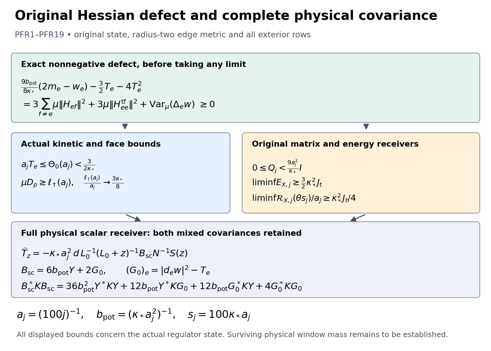
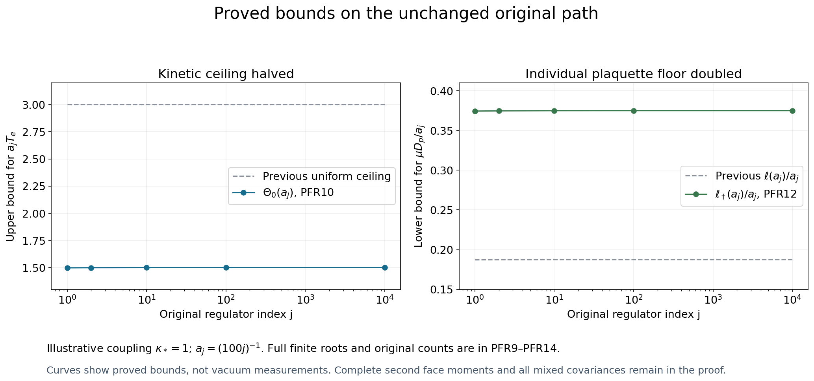

# Physical scalar receiver and a stronger actual kinetic bound

The complete physical projection of the current Schur lift has an exact scalar score receiver. An additional identity for the original diagonal Hessian, all its exterior rows and the variance of its trace improves the actual kinetic ceiling by a factor of two. It doubles the individual plaquette-mean floor, strengthens the original observable's first-energy and resolvent coefficients, and improves the full current and complementary spectral bounds. Every density-potential and score-fluctuation cross term remains in the physical response.

Complete providers are [CSR1–CSR21](https://github.com/KokunoYumeto/yang-mills-interacting-workbench/blob/88d4d14557a846feae0945d91fc3279d9f8ecdaf/yang-mills/continuations/20261011-central-signs-shrinking-window/FULL_CURRENT_SCHUR_AND_ENERGY_MEASURE.md), [KP1–KP17](https://github.com/KokunoYumeto/yang-mills-interacting-workbench/blob/88d4d14557a846feae0945d91fc3279d9f8ecdaf/yang-mills/continuations/20261011-central-signs-shrinking-window/ACTUAL_KINETIC_PROFILE_AND_SHIFT_MOMENTS.md), [SG3–SG13 and SG29–SG30](https://github.com/KokunoYumeto/yang-mills-interacting-workbench/blob/88d4d14557a846feae0945d91fc3279d9f8ecdaf/yang-mills/continuations/20261011-central-signs-shrinking-window/ACTUAL_GROUND_GRADIENT_TRIAL.md), [DF5–DF7](https://github.com/KokunoYumeto/yang-mills-interacting-workbench/blob/88d4d14557a846feae0945d91fc3279d9f8ecdaf/yang-mills/continuations/20261011-central-signs-shrinking-window/CURRENT_DENSITY_FLUX_AND_PROJECTED_RESIDUAL.md), [CFC17 and CFC22–CFC26](https://github.com/KokunoYumeto/yang-mills-interacting-workbench/blob/88d4d14557a846feae0945d91fc3279d9f8ecdaf/yang-mills/continuations/20261011-central-signs-shrinking-window/CENTERED_CURRENT_COVARIANCE.md), and [SOM5–SOM14](https://github.com/KokunoYumeto/yang-mills-interacting-workbench/blob/88d4d14557a846feae0945d91fc3279d9f8ecdaf/yang-mills/continuations/20261011-central-signs-shrinking-window/ACTUAL_SCORE_MOMENTS_AND_SECOND_ENERGY.md).

Original-author weighted-form and Schur provenance remains Jon Johnsen, Assane Lo, and Geneviève Dusson, Israel Michael Sigal and Benjamin Stamm, with the exact author-TeX versions and actual reading coverage in the source ledger. This increment derives its improvements directly from the complete programme providers; it claims no new external reading or novelty.

## Original objects and the two projections

Retain the original open lattice, radius-two SU(2) edge metric, probability Haar measure and ground:
\[
\begin{gathered}
L_j=j^4,\quad a_j=(100j)^{-1},\quad
g_j^2=\kappa_*a_j/2,\quad
b_{{\rm pot},j}=(\kappa_*a_j^2)^{-1},\quad
s_j=100\kappa_*a_j,\\
U_p=U_d(z)U_k(z+e_d)U_d(z+e_k)^{-1}U_k(z)^{-1},\quad d<k,\\
D_p=2-\operatorname{Tr}U_p,\qquad
V_j=b_{{\rm pot},j}\sum_pD_p
=2b_{{\rm pot},j}|\mathcal P_j|-b_{{\rm pot},j}\sum_p\operatorname{Tr}U_p,\\
H_j=-\kappa_*\Delta+V_j,\quad H_j\psi_j=E_{0,j}\psi_j,\quad
\psi_j>0,\quad\|\psi_j\|=1,\quad d\mu_j=\psi_j^2dU,\quad w_j=\log\psi_j,\\
L=\mathscr L_{1,j}=\kappa_*(dd_\mu^*+d_\mu^*d),\qquad
\mathscr L_{0,j}=\kappa_*d_\mu^*d .
\end{gathered}
\]
Suppress \(j\) only in finite identities. The Hilbert space \(\mathscr H_j\) is the full weighted \(L^2\) space of one-forms on the compact configuration manifold, with the original product metric. Inner products are conjugate-linear in the first argument. The closed operator \(L\) is the nonnegative self-adjoint weighted Hodge operator constructed in PT; its smooth current columns are in its domain.

For a continuous compactly supported real or complex test triple \(\mathbf f\), retain the original centers and observable
\[
\begin{gathered}
x_p=o+a_j(z-L_j\mathbf1+(e_d+e_k)/2),\qquad
x_e=o+a_j(z-L_j\mathbf1+e_d/2),\\
C_{\mathbf f}=a_j\sum_p f_{\sigma(p)}(x_p)D_p,\qquad
X=C_{\mathbf f}-\mu_j C_{\mathbf f},\qquad v=dX,\\
t_1=f_{12}+f_{13},\quad t_2=f_{12}+f_{23},\quad t_3=f_{13}+f_{23}.
\end{gathered}
\]
Continuity is in physical space; at each finite regulator the observable is a finite smooth function of configuration. The inverse test map is
\(2f_{12}=t_1+t_2-t_3\), \(2f_{13}=t_1+t_3-t_2\), \(2f_{23}=t_2+t_3-t_1\).

Use the same strict fitting edge set \(I_j\): for the physical cube
\(\mathcal Q=\prod_d(c_d,c_d+R)\), take
\(q_j=\lceil R/a_j\rceil+3\) and
\((v_Q)_d=L_j+\lfloor(c_d-o_d)/a_j\rfloor-1\).
No outside edge or boundary coupling is removed from \(L\).
The original current columns and raw matrices are
\[
\begin{gathered}
\mathsf Cc=\sum_{e\in I_j}c_ea_j^2\Pi_edw_j,\qquad
T_e=\mu_j|d_ew_j|^2,\qquad
\mathsf N=\mathsf C^*\mathsf C=a_j^4\operatorname{diag}(T_e)>0,\\
\mathsf Q=\mathsf C^*L\mathsf C,\qquad
\mathsf Z^{(0)}=(L\mathsf C)^*L\mathsf C,\qquad
\mathsf b=\mathsf C^*v,\qquad k(z)=((L+z)\mathsf C)^*v .
\end{gathered}
\]
Keep the distinction between \(\mathsf b\) and \(k(z)\). KP8 proves
\(0\le\mathsf Q\le15a_j^2/\kappa_*\,I\).
The current-span projection and its complete residual are
\[
\Pi=\mathsf C\mathsf N^{-1}\mathsf C^*,\qquad
\mathsf R=(I-\Pi)L\mathsf C,\qquad v_\perp=(I-\Pi)v .
\]
The exact-form projection \(P_{\rm ex}\) from PT14 is different: it reduces \(L\) and contains \(v\). All formulas below use both with their specified meanings.

The complementary operator \(A_\perp\) is the nonnegative self-adjoint compression on \(\operatorname{Dom}L\cap\operatorname{Ran}(I-\Pi)\), with this domain proved in CSR1. For \(z>0\), keep
\[
D_\perp(z)=A_\perp+z,\qquad
\mathsf S(z)=\mathsf Q+z\mathsf N-\mathsf R^*D_\perp(z)^{-1}\mathsf R,\qquad
\mathsf S(z)\ge z\mathsf N>0 .
\]
These are the full complementary inverse and the raw Schur matrix; every outside edge remains present.

## Full lifted equation

The CSR lift \(\mathsf T_zc=\mathsf Cc-D_\perp(z)^{-1}\mathsf Rc\)
has zero complementary component after applying \(L+z\).
Its current-column pairing is \(\mathsf S(z)c\). Every vector in the current range with these pairings is uniquely \(\mathsf C\mathsf N^{-1}\mathsf S(z)c\).
Consequently
\[
(L+z)\mathsf T_z=\mathsf C\mathsf N^{-1}\mathsf S(z),\qquad
\mathsf T_z=(L+z)^{-1}\mathsf C\mathsf N^{-1}\mathsf S(z).
\tag{PFR1}
\]
Both identities are operator-domain identities from a finite coefficient space. This gives the exact connection to the full resolvent rather than assigning exactness to the lift.

Let \(P=P_{\rm ex}\), and retain the scalar score columns
\[
S_e=\Delta_ew+2G_e,\qquad G_e=|d_ew|^2,\qquad
\mathsf B_{\rm sc}c=\sum_{e\in I_j}c_eS_e .
\]
Compact weighted integration gives
\(\mu\Delta_ew=-2T_e=-2\mu G_e\), so every \(S_e\) is mean zero.
The columns are smooth and gauge invariant: the edge Laplacian, metric and ground log are preserved by the original vertex gauge action.
SG3 gives \(d_\mu^*\mathsf C=-a_j^2\mathsf B_{\rm sc}\).
The scalar operator \(\mathscr L_0\) has a positive finite-regulator eigenvalue on mean-zero invariant scalars, by PT's compact-domain proof; no uniform eigenvalue is imposed here.

## Exact physical scalar receiver

Use SG29's original projection formula
\(P\mathsf C=-\kappa_*a_j^2d\mathscr L_0^{-1}\mathsf B_{\rm sc}\)
and the exact intertwining
\((L+z)^{-1}d=d(\mathscr L_0+z)^{-1}\).
Its validity on each smooth column follows either by the scalar eigenbasis in PT14–PT15 or by applying the two operators to a smooth scalar and using the unique resolvent solution.
Define, retaining the raw matrix order,
\[
h_z=\mathsf N^{-1}\mathsf S(z),\qquad
\Phi_z=\mathsf B_{\rm sc}h_z,\qquad
\widehat{\mathsf T}_z=P\mathsf T_z
=-\kappa_*a_j^2d\mathscr L_0^{-1}
(\mathscr L_0+z)^{-1}\Phi_z .
\tag{PFR2}
\]
No commutation between \(\mathsf N\) and \(\mathsf S(z)\) is used.
The last operator is a finite family of smooth exact invariant one-forms by the finite elliptic scalar inverse. For complex coefficients the scalar Hilbert-space inner product conjugates the first argument.

For any two positive shifts \(z,r\), compact integration by parts
\(\langle du,dv\rangle_\mu=\kappa_*^{-1}\langle u,\mathscr L_0v\rangle_\mu\)
and scalar spectral commutation give the complete mixed physical matrices
\[
\begin{aligned}
\widehat{\mathsf T}_z^*\widehat{\mathsf T}_r
&=\kappa_*a_j^4\Phi_z^*
\mathscr L_0^{-1}(\mathscr L_0+z)^{-1}
(\mathscr L_0+r)^{-1}\Phi_r,\\
\widehat{\mathsf T}_z^*L\widehat{\mathsf T}_r
&=\kappa_*a_j^4\Phi_z^*
(\mathscr L_0+z)^{-1}(\mathscr L_0+r)^{-1}\Phi_r .
\end{aligned}\tag{PFR3}
\]
The scalar inverse powers act only on the stated mean-zero space.
For the first line, the two factors from PFR2 give
\(\kappa_*^2a_j^4\); the integration-by-parts factor is
\(\kappa_*^{-1}\), and one \(\mathscr L_0\) cancels one of the two displayed inverse factors. For the second line, commuting \(L\) through the second gradient supplies one further \(\mathscr L_0\), removing the other inverse factor. These steps retain every \(\kappa_*,a_j,z,r\) contribution.

The source identity follows with the same signs:
\[
\begin{gathered}
\mathsf b=-a_j^2\mathsf B_{\rm sc}^*X,\qquad
d(z)=\widehat{\mathsf T}_z^*dX
=-a_j^2\mathsf S(z)\mathsf N^{-1}
\mathsf B_{\rm sc}^*(\mathscr L_0+z)^{-1}X,\\
c_z=\mathsf S(z)^{-1}d(z)
=-a_j^2\mathsf N^{-1}\mathsf B_{\rm sc}^*
(\mathscr L_0+z)^{-1}X .
\end{gathered}\tag{PFR4}
\]
To prove the middle identity, pair PFR2 with \(dX\), use the same integration by parts, and cancel the single scalar \(\mathscr L_0^{-1}\). The adjoint of \(h_z\) is \(\mathsf S(z)\mathsf N^{-1}\), in that order. The first identity is \(d_\mu^*\mathsf C=-a_j^2\mathsf B_{\rm sc}\) paired with \(X\); the last follows by the already proved invertibility of \(\mathsf S(z)\).

The entire source cross resolvent from CSR9 has therefore been mapped to an original scalar covariance:
\[
\begin{aligned}
\int_{[0,\infty)}(\lambda+z)^{-1}\,dJ(\lambda)
={}&-a_j^2\mathsf B_{\rm sc}^*X\\
&+a_j^2\mathsf S(z)\mathsf N^{-1}
\mathsf B_{\rm sc}^*(\mathscr L_0+z)^{-1}X .
\end{aligned}\tag{PFR5}
\]
This is an exact value as an original scalar resolvent expression. It does not supply its regulator limit.

## Actual density potential and score fluctuation, with all mixed terms

DF6's density potential is
\(Y_e=(\Delta_ew+2T_e)/(6b_{\rm pot})\).
Define two finite scalar-column maps on mean-zero invariant functions,
\[
\mathsf Yc=\sum_ec_eY_e,\qquad
\mathsf G_0c=\sum_ec_e(G_e-T_e).
\]
Their exact relation is
\[
\mathsf B_{\rm sc}=6b_{\rm pot}\mathsf Y+2\mathsf G_0,\qquad
\Phi_z=6b_{\rm pot}\mathsf Yh_z+2\mathsf G_0h_z .
\tag{PFR6}
\]
Indeed the \(2T_e\) in \(6b_{\rm pot}Y_e\) cancels only with the explicitly retained \(-2T_e\) in the fluctuation term, leaving \(\Delta_ew+2G_e\). The original
\(b_{\rm pot}=(\kappa_*a_j^2)^{-1}\) is not absorbed into either column.

For either scalar kernel
\[
K^{N}_{z,r}=\mathscr L_0^{-1}(\mathscr L_0+z)^{-1}(\mathscr L_0+r)^{-1},
\qquad
K^{E}_{z,r}=(\mathscr L_0+z)^{-1}(\mathscr L_0+r)^{-1},
\]
the full receiving product is
\[
\begin{aligned}
\Phi_z^*K_{z,r}\Phi_r
={}&h_z^*\big\{
36b_{\rm pot}^2\mathsf Y^*K_{z,r}\mathsf Y
+12b_{\rm pot}\mathsf Y^*K_{z,r}\mathsf G_0\\
&\hspace{13mm}
+12b_{\rm pot}\mathsf G_0^*K_{z,r}\mathsf Y
+4\mathsf G_0^*K_{z,r}\mathsf G_0
\big\}h_r .
\end{aligned}\tag{PFR7}
\]
Distributivity applied to PFR6 proves all four terms. The original
\(\kappa_*a_j^4\) multiplying this matrix in PFR3 remains outside the braces. Both mixed entries are necessary; no independent fluctuation or diagonal approximation is asserted.

These exact scalar matrices also identify the full physical costs left in CSR20:
\[
\begin{gathered}
\mathsf N_\perp^{\rm lift}(z)
=\mathsf S'(z)-\kappa_*a_j^4\Phi_z^*
\mathscr L_0^{-1}(\mathscr L_0+z)^{-2}\Phi_z\ge0,\\
\mathsf E_\perp^{\rm lift}(z)
=\mathsf S(z)-z\mathsf S'(z)
-\kappa_*a_j^4\Phi_z^*(\mathscr L_0+z)^{-2}\Phi_z\ge0 .
\end{gathered}\tag{PFR8}
\]
Each is exactly the Gram or \(L\)-energy matrix of
\((I-P)\mathsf T_z\), by orthogonal reducing decomposition and PFR3. Thus the formulas are equalities to known nonnegative quantities, with no missing estimate assumed.

## An exact defect improves the actual kinetic ceiling

All quantities below remain in the original interacting ground state. Write
\(g_e=d_ew\), \(H_{ef}=(\nabla^2w)_{ef}\),
\(\bar R_e=\mu\sum_f\|H_{ef}\|_{\rm HS}^2\),
\(m_e=|\{p:e\in\partial p\}|\le4\),
\(w_e=\sum_{p\ni e}\mu D_p\), and
\(\tau_e^{\rm kin}=a_jT_e\).
The distinction between the partial Laplacian \(\Delta_ew\) and
\(\tau_e^{\rm kin}\) is kept throughout.
SG7–SG8, applied to one original edge, and compact weighted integration give
\[
2\bar R_e+T_e=\frac{3b_{\rm pot}}{4\kappa_*}(2m_e-w_e),
\qquad
\mu\Delta_ew=-2T_e .
\]
This formula includes all outside Hessian rows and every incident boundary face.
Decompose the three-dimensional diagonal Hessian block into its trace and trace-free part
\(H_{ee}^{\rm tf}=H_{ee}-(\Delta_ew/3)I_e\).
Orthogonality of that decomposition gives the exact nonnegative defect
\[
\begin{aligned}
\frac{9b_{\rm pot}}{8\kappa_*}(2m_e-w_e)
-\frac32T_e-4T_e^2
&=3\bar R_e-4T_e^2\\
&=3\sum_{f\ne e}\mu\|H_{ef}\|_{\rm HS}^2
+3\mu\|H_{ee}^{\rm tf}\|_{\rm HS}^2
+\operatorname{Var}_\mu(\Delta_ew)\ge0 .
\end{aligned}\tag{PFR9}
\]
Indeed \(3\mu\|H_{ee}\|^2=\mu(\Delta_ew)^2+
3\mu\|H_{ee}^{\rm tf}\|^2\), and
\((\mu\Delta_ew)^2=4T_e^2\).
This is an equality to the complete defect, not a trace approximation.

For the strict inside edges \(m_e=4\), multiply PFR9 by \(a_j^2\) and use the original \(b_{\rm pot}=(\kappa_*a_j^2)^{-1}\).
The positive root of its quadratic gives
\[
\begin{gathered}
4(\tau_e^{\rm kin})^2+\frac32a_j\tau_e^{\rm kin}
\le\frac9{\kappa_*^2}\left(1-\frac{w_e}{8}\right),\\
0<\tau_e^{\rm kin}\le
\Theta(a_j,w_e):=
\frac{-3a_j/2+
\sqrt{9a_j^2/4+(144/\kappa_*^2)(1-w_e/8)}}8
\le\Theta_0(a_j)<\frac3{2\kappa_*},\\
\Theta_0(a)=
\frac{-3a/2+\sqrt{9a^2/4+144/\kappa_*^2}}8,\qquad
\Theta_0(a)\longrightarrow\frac3{2\kappa_*}.
\end{gathered}\tag{PFR10}
\]
The actual strict-edge positivity of \(T_e\) was proved in CFC20.
The first inequality ensures \(w_e<8\), so its root is real.
For every boundary edge the general PFR9 formula and \(m_e\le4,w_e\ge0\) give the same universal upper bound
\(a_jT_e\le\Theta_0(a_j)\).
The root is strictly less than \(3/(2\kappa_*)\) because at that positive number the quadratic left side is strictly greater than \(9/\kappa_*^2\).
This halves the preceding uniform \(3/\kappa_*\) ceiling while keeping its exact positive defect.

## Stronger full matrix and scalar covariance bounds

KP8 retains
\[
\mathsf Q=a_j^2\operatorname{diag}
\left(\frac3{\kappa_*}-\frac{3w_e}{8\kappa_*}
+4\tau_e^{\rm kin}\right)-\mathsf D,\qquad \mathsf D\ge0 .
\]
Consequently the original full matrix, not only its trace, obeys
\[
\begin{gathered}
0\le\mathsf Q\le
a_j^2\left(\frac3{\kappa_*}+4\Theta_0(a_j)\right)I
<\frac{9a_j^2}{\kappa_*}I,\qquad
0<\mathsf N\le a_j^3\Theta_0(a_j)I,\\
\boldsymbol{\Gamma}:=\mathsf B_{\rm sc}^*\mathsf B_{\rm sc}
\le\frac{\mathsf Q}{\kappa_*a_j^4}
\le\frac{9}{\kappa_*^2a_j^2}I,\\
\mathsf B_{\rm sc}^*\mathscr L_0^{-1}\mathsf B_{\rm sc}
\le\frac{\mathsf N}{\kappa_*a_j^4}
=\frac1{\kappa_*}\operatorname{diag}(T_e)
\le\frac{\Theta_0(a_j)}{\kappa_*a_j}I .
\end{gathered}\tag{PFR11}
\]
The energy inequality is SG29's
\(\kappa_*a_j^4\boldsymbol{\Gamma}=\mathsf C^*P L P\mathsf C
\le\mathsf C^*L\mathsf C\).
The inverse inequality is the exact norm identity
\(\kappa_*a_j^4\mathsf B_{\rm sc}^*\mathscr L_0^{-1}
\mathsf B_{\rm sc}=\mathsf C^*P\mathsf C\le\mathsf N\).
Both use the reducing projection, keeping every physical complement from PFR8.

## An improved individual plaquette floor

For any original plaquette \(p\), choose an incident edge and write
\(d_p=\mu D_p\), \(U_0(a)=\Theta_0(a)/a>0\).
The full Casimir and group-gradient identities from CFC22 give
\[
\frac9{64}(2-d_p)^2
\le T_e\left(d_p-\frac14\mu D_p^2\right)
\le U_0(a)\left(d_p-\frac14d_p^2\right).
\]
The second inequality uses \(T_e\le U_0(a)\),
\(d_p-\mu D_p^2/4=\mu|d_eD_p|^2\ge0\), and
\(\mu D_p^2\ge d_p^2\), in that order.
Set \(A(a)=9+16U_0(a)\). Multiplication by \(64\) gives
\(A(a)d_p^2-4A(a)d_p+36\le0\).
Its lower root, including all retained factors, is
\[
\begin{gathered}
d_p\ge\ell_\dagger(a):=
2-8\sqrt{\frac{U_0(a)}{9+16U_0(a)}}
=\frac{18}{9+16U_0(a)+4\sqrt{U_0(a)(9+16U_0(a))}},\\
\frac{\ell_\dagger(a_j)}{a_j}\longrightarrow
\frac{3\kappa_*}{8}.
\end{gathered}\tag{PFR12}
\]
The rational expression follows by multiplying the difference of square roots by its conjugate; its numerator is exactly \(18\).
For the limit use \(aU_0(a)\to3/(2\kappa_*)\):
the denominator times \(a\) tends to \(32\cdot3/(2\kappa_*)=48/\kappa_*\).
This proves the doubled individual-face floor, including finite boundary plaquettes, without replacing the second face moment in the preceding exact inequality.

## Finite budget, spatial means, and two different kinetic receivers

Keep every original fitting-cube quantity
\[
\begin{gathered}
N_Q=3q(q+1)^2,\quad M_Q=3q^2(q+1),\quad
q=\lceil R/a_j\rceil+3,\\
C_Q=2q(q+1)\sum_d
[\mathbf1_{\{(v_Q)_d>0\}}+\mathbf1_{\{(v_Q)_d+q<2L_j\}}],\\
d_Q=\sum_{p\ {\rm inside}\ Q}\mu D_p,\quad
\Lambda_Q=\min\{2M_Q,6g_j^2\sqrt{N_QM_Q}\}+2C_Q,\\
\kappa_*T_Q+b_{\rm pot}d_Q
\le E_{0,j}-E_{{\rm out},j}\le b_{\rm pot}\Lambda_Q,\\
A_Q=9+64b_{\rm pot}/\kappa_*,\quad
B_Q=36M_Q+64(b_{\rm pot}/\kappa_*)\Lambda_Q,\\
\Delta_Q=B_Q^2-144A_QM_Q^2,\qquad
d_Q^-=\frac{B_Q-\sqrt{\Delta_Q}}{2A_Q},\\
\mathsf L_R=9\kappa_*R^3+24R^2,\qquad
K_R=\frac{\mathsf L_R+
\sqrt{\mathsf L_R^2-81\kappa_*^2R^6/4}}2 .
\end{gathered}
\]
The root \(d_Q^-\) and its original budget are CFC23/HVR18.
Summing PFR12 gives the finite and limiting improvements
\[
\begin{gathered}
d_Q^\dagger:=\max\{d_Q^-,M_Q\ell_\dagger(a_j)\}\le d_Q,\qquad
T_Q\le\min\left\{N_QU_0(a_j),
\frac{b_{\rm pot}}{\kappa_*}(\Lambda_Q-d_Q^\dagger)\right\},\\
\liminf_j a_j^2d_Q\ge\frac{9\kappa_*R^3}{8},\qquad
\limsup_j a_j^2(\Lambda_Q-d_Q)
\le\mathsf L_R-\frac{9\kappa_*R^3}{8}<K_R,\\
\limsup_j a_j^4T_Q\le\frac{9R^3}{2\kappa_*}.
\end{gathered}\tag{PFR13}
\]
For the magnetic floor use \(a_j^3M_Q\to3R^3\).
To show it exceeds the previous lower uncertainty root, put
\(r=9\kappa_*R^3/8\) and \(c=81\kappa_*^2R^6/16\).
Both \(r\) and \(\mathsf L_R-K_R\) lie below \(\mathsf L_R/2\), and
\[
r(\mathsf L_R-r)-c
=\frac{243}{64}\kappa_*^2R^6+27\kappa_*R^5>0 .
\]
Strict monotonicity of \(x(\mathsf L_R-x)\) there proves
\(r>\mathsf L_R-K_R\), including every \(R>0\).
Finally \(a_j^3N_Q\to3R^3\) and \(a_jU_0(a_j)\to3/(2\kappa_*)\)
prove the direct kinetic limit.
The exact connecting inequality is
\(\kappa_*^2a_j^4T_Q\le a_j^2(\Lambda_Q-d_Q)\).
The separate upper bound on its left side has not been assigned to the right side.
The force/source upper bound for \(d_Q\), which uses \(K_R\), is unchanged.

For the original oriented measures
\(\mathfrak m_{\sigma,j}=a_j^2\sum_{p:\sigma}d_p\delta_{x_p}\),
the same original Riemann sums and locally bounded extraction in CFC25 now give
\[
\mathfrak m_\sigma\ge\frac{3\kappa_*}{8}\,dx,\qquad
\sum_\sigma\mathfrak m_\sigma\ge\frac{9\kappa_*}{8}\,dx .
\tag{PFR14}
\]
Indeed multiply \(d_p\ge\ell_\dagger(a_j)\) by each nonnegative test value, sum, and pass to the limit using PFR12. No statement about random sample smoothness is inferred from these mean measures.

## Stronger original observable energy and resolvent coefficients

Let \(\mathsf B_j\) collect the actual raw-source columns
\(\mathsf b_j^{(\ell)}=\mathsf C_j^*dX_\ell\)
for a fixed finite original test family, and let
\(\mathsf E_j\) be its physical energy matrix
\(\kappa_*\langle dX_\ell,dX_m\rangle_\mu\).
Orthogonal projection onto the full current span gives the exact finite inequality
\[
\begin{gathered}
\mathsf E_j\ge\kappa_*\mathsf B_j^*\mathsf N_j^{-1}\mathsf B_j
\ge\frac{\kappa_*}{a_j^3\Theta_0(a_j)}\mathsf B_j^*\mathsf B_j,\\
\mathsf E_j\ge\frac{3\kappa_*^2}{2}\mathsf J_t-\epsilon_jI,\qquad
(\mathsf J_t)_{\ell m}=\int_{\mathcal Q}
\sum_d\overline{t_d^{(\ell)}}t_d^{(m)},\qquad \epsilon_j\to0 .
\end{gathered}\tag{PFR15}
\]
The first difference is exactly the Gram matrix of
\(\sqrt{\kappa_*}(I-\Pi)dX_\ell\); the second is the positive inverse order from PFR11. The actual strong-source comparison gives
\(a_j^{-3}\mathsf B_j^*\mathsf B_j\to(9/4)\mathsf J_t\).
Finite matrix norm convergence and
\(\Theta_0(a_j)\to3/(2\kappa_*)\) prove the second line.
For every raw coefficient list \(\gamma_j\) this retains the error
\(\epsilon_j\|\gamma_j\|^2\).
The lower limiting matrix has precisely the original test-relation kernel because the map \(\mathbf f\mapsto t\) is invertible.
Thus the actual original first energy moment is uniformly nonzero for every nonzero original test. Its distribution over spectral energies is a further question.

For the original unscaled trial \(h_e=t_d(x_e)\), the unchanged norm and trace formulas now give
\[
\begin{gathered}
\limsup_jN_h\le\frac{3J_t}{2\kappa_*},\qquad
\limsup_j a_jq_1(\alpha_h)\le\frac{9J_t}{\kappa_*},\\
\liminf_j\frac{\mathcal R_{\mathbf f,j}(\theta s_j)}{a_j}
\ge\frac{\kappa_*^2J_t}{4},\qquad
J_t=\int_{\mathcal Q}\sum_d|t_d|^2>0 .
\end{gathered}\tag{PFR16}
\]
The norm is \(a_j^3\sum_e\tau_e^{\rm kin}|h_e|^2\); the original cell Riemann sum and PFR10 prove its bound.
SG8–SG9 retain the entire signed Hessian remainder and give
\(q_1(\alpha_h)\le(a_j^4/2)\mu\Delta_{|h|^2}V+(4/a_j)N_h\).
The exact original trace limit is
\(a_j(a_j^4/2)\mu\Delta_{|h|^2}V\to3J_t/\kappa_*\),
with the scalar face terms and boundary contribution kept before passage to the limit. The original source overlap tends to \(-3J_t/2\).
More explicitly, on the strict list every edge has its four incident faces, so
\[
a_j\frac{a_j^4}{2}\mu\Delta_{|h|^2}V
=\frac{3a_j^3}{8\kappa_*}
\sum_{e\in I_j}|h_e|^2(8-w_e).
\]
The leading term tends to \(3J_t/\kappa_*\) by the original edge-center Riemann sum. The absolute value of the subtracted term is at most
\(3a_j^3H_t^2d_Q/(2\kappa_*)\to0\), using
\(\sum_{e\in I_j}w_e\le4d_Q\) and the unchanged budget
\(a_j^2d_Q\le K_R+o(1)\). Thus the entire original contribution is evaluated before taking this limit.
Apply SG12, multiply its denominator by \(a_j\), and use
\(a_j\theta s_jN_h=100\kappa_*\theta a_j^2N_h\to0\).
This proves the coefficient with all original powers. The identical proof applies at each fixed positive shift, since \(a_jzN_h\to0\) there too.
For sign weights set \(h_e=t_d(x_e)/|t_d(x_e)|\) when \(t_d(x_e)\ne0\), and \(h_e=0\) otherwise. Then \(\overline h_et_d(x_e)=|t_d(x_e)|\), also for complex tests. The corresponding retained constants are
\(\limsup N_h\le9R^3/(2\kappa_*)\),
\(\limsup a_jq_1(\alpha_h)\le27R^3/\kappa_*\), and
\(\liminf\mathcal R_{\mathbf f,j}(\theta s_j)/a_j
\ge\kappa_*^2J_{\rm edge}^2/(12R^3)\).
These follow from the same full incidence count and original overlap
\(-3J_{\rm edge}/2\), with \(J_{\rm edge}=\sum_d\int|t_d|\).
The exact physical projection and residual remain those of SG13 and PFR1–PFR8.

## Complete equal-time scalar covariance and its dynamic bounds

Every entry of the actual scalar score covariance can be evaluated as an original Hessian contraction:
\[
\begin{gathered}
\boldsymbol{\Gamma}_{ef}
=\mu\|H_{ef}\|_{\rm HS}^2+\tfrac12\delta_{ef}T_e
-2\mu H_{ef}(g_e,g_f),\\
c^*\mathsf L_Hc
=\sum_{\{e,f\}\subset\mathcal E_j,\ e\ne f}
|c_e-c_f|^2\mu\|H_{ef}\|_{\rm HS}^2,\qquad c_e=0\ (e\notin I_j),\\
\kappa_*a_j^4\boldsymbol{\Gamma}
=\mathsf Q-\kappa_*a_j^4\mathsf L_H,\qquad
0\le\mathsf L_H\le\frac6{\kappa_*^2a_j^2}I .
\end{gathered}\tag{PFR17}
\]
The unordered edge pairs in the middle line are counted once.
To prove the first line, integrate
\(\mu S_eS_f=-\mu\langle g_e,d_eS_f\rangle\).
For \(e\ne f\), product covariant derivatives commute and
\(d_e\Delta_fw=\Delta_fg_e\).
Integrating the latter in \(f\) gives
\(-\mu\|H_{ef}\|^2-2\mu H_{ef}(g_e,g_f)\);
the derivative of \(2G_f\) supplies \(4H_{ef}g_f\).
The overall preceding minus sign gives the stated entry.
For \(e=f\), the gradient/Laplacian commutator contributes the original
\(\operatorname{Ric}_e=\tfrac12 I_e\), giving \(\tfrac12T_e\).
Polarization extends the real identities to complex raw lists.
Alternatively subtracting the complete exterior-derivative energy SG3–SG5 from the weighted Hodge energy gives exactly the same formula and the third line.
The graph bound follows from
\(|c_e-c_f|^2\le2|c_e|^2+2|c_f|^2\)
and \(\bar R_e\le3/(\kappa_*^2a_j^2)\) on every inside row.
All exterior pairs are still present.

Let \(E_0(B)\) denote the spectral resolution of \(\mathscr L_0\)
on the mean-zero invariant space, and set
\(\mathsf A_{\rm sc}(B)=\mathsf B_{\rm sc}^*E_0(B)\mathsf B_{\rm sc}\).
The actual matrix inequalities, valid at every positive shift and every cutoff, are
\[
\begin{gathered}
\mathsf A_{\rm sc}((0,\infty))=\boldsymbol{\Gamma},\qquad
\int\lambda^{-1}\,d\mathsf A_{\rm sc}(\lambda)
\le\frac{\mathsf N}{\kappa_*a_j^4},\\
0\le\mathsf B_{\rm sc}^*(\mathscr L_0+z)^{-1}\mathsf B_{\rm sc}
\le\frac{\mathsf N}{\kappa_*a_j^4},\\
\mathsf A_{\rm sc}((0,\theta s_j])
\le\frac{\theta s_j}{\kappa_*a_j^4}\mathsf N
\le100\theta\Theta_0(a_j)I
<\frac{150\theta}{\kappa_*}I .
\end{gathered}\tag{PFR18}
\]
The first two lines are PFR11 and the scalar inequality
\((\lambda+z)^{-1}\le\lambda^{-1}\).
For the last line use \(1\le\theta s_j/\lambda\) in the stated interval and then the full original
\(\mathsf N\le a_j^3\Theta_0(a_j)I\),
\(s_j=100\kappa_*a_j\).
This controls an actual scalar covariance and its low-energy part, not only an auxiliary graph.
For each original \(X\), the cross measure
\(\mathsf B_{\rm sc}^*E_0(B)X\) satisfies the full Gram inequality
\[
|c^*\mathsf B_{\rm sc}^*E_0(B)X|^2
\le(c^*\mathsf A_{\rm sc}(B)c)\,\|E_0(B)X\|^2 .
\]
This follows by projecting both vectors before Cauchy–Schwarz and retains the original spectral mass that PFR4 requires.

For the density and fluctuation columns from PFR6, the same actual calculations give
\[
\begin{gathered}
36b_{\rm pot}^2\|Y_e\|_\mu^2
=\operatorname{Var}_\mu(\Delta_ew)
\le\frac{9b_{\rm pot}}{8\kappa_*}(2m_e-w_e)
-\frac32T_e-4T_e^2,\\
\|G_e-T_e\|_\mu^2
=\mu G_e^2-T_e^2\le\frac{5T_e}{\kappa_*a_j}-T_e^2 .
\end{gathered}\tag{PFR19}
\]
The first is the exact defect PFR9 with the two other nonnegative terms retained there; the second is the actual SOM5 moment inequality.
For any positive scalar kernel \(K\) appearing in PFR3, all four terms in PFR7 are present, and
\[
|\langle Yc,K\mathsf G_0d\rangle|^2
\le\langle Yc,KYc\rangle\,\langle\mathsf G_0d,K\mathsf G_0d\rangle .
\]
At finite regulator these inverse kernels are bounded on mean-zero functions; their positive square root and Cauchy–Schwarz prove the inequality. No independence or omitted mixed covariance is used.

## Propagation through kinetic profiles and full complementary limits

The actual profiles constructed in KP4 now satisfy
\(0<\tau_d\le3/(2\kappa_*)\) almost everywhere, with the same full reciprocal bound \(16K_R/9\).
Indeed integrate the improved pointwise ceiling against every nonnegative test and pass to the same weak subsequence. The original reciprocal proof and all of its finite bad-cell terms remain valid; no substitution for the actual state is required.
KP8–KP10 and every operator using that bound improve from
\(15/\kappa_*\) to \(9/\kappa_*\), while retaining the complete multiplier
\(3/\kappa_*-3w_e/(8\kappa_*)+4\tau_{j,d}\)
and its positive Hessian remainder.
Thus CSR10's full complementary bound becomes
\(M_j([0,\theta s_j])\le900\theta a_j^3I\);
CSR13's measure total is at most \(9/\kappa_*\);
CSR16's derivative ceiling is
\(9m!/(\kappa_*\theta^m)\).
The finite norm terms in CSR15 and CSR19 are now bounded by
\(150\theta a_j^2\) and \(150a_j^2\), respectively, with their full original formulas unchanged.

The complete KP11 and CSR19 limiting matrices, their raw coefficient error factors, and the five zero-index Green moments have not been replaced by a diagonal approximation. PFR9 supplies an exact additional defect for the next calculation: its off-diagonal Hessians, diagonal trace-free Hessian and partial-Laplacian variance quantify the unsaturated kinetic ceiling. PFR17–PFR19 give the actual scalar covariance, its inverse-energy bound and all original density/score-fluctuation contributions. The remaining calculation is their signed resolvent pairing with the original \(X\) at the three shifts, followed by the original physical window and interacting continuum construction. The smooth global no-gap endpoint remains the programme goal.

## Reproducible figures and complete diagnostics

[The diagnostic source](check_physical_receiver.py) checks the finite physical intertwinings, exact defect, both quadratic roots, retained budget and full exterior-pair covariance algebra. Its specified finite arrays are algebra diagnostics, not simulated Yang–Mills vacua. [The figure source](figure_physical_receiver.py), [diagnostic results](PHYSICAL_RECEIVER_CHECKS.json) and [source-use ledger](PHYSICAL_RECEIVER_SOURCE_USE_LEDGER.json) retain the exact inputs and reading coverage. The written proofs establish the claims.

## Actual physical spectral measure and its total kernel

[PSC1–PSC10](https://github.com/KokunoYumeto/yang-mills-interacting-workbench/blob/main/yang-mills/continuations/20261011-central-signs-shrinking-window/ACTUAL_PHYSICAL_SCORE_SPECTRAL_MEASURE.md) construct the actual physical current-norm measure and its complete joint source/energy measure on the original relative-energy interval. They prove
\[
\ker\mathcal M([0,\infty])\cap L^2(\mathcal Q;\mathbb C^3)=\{0\},
\qquad
d\mathcal C_j(r)=100a_j^2r\,d\mathcal M_j(r).
\]
The first statement concerns the total physical measure, including both endpoint atoms. The second preserves the exact map to the leading score covariance, whose original-scale limit is \(\mathcal G\delta_\infty\). Its possible zero coefficient is retained.

PSC7 keeps the surviving original source in one positive block measure. PSC8–PSC9 give all physical cross-shift norm, energy, source and original signed-window limits with their full factors and signs. PSC10 identifies the different kernels obtained when infinity or both endpoints are excluded. Thus total injectivity is proved without assigning it to finite relative energies. The actual allocation of mass and the sign of the original three-shift window remain active calculations toward the smooth interacting continuum no-gap goal.

## Original gauge constraints and stronger actual-state bounds

[GWH1–GWH15](https://github.com/KokunoYumeto/yang-mills-interacting-workbench/blob/main/yang-mills/continuations/20261011-central-signs-shrinking-window/GAUGE_HESSIAN_AND_COVARIANT_GRAPH.md) differentiate the original vertex gauge invariance with its full connection term, apply both endpoint constraints, and retain every outside Hessian row. They prove the stronger actual ceiling and the physical norm correction
\[
\begin{gathered}
\Theta_G(a)=\frac{-3a/2+\sqrt{9a^2/4+144/[\kappa_*^2(7/5)]}}8,
\qquad a_jT_e\le\Theta_G(a_j)<\frac3{2\kappa_*}\sqrt{\frac57},\\
\mathsf C_j^*P\mathsf C_j+\mathsf V_{g,j}\le\mathsf N_j,\qquad
c^*\mathsf V_{g,j}c
=a_j^4\mu\langle K_U^*D_cg,(K_U^*K_U)^\dagger K_U^*D_cg\rangle .
\end{gathered}
\]
The original full gauge graph, holonomy transports and all gauge zero modes remain. Horizontality of the physical exact-current columns follows from their proved gauge invariance and projection equivariance. The full row minimum and its complete residual are GWH8–GWH9.

GWH6 and GWH12–GWH15 propagate the finite root through the complete current and scalar covariance bounds, complementary spectral measure and derivatives, original cube budget and oriented means, first-energy and both original resolvent trials, and the exact density variance. The scalar-score low-energy ceiling is \(100\theta\Theta_G(a_j)\); the current energy ceiling is \(a_j^2(3/\kappa_*+4\Theta_G(a_j))\). The complete four mixed density/score terms, raw coefficient errors and source upper constant \(K_R\) remain. The actual physical total satisfies
\(\mathcal M([0,\infty])+\mathcal V_g\le M_{\mathbf1_{\mathcal Q}\tau}\).
These strengthen the existing receivers without assigning physical mass to a spectral interval. The original window and interacting smooth global no-gap endpoint remain active.

## Full gauge-current matrix and exact dynamic curl

[GCM1–GCM16](https://github.com/KokunoYumeto/yang-mills-interacting-workbench/blob/main/yang-mills/continuations/20261011-central-signs-shrinking-window/GAUGE_CURRENT_COVARIANCE_AND_DYNAMIC_CURL.md) retain the complete vertex cross covariance and prove the full matrix lower bound
\[
\mathsf V_g\ge a_j^4\mathsf A_0\mathsf A_1^\dagger\mathsf A_0
\ge\frac{a_j^4}{12}\mathsf A_0,\qquad
\mathsf A_0=\mu B_U^*B_U,\quad
\mathsf A_1=\mu B_U^*(K_U^*K_U)B_U .
\]
The physical source-energy receiver keeps this entire correction. Its scalar inverse and continuum inverse-half domains are proved in GCM6–GCM9. The single-edge bound \((\mathsf V_g)_{ee}\ge2\mathsf N_{ee}/7\) is a diagonal statement: the full original constant list has \(\mathsf V_g\mathbf1=0\) and \(P\mathsf C\mathbf1=\mathsf C\mathbf1\). No factor inferred from the diagonal replaces the actual matrix.

The original contraction \(\mathscr T\alpha=K_U^*\alpha^\sharp\) satisfies
\[
\mathscr T L_1-L_0^{\mathbb V}\mathscr T
=\kappa_*\mathscr R\,d,\qquad
\mathscr R\omega=\mathscr S_U((*_e\omega_{ee})_e).
\]
GCM13–GCM16 prove every connection sign, the \(12\) degree bounds, the current identity with zero initial diagonal curl, and the complete two-form resolvent correction. GCM10–GCM12 construct the graph-energy receiver for a common smooth spatial weight, with no infinity atom at \(\lambda/a_j^2\). Its connection to physical time energy \(\lambda/s_j\) remains the exact norm and dynamic maps above. All endpoint atoms in the physical measure, original raw coefficients, mixed scalar kernels and the signed physical window remain.

## Exact force receiver and common physical source

[TFC1–TFC26](https://github.com/KokunoYumeto/yang-mills-interacting-workbench/blob/main/yang-mills/continuations/20261011-central-signs-shrinking-window/TWO_FORM_FORCE_AND_COMMON_SPECTRUM.md) prove the full original force-curl receiver, including
\[
L_2d\mathsf Cc=-a_j^2d(D_cdV),\qquad
\mathsf N^\perp=\kappa_*a_j^4
\int_{(0,\infty)}\lambda^{-3}\,d\Omega_j(\lambda).
\]
The actual force covariance tends strongly to \(9/\kappa_*^2\) times the direction-difference projection on the original support cube. Its kernel is exactly the common-coefficient subspace. For a common \(C_c^1\) coefficient, TFC15 evaluates the next spatial term and TFC21–TFC22 prove a uniform removed-current second moment at the unchanged energy. All face deficits, their second moments, outside neighbors and limiting zero atoms remain.

The original common plaquette observable \(X_{\varphi,j}\) and the explicitly defined centered squared-score observable \(Q_{\varphi,j}\) satisfy
\[
dX_{\varphi,j}+dQ_{\varphi,j}
=-\frac{\kappa_*a_j}{2}L_1P\mathsf Cc_j+Pe_{\varphi,j},
\qquad \|e_{\varphi,j}\|=O(a_j).
\]
TFC23–TFC25 prove the complete low-band and original three-shift comparisons. The displayed scaled response error is \(O(a_j)\); its unscaled error is only \(O(1)\), and no positive window sign is inferred. TFC26 proves that the leading full Hessian-pair remainder kills the common subspace, with \(\mathcal Qh=\kappa_*\mathcal Gh\) there. These formulas strengthen the existing physical, score and force receivers while leaving the actual spectral allocation and interacting smooth global no-gap construction active.

## Exact scalar source and full positive-energy band

[TSC1–TSC12](https://github.com/KokunoYumeto/yang-mills-interacting-workbench/blob/main/yang-mills/continuations/20261011-central-signs-shrinking-window/SCALAR_COMMON_SOURCE_RECONSTRUCTION.md) integrate the common-source gradient identity with every original centering constant:
\[
X_{\varphi,j}+Q_{\varphi,j}
=\frac{\kappa_*^2a_j^3}{2}B_{c_j}+r_{\varphi,j},
\qquad r_{\varphi,j}=\kappa_*L_0^{-1}\delta_\mu e_{\varphi,j}.
\]
The full scalar score term has norm \(O(\sqrt{a_j})\). For every Borel subset \(B\subset[\epsilon s_j,\infty)\), the exact finite estimate proves
\[
\|E_0(B)(X_{\varphi,j}+Q_{\varphi,j})\|
\le d_{\varphi,j}(\epsilon s_j)=O(\sqrt{a_j}).
\]
Consequently the original \(X\) and squared-score \(Q\) masses have equal extended liminf and limsup on every such sequence of bands, including the original shrinking annulus. This compares the actual unweighted physical masses without assigning a positive value to either one. TSC8–TSC9 retain all three original response shifts and give explicit signed bounds. TSC10–TSC12 evaluate the actual mixed density/score covariance combination and give a whole-variance floor of order \(a_j\). The weighted Poisson residual at zero, all mixed terms and original coefficient norms remain. The spectral allocation and smooth interacting continuum no-gap construction continue.
