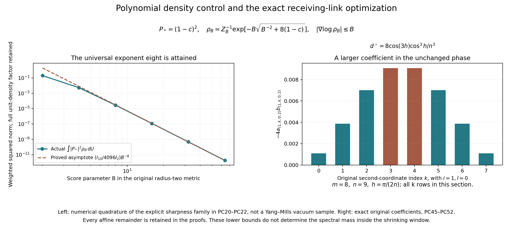

# Polynomial conditional bounds in the original SU(2) metric

This note proves an explicit bound for every quaternion polynomial of
degree at most two, retaining its entire affine remainder. The exponent
eight is optimal under the stated logarithmic score hypothesis. Applied
to the original two-link phase calculation, it replaces the exponential
losses in JP43, JP47 and JP48 by polynomial losses on the unchanged
joint path. It does not determine the complete shrinking-window endpoint.
Section 9 strengthens the application further by using a larger
coefficient already present in the original phase, with complete
conjugation and derivative maps.

## 1. Metric, density and the exact polynomial space

Write an original group element as
\[
 U=x_0I+2\sum_{\alpha=1}^3x_\alpha T_\alpha,\qquad
 T_\alpha=-i\sigma_\alpha/2,\qquad
 \sum_{\alpha=0}^3x_\alpha^2=1 .
 \tag{PC1}
\]
Thus \(c(U)=x_0=\operatorname{tr}U/2\) and
\(q_\alpha(U)=2x_\alpha=-2\operatorname{tr}(T_\alpha U)\).
The metric making the three original left fields orthonormal is the
round metric of radius two. Its distance from identity is
\(d(I,U)=2\arccos x_0\), its diameter is \(2\pi\), and normalized Haar
measure is denoted by \(dU\). A ball of physical radius \(r\) has volume
\[
 v(r)={r-\sin r\over2\pi}.
 \tag{PC2}
\]
Indeed the polar angle \(\theta=d(I,U)/2\) has density
\((2/\pi)\sin^2\theta\,d\theta\) on \([0,\pi]\).
The radius follows directly because the velocity of \(\exp(tT_\alpha)\)
has Euclidean length \(1/2\) in the unit quaternion sphere. Left
multiplication is orthogonal, so multiplying that sphere metric by
four gives precisely the original orthonormal left fields.
Rotation invariance also gives \(\int x_i^2=1/4\).
Writing \(a=\int x_i^4\) and \(b=\int x_i^2x_j^2\) for \(i\ne j\),
the rotation \(x_i\mapsto(x_i+x_j)/\sqrt2\) gives \(a=3b\).
The identity \((\sum_i x_i^2)^2=1\) gives \(4a+12b=1\).
Thus \(a=1/8\), \(b=1/24\); odd coordinate moments vanish.

Let \(\mathcal P_2\) consist of restrictions to this sphere of complex
polynomials of degree at most two in the four \(x_\alpha\).
Its restriction dimension is fourteen: the fifteen coefficients of an ambient
polynomial have the single restriction relation
\(\sum x_\alpha^2-1=0\). Equivalently its harmonic dimensions are
\(1+4+9\). To verify uniqueness of the restriction relation,
a degree-two polynomial vanishing on the sphere has zero linear
part by comparing \(x\) and \(-x\). Its symmetric quadratic form
is constant on all unit vectors, hence is a scalar multiple of the
identity; comparison with the constant term gives the stated relation.
A positive probability density \(\rho\) is assumed to satisfy
\[
 \int\rho\,dU=1,\qquad
 |\nabla\log\rho|\le B,\qquad B\ge0.
 \tag{PC3}
\]
Smooth densities suffice for all applications below. The proof also
applies whenever \(\log\rho\) is \(B\)-Lipschitz. In particular,
integration along a shortest original geodesic gives
\[
 e^{-Bd(U,V)}\rho(V)\le\rho(U)\le e^{Bd(U,V)}\rho(V).
 \tag{PC4}
\]
No probability density or polynomial is replaced by a reference state.

Define the explicit constant
\[
 c_{\rm cap}
 ={ \cos^{14}(1/4)\over1024\cdot105041\cdot\pi\cdot3^{9/2}}
 >2^{-37}.
 \tag{PC5}
\]
The principal bound, proved in Sections 2–4, is
\[
 \boxed{\displaystyle
 \int|P(U)|^2\rho(U)\,dU
 \ge c_{\rm cap}(1+B)^{-8}\int|P(U)|^2\,dU
 \ge2^{-37}(1+B)^{-8}\int|P(U)|^2\,dU
 \quad(P\in\mathcal P_2).}
 \tag{PC6}
\]
This applies componentwise to vector-valued polynomials, with all
components summed. Its constants do not depend on any coefficient,
affine term, cap centre, box size or coupling.

## 2. An exact polynomial Gram estimate on a cube

Use probability measure \(dt/2\) on \([-1,1]\). The orthonormal
polynomials through degree four are
\[
 \begin{array}{ll}
 L_0=1,&L_1=\sqrt3\,t,\\
 L_2={\sqrt5\over2}(3t^2-1),&
 L_3={\sqrt7\over2}(5t^3-3t),\\
 L_4={3\over8}(35t^4-30t^2+3).
 \end{array}
 \tag{PC7}
\]
Their orthonormality follows by integrating each monomial:
\(\int_{-1}^1t^kdt/2=0\) for odd \(k\) and \(1/(k+1)\) for even
\(k\). Their coefficient squared norms in the monomial basis are
respectively
\[
 t_0=1,\quad t_1=3,\quad t_2={25\over2},\quad
 t_3={119\over2},\quad t_4={9603\over32}.
 \tag{PC8}
\]

Consider all monomials \(z^\alpha\) in three variables with
\(|\alpha|\le4\). Their number is \(\binom73=35\). Their Gram
matrix \(G\), for probability measure \(dz/8\) on \([-1,1]^3\),
has entries
\[
 G_{\alpha\beta}
 =\prod_{i=1}^3
 \begin{cases}
 0,&\alpha_i+\beta_i\text{ odd},\\
 (\alpha_i+\beta_i+1)^{-1},&\alpha_i+\beta_i\text{ even}.
 \end{cases}
 \tag{PC9}
\]
It is positive definite: a polynomial with zero integral squared norm
vanishes on an open cube, hence all its coefficients vanish.
The thirty-five products
\(L_{\ell_1}(z_1)L_{\ell_2}(z_2)L_{\ell_3}(z_3)\),
\(\ell_1+\ell_2+\ell_3\le4\), form an orthonormal basis of exactly
this space, by their triangular leading coefficients.
If \(C\) is their coefficient matrix, \(CGC^*=I\), so
\(G^{-1}=C^*C\). Therefore
\[
 \begin{split}
 \operatorname{tr}G^{-1}
 &=\sum_{\ell_1+\ell_2+\ell_3\le4}t_{\ell_1}t_{\ell_2}t_{\ell_3}\\
 &=1+9+{129\over2}+{861\over2}+{88881\over32}
   ={105041\over32}.
 \end{split}\tag{PC10}
\]
The displayed five contributions are the coefficients of degrees
zero through four in
\((1+3z+(25/2)z^2+(119/2)z^3+(9603/32)z^4)^3\).
The largest eigenvalue of the positive \(G^{-1}\) is at most its
trace. Thus every total-degree-four polynomial
\(Q(z)=\sum_{|\alpha|\le4}a_\alpha z^\alpha\) satisfies
\[
 \int_{[-1,1]^3}|Q(z)|^2{dz\over8}
 \ge {32\over105041}\sum_{|\alpha|\le4}|a_\alpha|^2.
 \tag{PC11}
\]
This estimate is proved from the complete Gram matrix, including
every lower-degree monomial. No affine coefficient has been omitted.

## 3. The exact chart and a cap-average lower bound

Use the stereographic coordinate map into the original quaternion sphere:
\[
 x_0={1-|y|^2\over1+|y|^2},\qquad
 (x_1,x_2,x_3)={2y\over1+|y|^2},
 \qquad
 Q(y)=(1+|y|^2)^2P(x(y)).
 \tag{PC12}
\]
This map covers \(SU(2)\setminus\{-I\}\), with inverse
\(y=(x_1,x_2,x_3)/(1+x_0)\). The equality
\(P(x(y))=Q(y)/(1+|y|^2)^2\) retains its entire denominator.
The numerator \(Q\) has total degree at most four, and no coefficient
of \(P\) is discarded. The missing point is handled by continuity.

Write \(Q=\sum_{|\alpha|\le4}a_\alpha y^\alpha\), \(t=|y|^2\).
For each degree \(d\), the multinomial formula gives
\(\sum_{|\alpha|=d}y^{2\alpha}\le t^d\). Since the coefficients of
\((1+t)^4\) dominate those of \(\sum_{d=0}^4t^d\), Cauchy–Schwarz
proves the exact comparison
\[
 |P(x(y))|^2
 \le\left(\sum_\alpha|a_\alpha|^2\right)
       {\sum_{|\alpha|\le4}y^{2\alpha}\over(1+|y|^2)^4}
 \le\sum_\alpha|a_\alpha|^2,\qquad
 \|P\|_{\rm Haar}^2\le\sum_\alpha|a_\alpha|^2.
 \tag{PC13}
\]
The same bound holds at the missing point by continuity.

In these coordinates normalized Haar measure is exactly
\[
 dU={4\over\pi^2}{dy\over(1+|y|^2)^3}.
 \tag{PC14}
\]
The Jacobian follows from the conformal length factor
\(2/(1+|y|^2)\) of the unit sphere and its volume \(2\pi^2\).
Normalization of Haar does not change when the metric is expressed
at radius two; that metric remains in the ball radius.

For \(0<r\le1\), the original radius-\(r\) cap is
\(|y|\le a_r=\tan(r/4)\). It contains the cube
\([-\delta_r,\delta_r]^3\), where \(\delta_r=a_r/\sqrt3<1\).
The coefficient vector of \(Q(\delta_r z)\) has squared norm
\(\sum_\alpha|a_\alpha|^2\delta_r^{2|\alpha|}
\ge\delta_r^8\sum_\alpha|a_\alpha|^2\).
Combining (PC11)–(PC14), with the full denominator retained, yields
\[
 \begin{split}
 \int_{d(I,U)\le r}|P(U)|^2dU
 &={4\over\pi^2}\int_{|y|\le a_r}
          {|Q(y)|^2\over(1+|y|^2)^7}dy\\
 &\ge {1024\over105041\pi^2}\,
       {\delta_r^{11}\over(1+a_r^2)^7}\,
                       \|P\|_{\rm Haar}^2.
 \end{split}\tag{PC15}
\]
The exponent eleven is eight from the worst coefficient scaling and
three from volume. Since
\(a_r\ge r/4\),
\((1+a_r^2)^{-7}\ge\cos^{14}(1/4)\), and
\(v(r)\le r^3/(12\pi)\), division by the actual cap volume gives
\[
 {1\over v(r)}\int_{d(I,U)\le r}|P(U)|^2dU
 \ge c_{\rm cap}r^8\|P\|_{\rm Haar}^2.
 \tag{PC16}
\]
For the volume inequality, \(\sin r\ge r-r^3/6\) on \([0,1]\);
substitute this in (PC2). All constants in (PC16) follow by
substituting \(\delta_r\ge r/(4\sqrt3)\) in (PC15):
\(12288/(4^{11}3^{11/2})=1/(1024\,3^{9/2})\).

Left multiplication by any cap centre is an orthogonal transformation
of the four quaternion coordinates. It preserves \(\mathcal P_2\),
the original metric and Haar norm. Thus (PC16) holds with the cap
centred at every \(V\), for the original \(P\). This is the precise
coordinate map giving uniformity in the centre.

The dyadic inequality in (PC5) follows without decimal estimates.
One has
\(\cos(1/4)\ge31/32\), hence
\(\cos^{14}(1/4)\ge1-14/32=9/16\);
also \(\pi<4\) and \(3^{9/2}=81\sqrt3<162\).
Finally
\((9/16)2^{37}>1024\cdot105041\cdot4\cdot162\).
These inequalities prove \(c_{\rm cap}>2^{-37}\).

## 4. Averaging removes the volume loss

Fix \(0<r\le1\), and integrate (PC16) over cap centres against the
actual unit density \(\rho(V)dV\). The score comparison (PC4) and
Fubini's theorem give
\[
 \begin{split}
 v(r)c_{\rm cap}r^8\|P\|_{\rm Haar}^2
 &\le \int\rho(V)\!
             \int_{d(U,V)\le r}|P(U)|^2dU\,dV\\
 &\le e^{Br}\int |P(U)|^2\rho(U)
                  \int_{d(U,V)\le r}dV\,dU\\
 &=e^{Br}v(r)\int|P(U)|^2\rho(U)dU .
 \end{split}\tag{PC17}
\]
Every cap has the same Haar volume. It therefore cancels, and
\[
 \int|P|^2\rho\,dU
 \ge c_{\rm cap}e^{-Br}r^8\|P\|_{\rm Haar}^2.
 \tag{PC18}
\]
This is stronger than using only a ball about a density maximum.

Choose \(r=2/(B+2)\) and \(t=B/(B+2)\in[0,1)\).
Then \(Br=2t\) and \(r(1+B)=1+t\).
Since \(\log(1+t)\ge t/2\),
\((1+t)^8e^{-2t}\ge1\). Hence
\(e^{-Br}r^8\ge(1+B)^{-8}\), proving (PC6).
An explicit stronger coefficient, useful when \(B\) is known, is
\[
 \Lambda_2(B)=c_{\rm cap}
 \begin{cases}
 e^{-B},&0\le B\le8,\\
 (8/(eB))^8,&B\ge8.
 \end{cases}
 \qquad
 \Lambda_2(B)\ge c_{\rm cap}(1+B)^{-8}.
 \tag{PC19}
\]
Indeed \(r=\min(1,8/B)\) maximizes \(e^{-Br}r^8\) on \((0,1]\).
The preceding radius choice proves the final inequality for this
maximum as well.

## 5. Exponent eight is optimal under the score bound alone

For \(B\ge1\), define a smooth positive density using the unchanged
metric and coordinates:
\[
 f_B(U)=\sqrt{B^{-2}+8(1-c(U))},\qquad
 \rho_B(U)={e^{-Bf_B(U)}\over Z_B},\qquad
 Z_B=\int e^{-Bf_B(U)}dU,\qquad P_*(U)=(1-c(U))^2.
 \tag{PC20}
\]
The density is smooth on the whole compact group because the radicand
is strictly positive. Since
\(|\nabla c|^2=(1-c^2)/4\),
\[
 |\nabla f_B|^2
 ={4(1-c^2)\over B^{-2}+8(1-c)}
 \le{1+c\over2}\le1.
\]
Thus \(|\nabla\log\rho_B|\le B\), with exactly the same score
parameter as (PC3). The polynomial \(P_*\) belongs to
\(\mathcal P_2\) and \(\|P_*\|_{\rm Haar}^2=21/8\):
expand \((1-c)^4\), use the odd moments zero and the sphere
moments \(\int c^2=1/4,\int c^4=1/8\).

Let \(t=\sqrt{8(1-c)}\in[0,4]\). The exact Haar density of \(t\)
is
\[
 {t^2\over4\pi}\sqrt{1-t^2/16}\,dt,\qquad
 |P_*|^2={t^8\over4096}.
 \tag{PC21}
\]
This follows by substituting \(c=1-t^2/8\) into the polar measure
in Section 1. For \(I_k=\int_0^\infty u^k e^{-\sqrt{1+u^2}}du\),
which is finite and strictly positive, the substitution \(u=Bt\)
and dominated convergence give
\[
 B^3Z_B\longrightarrow {I_2\over4\pi},\qquad
 B^{11}\int|P_*|^2e^{-Bf_B}dU
                  \longrightarrow {I_{10}\over16384\pi},
 \qquad
 B^8\int|P_*|^2\rho_B\,dU
                  \longrightarrow {I_{10}\over4096I_2}>0.
 \tag{PC22}
\]
The dominators are \(u^2e^{-u}\) and \(u^{10}e^{-u}\),
respectively, after extending each integral by zero past \(4B\).
Thus no bound of the form \(c(1+B)^{-k}\|P\|_{\rm Haar}^2\),
with a fixed positive \(c\) and \(k<8\), holds for every density
and polynomial in (PC3) and \(\mathcal P_2\).
This obstruction identifies the exact fourth-order vanishing direction
\((1-c)^2\), with a smooth admissible family realizing its concentration.

## 6. A stronger receiving bound for the original colour vector

The even-mass application below needs \(|q(U)|^2\), which has
additional structure. Let the original radius-\(r\) cap, \(r\le1\),
be centred at \(V\), and write \(U=VZ\), with \(Z\) in the identity
cap. Set \(t_r\) equal to the cap average of \(c(Z)^2\).
Rotation invariance in the three vector coordinates gives
\[
 \operatorname{av}_{Z}|c(VZ)|^2
 =c(V)^2t_r+[1-c(V)^2]{1-t_r\over3}.
 \tag{PC23}
\]
The cross terms have zero integral. Since
\(c(Z)^2\ge\cos^2(1/2)\ge49/64>1/4\), the right side is at
most \(t_r\). Therefore the cap average of \(|q(U)|^2\) is
smallest at an identity or negative-identity centre, and is at least
\[
 4{\int_0^{r/2}\sin^4\theta\,d\theta
       \over\int_0^{r/2}\sin^2\theta\,d\theta}
 \ge {3\over5}\left({23\over24}\right)^4r^2 .
 \tag{PC24}
\]
For the inequality, use
\(\sin\theta\ge\theta-\theta^3/6\ge(23/24)\theta\)
and \(\sin\theta\le\theta\) for \(0\le\theta\le1/2\).
Integrate the resulting powers \(\theta^4\) and \(\theta^2\).

The same averaging argument (PC17), followed by
\(r=\min(1,2/B)\), now proves
\[
 \boxed{\displaystyle
 \int|q(U)|^2\rho(U)dU
 \ge3c_q(1+B)^{-2},\qquad
 c_q={4\over5e^2}\left({23\over24}\right)^4>{1\over16}.}
 \tag{PC25}
\]
To check the uniform constant, for \(B\le2\) the quantity
\(e^{-B}(1+B)^2\) is at least one: its only interior critical
point is its maximum at \(B=1\), and its endpoint values are
\(1\) and \(9/e^2>1\). For \(B\ge2\), the chosen radius gives
\(e^{-Br}r^2=4e^{-2}B^{-2}\ge4e^{-2}(1+B)^{-2}\).
Finally \(e<3\) and \(64(23/24)^4>45\) prove \(c_q>1/16\).
The full Haar norm here is \(\int|q|^2dU=3\).
The densities (PC20) also give
\(B^2\int|q|^2\rho_BdU\to I_4/I_2>0\), by (PC21) and
\(|q|^2=t^2-t^4/16\). Thus exponent two is optimal for this
particular receiving observable.

## 7. Application to the unchanged original phase and vacuum

Retain \(m=2L\), \(n=m+1\), \(h=\pi/(2n)\), and \(L\ge2\).
The original chord sets are
\[
 \mathcal C_2=\{(i,k,l;2):1\le i\le m,\ 0\le k<m,\ 0\le l\le m\},
 \quad
 \mathcal C_3=\{(i,k,l;3):0\le i,k\le m,\ (i,k)\ne(0,0),\
                                      0\le l<m\}.
\]
The original tree has every direction-one edge, direction-two
edges at first coordinate zero, and direction-three edges at first
two coordinates zero. Root paths start at \((0,0,0)\), proceeding
in directions three, two and one. Every coordinate remains the full
word \(Z_c=t_sU_ct_t^{-1}\). The original physical vertex indexed
by \((i,k,l)\) is \(o+a(i-L,k-L,l-L)\).

The complete original rows, with all excluded tree edges retained as
exclusions, are
\[
 \begin{gathered}
 v_0(l)=n^{-1/2},\quad
 v_1(l)=\sqrt{2/n}\cos{\pi(l+1/2)\over n},\quad
 w_1(l)=-\sqrt{2/n}\sin{\pi(l+1)\over n},\\
 a_{(i,k,l;2)}=-v_1(i)w_1(k)v_0(l)/\sqrt2,\qquad
 a_{(i,k,l;3)}=0,\\
 b_{(i,k,l;2)}=v_0(i)w_1(k)v_1(l)/\sqrt2,\qquad
 b_{(i,k,l;3)}=-v_0(i)v_1(k)w_1(l)/\sqrt2,\\
 u_1=\sum_ca_cq(Z_c),\quad u_3=\sum_cb_cq(Z_c),\quad
 \mathcal S=u_1\cdot u_3,\quad
 \mathcal S_{\mathcal R}=\mathcal S\circ\mathcal R,\\
 D=\mathcal S+\mathcal S_{\mathcal R},\quad
 \sigma_*=\sqrt8\sin h,\quad \beta_0={\sigma_*\over2g^2},\quad
 F=p-r=\beta_0(\mathcal S-\mathcal S_{\mathcal R}).
 \end{gathered}\tag{PC26}
\]
Here \(\mathcal R\) is the original direction-one graph reflection,
including every inverse orientation and reflected root.

The full Hamiltonian and actual positive unit vacuum are
\[
 H=\kappa H_0+b_{\rm mag}W,\quad
 H_0=-\sum_{e,\alpha}X_{e,\alpha}^2,\quad
 W=\sum_{\text{all faces }p}(2-\operatorname{tr}U_p),\quad
 \kappa={2g^2\over a},\quad b_{\rm mag}={1\over2g^2a},\quad
 \xi={1\over4g^4},\quad H\psi=E_0\psi,\quad d\mu=\psi^2dU.
 \tag{PC27}
\]
The constant \(2b_{\rm mag}M\), \(M=3m^2(m+1)\), remains in
the potential and vacuum equation. Integration by parts in that
complete equation gives
\(C_F=\langle F\psi,(H-E_0)F\psi\rangle
=\kappa\mu(|\nabla F|^2)\), and \(G=\mu(F^2)\).
The original raw vector is not divided by its norm.

The local score bound, in precisely this metric, is
\[
 |\nabla_e\log\psi^2|\le4r_e\xi .
 \tag{PC28}
\]
Its original proof is
[the retained original TeX, equations (77)–(79) and (113)–(115)](https://github.com/KokunoYumeto/yang-mills-interacting-workbench/blob/485b61423c1f4e1805deb453c1b6b342b27842b6/yang-mills/continuations/20260930-s6-ns-moment-map-bridge/sources/spatial/spatial_continuum.tex#L1415).
For precision, divide the full vacuum equation by \(\psi\), set
\(u=\log\psi\), and use the partial Bochner identity
\[
 (\Delta+2\nabla u\cdot\nabla)|\nabla_eu|^2
 =2\sum_f|\nabla_f\nabla_eu|^2+|\nabla_eu|^2
       +2\xi\langle\nabla_eu,\nabla_eW\rangle.
\]
The radius-two Ricci tensor supplies the displayed coefficient one,
and every incident face has \(|\nabla_e(2-\operatorname{tr}U_p)|\le1\).
At a maximum of \(|\nabla_eu|^2\), all mixed Hessian squared norms
are nonnegative, giving
\(|\nabla_eu|^2\le2r_e\xi|\nabla_eu|\).
This proves (PC28), including boundary face counts.

The exact tree coordinate map takes physical product Haar to product
Haar in tree transports and the full chords. Gauge-invariant functions
are independent of the tree transports. This follows successively
from \(U_{(s,t)}=t_s^{-1}t_t\) on the tree and
\(U_c=t_s^{-1}Z_ct_t\) on each chord, by left and right Haar
invariance. The actual density in chord coordinates is therefore
the same \(\psi^2\), evaluated with tree links identity. A left
variation of an original chord is its physical left variation.
Every actual conditional density of a chord satisfies (PC28) with
its same \(r_e\). A marginal density also does: differentiation of
its logarithm is the density-weighted average of the original score.
These are exact measure maps, with all correlations retained.

Fix the two original chords
\[
 k_*=(1,0,0;2),\quad b_*=(m,0,0;2),\quad k=Z_{k_*},\
 h_b=Z_{b_*},\quad
 A=-{v_1(1)w_1(0)v_0(0)\over\sqrt2},\quad
 d_0={v_0(0)w_1(0)v_1(0)\over\sqrt2},\quad
 d_*=-4Ad_0={8\cos h\cos(3h)\sin^2(2h)\over n^3}>0.
 \tag{PC29}
\]
Their face counts are respectively three and two, so define
\[
 B_k=12\xi,\qquad B_b=8\xi,\qquad
 \eta_2(B)=c_{\rm cap}(1+B)^{-8},\quad
 \eta_q(B)=c_q(1+B)^{-2}.
 \tag{PC30}
\]

To verify the receiving polynomial degree and all remainders directly,
in the tree presentation put
\[
 A_{k,l}=\left(\prod_{r=0}^{l-1}U_3(m,0,r)\right)
                   \left(\prod_{t=0}^{k-1}U_2(m,t,l)\right).
\]
Empty products are identity, each displayed product is in increasing
index order, and original tree values are
\(U_2(0,k,l)=I,\ U_3(0,0,l)=I\).
Reflection of the full root paths gives the words
\[
 Z^{\mathcal R}_{(i,k,l;2)}
       =A_{k,l}U_2(m-i,k,l)A_{k+1,l}^{-1},\qquad
 Z^{\mathcal R}_{(i,k,l;3)}
       =A_{k,l}U_3(m-i,k,l)A_{k,l+1}^{-1}.
 \tag{PC31}
\]
The reversed direction-one root segments are original tree links;
the other two root segments are exactly the displayed endpoint
products. This proves (PC31), including their order.
The bulk chord \(k_*\) occurs as a reflected target only for
\(c_*=(m-1,0,0;2)\); its endpoint products are \(I,h_b\), so
its reflected word is \(kh_b^{-1}\). It occurs in no \(A_{k,l}\).

Define \(U_\mu=\sum_{c\ne k_*}\mathsf M_{\mu c}q(Z_c)\) and
\(V_\mu=\sum_{c\ne c_*}\mathsf M_{\mu c}q(Z_c^{\mathcal R})\),
where the two complete rows are those in (PC26). These keep every
other original and reflected word. Exact multiplication gives
\[
 \begin{split}
 \mathcal S={}&U_1\cdot U_3+(d_0U_1+AU_3)\cdot q(k)
                                         +Ad_0|q(k)|^2,\\
 \mathcal S_{\mathcal R}={}&V_1\cdot V_3
       +(d_0V_1-AV_3)\cdot q(kh_b^{-1})
                                 -Ad_0|q(kh_b^{-1})|^2.
 \end{split}\tag{PC32}
\]
Every other coefficient is independent of \(k\), but may depend on
all boundary and exterior chords. Since quaternion multiplication is
linear in each factor, the remaining terms are affine-linear in
the four coordinates of \(k\). Derivatives in \(b_*\) preserve that
affine degree; derivatives in \(k_*\) preserve each harmonic degree.
Thus every receiving function below belongs to the full
\(\mathcal P_2\), with its remainder present.

For \(h_b(t)=\exp(tT_\alpha)h_b\),
\(kh_b(t)^{-1}=kh_b^{-1}\exp(-tT_\alpha)\).
The original quaternion product gives
\(\partial c=q_\alpha/4\) and
\(\partial |q|^2=-2cq_\alpha\). Therefore
\[
 X_{b_*,\alpha}D
 =2Ad_0c(kh_b^{-1})q_\alpha(kh_b^{-1})+R_\alpha(k),
 \tag{PC33}
\]
with the entire affine derivative remainder \(R_\alpha\) retained.
The quadratic term is Haar-orthogonal to that remainder, and
\(\int c q_\alpha\,c q_\beta=\delta_{\alpha\beta}/6\).
These moments follow from rotation invariance:
\(\int x_0^2x_\alpha^2=1/24\) for \(\alpha>0\).
Their three squared norms add to \(d_*^2/8\).
Apply (PC6) separately to all three complete polynomials (PC33),
using the actual \(k_*\) conditional density. Then integrate its
unchanged exterior marginal. This proves
\[
 \boxed{\displaystyle
 \mu(|\nabla D|^2)\ge{d_*^2\over8}\eta_2(B_k),\qquad
 \kappa\beta_0^2\mu(|\nabla D|^2)
                \ge{\kappa\beta_0^2d_*^2\over8}\eta_2(B_k).}
 \tag{PC34}
\]
This directly improves JP43 without a boundary condition or
boundary-band penalty.

For the raw odd phase, the quadratic harmonic parts of (PC32) are
\(-Ad_0\chi_1(k)\) and \(Ad_0\chi_1(kh_b^{-1})\), where
\(\chi_1(U)=4c(U)^2-1\). The constant terms
\(+3Ad_0,-3Ad_0\) remain in the respective remainders.
Sphere moments give
\[
 \int\chi_1(k)^2dk=1,\qquad
 \int\chi_1(k)\chi_1(kh_b^{-1})dk={4c(h_b)^2-1\over3}.
\]
Indeed \(c(kh_b^{-1})=x\cdot y\), and
\(\int x_0^2(x\cdot y)^2=(1+2y_0^2)/24\).
It follows that the quadratic harmonic part of the full \(F\) has
squared norm
\(\beta_0^2d_*^2[1+2c(h_b)^2]/12\), at least
\(\beta_0^2d_*^2/12\). Its \(k_*\)-Casimir is exactly two,
by the degree-two sphere eigenvalue \(2(2+2)/4\). Orthogonality
and left differentiation retain the affine terms and prove
\(\int\sum_\alpha|X_{k_*,\alpha}F|^2dk
\ge\beta_0^2d_*^2/6\).
Applying (PC6) to the full \(F\) and its full three derivatives gives
\[
 \boxed{\displaystyle
 G\ge{\beta_0^2d_*^2\over12}\eta_2(B_k),\qquad
 C_F\ge{\kappa\beta_0^2d_*^2\over6}\eta_2(B_k).}
 \tag{PC35}
\]
These are separate bounds, and do not assert \(C_F\ge2\kappa G\).

For \(D\), the same full conditional calculation gives quadratic
harmonic squared norm \(d_*^2|q(h_b)|^2/24\).
Apply (PC6) to the complete \(D\) in the \(k_*\) conditional,
then (PC25) to the actual \(h_b\) marginal, whose score is at most
\(B_b\). All other variables are integrated in the actual measure.
The result is
\[
 \boxed{\displaystyle
 \mu(D^2)\ge{d_*^2\over8}\eta_2(B_k)\eta_q(B_b).}
 \tag{PC36}
\]
This improves JP48 with a degree-two factor for the arbitrary
polynomial in \(k_*\), and the sharper exponent-two factor for the
specific original \(|q(h_b)|^2\). One may replace \(\eta_2\) by
the stronger \(\Lambda_2\) in every displayed receiving inequality.

## 8. Exact original-path bounds and the remaining endpoint

Keep precisely
\[
 L_j=j^4,\quad a_j={1\over100j},\quad
 g_j^2={\kappa_*\over200j},\quad s_j={\kappa_*\over j},
 \quad \kappa_j=\kappa_*>0,\quad
 \xi_j={10000j^2\over\kappa_*^2},\quad j\ge2 .
 \tag{PC37}
\]
Consequently
\[
 \eta_2(B_{k,j})
 =c_{\rm cap}\left(1+{120000j^2\over\kappa_*^2}\right)^{-8},
 \qquad
 \eta_q(B_{b,j})
 =c_q\left(1+{80000j^2\over\kappa_*^2}\right)^{-2}.
 \tag{PC38}
\]
These factors replace the exponential losses without changing a
single original coupling or raw vector. The limits obtained directly
from (PC26) and (PC29) are
\[
 j^3\beta_{0,j}\to{50\sqrt2\pi\over\kappa_*},\qquad
 j^{20}d_{*,j}\to{\pi^2\over4}.
 \tag{PC39}
\]
Put \(K_k=(\kappa_*^2/120000)^8\) and
\(K_b=(\kappa_*^2/80000)^2\); these are only explicitly displayed
constants, not replacements for the path. The right sides in (PC35)
are respectively asymptotic to
\[
 {625\pi^6\over24\kappa_*^2}c_{\rm cap}K_k\,j^{-62},
 \qquad
 {625\pi^6\over12\kappa_*}c_{\rm cap}K_k\,j^{-62}.
 \tag{PC40}
\]
The right side of (PC36) is asymptotic to
\[
 {\pi^4\over128}c_{\rm cap}c_qK_kK_b\,j^{-60}.
 \tag{PC41}
\]
These are asymptotics of the proved lower bounds. They do not assert
that the actual vacuum expectations equal these expressions.

Finally retain every term in the original endpoint. Reflection
invariance gives
\(2\mu(\mathcal SD)=\mu(D^2)\) and
\(2\mu(\nabla\mathcal S\cdot\nabla D)=\mu(|\nabla D|^2)\).
They follow by adding the equal reflected integrals and using
\(D=\mathcal S+\mathcal S_{\mathcal R}\), including reflection
invariance of the original physical metric. Thus the full expansion is
\[
 \begin{split}
 \mathscr E(s)
 =\beta_0^2[&
 4\mu(\mathcal S^2)-4\mu(\mathcal SD)+\mu(D^2)\\
 &-{\kappa\over s}
   \{4\mu(|\nabla\mathcal S|^2)
      -4\mu(\nabla\mathcal S\cdot\nabla D)+\mu(|\nabla D|^2)\}]\\
 ={}&4\beta_0^2[\mathcal Q_4-(\kappa/s)\mathcal K_1]
                 -\beta_0^2\mu(D^2)
                 +(\kappa\beta_0^2/s)\mu(|\nabla D|^2),
 \end{split}\tag{PC42}
\]
where \(\mathcal Q_4=\mu(\mathcal S^2)\) and
\(\mathcal K_1=\mu(|\nabla\mathcal S|^2)\).
Inserting (PC34) at the exact path proves
\[
 \boxed{\displaystyle
 \mathscr E_j(s_j)\ge
 4\beta_{0,j}^2[\mathcal Q_{4,j}-j\mathcal K_{1,j}]
 -\beta_{0,j}^2\mu_j(D_j^2)
 +{j\beta_{0,j}^2d_{*,j}^2\over8}\,
       c_{\rm cap}\left(1+{120000j^2\over\kappa_*^2}\right)^{-8}.}
 \tag{PC43}
\]
The proved positive term is asymptotic to
\[
 {625\pi^6\over16\kappa_*^2}c_{\rm cap}K_k\,j^{-61}.
 \tag{PC44}
\]
This is a polynomial improvement of the exponential term in JP44.
The actual values of the full four-loop and gradient expectations
in (PC42) remain unknown on the joint path. A lower bound for the
negative even-mass term cannot be substituted as a lower bound for
its negative contribution. Nor do separate lower bounds for total
odd mass and energy determine their difference. Accordingly this
calculation does not settle the sign of \(\mathscr E_j(s_j)\) or
the raw spectral mass inside \((0,s_j]\).

## 9. A stronger receiving chord inside the same original state

The coefficient \(w_1(0)\) in (PC29) is small. The original phase
already contains a larger coefficient that supports the same exact
conditional calculation. Nothing in the raw function needs to change.
For any original direction-two bulk chord
\[
 v=(i,k,l;2),\qquad 1\le i\le m-1,\quad
 0\le k<m,\quad0\le l\le m,
\]
let its right-wall partner be \(e_\partial(v)=(m,k,l;2)\).
Its unique reflected target source is \((m-i,k,l;2)\).
Put \(K=Z_v\), \(H_\partial=Z_{e_\partial(v)}\), and \(\mathcal T=A_{k,l}\)
from (PC31). The ordered endpoint products satisfy, exactly,
\[
 A_{k+1,l}=A_{k,l}H_\partial,\qquad
 Z^{\mathcal R}_{(m-i,k,l;2)}
       =\mathcal T K H_\partial^{-1}\mathcal T^{-1}.
 \tag{PC45}
\]
The transport \(\mathcal T\) is independent of both \(K\) and
\(H_\partial\): its direction-two product ends at index \(k-1\), and
its direction-three factors are different links. The bulk \(K\)
occurs in no boundary transport. Its original row coefficients
are \(a_v,b_v\), and its reflected target source coefficients are
\(-a_v,b_v\), since \(v_1(m-i)=-v_1(i)\).

Conjugation is an orthogonal action on the colour vector and preserves
the scalar component:
\[
 q(\mathcal T K H_\partial^{-1}\mathcal T^{-1})
   =\operatorname{Ad}_{\mathcal T}q(KH_\partial^{-1}),\qquad
 c(\mathcal T K H_\partial^{-1}\mathcal T^{-1})=c(KH_\partial^{-1}).
 \tag{PC46}
\]
This follows directly from
\(\mathcal TT_\alpha\mathcal T^{-1}
=\sum_\beta(\operatorname{Ad}_{\mathcal T})_{\beta\alpha}T_\beta\);
the trace inner product
\(-2\operatorname{tr}(T_\alpha T_\beta)=\delta_{\alpha\beta}\)
proves orthogonality. In particular the complete quadratic terms
of \(\mathcal S,\mathcal S_{\mathcal R}\) in \(K\) are
\(a_vb_v|q(K)|^2\) and \(-a_vb_v|q(KH_\partial^{-1})|^2\).
Their full remainders are the two expansions (PC32), with the
remaining coefficient sums and the displayed adjoint action retained.
Every remainder is affine-linear in all four quaternion coordinates
of \(K\).

Under the original left variation
\(H_\partial(t)=\exp(tT_\alpha)H_\partial\), the inverse factor remains
\(KH_\partial^{-1}\exp(-tT_\alpha)\). Equation (PC46) and independence
of \(\mathcal T\) from \(H_\partial\) show that the quadratic part of
\(X_{e_\partial(v),\alpha}D\) is exactly
\(2a_vb_vc(KH_\partial^{-1})q_\alpha(KH_\partial^{-1})\).
The complete differentiated remainder remains affine. Thus every
projection, Casimir and conditional estimate in (PC33)–(PC36)
holds with \(d_*^2\) replaced by
\[
 d_v^2=16a_v^2b_v^2,\qquad
 B_K=4\xi[2+\mathbf1_{l>0}+\mathbf1_{l<m}],\qquad
 B_H=4\xi[1+\mathbf1_{l>0}+\mathbf1_{l<m}].
 \tag{PC47}
\]
These are the actual original incident-face counts. The exact
conjugation map proves the generalization; no reflected or original
word has been replaced.

Now choose
\[
 v^\circ=(1,L-1,0;2),\qquad
 e_\partial^\circ=(m,L-1,0;2),\qquad m=2L,\quad n=m+1.
\]
Since
\(\sin(\pi L/n)=\cos h\), the complete coefficients are
\[
 a^\circ={\sqrt2\over n^{3/2}}\cos(3h)\cos h,\qquad
 b^\circ=-{\sqrt2\over n^{3/2}}\cos^2h,\qquad
 a^\circ b^\circ=-{2\over n^3}\cos(3h)\cos^3h,
 \qquad
 d^\circ=-4a^\circ b^\circ
       ={8\over n^3}\cos(3h)\cos^3h>0 .
 \tag{PC48}
\]
The two selected links have face counts three and two. The exact coefficient improvement over (PC29) is
\(d^\circ/d_*=1/(4\sin^2h)\), obtained from
\(\sin(2h)=2\sin h\cos h\). Thus the squared coefficient gain
is exactly \(1/(16\sin^4h)\), with no change in the original state.
This coefficient is maximal
in absolute value among the entire receiving family (PC45).
Indeed
\[
 |a_vb_v|={2\over n^3}
 \left|\cos{\pi(i+1/2)\over n}
             \cos{\pi(l+1/2)\over n}\right|
             \sin^2{\pi(k+1)\over n}.
\]
Over \(1\le i\le m-1\), the first absolute cosine is at most
\(\cos3h\), attained at \(i=1,m-1\).
Over \(0\le l\le m\), the second is at most \(\cos h\), attained
at \(l=0,m\). Since \(n=2L+1\), the sine is at most \(\cos h\),
attained at \(k=L-1,L\). Their product is (PC48). These same
choices \(l=0,m\) also minimize both face counts in (PC47).
This is an exact optimization within the stated receiving family,
not a claim about every possible proof or every original observable.

Applying the proven estimates to these two existing chords gives the
stronger actual-vacuum bounds
\[
 \boxed{\begin{gathered}
 \mu(|\nabla D|^2)\ge{(d^\circ)^2\over8}\eta_2(12\xi),\\
 G\ge{\beta_0^2(d^\circ)^2\over12}\eta_2(12\xi),\qquad
 C_F\ge{\kappa\beta_0^2(d^\circ)^2\over6}\eta_2(12\xi),\\
 \mu(D^2)\ge{(d^\circ)^2\over8}
                         \eta_2(12\xi)\eta_q(8\xi).
 \end{gathered}}\tag{PC49}
\]
All earlier bounds with \(d_*\) remain valid. This strengthening
selects a receiving conditional coordinate already present in the
unchanged full \(F,D,\psi\).

On the exact path (PC37),
\(j^{12}d^\circ_j\to1\). Hence the two odd bounds in (PC49) are
respectively asymptotic to
\[
 {1250\pi^2\over3\kappa_*^2}c_{\rm cap}K_k\,j^{-46},
 \qquad
 {2500\pi^2\over3\kappa_*}c_{\rm cap}K_k\,j^{-46},
 \tag{PC50}
\]
and the even-mass bound is asymptotic to
\[
 {1\over8}c_{\rm cap}c_qK_kK_b\,j^{-44}.
 \tag{PC51}
\]
These remain asymptotics of the explicit bounds, with no assertion
that the actual vacuum values have those asymptotics.
Finally the original endpoint receives
\[
 \boxed{\begin{split}
 \mathscr E_j(s_j)\ge&
 4\beta_{0,j}^2[\mathcal Q_{4,j}-j\mathcal K_{1,j}]
 -\beta_{0,j}^2\mu_j(D_j^2)\\
 &+{j\beta_{0,j}^2(d^\circ_j)^2\over8}\,
       c_{\rm cap}\left(1+{120000j^2\over\kappa_*^2}\right)^{-8}.
 \end{split}}\tag{PC52}
\]
The last, strictly positive term is asymptotic to
\((625\pi^2/\kappa_*^2)c_{\rm cap}K_kj^{-45}\).
This strengthens (PC43) by sixteen powers of \(j\), while preserving
every original state, coupling, physical link, word orientation,
boundary contribution, and remainder. The complete cancellation in
(PC42), and therefore the low-window spectral mass, remain unresolved.

