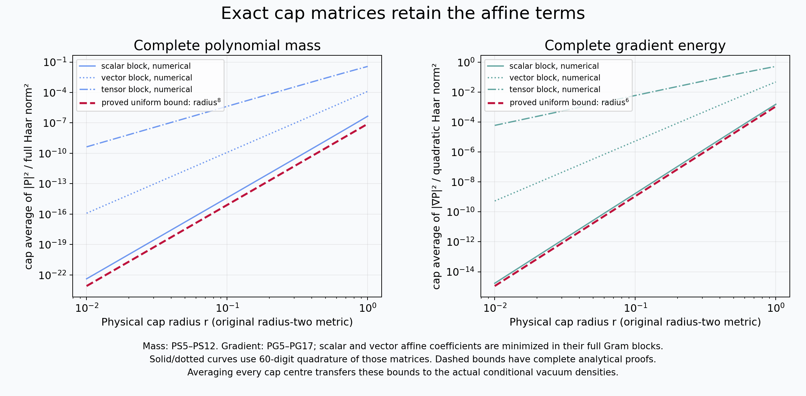

# Polynomial score bounds and the original raw endpoint

This note proves a uniform estimate for the entire fourteen-dimensional
space of quaternion polynomials of degree at most two on the original
radius-two \(SU(2)\). It then proves a stronger estimate for the exact
three-component quadratic family in the boundary derivative, with every
affine remainder retained. The powers are eight and six respectively;
both powers are optimal for their stated classes of densities and
remainders. The receiving calculation uses the original open-box
Hamiltonian, vacuum, tree coordinates, reflected words, coefficient
rows, physical metric and simultaneous path.

The original programme definitions are
[PK103–PK108](https://github.com/KokunoYumeto/yang-mills-interacting-workbench/blob/485b61423c1f4e1805deb453c1b6b342b27842b6/yang-mills/continuations/20260930-s6-ns-moment-map-bridge/PERIOD_COUPLING_AND_PHYSICAL_KERNELS.md#L2440),
[PK158–PK160](https://github.com/KokunoYumeto/yang-mills-interacting-workbench/blob/485b61423c1f4e1805deb453c1b6b342b27842b6/yang-mills/continuations/20260930-s6-ns-moment-map-bridge/PERIOD_COUPLING_AND_PHYSICAL_KERNELS.md#L3500),
and the original
[spatial TeX, equations (77)–(79), (113)–(115)](https://github.com/KokunoYumeto/yang-mills-interacting-workbench/blob/485b61423c1f4e1805deb453c1b6b342b27842b6/yang-mills/continuations/20260930-s6-ns-moment-map-bridge/sources/spatial/spatial_continuum.tex#L1415).
The exact receiving words are independently rederived below. Their
comparison locators are [JP1–JP8 and JP40–JP49](BOUNDARY_REFLECTION_AND_RAW_ENDPOINT.md) in the complete boundary reflection proof. The new
estimates do not assume any unproved spectral, concentration or
conditional-density estimate.

## 1. Original metric, measure and full polynomial space

Write
\[
 U=c(U)I+\sum_{\alpha=1}^3q_\alpha(U)T_\alpha,\qquad
 T_\alpha=-i\sigma_\alpha/2,\qquad
 x=(x_0,x_1,x_2,x_3)=(c,q_1/2,q_2/2,q_3/2)\in S^3.
 \tag{PS1}
\]
The fields generated by \(T_\alpha\) are orthonormal for the original
metric. The quaternion unit sphere in these coordinates therefore has
physical radius two, distance \(2\arccos(x\cdot z)\), diameter \(2\pi\)
and probability Haar measure \(dH\). In particular, no factor of two
in \(q\), distance, a derivative or an eigenvalue is suppressed.

Let \(\mathcal P_{\le2}\) be the restrictions to \(S^3\) of complex
polynomials of total degree at most two in the four real coordinates
\(x_j\). Its dimension is \(1+4+9=14\): the only relation in the
fifteen coefficients of a polynomial of degree at most two is a
multiple of \(\sum_jx_j^2-1\). Equivalently, it is the direct sum
of the spherical harmonics of degrees zero, one and two. All three
degrees remain in the estimates.

Let \(\rho>0\) be a probability density such that \(\log\rho\) is
\(\lambda\)-Lipschitz for the physical distance, with \(0\le\lambda<\infty\).
Every positive \(C^1\) density satisfying
\(\lvert\nabla\log\rho\rvert\le\lambda\) has this property: integrate
the derivative of \(\log\rho\) along a shortest geodesic. All densities
used in the original vacuum application are smooth.

For a cap \(B(z,R)\), \(0<R\le1\), its Haar volume is independent
of \(z\), and
\[
 v_R=H(B(z,R))={R-\sin R\over2\pi},\qquad
 \operatorname{Av}_{z,R}f={1\over v_R}\int_{B(z,R)}f\,dH.
 \tag{PS2}
\]
To verify the volume, use polar angle \(\theta\) about \(z\);
physical distance is \(2\theta\), and radial probability measure is
\((2/\pi)\sin^2\theta\,d\theta\). Integrating to \(R/2\) gives (PS2).

## 2. An exact cap Gram calculation for all fourteen dimensions

First put the cap centre at \(e_0=(1,0,0,0)\), and write
\[
 t=x_0,\quad {\bf x}=\sqrt{1-t^2}\,\omega,\quad \omega\in S^2,
 \qquad u=1-t,\quad \delta=1-\cos(R/2).
\]
Here \(d\sigma(\omega)\) is probability area measure on \(S^2\), and
\[
 dH={2\over\pi}\sqrt{1-t^2}\,dt\,d\sigma(\omega),\quad
 {47\over384}R^2\le\delta\le {R^2\over8}\le{1\over8}.
 \tag{PS3}
\]
The inequalities follow from
\(R^2/8-R^4/384\le1-\cos(R/2)\le R^2/8\).
These follow, for \(0\le R/2\le1/2\), by the alternating cosine
series with its decreasing successive terms.

The cap probability measure in \(u\) is
\[
 d\nu_\delta(u)=
 {\sqrt{u(2-u)}\,du\over\int_0^\delta\sqrt{v(2-v)}\,dv}.
\]
For \(0\le u\le\delta\le1/8\), its density has the explicit lower
bound
\[
 d\nu_\delta(u)\ \ge\
 {15\over16}{3\over2}{u^{1/2}\over\delta^{3/2}}\,du.
 \tag{PS4}
\]
Indeed, replace \(\sqrt{2-u}\) in the numerator by
\(\sqrt{2-\delta}\), and the corresponding denominator factor by
\(\sqrt2\). The remaining ratio is
\(\sqrt{1-\delta/2}\ge\sqrt{15}/4\ge15/16\).
Thus (PS4) is a measure inequality, not an assertion that its
right side integrates to one.

Every member of \(\mathcal P_{\le2}\) has the exact decomposition
\[
 P=a+bt+ct^2+\sqrt{1-t^2}(v+tw)\cdot\omega
                  +(1-t^2)\omega^{\mathsf T}T\omega,
 \tag{PS5}
\]
where \(a,b,c\in\mathbb C\), \(v,w\in\mathbb C^3\), and
\(T\) is a complex symmetric trace-free \(3\)-by-\(3\) matrix.
For the original expression
\[
 C+\ell_0t+\ell'\cdot{\bf x}+A_{00}t^2
       +2t\,a'\cdot{\bf x}+{\bf x}^{\mathsf T}B{\bf x},
\]
the exact coefficient map is
\[
 a=C+\operatorname{tr}B/3,\quad b=\ell_0,\quad
 c=A_{00}-\operatorname{tr}B/3,\quad
 v=\ell',\quad w=2a',\quad T=B-(\operatorname{tr}B)I/3.
\]
Thus no lower-degree coefficient is discarded or held fixed.

For completeness, rotational symmetry on \(S^2\) gives
\(\int\omega_i\omega_j\,d\sigma=\delta_{ij}/3\) and
\[
 \int\omega_i\omega_j\omega_k\omega_l\,d\sigma
 ={\delta_{ij}\delta_{kl}+\delta_{ik}\delta_{jl}
                         +\delta_{il}\delta_{jk}\over15}.
\]
To find the denominator, write
\(\int\omega_1^4=A\), \(\int\omega_1^2\omega_2^2=B\).
The rotation \(\omega_1\mapsto(\omega_1+\omega_2)/\sqrt2\)
gives \(A=3B\), and \(3A+6B=1\) then gives \(B=1/15\).
Odd moments vanish by a coordinate reflection. It follows that the
three summands in (PS5) are pairwise orthogonal in the angular
variable and have squared angular norms
\[
 |a+bt+ct^2|^2,\qquad
 {1-t^2\over3}|v+tw|^2,\qquad
 {2\over15}(1-t^2)^2\|T\|_{\mathrm F}^2.
 \tag{PS6}
\]
This orthogonality holds for the full Haar integral and every cap
with this centre. Complex coefficients are covered by the same
sesquilinear identities.

For the scalar block write \(a+bt+ct^2=\alpha+\beta u+\gamma u^2\).
Under the probability measure \((3/2)y^{1/2}dy\) on \([0,1]\),
the Gram matrix of \(1,y,y^2\) and its inverse are exactly
\[
 H_0=
 \begin{pmatrix}
 1&3/5&3/7\\3/5&3/7&1/3\\3/7&1/3&3/11
 \end{pmatrix},\qquad
 H_0^{-1}=
 \begin{pmatrix}
 1225/64&-2205/32&3465/64\\
 -2205/32&4725/16&-8085/32\\
 3465/64&-8085/32&14553/64
 \end{pmatrix}.
 \tag{PS7}
\]
The integral of a nonzero polynomial square is positive, so \(H_0\)
is positive definite. Multiplication verifies the displayed inverse.
For a positive definite matrix \(H\),
\(\lambda_{\min}(H)=1/\lambda_{\max}(H^{-1})
\ge1/\operatorname{tr}(H^{-1})\). Hence
\(\lambda_{\min}(H_0)\ge32/17339\).
After \(u=\delta y\), (PS4) gives
\[
 \operatorname{Av}_{e_0,R}|\alpha+\beta u+\gamma u^2|^2
 \ge {15\over16}{32\over17339}
          (|\alpha|^2+\delta^2|\beta|^2+\delta^4|\gamma|^2).
\]
The full-sphere moments are
\(\mathbb Et^2=1/4\), \(\mathbb Et^4=1/8\), with odd moments zero.
They follow either by the same rotational argument in four
coordinates or by the measure in (PS3). Consequently
\(\mathbb Eu^2=5/4\), \(\mathbb Eu^4=21/8\). Pointwise
Cauchy–Schwarz and integration yield
\[
 \|\alpha+\beta u+\gamma u^2\|_{L^2(H)}^2
 \le {39\over8}(|\alpha|^2+|\beta|^2+|\gamma|^2).
\]
Because \(\delta\le1\), the complete scalar-block comparison is
\[
 \operatorname{Av}_{e_0,R}|P_{\rm scalar}|^2
 \ge {80\over225407}\delta^4\|P_{\rm scalar}\|_{L^2(H)}^2.
 \tag{PS8}
\]

For the vector block put \(v+tw=\alpha+\beta u\), component by
component. On the cap,
\((1-t^2)/3=u(2-u)/3\ge(5/8)u\). The required Gram matrix is
\[
 H_1=
 \begin{pmatrix}3/5&3/7\\3/7&1/3\end{pmatrix},\qquad
 H_1^{-1}=
 \begin{pmatrix}245/12&-105/4\\-105/4&147/4\end{pmatrix},
 \qquad \operatorname{tr}H_1^{-1}=343/6.
 \tag{PS9}
\]
It is the integral Gram matrix for \(1,y\) with weight
\((3/2)y^{3/2}dy\); in particular it is positive definite.
The same argument gives
\[
 \operatorname{Av}_{e_0,R}|P_{\rm vector}|^2
 \ge {15\over16}{5\over8}{6\over343}
       \delta\bigl(|\alpha|^2+\delta^2|\beta|^2\bigr).
\]
Here and below vector absolute values sum all three components.
Since
\[
 {1\over3}\mathbb E[(1-t^2)(1+u^2)]={13\over24},
\]
the global Cauchy–Schwarz estimate gives
\[
 \operatorname{Av}_{e_0,R}|P_{\rm vector}|^2
 \ge {675\over35672}\delta^3\|P_{\rm vector}\|_{L^2(H)}^2.
 \tag{PS10}
\]
For the tensor block, \(\mathbb E(1-t^2)^2=5/8\), while (PS4)
and \(2-u\ge15/8\) give the complete ratio
\[
 \operatorname{Av}_{e_0,R}|P_{\rm tensor}|^2
 \ge {15\over16}\left({15\over8}\right)^2{3\over7}
       {8\over5}\delta^2\|P_{\rm tensor}\|_{L^2(H)}^2
 ={2025\over896}\delta^2\|P_{\rm tensor}\|_{L^2(H)}^2.
 \tag{PS11}
\]

Both constants in (PS10)–(PS11) exceed \(80/225407\), and
\(\delta^2,\delta^3\ge\delta^4\). Summing the three exact
orthogonal blocks proves
\[
 \boxed{\operatorname{Av}_{z,R}|P|^2
       \ge C_2R^8\|P\|_{L^2(H)}^2,\qquad
 C_2={80\over225407}\left({47\over384}\right)^4
 ={24398405\over306317856079872}>2^{-24}.}
 \tag{PS12}
\]
To cover every centre \(z\), compose \(P\) with left multiplication
by the quaternion \(z\). This is an orthogonal linear map of
\(\mathbb R^4\), is an isometry for the original radius-two metric,
preserves Haar measure and preserves the complete polynomial space.
It maps \(e_0\) to \(z\). Applying the result already proved to this
composed polynomial proves (PS12) at every centre, including
polynomials with arbitrary constant and linear terms.

## 3. Averaging every centre removes the cap-volume loss

Set \(I=\int|P|^2\rho\,dH\). Tonelli's theorem, symmetry of the
distance and (PS2) give the exact identity
\[
 I={1\over v_R}\int_{S^3}\int_{B(z,R)}
                        |P(y)|^2\rho(y)\,dH(y)\,dH(z).
 \tag{PS13}
\]
For \(y\in B(z,R)\), the score hypothesis gives
\(\rho(y)\ge e^{-\lambda R}\rho(z)\). Substitute this in (PS13)
and use (PS12). Since \(\int\rho(z)dH(z)=1\), the result is
\[
 I\ge C_2e^{-\lambda R}R^8\|P\|_{L^2(H)}^2,\qquad 0<R\le1.
 \tag{PS14}
\]
The volume is cancelled exactly by (PS13); no lower bound for the
measure of one chosen cap and no assumption about the location of
the density maximum is used.

For \(k>0\), define
\[
 R_k(\lambda)=
 \begin{cases}1,&0\le\lambda\le k,\\ k/\lambda,&\lambda>k.\end{cases}
 \qquad
 \Phi_2(\lambda)=C_2e^{-\lambda R_8(\lambda)}R_8(\lambda)^8,
 \qquad
 \Theta_2(\lambda)=\max\{e^{-2\pi\lambda},\Phi_2(\lambda)\}.
 \tag{PS15}
\]
The choice \(R_8\) maximizes \(e^{-\lambda R}R^8\) on \(0<R\le1\):
its logarithmic derivative is \(8/R-\lambda\).
Also \(\rho\ge e^{-2\pi\lambda}\), because its logarithmic
oscillation is at most \(2\pi\lambda\) and it has integral one.
Thus for the entire fourteen-dimensional space,
\[
 \boxed{\int|P|^2\rho\,dH
       \ge\Theta_2(\lambda)\int|P|^2dH
       \ge C_2(1+\lambda)^{-8}\int|P|^2dH
       >2^{-24}(1+\lambda)^{-8}\int|P|^2dH}
 \tag{PS16}
\]
when \(P\ne0\); for \(P=0\) the last comparison may be written
with \(\ge\). To prove the middle comparison on \(0\le\lambda\le8\),
the concave function \(8\log(1+\lambda)-\lambda\) is nonnegative
at both endpoints, hence throughout the interval. On \(\lambda\ge8\),
\(\Phi_2=C_2(8/e)^8\lambda^{-8}\), and \(8>e\).
This proves the stated constant without an additional factor \(e^{-1}\).

## 4. A pure first harmonic and the exact three-component family

For the application to a second marginal, a pure degree-one function
\(\ell(x)=a\cdot x\) admits a stronger estimate. At centre \(z\)
the cap second-moment matrix has eigenvalues
\(\operatorname{Av}\cos^2\theta\) along \(z\) and
\(\operatorname{Av}\sin^2\theta/3\) on its three-dimensional
orthogonal complement. This follows from the angular second moments.
For \(R\le1\), the first eigenvalue is the larger one: pointwise
\(\cos^2\theta\ge3/4\) and \(\sin^2\theta/3\le1/12\).
Indeed \(\theta\le1/2\) and
\(\cos\theta\ge1-\theta^2/2\ge7/8\), whose square exceeds \(3/4\).
The full-sphere norm is \(|a|^2/4\). Equations (PS3)–(PS4) give
\[
 \operatorname{Av}u\ge {9\over16}\delta,\qquad
 \operatorname{Av}\sin^2\theta
 \ge {15\over8}{9\over16}\delta={135\over128}\delta.
\]
It follows that
\[
 \operatorname{Av}_{z,R}|\ell|^2
 \ge C_1R^2\|\ell\|_{L^2(H)}^2,\qquad C_1={705\over4096}.
 \tag{PS17}
\]
This assertion concerns a pure linear function; it is not applied to
an arbitrary affine function.
Define
\[
 \Phi_1(\lambda)=C_1e^{-\lambda R_2(\lambda)}R_2(\lambda)^2,
 \qquad\Theta_1(\lambda)=\max\{e^{-2\pi\lambda},\Phi_1(\lambda)\}.
\]
The centre-averaging proof gives
\[
 \int|\ell|^2\rho\,dH\ge\Theta_1(\lambda)\|\ell\|_{L^2(H)}^2,
 \qquad
 \Theta_1(\lambda)\ge{4C_1\over e^2}(1+\lambda)^{-2}
 >{235\over3072}(1+\lambda)^{-2}.
 \tag{PS18}
\]
For \(0\le\lambda\le2\), concavity of
\(2\log(1+\lambda)-\lambda\) shows
\(e^{-\lambda}\ge(1+\lambda)^{-2}\).
For \(\lambda\ge2\), use
\(\Phi_1=4C_1e^{-2}\lambda^{-2}\).
The rational comparison uses \(e<3\).

Now retain the special vector family
\[
 \mathcal P_\alpha(x)=a\,c(U)q_\alpha(U)+R_\alpha(x)
                   =2a x_0x_\alpha+R_\alpha(x),\quad 1\le\alpha\le3,
 \tag{PS19}
\]
where \(a\in\mathbb C\) is fixed and each \(R_\alpha\) is an
arbitrary affine function of all four coordinates, with arbitrary
complex coefficients. For \(a=0\) the desired estimate is immediate.
By division by \(a\), it suffices during the proof to take \(a=1\);
the final inequality retains \(|a|^2\).
Set
\[
 A_\alpha=e_0e_\alpha^{\mathsf T}+e_\alpha e_0^{\mathsf T},
 \quad \Pi_z=I-zz^{\mathsf T},\quad
 b_\alpha=2\Pi_zA_\alpha z.
 \tag{PS20}
\]
The vector \(b_\alpha\) belongs to the tangent space \(z^\perp\).
In coordinates \(x=t z+\sqrt{1-t^2}\,\omega\) with
\(\omega\in z^\perp\cap S^3\), the quadratic is exactly
\[
 x^{\mathsf T}A_\alpha x
 =t^2z^{\mathsf T}A_\alpha z+
 t\sqrt{1-t^2}\,b_\alpha\cdot\omega
 +(1-t^2)\omega^{\mathsf T}A_\alpha\omega.
 \tag{PS21}
\]
An affine remainder contributes a scalar angular block and a vector
block \(\sqrt{1-t^2}\,v_\alpha\cdot\omega\). Its scalar part and
the scalar and trace-free tensor parts of the quadratic all remain
in the orthogonal decomposition. Dropping their nonnegative squared
norms from that exact equality gives the lower bound from the vector
block
\[
 \sqrt{1-t^2}(v_\alpha+t b_\alpha)\cdot\omega
 =\sqrt{1-t^2}(v_\alpha+b_\alpha-u b_\alpha)\cdot\omega.
\]
Use (PS4), \((1-t^2)/3\ge(5/8)u\), and the same \(H_1\) as
in (PS9). The free vector \(v_\alpha+b_\alpha\) can be minimized
exactly. The Schur complement is
\[
 {1\over3}-{(3/7)^2\over3/5}={4\over147}.
 \tag{PS22}
\]
Completing the square, component by component, proves
\[
 \operatorname{Av}_{z,R}|\mathcal P_\alpha|^2
 \ge {15\over16}{5\over8}{4\over147}\delta^3|b_\alpha|^2
 ={25\over1568}\delta^3|b_\alpha|^2.
 \tag{PS23}
\]
This minimizes over the entire complex affine vector coefficient;
it does not set the remainder to zero.

A rotation of the three spatial coordinates puts
\(z=(c,s,0,0)\), \(c^2+s^2=1\). The three matrices \(A_\alpha\)
transform as a spatial vector, so the sum of the three squared
lengths is unchanged. In the tangent frame
\((-s,c,0,0),e_2,e_3\), their cross vectors have lengths
\(2|c^2-s^2|,2|c|,2|c|\), respectively. Therefore
\[
 \sum_{\alpha=1}^3|b_\alpha|^2
 =4[(c^2-s^2)^2+2c^2]
 =12-24s^2+16s^4
 =3+16(s^2-3/4)^2\ge3.
 \tag{PS24}
\]
The full Haar norm of the fixed quadratic vector is
\[
 \int\sum_\alpha|cq_\alpha|^2dH
 =4\mathbb E[x_0^2(1-x_0^2)]=4(1/4-1/8)=1/2.
 \]
Combining (PS3), (PS23) and (PS24), and restoring \(a\), gives
\[
 \boxed{\operatorname{Av}_{z,R}\sum_\alpha|\mathcal P_\alpha|^2
 \ge {|a|^2\over2}C_6R^6,\qquad
 C_6={75\over784}\left({47\over384}\right)^3.}
 \tag{PS25}
\]
This estimate is uniform in the cap centre and every affine
remainder. The fixed quadratic family and its coefficient are the
ones retained in (PS19).

Define
\[
 \Phi_6(\lambda)=C_6e^{-\lambda R_6(\lambda)}R_6(\lambda)^6,
 \qquad
 \Theta_6(\lambda)=\max\{e^{-2\pi\lambda},\Phi_6(\lambda)\}.
 \]
The averaging argument (PS13) applies to the sum in (PS25).
The original density floor supplies the other term in \(\Theta_6\),
because each quadratic \(cq_\alpha\) is orthogonal to every affine
function on the full sphere. Indeed it is the trace-free quadratic
\(2x_0x_\alpha\); all relevant odd moments and
\(\int x_0x_\alpha\) vanish. Consequently
\[
 \boxed{\int\sum_\alpha|a\,cq_\alpha+R_\alpha|^2\rho\,dH
   \ge {|a|^2\over2}\Theta_6(\lambda)
   \ge {|a|^2\over2}C_6(1+\lambda)^{-6}.}
 \tag{PS26}
\]
For the last inequality use concavity of
\(6\log(1+\lambda)-\lambda\) on \([0,6]\), whose endpoint values
are nonnegative, and \(\Phi_6=C_6(6/e)^6\lambda^{-6}\)
for \(\lambda\ge6\). All three functions
\(\Theta_1,\Theta_2,\Theta_6\) lie in \((0,1]\), equal one at
\(\lambda=0\), and are nonincreasing: each displayed optimized
factor decreases on either side of its matching point, and the
maximum of two nonincreasing functions is nonincreasing.

## 5. The exponents eight and six cannot be reduced in these classes

This section defines explicit smooth densities, including the
behaviour at the cap centre. For \(\lambda\ge1\), put
\[
 f_\lambda(x)=\sqrt{8(1-x_0)+\lambda^{-2}},\qquad
 \rho_\lambda(x)=Z_\lambda^{-1}e^{-\lambda f_\lambda(x)},\qquad
 Z_\lambda=\int e^{-\lambda f_\lambda}\,dH.
 \tag{PS27}
\]
These are smooth positive probability densities on the entire
sphere. In the radius-two metric
\(\lvert\nabla x_0\rvert^2=(1-x_0^2)/4\), whence
\[
 |\nabla f_\lambda|^2
 ={4(1-x_0^2)\over8(1-x_0)+\lambda^{-2}}
 \le{1+x_0\over2}\le1.
 \]
Thus \(|\nabla\log\rho_\lambda|\le\lambda\), exactly the
assumption in the theorems above.

Let \(s=2\arccos x_0\in[0,2\pi]\) be physical distance to \(e_0\).
The Haar radial measure is \(\pi^{-1}\sin^2(s/2)ds\), and
\[
 {2s\over\pi}\le\sqrt{8(1-x_0)}=4\sin(s/4)\le s.
 \]
The lower sine bound follows from concavity on \([0,\pi/2]\).
For \(0\le s\le1/\lambda\), \(f_\lambda\le\sqrt2/\lambda\)
and \(\sin(s/2)\ge s/\pi\). Hence
\[
 Z_\lambda\ge {e^{-\sqrt2}\over3\pi^3\lambda^3}.
 \tag{PS28}
\]
Take \(P=(1-x_0)^2\in\mathcal P_{\le2}\). Then
\(\|P\|_{L^2(H)}^2=21/8\) and
\(|P|^2\le s^8/4096\). Using
\(\sin^2(s/2)\le s^2/4\), extending the nonnegative radial integral
to \(+\infty\), and integrating \(s^{10}e^{-as}\) by ten
integrations by parts gives
\[
 \int |P|^2e^{-\lambda f_\lambda}dH
 \le {10!\,\pi^{10}\over2^{25}\lambda^{11}}.
 \]
Dividing by (PS28) and the fixed Haar norm gives
\[
 {\int|P|^2\rho_\lambda dH\over\int|P|^2dH}
 \le {e^{\sqrt2}10!\pi^{13}\over7\,2^{22}}\lambda^{-8}.
 \tag{PS29}
\]
If a positive uniform constant with power \(k<8\) existed for
the full space, multiplying that assertion and (PS29) by
\((1+\lambda)^k\) and taking \(\lambda\to\infty\) would give
a positive number at most zero. Thus the full-space power eight
is optimal.

For the special vector family take \(a=1\) and the permitted
affine remainders \(R_\alpha=-q_\alpha\). Then
\[
 \sum_\alpha|cq_\alpha-q_\alpha|^2
 =(1-c)^2|q|^2\le s^6/64.
 \]
The same radial integral and (PS28) give
\[
 \int\sum_\alpha|(c-1)q_\alpha|^2\rho_\lambda\,dH
 \le {3e^{\sqrt2}8!\pi^{11}\over2^{17}}\lambda^{-6}.
 \tag{PS30}
\]
The fixed quadratic norm in (PS26) is still \(1/2\).
This excludes a positive uniform power \(k<6\) for that estimate,
even with real affine remainders and smooth positive densities.
These examples describe the precise limitation of the score-only
input; they do not assert that the original lattice vacuum equals
one of these densities.

## 6. The original vacuum supplies the score, with every face retained

Let \(L\ge2\), \(m=2L\), \(n=m+1\). The open box has vertices
\((i,y,l)\in\{0,\ldots,m\}^3\), representing the physical points
\(o+a(i-L,y-L,l-L)\). Every positive link and elementary face is
retained. There are \(N=3m(m+1)^2\) links and
\(M=3m^2(m+1)\) faces. On the original link product retain
\[
 \begin{split}
 H&=\kappa H_0+V,\qquad
 H_0=-\sum_{e,\alpha}X_{e,\alpha}^2,\qquad
 V=b_{\rm mag}\sum_p(2-\operatorname{tr}U_p),\\
 \kappa&={2g^2\over a},\qquad b_{\rm mag}={1\over2g^2a},\qquad
 \xi={b_{\rm mag}\over\kappa}={1\over4g^4},\qquad a,g>0.
 \end{split}
 \tag{PS31}
\]
In particular \(2b_{\rm mag}M\) remains in the Hamiltonian.
Let \(\psi>0\) be its original unit ground state, \(H\psi=E_0\psi\),
and put \(\rho_{\rm full}=\psi^2\), \(d\mu=\rho_{\rm full}\,dU\).
All assertions below concern this same vacuum.

Here is the local score proof, retaining the metric and the mixed
Hessians. Write \(u=\log\psi\) and
\(\Delta=\sum_{e,\alpha}X_{e,\alpha}^2\). The full vacuum equation
is
\(\Delta u+|\nabla u|^2=(V-E_0)/\kappa\).
On the product manifold set \(w_e=|\nabla_eu|^2\). Differentiating
this equation and applying the product connection gives
\[
 (\Delta+2\nabla u\cdot\nabla)w_e
 =2\sum_f|\nabla_f\nabla_eu|^2+w_e
           +{2\over\kappa}\langle\nabla_eu,\nabla_eV\rangle.
 \tag{PS32}
\]
The curvature term is \(2\operatorname{Ric}_e(\nabla_eu,\nabla_eu)
=w_e\), since the radius-two three-sphere has
\(\operatorname{Ric}=\tfrac12\,\mathrm{metric}\).
For \(f\ne e\), commuting the product covariant derivatives adds
no curvature and produces the retained nonnegative mixed Hessian
term. For \(f=e\), the covariant derivative commutator contributes
exactly that Ricci term. The derivative of \(|\nabla u|^2\) cancels
the drift term displayed on the left. This proves (PS32).

If \(r_e\) is the actual number of faces incident to \(e\), then
\(|\nabla_eV|\le b_{\rm mag}r_e\). To check its unit constant,
cyclicity of trace and bi-invariance reduce one face to
\(\operatorname{tr}U=2c(U)\) or its inverse. Since
\(X_\alpha\operatorname{tr}U=\operatorname{tr}(T_\alpha U)
=-q_\alpha(U)/2\), its gradient has squared norm
\(|q(U)|^2/4=1-c(U)^2\le1\).
At a global maximum of the smooth function \(w_e\), compactness
gives \(\Delta w_e\le0\) and \(\nabla w_e=0\). Equation (PS32)
therefore implies
\[
 0\ge w_e-2r_e\xi\sqrt{w_e},\qquad
 \boxed{|\nabla_e\log\rho_{\rm full}|\le4r_e\xi.}
 \tag{PS33}
\]
No size restriction on \(\xi\) was used. This reproduces the
original partial Bochner calculation in the cited TeX with all
physical factors and every incident face.

The original tree consists of every direction-one edge, every
direction-two edge at \(i=0\), and every direction-three edge at
\(i=y=0\). Its root path goes first in direction three, then two,
then one. For a chord \(c:s\to t\), its original rooted word is
\(Z_c=t_sU_ct_t^{-1}\). Conversely, with \(t_{\rm root}=I\),
a tree edge has value \(t_s^{-1}t_t\) and a chord edge has value
\(t_s^{-1}Z_ct_t\). Successive left and right invariance of Haar
measure, working outward from the root, proves that this is an
exact product-Haar coordinate change in the tree transports and
the chord words. Gauge invariance makes the vacuum and all the
functions below independent of the tree transports. Integrating
those variables therefore gives their exact measure
\[
 d\mu=\rho(Z)\prod_c dZ_c,\qquad
 \rho(Z)=\psi^2\big|_{\text{tree links }I},\qquad\int\rho=1.
 \tag{PS34}
\]
This is the original gauge-invariant measure in its tree
coordinates. A chord variation at tree identity varies that
physical link alone, so (PS33) gives the same score in \(Z_c\).
The full physical gradient norm is gauge invariant: a gauge
change rotates each three-component physical derivative by an
orthogonal adjoint matrix. Consequently a sum of squared
derivatives over any specified chord links is bounded above by the
full physical gradient norm, both in (PS34) and before the
coordinate change.

For a single chord \(k\), its actual conditional density is
\(\rho(k,z)/\int\rho(v,z)dH(v)\). The denominator is positive
and independent of \(k\), so its score is at most \(4r_k\xi\).
For a marginal in a chord \(b\), differentiating the positive
compact integral gives
\[
 \nabla_b\log\!\int\rho(b,z)dz
 ={\int\rho(b,z)\nabla_b\log\rho(b,z)\,dz
                \over\int\rho(b,z)dz}.
 \tag{PS35}
\]
Its norm is at most \(4r_b\xi\) by the triangle inequality.
Smoothness and compactness justify differentiation under the
integral. Thus both the conditional and marginal applications of
(PS16), (PS18) and (PS26) use proved score bounds for actual
densities; no product law for these chords is assumed.

## 7. Original coefficient rows and the complete reflected words

Set \(h=\pi/(2n)\) and retain
\[
 \begin{gathered}
 v_0(l)=n^{-1/2},\qquad
 v_1(l)=\sqrt{2/n}\cos{\pi(l+1/2)\over n},\qquad
 w_1(y)=-\sqrt{2/n}\sin{\pi(y+1)\over n},\\
 a_{(i,y,l;2)}=-{v_1(i)w_1(y)v_0(l)\over\sqrt2},\qquad
 a_{(i,y,l;3)}=0,\\
 b_{(i,y,l;2)}={v_0(i)w_1(y)v_1(l)\over\sqrt2},\qquad
 b_{(i,y,l;3)}=-{v_0(i)v_1(y)w_1(l)\over\sqrt2}.
 \end{gathered}
 \tag{PS36}
\]
The direction-two chords have
\(1\le i\le m,\ 0\le y<m,\ 0\le l\le m\).
The direction-three chords have
\(0\le i,y\le m,\ (i,y)\ne(0,0),\ 0\le l<m\).
Vertex sequences \(v_0,v_1\) retain indices \(0,\ldots,m\);
the edge sequence \(w_1\) retains indices \(0,\ldots,m-1\).
Every excluded tree link remains excluded from these coefficient
rows.

Write \(U_2(0,y,l)=I\), \(U_3(0,0,l)=I\), and identify the
other direction-two and direction-three \(U\)'s with their exact
chord coordinates. Define the ordered boundary products
\[
 B_l=\prod_{r=0}^{l-1}U_3(m,0,r),\qquad
 A_{y,l}=B_l\prod_{b=0}^{y-1}U_2(m,b,l),
 \tag{PS37}
\]
with increasing index order and empty product \(I\).
Under the direction-one reflection the complete rooted words are
\[
 Z^{\mathcal R}_{(i,y,l;2)}
   =A_{y,l}U_2(m-i,y,l)A_{y+1,l}^{-1},\qquad
 Z^{\mathcal R}_{(i,y,l;3)}
   =A_{y,l}U_3(m-i,y,l)A_{y,l+1}^{-1}.
 \tag{PS38}
\]
Indeed, the reflected direction-three segment of a root path lies
at \(i=m,y=0\); its reflected direction-two segment lies at
\(i=m\). They are precisely the two products in (PS37). The
reversed direction-one segment consists of original tree links
and hence equals \(I\) in these coordinates. The reflected chord
itself is the displayed target, with the same orientation because
its direction is two or three. The terminal root segment is the
inverse of the complete endpoint product. This proves (PS38)
without commuting any matrices or fixing any boundary chord.

Retain
\[
 \begin{gathered}
 u_1=\sum_ca_cq(Z_c),\quad u_3=\sum_cb_cq(Z_c),\quad
 u_1^{\mathcal R}=\sum_ca_cq(Z_c^{\mathcal R}),\quad
 u_3^{\mathcal R}=\sum_cb_cq(Z_c^{\mathcal R}),\\
 \mathcal S=u_1\cdot u_3,\quad
 \mathcal S_{\mathcal R}=u_1^{\mathcal R}\cdot u_3^{\mathcal R},
 \quad D=\mathcal S+\mathcal S_{\mathcal R},\\
 \sigma_*=\sqrt8\sin h,\quad \beta_0={\sigma_*\over2g^2},
 \quad F=\beta_0(\mathcal S-\mathcal S_{\mathcal R}).
 \end{gathered}
 \tag{PS39}
\]
All vectors, sums and scalar coefficients in (PS39) are the
original ones. Selecting derivative rows in the next calculation
does not change any of these states.

For every \(0\le y<m,\ 0\le l\le m\), select the two distinct
physical chords
\[
 k_{y,l}=(1,y,l;2),\qquad b_{y,l}=(m,y,l;2),
 \qquad k=Z_{k_{y,l}},\quad H_b=Z_{b_{y,l}}.
 \tag{PS40}
\]
The coefficient of this \(k\) in \(u_1\) and \(u_3\), respectively,
is
\[
 \begin{split}
 A^{\rm row}_{y,l}
   &={\sqrt2\cos3h\sin[\pi(y+1)/n]\over n^{3/2}},\\
 d^0_{y,l}
   &=-{\sqrt2\cos[(2l+1)h]\sin[\pi(y+1)/n]\over n^{3/2}},\\
 d_{y,l}:=-4A^{\rm row}_{y,l}d^0_{y,l}
   &={8\cos3h\cos[(2l+1)h]\sin^2[\pi(y+1)/n]\over n^3}.
 \end{split}
 \tag{PS41}
\]
The notation \(A^{\rm row}\) denotes a scalar coefficient and is
distinct from the matrix \(A_{y,l}\) in (PS37).
The sign of \(d_{y,l}\) changes with \(l\), and the zero at \(l=L\)
is retained.

The chord \(k\) occurs in (PS38) as a target exactly once, for
\((m-1,y,l;2)\). It occurs in no boundary product. Since
\(A_{y+1,l}=A_{y,l}H_b\), this target word is exactly
\[
 A_{y,l}\,kH_b^{-1}\,A_{y,l}^{-1}.
 \tag{PS42}
\]
The matrix \(A_{y,l}\) is independent of both \(k\) and \(H_b\).
Let \(\mathcal O=\operatorname{Ad}_{A_{y,l}}\in SO(3)\).
The identities \(v_1(m-1)=-v_1(1)\) and \(v_0(m-1)=v_0(1)\)
give the complete dependence on \(k\):
\[
 \begin{array}{ll}
 u_1=U_1+A^{\rm row}q(k),&
 u_3=U_3+d^0q(k),\\
 u_1^{\mathcal R}=V_1-A^{\rm row}\mathcal Oq(kH_b^{-1}),&
 u_3^{\mathcal R}=V_3+d^0\mathcal Oq(kH_b^{-1}).
 \end{array}
 \tag{PS43}
\]
The vectors \(U_1,U_3,V_1,V_3\) retain the sums over every
remaining chord and are independent of \(k\). They may depend on
\(H_b\) and all other boundary links. Multiplying the entire
expressions gives
\[
 \begin{split}
 \mathcal S={}&U_1\cdot U_3+
      (d^0U_1+A^{\rm row}U_3)\cdot q(k)
                 +A^{\rm row}d^0|q(k)|^2,\\
 \mathcal S_{\mathcal R}={}&V_1\cdot V_3+
      (d^0V_1-A^{\rm row}V_3)\cdot\mathcal Oq(kH_b^{-1})
                 -A^{\rm row}d^0|q(kH_b^{-1})|^2.
 \end{split}
 \tag{PS44}
\]
The equality \(|\mathcal O q|^2=|q|^2\) uses the exact orthogonal
adjoint action; it does not alter an endpoint product.
Right multiplication by a fixed quaternion is linear in the four
coordinates of \(k\). Thus, apart from the displayed squared
norms, every term in (PS44) is affine in \(k\). This remains true
after a derivative in \(H_b\), which differentiates the retained
coefficients and the right-multiplication matrix.

For the original physical left variation
\(H_b(t)=\exp(tT_\alpha)H_b\), set \(V_k=kH_b^{-1}\). The
quaternion product and \(|q|^2=4(1-c^2)\) give
\[
 {d\over dt}c(V_k\exp(-tT_\alpha))\big|_0={q_\alpha(V_k)\over4},
 \qquad
 {d\over dt}|q(V_k\exp(-tT_\alpha))|^2\big|_0
       =-2c(V_k)q_\alpha(V_k).
 \tag{PS45}
\]
For example these follow directly from
\(T_\alpha T_\beta=-\delta_{\alpha\beta}I/4+
\epsilon_{\alpha\beta\gamma}T_\gamma/2\). Therefore the full
physical derivatives are
\[
 \begin{split}
 X_{b_{y,l},\alpha}D
   &=2A^{\rm row}_{y,l}d^0_{y,l}\,c(V_k)q_\alpha(V_k)
                                       +R^D_\alpha(k),\\
 X_{b_{y,l},\alpha}F
   &=-2\beta_0A^{\rm row}_{y,l}d^0_{y,l}\,
                       c(V_k)q_\alpha(V_k)+R^F_\alpha(k).
 \end{split}
 \tag{PS46}
\]
Both \(R^D_\alpha\) and \(R^F_\alpha\) are the entire affine
remainders from differentiating (PS44), including derivatives of
all its exterior coefficients. Neither remainder is assumed zero,
small, independent of the vacuum, or orthogonal in the weighted
measure.

The actual face numbers of the selected links are
\[
 r_{k_{y,l}}=
 \begin{cases}3,&l=0,m,\\4,&1\le l\le m-1,\end{cases}
 \qquad
 r_{b_{y,l}}=
 \begin{cases}2,&l=0,m,\\3,&1\le l\le m-1.\end{cases}
 \tag{PS47}
\]
A direction-two edge at first coordinate \(1\) has two incident
direction-\((1,2)\) faces, while at first coordinate \(m\) it has
one. It has one direction-\((2,3)\) face at \(l=0,m\), and two
at the other heights. Its longitudinal coordinate \(y\) removes
none of these transverse faces. This proves every entry in (PS47).

Condition on every chord except \(k\). The right translation
\(k\mapsto kH_b^{-1}\) preserves Haar measure, the original metric
and the score bound. Apply (PS26) to the full vector (PS46),
with \(a=2A^{\rm row}d^0\) or
\(a=-2\beta_0A^{\rm row}d^0\), then integrate the unchanged
exterior marginal. Since \(|a|^2/2=d_{y,l}^2/8\) in the first
case, the exact resulting bounds are
\[
 \boxed{\begin{split}
 \mu\!\left(\sum_\alpha|X_{b_{y,l},\alpha}D|^2\right)
       &\ge{d_{y,l}^2\over8}\Theta_6(4r_{k_{y,l}}\xi),\\
 \mu\!\left(\sum_\alpha|X_{b_{y,l},\alpha}F|^2\right)
       &\ge{\beta_0^2d_{y,l}^2\over8}
                                      \Theta_6(4r_{k_{y,l}}\xi).
 \end{split}}
 \tag{PS48}
\]
Using only (PS16) and Haar orthogonality would give the same
formulas with \(\Theta_2\) in place of \(\Theta_6\).
Equation (PS48) records the stronger special-family estimate.

## 8. The full two-link harmonic, raw masses and additional derivatives

Define the auxiliary harmonic \(\chi_1(U)=4c(U)^2-1\).
It is the restriction of
\(4x_0^2-\sum_{j=0}^3x_j^2\), a homogeneous harmonic
quadratic, so its eigenvalue for the original one-link electric
operator is \(2(2+2)/4=2\).
Explicitly, the Euclidean polar-coordinate Laplacian in four
dimensions sends \(r^\ell Y\) to
\(r^{\ell-2}[\ell(\ell+2)Y+\Delta_{S^3}Y]\).
For a homogeneous harmonic polynomial this is zero; the original
radius-two metric divides the unit-sphere eigenvalue by four.
The identity \(|q|^2=3-\chi_1\), applied to (PS44), gives
\[
 P_2\mathcal S=-A^{\rm row}d^0\,\chi_1(k),\qquad
 P_2\mathcal S_{\mathcal R}
             =A^{\rm row}d^0\,\chi_1(kH_b^{-1}),
 \tag{PS49}
\]
where \(P_2\) is Haar projection onto degree two in \(k\).
The constants \(+3A^{\rm row}d^0\) and
\(-3A^{\rm row}d^0\) remain in the original affine remainders.
Projection supplies a norm inequality after applying the full
fourteen-dimensional weighted estimate; it is not substituted
for either original polynomial.

The four-dimensional sphere moments are
\[
 \mathbb Ex_ix_j={\delta_{ij}\over4},\qquad
 \mathbb Ex_ix_jx_kx_l
   ={\delta_{ij}\delta_{kl}+\delta_{ik}\delta_{jl}
                               +\delta_{il}\delta_{jk}\over24}.
 \]
Their proof is the one used after (PS5), with
\(4A+12B=1\), \(A=3B\). For unit quaternions \(k=x,H_b=y\),
\(c(kH_b^{-1})=x\cdot y\). Substitution of these moments gives
\[
 \int\chi_1(k)^2dk=1,\qquad
 \int\chi_1(k)\chi_1(kH_b^{-1})dk
          ={4c(H_b)^2-1\over3}=:\eta_b.
 \]
Thus the exact quadratic Gram matrix is
\[
 \Gamma_2(H_b)=(A^{\rm row}d^0)^2
          \begin{pmatrix}1&-\eta_b\\-\eta_b&1\end{pmatrix},
 \tag{PS50}
\]
and the full odd and even quadratic norms are
\[
 \begin{split}
 \int|P_2F|^2dk
    &={\beta_0^2d_{y,l}^2\over12}\,[1+2c(H_b)^2],\\
 \int|P_2D|^2dk
    &={d_{y,l}^2\over24}|q(H_b)|^2.
 \end{split}
 \tag{PS51}
\]
The global norm of each of \(F,D\) in \(k\) is at least the
displayed projected norm, since all its affine terms are retained
and orthogonal to degree two under Haar measure.

Apply (PS16) first to the complete polynomial in the actual
conditional law of \(k\). Then use (PS18) for the actual marginal
of \(H_b\), to which (PS35) applies. Since
\(\int c^2dH=1/4\) and \(\int|q|^2dH=3\), the resulting raw
mass bounds for each selected row are
\[
 \boxed{\begin{split}
 G:=\mu(F^2)&\ge{\beta_0^2d_{y,l}^2\over12}
       \Theta_2(4r_k\xi)
                   \left[1+\tfrac12\Theta_1(4r_b\xi)\right],\\
 \mu(D^2)&\ge{d_{y,l}^2\over8}
                   \Theta_2(4r_k\xi)\Theta_1(4r_b\xi).
 \end{split}}
 \tag{PS52}
\]
The actual mass Gram matrix of
\((\mathcal S,\mathcal S_{\mathcal R})\) is bounded below by
\[
 (A^{\rm row}d^0)^2
          \Theta_2(4r_k\xi)\Theta_1(4r_b\xi)\,I_2.
 \tag{PS53}
\]
Indeed, apply the full-space inequality to each linear combination
before taking its Haar quadratic Gram matrix (PS50). Its integrated
eigenvalues are \(1-\mu_b(\eta_b)=\mu_b(|q|^2)/3\) and
\(1+\mu_b(\eta_b)=2/3+4\mu_b(c^2)/3\). They are respectively at
least \(\Theta_1\) and \((2+\Theta_1)/3\ge\Theta_1\),
because \(0<\Theta_1\le1\). This proves the matrix assertion for
all real or complex linear combinations, with all affine terms.

The left \(k\)-derivatives preserve harmonic degree: their flows
are orthogonal transformations of the four quaternion coordinates.
They also preserve the homogeneous harmonic subspaces because
the Euclidean Laplacian is rotation invariant. Each derivative of
the entire polynomial therefore still belongs to
\(\mathcal P_{\le2}\). Integration by parts on the compact group
and the original eigenvalue two give
\[
 \int\sum_\alpha|X_{k,\alpha}P|^2dk
 \ge2\int|P_2P|^2dk,\qquad P=F,D.
 \]
The affine derivatives remain present and are orthogonal to the
quadratic derivatives in this Haar integral. Applying (PS16) to
each complete derivative and (PS18) to the actual \(H_b\)
marginal, as above, gives
\[
 \boxed{\begin{split}
 \mu\!\left(\sum_\alpha|X_{k_{y,l},\alpha}F|^2\right)
 &\ge{\beta_0^2d_{y,l}^2\over6}\Theta_2(4r_k\xi)
                   \left[1+\tfrac12\Theta_1(4r_b\xi)\right],\\
 \mu\!\left(\sum_\alpha|X_{k_{y,l},\alpha}D|^2\right)
 &\ge{d_{y,l}^2\over4}
                    \Theta_2(4r_k\xi)\Theta_1(4r_b\xi).
 \end{split}}
 \tag{PS54}
\]
These lower bounds can be added over distinct physical derivative
links. In contrast, the inequalities (PS52) for the same raw
mass are not added over rows.

The row \(y=0,l=0\) in (PS41) is exactly the original JP choice
\[
 d_*={8\cos h\cos3h\sin^2(2h)\over n^3},\quad r_k=3,\ r_b=2.
 \tag{PS55}
\]
Thus (PS48), (PS52) and (PS54) directly replace the exponential
penalties in JP43 and JP47–JP48 on those identical links.
A larger coefficient with the same incidences is already present
in the unchanged original sums: choose \(y=L-1,l=0\). Then
\[
 d^\circ={8\cos^3h\cos3h\over n^3}>0,\qquad
 r_{k^\circ}=3,\quad r_{b^\circ}=2.
 \tag{PS56}
\]
The identity is
\(\sin(\pi L/n)=\cos h\). The symmetric row \(y=L,l=0\)
has the same coefficient, and the corresponding top rows have
its negative. No original vector or Hamiltonian is changed by
using any of these rows in the proved inequalities.

## 9. Adding distinct original derivative rows, with exact finite sums

The \(m(m+1)\) links \(b_{y,l}\) are pairwise distinct, as are the
\(m(m+1)\) links \(k_{y,l}\). These two sets are disjoint because
\(m\ge4\). They are actual original physical links, and (PS34)
proved the comparison with the complete physical kinetic metric.
Thus (PS48) and (PS54) can all be added.

The two exact trigonometric sums required for this addition are
\[
 \sum_{y=0}^{m-1}\sin^4{\pi(y+1)\over n}={3n\over8},\qquad
 \sum_{l=0}^{m}\cos^2[(2l+1)h]={n\over2}.
 \tag{PS57}
\]
For the first, use
\(\sin^4 t=(3-4\cos2t+\cos4t)/8\).
For \(n\ge5\), summing each of
\(\exp(2\pi i k/n)\) and \(\exp(4\pi i k/n)\) over
\(k=0,\ldots,n-1\) gives zero by the finite geometric series.
The \(k=0\) sine term is zero, so removing it leaves the first
formula. For the second, expand
\(\cos^2t=(1+\cos2t)/2\) and use the same geometric series
multiplied by \(\exp(i\pi/n)\).
The terms \(l=0,m\) contribute exactly \(2\cos^2h\) to the
second sum. The middle zero at \(l=L\) is still included.

Define the following explicit positive functions of the original
\(n,h,\xi\):
\[
 \begin{split}
 B_6={3\cos^2(3h)\over n^5}
 \Big\{&2\cos^2h\,\Theta_6(12\xi)
        +\left({n\over2}-2\cos^2h\right)\Theta_6(16\xi)\Big\},\\
 B_2^-={6\cos^2(3h)\over n^5}
 \Big\{&2\cos^2h\,\Theta_2(12\xi)\Theta_1(8\xi)
    +\left({n\over2}-2\cos^2h\right)
                             \Theta_2(16\xi)\Theta_1(12\xi)\Big\},\\
 B_2^+={4\cos^2(3h)\over n^5}
 \Big\{&2\cos^2h\,\Theta_2(12\xi)
                                  [1+\tfrac12\Theta_1(8\xi)]\\
       &+\left({n\over2}-2\cos^2h\right)\Theta_2(16\xi)
                                  [1+\tfrac12\Theta_1(12\xi)]\Big\}.
 \end{split}
 \tag{PS58}
\]
The coefficient \(n/2-2\cos^2h\) is nonnegative because it is
the sum of the retained interior squared cosines. Each term keeps
its actual boundary or interior incidence.
Substituting (PS41) into (PS48), using (PS47), and then (PS57)
gives exactly
\[
 B_6=\sum_{y,l}{d_{y,l}^2\over8}\Theta_6(4r_{k_{y,l}}\xi).
 \]
The two analogous substitutions in (PS54) give \(B_2^-\) and
\(\beta_0^2B_2^+\). For example the common \(y\)-summation factor
is \(64(3n/8)\cos^2(3h)/n^6=24\cos^2(3h)/n^5\);
division by \(8,4,6\) gives \(3,6,4\), respectively.
This proves all factors in (PS58).

Consequently the evaluated full-gradient estimates are
\[
 \boxed{\mu(|\nabla D|^2)\ge B_6+B_2^-,
 \qquad
 C_F:=\kappa\mu(|\nabla F|^2)
                  \ge\kappa\beta_0^2(B_6+B_2^+).}
 \tag{PS59}
\]
Only the nonnegative contributions of other physical links have
been omitted from these lower bounds. Within every selected
derivative, all original affine terms were retained through the
weighted inequality. Different rows need not be independent:
each conditional calculation was integrated against its own
actual exterior marginal before adding the resulting expectations.

For later direct use, the raw mass bounds from the row (PS56) are
\[
 \boxed{\begin{split}
 G&\ge{\beta_0^2(d^\circ)^2\over12}
       \Theta_2(12\xi)[1+\tfrac12\Theta_1(8\xi)],\\
 \mu(D^2)&\ge{(d^\circ)^2\over8}
                        \Theta_2(12\xi)\Theta_1(8\xi).
 \end{split}}
 \tag{PS60}
\]
They prove that the original odd raw state is nonzero at every
finite original regulator. They also prove positive even mass.
They are not added over rows, and comparison of the separate
lower bounds for \(C_F\) and \(G\) does not assert a bound on
the quotient \(C_F/G\).

## 10. Full Hamiltonian form and the unchanged endpoint

For any smooth complex function \(f\), the original ground-state
equation and integration by parts give
\[
 \langle f\psi,(H-E_0)f\psi\rangle
                  =\kappa\int|\nabla f|^2\psi^2\,dU.
 \tag{PS61}
\]
To verify every contribution, expand
\(|\nabla(f\psi)|^2
=\psi^2|\nabla f|^2+|f|^2|\nabla\psi|^2
+2\operatorname{Re}(\psi\overline f\,\nabla f\cdot\nabla\psi)\).
Multiplication of \(H\psi=E_0\psi\) by \(|f|^2\psi\) and
integration by parts gives precisely the sum of the last two
kinetic terms together with
\((V-E_0)|f|^2\psi^2\), equal to zero. Subtracting leaves (PS61).
The complete potential, including \(2b_{\rm mag}M\), cancels
through that equation, rather than being removed from \(H\).
In particular the energy of the original even correction
\(\beta_0D\psi\) is at least
\(\kappa\beta_0^2(B_6+B_2^-)\).

The direction-one reflection permutes original links and faces,
possibly replacing a face word by its inverse. The bi-invariant
kinetic term and \(\operatorname{tr}U_p=\operatorname{tr}U_p^{-1}\)
are unchanged, so it commutes with the full \(H\).
Its action on the positive unit ground state is trivial. One can
verify uniqueness directly from (PS61): for any other ground
state \(\varphi\), the smooth function \(f=\varphi/\psi\)
has zero gradient by (PS61), and is constant on the connected
link product. Positivity and unit norm then identify the reflected
ground state with \(\psi\). Thus \(\mu\) is reflection invariant,
\(F\) is odd, \(D\) is even, and the odd raw state is already
vacuum orthogonal.

Retain all four original expectations
\[
 \mathcal Q_4=\mu(\mathcal S^2),\quad
 \mathcal Q_{4,\mathcal R}=\mu(\mathcal S\mathcal S_{\mathcal R}),
 \quad
 \mathcal K_1=\mu(|\nabla\mathcal S|^2),\quad
 \mathcal K_{\mathcal R}
                =\mu(\nabla\mathcal S\cdot\nabla\mathcal S_{\mathcal R}).
 \]
Reflection invariance gives
\[
 \begin{array}{ll}
 G=2\beta_0^2(\mathcal Q_4-\mathcal Q_{4,\mathcal R}),&
 C_F=2\kappa\beta_0^2(\mathcal K_1-\mathcal K_{\mathcal R}),\\
 \mu(D^2)=2(\mathcal Q_4+\mathcal Q_{4,\mathcal R}),&
 \mu(|\nabla D|^2)=2(\mathcal K_1+\mathcal K_{\mathcal R}).
 \end{array}
 \tag{PS62}
\]
Every equality is the full square or derivative square of the
original sums. For \(s>0\), the original raw endpoint is therefore
\[
 \begin{split}
 \mathscr E(s):=G-C_F/s
 &=2\beta_0^2(\mathcal Q_4-\mathcal Q_{4,\mathcal R})
   -{2\kappa\beta_0^2\over s}
                       (\mathcal K_1-\mathcal K_{\mathcal R})\\
 &=4\beta_0^2\left[\mathcal Q_4-{\kappa\over s}\mathcal K_1\right]
    -\beta_0^2\mu(D^2)
    +{\kappa\beta_0^2\over s}\mu(|\nabla D|^2).
 \end{split}
 \tag{PS63}
\]
Inserting (PS59) gives the evaluated improvement
\[
 \boxed{\mathscr E(s)\ge
 4\beta_0^2\left[\mathcal Q_4-{\kappa\over s}\mathcal K_1\right]
 -\beta_0^2\mu(D^2)
 +{\kappa\beta_0^2\over s}(B_6+B_2^-).}
 \tag{PS64}
\]
The sign of the remaining complete expression is not inferred
from its strictly positive last term. In particular, the lower
bound on the even mass in (PS60) cannot be substituted into the
negative mass term to obtain a lower bound in (PS64).

The direct spectral relation is retained as well. For \(A=H-E_0\)
and \(v=F\psi\perp\psi\), the scalar inequality
\(\mathbf1_{(0,s]}(t)\ge1-t/s\) holds on \(t>0\).
Integration against the spectral measure of \(v\), which has
no mass at zero, gives
\[
 \langle F\psi,\mathbf1_{(0,s]}(H-E_0)F\psi\rangle
                         \ge\max\{0,\mathscr E(s)\}.
 \tag{PS65}
\]
Neither a total raw mass lower bound nor a total energy lower
bound alone specifies the measure in this spectral interval.

## 11. Exact evaluation on the prescribed simultaneous path

Retain exactly
\[
 L_j=j^4,\quad a_j={1\over100j},\quad
 g_j^2={\kappa_*\over200j},\quad s_j={\kappa_*\over j},\qquad
 \kappa_*>0,\quad j\ge2.
 \]
The resulting original quantities are
\[
 n_j=2j^4+1,\quad h_j={\pi\over2n_j},\quad
 \kappa_j=\kappa_*,\quad
 \xi_j={10000j^2\over\kappa_*^2},\quad
 \beta_{0,j}={100j\sqrt8\sin h_j\over\kappa_*}.
 \tag{PS66}
\]
Since \(j^4h_j\to\pi/4\) and \(\sin h/h\to1\),
\[
 j^3\beta_{0,j}\longrightarrow {50\sqrt2\pi\over\kappa_*},
 \qquad
 j^{12}d^\circ_j\longrightarrow1,\qquad
 j^{20}d_{*,j}\longrightarrow{\pi^2\over4}.
 \tag{PS67}
\]
The second and third limits follow directly from (PS55)–(PS56),
including the factor \(\sin^2(2h)\) in \(d_*\).

For explicit constants set
\[
 \begin{array}{ll}
 T_{2,3}=C_2\left({\kappa_*^2\over15000e}\right)^8,&
 T_{2,4}=C_2\left({\kappa_*^2\over20000e}\right)^8,\\
 T_{1,2}=C_1\left({\kappa_*^2\over40000e}\right)^2,&
 T_{1,3}=C_1\left({\kappa_*^2\over60000e}\right)^2,\\
 T_{6,3}=C_6\left({\kappa_*^2\over20000e}\right)^6,&
 T_{6,4}=C_6\left({3\kappa_*^2\over80000e}\right)^6 .
 \end{array}
 \tag{PS68}
\]
For each fixed \(\kappa_*>0\), eventually the optimized polynomial
term in each \(\Theta\) is larger than its retained exponential
floor. Indeed, for \(a,b>0\) and finite \(k\),
\(\exp(-aj^2)j^k/b\to0\): for example
\(\log j\le j\) and then \(-aj^2+k\log j\to-\infty\).
Also each argument eventually exceeds its optimization breakpoint.
Consequently the following are eventually exact equalities:
\[
 \begin{array}{ll}
 \Theta_2(12\xi_j)=T_{2,3}j^{-16},&
 \Theta_2(16\xi_j)=T_{2,4}j^{-16},\\
 \Theta_1(8\xi_j)=T_{1,2}j^{-4},&
 \Theta_1(12\xi_j)=T_{1,3}j^{-4},\\
 \Theta_6(12\xi_j)=T_{6,3}j^{-12},&
 \Theta_6(16\xi_j)=T_{6,4}j^{-12}.
 \end{array}
 \tag{PS69}
\]
No asymptotic statement about the actual unknown vacuum expectation
is used to establish these identities for explicit factors.

The bound on \(G\) in (PS60), multiplied by \(j^{46}\), has limit
\[
 {1250\pi^2\over3\kappa_*^2}\,T_{2,3}>0.
 \tag{PS70}
\]
Here \(\beta_{0,j}^2\) contributes \(j^{-6}\) with constant
\(5000\pi^2/\kappa_*^2\), \((d^\circ_j)^2\) contributes
\(j^{-24}\), and \(\Theta_2\) contributes \(j^{-16}\);
the bracket \(1+\Theta_1/2\) tends to one.
The even mass lower bound in (PS60), multiplied by \(j^{44}\),
has limit
\[
 {1\over8}T_{2,3}T_{1,2}>0.
 \tag{PS71}
\]
The full mass Gram lower bound (PS53) for this row has the same
power \(j^{-44}\) and scalar limit \(T_{2,3}T_{1,2}/16\).
If one keeps the initial JP row \(d_*\) instead, (PS52) has
raw-odd-mass power \(j^{-62}\), with scalar limit
\(625\pi^6T_{2,3}/(24\kappa_*^2)\); this records the exact
gain from selecting a larger coefficient already in the same
original state.

The sums of distinct derivatives give a further gain. From
(PS58), (PS66) and (PS69),
\[
 \begin{split}
 j^{28}B_{6,j}&\longrightarrow {3\over32}T_{6,4},\\
 j^{36}B_{2,j}^-&\longrightarrow {3\over16}T_{2,4}T_{1,3},\\
 j^{32}B_{2,j}^+&\longrightarrow {1\over8}T_{2,4}.
 \end{split}
 \tag{PS72}
\]
For the first, the \(2\cos^2h_j\) term is lower by a factor
of order \(n_j\) than the interior sum; the latter has leading
factor \(3/(2n_j^4)\), and \(j^{16}/n_j^4\to1/16\).
The second and third have leading factors \(3/n_j^4\) and
\(2/n_j^4\), respectively. Their extra score powers are
\(j^{-20}\) and \(j^{-16}\). This proves all limits in (PS72),
including the smaller positive terms and the actual boundary
incidences.

In particular the right-hand lower bounds for both the even
energy \(\kappa_j\beta_{0,j}^2\mu_j(|\nabla D_j|^2)\) and the
odd energy \(C_{F,j}\), as given respectively by (PS61), (PS59),
have power \(j^{-34}\), with the same positive leading constant
\[
 {1875\pi^2\over4\kappa_*}\,T_{6,4}.
 \tag{PS73}
\]
The complete positive correction in (PS64), namely
\[
 {\kappa_j\beta_{0,j}^2\over s_j}(B_{6,j}+B_{2,j}^-)
                 =j\beta_{0,j}^2(B_{6,j}+B_{2,j}^-),
 \]
has power \(j^{-33}\), with exact leading constant
\[
 \boxed{
 \lim_{j\to\infty}j^{33}\,
      j\beta_{0,j}^2(B_{6,j}+B_{2,j}^-)
 = {1875\pi^2\over4\kappa_*^2}\,
       C_6\left({3\kappa_*^2\over80000e}\right)^6>0.}
 \tag{PS74}
\]
The unchanged endpoint inequality on this path is, for every
\(j\ge2\),
\[
 \boxed{\mathscr E_j(s_j)\ge
 4\beta_{0,j}^2[\mathcal Q_{4,j}-j\mathcal K_{1,j}]
 -\beta_{0,j}^2\mu_j(D_j^2)
 +j\beta_{0,j}^2(B_{6,j}+B_{2,j}^-).}
 \tag{PS75}
\]
All limits (PS70)–(PS74) evaluate the displayed lower-bound
functions. They do not assert asymptotic equivalence of the
unknown actual \(G_j,C_{F,j}\), even mass or endpoint to these
functions.

The exponential limitation in the single-link conditional route
has thus led to a complete cap Gram calculation, a score-to-polynomial
inequality, its sharp special-vector refinement, and addition of
all distinct selected physical derivative rows. The remaining
endpoint question is the actual cancellation in (PS62)–(PS63).
The equations retain its exact connecting map and every original
term. The explicit counterexamples (PS27)–(PS30) identify which
powers cannot be improved from the score hypothesis alone; any
further improvement of those powers for the actual vacuum would
have to use additional proved information about that vacuum or
its particular affine remainders.

## 12. Original-source comparison and exact check locators

Feng Dai and Heping Wang,
[*Positive Cubature formulas and Marcinkiewicz-Zygmund inequalities
on spherical caps*, arXiv:math/0703768v1](https://arxiv.org/abs/math/0703768v1),
define their \(\Pi_n^d\) as restrictions of all polynomials of
degree at most \(n\), and define a cap using the unit-sphere
distance \(\arccos(x\cdot z)\). Their
[original author TeX](https://arxiv.org/src/math/0703768v1),
Section 1, definitions preceding Theorem 1.1, was read directly.
For that notation the exact comparison in this note is
\[
 \mathcal P_{\le2}=\Pi_2^3,\qquad
 B_{\mathrm{physical}}(z,R)=B_{\mathrm{unit}}(z,R/2),\qquad
 dH={d\sigma_{\mathrm{unit}}\over2\pi^2}.
 \tag{PS76}
\]
Their boundary-sensitive auxiliary metric is not the physical
link metric and is not substituted for it here. Theorem 1.1 and
the adjoining cubature statements give a general spherical-cap
framework; their unspecified constants are not inputs to any
bound in this note. The explicit Gram matrices (PS7), (PS9),
the measure comparison (PS4), and the centre integration (PS13)
supply all constants needed here. This bounded source comparison
does not claim an exhaustive literature review or novelty.

The rational certificate in the accompanying *cap_constants.py*
multiplies the two displayed inverses by their Gram matrices,
checks all rational constants and the path prefactors, and records
its results in *CAP_CONSTANT_CHECKS.json*. The independent symbolic
identities in *verify_symbolic_geometry.py* verify the sphere
moments, the complete cross-vector sum, original derivative signs,
the trigonometric sums for odd \(5\le n\le33\), and physical
face incidences for \(L=2,3,4,5\). Its result is
*SYMBOLIC_GEOMETRY_CHECKS.json*. Those finite checks support the
general proofs in (PS1)–(PS76); no tested sample replaces a
quantified argument.

