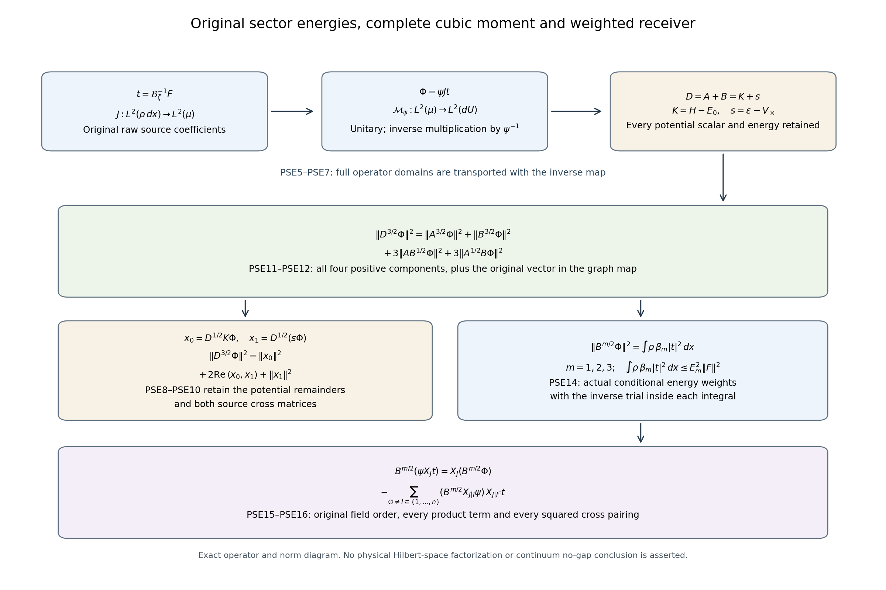

# Original positive sector energies and the actual inverse trial

This calculation keeps the original finite Yang–Mills Hamiltonian and
the entire crossing potential. It proves first, second and third
sector-energy moment bounds for the actual cubic inverse trial, with
all source cross entries. The relation to weighted derivatives is an
exact ordered product formula. The sector estimates are not substituted
for the higher derivative weights in WKM15. A direct weighted integration
identity also bounds the original second-derivative array; its full
propagation through every cubic residual row is given in Sections 7–8.

The mathematical sources are
[KC7–KC10, original positive sectors](https://github.com/KokunoYumeto/yang-mills-interacting-workbench/blob/7b1c3a730c2db94891391d37c554b1f6085526ca/yang-mills/continuations/20261011-central-signs-shrinking-window/KINETIC_CURRENT_AND_PHYSICAL_ENERGY.md),
[WKM1 and WKM8–WKM15, original state and cubic derivatives](https://github.com/KokunoYumeto/yang-mills-interacting-workbench/blob/7b1c3a730c2db94891391d37c554b1f6085526ca/yang-mills/continuations/20261011-central-signs-shrinking-window/TRIAL_WEIGHTED_VARIANCE_AND_CUBIC_DERIVATIVES.md),
and [WCR8–WCR14 and the four preceding inverse-trial norm bounds](https://github.com/KokunoYumeto/yang-mills-interacting-workbench/blob/7b1c3a730c2db94891391d37c554b1f6085526ca/yang-mills/continuations/20261011-central-signs-shrinking-window/FULL_CUBIC_FLUX_AND_RESIDUAL_ENERGY.md).
No novelty claim is made.

## 1. Original objects and the full potential partition

Keep the radius-two SU(2) product, probability Haar measure dU,
generators \(T_\alpha=-i\sigma_\alpha/2\), and the original ordered
left-multiplication fields \(X_{e,\alpha}\), whose same-edge bracket
is \([X_\alpha,X_\beta]=-\epsilon_{\alpha\beta\gamma}X_\gamma\).
The unchanged data are
\[
\begin{gathered}
a=(100j)^{-1},\quad L=j^4,\quad g^2=\kappa_*a/2,\quad
b=(\kappa_*a^2)^{-1},\quad \zeta=\theta\kappa_*/j,\quad j\ge4,\\
N=3(2L)(2L+1)^2,\quad M=3(2L)^2(2L+1),\\
H=-\kappa_*\Delta+2bM-b\sum_pT_p,\quad
H\psi=E_0\psi,\quad \psi>0,\quad\int\psi^2dU=1,\\
U_p=U_d(z)U_k(z+e_d)U_d(z+e_k)^{-1}U_k(z)^{-1},
\qquad T_p=\operatorname{Tr}U_p .
\end{gathered}
\]
The inside cube is the original
\(Q=Q_{50j}=(L-50j)(1,1,1)+\{0,\ldots,100j\}^3\).
Set \(q=100j\);
its full counts are
\[
N_Q=3q(q+1)^2,\quad M_Q=3q^2(q+1),\quad
C=C_Q^\times=12q(q+1),\quad M_{\rm out}=M-M_Q-C.
\]
The three face sets and all orientations are retained:
\[
\begin{gathered}
V_Q=2bM_Q-b\sum_{p\ {\rm inside}}T_p,\qquad
V_{\rm out}=2bM_{\rm out}-b\sum_{p\ {\rm outside}}T_p,\\
V_\times=2bC-b\sum_{p\ {\rm crossing}}T_p,\qquad
V=V_Q+V_{\rm out}+V_\times,\\
H_{\rm in}=-\kappa_*\Delta_Q+V_Q,\qquad
H_{\rm out}=-\kappa_*\Delta_{\rm out}+V_{\rm out},\\
e_{\rm in}=\inf\sigma(H_{\rm in}),\quad
e_{\rm out}=\inf\sigma(H_{\rm out}),\\
A=H_{\rm in}-e_{\rm in},\quad B=H_{\rm out}-e_{\rm out},\quad
D=A+B,\quad K=H-E_0,\\
\varepsilon=E_0-e_{\rm in}-e_{\rm out},\quad M_\times=2bC,\quad
s=\varepsilon-V_\times .
\end{gathered}\tag{PSE1}
\]
These A,B are KC7's positive sector operators, not coefficient
ceilings or the cubic compression. They strongly commute on the full
Haar product because they act on disjoint link sets. Their spectral
resolutions therefore commute. The physical gauge-invariant subspace
is not asserted to factor. Each sector and the full operator preserve
it because each retained face trace and each link Casimir is invariant.

The complete KC8 proof gives
\[
0\le\mu V_\times\le\varepsilon\le M_\times,\quad
0\le V_\times\le2M_\times,\quad
D=K+s,\quad D\psi=s\psi .
\]
For completeness, positivity of D and its ground equation give the
first lower bound. Each sector has its positive unique ground.
In a crossing face, the three outside traversals form an open path
between distinct endpoints of its single inside edge. A restricted
central gauge transformation at an endpoint makes its expectation
zero in the outside ground. Thus the product of the sector grounds
has crossing energy \(2bC\); the variational comparison gives
\(\varepsilon\le M_\times\). The face inequality \(0\le2-T_p\le4\)
gives the pointwise bound. No vacuum energy or potential scalar has
been removed.

All identities below first hold on smooth functions. K and D are
elliptic full-product operators; A and B have their original
anisotropic sector domains. The closed forms and joint spectral
resolution give the indicated extensions. The actual inverse trials
are smooth at each fixed regulator by NSE7–NSE9.

## 2. Full crossing gradient, incidence and retained remainders

For each crossing face incident on an edge e, retain its original
oriented three-component derivative
\[
v_{ep}=(X_{e,1}T_p,X_{e,2}T_p,X_{e,3}T_p)\in\mathbb R^3,
\qquad n_e=|\{p\ {\rm crossing}:e\in p\}|.
\]
The orientation, inverse traversal and all intervening group factors
remain in this definition. On the original radius-two factor,
\[
|v_{ep}|^2=1-T_p^2/4 .
\tag{PSE2}
\]
To prove it, cyclically move the differentiated factor to the front
of the trace. A forward traversal gives \(\operatorname{Tr}(T_\alpha U)\)
after an adjoint rotation; an inverse traversal gives its negative
with another adjoint rotation. Write
\(U=u_0I+i\sum_\alpha u_\alpha\sigma_\alpha\),
\(u_0^2+\sum u_\alpha^2=1\). Then
\(\operatorname{Tr}U=2u_0\) and
\(\operatorname{Tr}(T_\alpha U)=u_\alpha\).
Both adjoint rotations preserve the original three-component norm,
and the traversal sign is retained before taking that norm.

Each original three-dimensional lattice edge meets at most four
faces, so \(0\le n_e\le4\) and \(\sum_e n_e=4C\).
The exact incidence identity is
\[
\begin{aligned}
16b^2C-\|dV_\times\|_{\rm point}^2
={}&4b^2\sum_{p\ {\rm crossing}}T_p^2\\
&+b^2\sum_e\left[
(4-n_e)\sum_{p\ni e}|v_{ep}|^2
+\sum_{\substack{p<r\\p,r\ni e}}|v_{ep}-v_{er}|^2\right]\ge0 .
\end{aligned}\tag{PSE3}
\]
Indeed \(d_eV_\times=-b\sum_{p\ni e}v_{ep}\), and
\[
n_e\sum_{p\ni e}|v_{ep}|^2-\left|\sum_{p\ni e}v_{ep}\right|^2
=\sum_{p<r}|v_{ep}-v_{er}|^2.
\]
Sum this equality, retain the \(4-n_e\) terms, and apply PSE2
on all four distinct edges of each face. This proves
\[
|ds|=|dV_\times|\le P_\times:=4b\sqrt C.
\]
This is the full gradient, including outside links. The inside-only
coefficient \(2b\sqrt C\) is not used for it.
The same original Casimir gives
\[
\Delta T_p=-3T_p,\quad
\Delta V_\times=3M_\times-3V_\times,\quad
\Delta s=3(\varepsilon-M_\times)-3s .
\tag{PSE4}
\]
Each of the four link Casimirs contributes \(-3T_p/4\).
The constant \(3M_\times\) remains.

## 3. Typed ground multiplication and original sector operators

With \(d\mu=\psi^2dU\), the exact map and inverse are
\[
\mathcal M_\psi:L^2(\mu)\longrightarrow L^2(dU),\quad
f\longmapsto\psi f,\qquad
\mathcal M_\psi^{-1}u=\psi^{-1}u .
\]
Direct integration proves it is unitary. Positivity and smoothness
of \(\psi\) on the fixed compact product make both multiplication
maps preserve smooth functions. The full operator transports have
exact domains
\[
D(\mathcal M_\psi^{-1}T\mathcal M_\psi)
=\mathcal M_\psi^{-1}D(T),\qquad T=A,B,D,K.
\]
The product rule and original ground equation give, on smooth f,
\[
\begin{aligned}
\mathcal M_\psi^{-1}A\mathcal M_\psi f
&=-\kappa_*(\Delta_Q f+2d_Q\log\psi\cdot d_Q f)+a_{\rm en}f,\\
a_{\rm en}&=V_Q-e_{\rm in}-\kappa_*\Delta_Q\psi/\psi,\\
\mathcal M_\psi^{-1}B\mathcal M_\psi f
&=-\kappa_*(\Delta_{\rm out} f
+2d_{\rm out}\log\psi\cdot d_{\rm out}f)+b_{\rm out}f,\\
b_{\rm out}&=V_{\rm out}-e_{\rm out}
-\kappa_*\Delta_{\rm out}\psi/\psi,\\
\mathcal M_\psi^{-1}K\mathcal M_\psi&=\mathcal L,\qquad
a_{\rm en}+b_{\rm out}=s .
\end{aligned}\tag{PSE5}
\]
In particular, the transported positive A is not obtained by
deleting its multiplication term or its outside dependence.
For arbitrary smooth f,g the exact form identities are
\[
\begin{aligned}
\langle\mathcal M_\psi f,K\mathcal M_\psi g\rangle
&=\kappa_*\langle df,dg\rangle_\mu,\\
\langle\mathcal M_\psi f,D\mathcal M_\psi g\rangle
&=\kappa_*\langle df,dg\rangle_\mu+\langle f,sg\rangle_\mu .
\end{aligned}\tag{PSE6}
\]
They follow by the product rule and Haar integration by parts.
The second form is nonnegative because D is nonnegative, despite
the signed multiplier s. Its difference from
\(\langle f,(\mathcal L+\varepsilon)g\rangle_\mu\) is precisely
\(-\langle f,V_\times g\rangle_\mu\).

## 4. Actual trial, cubic energy and all cross terms

Retain
\[
\rho(x)=\int\psi(x,y)^2dy,\quad
J:L^2(\rho dx)\to L^2(\mu),\quad Jt=t(x),
\quad J^*f=\rho^{-1}\int\psi^2f\,dy .
\]
The raw source is \(Z=\sum_p\varphi_p a(\mu T_p-T_p)/2\), with
its original face support in Q and \(F=J^*Z\). Put
\[
q_\zeta(\lambda)=(\lambda+\zeta)(\lambda+\zeta/4)(\lambda+4\zeta),
\quad \mathcal B_\zeta=J^*q_\zeta(\mathcal L)J,\quad
t=\mathcal B_\zeta^{-1}F,\quad \Phi=\mathcal M_\psi Jt .
\]
The cubic compression is its original closed form compression.
With \(e_1=21\zeta/4,e_2=21\zeta^2/4,e_3=\zeta^3\), retain
\[
s_0=e_3^{-1},\quad s_1=(2\sqrt{\kappa_*e_2e_3})^{-1},\quad
s_L=(2\sqrt{e_1e_3})^{-1},\quad
s_{3/2}=(2\sqrt{e_3})^{-1}.
\]
The complete positive cubic form and its inverse give
\[
\|\Phi\|\le s_0\|F\|_\rho,\quad
\|dt\|_\mu\le s_1\|F\|_\rho,\quad
\|K\Phi\|\le s_L\|F\|_\rho,\quad
\|K^{3/2}\Phi\|\le s_{3/2}\|F\|_\rho .
\tag{PSE7}
\]
If \(F=0\), positivity \(\mathcal B_\zeta\ge e_3 I\) gives \(t=0\),
and all four bounds follow. For \(F\ne0\), put \(x=\|t\|/\|F\|\).
The full identity
\(\|K^{3/2}\Phi\|^2+e_1\|K\Phi\|^2
+e_2\kappa_*\|dt\|^2+e_3\|\Phi\|^2=\langle t,F\rangle\)
implies each indicated nonnegative term is at most
\((x-e_3x^2)\|F\|^2\le(4e_3)^{-1}\|F\|^2\).
The norm bound follows from the same identity. Thus no trial norm
is assumed.

Set \(S=2M_\times-\varepsilon\), so \(|s|\le S\) and
\(0\le\varepsilon\le S\).
Define actual vectors
\[
x_0=D^{1/2}K\Phi,\qquad x_1=D^{1/2}(s\Phi).
\]
Smoothness supplies their domains. The full cubic identity is
\[
\begin{aligned}
D^{3/2}\Phi&=x_0+x_1,\\
\|D^{3/2}\Phi\|^2
&=\|x_0\|^2+2\operatorname{Re}\langle x_0,x_1\rangle+\|x_1\|^2,\\
\|x_0\|^2
&=\|K^{3/2}\Phi\|^2+\varepsilon\|K\Phi\|^2
-\|V_\times^{1/2}K\Phi\|^2,\\
\|x_1\|^2
&=\kappa_*\|s\,dt+t\,ds\|_\mu^2+\varepsilon^3\|t\|_\rho^2\\
&\hspace{1cm}-\int V_\times(\varepsilon^2+\varepsilon s+s^2)|t|^2d\mu,\\
\langle x_0,x_1\rangle
&=\kappa_*\langle d(\mathcal LJt),d(sJt)\rangle_\mu
+\langle\mathcal LJt,s^2Jt\rangle_\mu .
\end{aligned}\tag{PSE8}
\]
The first equality uses \(D\Phi=K\Phi+s\Phi\); the others use
PSE6 without commuting D and K. In the fourth line,
\(\varepsilon^3-s^3
=V_\times(\varepsilon^2+\varepsilon s+s^2)\ge0\).
The polynomial factor is
\((s+\varepsilon/2)^2+3\varepsilon^2/4\).
The derivative term retains
\(\|sdt\|^2+\|tds\|^2+2\operatorname{Re}\langle sdt,tds\rangle\).
Neither cross term in PSE8 has been assigned a sign.

PSE3, PSE7 and the triangle inequality now prove
\[
\begin{gathered}
R_0=\sqrt{s_{3/2}^2+\varepsilon s_L^2},\quad
R_1=\sqrt{\kappa_*(Ss_1+P_\times s_0)^2+\varepsilon^3s_0^2},\\
\|D^{3/2}\Phi\|\le(R_0+R_1)\|F\|_\rho,\\
E_3=\sqrt{s_{3/2}^2+M_\times s_L^2}
+\sqrt{\kappa_*(2M_\times s_1+P_\times s_0)^2
+M_\times^3s_0^2},\qquad R_0+R_1\le E_3 .
\end{gathered}\tag{PSE9}
\]
The actual \(\varepsilon\), potential remainders and full cross
entries remain in PSE8; E3 is an additional explicit upper function.
No inference \(D^3\le(K+\varepsilon)^3\) has been used.

For every raw coefficient vector v let \(\Phi_v\) be its actual
trial. All preceding equalities polarize to exact Gram matrices,
for example
\[
\mathsf G_D[v,z]=\langle D^{3/2}\Phi_v,D^{3/2}\Phi_z\rangle
=\sum_{r,t=0}^1\langle x_{r,v},x_{t,z}\rangle,\qquad
0\le\mathsf G_D\le E_3^2\mathsf S_{\rm raw},
\quad\mathsf S_{\rm raw}=F^*F=Z^*Z .
\tag{PSE10}
\]
The upper order follows by applying PSE9 to each unchanged vector
of coefficients. No matrix commutation, inverse source Gram,
independence or removal of zero columns is required.

## 5. Positive sector moment maps and their entire complements

The exact joint spectral identities are
\[
\begin{aligned}
\|D^{1/2}\Phi\|^2
&=\|A^{1/2}\Phi\|^2+\|B^{1/2}\Phi\|^2,\\
\|D\Phi\|^2
&=\|A\Phi\|^2+\|B\Phi\|^2+2\|A^{1/2}B^{1/2}\Phi\|^2,\\
\|D^{3/2}\Phi\|^2
&=\|A^{3/2}\Phi\|^2+\|B^{3/2}\Phi\|^2
+3\|AB^{1/2}\Phi\|^2+3\|A^{1/2}B\Phi\|^2 .
\end{aligned}\tag{PSE11}
\]
They follow by integrating the full polynomials
\(a+b,(a+b)^2,(a+b)^3\) over the joint nonnegative spectral
coordinates; every mixed monomial stays present.

In particular the exact typed graph map is
\[
\begin{gathered}
\mathcal E:D(D^{3/2})\longrightarrow L^2(dU)^{\oplus5},\\
\mathcal E\Phi=(\Phi,A^{3/2}\Phi,B^{3/2}\Phi,
\sqrt3\,AB^{1/2}\Phi,\sqrt3\,A^{1/2}B\Phi),\\
\|\mathcal E\Phi\|^2=\|\Phi\|^2+\|D^{3/2}\Phi\|^2 .
\end{gathered}\tag{PSE12}
\]
Its codomain range consists exactly of these five entries for one
\(\Phi\in D(D^{3/2})\). The inverse on that range is the first
coordinate. Joint spectral closure proves that the graph is closed;
PSE11 makes its domain norm complete. This proves an isometric
isomorphism onto its explicitly specified range, including the
zero-energy sector. No component is discarded.

There are also the full finite ceilings
\[
\begin{gathered}
E_1=\sqrt{\kappa_*s_1^2+M_\times s_0^2},\qquad
E_2=s_L+2M_\times s_0,\\
\|D^{1/2}\Phi\|\le E_1\|F\|_\rho,\qquad
\|D\Phi\|\le E_2\|F\|_\rho .
\end{gathered}\tag{PSE13}
\]
The first follows from
\(\|D^{1/2}\Phi\|^2=\kappa_*\|dt\|^2+\varepsilon\|t\|^2
-\int V_\times|t|^2d\mu\).
For the second retain
\(\|D\Phi\|^2=\|K\Phi\|^2+2\operatorname{Re}\langle K\Phi,s\Phi\rangle
+\|s\Phi\|^2\), then use PSE7 and \(|s|\le2M_\times\).
PSE11 bounds each sector moment by the corresponding D moment,
with all other sector and mixed norms as exact positive remainders.

For m=1,2,3 define the actual nonnegative conditional function
\[
\beta_m(x)=\rho(x)^{-1}
\langle\psi(x,\cdot),B^m\psi(x,\cdot)\rangle_{L^2(dy)} .
\]
Since B acts on y only, it commutes with multiplication by every
inside t and its spectral powers commute with that multiplication.
Consequently
\[
\begin{gathered}
\langle B^{m/2}\Phi_v,B^{m/2}\Phi_z\rangle
=\int\rho(x)\beta_m(x)\overline{t_v(x)}t_z(x)\,dx,\\
0\le\left[\int\rho\beta_m\overline{t_v}t_z\right]_{v,z}
\le E_m^2\mathsf S_{\rm raw}.
\end{gathered}\tag{PSE14}
\]
For odd m, positivity is the spectral identity
\(\langle\psi_x,B^m\psi_x\rangle=\|B^{m/2}\psi_x\|^2\).
Each mixed face entry is retained. This is an actual weighted
moment bound, not multiplication of an unweighted integral by
\(\|t\|^2\).

## 6. Exact derivative receiver and current extent of the bound

The higher derivatives required in WKM15 have an exact relation
to PSE14. For an ordered inside word
\(J=(i_1,\ldots,i_n)\), and a subset I of its positions, let
\(J|I\) retain their original order; the empty word is identity.
Inside differentiation commutes with B and its spectral powers.
Repeated full Leibniz expansion therefore gives
\[
\begin{aligned}
B^{m/2}(\psi X_Jt)
={}&X_J(B^{m/2}\Phi)\\
&-\sum_{\varnothing\ne I\subseteq\{1,\ldots,n\}}
\left(B^{m/2}X_{J|I}\psi\right)X_{J|I^c}t .
\end{aligned}\tag{PSE15}
\]
For n=1 this is the ordinary product rule with its ground
derivative term. Applying the next ordered derivative to every
factor creates the two choices for its position, which proves
the formula inductively without interchanging any fields.
All vectors lie in the original Haar space; smoothness and the
outside spectral calculus give their domains.

Thus the exact weighted derivative is
\[
\int\rho\beta_m|X_Jt|^2dx
=\left\|X_J(B^{m/2}\Phi)
-\sum_{\varnothing\ne I}
(B^{m/2}X_{J|I}\psi)X_{J|I^c}t\right\|_{L^2(dU)}^2 .
\tag{PSE16}
\]
Its square includes every ordered pairing of summands. For
\(d_Q\Delta_Q^2t\), sum the corresponding ordered words before
taking each component's norm, retaining the cross terms between
the two Laplacian index sums. PSE14 alone does not bound this
different derivative-weighted expression.

The complete explicit upper functions have finite limits
\[
\begin{gathered}
\mathfrak m=2400000000/\kappa_*,\qquad
M_\times=\mathfrak m j^4+(24000000/\kappa_*)j^3,\\
\lim_{j\to\infty}\frac{E_1}{j^5}
=\frac{\sqrt{\mathfrak m}}{\theta^3\kappa_*^3},\quad
\lim_{j\to\infty}\frac{E_2}{j^7}
=\frac{2\mathfrak m}{\theta^3\kappa_*^3},\quad
\lim_{j\to\infty}\frac{E_3}{j^9}
=\frac{\mathfrak m^{3/2}}{\theta^3\kappa_*^3}.
\end{gathered}\tag{PSE17}
\]
Indeed \(s_0=j^3/(\theta^3\kappa_*^3)\),
\(s_1=j^{5/2}/(\sqrt{21}\theta^{5/2}\kappa_*^3)\),
\(s_L=j^2/(\sqrt{21}\theta^2\kappa_*^2)\), and
\(s_{3/2}=j^{3/2}/(2\theta^{3/2}\kappa_*^{3/2})\).
Also \(P_\times\) has order \(j^3\).
In E3 the first square root has order \(j^4\); the derivative
square in the second has order \(j^{13}\), whereas its retained
\(M_\times^3s_0^2\) term has order \(j^{18}\).
This proves all three limits from the entire finite expressions.
They describe sector-energy upper functions, not powers of the
original ordered derivatives or a physical spectral mass.

PSE15–PSE16 identify the full ground-derivative terms, their cross
pairings and the corresponding weighted derivative receiver.
No continuum state, vanishing signed residual, surviving spectral
weight or global no-gap result is asserted by PSE1–PSE17.

## 7. A complete second-derivative receiver without a Hessian ceiling

The next receiver can be calculated directly, retaining the actual
ground weight. Let f be any smooth inside function, including the
actual t. Keep the ordered derivative array and full inside score:
\[
Q_f=\Delta_Q f,\quad
C_f=\sum_{h\ {\rm inside}}a_hX_hf,\quad
a_h=X_h\log\psi,\quad
D_1(f)=\|d_Qf\|_\mu,\quad
D_2(f)^2=\sum_{h,i\ {\rm inside}}\|X_hX_if\|_\mu^2 .
\]
The exact weighted integration identity is
\[
\begin{aligned}
D_2(f)^2={}&\|Q_f\|_\mu^2
+2\operatorname{Re}\langle C_f,Q_f\rangle_\mu\\
&-2\operatorname{Re}\sum_{h,i}
\int a_h\,\overline{X_if}\,X_hX_if\,d\mu\\
={}&\kappa_*^{-2}\|\mathcal Lf\|_\mu^2
+2\kappa_*^{-1}\operatorname{Re}\langle C_f,\mathcal Lf\rangle_\mu\\
&-2\operatorname{Re}\sum_{h,i}
\int a_h\,\overline{X_if}\,X_hX_if\,d\mu .
\end{aligned}\tag{PSE18}
\]
To prove the first equality, integrate each outer Xh in
\(\sum_{h,i}\langle X_hX_if,X_hX_if\rangle_\mu\).
Its weighted adjoint is \(-X_h-2a_h\).
The original link Casimir commutes with every Xi, including on the
same edge. Thus the resulting second-order sum is
\(-\sum_i\langle X_if,X_i\Delta_Qf\rangle_\mu\).
Integrating its Xi once gives exactly
\(\|Q_f\|^2+2\operatorname{Re}\langle C_f,Q_f\rangle\).
Every weight-derivative term remains in the final double sum.
For the second equality use
\(\mathcal Lf=-\kappa_*(Q_f+2C_f)\).
Expanding its full square gives
\[
\|Q_f\|^2+2\operatorname{Re}\langle C_f,Q_f\rangle
=\kappa_*^{-2}\|\mathcal Lf\|^2
+2\kappa_*^{-1}\operatorname{Re}\langle C_f,\mathcal Lf\rangle .
\]
This is an exact equality, retaining both cross terms until the
following norm bound.

The original score estimates give
\[
\begin{gathered}
|d_Q\log\psi|\le\alpha_Q,\qquad
\alpha_Q=\min\left\{2\pi c\sqrt{N_Q},\sqrt{N_Q}G(a)\right\},
\\
c=\frac{2}{\kappa_*a},\qquad
G(a)=\min\left\{\frac8{\kappa_*^2a^2},
\frac{2+2\sqrt{4+2\pi}}{\kappa_*a}\right\}.
\end{gathered}
\]
Consequently \(\|C_f\|\le\alpha_QD_1(f)\), and Cauchy–Schwarz
on the entire double sum gives its absolute value at most
\(\alpha_QD_1(f)D_2(f)\).
Put \(l=\kappa_*^{-1}\|\mathcal Lf\|\) and
\(a_f=\alpha_QD_1(f)\); PSE18 gives
\[
D_2(f)^2\le l^2+2a_fl+2a_fD_2(f),\qquad
(D_2(f)-a_f)^2\le(l+a_f)^2 .
\]
Taking the upper endpoint of this interval proves
\[
D_2(f)\le\kappa_*^{-1}\|\mathcal Lf\|_\mu
+2\alpha_Q\|d_Qf\|_\mu .
\tag{PSE19}
\]
Every original ordered field and the original full generator is
retained. No Hessian bound, change of metric or deletion of the
weight derivative has been used.

For the actual inverse trial this yields the new complete ceiling
\[
\begin{gathered}
D_{2,0}(t)\le
\min\{\widehat t_{2,0},\,\kappa_*^{-1}s_L+2\alpha_Qs_1\}\,
\|F\|_\rho,\\
\mathfrak a_1=
\frac{100\sqrt{3000000}}{\kappa_*}
\min\{4\pi,\,2+2\sqrt{4+2\pi}\},\\
\lim_{j\to\infty}
\frac{\kappa_*^{-1}s_L+2\alpha_Qs_1}{j^5}
=\frac{2\mathfrak a_1}
{\sqrt{21}\theta^{5/2}\kappa_*^3}.
\end{gathered}\tag{PSE20}
\]
The limit follows from the full NQ and G(a) formulas and PSE17's
explicit s1,sL. This improves this particular derivative ceiling
from WCR's power \(19/2\) to power 5; it does not change the working
objects. Its raw source Gram bound follows by applying it to every
coefficient vector, as in PSE10.

The following formulas receive this proved second-derivative
ceiling in WKM9–WKM12 with all their remaining terms.
In particular PSE19 alone does not control the higher commutator
terms containing derivatives of the score. Those terms remain
explicit in WKM8 and PSE15. The complete residual estimate is not
claimed to have a new leading power on the basis of this one row.

## 8. Receive the bound in every original cubic row

Write \(H^+_{2,0},\mathcal U^+_{1,0},M_2\) for the complete
WCR9–WCR10 finite expressions, and retain the original \(A_Q\) and
the scalar Hessian ceiling
\[
K_{\mathrm H}=\frac{4bM}{\kappa_*}+(3N-1)c,\qquad
c=\frac{2}{\kappa_*a}.
\]
This is the scalar denoted \(K\) in WCR, whereas PSE1's \(K=H-E_0\)
continues to denote the full operator. Retain
all coefficients \(d_{m,r},r_{m,r}\) of WKM10–WKM11, and every
WCR pair coefficient \(C_{m,r},\Gamma_{m,r},U_1^{\rm all}\).
None of these is assigned a new value. Define the proved new
derivative ceilings by their full finite expressions:
\[
\begin{aligned}
t^\dagger_{2,0}
&=\min\{\widehat t_{2,0},\kappa_*^{-1}s_L+2\alpha_Qs_1\},\\
t^\dagger_{1,1}
&=\min\{\widehat t_{1,1},
\kappa_*^{-3/2}s_{3/2}+2K_{\mathrm H}s_1+2A_Qt^\dagger_{2,0}\},\\
t^\dagger_{0,2}
&=\min\{\widehat t_{0,2},
\kappa_*^{-2}M_2+4A_Qt^\dagger_{1,1}
+4H^+_{2,0}t^\dagger_{2,0}
+2\kappa_*^{-1}\mathcal U^+_{1,0}s_1\}.
\end{aligned}\tag{PSE21}
\]
The second and third inequalities are exactly WCR8–WCR11 with
PSE20 substituted in their receiving norms; no coefficient or
term of those identities changes. The minima retain the previous
ceilings. Every other \(t^\dagger_{m,r}\) with \(m+2r\le4\)
initially remains \(\widehat t_{m,r}\).

PSE19 applied separately to every original Xi t, followed by the
Euclidean triangle inequality over that array, gives
\[
\begin{aligned}
D_{3,0}(t)&\le
\kappa_*^{-1}\left(\sum_i\|\mathcal LX_it\|_\mu^2\right)^{1/2}
+2\alpha_QD_{2,0}(t),\\
\left(\sum_i\|\mathcal LX_it\|_\mu^2\right)^{1/2}
&\le\kappa_*^{-1/2}s_{3/2}\|F\|_\rho
+\kappa_*(2K_{\mathrm H}+G(a))s_1\|F\|_\rho .
\end{aligned}
\]
The second line retains the full commutator WKM8 and its connection
term \(G(a)\); the inside part of \(d\mathcal Lt\) is bounded by
the full gradient. The energy identity gives
\(\|d\mathcal Lt\|=\kappa_*^{-1/2}\|\mathcal L^{3/2}Jt\|\).
For f=\(\Delta_Qt\), the same PSE19 and the exact
\(\mathcal L\Delta_Qt=-\kappa_*\Delta_Q^2t
-2\kappa_*d_Qw\cdot d_Q\Delta_Qt\) give
\[
D_{2,1}(t)\le D_{0,2}(t)+4\alpha_QD_{1,1}(t).
\]
Thus the complete new choices are
\[
\begin{aligned}
t^\dagger_{3,0}=\min\big\{&
\overline d_{3,0},
\sqrt{[\kappa_*^{-3/2}s_{3/2}+(2K_{\mathrm H}+G(a))s_1]^2
+2K_{\mathrm H}(t^\dagger_{2,0})^2},\\
&\kappa_*^{-3/2}s_{3/2}+(2K_{\mathrm H}+G(a))s_1
+2\alpha_Qt^\dagger_{2,0}\big\},\\
t^\dagger_{2,1}=\min\big\{&
\overline d_{2,1},
\sqrt{[t^\dagger_{0,2}+2\alpha_Qt^\dagger_{1,1}]^2
+2K_{\mathrm H}(t^\dagger_{1,1})^2},\\
& t^\dagger_{0,2}+4\alpha_Qt^\dagger_{1,1}\big\}.
\end{aligned}\tag{PSE22}
\]
The square-root choices are WKM9 with the new proved lower
derivative ceilings. They and the new linear choices all refer to
the same original derivative arrays.

The entire WKM10 cubic equation now yields
\[
\begin{aligned}
\mathcal R^\dagger_6=\kappa_*^{-3}\big[
&1+e_1\kappa_*^2t^\dagger_{0,2}
+e_2\kappa_*\widehat t_{0,1}+e_3s_0\\
&+d_{2,1}t^\dagger_{2,1}+d_{3,0}t^\dagger_{3,0}
+d_{1,1}t^\dagger_{1,1}
+d_{2,0}t^\dagger_{2,0}+d_{1,0}\widehat t_{1,0}\big],\\
\mathcal Y^\dagger
&=4\alpha_Qt^\dagger_{0,2}
+\sqrt{16\alpha_Q^2(t^\dagger_{0,2})^2
+t^\dagger_{0,2}\mathcal R^\dagger_6},\\
\mathcal X^\dagger&=6\alpha_Q\mathcal Y^\dagger+\mathcal R^\dagger_6,\\
t^\dagger_{1,2}&=\min\{\overline d_{1,2},\mathcal Y^\dagger\},\quad
t^\dagger_{0,3}=\min\{\overline d_{0,3},\mathcal X^\dagger\},\\
\beta^\dagger={}&
r_{1,2}t^\dagger_{1,2}+r_{2,1}t^\dagger_{2,1}
+r_{3,0}t^\dagger_{3,0}
+r_{1,1}t^\dagger_{1,1}+r_{2,0}t^\dagger_{2,0}
+r_{1,0}\widehat t_{1,0},\\
\Xi^\dagger_{\rm dir}&=\zeta^{-1}(\beta^\dagger)^2 .
\end{aligned}\tag{PSE23}
\]
For the derivation, divide the original fifth/sixth derivative
norms by \(\|F\|\) when F is nonzero. The entire cubic equation
gives \(X\le6\alpha_QY+\mathcal R^\dagger_6\); weighted integration
by parts gives \(Y^2\le t^\dagger_{0,2}X+
2\alpha_Qt^\dagger_{0,2}Y\). These are the same full inequalities
as WKM10, so their quadratic root is exactly the displayed
\(\mathcal Y^\dagger,\mathcal X^\dagger\).
For F=0 positivity of the compression makes t=0.
The six original residual rows and their thirty ordered mixed
pairings give \(\mathsf B_{\rm res}\le
\Xi^\dagger_{\rm dir}\mathsf S_{\rm raw}\).

The full original WCR representing pair also receives all lower
derivative improvements:
\[
\begin{gathered}
\mathfrak F^\dagger=\sum_{(m,r)\in\mathcal I_{\rm WCR}}
C_{m,r}t^\dagger_{m,r},\qquad
\mathfrak S^\dagger=\sum_{(m,r)\in\mathcal I_{\rm WCR}}
(\Gamma_{m,r}+2U_1^{\rm all}C_{m,r})t^\dagger_{m,r},\\
\mathcal I_{\rm WCR}=\{(0,2),(0,1),(0,0),(1,1),(1,0),(2,0)\},\\
\Xi^\dagger_{\rm pair}=\kappa_*^{-1}(\mathfrak F^\dagger)^2
+\zeta^{-1}(\mathfrak S^\dagger)^2,\quad
\Xi^\dagger_*=\min\{\Xi_*,\Xi^\dagger_{\rm dir},\Xi^\dagger_{\rm pair}\}.
\end{gathered}
\]
Both source matrix orders therefore retain the full PST receiver
\[
-\mathsf X^\dagger_\tau\le\mathsf C-\mathsf T_{50j}
\le\mathsf X^\dagger_\tau,\quad
\mathsf X^\dagger_\tau=\tau(43/25)^2\mathsf M_1^{\rm source}
+(\tau^{-1}+43\zeta/25)\Xi^\dagger_*\mathsf S_{\rm raw}.
\]
Here \(\tau>0\), both negative spectral tails and the original raw
source matrix remain. No scalar bound replaces an exact matrix
remainder in ROF.

Using the full constants \(\mathfrak a,\mathfrak g,u_1,\gamma,d,
\ell_{11}\) defined in WKM14, the exact new leading coefficients are
\[
\begin{gathered}
\ell^\dagger_{02}=4u_1(2\mathfrak a+\mathfrak g)d,\quad
v^\dagger_{30}=2\mathfrak a d,\quad
v^\dagger_{21}=\ell^\dagger_{02},\\
r^\dagger_6=12\mathfrak a\ell^\dagger_{02}
+8\mathfrak a\gamma v^\dagger_{30},\\
\lim_{j\to\infty}\frac{\Xi^\dagger_{\rm dir}}{j^{76}}
=\frac{\kappa_*^5(r^\dagger_6)^2}{\theta},\\
\mathfrak s^\dagger=\kappa_*^3[
6(\mathfrak a+3\mathfrak g)\ell^\dagger_{02}
+12u_1(4\mathfrak a+3\mathfrak g)\ell_{11}],\quad
\lim_{j\to\infty}\frac{\Xi^\dagger_{\rm pair}}{j^{76}}
=\frac{(\mathfrak s^\dagger)^2}{\theta\kappa_*}.
\end{gathered}\tag{PSE24}
\]
To verify the coefficients, PSE20 reduces the \(H^+_{2,0}t_{2,0}\)
term in PSE21 from order \(j^{47/2}\) to \(j^{19}\).
The \(2\kappa_*^{-1}\mathcal U^+_{1,0}s_1\) term remains of
order \(j^{47/2}\), with coefficient \(\ell^\dagger_{02}\).
The other terms there have smaller powers, as in the full WCR
expressions. PSE22 now has leading coefficients
\(2\mathfrak a d\) and \(\ell^\dagger_{02}\).
The two maximal terms in \(\mathcal R^\dagger_6\) have the stated
sum. Every other term of PSE23 is retained and has smaller order.
The six residual row powers are now
\[
33,\quad75/2,\quad75/2,\quad39/2,\quad18,\quad17/2.
\]
In the pair bound its third formerly maximal scalar row, (2,0),
has lower power after PSE20; the two surviving maximal rows give
\(\mathfrak s^\dagger\). These limits concern the full upper
functions; no term is removed from their finite formulas.

At \(\kappa_*=4/5,\theta=1\), the new direct leading coefficient
is approximately 0.9731531947555984191 times WKM14's, and the
new pair leading coefficient is approximately
0.7086159058216939584 times WCR14's. The complete direct bound
still has power76. The next needed improvement therefore concerns
the retained score-derivative and marginal-potential terms that
set \(\ell^\dagger_{02}\), together with the actual weighted
moments in PSE16; the improved second-derivative row alone has
now been propagated through the full receiving estimate.

The figure displays the exact maps and all four cubic joint-energy
components in PSE5–PSE16. PSE18–PSE20 additionally evaluate the
second-derivative receiver by integration in the original ground
measure; their complete formulas remain above.

## 9. The exact wider class of the second-derivative identity

PSE18–PSE19 do not use the Wilson potential or the ground equation.
Here is the full construction to which the same argument applies.
Take a finite product of compact Lie groups, each with its specified
bi-invariant metric, and retain the associated orthonormal invariant
fields \(X_i\). Let w be any given smooth real function and
\(d\nu=e^{2w}dU\), without rescaling its total mass. For a fixed
subset I of factors define
\[
\mathcal L_{I,w}=-\kappa_*\left(\sum_{i\in I}X_i^2
+2\sum_{i\in I}(X_iw)X_i\right),\quad
\alpha_I=\sup|d_Iw|,\quad\kappa_*>0.
\]
This is the nonnegative weighted form operator on \(L^2(\nu)\).
For a smooth f depending on those factors, the entire identity
PSE18 holds with its original I fields, w and measure \(\nu\);
hence
\[
\left(\sum_{h,i\in I}\|X_hX_if\|_\nu^2\right)^{1/2}
\le\kappa_*^{-1}\|\mathcal L_{I,w}f\|_\nu
+2\alpha_I\left(\sum_{i\in I}\|X_if\|_\nu^2\right)^{1/2}.
\tag{PSE25}
\]
To justify the one geometric step, metric invariance makes
\(c_{ih}^{\,l}=\langle[X_i,X_h],X_l\rangle\) skew in h,l.
Thus
\[
[X_i,\sum_hX_h^2]
=\sum_{h,l}c_{ih}^{\,l}(X_lX_h+X_hX_l)=0 .
\]
All outside factors commute with I. Haar invariance gives the
same weighted adjoints \(-X_h-2X_hw\); the two integrations
and the full square in PSE18 then prove PSE25 exactly.
No Ricci term, structure constant, metric scale or density factor
has been omitted in this cancellation.

The programme instance is obtained by the explicit identity map
on functions with \(G_e=\mathrm{SU}(2)\) in its original radius-two
metric, \(w=\log\psi\), \(\nu=\mu\), and I the original inside
links. That map is an isometry because its measures and metrics
are exactly equal. On every such inside f,
\(\mathcal L_{I,w}f=\mathcal Lf\) since all outside derivatives
of f vanish. Thus its receiving map is precisely PSE19, including
every original constant and field word. This wider statement
does not assume a state that has not been constructed.
