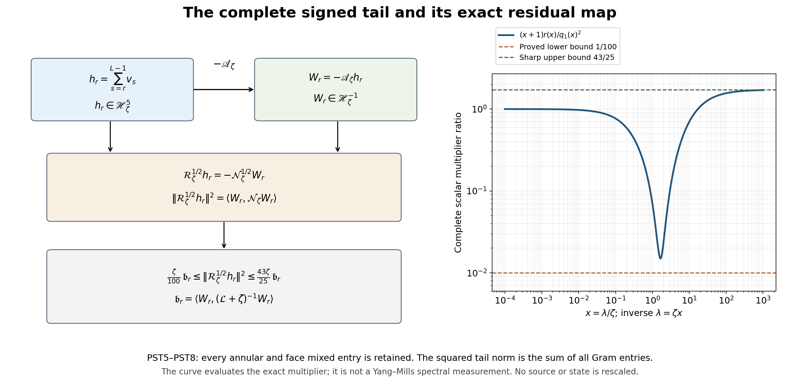

# Complete signed tails and the original residual resolvent

Derivation, 15 October 2026. The entire remaining inverse tail has a positive quadratic form, with all annular and face mixed entries retained. This paper proves its exact typed map to the original residual, bounds that map in both directions, calculates the six original moment maps, and strengthens the complete signed-response comparison. The resulting original second-order energy has not been evaluated as establishing a positive shrinking-window response. The smooth global no-gap construction remains the programme goal.

The providers are [NSE1–NSE13](https://github.com/KokunoYumeto/yang-mills-interacting-workbench/blob/a2653f400dadacb0cee092aca1ec7b36322d368a/yang-mills/continuations/20261011-central-signs-shrinking-window/NESTED_INVERSE_ENERGY_AND_SIGNED_RESPONSE.md), [the original state and typed maps in CDE](https://github.com/KokunoYumeto/yang-mills-interacting-workbench/blob/a2653f400dadacb0cee092aca1ec7b36322d368a/yang-mills/continuations/20261011-central-signs-shrinking-window/ORIGINAL_FRAME_CUBIC_RESIDUAL.md), and [the complete CCJ17–CCJ20 residual bound](https://github.com/KokunoYumeto/yang-mills-interacting-workbench/blob/a2653f400dadacb0cee092aca1ec7b36322d368a/yang-mills/continuations/20261011-central-signs-shrinking-window/CONTRACTED_CUBIC_BOUNDS.md). The indicated sections were reread for these uses. Twelve disk-index routing hits were recorded; none is treated as a read external source. No novelty is claimed.

## Original state, source and full operators

Keep the original SU(2) product with radius-two metric, probability Haar measure, generators \(T_\alpha=-i\sigma_\alpha/2\), and ordered left-multiplication fields \(X_{e,\alpha}\). All operators below restrict to the original gauge-invariant physical subspace. The complete state is
\[
\begin{gathered}
a=(100j)^{-1},\quad L=j^4,\quad g^2=\kappa_*a/2,\quad
b=(\kappa_*a^2)^{-1},\quad\zeta=\theta\kappa_*/j,\quad j\ge4,\\
N=3(2L)(2L+1)^2,\qquad M=3(2L)^2(2L+1),\\
V=2bM-b\sum_pT_p,\quad H=-\kappa_*\sum_{i\in\mathcal I}X_i^2+V,\quad
H\psi=E_0\psi,\quad \psi>0,\quad\int\psi^2dU=1,\\
d\mu=\psi^2dU,\quad w=\log\psi,\quad
\mathcal L=\psi^{-1}(H-E_0)\psi,\quad\mathscr H_\mu=L^2(\mu).
\end{gathered}
\]
The original oriented plaquette and raw centered source are
\[
\begin{gathered}
U_p=U_d(z)U_k(z+e_d)U_d(z+e_k)^{-1}U_k(z)^{-1},\qquad
T_p=\operatorname{Tr}U_p,\\
Z_p=a(\mu T_p-T_p)/2,\qquad Z=\sum_p\varphi_p Z_p .
\end{gathered}
\]
Every original face, orientation, source center and coefficient stays fixed.
Let \(Q_r=(L-r)\mathbf1+\{0,\ldots,2r\}^3\), \(50j\le r\le L\), with the original source supported in \(Q_{50j}\). Write
\(\rho_r(x_r)=\int\psi(x_r,y_r)^2dy_r\) and
\(\mathscr H_r=L^2(\rho_r dx_r)\). The exact maps are
\[
J_r:\mathscr H_r\to\mathscr H_\mu,\quad J_rf=f(x_r),\qquad
J_r^*f=\rho_r^{-1}\int\psi^2 f\,dy_r,\qquad J_r^*J_r=I.
\]
Their full complement \(I-J_rJ_r^*\) is retained. The constants \(\kappa_*,\theta\) are positive. Use the original filter parameters \(1/4,4\) and every term of
\[
\begin{gathered}
q_\zeta(\lambda)=(\lambda+\zeta)(\lambda+\zeta/4)(\lambda+4\zeta),\\
k_\zeta(\lambda)=\frac{\zeta\lambda}{(\lambda+\zeta)^2}
-\frac{16}{25}\frac{(\zeta/4)\lambda}{(\lambda+\zeta/4)^2}
-\frac{16}{25}\frac{4\zeta\lambda}{(\lambda+4\zeta)^2}.
\end{gathered}
\]
Define the positive full cubic \(\mathscr A_\zeta=q_\zeta(\mathcal L)\), with domain H6 and form domain H3, and its closed compression \(\mathcal B_r=J_r^*\mathscr A_\zeta J_r\), with the same original inside Sobolev orders. Put
\[
\begin{gathered}
F_r=J_r^*Z,\quad t_r=\mathcal B_r^{-1}F_r,\quad u_r=J_rt_r,\quad
Y_r=\mathscr A_\zeta u_r=Z+W_r,\quad J_r^*W_r=0,\\
h_r=\mathscr A_\zeta^{-1}Z-u_r=-\mathscr A_\zeta^{-1}W_r,\quad
\delta_r=\|\mathscr A_\zeta^{1/2}h_r\|_\mu^2,\\
C(F)=\langle Z,k_\zeta(\mathcal L)Z\rangle_\mu,\quad
T_r(F)=\langle Y_r,k_\zeta(\mathcal L)Y_r\rangle_\mu,\quad
m_1(F)=\langle Z,\mathcal LZ\rangle_\mu .
\end{gathered}
\]
NSE7–NSE9 prove smoothness of the displayed finite-regulator vectors, their gauge restrictions, and
\[
v_s=u_{s+1}-u_s,\quad
d_s=\|\mathscr A_\zeta^{1/2}v_s\|_\mu^2,\quad
h_r=\sum_{s=r}^{L-1}v_s,\quad
\delta_r=\sum_{s=r}^{L-1}d_s,\quad
\langle v_s,\mathscr A_\zeta v_t\rangle=0\quad(s\ne t).
\]
The terminal cube has \(J_L=I\), \(W_L=h_L=0\) and crossing count zero. These identities retain the entire finite tail and its original terminal boundary.

## 1. Complete original polynomial and its domain

On the unchanged full weighted physical space define, first on smooth vectors,
\[
\mathcal R_\zeta=\zeta^3\mathscr A_\zeta
-\mathscr A_\zeta^2k_\zeta(\mathcal L).
\]
Retain the complete polynomial, with every sign and coefficient:
\[
\begin{aligned}
\mathcal R_\zeta={}&
\frac{43}{25}\zeta\mathcal L^5-\frac12\zeta^2\mathcal L^4
-\frac{3401}{400}\zeta^3\mathcal L^3\\
&+\frac{19}{4}\zeta^4\mathcal L^2
+\frac{697}{100}\zeta^5\mathcal L+\zeta^6 I .
\end{aligned}
\]
Indeed the exact bijection \(\lambda=\zeta x\), including its factors, gives
\[
\zeta^3q_\zeta(\lambda)-q_\zeta(\lambda)^2k_\zeta(\lambda)
=\zeta^6[q_1(x)-xP(x)]=\zeta^6R(x)/400 .
\]
The complete original polynomials are
\[
\begin{gathered}
q_1(x)=x^3+\frac{21}{4}x^2+\frac{21}{4}x+1,\\
P(x)=-\frac{43}{25}x^4+\frac12x^3+\frac{3801}{400}x^2+\frac12x-\frac{43}{25},
\\R(x)=400[q_1(x)-xP(x)] .
\end{gathered}
\]
They are the NSE5 polynomials, with \(k_1=xP/q_1^2\). This proves the polynomial identity without an asymptotic replacement.

The original positive spectral operator \(\mathcal L\) defines the closure by this polynomial. Its domain is \(D(\mathcal L^5)=H^{10}\), and its closed form domain is \(D(\mathcal L^{5/2})=H^5\), with the original physical restrictions. To check the domains, the polynomial has positive leading coefficient \(43\zeta/25\), so its absolute value plus one is bounded above and below by positive fixed-regulator multiples of \(1+\lambda^5\) on \([0,\infty)\); compact intervals follow by continuity and the large interval by the retained leading term. Squaring and integrating in the spectral measure gives the operator-domain equality. The analogous form comparison follows from the positivity proved next. These are fixed-regulator equivalences, not uniform bounds in j.

## 2. A retained positive lower contribution

The Bernstein certificates of NSE5 prove the stronger exact inequality
\[
R(x)\ge400(1+x),\qquad x\ge0.
\]
Here is the full finite verification. On each interval \([a,b]\) of that table the new Bernstein coefficients are exactly
\[
B_i-400\left(1+a+(b-a)i/5\right),\qquad i=0,\ldots,5.
\]
The three complete lists of resulting coefficients, in increasing index, are
\[
\begin{gathered}
(0,2388/5,5726/5,16627/10,1650,1375),\\
(1375,2475/2,41377/40,63941/80,606,4725/8),\\
(4725/8,2301/4,59021/80,24283/20,11012/5,3984).
\end{gathered}
\]
Each is nonnegative; the first coefficient on [0,1] is zero and all others are positive. The identity follows because the Bernstein basis sums to one and its coefficient-weighted mean i/5 is t. For x=2+t the complete coefficients, in descending powers of t, become
\[
688,\quad6680,\quad22519,\quad31734,\quad17816,\quad3984 ,
\]
all positive. Thus the finite intervals and the final ray cover every original nonnegative spectral value. Restoring the factors proves
\[
\mathcal R_\zeta\ge\zeta^6 I+\zeta^5\mathcal L .
\tag{PST1}
\]
Both terms remain in the subsequent comparison.

## 3. The complete annular Gram matrix and the original receiving map

Use the actual smooth nested inverse increments \(v_s=u_{s+1}-u_s\) from NSE8. On their original finite index set define
\[
\mathsf G^{\mathcal R}_{st}
=\langle\mathcal R_\zeta^{1/2}v_s,
\mathcal R_\zeta^{1/2}v_t\rangle_\mu .
\]
This is the Gram matrix of the typed map
\[
\mathbb C^{L-r}\longrightarrow\mathscr H_\mu,\qquad
c\longmapsto\sum_{s=r}^{L-1}c_s\mathcal R_\zeta^{1/2}v_s.
\]
Every vector in this finite sum is in the form domain, since the inverse trials are smooth. Its squared norm proves positivity of the entire matrix, retaining every mixed entry. For the original source-column version the coefficient space also contains every original face index; the same sum and proof keep all face/annulus mixed entries.

The actual signed annular matrix is exactly
\[
\langle\mathscr A_\zeta v_s,k_\zeta(\mathcal L)
\mathscr A_\zeta v_t\rangle
=\zeta^3\delta_{st}d_s-\mathsf G^{\mathcal R}_{st}.
\tag{PST2}
\]
This follows from the full operator identity and NSE9's proved A-orthogonality. In particular the off-diagonal entries equal the negative of the corresponding R-Gram entries, not zero. Each pair obeys
\[
|\mathsf G^{\mathcal R}_{st}|^2
\le\mathsf G^{\mathcal R}_{ss}\mathsf G^{\mathcal R}_{tt}
\]
by the exact Gram Cauchy–Schwarz inequality. This is a relation between actual complete entries, not an assigned covariance.

For the full original error \(h_r=\sum_s v_s=-\mathscr A_\zeta^{-1}W_r\), the complete remaining signed identity becomes
\[
\begin{aligned}
C(F)-T_r(F)={}&
2\operatorname{Re}\langle Z,k_\zeta(\mathcal L)\mathscr A_\zeta h_r\rangle
-\zeta^3\delta_r(F)\\
&+\|\mathcal R_\zeta^{1/2}h_r\|_\mu^2 .
\end{aligned}
\tag{PST3}
\]
The last squared norm equals the sum of every entry of the full R-Gram matrix. It is not its trace; no off-diagonal term has been omitted.

NSE5 bounds the retained cross term, while PST1 bounds the last full form from below. Therefore
\[
\begin{aligned}
C(F)\ge{}&T_r(F)-\frac{86}{25}\zeta\sqrt{m_1(F)\delta_r(F)}
-\zeta^3\delta_r(F)\\
&+\zeta^6\|h_r\|_\mu^2
+\zeta^5\|\mathcal L^{1/2}h_r\|_\mu^2 .
\end{aligned}\tag{PST4}
\]
This strengthens the already proved NSE6 by retaining two positive contributions. Neither h nor its energy is being set by a model density. To calculate the full R-Gram directly, its original finite-moment expression is
\[
\begin{aligned}
\mathsf G^{\mathcal R}_{st}={}&
\frac{43}{25}\zeta\langle\mathcal L^{5/2}v_s,\mathcal L^{5/2}v_t\rangle
-\frac12\zeta^2\langle\mathcal L^2v_s,\mathcal L^2v_t\rangle\\
&-\frac{3401}{400}\zeta^3
\langle\mathcal L^{3/2}v_s,\mathcal L^{3/2}v_t\rangle\\
&+\frac{19}{4}\zeta^4\langle\mathcal Lv_s,\mathcal Lv_t\rangle
+\frac{697}{100}\zeta^5
\langle\mathcal L^{1/2}v_s,\mathcal L^{1/2}v_t\rangle
+\zeta^6\langle v_s,v_t\rangle .
\end{aligned}
\]
## 4. Every higher moment through the complete original residual

For each original annulus define
\[
\eta_s=\mathscr A_\zeta v_s=W_{s+1}-W_s,\qquad
\sum_{s=r}^{L-1}\eta_s=-W_r .
\]
The first equality follows by subtracting the two full equations
\(\mathscr A_\zeta u_s=Z+W_s\). The second retains the terminal identity \(W_L=0\).
For every \(\ell=0,\ldots,5\), the complete mixed moment is
\[
\langle\mathcal L^{\ell/2}v_s,\mathcal L^{\ell/2}v_t\rangle_\mu
=\langle\eta_s,\mathcal L^\ell\mathscr A_\zeta^{-2}\eta_t\rangle_\mu .
\tag{PST5}
\]
Substitute \(v_s=\mathscr A_\zeta^{-1}\eta_s\) and commute only functions of the same original self-adjoint operator. The multiplier \(\lambda^\ell/q_\zeta(\lambda)^2\) is bounded for these six integers; the equality therefore extends to all residuals in the original Hilbert space. This calculates the six moment maps without dropping either negative coefficient in the full R polynomial.

The exact comparison
\[
\frac{q_\zeta(\lambda)}{(\lambda+\zeta)^3}
=1+\frac94\,\frac{\zeta\lambda}{(\lambda+\zeta)^2}
\in[1,25/16]
\]
follows by expanding both full cubic polynomials and using
\((\lambda-\zeta)^2\ge0\). Consequently
\[
0\le\frac{\lambda^\ell}{q_\zeta(\lambda)^2}
\le\frac{c_\ell\zeta^{\ell-5}}{\lambda+\zeta},\qquad
(c_0,c_1,c_2,c_3,c_4,c_5)
=\left(1,\frac{256}{3125},\frac{108}{3125},
\frac{108}{3125},\frac{256}{3125},1\right).
\]
For \(1\le\ell\le4\), differentiate \(\lambda^\ell/(\lambda+\zeta)^5\): its derivative has the sign of \(\ell\zeta-(5-\ell)\lambda\). Its maximum is
\(\ell^\ell(5-\ell)^{5-\ell}\zeta^{\ell-5}/5^5\).
The cases zero and five follow directly from the same full quotient. Applying these scalar inequalities to the entire column map \((\eta_s)_s\) proves the corresponding positive matrix orders, retaining every mixed source and annular entry. These are estimates on the complete moments, not replacements in their signed sum.

## 5. Exact positive residual multiplier and complete constants

Define on the original full Hilbert space
\[
\mathcal N_\zeta
=\mathscr A_\zeta^{-1}\mathcal R_\zeta\mathscr A_\zeta^{-1}
=\zeta^3\mathscr A_\zeta^{-1}-k_\zeta(\mathcal L).
\]
The first expression is initially interpreted on smooth vectors. The second is bounded and extends it uniquely. For the exact scalar coordinate \(x=\lambda/\zeta\), with inverse \(\lambda=\zeta x\), retain
\[
r(x)=q_1(x)-xP(x)
=\frac{43}{25}x^5-\frac12x^4-\frac{3401}{400}x^3
+\frac{19}{4}x^2+\frac{697}{100}x+1.
\]
Thus the original multiplier is
\(n_\zeta(\lambda)=r(x)/q_1(x)^2\). Here \(r=R/400\) for the full polynomial R in NSE5. The exact operator comparisons are
\[
\frac{\zeta}{100}(\mathcal L+\zeta)^{-1}
\le\mathcal N_\zeta
\le\frac{43\zeta}{25}(\mathcal L+\zeta)^{-1},
\qquad 0\le\mathcal N_\zeta\le I .
\tag{PST6}
\]
The following certificates prove every constant on the full spectral half-line.

For the lower bound set \(D(x)=(x+1)r(x)-q_1(x)^2/100\).
On \(0\le x\le3/2\), PST1 gives \(r(x)\ge1+x\). Hence
\[
\frac{(x+1)r(x)}{q_1(x)^2}
\ge\frac1{(x+1/4)^2(x+4)^2}
\ge\frac{64}{5929}>\frac1{100}.
\]
On \([3/2,2]\) every degree-six Bernstein coefficient of D, in increasing Bernstein index, is
\[
\frac{4251}{1024},\quad\frac{53731}{15360},\quad
\frac{1301671}{384000},\quad\frac{553683}{128000},\quad
\frac{225321}{32000},\quad\frac{20151}{1600},\quad
\frac{8991}{400}.
\]
Specifically \(D(3/2+t/2)\) equals the sum of these coefficients times
\(\binom6i t^i(1-t)^{6-i}\); expansion proves the identity. For \(x=2+t\), the entire polynomial is
\[
\begin{aligned}
D(2+t)={}&\frac{171}{100}t^6+\frac{4327}{200}t^5
+\frac{166987}{1600}t^4+\frac{191049}{800}t^3\\
&+\frac{415683}{1600}t^2+\frac{47439}{400}t+\frac{8991}{400}.
\end{aligned}
\]
All coefficients in both certificates are positive. These intervals cover every \(x\ge0\).

For the first upper bound the complete polynomial identity is
\[
\begin{aligned}
\frac{43}{25}q_1(x)^2-(x+1)r(x)
={}&\frac{421}{25}x^5+\frac{7447}{100}x^4
+\frac{40803}{400}x^3\\
&+\frac{21499}{400}x^2+\frac{1009}{100}x+\frac{18}{25}.
\end{aligned}
\]
Every coefficient is positive; the degree-six terms cancel by exact equality.
The constant \(43/25\) is sharp in this comparison, since
\((x+1)r(x)/q_1(x)^2\to43/25\). No optimality is asserted for \(1/100\).
For the contraction bound retain
\[
q_1(x)^2-r(x)
=x^6+\frac{439}{50}x^5+\frac{617}{16}x^4
+\frac{26251}{400}x^3+\frac{533}{16}x^2+\frac{353}{100}x.
\]
The constant term is exactly zero. Division by the positive denominator and restoration of \(\zeta/(\lambda+\zeta)=1/(x+1)\) prove PST6.

## 6. Typed maps, including the inverse and all regularity

For this paragraph use the original spectral Sobolev spaces
\(\mathscr H_\zeta^s\), defined by the norm
\[
\|f\|_{s,\zeta}=\|(\mathcal L+\zeta)^{s/2}f\|_\mu .
\]
For nonnegative s the domain is the domain of that full power; for negative s use the completion of the original Hilbert space in this norm. At fixed regulator these are the original Sobolev spaces, with equivalent norms, by ellipticity and the positive smooth ground multiplication. The new notation keeps the full positive shift and is not a change of \(\mathcal L\), \(\mu\), or the original vector.

The complete cubic and its inverse extend as
\[
\mathscr A_\zeta:\mathscr H_\zeta^5\longrightarrow\mathscr H_\zeta^{-1},
\qquad
\mathscr A_\zeta^{-1}:\mathscr H_\zeta^{-1}\longrightarrow\mathscr H_\zeta^5.
\]
They are mutual inverses. Indeed their original spectral multipliers multiply to one, and the preceding exact cubic comparison gives
\(\|h\|_{5,\zeta}\le\|\mathscr A_\zeta h\|_{-1,\zeta}\le(25/16)\|h\|_{5,\zeta}\).
The spectral theorem proves surjectivity by applying the reciprocal multiplier to any element of the completed target.

The full form map has the exact commuting diagram expressed by
\[
\begin{gathered}
\mathcal R_\zeta^{1/2}:\mathscr H_\zeta^5\longrightarrow\mathscr H_\mu,\qquad
\mathcal N_\zeta^{1/2}:\mathscr H_\zeta^{-1}\longrightarrow\mathscr H_\mu,\\
\mathcal R_\zeta^{1/2}h
=\mathcal N_\zeta^{1/2}\mathscr A_\zeta h,\qquad
\frac{\zeta}{100}\|W\|_{-1,\zeta}^2
\le\|\mathcal N_\zeta^{1/2}W\|_\mu^2
\le\frac{43\zeta}{25}\|W\|_{-1,\zeta}^2.
\end{gathered}\tag{PST7}
\]
The first map has the stated domain from the complete degree-five polynomial and PST1. For the second, PST6 gives the two norm bounds on a dense subspace, hence its unique extension. Its inverse is the original reciprocal multiplier \(\mathcal N_\zeta^{-1/2}:\mathscr H_\mu\to\mathscr H_\zeta^{-1}\); the lower bound proves it is defined and bounded on every target vector. The multiplier identity proves the diagram on smooth vectors, and continuity proves it on the displayed spaces. In particular this comparison does not project away any residual direction. All these functions of the original gauge-invariant operator preserve the physical invariant subspaces.

## 7. The entire tail as one original second-order resolvent problem

For the actual residual \(W_r=\mathscr A_\zeta u_r-Z\), define
\[
\xi_r=(\mathcal L+\zeta)^{-1}W_r,\qquad
\mathfrak b_r=\langle W_r,(\mathcal L+\zeta)^{-1}W_r\rangle_\mu .
\]
The smooth original W has a unique smooth solution because the original shifted elliptic operator is positive. In the original ordered fields its equation and complete energy are
\[
\begin{gathered}
-\kappa_*\sum_{i\in\mathcal I}X_i^2\xi_r
-2\kappa_*\sum_{i\in\mathcal I}(X_iw)X_i\xi_r
+\zeta\xi_r=W_r,\\
\mathfrak b_r
=\kappa_*\int\psi^2\sum_{i\in\mathcal I}|X_i\xi_r|^2dU
+\zeta\int\psi^2|\xi_r|^2dU.
\end{gathered}\tag{PST8}
\]
The index set is the full original link set, including every outside field. Integration by parts in the original probability Haar measure proves the energy equality: differentiation of \(\psi^2\) supplies exactly the displayed drift. The original equation \(H\psi=E_0\psi\), full potential and vacuum energy remain in w.

For all original annular and face columns,
\[
\mathsf G^{\mathcal R}_{st}
=\langle\eta_s,\mathcal N_\zeta\eta_t\rangle_\mu,\qquad
\|\mathcal R_\zeta^{1/2}h_r\|_\mu^2
=\langle W_r,\mathcal N_\zeta W_r\rangle_\mu .
\]
PST5 and PST7 prove the first equality; summing the complete two-index expression and using \(\sum_s\eta_s=-W_r\) proves the second. Both minus signs cancel in that quadratic form. Thus PST6 bounds the entire sum, not its trace:
\[
\frac{\zeta}{100}\mathfrak b_r
\le\|\mathcal R_\zeta^{1/2}h_r\|_\mu^2
\le\min\left\{\frac{43\zeta}{25}\mathfrak b_r,\|W_r\|_\mu^2\right\}.
\]
No minimization over annuli is used here.

## 8. Original source and complete matrix consequences

The exact relation
\[
\mathfrak b_r-\zeta^2\delta_r
=\left\langle W_r,
\frac{\mathcal L(\mathcal L+17\zeta/4)}{q_\zeta(\mathcal L)}
W_r\right\rangle_\mu\ge0
\]
follows from
\(q_\zeta(\lambda)/(\lambda+\zeta)=\lambda^2+17\zeta\lambda/4+\zeta^2\).
This is an identity between the original full multipliers, including the constant term. PST3, NSE5 and PST6 therefore give the retained lower bound
\[
\begin{aligned}
C(F)\ge{}&T_r(F)-\frac{86}{25}\zeta\sqrt{m_1(F)\delta_r}
-\frac{99}{100}\zeta^3\delta_r\\
&+\frac{\zeta}{100}\bigl(\mathfrak b_r-\zeta^2\delta_r\bigr).
\end{aligned}\tag{PST9}
\]
The last line is nonnegative and has the exact formula just displayed; it has not been assumed zero. This strengthens NSE6 for the actual full remaining tail.

For the entire unchanged source-column map set
\[
\mathsf B_{{\rm res},r}=W_r^*(\mathcal L+\zeta)^{-1}W_r,\qquad
\mathsf D_r=W_r^*\mathscr A_\zeta^{-1}W_r .
\]
For every positive comparison parameter \(\tau\), polarization of the same original quadratic forms and \(2ab\le\tau a^2+\tau^{-1}b^2\) give
\[
\mathsf C\ge\mathsf T_r
-\tau\left(\frac{43}{25}\right)^2\zeta^2\mathsf M_1
-(\tau^{-1}+\zeta^3)\mathsf D_r
+\frac{\zeta}{100}\mathsf B_{{\rm res},r}.
\]
No pair of source matrices is assumed to commute. PST4 gives another retained lower contribution; a convex combination of the two proved form bounds is valid, while a componentwise maximum of matrices is not asserted.

The original NSE10 source energy may be inserted with its full finite expression:
\[
\begin{gathered}
\Phi_2=\sum_p|\varphi_p|^2,\quad\Phi_\infty=\max_p|\varphi_p|,\qquad
B_Q=\min\{4M_Q,\min(2M_Q,6g^2\sqrt{N_QM_Q})+2C_Q\},\\
m_1(F)\le4\kappa_*a^2\min\{\Phi_2,\Phi_\infty^2B_Q\}.
\end{gathered}
\]
The inside and crossing counts are the original side-one cube counts. This insertion preserves every raw coefficient. It does not evaluate either the signed trial response or the full residual energy as a positive spectral response.

## 9. Two-sided signed comparison and the remaining original-state calculation

The entire multiplier obeys
\[
|k_\zeta(\lambda)|(\lambda+\zeta)\le\frac{43}{25}\zeta .
\]
To prove both signs, keep the complete polynomial coefficient lists in descending degree:
\[
\begin{array}{c|rrrrrrr}
 &x^6&x^5&x^4&x^3&x^2&x&1\\ \hline
\frac{43}{25}q_1^2+(x+1)xP
&0&421/25&7547/100&43303/400&25699/400&817/50&43/25\\
\frac{43}{25}q_1^2-(x+1)xP
&86/25&482/25&11093/200&35301/400&1067/16&989/50&43/25
\end{array}
\]
Expansion verifies the identities and every listed coefficient is nonnegative. Division by \(q_1^2\) and restoration of the original \(\zeta\) prove the bound.
Also NSE5 and
\((\lambda+\zeta/4)(\lambda+4\zeta)\ge\zeta^2\) give
\[
(\lambda+\zeta)k_\zeta(\lambda)^2
\le(43/25)^2\lambda .
\]
Use the full equality
\(C-T_r=-2\operatorname{Re}\langle Z,k_\zeta W_r\rangle
-\langle W_r,k_\zeta W_r\rangle\).
Cauchy–Schwarz with the exact factors \((\mathcal L+\zeta)^{1/2}\) and its inverse proves
\[
|C-T_r|
\le\frac{86}{25}\sqrt{m_1(F)\mathfrak b_r}
+\frac{43}{25}\zeta\mathfrak b_r .
\tag{PST10}
\]
This is a bound on the whole signed difference, including both negative tails.
For all raw face coefficients the two matrix orders are
\[
-\mathsf X_\tau\le\mathsf C-\mathsf T_r\le\mathsf X_\tau,\qquad
\mathsf X_\tau=\tau(43/25)^2\mathsf M_1+
(\tau^{-1}+43\zeta/25)\mathsf B_{{\rm res},r},\quad\tau>0.
\]
The same scalar Cauchy–Schwarz argument for every coefficient vector proves both orders without deleting any mixed entries.

The previously proved original CCJ17 estimate applies directly to the original source cube \(r_0=50j\), giving
\[
\begin{gathered}
0\le\mathfrak b_{r_0}\le
\zeta^{-1}\widehat{\mathfrak P}_\zeta^2\|F\|_\rho^2,\qquad
0\le\langle W_{r_0},\mathcal N_\zeta W_{r_0}\rangle
\le\widehat{\mathfrak P}_\zeta^2\|F\|_\rho^2,\\
|C-T_{r_0}|
\le\frac{86}{25}\widehat{\mathfrak P}_\zeta
\sqrt{\frac{m_1(F)\|F\|_\rho^2}{\zeta}}
+\frac{43}{25}\widehat{\mathfrak P}_\zeta^2\|F\|_\rho^2 .
\end{gathered}\tag{PST11}
\]
Here \(\widehat{\mathfrak P}_\zeta\) is the entire finite sum in CCJ17, with every coefficientwise derivative bound and its minimum retained. The first line follows from the original resolvent bound and PST6; the second follows from PST10. This gives an evaluated finite upper function on the actual original path. Its known degree45 growth makes this inherited estimate insufficient for a vanishing whole-tail error. Growth of that upper function does not prove growth of the actual residual.

The receiving quantity exposed by the full calculation is the original energy \(\mathfrak b_r\) in PST8, together with the actual signed trial response. The next calculation is to estimate that energy directly from the full original complementary drift and cubic forcing, preserving conditional score covariances; PST11 need not be sharp. No positivity of C, surviving shrinking-window mass, continuum reconstruction or smooth global no-gap conclusion follows from the calculations above.

PST5–PST8 prove the displayed typed map, its inverse, and the two bounds on the full quadratic form. Every annular and face mixed entry is retained. The right panel evaluates the complete scalar ratio with its exact inverse coordinate map; it is not a Wilson-state spectral sample. Figure source: [figure_positive_tail.py](figure_positive_tail.py).

The 266 diagnostics in [check_positive_residual.py](check_positive_residual.py) verify every rational certificate, six moment maps, the full annular Gram identities, both residual bounds, and signed raw matrix orders on six noncommuting nested Hermitian fixtures, including two complex cases and a retained vacuum. These are algebra diagnostics, not evaluations of the actual Wilson ground state. The complete arguments above establish the actual finite-regulator maps and bounds.

## Full cubic flux and stronger residual energy bound

[WCR1–WCR15](https://github.com/KokunoYumeto/yang-mills-interacting-workbench/blob/main/yang-mills/continuations/20261011-central-signs-shrinking-window/FULL_CUBIC_FLUX_AND_RESIDUAL_ENERGY.md) retain every original cubic coefficient, conditional covariance and outside flux. The exact typed divergence map has an isometric resolvent right inverse, and
\[
\begin{gathered}
\mathfrak b_r=\|(\widetilde{\mathcal F},\widetilde{\mathcal S})\|_{\mathscr V}^2
-\|(\widetilde{\mathcal F},\widetilde{\mathcal S})-\mathfrak JW_r\|_{\mathscr V}^2,\\
\mathsf B_{{\rm res},50j}\le\Xi_\zeta^{\rm best}\mathsf S,\qquad
\Xi_\zeta^{\rm best}=\min\{\Xi_\zeta,\widehat{\mathfrak P}_\zeta^2/\zeta\}.
\end{gathered}
\]
All six coefficient divergences and complete finite derivative bounds are proved. The new upper coefficient has exact growth degree76, compared with degree91 for the inherited one; its full leading constant and every finite term are retained. WCR15 propagates the bound through both signed matrix orders. These upper functions do not establish vanishing tail error or measure actual residual growth. The smooth global no-gap result remains the programme goal.
