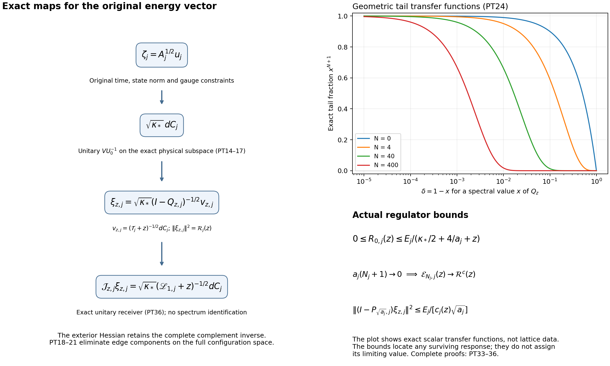

# Positive-time covariance on the original Yang–Mills lattice

This note evaluates the complete two-time current identity and constructs its weighted differential-form and complementary-resolvent representations. It uses the actual interacting ground state throughout. The resulting estimates retain every term that can carry finite-energy weight. They do not assign a positive value to an unevaluated limiting coefficient.

The complete programme inputs are [CE1–CE11](https://github.com/KokunoYumeto/yang-mills-interacting-workbench/blob/72cba101235c8c9c28e78449e752c68d625a535d/yang-mills/continuations/20261011-central-signs-shrinking-window/CURRENT_COVARIANCE_EQUALITY.md), [EF1–EF27](https://github.com/KokunoYumeto/yang-mills-interacting-workbench/blob/72cba101235c8c9c28e78449e752c68d625a535d/yang-mills/continuations/20261011-central-signs-shrinking-window/ENERGY_ROOT_AND_ANCHORED_HISTORIES.md), and the ordered face derivatives and logarithmic Hessian proved in [BM13–BM17](https://github.com/KokunoYumeto/yang-mills-interacting-workbench/blob/72cba101235c8c9c28e78449e752c68d625a535d/yang-mills/continuations/20261011-central-signs-shrinking-window/BOUNDED_ENERGY_MULTIPLIER.md). The human-source comparison in Section 8 uses the original author TeX of Jon Johnsen and Assane Lo. The proof establishes the particular maps and constants needed here; it makes no novelty claim.

## 1. Original objects and the complete two-time identity

At regulator \(j\), retain the open lattice \(z\in\{0,\ldots,2L_j\}^3\), all positive edges \(\mathcal E_j\), all vertex gauge constraints, and Haar probability \(dU\). Each edge has the radius-two \(\mathrm{SU}(2)\) metric with \(T_\beta=-i\sigma_\beta/2\) orthonormal. Write
\[
\begin{gathered}
L_j=j^4,\quad a_j=(100j)^{-1},\quad
g_j^2=\kappa_*a_j/2,\quad b_j=(\kappa_*a_j^2)^{-1},\\
U_p=U_d(z)U_k(z+e_d)U_d(z+e_k)^{-1}U_k(z)^{-1}\quad(d<k),\\
D_p=2-\operatorname{Tr}U_p,\quad
x_{p,j}=o+a_j(z-L_j\mathbf1+(e_d+e_k)/2),\\
M_j=\mathrm{SU}(2)^{\mathcal E_j},\quad
\Delta_j=\sum_{e,\beta}X_{e,\beta}^2,\quad
H_j=-\kappa_*\Delta_j+b_j\sum_pD_p,\\
H_j\psi_j=E_{0,j}\psi_j,\quad \psi_j>0,\quad
\|\psi_j\|=1,\quad w_j=\log\psi_j,\quad
d\mu_j=\psi_j^2dU,\quad A_j=H_j-E_{0,j}I .
\end{gathered}\tag{PT1}
\]
The scalar \(2b_j|\mathcal P_j|\) in the potential and the complete \(E_{0,j}\) remain. All formulas below hold at each finite regulator; suppressing \(j\) does not change an object, metric, time, norm or energy unit.

For real orientation triples \(\mathbf f,\mathbf g\in C_c(\mathbb R^3;\mathbb R)^3\), retain
\[
\begin{gathered}
Y_{\mathbf f}=\sum_{\sigma,p:\sigma}f_\sigma(x_p)D_p,\quad
C_{\mathbf f}=aY_{\mathbf f},\quad
X_{\mathbf f}=C_{\mathbf f}-\mu C_{\mathbf f},\quad
u_{\mathbf f}=\psi X_{\mathbf f},\\
A_{0,\mathbf f}=\sum_{\sigma,p:\sigma}f_\sigma(x_p),\quad
A_{2,\mathbf f}=\sum_{\sigma,p:\sigma}|f_\sigma(x_p)|^2,\quad
s_{\mathbf f}=\Gamma(w,Y_{\mathbf f}),\\
S_t h=\psi^{-1}e^{-tA}(\psi h),\quad
K_{\mathbf f,\mathbf g}(t)=\mu[X_{\mathbf f}S_tX_{\mathbf g}],\\
B_{\mathbf f,\mathbf g}(t)
=\langle A^{1/2}u_{\mathbf f},e^{-tA}A^{1/2}u_{\mathbf g}\rangle .
\end{gathered}\tag{PT2}
\]
Here \(\Gamma(F,G)=\langle dF,dG\rangle\), with the stated edge metric. Inner products are conjugate-linear in the first variable; complex linear combinations follow by sesquilinearity.

All functions in (PT2) are smooth on the finite compact configuration manifold. Ground transformation, integration by parts and spectral differentiation therefore give, including at \(t=0\),
\[
\begin{gathered}
\partial_t S_t=\kappa(\Delta+2\nabla w\cdot\nabla)S_t,\qquad
K'_{\mathbf f,\mathbf g}(t)=-B_{\mathbf f,\mathbf g}(t),\\
B_{\mathbf f,\mathbf g}(t)
=\kappa\mu\Gamma(C_{\mathbf f},S_tC_{\mathbf g}),\\
B'_{\mathbf f,\mathbf g}(t)
=-\mu[r_{\mathbf f}S_t r_{\mathbf g}],\qquad
r_{\mathbf f}=\psi^{-1}A(C_{\mathbf f}\psi).
\end{gathered}\tag{PT3}
\]
For the last identity commute \(A\) with its heat operator and use \(\psi r_{\mathbf f}=Au_{\mathbf f}\). No mixed current term or outside-energy term is omitted.

The four edge Casimirs of the ordered plaquette give the full CE11 identities
\[
\begin{gathered}
\Delta C_{\mathbf f}=6aA_{0,\mathbf f}-3C_{\mathbf f},\\
r_{\mathbf f}
=\kappa(3C_{\mathbf f}-6aA_{0,\mathbf f}-2a s_{\mathbf f}),\quad
\mu r_{\mathbf f}=0,\\
\mu s_{\mathbf f}
=\frac{3\mu C_{\mathbf f}-6aA_{0,\mathbf f}}{2a},\qquad
\widetilde s_{\mathbf f}=s_{\mathbf f}-\mu s_{\mathbf f},\\
r_{\mathbf f}=\kappa(3X_{\mathbf f}-2a\widetilde s_{\mathbf f}).
\end{gathered}\tag{PT4}
\]
Thus the scalar cancels only after its exact mean has been computed. Expanding gives
\[
\begin{aligned}
-B'_{\mathbf f,\mathbf g}(t)=\kappa^2\{&
9K_{\mathbf f,\mathbf g}(t)
-6a\,\mu[X_{\mathbf f}S_t\widetilde s_{\mathbf g}]\\
&-6a\,\mu[\widetilde s_{\mathbf f}S_tX_{\mathbf g}]
+4a^2\mu[\widetilde s_{\mathbf f}S_t\widetilde s_{\mathbf g}]\}.
\end{aligned}\tag{PT5}
\]
Substitute (PT4) into each covariance and commute \(A\) with its heat operator:
\[
\begin{gathered}
\mu[X_{\mathbf f}S_t\widetilde s_{\mathbf g}]
=\mu[\widetilde s_{\mathbf f}S_tX_{\mathbf g}]
=\frac{3K_{\mathbf f,\mathbf g}(t)}{2a}
-\frac{B_{\mathbf f,\mathbf g}(t)}{2a\kappa},\\
\mu[\widetilde s_{\mathbf f}S_t\widetilde s_{\mathbf g}]
=\frac{9K_{\mathbf f,\mathbf g}(t)}{4a^2}
-\frac{3B_{\mathbf f,\mathbf g}(t)}{2a^2\kappa}
-\frac{B'_{\mathbf f,\mathbf g}(t)}{4a^2\kappa^2}.
\end{gathered}\tag{PT6}
\]
Substitution into (PT5) cancels the \(K\) and \(B\) terms and recovers exactly \(-B'\). The already evaluated leading current consequently does not close a new positive-time differential inequality. The remaining covariance occurs at precisely the scale in (PT6).

## 2. What the existing two moments give

For a test with \(E_{\mathbf f}>0\), put
\[
\begin{gathered}
d\sigma_{\mathbf f}(\lambda)
=d\langle A^{1/2}u_{\mathbf f},
\mathbf1_{(-\infty,\lambda]}(A)A^{1/2}u_{\mathbf f}\rangle,\\
E_{\mathbf f}=\int d\sigma_{\mathbf f},\quad
E_{2,\mathbf f}=\int\lambda\,d\sigma_{\mathbf f},\quad
m=E_{2,\mathbf f}/E_{\mathbf f}.
\end{gathered}\tag{PT7}
\]
Taylor's formula with its full integral remainder gives
\[
\begin{aligned}
B_{\mathbf f}(t)
={}&E_{\mathbf f}e^{-tm}\\
&+t^2\int(\lambda-m)^2
\left\{\int_0^1(1-v)e^{-t(m+v(\lambda-m))}\,dv\right\}
d\sigma_{\mathbf f}(\lambda)
\ \ge E_{\mathbf f}e^{-tm}.
\end{aligned}\tag{PT8}
\]
The integrated linear term is zero by (PT7). All moments are finite because the vector is smooth. When \(E_{\mathbf f}=0\), the measure and correlation vanish and no quotient is used.

CE9–CE10 give \(0<e_{\mathbf f}\le\liminf E_{\mathbf f,j}\le\limsup E_{\mathbf f,j}\le U_{\mathbf f}\) and \(\limsup a_jE_{2,\mathbf f,j}\le D_{\mathbf f}\), with full constants in EF3. At fixed \(t>0\), these bounds and (PT8) do not yield a positive regulator-independent lower bound. This is a limitation of that estimate, not an assigned limit of the actual correlation. We next construct the exact operator and its full complementary inverse.

## 3. Weighted forms, curvature and domains

Let \(\mathcal H_k=L^2(M;\Lambda^kT^*M,\mu)\). The exterior derivative is \(d\). Integration against \(\psi^2\), using \(d^*(h\alpha)=h\,d^*\alpha-\iota_{\nabla h}\alpha\), gives
\[
d_\mu^*=\psi^{-2}d^*\psi^2=d^*-2\iota_{\nabla w},\qquad
\mathscr L_k=\kappa(dd_\mu^*+d_\mu^*d)|_{\mathcal H_k}.
\tag{PT9}
\]
Define this operator by the nonnegative closed form
\[
\mathfrak q_k(\alpha,\beta)
=\kappa\{\langle d\alpha,d\beta\rangle_\mu
+\langle d_\mu^*\alpha,d_\mu^*\beta\rangle_\mu\}.
\tag{PT10}
\]
For degrees zero and one its form domain is \(H^1\), and its operator domain is \(H^2\). Here is the finite-regulator domain argument. The smooth weight has positive minimum and finite maximum. On zero forms the form is \(\kappa\|dh\|_\mu^2\). On one forms (PT12) below expresses it as the weighted covariant-gradient norm plus a smooth bounded matrix potential. Adding a sufficiently large finite multiple of the \(L^2\) norm therefore gives equivalent \(H^1\) norms. Finite-chart smoothing and a partition of unity prove density and closure. The positive metric Laplacian is the principal part of the operator. The local elliptic second-derivative estimate follows by freezing the positive principal coefficients in a sufficiently small chart, using the Fourier estimate there and absorbing their small variation; the lower derivatives are bounded by interpolation. A finite cover gives equivalence of its graph norm and the \(H^2\) norm. Repetition gives smooth eigenforms. The embedding \(H^1\to L^2\) is compact: in each chart truncate the Fourier modes, bound the \(L^2\) tail by the inverse frequency times the \(H^1\) norm, and use the finite partition. Thus the resolvent is compact. These constants may depend on \(j\) and \(\psi_j\); no uniform estimate is inferred.

The scalar unitary \(U_0h=\psi h\), from \(L^2(\mu)\) to \(L^2(dU)\), gives
\[
\begin{gathered}
\mathscr L_0=-\kappa(\Delta+2\nabla w\cdot\nabla),\qquad
U_0\mathscr L_0U_0^{-1}=A,\\
\kappa(\Delta w+|\nabla w|^2)
=b\sum_p(2-\operatorname{Tr}U_p)-E_0 .
\end{gathered}\tag{PT11}
\]
The last line is the original ground equation divided by \(\psi\); substituting it into the product-rule expansion proves the conjugation with all scalar terms retained.

For one forms the exact weighted Weitzenböck identity is
\[
\begin{gathered}
\mathscr L_1
=\kappa\{\nabla_\mu^*\nabla+\operatorname{Ric}^{\#}
-2(\nabla^2w)^{\#}\}
=\kappa\{\nabla_\mu^*\nabla+\tfrac12 I-2(\nabla^2w)^{\#}\},\\
\nabla_\mu^*\nabla=\nabla^*\nabla-2\nabla_{\nabla w}.
\end{gathered}\tag{PT12}
\]
To check the signs, (PT9) is the ordinary Hodge Laplacian minus \(2(d\iota_{\nabla w}+\iota_{\nabla w}d)\). In a normal orthonormal frame its first term is \(\nabla^*\nabla+\operatorname{Ric}^{\#}\), from commuting the two covariant derivatives, while its Lie derivative is \(\nabla_{\nabla w}+(\nabla^2w)^\#\). Radius-two \(S^3\) has sectional curvature \(1/4\), hence Ricci \(1/2\). The product has this endomorphism on each edge summand and no mixed curvature. The sharp raises an index with the original metric.

The complete source components are
\[
\begin{gathered}
dC_{\mathbf f}=a\sum_{\sigma,p:\sigma}f_\sigma(x_p)dD_p,\\
(dC_{\mathbf f})_{e,\beta}
=a\sum_{p\ni e}f_pX_{e,\beta}D_p .
\end{gathered}\tag{PT13}
\]
Each derivative acts on the ordered product in (PT1), including inverse-edge signs and transported generators. Thus the initial form has components only on edges of its supporting faces. Its subsequent heat flow need not have that support.

## 4. The exact physical gradient isometry

Let \(\mathcal F\) be the mean-zero gauge-invariant subspace of \(L^2(\mu)\), and \(\mathcal G\) the closure of \(dh\) for smooth gauge-invariant \(h\). The only scalar zero modes are constants, since the zero form energy implies \(dh=0\) and \(M\) is connected. Compact resolvent gives a strictly positive finite-regulator scalar eigenvalue on the mean-zero space. Thus \(d\) has closed range there.

The vertex gauge group acts by product isometries preserving \(\psi,\mu\). Pullback commutes with \(d,d_\mu^*,\mathscr L_k\); averaging over the compact group gives an invariant projection commuting with their resolvents. The derivative of an invariant scalar is zero on every infinitesimal gauge orbit. Its one-form is therefore invariant and horizontal. We use the exact subspace \(\mathcal G\), without claiming that every horizontal form is exact.

Choose an orthonormal scalar eigenbasis \(h_n\) of \(\mathcal F\), with \(\mathscr L_0h_n=\lambda_nh_n\), \(\lambda_n>0\). Since \(d^2=0\), one has \(d\mathscr L_0=\mathscr L_1d\) on smooth functions. Therefore
\[
V=\sqrt\kappa\,d\mathscr L_0^{-1/2}:\mathcal F\longrightarrow\mathcal G,\quad
Vh_n=\sqrt{\kappa/\lambda_n}\,dh_n,\quad
\mathscr L_1Vh_n=\lambda_nVh_n .
\tag{PT14}
\]
Integration by parts gives \(\langle dh_n,dh_m\rangle_\mu=\lambda_m\delta_{nm}/\kappa\); the images are orthonormal. Their span is dense in \(\mathcal G\), since the eigenfunction expansion of a smooth invariant scalar converges in the scalar form norm and hence after differentiation. Thus \(V\) is unitary onto \(\mathcal G\). The orthogonal complement of this eigenform span is invariant under the self-adjoint resolvent, so \(\mathcal G\) is reducing. For every Borel function \(F\),
\[
\begin{gathered}
VF(\mathscr L_0)V^*=F(\mathscr L_1)|_{\mathcal G},\\
D(F(\mathscr L_1)|_{\mathcal G})
=VD(F(\mathscr L_0)|_{\mathcal F}).
\end{gathered}\tag{PT15}
\]
Both domains are precisely the expansions with \(\sum_n|F(\lambda_n)c_n|^2<\infty\). This proves the unbounded-function statement as well as the bounded spectral calculus.

The image of \(U_0^{-1}\zeta_{\mathbf f}=\mathscr L_0^{1/2}X_{\mathbf f}\) under \(V\) is \(\sqrt\kappa\,dC_{\mathbf f}\). Hence
\[
\begin{gathered}
B_{\mathbf f,\mathbf g}(t)
=\kappa\langle dC_{\mathbf f},e^{-t\mathscr L_1}dC_{\mathbf g}\rangle_\mu,\\
\sigma_{\mathbf f,\mathbf g}(J)
=\kappa\langle dC_{\mathbf f},\mathbf1_J(\mathscr L_1)dC_{\mathbf g}\rangle_\mu,\\
G_{\mathbf f,\mathbf g}
=\kappa\langle dC_{\mathbf f},
(\mathscr L_1|_{\mathcal G})^{-1}dC_{\mathbf g}\rangle_\mu .
\end{gathered}\tag{PT16}
\]
The last inverse exists on the stated subspace at finite \(j\). These are identities for the original physical vectors. In particular, the original \(s_j=\kappa_*/j=100\kappa_*a_j\) satisfies
\[
\begin{gathered}
\|\mathbf1_{(0,s_j]}(A_j)\zeta_{\mathbf f,j}\|^2
=\kappa_*\|\mathbf1_{(0,s_j]}(\mathscr L_{1,j})dC_{\mathbf f,j}\|_{\mu_j}^2,\\
\|\mathbf1_{(0,s_j]}(A_j)u_{\mathbf f,j}\|^2
=\kappa_*\langle dC_{\mathbf f,j},
\mathbf1_{(0,s_j]}(\mathscr L_{1,j})
(\mathscr L_{1,j}|_{\mathcal G_j})^{-1}dC_{\mathbf f,j}\rangle_{\mu_j}.
\end{gathered}\tag{PT17}
\]
Both raw and energy-weighted spectral mass remain. The map alone assigns no asymptotic value to them.

## 5. Elimination of every exterior edge component

Let \(Q\subset\mathcal E_j\) contain all edges of all faces with nonzero coefficient in (PT13). Split the full one-form space as \(\mathcal H_Q\oplus\mathcal H_O\), \(O=\mathcal E_j\setminus Q\), by edge components. These are forms on the full \(M_j\): their coefficients still depend on every configuration variable. The component projections are parallel for the product connection, so the rough weighted Laplacian and Ricci in (PT12) are block diagonal. Put
\[
\begin{gathered}
W_{QO}=\Pi_Q(\nabla^2w)^\#\Pi_O,\qquad W_{OQ}=W_{QO}^*,\\
\mathscr L_1=
\begin{pmatrix}
\mathscr L_{QQ}&-2\kappa W_{QO}\\
-2\kappa W_{OQ}&\mathscr L_{OO}
\end{pmatrix},\\
\mathscr S_Q(z)=\mathscr L_{QQ}+zI
-4\kappa^2W_{QO}(\mathscr L_{OO}+zI)^{-1}W_{OQ},\qquad z>0 .
\end{gathered}\tag{PT18}
\]
The diagonal operators are the Friedrichs restrictions of the full nonnegative form to the component subspaces, with domains \(H^2\). The off-diagonal blocks are bounded multiplication operators at finite \(j\). Thus this block expression has the original operator domain. Its exterior inverse acts on all exterior components and all configuration variables.

Completing the quadratic-form square proves
\[
\begin{aligned}
\langle(x,y),(\mathscr L_1+zI)(x,y)\rangle_\mu
={}&\langle x,\mathscr S_Q(z)x\rangle_\mu\\
&+\|(\mathscr L_{OO}+zI)^{1/2}
[y-2\kappa(\mathscr L_{OO}+zI)^{-1}W_{OQ}x]\|_\mu^2 .
\end{aligned}\tag{PT19}
\]
Use \(H^1\) vectors and close the equality. The minimizing exterior component is the bracket's cancellation; the resolvent sends its \(L^2\) input into the exterior operator domain. Since the full form is at least \(z(\|x\|^2+\|y\|^2)\), this gives \(\mathscr S_Q(z)\ge zI\). Solving the two block equations with right hand side \((dC_{\mathbf g},0)\) then gives
\[
\begin{gathered}
\mathcal R_{\mathbf f,\mathbf g}(z)
:=\int_0^\infty e^{-zt}B_{\mathbf f,\mathbf g}(t)\,dt
=\int\frac{d\sigma_{\mathbf f,\mathbf g}(\lambda)}{z+\lambda}\\
=\kappa\langle dC_{\mathbf f},\mathscr S_Q(z)^{-1}dC_{\mathbf g}\rangle_\mu .
\end{gathered}\tag{PT20}
\]
Absolute integrability follows from \(|B_{\mathbf f,\mathbf g}|\le\sqrt{E_{\mathbf f}E_{\mathbf g}}\). Component projections need not preserve exact forms. Thus the elimination uses the full one-form space before taking the source matrix element; restricting the two diagonal blocks separately to exact forms would change the calculation.

The outside contribution has a definite sign and a full positive expression:
\[
\begin{gathered}
\mathscr S_Q(z)\le\mathscr L_{QQ}+zI,\qquad
\mathcal R_{\mathbf f}(z)\ge
\kappa\langle dC_{\mathbf f},(\mathscr L_{QQ}+zI)^{-1}dC_{\mathbf f}\rangle_\mu,\\
\langle x,[(\mathscr L_{QQ}+zI)-\mathscr S_Q(z)]x\rangle_\mu
=4\kappa^2\|(\mathscr L_{OO}+zI)^{-1/2}W_{OQ}x\|_\mu^2 .
\end{gathered}\tag{PT21}
\]
The inverse order follows from
\(\langle v,T^{-1}v\rangle=\sup_x\{2\operatorname{Re}\langle v,x\rangle-\langle x,Tx\rangle\}\)
for \(T>0\). This proves the effect of the exterior Hessian. It does not identify this component elimination with an earlier finite Wilson Gram compression.

## 6. Full Hessian contributions and a convergent inverse

Use the previously proved actual bound \(\nabla^2w\ge-2(\kappa a)^{-1}g\). Set
\[
\begin{gathered}
\mathcal S=(\nabla^2w)^\#+\frac{2}{\kappa a}I\ge0,\qquad
\mathcal T=\kappa\nabla_\mu^*\nabla+
\left(\frac{\kappa}{2}+\frac4a\right)I,\qquad
\mathscr L_1=\mathcal T-2\kappa\mathcal S,\\
Q_z=2\kappa(\mathcal T+zI)^{-1/2}
\mathcal S(\mathcal T+zI)^{-1/2},\\
\mathfrak m=2\kappa\|\mathcal S\|_{L^\infty(M)},\qquad
q_z=\frac{\mathfrak m}{z+\mathfrak m}<1 .
\end{gathered}\tag{PT22}
\]
Both \(4/a\) and \(\kappa/2\) remain. The supremum is finite at each regulator and has not been assigned a uniform value.

The operator \(Q_z\) is nonnegative. Since
\(\mathcal T+zI=(\mathscr L_1+zI)+2\kappa\mathcal S
\le(1+\mathfrak m/z)(\mathscr L_1+zI)\)
as forms, conjugation gives
\[
\begin{gathered}
0\le Q_z\le q_z I,\\
(\mathscr L_1+zI)^{-1}
=(\mathcal T+zI)^{-1/2}(I-Q_z)^{-1}(\mathcal T+zI)^{-1/2}.
\end{gathered}\tag{PT23}
\]
The factorization first acts between the common \(H^1\) form space and its dual. The strict lower bound on \(I-Q_z\) gives the displayed bounded \(L^2\) inverse. Thus no formal inverse or unproved series convergence is used.

For \(v_{z,\mathbf f}=(\mathcal T+zI)^{-1/2}dC_{\mathbf f}\), the finite geometric identity yields
\[
\begin{gathered}
\mathcal R_{\mathbf f,\mathbf g}(z)
=\kappa\sum_{n=0}^{N}\langle v_{z,\mathbf f},Q_z^nv_{z,\mathbf g}\rangle_\mu
+\mathcal E_{N,\mathbf f,\mathbf g}(z),\\
\mathcal E_{N,\mathbf f,\mathbf g}(z)
=\kappa\langle v_{z,\mathbf f},
Q_z^{N+1}(I-Q_z)^{-1}v_{z,\mathbf g}\rangle_\mu,\\
|\mathcal E_{N,\mathbf f,\mathbf g}(z)|
\le\kappa\frac{q_z^{N+1}}{1-q_z}
\|v_{z,\mathbf f}\|_\mu\|v_{z,\mathbf g}\|_\mu,\qquad
\mathcal E_{N,\mathbf f}(z)\ge0 .
\end{gathered}\tag{PT24}
\]
The bound tends to zero at every finite regulator. For a finite test family every term and remainder matrix is positive semidefinite. The full first correction is
\[
\kappa\langle v_{z,\mathbf f},Q_zv_{z,\mathbf g}\rangle_\mu
=2\kappa^2\langle
(\mathcal T+zI)^{-1}dC_{\mathbf f},
\mathcal S(\mathcal T+zI)^{-1}dC_{\mathbf g}\rangle_\mu .
\tag{PT25}
\]
All later terms and the remainder retain the actual ground density. The finite contraction bound does not assert uniform convergence as \(j\to\infty\).

The diagonal \(n=0\) term has the following quantitative evaluation from existing actual estimates. Cauchy–Schwarz for \((\mathcal T+zI)^{1/2}\) and its inverse gives
\[
\begin{gathered}
\mathcal R_{\mathbf f}(z)
\ge\kappa\langle dC_{\mathbf f},(\mathcal T+zI)^{-1}dC_{\mathbf f}\rangle_\mu\\
\ge\frac{E_{\mathbf f}^{\,2}}
{\kappa^2\mu\|\nabla^2C_{\mathbf f}\|^2+
(\kappa/2+4/a+z)E_{\mathbf f}}\\
\ge\frac{E_{\mathbf f}^{\,2}}
{21\kappa^2a^2A_{2,\mathbf f}
+(\kappa/2+4/a+z)E_{\mathbf f}} .
\end{gathered}\tag{PT26}
\]
Indeed \(\|dC\|_\mu^2=E/\kappa\) and
\(\langle dC,\nabla_\mu^*\nabla dC\rangle_\mu=\mu\|\nabla^2C\|^2\).
Substitution gives the first denominator; CE10 gives the last one. For \(E=0\) use the undivided zero identity.

With \(J_2^\Sigma=\sum_\sigma\int f_\sigma^2\), the exact Riemann limit \(a_j^3A_{2,\mathbf f,j}\to J_2^\Sigma\) and EF3 yield, for fixed \(z>0\),
\[
\liminf_{j\to\infty}\frac{\mathcal R_{\mathbf f,j}(z)}{a_j}
\ge
\frac{e_{\mathbf f}^{\,2}}
{21\kappa_*^2J_2^\Sigma+4U_{\mathbf f}}>0 .
\tag{PT27}
\]
This bound is at scale \(a_j\) and does not assert a nonzero limit of the unscaled response. The rest of (PT24) is its exact nonnegative correction; (PT21) also retains the exterior contribution.

## 7. Exact limiting coefficients and finite windows

Use the EF ultrafilter and continuous projection \(P\). Put \(\zeta_{\mathbf f}=[A_j^{1/2}u_{\mathbf f,j}]\), \(\overline E_{\mathbf f}=\|\zeta_{\mathbf f}\|^2\), and let \(\sigma^c_{\mathbf f}\) be its continuous-subspace spectral measure, including zero. Then
\[
\begin{gathered}
\mathcal R^c_{\mathbf f}(z)
:=\lim_{\mathcal U}\mathcal R_{\mathbf f,j}(z)
=\int_{[0,\infty)}\frac{d\sigma^c_{\mathbf f}(\lambda)}{z+\lambda},\\
\lim_{z\to\infty}z\mathcal R^c_{\mathbf f}(z)=\|P\zeta_{\mathbf f}\|^2,\qquad
\lim_{z\downarrow0}z\mathcal R^c_{\mathbf f}(z)=\|Z\zeta_{\mathbf f}\|^2 .
\end{gathered}\tag{PT28}
\]
Here is a direct justification avoiding an unproved interchange of ultralimit and integral. On \([\varepsilon,T]\), spectral calculus gives
\(|B'_{\mathbf f,j}(t)|\le E_{\mathbf f,j}/(e\varepsilon)\);
thus Riemann sums for the Laplace integral converge uniformly in \(j\). The omitted intervals \([0,\varepsilon]\) and \([T,\infty)\) contribute at most
\(\varepsilon\sup_jE_{\mathbf f,j}\) and \(z^{-1}e^{-zT}\sup_jE_{\mathbf f,j}\).
The uniform bound holds after ignoring finitely many regulators. This proves the first equality. Bounded convergence for \(z/(z+\lambda)\) proves the two endpoint formulas. Their order matters: at finite \(j\), taking \(z\downarrow0\) first gives zero since the original energy vector has no zero atom.

Consequently (PT20) and (PT24) calculate the same coefficient received by the actual phase measures in EF25–EF27. Infinite-energy escape contributes zero to the resolvent kernel. Zero-energy collapse contributes \(\|Z\zeta_{\mathbf f}\|^2/z\), with original time retained.

Let \(m_{\mathbf f,j}(r)=\sigma_{\mathbf f,j}((0,r])\). Splitting the finite measure at \(r>0\) gives
\[
\begin{gathered}
\mathcal R_{\mathbf f,j}(z)
\le\frac{m_{\mathbf f,j}(r)}{z}
+\frac{E_{\mathbf f,j}-m_{\mathbf f,j}(r)}{z+r},\\
m_{\mathbf f,j}(r)\ge
\max\left\{0,\frac{z(z+r)}r
\left[\mathcal R_{\mathbf f,j}(z)-\frac{E_{\mathbf f,j}}{z+r}\right]\right\},\\
\nu_{\mathbf f,j}((0,r])\ge m_{\mathbf f,j}(r)/r .
\end{gathered}\tag{PT29}
\]
There is no finite zero atom; on the window \(d\sigma=\lambda\,d\nu\), which proves the final inequality. This applies at the original \(r=s_j=100\kappa_*a_j\). The subtraction \(E/(z+r)\) is essential: (PT27) does not make its bracket positive at fixed \(z\).

Section 9 advances this calculation: every fixed truncation, including the term (PT25), is evaluated as vanishing in the original limit. The remaining response is exactly the full tail localized there. These are actual ground-state quantities, not hypotheses assumed in a theorem.

## 8. Primary-source comparison and compact-domain obstruction

Jon Johnsen, [On the spectral properties of Witten-Laplacians, their range projections and Brascamp-Lieb's inequality](https://arxiv.org/abs/1703.10011v2), original author source v2, closed-range Section 3 (lines 934–1167) and the unitary-transformation and exact-range passage (lines 1439–1558), provides the general polar-isometry setting. Archive and TeX hashes, actual reading coverage and receiving formulas are in the source-use ledger. Equation (PT14) specializes \(T=\sqrt\kappa\,d\); the exact-range target and domains were proved above.

At source line 1025 the printed statement \(R(S_1)=Z(S_1)=\{0\}\) accompanies the conclusion that \(S_1^{-1}\) is defined on \(F_1\). This is a typographical error in that step: the needed identity is \(R(S_1)^\perp=Z(S_1)\), and the already established closed range and zero kernel imply \(R(S_1)=F_1\). The eigenbasis argument (PT14)–(PT15) independently proves the required specialization. The original author source is preserved unchanged; no wider defect is inferred from that line.

Assane Lo, [Witten Laplacian Methods for the Decay of Correlations](https://arxiv.org/abs/math-ph/0611002v9), original author source v9, Section 2 (lines 308–446) and the weighted-convexity setup (lines 2029–2083), supplies the Euclidean weighted formula and its spatially weighted Hessian assumption. The exact dictionary here is
\[
\begin{gathered}
\Phi=-2w,\quad e^{-\Phi}dU=\psi^2dU,\quad
\nabla^2\Phi=-2\nabla^2w,\\
\kappa(-\Delta+\nabla\Phi\cdot\nabla)=\mathscr L_0,\\
\kappa\{\nabla_\mu^*\nabla+\operatorname{Ric}^{\#}
+(\nabla^2\Phi)^{\#}\}=\mathscr L_1 .
\end{gathered}\tag{PT30}
\]
Thus the Euclidean one-form formula gains the original product Ricci \(I/2\) and retains \(\kappa\). Multiplication by \(e^{-\Phi/2}=\psi\) conjugates the scalar operator to the full original \(A\), by (PT11). This proves the comparison with the curved configuration manifold.

Strict global Hessian convexity cannot be imported on this compact domain. Indeed \(\nabla^2\Phi\ge\delta g\), \(\delta>0\), would imply in dimension \(n=3|\mathcal E_j|\)
\[
0=\int_M\Delta\Phi\,d\operatorname{vol}
\ge n\delta\,\operatorname{vol}(M)>0 .
\tag{PT31}
\]
The equality is the divergence theorem on the closed manifold. The same trace obstruction holds for a globally defined invertible bundle map \(J\) whose similarity-weighted Hessian \(J^{-1}(\nabla^2\Phi)^\#J\) has quadratic form at least \(\delta I\): similarity preserves the trace \(\Delta\Phi\). This statement concerns that pointwise bound, not the full weighted operator.

The structure retained by the obstruction is the complete form
\[
\begin{aligned}
&\kappa\{\|\nabla\alpha\|_\mu^2+\tfrac12\|\alpha\|_\mu^2
-2\mu[\nabla^2w(\alpha^\sharp,\overline{\alpha^\sharp})]\}\\
&\hspace{15mm}
=\kappa\{\|d\alpha\|_\mu^2+\|d_\mu^*\alpha\|_\mu^2\}\ge0 .
\end{aligned}\tag{PT32}
\]
The Hessian pairing is extended sesquilinearly; its value is real. Together with its scalar-gradient unitary (PT14), exterior square (PT21) and full Hessian correction (PT24), this gives an exact relation to the original physical spectrum despite the compact convexity obstruction.

## 9. Evaluation of every fixed truncation and the surviving tail

The preceding calculation can be advanced beyond the lower bound (PT27). Put
\(c_j(z)=\kappa_*/2+4/a_j+z\).
Since \(\mathcal T_j+zI\ge c_j(z)I\), the actual zeroth coefficient obeys the upper bound
\[
0\le R_{0,\mathbf f,j}(z)
:=\kappa_*\|v_{z,\mathbf f,j}\|_{\mu_j}^2
\le \frac{E_{\mathbf f,j}}{c_j(z)} .
\tag{PT33}
\]
The lower estimate in (PT26) applies to this same coefficient. It follows that its scale is bounded above by a constant times \(a_j\), and bounded below at that scale for a nonzero test. This is an evaluation of the original coefficient's asymptotic order, without selecting a comparison probability law.

Moreover \(0\le Q_z\le I\). Thus, retaining each coefficient and the entire remainder,
\[
\begin{gathered}
0\le \kappa_*\sum_{n=0}^{N_j}
\langle v_{z,\mathbf f,j},Q_{z,j}^nv_{z,\mathbf f,j}\rangle_{\mu_j}
\le\frac{(N_j+1)E_{\mathbf f,j}}{c_j(z)},\\
a_j(N_j+1)\longrightarrow0
\quad\Longrightarrow\quad
\lim_{\mathcal U}\mathcal E_{N_j,\mathbf f,j}(z)
=\mathcal R^c_{\mathbf f}(z).
\end{gathered}\tag{PT34}
\]
The implication is proved by subtracting the first line from the exact identity (PT24), using the bounded actual energies and (PT28). It applies to every fixed truncation and also to any sequence of truncation lengths growing more slowly than \(a_j^{-1}\). Off-diagonal terms obey the same conclusion by Cauchy–Schwarz for each positive remainder and coefficient matrix. In particular, the entire first correction (PT25) tends to zero at fixed \(z\). Therefore its isolated evaluation cannot establish a positive limiting response. The cumulative tail, at a number of steps diverging with the original regulator, is required by the actual estimates already proved.

This tail has an exact spectral location. Let
\[
\begin{gathered}
\xi_{z,\mathbf f,j}
=\sqrt{\kappa_*}(I-Q_{z,j})^{-1/2}v_{z,\mathbf f,j},\quad
\|\xi_{z,\mathbf f,j}\|_{\mu_j}^2=\mathcal R_{\mathbf f,j}(z)
\le E_{\mathbf f,j}/z,\\
P_{\delta,j}=\mathbf1_{(1-\delta,1]}(Q_{z,j}),\qquad 0<\delta<1,\\
\|(I-P_{\delta,j})\xi_{z,\mathbf f,j}\|_{\mu_j}^2
=\kappa_*\int_{[0,1-\delta]}
\frac{d\langle v_{z,\mathbf f,j},
\mathbf1_{(-\infty,x]}(Q_{z,j})v_{z,\mathbf f,j}\rangle_{\mu_j}}{1-x}
\le\frac{E_{\mathbf f,j}}{c_j(z)\delta}.
\end{gathered}\tag{PT35}
\]
The measure is the raw spectral measure of \(v_z\); its norm has not been changed. All factors are explicit. For example \(\delta_j=\sqrt{a_j}\) makes the last bound tend to zero. Consequently the full limiting response equals the limit of \(\|P_{\sqrt{a_j},j}\xi_{z,\mathbf f,j}\|^2\). This concentration statement does not claim that either norm has a positive limit; it identifies the exact part where such a limit must be evaluated.

There is a unitary map to the original resolvent vector, so this auxiliary spectral location has an explicit physical receiver. In the full one-form Hilbert space set \(D_z=\mathscr L_1+zI\), \(T_z=\mathcal T+zI\). Their common form domain and (PT23) give
\[
\begin{gathered}
\mathcal J_z=D_z^{1/2}T_z^{-1/2}(I-Q_z)^{-1/2},\qquad
\mathcal J_z^*\mathcal J_z=\mathcal J_z\mathcal J_z^*=I,\\
\mathcal J_z\xi_{z,\mathbf f}
=\sqrt\kappa\,D_z^{-1/2}dC_{\mathbf f},\\
\|\mathbf1_{[0,1-\delta]}(Q_z)\xi_{z,\mathbf f}\|_\mu
=\|(I-\mathcal J_zP_\delta\mathcal J_z^*)
\sqrt\kappa\,D_z^{-1/2}dC_{\mathbf f}\|_\mu .
\end{gathered}\tag{PT36}
\]
To prove all products are bounded and the map is onto, put \(F=D_z^{1/2}T_z^{-1/2}\). The form inequalities \(D_z\le T_z\le(1+\mathfrak m/z)D_z\) show that \(F\) is bounded and has bounded inverse \(T_z^{1/2}D_z^{-1/2}\). Direct computation in the form domain yields \(F^*F=I-Q_z\). Therefore \(F(I-Q_z)^{-1/2}\) is unitary. Its action on \(\xi_z\) follows from
\(T_z^{-1/2}(I-Q_z)^{-1}T_z^{-1/2}=D_z^{-1}\).
The final norm identity is unitary conjugation. Composing the middle line with \(V^*\) and \(U_0\), as defined in (PT14), receives precisely \((A+zI)^{-1/2}\zeta_{\mathbf f}\). Only the full vector is asserted to lie in \(\mathcal G\); the component selected by \(P_\delta\) need not do so.

Thus the interval near one for \(Q_z\) is related to the original physical resolvent by (PT36), not by equating the spectra of \(Q_z\) and \(A\). Formula (PT17) remains the direct exact map for the original shrinking energy window. The calculation now advances the next task from the isolated term (PT25) to the actual near-one distribution in (PT35), together with its exterior-Hessian inverse (PT18)–(PT21). The order-\(a_j\) response and the complete vanishing of all sub-\(a_j^{-1}\) truncations are proved; the size of the surviving tail remains to be calculated.

The figure shows the exact maps in PT14–PT36 and the geometric tail transfer functions. It contains no lattice measurements. Reproducible sources and bounded diagnostics are in check_positive_time.py; exact source editions and reading coverage are in [the source-use ledger](POSITIVE_TIME_SOURCE_USE_LEDGER.json).

## Actual ground-gradient trials and complete variational residual

[SG1–SG33](https://github.com/KokunoYumeto/yang-mills-interacting-workbench/blob/main/yang-mills/continuations/20261011-central-signs-shrinking-window/ACTUAL_GROUND_GRADIENT_TRIAL.md) construct edge-weighted gradients of the actual logarithmic ground density and compute their complete energy, current covariance, source overlap and exterior Hessian contributions. Exact optimization over every deterministic edge weight gives a strictly positive finite matrix and an explicit residual mapping its value to the full physical resolvent. A forced equation relates the trial directly to the derivative of the original plaquette potential. For the unchanged three-orientation tent test, the sign trial improves the previous proved lower-bound coefficient by more than ten thousand; its lattice-spacing scale is retained. The remaining signed contraction and full residual have not been assigned limiting values. Complete proofs, exact coefficient comparisons and reproducible inspected figures are included. The physical exact projection removes the entire nonnegative Hessian graph energy while preserving source overlap. Its improved current-covariance matrix retains both full residual norms. Every exterior graph connection and the complete kernel of the removed defect are specified.

## Actual filtered currents and the complete inverse contribution

[FTC1–FTC33](https://github.com/KokunoYumeto/yang-mills-interacting-workbench/blob/main/yang-mills/continuations/20261011-central-signs-shrinking-window/ACTUAL_FILTERED_CURRENT_AND_TAIL.md) transfer the original positive first energy to the outside Wilson source and prove a positive filtered-response bound with its original vanishing scale retained. The complete inverse contribution is located through an exact map from the physical window, including its full metric. Direct optimization of the filtered response retains the original force, every mixed Hessian and all exterior rows in a complete second-moment matrix. Both physical residual norms remain. An explicit comparison measure shows why the moment bounds alone do not establish surviving low-energy weight. The signed three-scale interacting response and the continuum no-gap endpoint remain active calculations.

## Full current complement and its relative-energy measure

[CSR1–CSR21](https://github.com/KokunoYumeto/yang-mills-interacting-workbench/blob/main/yang-mills/continuations/20261011-central-signs-shrinking-window/FULL_CURRENT_SCHUR_AND_ENERGY_MEASURE.md) construct the full current-span Schur response with its corrected source and both physical solution components. The actual complementary coupling measure satisfies
\[
M_j([0,\theta s_j])\le1500\theta a_j^3I,\qquad
\int\lambda^{-1}dM_j(\lambda)\le Q_j .
\]
A common actual subsequence gives a bounded relative-energy measure with both endpoint atoms retained. It evaluates the effective current energy and the full complementary lift's norm and energy at their original \(a_j^4,a_j^5\) scales. The exact effective kernel includes KP17's current-trial kernel; the full physical projection and source cross measure remain in the response. All three original shifts, raw coefficient norms and complementary contributions are preserved. The signed physical window and smooth interacting no-gap endpoint remain active calculations.

## Full gauge-current matrix and exact dynamic curl

[GCM1–GCM16](https://github.com/KokunoYumeto/yang-mills-interacting-workbench/blob/main/yang-mills/continuations/20261011-central-signs-shrinking-window/GAUGE_CURRENT_COVARIANCE_AND_DYNAMIC_CURL.md) retain the complete vertex cross covariance and prove the full matrix lower bound
\[
\mathsf V_g\ge a_j^4\mathsf A_0\mathsf A_1^\dagger\mathsf A_0
\ge\frac{a_j^4}{12}\mathsf A_0,\qquad
\mathsf A_0=\mu B_U^*B_U,\quad
\mathsf A_1=\mu B_U^*(K_U^*K_U)B_U .
\]
The physical source-energy receiver keeps this entire correction. Its scalar inverse and continuum inverse-half domains are proved in GCM6–GCM9. The single-edge bound \((\mathsf V_g)_{ee}\ge2\mathsf N_{ee}/7\) is a diagonal statement: the full original constant list has \(\mathsf V_g\mathbf1=0\) and \(P\mathsf C\mathbf1=\mathsf C\mathbf1\). No factor inferred from the diagonal replaces the actual matrix.

The original contraction \(\mathscr T\alpha=K_U^*\alpha^\sharp\) satisfies
\[
\mathscr T L_1-L_0^{\mathbb V}\mathscr T
=\kappa_*\mathscr R\,d,\qquad
\mathscr R\omega=\mathscr S_U((*_e\omega_{ee})_e).
\]
GCM13–GCM16 prove every connection sign, the \(12\) degree bounds, the current identity with zero initial diagonal curl, and the complete two-form resolvent correction. GCM10–GCM12 construct the graph-energy receiver for a common smooth spatial weight, with no infinity atom at \(\lambda/a_j^2\). Its connection to physical time energy \(\lambda/s_j\) remains the exact norm and dynamic maps above. All endpoint atoms in the physical measure, original raw coefficients, mixed scalar kernels and the signed physical window remain.

## Exact force receiver and common physical source

[TFC1–TFC26](https://github.com/KokunoYumeto/yang-mills-interacting-workbench/blob/main/yang-mills/continuations/20261011-central-signs-shrinking-window/TWO_FORM_FORCE_AND_COMMON_SPECTRUM.md) prove the full original force-curl receiver, including
\[
L_2d\mathsf Cc=-a_j^2d(D_cdV),\qquad
\mathsf N^\perp=\kappa_*a_j^4
\int_{(0,\infty)}\lambda^{-3}\,d\Omega_j(\lambda).
\]
The actual force covariance tends strongly to \(9/\kappa_*^2\) times the direction-difference projection on the original support cube. Its kernel is exactly the common-coefficient subspace. For a common \(C_c^1\) coefficient, TFC15 evaluates the next spatial term and TFC21–TFC22 prove a uniform removed-current second moment at the unchanged energy. All face deficits, their second moments, outside neighbors and limiting zero atoms remain.

The original common plaquette observable \(X_{\varphi,j}\) and the explicitly defined centered squared-score observable \(Q_{\varphi,j}\) satisfy
\[
dX_{\varphi,j}+dQ_{\varphi,j}
=-\frac{\kappa_*a_j}{2}L_1P\mathsf Cc_j+Pe_{\varphi,j},
\qquad \|e_{\varphi,j}\|=O(a_j).
\]
TFC23–TFC25 prove the complete low-band and original three-shift comparisons. The displayed scaled response error is \(O(a_j)\); its unscaled error is only \(O(1)\), and no positive window sign is inferred. TFC26 proves that the leading full Hessian-pair remainder kills the common subspace, with \(\mathcal Qh=\kappa_*\mathcal Gh\) there. These formulas strengthen the existing physical, score and force receivers while leaving the actual spectral allocation and interacting smooth global no-gap construction active.

## Exact scalar source and full positive-energy band

[TSC1–TSC12](https://github.com/KokunoYumeto/yang-mills-interacting-workbench/blob/main/yang-mills/continuations/20261011-central-signs-shrinking-window/SCALAR_COMMON_SOURCE_RECONSTRUCTION.md) integrate the common-source gradient identity with every original centering constant:
\[
X_{\varphi,j}+Q_{\varphi,j}
=\frac{\kappa_*^2a_j^3}{2}B_{c_j}+r_{\varphi,j},
\qquad r_{\varphi,j}=\kappa_*L_0^{-1}\delta_\mu e_{\varphi,j}.
\]
The full scalar score term has norm \(O(\sqrt{a_j})\). For every Borel subset \(B\subset[\epsilon s_j,\infty)\), the exact finite estimate proves
\[
\|E_0(B)(X_{\varphi,j}+Q_{\varphi,j})\|
\le d_{\varphi,j}(\epsilon s_j)=O(\sqrt{a_j}).
\]
Consequently the original \(X\) and squared-score \(Q\) masses have equal extended liminf and limsup on every such sequence of bands, including the original shrinking annulus. This compares the actual unweighted physical masses without assigning a positive value to either one. TSC8–TSC9 retain all three original response shifts and give explicit signed bounds. TSC10–TSC12 evaluate the actual mixed density/score covariance combination and give a whole-variance floor of order \(a_j\). The weighted Poisson residual at zero, all mixed terms and original coefficient norms remain. The spectral allocation and smooth interacting continuum no-gap construction continue.

## Actual memory and complete character-coordinate operator

[MTO1–MTO20](https://github.com/KokunoYumeto/yang-mills-interacting-workbench/blob/main/yang-mills/continuations/20261011-central-signs-shrinking-window/ACTUAL_MIXED_TIME_EVOLUTION.md) prove the actual conditional memory and its exact Laplace map to the full Schur inverse. The original character frame identifies every conditional fluctuation with the tangent space of the actual square-root probability map into the sphere. Its metric, connection, curvature, physical coefficient laws and full complementary Hamiltonian are explicit. The original ground equation evaluates the entire connection-and-potential combination and proves
\[
q(\boldsymbol\Xi c,\boldsymbol\Xi d)
=\kappa_*\int A^2\sum_i[(X_ic)^*C(X_id)
+\overline{r_i^Tc}(r_i^Td)]\,dU.
\]
MTO11 and MTO16 retain the exact comparison with all original Wilson-potential terms. MTO19 calculates the full action on the actual face source, and MTO20 retains the mixed-time remainder. The joint three-shift correlation, limiting annular mass, reconstruction and smooth global no-gap state remain active.
