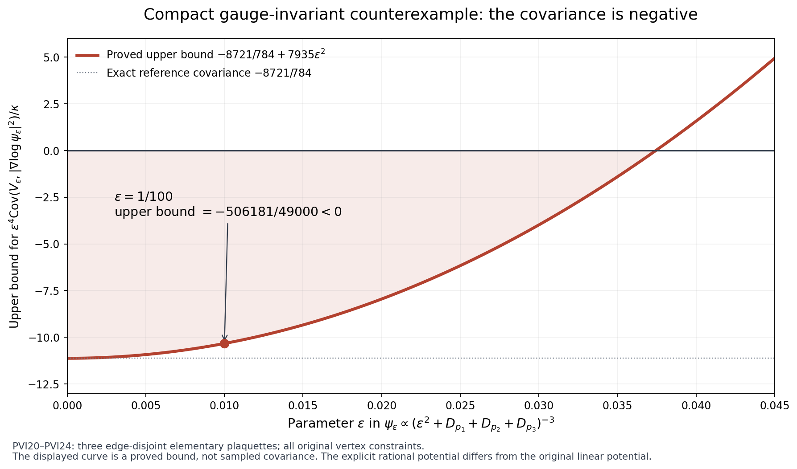

# Stationary potential identities and the local square estimate

This independent calculation uses the actual finite-volume Hamiltonian
\(H=-\kappa\Delta+V\), \(V=b\sum_p(2-\operatorname{Tr}U_p)\), the radius-two
product metric on \(\mathrm{SU}(2)^E\), and its positive unit ground state
\(\psi\). All original vertex gauge actions, including boundary vertices,
are retained. Set \(H\psi=\mathcal E\psi\), \(w=\log\psi\),
\(d\mu=\psi^2dU\), and \(Z=|\nabla w|^2\).
The scalar \(2bM\) remains part of \(V\).

## PVI1. Exact stationary covariance identity

For every real smooth function \(F\),
\[
 \boxed{\operatorname{Cov}_\mu(F,V)
       +\kappa\operatorname{Cov}_\mu(F,Z)
       ={\kappa\over2}\mu\Delta F.}                 \tag{PVI1}
\]
Indeed, division by the strictly positive ground state gives
\(V-\mathcal E=\kappa(\Delta w+Z)\). Haar integration by parts gives
\[
 \mu(F\Delta w)=-\mu\Gamma(F,w)-2\mu(FZ),\qquad
 \mu\Gamma(F,w)=-\tfrac12\mu\Delta F.
\]
Consequently
\(\mu(FV)=\mathcal E\mu F+(\kappa/2)\mu\Delta F-\kappa\mu(FZ)\).
Taking \(F=1\) proves
\(\mu V=\mathcal E-\kappa\mu Z\); subtracting its product with \(\mu F\)
proves (PVI1), with the means retained.

In particular,
\[
 \boxed{\operatorname{Var}_\mu V
   ={\kappa\over2}\mu\Delta V
                  -\kappa\operatorname{Cov}_\mu(V,Z).} \tag{PVI2}
\]
The original full potential obeys
\[
 \Delta V=6bM-3V,
 \qquad
 \operatorname{Var}_\mu V
 ={3\kappa b\over2}(2M-\mu\textstyle\sum_pD_p)
                  -\kappa\operatorname{Cov}_\mu(V,Z). \tag{PVI3}
\]
The last covariance has not been deleted or assigned a sign.

For the unchanged signed smearing
\(C_f=a\sum_p f(x_p)D_p=2aA_0-a\sum_p f(x_p)W_p\),
\(A_0=\sum_p f(x_p)\), \(m_f=\mu C_f\), the exact consequence is
\[
 b\sum_q\operatorname{Cov}_\mu(C_f,D_q)
    +\kappa\operatorname{Cov}_\mu(C_f,Z)
        ={\kappa\over2}(6aA_0-3m_f).                \tag{PVI4}
\]
All three original face orientations occur in both sums. The first
term is a row sum of the full face covariance matrix; it is not
\((b/a)\operatorname{Var}C_f\) for a nonconstant smearing.

## PVI2. Kinetic variance and the exact Hessian remainder

Write \(K=-\Delta\), \(T=\langle\psi,K\psi\rangle=\mu Z\).
The ground equation implies the exact vector equality
\[
 (V-\mu V)\psi=-\kappa(K-T)\psi,
 \quad
 \operatorname{Var}_\mu V
   =\kappa^2\bigl(\|K\psi\|^2-T^2\bigr).           \tag{PVI5}
\]
This is an equality of variances, not an upper bound on either variance.
All quantities are finite because the original configuration manifold
is compact and \(\psi\) is smooth.

Let \(h=\nabla^2w\) and \(\mathscr L=\Delta+2\nabla w\cdot\nabla\).
The integrated Bochner identity gives
\[
 \mu(\mathscr Lw)^2
 =\mu\|h\|^2+\mu\operatorname{Ric}(\nabla w,\nabla w)
      -2\mu h(\nabla w,\nabla w).
\]
Since \(V-\mu V=\kappa[\mathscr Lw-(Z-\mu Z)]\) and
\(\mu(Z\mathscr Lw)=-2\mu h(\nabla w,\nabla w)\), expansion gives
\[
 \operatorname{Var}_\mu V
 =\kappa^2\bigl[
  \mu\|h\|^2+\mu\operatorname{Ric}(\nabla w,\nabla w)
  +\operatorname{Var}_\mu Z+2\mu h(\nabla w,\nabla w)\bigr]. \tag{PVI6}
\]
Differentiating \(V-\mathcal E=\kappa(\Delta w+Z)\), applying the
scalar Bochner identity, and integrating yields
\[
 \mu\Delta V=2\kappa[\mu\|h\|^2+
                           \mu\operatorname{Ric}(\nabla w,\nabla w)].
                                                               \tag{PVI7}
\]
Thus the remainder omitted by a proposed
\(\operatorname{Var}V\le(\kappa/2)\mu\Delta V\) is exactly
\[
 -\kappa\operatorname{Cov}_\mu(V,Z)
  =\kappa^2[\operatorname{Var}_\mu Z
                         +2\mu h(\nabla w,\nabla w)].            \tag{PVI8}
\]
Here \(\operatorname{Ric}=\tfrac12g\). The available bound
\(h\ge-2\sqrt{b/\kappa}\,g\) supplies a lower bound on this remainder,
not the upper sign required to delete it.

## PVI3. Exact localization and its exterior term

Use the original cube patch \(Q\), its inside edges, inside face sum
\(W=\sum_{p\subset Q}D_p\), crossing sum \(W_\times\), and outside
Hamiltonian \(H_{\mathrm{out}}\). Set
\[
 Z_Q=|\nabla_Qw|^2,\quad
 e_Q={(-\kappa\Delta_Q+bW)\psi\over\psi},\quad
 r_{\mathrm{out}}={H_{\mathrm{out}}\psi\over\psi}.
\]
These are well-defined smooth functions. The exact decomposition is
\(e_Q=\mathcal E-r_{\mathrm{out}}-bW_\times\), and partial integration
in the original inside coordinates gives
\[
 \boxed{b\operatorname{Cov}_\mu(F,W)
 ={\kappa\over2}\mu\Delta_QF
   -\kappa\operatorname{Cov}_\mu(F,Z_Q)
   -\operatorname{Cov}_\mu(F,r_{\mathrm{out}}+bW_\times).} \tag{PVI9}
\]
The proof repeats the two integrations in (PVI1) with \(\Delta_Q\):
\(bW-e_Q=\kappa(\Delta_Qw+Z_Q)\), then center the resulting equality.
In particular, since \(\Delta_QW=6M_Q-3W\),
\[
 b\operatorname{Var}_\mu W
 ={\kappa\over2}(6M_Q-3d)
   -\kappa\operatorname{Cov}_\mu(W,Z_Q)
   -\operatorname{Cov}_\mu(W,r_{\mathrm{out}}+bW_\times),\quad d=\mu W.
                                                               \tag{PVI10}
\]
An operator lower bound on \(H_{\mathrm{out}}\) does not give a sign
to this last covariance. The pointwise function
\((H_{\mathrm{out}}\psi)/\psi\) is retained exactly.

## PVI4. Verified local square improvement on the original potential

This section verifies and slightly strengthens the parent calculation.
Write \(M=M_Q\), \(\Lambda=\Lambda_Q\), \(\alpha=\kappa/b\),
\(S=\Gamma(W)\), \(J(W)=6M-3W\). These symbols are local to this section;
the full potential and full score above are unchanged.
The original local budget OS34 is
\[
 \mu W^2+\alpha\mu(WZ_Q)
       \le\Lambda d+\alpha(3M-3d/2).                \tag{PVI11}
\]
It follows by applying the original local Hamiltonian lower bound to
\(\sqrt{W+\varepsilon}\psi\), retaining the inside kinetic energy, and
cancelling its \(\Gamma(W)/(4(W+\varepsilon))\) term against the full
ground-transform form. The surviving cross term is
\(\mu\Gamma(w,W)=-(1/2)\mu\Delta W=3d/2-3M\).
Monotone convergence of \((W+\varepsilon)Z_Q\) proves (PVI11).

Expand the nonnegative square
\[
 \mu\left[(W+\varepsilon)
 \left|\nabla_Qw+{J(W)\over32(W+\varepsilon)}\nabla W\right|^2\right]\ge0.
\]
Since \(J'(W)=-3\), integration by parts gives exactly
\[
 \mu[J(W)\Gamma(w,W)]
       =-\tfrac12\mu[J(W)^2-3S].                  \tag{PVI12}
\]
The square is therefore
\[
 \mu[(W+\varepsilon)Z_Q]-{\mu J^2\over32}
       +{3\mu S\over32}
       +\mu{J^2S\over1024(W+\varepsilon)}.
\]
Using \(S\le16W\), this square is at most
\(\mu[(W+\varepsilon)Z_Q]-\mu J^2/64+3\mu S/32\).
Letting \(\varepsilon\downarrow0\) proves
\[
 \boxed{\mu(WZ_Q)\ge{\mu J^2\over64}-{3\mu S\over32}
                         \ge{\mu J^2\over64}-{3d\over2}.}       \tag{PVI13}
\]
In particular all signs in the parent's proposed estimate are correct.

Put
\[
 c=1+{9\alpha\over64},\quad
 B=\Lambda+{9\alpha M\over16},\quad D={9\alpha M^2\over16}.
\]
Combining (PVI11) with the stronger first inequality in (PVI13) gives
\[
 \boxed{c\mu W^2-Bd+D
       \le3\alpha M-{3\alpha\over32}(16d-\mu S).}               \tag{PVI14}
\]
The term \(16d-\mu S\) is nonnegative. If \(d^-\le d^+\) are the
original uncertainty roots of \(cx^2-Bx+D=0\), already supplied by
OS8a, then the same algebra, with no change of mean, gives
\[
 \boxed{\operatorname{Var}_\mu W\le
 (d-d^-)(d^+-d)+{3\alpha M\over c}
                  -{3\alpha\over32c}(16d-\mu S).}              \tag{PVI15}
\]
The parent bound follows by deleting its final nonpositive term.
This deletion is legitimate; deleting the covariance in (PVI2) is not.

There is a further evaluated, nonnegative local improvement. Retaining
the individual face squares in edge Cauchy--Schwarz gives
\[
 S\le16W-4\sum_{p\subset Q}D_p^2
       \le16W-{4W^2\over M}.                                  \tag{PVI16}
\]
For the first inequality, each inside edge has at most four incident
inside faces, and each face has four distinct edges; for each incident
edge, its squared derivative is exactly \(D_p-D_p^2/4\).
The second inequality is the finite scalar Cauchy--Schwarz inequality.
Substitute (PVI16) in the final term of the square and use dominated
convergence (all functions are bounded at this fixed lattice) to obtain
\[
 \mu(WZ_Q)\ge{\mu J^2\over64}-{3\mu S\over32}
                       +{\mu(J^2W)\over256M}.                 \tag{PVI17}
\]
Thus both right sides of (PVI14) and, after division by \(c\), (PVI15)
can be decreased by respectively
\(\alpha\mu(J^2W)/(256M)\) and
\(\alpha\mu(J^2W)/(256Mc)\).
The stronger face sum version replaces \(W^2/M\) in the proof by
\(\sum_pD_p^2\); no independence is used.

For an arbitrary signed smearing, a variance bound on \(W\) alone
does not imply \(\operatorname{Var}C_f\le a^2\|f\|_\infty^2
\operatorname{Var}W\). The valid receiving bound is the second-moment
bound, retaining the actual mean:
\[
 G_f\le {a^2\|f\|_\infty^2\over c}
 \left[Bd-D+3\alpha M-{3\alpha\over32}(16d-\mu S)
                    -{\alpha\over256M}\mu(J^2W)\right]-m_f^2. \tag{PVI18}
\]
Indeed \(|C_f|\le a\|f\|_\infty W\), and (PVI14),(PVI17) bound
\(\mu W^2\). The cube contains every supported face and its edges.
Along the given path, \(\alpha=\kappa_*^2a^2\), \(M=O(a^{-3})\),
\(d,\Lambda=O(a^{-2})\). The subtraction \(D\) changes the leading
constant of this source-zero upper bound. These estimates still give
\(G_f=O(a^{-2})\); no estimate of order \(a\) follows from them.

## PVI5. Actual positive ground counterexample in Euclidean space

For \(x\in\mathbb R^8\), \(r=|x|\), put
\[
 \psi(x)=c_8(1+r^2)^{-5/2},\quad
 V(x)=40-{5(r^2+8)\over(1+r^2)^2},\quad H=-\Delta+V.
\]
The constant \(c_8>0\) is chosen so \(\|\psi\|_2=1\), which is
possible because the radial density at infinity is \(O(r^{-3})dr\).
Direct differentiation gives
\(\Delta\psi/\psi=-5(r^2+8)/(1+r^2)^2\), hence \(H\psi=40\psi\).
Also \((r^2+8)/(1+r^2)^2\le8\), so \(V\ge0\).
For every compactly supported smooth \(F\),
\(\langle F\psi,(H-40)F\psi\rangle=\int\psi^2|\nabla F|^2\ge0\).
Cutoff and form closure therefore prove that \(40\) is the actual
bottom eigenvalue. No gap assertion is required.

For \(y=r^2/(1+r^2)\), the normalized radial law is
\(4y^3\,dy\) on \([0,1]\). The full score and potential are
\[
 Z=25y(1-y),\qquad V=40+5(7y-8)(1-y).
\]
Integrating these polynomials against \(4y^3dy\) gives exactly
\[
 \mu(V-40)=-10/3,\quad \mu Z=10/3,\quad
 \operatorname{Cov}_\mu(V,Z)=-775/126,\quad
 \operatorname{Var}_\mu V=325/18,\quad
 \tfrac12\mu\Delta V=250/21.                                  \tag{PVI19}
\]
Thus \(\operatorname{Var}V>(1/2)\mu\Delta V\). Direct integration
of the displayed rational functions also gives the integration
identities, and the displayed decay makes their boundary terms vanish.

## PVI6. Compact gauge-invariant counterexample with explicit parameter

This construction tests what stationarity, compactness, positivity and
the original gauge constraints alone can prove. Its explicitly written
potential differs from the original linear plaquette potential; it
therefore does not disprove any assertion specific to that potential.

Choose three elementary plaquettes \(p_1,p_2,p_3\) with pairwise disjoint
edge sets inside an open cubic lattice, and keep every other original
edge and every original vertex gauge action. Write
\[
 d_i=2-\operatorname{Tr}U_{p_i},\quad q=d_1+d_2+d_3,
 \quad r_2=d_1^2+d_2^2+d_3^2,\quad\varepsilon=1/100.
\]
Each \(d_i\) is gauge invariant and \(0\le d_i\le4\). Disjointness
of their edge sets and the one-edge radius-two identities give exactly
\[
 \Gamma(q)=4q-r_2,\qquad \Delta q=18-3q.                        \tag{PVI20}
\]
Define the positive unit function
\(\psi_\varepsilon=c_\varepsilon(\varepsilon^2+q)^{-3}\), and
\[
 Z_\varepsilon={9(4q-r_2)\over(\varepsilon^2+q)^2},\quad
 T_\varepsilon={\Delta\psi_\varepsilon\over\psi_\varepsilon}
   =-{3(18-3q)\over\varepsilon^2+q}
                  +{12(4q-r_2)\over(\varepsilon^2+q)^2},
\]
\[
 \mathcal E_\varepsilon={54\kappa\over\varepsilon^2},\qquad
 V_\varepsilon=\mathcal E_\varepsilon+\kappa T_\varepsilon,
 \qquad H_\varepsilon=-\kappa\Delta+V_\varepsilon.              \tag{PVI21}
\]
Here \(4q-r_2\ge0\), and
\(-54/(\varepsilon^2+q)+9q/(\varepsilon^2+q)\ge-54/\varepsilon^2\).
Thus \(V_\varepsilon\ge0\), and equality holds when all three
plaquette holonomies are the identity. The ground transform proves
\(H_\varepsilon-\mathcal E_\varepsilon\ge0\) and uniqueness of its
positive ground state. This ground state and potential respect all
the original vertex constraints.

Under probability Haar measure the three plaquette holonomies are
independent Haar variables. This follows by conditioning on three of
the four edges of each face: the remaining Haar edge makes its ordered
face product Haar. The three sets of four edges are disjoint.
The exact marginal density of each \(d_i\) is
\(\sqrt{d_i(4-d_i)}\,dd_i/(2\pi)\).

Set \(d_i=\varepsilon^2t_i\), \(t=t_1+t_2+t_3\),
and use the reference probability law on \(\mathbb R_+^3\)
with density proportional to
\((t_1t_2t_3)^{1/2}(1+t)^{-6}\).
Under this law, \(y=t/(1+t)\) has beta parameters
\((9/2,3/2)\). Its expectation satisfies \(\mu_0t=9\).
The exact actual law is the reference law tilted by
\[
 R_\varepsilon(t_1,t_2,t_3)=
 \prod_{i=1}^3\sqrt{1-\varepsilon^2t_i/4}\,
                       \mathbf1_{\{t_i\le4/\varepsilon^2\}}.
\]
The product is interpreted as zero outside its indicated box. Since
\(1-\sqrt{1-u}\le u\) for \(0\le u\le1\),
\[
 0\le1-R_\varepsilon\le\min(1,\varepsilon^2t/4),\qquad
 \delta:=1-\mu_0R_\varepsilon\le9\varepsilon^2/4.               \tag{PVI22}
\]
For every bounded \(F\), normalization of this tilt gives
\(|\mu_\varepsilon F-\mu_0F|\le2\|F\|_\infty\delta/(1-\delta)\).

Write \(A_\varepsilon=\varepsilon^2T_\varepsilon\),
\(B_\varepsilon=\varepsilon^2Z_\varepsilon\), and
\[
 A_0=-{54+6t\over(1+t)^2}=6(8y-9)(1-y),\qquad
 B_0={36t\over(1+t)^2}=36y(1-y).
\]
The exact formulas (PVI21) show
\(|A_\varepsilon-A_0|\le12\varepsilon^2\),
\(|B_\varepsilon-B_0|\le9\varepsilon^2\),
\(|A_0|\le54\), and \(0\le B_\varepsilon\le B_0\le9\) on the
actual support. For \(\varepsilon\le1/10\), (PVI22) gives
\(\delta/(1-\delta)\le(900/391)\varepsilon^2\).
Consequently
\[
 |\mu_\varepsilon A_\varepsilon-\mu_0A_0|<261\varepsilon^2,
 \quad |\mu_\varepsilon B_\varepsilon-\mu_0B_0|<51\varepsilon^2,
\]
\[
 |\mu_\varepsilon A_\varepsilon B_\varepsilon-\mu_0A_0B_0|
 <2832\varepsilon^2,
\quad
 |\operatorname{Cov}_{\mu_\varepsilon}(A_\varepsilon,B_\varepsilon)
       -\operatorname{Cov}_{\mu_0}(A_0,B_0)|<7935\varepsilon^2. \tag{PVI23}
\]
For the third estimate the pointwise product error is at most
\((12\cdot9+54\cdot9)\varepsilon^2=594\varepsilon^2\);
the tilt error is at most \(972(900/391)\varepsilon^2\).
For the fourth use \(2832+9\cdot261+54\cdot51=7935\).
The beta moments \(\mu_0y^k=(9/2)_k/(6)_k\) give
\[
 \operatorname{Cov}_{\mu_0}(A_0,B_0)=-8721/784.
\]
At the explicit parameter \(\varepsilon=1/100\),
\[
 \boxed{\operatorname{Cov}_{\mu_\varepsilon}(V_\varepsilon,Z_\varepsilon)
 ={\kappa\over\varepsilon^4}
   \operatorname{Cov}_{\mu_\varepsilon}(A_\varepsilon,B_\varepsilon)
 <{\kappa\over\varepsilon^4}
          \left(-{8721\over784}+{7935\over10000}\right)<0.}     \tag{PVI24}
\]
By (PVI2), this actual compact physical ground state violates
\(\operatorname{Var}V_\varepsilon\le(\kappa/2)\mu\Delta V_\varepsilon\).
The additional argument needed for the original Hamiltonian must use
its original linear plaquette structure beyond the properties tested here.

Figure: the red curve is the rigorous covariance bound in PVI23–PVI24,
not a numerical sample of the covariance. The marked parameter gives
the strictly negative rational upper bound \(-506181/49000\). The
reproducible source is `draw_counterexample.py`; its PNG was inspected.

## Source and status record

The full actual-source provider read for this derivation is
[OS1–OS40](https://github.com/KokunoYumeto/yang-mills-interacting-workbench/blob/791f11fb3fcad8b36bbabd19018a792bf469c262/yang-mills/continuations/20261011-central-signs-shrinking-window/ORIGINAL_SOURCE_COVARIANCE.md),
OS1–OS10 and OS34–OS40, including their proof paragraphs. OS18–OS21 and
OS37 supply the retained Hessian and local Bochner context. This note
rederives its own identities and counterexamples. The existing canonical
index routing files in that provider were consulted; no routing entry
was treated as a read paper. No external theorem or novelty claim is
imported. The parent supplied the proposed local square identity, and
PVI12–PVI18 record its independent verification and further retained terms.
All provider files remain unchanged. No publication was performed.

The constant in the Euclidean example is explicit. The Gaussian integral on the original eight coordinates gives sphere area \(\pi^4/3\); substituting \(u=r^2\) gives \(\int_0^\infty r^7(1+r^2)^{-5}dr=\frac12B(4,1)=1/8\). Therefore
\[
 \int_{\mathbb R^8}(1+|x|^2)^{-5}dx=\pi^4/24,\qquad c_8=\sqrt{24}/\pi^2.\tag{PVI19a}
\]
This evaluates the stated unit-ground-vector constant and does not change the original potential, coordinates or covariance calculations.

Complete programme sources: [original covariance and Hessian proof](https://github.com/KokunoYumeto/yang-mills-interacting-workbench/blob/791f11fb3fcad8b36bbabd19018a792bf469c262/yang-mills/continuations/20261011-central-signs-shrinking-window/ORIGINAL_SOURCE_COVARIANCE.md), [HVR1–HVR34](https://github.com/KokunoYumeto/yang-mills-interacting-workbench/blob/791f11fb3fcad8b36bbabd19018a792bf469c262/yang-mills/continuations/20261011-central-signs-shrinking-window/HESSIAN_RECEIVING_REVIEW.md), [LC1–LC42](https://github.com/KokunoYumeto/yang-mills-interacting-workbench/blob/791f11fb3fcad8b36bbabd19018a792bf469c262/yang-mills/continuations/20261011-central-signs-shrinking-window/LOCAL_CURVATURE_BUDGET.md), and [PVC1–PVC50](https://github.com/KokunoYumeto/yang-mills-interacting-workbench/blob/791f11fb3fcad8b36bbabd19018a792bf469c262/yang-mills/continuations/20261011-central-signs-shrinking-window/PHYSICAL_LOCAL_COVARIANCE.md). Actual source reading and comparison scope are recorded in [the source-use ledger](https://github.com/KokunoYumeto/yang-mills-interacting-workbench/blob/main/yang-mills/continuations/20261011-central-signs-shrinking-window/RAW_UPPER_SOURCE_USE_LEDGER.json).
