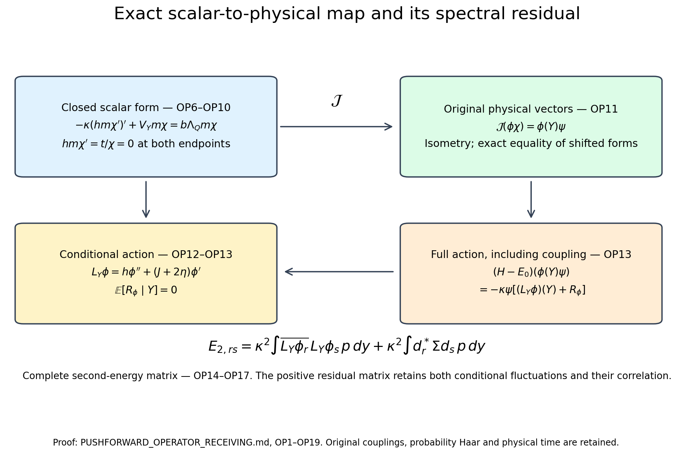

# Actual scalar compression, its domain, and the complete spectral residual

This calculation receives FO1–FO56 and PF1–PF53 without changing the original interacting state, configuration, couplings or energy units. It proves the operator-domain details of the scalar ground representation, evaluates the complete second-energy residual, and gives the exact physical-time dictionary for the primary conditional-dynamics source. Every conditional quantity below is computed in the original vacuum. No invariant scalar sector is assumed.

## 1. Original data and the closed scalar form

Retain the open cubic lattice, radius-two product metric, probability Haar, all original vertex gauge constraints, and
\[
 \begin{gathered}
 H=-\kappa\Delta+b\sum_pD_p= -\kappa\Delta+2bM-b\sum_pW_p,
 \\
 H\psi=E_0\psi,\quad \psi>0,\quad\int\psi^2dU=1,
 \quad w=\log\psi,\quad d\mu=\psi^2dU.
 \end{gathered}\tag{OP1}
\]
Here \(D_p=2-W_p\), and every original face word, inverse traversal and boundary face is the one in FO1. For the fixed original spatial test retain
\[
 \begin{gathered}
 Y=\sum_p|f_p|D_p=2A_1-\sum_p|f_p|W_p,\quad
 A_1=\sum_p|f_p|>0,\quad F=\|f\|_\infty,\quad I=[0,\ell],\quad\ell=4A_1,\\
 \gamma=|\nabla Y|^2,\quad A=\Gamma(w,Y),\quad
 J(y)=6A_1-3y,\quad Z_Q=|\nabla_Qw|^2.
 \end{gathered}\tag{OP2}
\]
The letter \(A\) in (OP2) is the directional score, and is distinct from the Hamiltonian \(H-E_0\). Use PF's actual conditional quantities
\[
 Y_\#\mu=p(y)dy,\quad h=\mathbb E[\gamma\mid Y=y],\quad
 \eta=\mathbb E[A\mid Y=y],\quad z=\mathbb E[Z_Q\mid Y=y],
 \quad s=hp,\quad t=\eta p.
 \tag{OP3}
\]
PF1–PF16 prove \(p,h>0\) almost everywhere in the interior, \(s,t\in W^{1,1}(\mathbb R)\) after extension by zero, \(s(y)>0\) at every interior value, both endpoint fluxes zero, and
\[
 s'=Jp+2t,\qquad
 \kappa t'=[\kappa z+b(u-\Lambda_Q)+o+\delta_Q]p,
 \quad u=\mathbb E[W_Q\mid Y=y],\quad o\ge0,\quad\delta_Q\ge0.
 \tag{OP4}
\]
The full outside and crossing contribution is
\(o=\kappa\mathbb E[|\nabla_{\rm out}w|^2\mid Y]+b\mathbb E[W_{\rm out}+W_\times\mid Y]-E_{\rm out}\).
Its nonnegativity follows from applying the outside variational inequality to each fixed-inside slice of \(\psi\), then conditioning. The comparison slack is \(\delta_Q=b\Lambda_Q-(E_0-E_{\rm out})\). In particular it is not a discarded vacuum-energy term.

The quotient \(r=t/s\) is bounded and locally absolutely continuous in the interior, by PF11. Fix \(y_0\in(0,\ell)\), and retain
\[
 \chi(y)=\exp\left(\int_{y_0}^yr(v)dv\right),\quad
 m(y)=p(y)/\chi(y)^2,\quad
 \tau=z-\eta^2/h\ge0,\quad
 V_Y=bu+o+\delta_Q+\kappa\tau.
 \tag{OP5}
\]
The function \(\chi\) and its reciprocal are bounded and Lipschitz on the closed interval. All of \(h,V_Y\) are bounded at this fixed regulator; this assertion is not uniform in the regulator. Direct differentiation of the actual currents gives
\[
 (hm)'=Jm,\qquad hm\chi'=t/\chi,\qquad
 -\kappa(hm\chi')'+V_Ym\chi=b\Lambda_Qm\chi,
 \quad (hm\chi')(0)=(hm\chi')(\ell)=0.
 \tag{OP6}
\]
For example, dividing the second equation in (OP4) by \(p\), inserting \(t=rs\), \(s'=(J+2rh)p\), and \(z=\tau+r^2h\) gives
\(h(r'+r^2)+Jr=\tau+[b(u-\Lambda_Q)+o+\delta_Q]/\kappa\).
Multiplying by \(\chi\) proves (OP6), including the original constants.

Consider on \(L^2(I,m,dy)\) the nonnegative form initially defined on smooth functions on the closed interval:
\[
 q_Y[v]=\kappa\int_Ihm|v'|^2dy+\int_IV_Ym|v|^2dy.
 \tag{OP7}
\]
Here is a complete closability proof. Suppose \(v_n\to0\) in \(L^2(m)\) and the form differences tend to zero. The derivatives converge in \(L^2(hm)\) to a function \(g\). On any closed interior interval \(K\), the continuous positive function \(hm=s/\chi^2\) has a positive minimum, so the derivatives are Cauchy in the original Lebesgue \(L^2(K)\). The weighted averages
\(b_n=(\int_Km)^{-1}\int_Kv_nm\) tend to zero, since \(0<\int_Km<\infty\). The fundamental theorem of calculus gives, for each \(y\in K\),
\[
 |v_n(y)-b_n|\le |K|^{1/2}\|v_n'\|_{L^2(K)}.
 \tag{OP8}
\]
Apply the same bound to differences. The sequence is uniformly Cauchy on \(K\), so it converges there to a continuous function whose \(L^2(m)\) value is zero. Since \(m>0\) almost everywhere, that continuous function is identically zero. Its distributional derivative is the \(L^2(K)\) limit of \(v_n'\), hence \(g=0\) on \(K\). Exhausting the interior proves \(g=0\) almost everywhere on \(I\). The bounded potential term tends to zero directly from \(L^2(m)\) convergence. This proves closability, including the endpoint-degenerate weights. Write \(\mathcal V_Y\) for the domain of its closure.

Multiplication by \(\chi\) and by \(\chi^{-1}\) are bounded inverse maps of \(\mathcal V_Y\) onto itself. For example the kinetic term has the explicit bound
\[
 \kappa\int hm|(\chi v)'|^2
 \le 2\|\chi\|_\infty^2\kappa\int hm|v'|^2
   +2\kappa\|\chi'\|_\infty^2\|h\|_\infty\int m|v|^2,
 \tag{OP9}
\]
and the potential term is at most \(\|\chi\|_\infty^2\int V_Ym|v|^2\). The identical argument uses the finite derivative and value bounds of \(\chi^{-1}\). Extend \(\chi\) Lipschitz past both endpoints and mollify it. Uniform value convergence, uniformly bounded derivatives, almost-everywhere derivative convergence and the integrability of \(hm,m\) show that its products with a smooth \(v\) lie in the form closure. These bounds and density then extend both multiplication maps to \(\mathcal V_Y\). The constant function belongs to the original form domain, so \(\chi\in\mathcal V_Y\).

Equation (OP6) has an integrable right-hand side and zero boundary flux. Integration by parts against every smooth function, then form-density, proves that \(\chi\) belongs to the associated self-adjoint operator domain and has eigenvalue \(b\Lambda_Q\). For smooth complex \(\phi\), expansion of the full form and that same integration give
\[
 q_Y[\phi\chi]-b\Lambda_Q\int|\phi\chi|^2m
      =\kappa\int h|\phi'|^2p.
 \tag{OP10}
\]
The real cross term is exactly the derivative of \(|\phi|^2\); its boundary flux vanishes by (OP6). The functions \(\phi\chi\) with \(\phi\) smooth form a dense subset of \(\mathcal V_Y\), by the preceding invertible multiplication map. Hence the shifted form is nonnegative throughout its full domain. Since \(\int\chi^2m=1\), this proves that \(\chi\) is a unit ground function of the specified closed form, with natural endpoint conditions.

## 2. Exact map to the physical operator and its second moment

The map initially specified by
\[
 \mathcal J(\phi\chi)=\phi(Y)\psi
 \tag{OP11}
\]
extends to an isometry from \(L^2(m)\) into the original physical Hilbert space: \(\|\mathcal J(\phi\chi)\|^2=\int|\phi|^2p=\int|\phi\chi|^2m\). Its range is the closed space of measurable functions of \(Y\) multiplied by \(\psi\). All gauge constraints survive because both \(Y\) and \(\psi\) are physical. The original ground transform proves equality of the shifted scalar form (OP10) and the original full form on these vectors and their form closures. This statement does not replace either operator by the other.

For \(\phi\in C^\infty(I)\), define the exact conditional generator
\[
 L_Y\phi=h\phi''+(J+2\eta)\phi'=p^{-1}(s\phi')',\qquad
 R_\phi=(\gamma-h(Y))\phi''(Y)+2(A-\eta(Y))\phi'(Y).
 \tag{OP12}
\]
All expressions lie in the original \(L^2\) spaces at each fixed regulator because the original gradients and the interval derivatives are bounded. The full operator action, with its sign and factor retained, is
\[
 (H-E_0)(\phi(Y)\psi)
    =-\kappa\psi\{(L_Y\phi)(Y)+R_\phi\},\qquad
 \mathbb E[R_\phi\mid Y]=0.
 \tag{OP13}
\]
This follows by expanding \(\Delta\phi(Y)+2\Gamma(w,\phi(Y))\) before conditioning. It proves that \(\psi R_\phi\) is orthogonal to the entire range of \(\mathcal J\), since its inner product with any square-integrable function of \(Y\) is zero by conditional expectation.

For a finite list of smooth complex functions \(\phi_r\), subtract their actual means and set \(v_r=(\phi_r(Y)-\mu\phi_r(Y))\psi\). Their complete matrices are
\[
 \begin{aligned}
 G_{rs}&=\int\overline{\phi_r}\phi_s p
                 -\overline{\int\phi_r p}\int\phi_s p,\\
 E_{rs}&=\kappa\int h\overline{\phi_r'}\phi_s'p,\\
 E_{2,rs}&=\kappa^2\int\overline{L_Y\phi_r}L_Y\phi_s p
                  +\kappa^2\mu\overline{R_{\phi_r}}R_{\phi_s}.
 \end{aligned}\tag{OP14}
\]
The last line uses the proved orthogonality; it is an equality. The full residual matrix is positive semidefinite, as the Gram matrix of the original residual vectors.

For clarity its fiber coefficients can also be evaluated explicitly. Define
\[
 \Sigma(y)=
 \begin{pmatrix}
 \mathbb E[(\gamma-h)^2\mid Y=y]&\mathbb E[(\gamma-h)(A-\eta)\mid Y=y]\\
 \mathbb E[(\gamma-h)(A-\eta)\mid Y=y]&\mathbb E[(A-\eta)^2\mid Y=y]
 \end{pmatrix}\succeq0,
 \quad d_\phi(y)=\binom{\phi''(y)}{2\phi'(y)}.
 \tag{OP15}
\]
Then \(\mu\overline{R_{\phi_r}}R_{\phi_s}=\int d_{\phi_r}^*\Sigma d_{\phi_s}p\). Positive semidefiniteness follows by taking the conditional expectation of the square of each linear combination of the two displayed centered real variables. In particular this formula retains their correlation and every factor two.

The exact geometry supplies the following finite upper receiver. With \(n_f=\#\{p:f_p\ne0\}\), retain both endpoint terms from FO10:
\[
 g_*(y)=\min\{16Fy-4y^2/n_f,\ 16F(\ell-y)-4(\ell-y)^2/n_f\},\quad
 0\le\gamma\le g_*(Y).
 \tag{OP16}
\]
Thus, writing \(\Sigma_{ij}\) for (OP15),
\[
 \begin{gathered}
 0\le\Sigma_{11}\le g_*h-h^2,\qquad
 0\le\Sigma_{22}\le g_*z-\eta^2,\qquad
 |\Sigma_{12}|\le\sqrt{\Sigma_{11}\Sigma_{22}},\\
 \mu|R_\phi|^2\le
 \int\left(|\phi''|\sqrt{g_*h-h^2}
       +2|\phi'|\sqrt{g_*z-\eta^2}\right)^2p.
 \end{gathered}\tag{OP17}
\]
For the first bound use \(\gamma^2\le g_*\gamma\). For the second use the original pointwise Cauchy–Schwarz inequality \(A^2\le\gamma Z_Q\le g_* Z_Q\) before conditioning. This step is essential: no independence of \(\gamma\) and \(Z_Q\) is assumed. The final two inequalities follow from the positive covariance matrix and expansion of its quadratic form. Equations (OP14)–(OP17) are exact original-state spectral receiving maps and their evaluated geometric upper bounds. They do not assume that the residual vanishes.

## 3. Primary-source comparison with all time and measure factors

The original author TeX of Frédéric Legoll and Tony Lelièvre, *Effective dynamics using conditional expectations*, arXiv:0906.4865v1, uses equilibrium density \(Z^{-1}e^{-\beta V}\) and generator \(-\nabla V\cdot\nabla+\beta^{-1}\Delta\). Lines 135–168, 393–540 and 680–750 were read directly from the intact source edition. Its nonvanishing-gradient hypothesis does not hold for \(Y\); the actual critical-value flux extension is proved in FO/PF, so none of that paper's approximation or convergence theorems is imported.

The precise comparison with the original physical time is the following. Let \(N\) be the original number of links; radius-two volume gives \(dU=(16\pi^2)^{-N}d\mathrm{vol}\). For this comparison only define the density potential and its partition integral by
\[
 \beta_{\rm source}^{-1}=\kappa,\qquad
 V_{\rm density}=-2\kappa w,\qquad
 Z_{\rm density}=\int e^{-V_{\rm density}/\kappa}d\mathrm{vol}
                      =(16\pi^2)^N.
 \tag{OP18}
\]
Then \(Z_{\rm density}^{-1}e^{-V_{\rm density}/\kappa}d\mathrm{vol}=\psi^2dU\) exactly, and
\[
 \begin{gathered}
 -\nabla V_{\rm density}\cdot\nabla+\kappa\Delta
       =\kappa(\Delta+2\nabla w\cdot\nabla),\\
 \xi_{\rm source}=Y,\qquad \sigma_{\rm source}^2=h,\qquad
 b_{\rm source}=\kappa(J+2\eta),\qquad
 \mathcal L_{\rm scalar}=\kappa L_Y.
 \end{gathered}\tag{OP19}
\]
These are obtained by substitution into the source's conditional coefficients, retaining its \(\sqrt{2\beta^{-1}}\) noise factor. The original Yang–Mills Hamiltonian still has the complete potential \(b\sum_pD_p\) in (OP1); \(V_{\rm density}\) is a derived log-density in this comparison and is not substituted for that potential. There is no change of physical time or energy units. The full original generator differs from its conditional scalar action by \(\kappa R_\phi\), while its Hamiltonian action differs by \(-\kappa R_\phi\psi\), exactly as in (OP13). The equality of forms and the residual matrix provide the complete map back to the original theory.

Complete programme providers: [ZU1–ZU44](https://github.com/KokunoYumeto/yang-mills-interacting-workbench/blob/f8f4d548dde98f04429f8b7eea664806399de825/yang-mills/continuations/20261011-central-signs-shrinking-window/SOURCE_ZERO_COVARIANCE_UPPER.md), [PVI1–PVI24 plus PVI19a](https://github.com/KokunoYumeto/yang-mills-interacting-workbench/blob/f8f4d548dde98f04429f8b7eea664806399de825/yang-mills/continuations/20261011-central-signs-shrinking-window/POTENTIAL_VARIANCE_IDENTITIES.md), [LC1–LC42](https://github.com/KokunoYumeto/yang-mills-interacting-workbench/blob/f8f4d548dde98f04429f8b7eea664806399de825/yang-mills/continuations/20261011-central-signs-shrinking-window/LOCAL_CURVATURE_BUDGET.md), and [CP1–CP50](https://github.com/KokunoYumeto/yang-mills-interacting-workbench/blob/f8f4d548dde98f04429f8b7eea664806399de825/yang-mills/continuations/20261011-central-signs-shrinking-window/CURVATURE_PHASE_RECONSTRUCTION.md). The [source-use ledger](PUSHFORWARD_SOURCE_USE_LEDGER.json) records exact editions, actual reading coverage and the receiving calculations.

## Both potential tails and the complete retained-energy covariance

[LR1–LR58](LOWER_SIDE_RETAINED_ENERGY.md) prove both tails around the original local energy roots, exact negative-moment bounds, and inverse-weighted ground and Bochner identities. The full inside energy, including the actual conditional kinetic and outside terms, has variance O(a^-1), with an explicit constant and a complete nonnegative remainder. For the signed original curvature, LR58 proves the exact compensated map and all of its mean and covariance terms.

[IM1–IM42](INSIDE_MARGINAL_ENERGY.md) independently derive the inside marginal, its conditional-vector equation and full operator residual. They evaluate every mixed-Hessian, shifted-Hessian and conditional-score-variance contribution, including inverse weights. The unchanged potential variance retains its signed covariance with the nonnegative energy remainder. The proved small variance of their sum does not assign a sign to that covariance.

## Complete associated-operator domain and independent phase refinement

[OR6–OR10](INDEPENDENT_OPERATOR_REVIEW.md) prove the exact operator domain and actual smooth test action, including the global flux and both endpoint conditions. The independent review confirms OP9–OP19. OR13–OR15 give the exact diagonal phase cancellation, full mixed residual and original second energy, strengthening the general absolute-value residual bound for the specified scalar phases.
