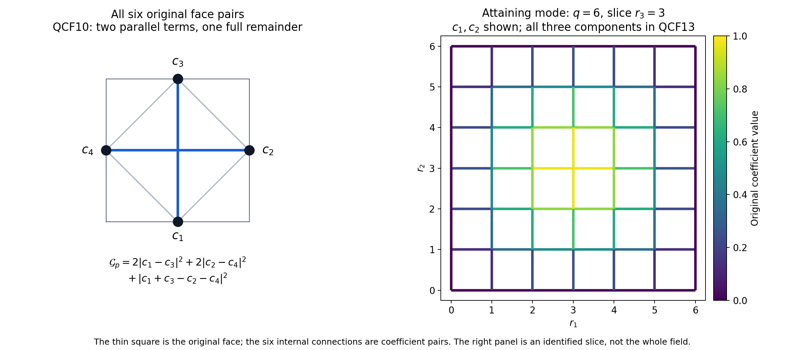
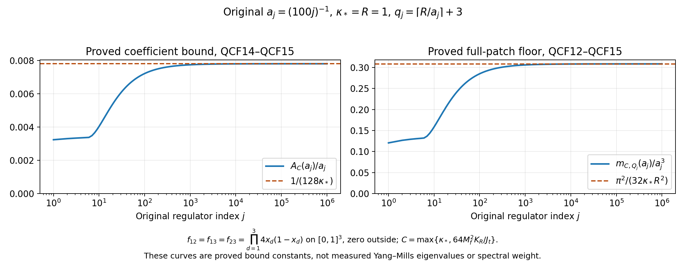

# Quantitative force curl on the original Yang–Mills patch

The original mixed-face Hessian and the full weighted codifferential give an explicit lower bound for the force term removed in DF12–DF16. The complete face graph has an exact Dirichlet constant on the fitting patch. These bounds retain raw coefficients and the original interacting state.

Provider: [DF1–DF21](https://github.com/KokunoYumeto/yang-mills-interacting-workbench/blob/84f89c0ec93211a39cfd263fa13baffdaf4ffae1/yang-mills/continuations/20261011-central-signs-shrinking-window/CURRENT_DENSITY_FLUX_AND_PROJECTED_RESIDUAL.md), with the human author-TeX provenance retained there. No additional external reading or novelty is claimed.

## Original objects and finite domains

Keep the open lattice with vertices \(\{0,\ldots,2L_j\}^3\), every positive edge, the original vertex gauge action, and probability Haar measure. The SU(2) edge metric has radius two and \(T_\alpha=-i\sigma_\alpha/2\) orthonormal. Retain
\[
\begin{gathered}
L_j=j^4,\quad a_j=(100j)^{-1},\quad g_j^2=\kappa_*a_j/2,\quad
b_j=(\kappa_*a_j^2)^{-1},\quad s_j=100\kappa_*a_j,\\
U_p=U_d(z)U_k(z+e_d)U_d(z+e_k)^{-1}U_k(z)^{-1}\quad(d<k),\\
D_p=2-\operatorname{Tr}U_p,\quad
V=b_j\sum_pD_p=2b_j|\mathcal P_j|-b_j\sum_p\operatorname{Tr}U_p,\\
H_j=-\kappa_*\Delta+V,\quad H_j\psi_j=E_{0,j}\psi_j,\quad
\psi_j>0,\quad \|\psi_j\|=1,\quad d\mu_j=\psi_j^2dU .
\end{gathered}
\]
The positive smooth gauge-invariant ground and its score bound are the original SOM1–SOM5. Suppress \(j\) only within finite formulas and write \(\kappa=\kappa_*\), \(w=\log\psi\), \(g_e=d_ew\), \(G_e=|g_e|^2\), \(T_e=\mu G_e\), \(F_e=d_eV\), and
\[
\mathscr D=\Delta+2dw\cdot d,\qquad
\mathscr L_0=-\kappa\mathscr D,\qquad
\mathscr L_1=\kappa(dd_\mu^*+d_\mu^*d).
\]
All are the original weighted operators on the compact full configuration manifold; no outside derivative is suppressed.

For the centered observable below, \(E_X=\kappa\mu|dX|^2\). For the original full test use \(A=H-E_0I\), \(u_{\mathbf f}=(C_{\mathbf f}-\mu C_{\mathbf f})\psi\), \(\zeta_{\mathbf f}=A^{1/2}u_{\mathbf f}\), and \(\mathcal R_{\mathbf f}(z)=\langle\zeta_{\mathbf f},(A+zI)^{-1}\zeta_{\mathbf f}\rangle=\kappa\langle dC_{\mathbf f},D_z^{-1}dC_{\mathbf f}\rangle_\mu\). SG12 proves this exact original-Hamiltonian map.

For a nonzero real continuous compactly supported triple \(\mathbf f=(f_{12},f_{13},f_{23})\), keep
\[
\begin{gathered}
x_p=o+a(z-L_j\mathbf1+(e_d+e_k)/2),\quad
x_e=o+a(z-L_j\mathbf1+e_d/2),\\
C_{\mathbf f}=a\sum_p f_{\sigma(p)}(x_p)D_p,\quad
X=a\sum_pu_pD_p-\mu\!\left(a\sum_pu_pD_p\right),\\
u_p=f_{\sigma(p)}(x_p)\ \hbox{for the full source},\qquad
u_p=f_{\sigma(p)}(x_p)\mathbf1_{\{e_0\notin\partial p\}}
\ \hbox{for its outside source},\\
M_f=\max_\sigma\|f_\sigma\|_\infty,\quad
t_1=f_{12}+f_{13},\quad t_2=f_{12}+f_{23},\quad
t_3=f_{13}+f_{23},\quad J_t=\sum_d\int_{\mathbb R^3}t_d^2>0 .
\end{gathered}
\]
The last strict inequality follows by the inverse relations \(2f_{12}=t_1+t_2-t_3\), \(2f_{13}=t_1+t_3-t_2\), \(2f_{23}=t_2+t_3-t_1\). Put \(v=dX\), \(J_X=dw\cdot dX\), \(\alpha_e=a^2\Pi_edw\), and \(D_z=\mathscr L_1+zI\), \(z>0\). For a deterministic finite edge list, \(\mathsf Cc=\sum_ec_e\alpha_e\), \(\mathsf N=\mathsf C^*\mathsf C\), \(\mathsf Z=(D_z\mathsf C)^*D_z\mathsf C\), \(\mathsf b=\mathsf C^*v\), \(k=(D_z\mathsf C)^*v\). The distinct sources \(k\) and \(\mathsf b\) are never identified.

Use the fitting cube \(Q=v_Q+\{0,\ldots,q\}^3\) for a physical support cube \(\prod_d[c_d,c_d+R]\), where \(q=\lceil R/a\rceil+3\), \((v_Q)_d=L_j+\lfloor(c_d-o_d)/a\rfloor-1\). Eventually it is strictly inside the full lattice. Its finite quantities, with boundary indicators retained, are
\[
\begin{gathered}
N_Q=3q(q+1)^2,\quad M_Q=3q^2(q+1),\quad
I=E_Q^\circ,\quad n=|I|=3q(q-1)^2,\\
C_Q=2q(q+1)\sum_d
[\mathbf1_{\{(v_Q)_d>0\}}+\mathbf1_{\{(v_Q)_d+q<2L_j\}}],\\
W_Q=\sum_{p\ {\rm inside}\ Q}D_p,\quad d_Q=\mu W_Q,\quad
T_Q=\sum_{e\ {\rm inside}\ Q}T_e,\quad E_Q=E_0-E_{\rm out},\\
\Lambda_Q=\min\{2M_Q,6g^2\sqrt{N_QM_Q}\}+2C_Q,\quad
\kappa T_Q+bd_Q\le E_Q\le b\Lambda_Q,\\
\mathsf L_R=9\kappa_*R^3+24R^2,\qquad
K_R=\frac{\mathsf L_R+\sqrt{\mathsf L_R^2-81\kappa_*^2R^6/4}}2 .
\end{gathered}
\]
Every edge in \(I\) has four incident faces, all inside \(Q\). HVR18–HVR22 prove both \(\limsup a_j^2d_Q\le K_R\) and \(\limsup a_j^2(\Lambda_Q-d_Q)\le K_R\). The inside, outside and crossing energies remain as displayed. All limits below use this same fitting prescription and original path.

Retain the complete Hessian row, incident deficit and positive density
\[
\begin{gathered}
H_{er}=(\nabla^2w)_{er},\quad R_e=\sum_{r\in\mathcal E_j}\|H_{er}\|_{\rm HS}^2,\quad
W_e^{\rm def}=\sum_{p\ni e}D_p,\quad w_e=\mu W_e^{\rm def},\\
\mathcal K_e=\Delta_eV-\kappa(2R_e+G_e),\quad \mu\mathcal K_e=0,\\
\mathcal A_e=\kappa(2R_e+G_e)+(3b/4)W_e^{\rm def}\ge0,\quad
\mu\mathcal A_e=6b,\quad d\nu_e=\frac{\mathcal A_e}{6b}d\mu,\\
I_j(C)=\{e\in I_j:w_e\le Ca_j\},\quad
C=\max\{\kappa_*,64M_f^2K_R/J_t\},\\
\liminf a_j^{-3}\|\mathsf b_{I(C)}\|^2\ge27J_t/16,\qquad
\gamma_C(z)=z^2a^4\,\frac{9(8-Ca)^2}{256Ca}\quad(Ca<8).
\end{gathered}
\]
CFC6–CFC20 prove these identities and bounds in the actual state, with no changed boundary or reference law. The ground log-Hessian bound and score estimate remain \(\nabla^2w\ge-2(\kappa a)^{-1}g\) and \(T_e\le3/(\kappa a)\).

## Exact SU(2) mixed-face Hessian

All coefficient lists below are deterministic, may be complex, and are extended by zero to the full original edge set. The inner product conjugates its first argument. Let
\[
F_c^\uparrow=\sum_ec_e\Pi_edV,\qquad
\omega_c=dF_c^\uparrow,\qquad
\mathcal G(c)=\sum_{p\in\mathcal P_j}
\sum_{\substack{e<f\\e,f\in\partial p}}|c_e-c_f|^2 .
\]
Every face contains its four original positive edges with their original traversal signs. There are six unordered pairs per face. No crossing pair is removed.

Write the actual ordered holonomy as
\[
U_p=W_1W_2W_3W_4=\xi_pI-i\,y_p\cdot\sigma,\qquad
\xi_p^2+|y_p|^2=1,\qquad D_p=2-2\xi_p.
\]
Here \(W_1,W_2\) are the two forward link factors and \(W_3,W_4\) the two inverse factors in the displayed original formula for \(U_p\); \(\xi_p\) is the scalar quaternion coordinate, and the spatial face center \(x_p\) remains unchanged.

For distinct edges in this face,
\[
\begin{gathered}
\|(\nabla^2D_p)_{ef}\|_{\rm op}=\frac12,\qquad
\|(\nabla^2D_p)_{ef}\|_{\rm HS}^2
=\frac{2+\xi_p^2}{4}\\
=\frac34-\frac{D_p}{4}+\frac{D_p^2}{16},\qquad
|d_eD_p|^2=D_p-\frac{D_p^2}{4}=|y_p|^2 .
\end{gathered}\tag{QCF1}
\]
Here is the ordered-derivative proof, including the inverse signs. Use the orthonormal tangent variation \(U_e(t)=e^{tT_\alpha}U_e\). For a forward factor, \(W_i'(0)=T_\alpha W_i\). For an inverse factor, \(W_i'(0)=-W_iT_\alpha=(-\operatorname{Ad}_{W_i}T_\alpha)W_i\). Put \(Q_i=W_1\cdots W_{i-1}\) and \(R_i=I\) for a forward factor, \(R_i=W_i\) for an inverse factor. The generator transported to the beginning of the ordered product is
\[
E_{i,\alpha}=\epsilon_i\operatorname{Ad}_{Q_iR_i}T_\alpha,
\qquad \epsilon_i=1,1,-1,-1 .
\]
For \(i<j\), the mixed derivative of the trace is exactly
\(\operatorname{Tr}(E_{i,\alpha}E_{j,\beta}U_p)\). The different edge factors have no connection cross term. The two adjoint actions are orthogonal matrices \(O_i,O_j\) in the original radius-two metric. The Pauli product gives
\[
-\operatorname{Tr}(T_\alpha T_\beta U_p)
=\frac12\left(\xi_p\delta_{\alpha\beta}
+\sum_\gamma\epsilon_{\alpha\beta\gamma}(y_p)_\gamma\right).
\]
Consequently the mixed block is
\(\epsilon_i\epsilon_jO_i^T(\xi_pI+E(y_p))O_j/2\), where
\(E(y)_{\alpha\beta}=\sum_\gamma\epsilon_{\alpha\beta\gamma}y_\gamma\).
For reversed order use its transpose. Since \(E(y)^T=-E(y)\) and
\[
(\xi I+E(y))(\xi I+E(y))^T
=(\xi^2+|y|^2)I-yy^T=I-yy^T,
\]
the squared singular values are \(1/4,1/4,\xi^2/4\). The first derivative is an orthogonal rotation, with its traversal sign, of \(y_p\). This proves every identity in QCF1.

Two distinct lattice edges belong to at most one unit face, by DF13. Hence the full potential curl has the exact norm
\[
\begin{gathered}
(\omega_c)_{(e,\alpha),(f,\beta)}
=(c_f-c_e)(\nabla^2V)_{(e,\alpha),(f,\beta)},\\
\|\omega_c\|_\mu^2
=b^2\sum_p\sum_{e<f\in\partial p}|c_e-c_f|^2
\left(\frac34-\frac{\mu D_p}{4}+\frac{\mu D_p^2}{16}\right).
\end{gathered}\tag{QCF2}
\]
The norm of a two-form is the sum of squared components over unordered orthonormal coordinate pairs. Within one edge the curl vanishes because its multiplier is constant and the Hessian is symmetric. For distinct edges only the unique coface contributes. Thus there is no omitted cross-face cancellation or extra factor of two in QCF2. In particular
\[
\frac{b^2}{2}\mathcal G(c)\le\|\omega_c\|_\mu^2
\le\frac{3b^2}{4}\mathcal G(c).
\]

On a retained set \(J\subset I(C)\), define
\[
\begin{gathered}
t=Ca,\qquad
\sigma(t)=1-\frac{[2-t]_+^2}{4},\qquad
\rho(t)=\frac{3-\sigma(t)}4
=\frac12+\frac{[2-t]_+^2}{16},\\
0<\sigma(t)\le1,\qquad \frac12\le\rho(t)<\frac34 .
\end{gathered}\tag{QCF3}
\]
If a face has a nonzero coefficient or coefficient difference, it contains an edge in \(I(C)\). Therefore \(d_p:=\mu D_p\le Ca\). QCF1 and Jensen's inequality give
\[
\mu|d_eD_p|^2=d_p-\frac{\mu D_p^2}{4}
\le d_p-\frac{d_p^2}{4}\le\sigma(Ca)
\]
for every edge of that face. For the last inequality, \(u-u^2/4\) increases on \([0,2]\) and has global maximum one on \([0,4]\). Also
\[
\frac34-\frac{\mu D_p}{4}+\frac{\mu D_p^2}{16}
=\frac34-\frac14\mu|d_eD_p|^2\ge\rho(Ca).
\]
It follows that
\[
\|\omega_c\|_\mu^2\ge b^2\rho(Ca)\mathcal G(c).
\tag{QCF4}
\]
The full second face moment remains in QCF2; QCF4 is its proved bound. For unrestricted lists the same argument uses \(\sigma=1,\rho=1/2\).

## Complete weighted codifferential

Let \(\delta\) be the probability-Haar adjoint of \(d\) on forms, and let
\(\delta_\mu=d_\mu^*=\delta-2\iota_{dw}\), where contraction uses the metric dual of \(dw\). Write
\(\bar c_p=\tfrac14\sum_{e\in\partial p}c_e\). The exact unweighted codifferential is
\[
\delta\omega_c
=3b\sum_p\sum_{e\in\partial p}(c_e-\bar c_p)\Pi_edD_p .
\tag{QCF5}
\]
To prove it, the scalar edge Casimir in the unchanged radius-two metric is
\(\Delta_eD_p=(3/4)(2-D_p)\). Summing its four edge contributions gives
\(-\Delta D_p=3D_p-6\). The unweighted Hodge Laplacian on one-forms commutes with the parallel product-edge projections: its connection Laplacian preserves each cotangent factor and its Ricci action is diagonal in those factors. It also commutes with \(d\). Thus
\[
\begin{gathered}
(d\delta+\delta d)(\Pi_edD_p)=3\Pi_edD_p,\\
\delta\!\left(\sum_{e\in\partial p}c_e\Pi_edD_p\right)
=\frac34\left(\sum_{e\in\partial p}c_e\right)(D_p-2).
\end{gathered}
\]
Subtract \(d\delta\) from the first Hodge expression, multiply by \(b\), and sum all faces. This proves QCF5 with its full constant, including the differentiated \(-6\) and \(-2\) terms.

Every original edge belongs to at most four faces. The four-value identity
\[
\sum_{e\in\partial p}|c_e-\bar c_p|^2
=\frac14\sum_{e<f\in\partial p}|c_e-c_f|^2
\]
holds for complex coefficients by expanding both sides. Apply Cauchy–Schwarz to the at most four face contributions in each edge block of QCF5. For \(c\) supported in \(I(C)\), use QCF3 on every contributing face. Then
\[
\|\delta\omega_c\|_\mu^2
\le36b^2\sigma(Ca)
\sum_p\sum_{e\in\partial p}|c_e-\bar c_p|^2
=9b^2\sigma(Ca)\mathcal G(c).
\tag{QCF6}
\]
For unrestricted lists replace \(\sigma(Ca)\) by one. Boundary edges can have fewer faces; their actual contributions are present and obey the same upper bound.

The drift term includes every neighboring edge score. Each edge has at most twelve distinct coface neighbors: at most four faces, each with three other edges, and no repeated pair. For a fixed output edge block, Cauchy–Schwarz with at most twelve terms and QCF1's operator norm give
\[
\begin{gathered}
|\iota_{dw}\omega_c|^2
\le3b^2\sum_p\sum_{e<f\in\partial p}
|c_e-c_f|^2(G_e+G_f),\\
\|\iota_{dw}\omega_c\|_\mu^2
\le\frac{18b^2}{\kappa a}\mathcal G(c),
\qquad T_e\le\frac3{\kappa a}.
\end{gathered}\tag{QCF7}
\]
In detail the output at edge \(e\) is the sum over its coface neighbors \(f\) of the mixed potential Hessian applied to \(g_f\), with multiplier \(c_e-c_f\) and the contraction sign. Its squared norm is at most
\(12(b^2/4)\sum_{f\sim e}|c_e-c_f|^2G_f\).
Summing output edges counts each unordered pair with \(G_e+G_f\). SOM5 then proves the second line. This retains the score at an outside neighbor even when its own coefficient is zero.

Combining the two parts without changing their original signed identity yields
\[
\begin{gathered}
\delta_\mu\omega_c=\delta\omega_c-2\iota_{dw}\omega_c,\\
\|\delta_\mu\omega_c\|_\mu
\le3b\left(\sqrt{\sigma(Ca)}
+2\sqrt{\frac2{\kappa a}}\right)\sqrt{\mathcal G(c)} .
\end{gathered}\tag{QCF8}
\]
The norm inequality uses the triangle inequality only after both complete terms have been calculated.

Let \(P\) be DF5's exact-space orthogonal projection and \(P^\perp=I-P\). Compact weighted integration and \(dPF_c^\uparrow=0\) give
\[
\|\omega_c\|_\mu^2
=\langle F_c^\uparrow,\delta_\mu\omega_c\rangle_\mu
=\langle P^\perp F_c^\uparrow,\delta_\mu\omega_c\rangle_\mu.
\]
Indeed \(\delta_\mu\omega_c\) is orthogonal to every exact form because \(d^2=0\). The projected force is smooth by DF7, so all displayed differentiations are classical. Cauchy–Schwarz with QCF4 and QCF8 proves
\[
\boxed{\quad
\|P^\perp F_c^\uparrow\|_\mu^2
\ge
\frac{b^2\rho(Ca)^2}
{9\left(\sqrt{\sigma(Ca)}+2\sqrt{2/(\kappa a)}\right)^2}
\mathcal G(c).\quad}
\tag{QCF9}
\]
For \(\mathcal G(c)>0\), divide the square of QCF4 by the square of QCF8. For \(\mathcal G(c)=0\), QCF9 is the nonnegative-norm inequality and involves no division. The unrestricted version has \(\rho=1/2,\sigma=1\). No density minimum or spectral-gap denominator appears.

## Exact graph constant on the original fitting patch

For a single face with cyclic values \(c_1,c_2,c_3,c_4\), its two parallel pairs are \((1,3)\) and \((2,4)\). Direct expansion, keeping all six pairs, gives
\[
\sum_{1\le i<j\le4}|c_i-c_j|^2
=2|c_1-c_3|^2+2|c_2-c_4|^2
+|c_1+c_3-c_2-c_4|^2 .
\tag{QCF10}
\]
This is stronger than keeping the parallel pairs once. On \(Q=v_Q+\{0,\ldots,q\}^3\), translate only the integer indices by \(v_Q\) for the next displayed formulas; the physical coordinates and \(a\) remain those defined above. An edge in direction \(d\) has
\(r_d\in\{0,\ldots,q-1\}\) and \(r_k\in\{1,\ldots,q-1\}\) for \(k\ne d\). These are exactly \(I=E_Q^\circ\). All other coefficients are zero.

For any one transverse line put \(u_0=u_q=0\). Its original finite difference satisfies
\[
\sum_{r=0}^{q-1}|u_{r+1}-u_r|^2
\ge4\sin^2\!\left(\frac{\pi}{2q}\right)
\sum_{r=1}^{q-1}|u_r|^2 .
\tag{QCF11}
\]
For a full verification, the \(q-1\) real vectors
\(s_m(r)=\sin(\pi mr/q)\), \(1\le m\le q-1\), are eigenvectors of the real symmetric matrix with diagonal \(2\) and neighboring entries \(-1\), with eigenvalues \(4\sin^2(\pi m/(2q))\). This follows from
\(\sin(x+h)+\sin(x-h)=2\cos(h)\sin x\), including the zero endpoints. The eigenvalues are distinct and the vectors are nonzero, hence form an orthogonal basis. Their squared norms are \(q/2\): expand \(\sin^2\) and sum the geometric series of \(e^{2\pi imr/q}\). Thus if \(u=\sum_ma_ms_m\), its norm is \((q/2)\sum|a_m|^2\) and the full difference energy is
\((q/2)\sum4\sin^2(\pi m/(2q))|a_m|^2\). This proves QCF11 and equality for the first sine vector without discarding either endpoint.

Apply QCF11 in both transverse directions for every fixed longitudinal edge index and the remaining transverse coordinate. Each original parallel pair belongs to exactly one such line. QCF10 supplies twice their sum. Therefore
\[
\mathcal G(c)\ge\lambda_q\sum_{e\in I}|c_e|^2,
\qquad
\lambda_q=16\sin^2\!\left(\frac{\pi}{2q}\right).
\tag{QCF12}
\]
This is the exact least constant for the whole patch, not merely a lower estimate. Define the following unscaled nonzero list on \(I\), extended by zero:
\[
c_{(r,d)}
=\sin\!\left(\frac{\pi(r_d+1/2)}q\right)
\prod_{k\ne d}\sin\!\left(\frac{\pi r_k}q\right).
\tag{QCF13}
\]
Every transverse line is a multiple of the first sine vector, so QCF11 is an equality on both transverse directions. On any face in directions \(d,k\), the sum of the two \(d\)-edge coefficients and the sum of the two \(k\)-edge coefficients both equal
\[
2\cos\!\left(\frac{\pi}{2q}\right)
\sin\!\left(\frac{\pi(r_d+1/2)}q\right)
\sin\!\left(\frac{\pi(r_k+1/2)}q\right)
\sin\!\left(\frac{\pi r_\ell}q\right),\qquad
\ell\notin\{d,k\}.
\]
This remains true at transverse endpoints because the sine there is zero. Hence the last square in QCF10 vanishes on every face. Faces outside \(Q\) contain no edge in \(I\), by the defining strict-inside property. Both inequalities leading to QCF12 are equalities for QCF13, proving exactness. For \(J\subset I(C)\subset I\) the same bound holds by zero extension, whether or not the attaining list is supported in \(J\).

## Quantified removal in the actual projected residual

Retain every term of DF12:
\[
c^*\mathsf M_\perp(z)c
=a^4\|P^\perp F_c^\uparrow\|_\mu^2
+2z\kappa a^4\sum_{e<f}|c_e-c_f|^2
\mu\|(\nabla^2w)_{ef}\|_{\rm HS}^2 .
\]
The last sum is over all original edge pairs, including noncoface pairs and those outside \(Q\); it is not replaced by \(\mathcal G(c)\). Define the finite constants
\[
\begin{gathered}
A_C(a)=
\frac{\rho(Ca)^2}
{9\kappa^2\left(\sqrt{\sigma(Ca)}
+2\sqrt{2/(\kappa a)}\right)^2},\\
m_{C,Q}(a)=16A_C(a)\sin^2\!\left(\frac{\pi}{2q}\right).
\end{gathered}
\]
The exact \(b=(\kappa a^2)^{-1}\), QCF9 and QCF12 now give
\[
\begin{gathered}
c^*\mathsf M_\perp(z)c
\ge A_C(a)\mathcal G(c)
+2z\kappa a^4\sum_{e<f}|c_e-c_f|^2
\mu\|(\nabla^2w)_{ef}\|_{\rm HS}^2,\\
\mathsf M_\perp(z)\ge m_{C,Q}(a)I_J
\qquad(\varnothing\ne J\subset I(C)).
\end{gathered}\tag{QCF14}
\]
No \(z\)-dependent term has been absorbed in the constant. The bound applies to each of the original three positive shifts.

On the unchanged original path, with fixed \(C,R,\kappa_*\) and
\(q_j=\lceil R/a_j\rceil+3\),
\[
\begin{gathered}
\lim_{j\to\infty}\frac{A_C(a_j)}{a_j}
=\frac1{128\kappa_*},\\
\lim_{j\to\infty}\frac{\lambda_{q_j}}{a_j^2}
=\frac{4\pi^2}{R^2},\\
\lim_{j\to\infty}\frac{m_{C,Q_j}(a_j)}{a_j^3}
=\frac{\pi^2}{32\kappa_*R^2}.
\end{gathered}
\tag{QCF15}
\]
For the first limit, \(\rho(Ca)\to3/4\), \(\sigma(Ca)=Ca-C^2a^2/4\) eventually, and
\[
a\left(\sqrt{\sigma(Ca)}+2\sqrt{2/(\kappa a)}\right)^2
=a\sigma(Ca)+4\sqrt{2a\sigma(Ca)/\kappa}+8/\kappa
\longrightarrow8/\kappa .
\]
For the second, \(qa\to R\) and \(\sin h/h\to1\); the displayed finite ceiling and \(+3\) remain in \(q_j\). Multiplication proves the third. These are limits of proved bound constants, not assertions that the matrix itself has these eigenvalue asymptotics.

With \(c_0=\mathsf Z^{-1}k\), \(c_\star=\mathsf Z_\star^{-1}k\), the exact DF16 gain consequently satisfies
\[
\begin{aligned}
\mathcal D_0-\mathcal D_\star
\ge{}&A_C(a)\mathcal G(c_0)\\
&+2z\kappa a^4\sum_{e<f}|(c_0)_e-(c_0)_f|^2
\mu\|(\nabla^2w)_{ef}\|_{\rm HS}^2\\
&+(c_\star-c_0)^*\mathsf Z_\star(c_\star-c_0)
\ge m_{C,Q}(a)\|c_0\|^2 .
\end{aligned}\tag{QCF16}
\]
Every original coefficient and both remaining positive terms have been retained. This quantifies DF15's strict finite improvement on the actual retained patch. It does not assign a positive limit to the gain, because \(c_0\) still depends on the complete signed source and matrix. DF18–DF21 continue to map the projected coefficient and physical residual to the signed window. The next calculation is to evaluate those collective quantities, using the exact graph and force bounds above; neither their value nor the smooth interacting no-gap endpoint is assumed.

## Reproducible figures and checks

The face diagram retains all six pairs. The field panel shows only the stated slice and its first two components; QCF13 gives all three components on the entire patch. The bound curves use \(\kappa_*=R=M_f=1\) and \(f_{12}=f_{13}=f_{23}=\prod_{d=1}^3 4x_d(1-x_d)\) on \([0,1]^3\), zero outside. Indeed
\[
\int_0^1[4x(1-x)]^2dx
=16(1/3-1/2+1/5)=8/15,\qquad
J_t=12(8/15)^3.
\]
Thus the plotted \(C=\max\{\kappa_*,64M_f^2K_R/J_t\}\) is the actual prescribed constant for this test. Every finite \(q_j=\lceil R/a_j\rceil+3\) is retained. The curves show proved bound constants, not measurements of eigenvalues or spectral weight. [Reproducible derivative and graph diagnostics](check_quantitative_curl.py) and the [source-use record](QUANTITATIVE_CURL_SOURCE_USE_LEDGER.json) accompany the full proofs.
