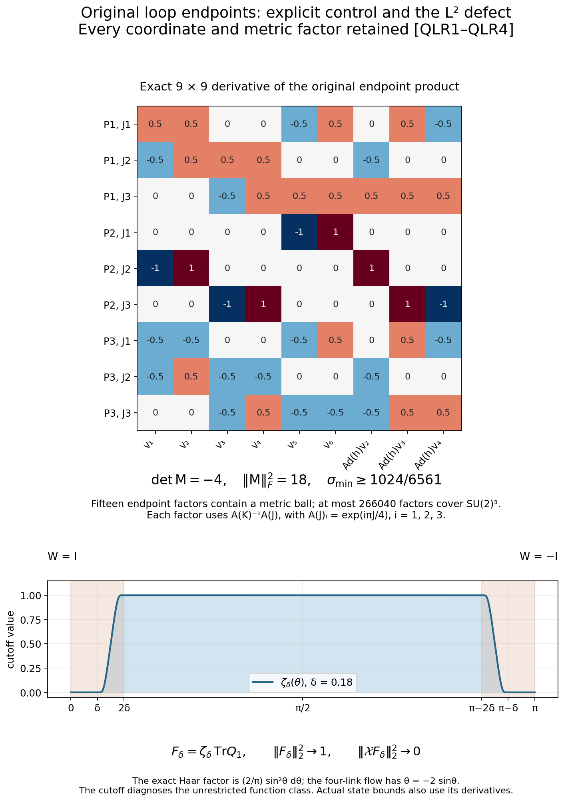
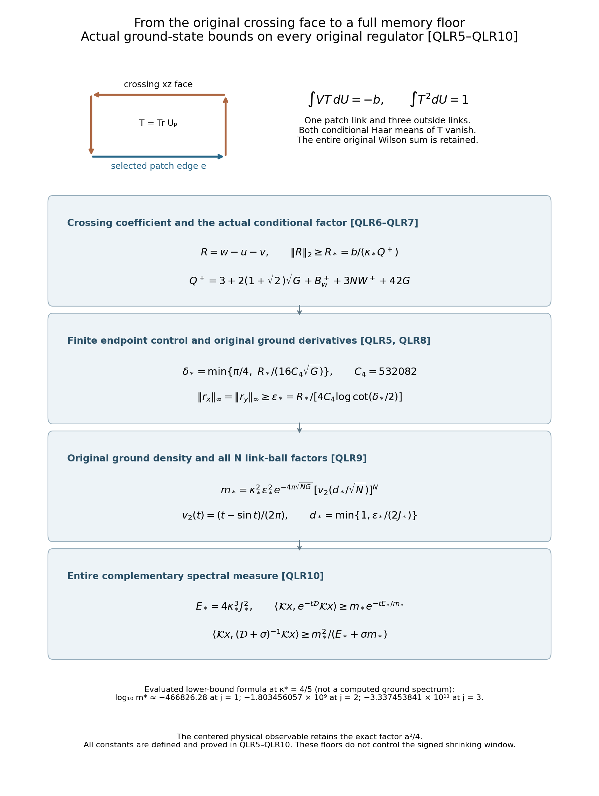

# Quantitative original loop rigidity and an actual full-state memory floor

Reviewed derivation, 14 October 2026. The complete proof, two figures and 144 independent diagnostics have been checked. This continues [FMP1–FMP13](https://github.com/KokunoYumeto/yang-mills-interacting-workbench/blob/c40ff0c78fdc3f72942e269a37a592fa938c7a47/yang-mills/continuations/20261011-central-signs-shrinking-window/FULL_STATE_MARGINAL_GROUND.md), with the actual derivative bounds [HCB1](https://github.com/KokunoYumeto/yang-mills-interacting-workbench/blob/c40ff0c78fdc3f72942e269a37a592fa938c7a47/yang-mills/continuations/20261011-central-signs-shrinking-window/ACTUAL_HESSIAN_BOUNDS.md) and [RHB1–RHB3](https://github.com/KokunoYumeto/yang-mills-interacting-workbench/blob/c40ff0c78fdc3f72942e269a37a592fa938c7a47/yang-mills/continuations/20261011-central-signs-shrinking-window/ACTUAL_RESOLVENT_HESSIAN.md). No new external theorem or novelty is claimed. The bounded disk-index results are routes only. The programme goal remains the smooth interacting global no-gap state and its four-dimensional reconstruction.

## 1. Keep the original full state and every parameter

Use exactly
\[
\begin{gathered}
a=(100j)^{-1},\quad L=j^4,\quad g^2=\kappa_*a/2,\quad
b=(\kappa_*a^2)^{-1},\quad s=\kappa_*/j,\\
N=3(2L)(2L+1)^2,\quad M=3(2L)^2(2L+1),\\
H=-\kappa_*\Delta+2bM-b\sum_pT_p,\quad H\psi=E_0\psi,
\quad\psi>0,\quad\int\psi^2dU=1,\quad0\le E_0\le2bM.
\end{gathered}
\]
Every link is the original radius-two SU(2), with orthonormal generators \(J_a/2=-i\sigma_a/2\) and original probability Haar measure. Keep the FMP seven-link patch, selected traces x,y and perimeter z, the full conditional projection Pi0, \(\rho=\Pi_0\psi^2\), \(\alpha=\sqrt\rho\), \(\chi=\psi/(\alpha\circ\pi)\), and the actual measure \(d\mu=\psi^2dU\). In this note
\[
w=\log\psi,\qquad u=\log(\alpha\circ\pi),\qquad
\ell=w-u=\log\chi,\qquad
r_x=\langle d\ell,dx\rangle,\quad r_y=\langle d\ell,dy\rangle.
\]
Here u is the trace marginal, rather than the earlier central-sign marginal. The exact receiving map is FMP1–FMP9. In particular \(\mathcal Kx=-2\kappa_*r_x\), \(\mathcal Ky=-2\kappa_*r_y\), with the entire trace-complement operator \(\mathcal D\). No central-sign operator is substituted.

## 2. The exact failure of an unrestricted L2 coercivity inference

For m>=2 original links, let \(T=\operatorname{Tr}(V_1\cdots V_m)\), \(\mathcal X=\nabla T\cdot\nabla\). FMP11 gives coordinates on the noncentral region
\[
P_i=e^{i\theta J/m}Q_i\quad(i<m),\qquad P_m=e^{\theta J},
\quad0<\theta<\pi,\qquad
\mathcal X=-\frac m2\sin\theta\,\partial_\theta.
\]
The i in the first exponent is the integer partial-product index, not the complex unit. The original factors remain \(V_i=P_{i-1}^{-1}P_i\). Successive Haar changes from factors to partial products preserve product probability measure. For fixed total holonomy, each left translation from P_i to Q_i also preserves it. Thus the complete integration measure is
\[
\left(\prod_{i=1}^{m-1}dQ_i\right)
\frac2\pi\sin^2\theta\,d\theta\,d\omega(J),
\tag{QLR1}
\]
where dω is probability area measure on the unit sphere of J axes. No radius factor is discarded; the original metric distance in the total SU(2) is 2theta.

Choose a smooth nondecreasing η on the real line, zero on (-infinity,1] and one on [2,infinity), and put \(C_\eta=\sup|\eta'|<\infty\). One concrete choice on (1,2) is \(\eta(t)=e^{-1/(t-1)}/[e^{-1/(t-1)}+e^{-1/(2-t)}]\), with the stated constant extensions. Let \(0<\delta<\pi/4\), \(\zeta_\delta(\theta)=\eta(\theta/\delta)\eta((\pi-\theta)/\delta)\), and \(F_\delta=\zeta_\delta(\theta)\operatorname{Tr}Q_1\). Vanishing on neighborhoods of both central holonomies extends this to a smooth function on the whole original product. Its mean is zero because the Haar mean of TrQ1 is zero; its Haar squared norm is one in Q1 because integrating \(4\cos^2\vartheta\) against \((2/\pi)\sin^2\vartheta\,d\vartheta\) gives one. Therefore
\[
\begin{aligned}
\|F_\delta\|_2^2&=\frac2\pi\int_0^\pi
\zeta_\delta(\theta)^2\sin^2\theta\,d\theta\longrightarrow1,\\
\|\mathcal XF_\delta\|_2^2
&=\frac{m^2}{2\pi}\int_0^\pi
\sin^4\theta\,|\zeta_\delta'(\theta)|^2d\theta
\le\frac{16m^2C_\eta^2}{\pi}\delta^3\longrightarrow0.
\end{aligned}\tag{QLR2}
\]
For the bound, the derivative is supported on the two intervals [delta,2delta] and [pi-2delta,pi-delta], each of length delta. The opposite cutoff equals one there. On them \(|\zeta'|\le C_\eta/\delta\) and \(\sin\theta\le2\delta\), which yields the displayed coefficient exactly. Dominated convergence proves the norm limit and strong L2 convergence to TrQ1 in these noncentral coordinates.

The smooth first-order operator X is closable: on smooth tests its Haar adjoint is \(-\mathcal X-\operatorname{div}\mathcal X\), a densely defined operator with smooth coefficients. Hence the displayed graph limit belongs to the kernel of its closure. It is a nonconstant L2 function. The same construction for arbitrary smooth functions of the Q variables gives an infinite-dimensional kernel in that closure. This is the precise defect: global smooth first-integral rigidity in FMP11 does not imply a positive constant in \(\|F-\int F\|_2\le C\|\mathcal XF\|_2\) over all smooth F. These cutoff functions are not asserted to be physical gauge-invariant observables. The failure concerns the unrestricted loop function class used in the rigidity argument. The actual full-state estimate below uses its independently proved derivative bounds.

## 3. A completely specified finite endpoint bound for four original links

Specialize now to m=4. Keep \(J_a=-i\sigma_a\), \([J_1,J_2]=2J_3\), \(\alpha_i=i\pi/4\) for i=1,2,3, and
\[
A_J=(e^{\alpha_1J},e^{\alpha_2J},e^{\alpha_3J}),\qquad
S=\{A_K^{-1}A_J:J^2=K^2=-I\}\subset SU(2)^3.
\]
The set S contains the identity and is closed under inversion. Every element of the full original product group is a product of at most
\[
D_4=266040
\tag{QLR3}
\]
elements of S. The following explicit matrix calculation proves this finite numerical bound, without assuming a group-generation estimate.

Write \(\boldsymbol a=(1/2,0,-1/2)\), \(\boldsymbol b=(1/2,1,1/2)\). Take the six ordered pairs of axes
\[
(K_r,V_r)=(J_3,J_1),(-J_3,J_1),(J_1,J_2),
(-J_1,J_2),(J_2,J_3),(-J_2,J_3).
\]
The curves \(g_r(t)=A_{K_r}^{-1}A_{\cos tK_r+\sin tV_r}\) lie in S and start at the identity. Their i-th tangent has vector coefficients
\(a_iV_r-b_i(K_r\times V_r)\), where J1 cross J2=J3; this follows from direct multiplication \(e^{-\alpha_iK_r}\sin\alpha_iV_r\). Let \(h=A_{J_3}^{-1}A_{J_1}\in S\). Conjugation by its i-th component is exactly the rotation \(R_3(-2\alpha_i)R_1(2\alpha_i)\), with the original angles and the bracket factor two intact. Define the nine-parameter product
\[
\Phi(t)=g_1(t_1)\cdots g_6(t_6)
[hg_2(t_7)h^{-1}][hg_3(t_8)h^{-1}][hg_4(t_9)h^{-1}].
\]
It belongs to S raised to the fifteenth product power. Write each component quaternion as \(q_{i0}I+\sum_a q_{ia}J_a\), and let f(t) be the concatenated nine real vector coefficients q_ia. Direct differentiation at zero gives
\[
Df(0)=\frac12
\begin{pmatrix}
1&1&0&0&-1&1&0&1&-1\\
-1&1&1&1&0&0&-1&0&0\\
0&0&-1&1&1&1&1&1&1\\
0&0&0&0&-2&2&0&0&0\\
-2&2&0&0&0&0&2&0&0\\
0&0&-2&2&0&0&0&2&-2\\
-1&-1&0&0&-1&1&0&1&-1\\
-1&1&-1&-1&0&0&-1&0&0\\
0&0&-1&1&-1&-1&-1&1&1
\end{pmatrix}=:\mathsf M.
\]
Its determinant is -4 and its squared Frobenius norm is 18; these follow by rational elimination and summing the 81 displayed squares. If its singular values increase from σ1 to σ9, then \(\prod_{i=2}^9\sigma_i\le(18/8)^4\) by the arithmetic-geometric mean inequality applied to their squares. Consequently
\[
\sigma_1\ge\lambda:=4(8/18)^4=1024/6561.
\]
Every factor curve in each quaternion component has operator norm one and first and second derivative norms at most one, since its only moving term is \(\sin\alpha_i(\cos tK_r+\sin tV_r)\). Conjugation by h preserves these norms. Differentiating the nine-factor product twice in a unit real direction v gives component norm at most \((\sum_r|v_r|)^2\le9\). Taking the three vector parts together gives
\(\|D^2f(t)[v,v]\|\le B:=9\sqrt3\).
Polarization with \(\|v+w\|^2+\|v-w\|^2=4\) gives the same bilinear operator bound for unit v,w, so \(\|Df(t)-\mathsf M\|\le B|t|\).

Set \(d_0=\lambda/(2B)\), \(y_0=\lambda^2/(4B)\). For |y|<=y0, the map
\(t\mapsto\mathsf M^{-1}\{y-[f(t)-\mathsf Mt]\}\)
is a contraction of the closed Euclidean ball |t|<=d0 into itself. Its Lipschitz constant is at most one half. Its norm there is at most \(y_0/\lambda+Bd_0^2/(2\lambda)=3d_0/4\). Iteration proves convergence to a solution f(t)=y: successive distances decrease geometrically, the closed ball is complete, and continuity verifies the equation. Also \(\|\Phi_i(t)-I\|\le\sum_r|t_r|\le3d_0<1\), so every scalar quaternion part is positive. Therefore every element of the original radius-two product metric ball of radius
\[
r_0=2y_0=\frac{\lambda^2}{18\sqrt3}
\]
belongs to S to the fifteenth power: writing its components \(e^{\theta_iJ_i}\), their total metric distance is \(2(\sum\theta_i^2)^{1/2}\), and their vector-part norm \((\sum\sin^2\theta_i)^{1/2}\) is at most half that distance, with positive scalar parts.

The original group SU(2)^3 has diameter \(2\pi\sqrt3\). Subdivide a shortest componentwise geodesic into \(\lceil108\pi/\lambda^2\rceil+1\) pieces, each shorter than r0. Its increments are in S to the fifteenth power, so their product gives the desired endpoint. Finally π<4, since the unit disk is a proper subset of the square of area four, and direct rational arithmetic gives \(\lceil432(6561/1024)^2\rceil+1=17736\). Thus 15 times this number is D4 as asserted. This numerical enlargement retains the sharper original π expression before taking the bound.

## 4. Quantitative oscillation from the actual loop derivative

Let F be a real smooth function on four original links with \(|dF|\le A\), \(|\mathcal XF|\le\varepsilon\); spectator links are fixed here. For every \(0<\delta\le\pi/4\), define
\[
E_\delta=2A\delta+\varepsilon\log\cot(\delta/2),\qquad
C_4=2(D_4+1)=532082.
\]
Then
\[
\operatorname{osc}_{SU(2)^4}F\le C_4E_\delta.
\tag{QLR4}
\]
For proof use the original FMP11 flow arc. Its velocity with respect to theta has total original norm one: each of its four factor velocities has norm one half, as also follows from \(|dT|=2\sin\theta\) and \(\dot\theta=-2\sin\theta\). On the interior arc, \(|dF/d\theta|\le\varepsilon/(2\sin\theta)\). The two omitted end segments contribute at most 2Adelta. Since \(\int_\delta^{\pi-\delta}d\theta/\sin\theta=2\log\cot(\delta/2)\), one has
\(|F_+(Q)-F_-(A_JQ)|\le E_\delta\).
The same bound relates any point of the arc to F+(Q), by stopping at that point and retaining whichever end segments occur. Thus for every member s of S, \(|F_+(sQ)-F_+(Q)|\le2E_\delta\). QLR3 gives oscillation at most 2D4Eδ on the entire positive critical set. Relating two arbitrary points to that set adds at most 2Eδ, proving QLR4. Continuity includes both critical sets.

## 5. Derivative bounds for the actual conditional factor

Keep the actual ground energy in the intermediate functions
\[
\begin{gathered}
c=2/(\kappa_*a),\quad G=4\pi^2Nc^2,\\
W=(4bM-E_0)/\kappa_*+(3N-1)c,\quad
W^+=4bM/\kappa_*+(3N-1)c,\\
B_w=\max\{(4bM-E_0)/\kappa_*,\ E_0/\kappa_*+G\},\quad
B_w^+=4bM/\kappa_*+G.
\end{gathered}
\]
HCB1 and the original logarithmic ground equation imply
\[
\begin{gathered}
|dw|\le\sqrt G,\quad -cg\le\nabla^2w\le Wg,\quad
|\Delta w|\le B_w,\\
|du|\le\sqrt G,\quad -cg\le\nabla^2u\le(W+2G)g,\\
|d\ell|\le2\sqrt G,\quad
\|\nabla^2\ell\|_{\rm op}\le W+2G+c,\\
|dr_x|,|dr_y|\le J_*:=2W^++4G+2c+4\sqrt G.
\end{gathered}\tag{QLR5}
\]
Here is each comparison. RHB1 bounds the original link score by 2πc and summing over N links gives G. The Hessian lower bound is HCB1. Its exact trace is \((V-E_0)/\kappa_*-|dw|^2\); subtracting the other 3N-1 eigenvalues, each at least -c, bounds its largest eigenvalue by W. The same trace and \(0\le V\le4bM\) give Bw. The earlier variational energy bound implies W>=c, W<=W+ and Bw<=Bw+.

FMP3 realizes the Haar conditional projection as averaging compact isometries, using outside-link left translations and the patch vertex gauge action. If those isometries are denoted q and their original probability measure is dq, then \(e^{2u}=\int e^{2w\circ q}dq\). Differentiating this actual integral, with probabilities \(p_q=e^{2w\circ q}/e^{2u}\), gives
\[
du=\int p_qd(w\circ q)dq,\qquad
\nabla^2u=\int p_q\nabla^2(w\circ q)dq
+2\left[\int p_qd(w\circ q)^{\otimes2}dq-du^{\otimes2}\right].
\]
The covariance is positive and bounded above by Gg. Isometric pullback preserves the w bounds, proving the u inequalities. Subtraction puts the eigenvalues of the Hessian of ell in [-(W+2G+c),W+c], which proves its operator bound. The original four-link trace satisfies \(|dx|,|dy|\le2\), and \(\|\nabla^2x\|_{\rm op},\|\nabla^2y\|_{\rm op}\le2\): its four same-factor and twelve ordered cross-factor derivatives give \(|\nabla^2T(Y,Y)|\le\tfrac12(\sum_{e\in\partial p}|Y_e|)^2\le2\sum_{e\in\partial p}|Y_e|^2\), as in HCB1. Differentiating each inner product r gives the last bound. All covariant derivatives use the full original product metric.

## 6. A crossing face gives a quantitative failure of product factorization

Let \(v(U_{\rm out})=\int\ell(U_{\rm patch},U_{\rm out})dU_{\rm patch}\), \(q=u+v\), and \(R=\ell-v=w-q\). These are actual conditional functions, with the original seven-link Haar average and all N-7 outside links retained. Let T be the crossing xz-face trace of FMP12 with lower corner (0,0,0). Its bottom x edge is in the selected patch and the other three edges are outside. Haar integration gives
\[
\int T\,dU_{\rm patch}=0,\quad\int T\,dU_{\rm out}=0,
\quad\int T^2dU=1,\quad\Delta T=-3T,\quad |dT|\le2.
\]
For example, integrating the single patch edge makes the first conditional mean zero; integrating any one of the three outside edges gives the second. Haar translation makes the face holonomy uniform, proving its squared norm as in QLR2. Each of four link Laplacians gives -3T/4, proving the full Laplacian. Distinct original plaquette traces are Haar orthogonal, because their boundaries contain an edge occurring in only one of the two traces; integrate that edge first. Consequently the entire original potential satisfies \(\int VT\,dU=-b\), including its constant 2bM term, whose integral is zero.

The two parts of q depend on disjoint original link sets. Therefore \(\Delta q+|dq|^2\) is additively separated and its integral against T vanishes. Subtract it from the original logarithmic ground equation and integrate by parts, retaining \(|dw|^2-|dq|^2=\langle dR,d(w+q)\rangle\). The result is the exact identity
\[
-\frac b{\kappa_*}=\int R\left[
-3T-\langle dT,d(w+q)\rangle-T\Delta(w+q)\right]dU.
\tag{QLR6}
\]
The E0 term is present before this integration and vanishes because the Haar mean of T is zero. No vacuum energy is absorbed into a changed operator.

Since u depends only on the patch, differentiating v in outside directions differentiates only the Haar average of w. Hence \(|dv|\le\sqrt G\) and its outside Hessian lies between -c and W. Orthogonality of the patch and outside gradients now gives \(|dq|\le\sqrt{2G}\). The patch has exactly 21 original tangent dimensions; the complement has 3(N-7). Thus
\[
|\Delta q|\le21(W+2G)+3(N-7)W=3NW+42G.
\]
Using the exact norm \(\|T\|_2=1\), QLR5 and the triangle inequality bounds the L2 norm of the entire bracket in QLR6 by
\[
\begin{gathered}
Q=3+2(1+\sqrt2)\sqrt G+B_w+3NW+42G\le Q^+,\\
Q^+=3+2(1+\sqrt2)\sqrt G+B_w^++3NW^++42G,\qquad
R_*:=\frac b{\kappa_*Q^+}>0,\\
\|R\|_{L^2(dU)}\ge\frac b{\kappa_*Q}\ge R_*.
\end{gathered}\tag{QLR7}
\]
These are evaluated quantities of the original parameters; the intermediate sharper bounds still display E0. The exact Wilson coefficient -b, rather than an unspecified nonseparability statement, produces the positive floor.

## 7. An evaluated lower bound for each actual trace residual

Set
\[
\delta_*:=\min\left\{\frac\pi4,\frac{R_*}{16C_4\sqrt G}\right\},\qquad
\varepsilon_*:=\frac{R_*}{4C_4\log\cot(\delta_*/2)}>0.
\]
Then
\[
\|r_x\|_\infty=\|r_y\|_\infty\ge\varepsilon_*.
\tag{QLR8}
\]
To prove it let epsilon be the maximum of these two suprema. With all spectator links fixed, apply QLR4 to ell on each selected face, using \(A=2\sqrt G\) from QLR5. Any two seven-link configurations can be connected in two steps: first change the four left-face links to their desired values, including the shared link, then change the three remaining right-face links, leaving the shared link at its desired value. Each step lies within one four-link factor product. Therefore
\[
\operatorname{osc}_{\rm patch}\ell
\le2C_4[4\sqrt G\delta+\varepsilon\log\cot(\delta/2)].
\]
The Haar average defining v lies between the extremal real values of ell, so this also bounds |R| at every original configuration. Inserting delta* and QLR7 gives
\(R_*\le R_*/2+2C_4\varepsilon\log\cot(\delta_*/2)\), which proves the lower bound for their maximum. The full box reflection of FMP12 fixes w and commutes with the Haar conditional projection, hence fixes u and ell and exchanges r_x,r_y. Their suprema are equal, proving QLR8 separately for both faces.

The minimum of the actual density has a fully specified lower bound. The original product has diameter \(2\pi\sqrt N\), so QLR5 gives \(\operatorname{osc}w\le2\pi\sqrt{NG}\). Since the Haar integral of ψ2 is one, its maximum is at least one, and thus \(\min\psi^2\ge e^{-4\pi\sqrt{NG}}\). Put
\[
d_*:=\min\{1,\varepsilon_*/(2J_*)\},\qquad
v_2(t):=\frac{t-\sin t}{2\pi},\qquad
m_*:=\kappa_*^2\varepsilon_*^2e^{-4\pi\sqrt{NG}}
\left[v_2(d_*/\sqrt N)\right]^N>0.
\]
Here v2(t) is the exact probability volume of a radius-t ball in the original radius-two SU(2), for 0<=t<=2π. Indeed its radial angular integral is \((2/\pi)\int_0^{t/2}\sin^2\theta\,d\theta=(t-\sin t)/(2\pi)\). At a maximum of |r_x| the Lipschitz bound J* implies \(|r_x|\ge\varepsilon_*/2\) on the radius-d* product-metric ball. The product of N link balls of radius \(d_*/\sqrt N\) is contained in that ball and has exactly the displayed product Haar volume. Integrating over this subset gives
\[
\|\mathcal Kx\|^2=\|\mathcal Ky\|^2\ge m_*.
\tag{QLR9}
\]
The full factor \(4\kappa_*^2\) in the source norm cancels exactly the one-quarter from the lower squared score. All original N links and their ground-density cost remain in this formula.

## 8. Lower bounds for the complete memory, with its energy retained

The sources Kx,Ky are smooth and belong to the actual trace complement. Its closed quadratic form is the restriction of the full ground form. Hence
\[
q_{\mathcal D}(\mathcal Kx)=\kappa_*\int|d(\mathcal Kx)|^2d\mu
\le E_*:=4\kappa_*^3J_*^2,
\]
and the same bound holds for y. Let \(m=\|\mathcal Kx\|^2\) and \(e=q_{\mathcal D}(\mathcal Kx)\). The complete spectral measure of Kx has mass m and first moment e. Jensen's inequality for the convex functions \(e^{-t\lambda}\) and \((\lambda+\sigma)^{-1}\) gives m exp(-te/m) and \(m^2/(e+\sigma m)\), respectively. One can verify Jensen here directly from each convex function's tangent-line inequality and integrate that inequality against the probability spectral measure divided by m. These expressions increase with m>0 and decrease with e>=0. QLR9 therefore proves
\[
\begin{gathered}
\langle\mathcal Kx,e^{-t\mathcal D}\mathcal Kx\rangle
\ge m_*\exp(-tE_*/m_*)>0\quad(t\ge0),\\
\langle\mathcal Kx,(\mathcal D+\sigma)^{-1}\mathcal Kx\rangle
\ge\frac{m_*^2}{E_*+\sigma m_*}>0\quad(\sigma>0).
\end{gathered}\tag{QLR10}
\]
Reflection gives the same bounds for y. The original centered face observable \(X_x=a(\mu x-x)/2\) multiplies every quadratic expression by exactly \(a^2/4\), as in FMP13. The positive shifts include the original s and each positive multiple used by the signed three-shift filter. Separate positive-shift floors cannot be subtracted as though they were bounds on that signed combination; the negative coefficients require the opposite bounds for their terms.

The formulas supply a nonzero quantitative floor at every original regulator. They keep the full complementary spectrum and all original volume, metric, coupling and state factors. Their density and small-ball factors are severe and do not establish a uniform shrinking-window mass, exclude zero-energy concentration, or construct the continuum state. The next calculation must use the actual spectral distribution or a stronger estimate that avoids these full-volume losses, while retaining the signed window and its raw observable coefficients.

The matrix displays every entry of the original nine-parameter endpoint map in QLR3. Its rows are the three original Lie-algebra coordinates for each of the three partial-product slots; its columns are the six displayed tangent curves and the three stated conjugated curves. The exact determinant, full Frobenius norm, singular lower estimate and finite endpoint-factor count are proved there. The integer i in exp(iπJ/4) labels a partial product. The lower plot is the explicit cutoff of QLR2 at delta=0.18, with both critical holonomies retained. It illustrates the unrestricted smooth function class, without claiming that these cutoff functions are physical gauge-invariant observables.

The square is the exact xz coordinate projection of the crossing face at integer lower corner (0,0,0). The bottom selected edge and the three outside edges follow the ordered Wilson traversal; the upper and left traversals use inverses of positively oriented original links. The complete Haar coefficient is minus b. Each later box records a proved receiving estimate, with the original density and all N link-ball factors visible. The numerical logarithms evaluate the bound at kappa=4/5 and j=1,2,3 using 180 decimal digits; they are not computations of the actual ground or its spectral mass. All constants are defined in QLR5–QLR10, including their sharper vacuum-energy-dependent precursors. The source's full argument accompanies both figures. Reproducible sources: [figure_quantitative_loop.py](figure_quantitative_loop.py) and [check_quantitative_loop.py](check_quantitative_loop.py).

## Actual local conditional memory bound and its original-path coefficient

[LPF1–LPF7](https://github.com/KokunoYumeto/yang-mills-interacting-workbench/blob/main/yang-mills/continuations/20261011-central-signs-shrinking-window/LOCAL_CONDITIONAL_MEMORY_FLOOR.md) retain the actual outside marginal and every density derivative in the crossing Wilson identity. The original four-link and seven-link conditional comparisons give an evaluated positive full-state residual floor, with the earlier bound retained as well:
\[
\|\mathcal Kx\|^2=\|\mathcal Ky\|^2\ge\max\{m_*,m_C\},\qquad m_C=2\kappa_*^2B_Pe_C^{23}>0.
\]
The complete time and resolvent memory bounds keep the same original complementary operator and the physical factor \(a^2/4\). Every constant is specified. The lower-bound formula has the exact limit
\[
m_C j^{869}e^{84800\pi^2j/\kappa_*}\longrightarrow A_{\kappa_*}>0,
\]
with its full coefficient proved in LPF7. This improves the volume dependence of the earlier estimate while retaining every original boundary term. It describes the bound formula, not the actual spectral mass. The signed shrinking window and smooth global no-gap construction remain active.
