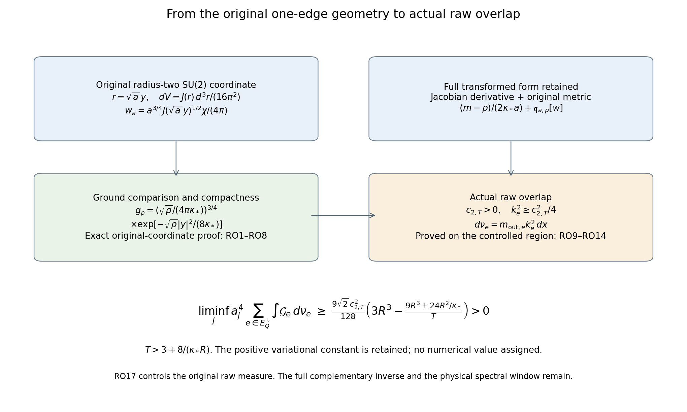

# Raw overlap and the original metric near aligned surrounding paths

This calculation follows GF1–GF31 and derives a positive local lower bound for the raw projected derivative contribution. It does not assert physical spectral weight in a shrinking window.

## 1. Exact original coordinate map

Keep \(\kappa=\kappa_*>0\), \(a=a_j=(100j)^{-1}\),
\(b=(\kappa_*a^2)^{-1}\), and the original radius-two metric. At a surrounding matrix \(S=\rho Q_S\), \(\rho>0\), right multiplication sends \(U\) to \(V=UQ_S\), preserving the original Haar measure, metric and every fiber norm. The full fiber operator becomes
\[
A=-\kappa_*\Delta_V+
\frac{m-\rho}{2\kappa_*a^2}
+\frac{\rho}{4\kappa_*a^2}(2-\operatorname{Tr}V).
\tag{RO1}
\]
Both scalar contributions and the full deficit remain. Use the original geodesic coordinate \(r\in\mathbb R^3\), \(|r|<2\pi\), with
\[
V(r)=\cos(|r|/2)I+
i\sin(|r|/2)\frac{r}{|r|}\cdot\sigma,\qquad
J(r)=\left(\frac{\sin(|r|/2)}{|r|/2}\right)^2 .
\]
At \(r=0\), the expressions have their smooth extensions. The coordinate omits only the antipodal point, which has zero Haar measure. The radius-two metric, inverse metric and probability Haar measure are exactly
\[
g(r)=P_r+J(r)P_r^\perp,\qquad
g^{-1}(r)=P_r+J(r)^{-1}P_r^\perp,\qquad
dV=\frac{J(r)}{16\pi^2}\,d^3r.
\tag{RO2}
\]
Here \(P_r=rr^T/|r|^2\), and the sum extends to the identity at zero. These formulas follow from
\(ds^2=d|r|^2+4\sin^2(|r|/2)d\omega^2\).
The sphere of radius two has volume \(16\pi^2\), so the Haar prefactor is retained.

For an original Haar-unit fiber vector \(\chi\), define its exact image on
\(\mathbb B_a=\{y:|y|<2\pi/\sqrt a\}\) by
\[
w_a(y)=\frac{a^{3/4}}{4\pi}
J(\sqrt a\,y)^{1/2}\chi(V(\sqrt a\,y)),\qquad
\chi(V(\sqrt a\,y))
=4\pi a^{-3/4}J(\sqrt a\,y)^{-1/2}w_a(y).
\tag{RO3}
\]
Extend \(w_a\) by zero outside \(\mathbb B_a\) for its \(L^2(\mathbb R^3)\) interpretation. Change of variables in (RO2) proves the exact isometry
\(\|w_a\|_{L^2(dy)}=\|\chi\|_{L^2(dV)}=1\).
This comparison does not replace the original object; the inverse, the full state prefactor and the Jacobian are explicit.

Write \(J_a(y)=J(\sqrt a\,y)\) and
\(\nabla_a^Jw=\nabla w-\tfrac12(\nabla\log J_a)w\).
The complete radial logarithmic derivative is
\[
\nabla\log J_a(y)
=\left(\sqrt a\cot\frac{\sqrt a\,|y|}{2}
-\frac{2}{|y|}\right)\frac{y}{|y|},
\]
with value zero at \(y=0\). Both terms remain before taking their smooth common limit.
Direct substitution in the original kinetic and potential integrals gives
\[
\begin{split}
a\langle\chi,A\chi\rangle
={}&\frac{m-\rho}{2\kappa_*a}+\mathfrak q_{a,\rho}[w_a],\\
\mathfrak q_{a,\rho}[w]
={}&\kappa_*\int_{\mathbb B_a}
(\nabla_a^Jw)^*g^{-1}(\sqrt a\,y)(\nabla_a^Jw)\,dy\\
&+\int_{\mathbb B_a}
\frac{\rho}{2\kappa_*a}
\left(1-\cos\frac{\sqrt a\,|y|}{2}\right)|w|^2\,dy .
\end{split}\tag{RO4}
\]
No boundary integration or omission of the Jacobian derivative was used. All terms come from the change of variables and the derivative of the inverse in (RO3). For original \(H^1\) vectors, approximate by smooth vectors and pass in the original form norm; the same nonnegative integral identity holds.

## 2. Compactness with all original contributions retained

Fix \(0<\rho_0\le4\) and a finite \(T>0\). Consider actual original nonnegative Haar-unit vectors whose images satisfy
\(\rho\in[\rho_0,4]\) and \(\mathfrak q_{a,\rho}[w]\le T\).
These are explicitly defined variational classes, not hypotheses imposed on the Yang–Mills limit.

For \(0\le t\le\pi\), \(1-\cos t\ge2t^2/\pi^2\). One proof is
\(1-\cos t=2\sin^2(t/2)\) and the concavity lower chord
\(\sin s\ge2s/\pi\), \(0\le s\le\pi/2\). Thus (RO4) implies
\[
\int_{\mathbb R^3}|y|^2|w(y)|^2\,dy
\le\frac{4\kappa_*\pi^2T}{\rho_0}.
\tag{RO5}
\]
On any fixed ball, \(J_a\to1\), \(g^{-1}(\sqrt a\,y)\to I\), and
\(\nabla\log J_a\to0\) uniformly, with all needed derivatives. The kinetic term in (RO4) bounds the ordinary \(H^1\) norm there, because
\(|\nabla w|^2\le2|\nabla_a^Jw|^2+
\tfrac12|\nabla\log J_a|^2|w|^2\)
and the inverse metric is bounded below by the identity. Rellich compactness on each fixed ball, followed by a diagonal subsequence, gives local strong \(L^2\) convergence. The tail estimate (RO5) upgrades it to strong \(L^2(\mathbb R^3)\) convergence, retaining norm one and nonnegativity.

If \(\rho_n\to\rho\in[\rho_0,4]\), \(a_n\downarrow0\), and \(w_n\to w\) in this way, weak lower semicontinuity of the kinetic term on each fixed ball and uniform convergence of the potential there give
\[
\mathfrak h_\rho[w]
:=\kappa_*\int_{\mathbb R^3}|\nabla w|^2\,dy
+\frac{\rho}{16\kappa_*}\int_{\mathbb R^3}|y|^2|w|^2\,dy
\le\liminf_n\mathfrak q_{a_n,\rho_n}[w_n].
\tag{RO6}
\]
To justify the displayed coefficient, the exact potential in (RO4) has
\((1-\cos(\sqrt a\,|y|/2))/a\to|y|^2/8\).
The Taylor remainder bound
\(|1-\cos t-t^2/2|\le t^4/24\)
even bounds the error in its full potential coefficient on \(|y|\le R_0\) by
\(\rho aR_0^4/(768\kappa_*)\).
For the kinetic lower limit, subtracting the coefficient
\(\tfrac12\nabla\log J_a\) changes the local weak gradient by a strongly vanishing \(L^2\) term. The inverse metric converges uniformly. Taking expanding balls retains all nonnegative limiting terms. This proves the comparison without an assumed spectral convergence theorem.

The oscillator form \(\mathfrak h_\rho\) has ground value \(3\sqrt\rho/4\), with unique nonnegative unit ground
\[
g_\rho(y)=
\left(\frac{\sqrt\rho}{4\pi\kappa_*}\right)^{3/4}
\exp\left(-\frac{\sqrt\rho\,|y|^2}{8\kappa_*}\right).
\tag{RO7}
\]
Indeed, with \(\gamma=\sqrt\rho/(4\kappa_*)\), integration by parts gives
\[
\mathfrak h_\rho[w]-\frac{3\sqrt\rho}{4}\|w\|^2
=\kappa_*\int|\nabla w+\gamma yw|^2\,dy .
\]
The identity first holds for compact smooth functions; cutoff and form approximation extend it to \(H^1\) functions with finite second moment. A zero right side gives
\(\nabla(e^{\gamma|y|^2/2}w)=0\) locally, hence a constant multiple of the displayed Gaussian. Its exact Gaussian integral gives the prefactor in (RO7).

Apply the exact map to the actual positive fiber ground \(f_\rho\). EV18 gives
\[
\mathfrak q_{a,\rho}[w_a^{\mathrm{ground}}]
=a\left(\lambda_m(\rho)-\frac{m-\rho}{2\kappa_*a^2}\right)
\le\frac{3\sqrt\rho}{4}+\frac{3\kappa_*a}{16}.
\tag{RO8}
\]
The preceding compactness and lower bound force every convergent subsequence with \(\rho_n\to\rho\) to have limit \(g_\rho\); its norm remains one. Uniqueness proves the full sequential statement. In particular this convergence is uniform in the sequential sense for \(\rho\) in any compact interval \([\rho_0,4]\). The original additive potential constant remains in (RO8).

## 3. A proved positive overlap constant

For \(T>3/2\), define the actual variational number
\[
c_{\rho_0,T}
=\inf\left\{
\langle g_\rho,w\rangle_{L^2(dy)}:
\rho\in[\rho_0,4],\ w\ge0,\ \|w\|_2=1,\
\mathfrak h_\rho[w]\le T
\right\}.
\tag{RO9}
\]
The class is nonempty, since the Gaussian ground has energy at most \(3/2\). It is compact in \(L^2\), jointly with \(\rho\): its derivative and second-moment bounds give exactly the Rellich and tail argument above, while weak lower semicontinuity retains its energy bound. The Gaussian depends continuously on \(\rho\) in \(L^2\), by its explicit formula and Gaussian domination on this compact interval. The infimum is therefore attained. Each possible \(w\) is nonnegative with norm one, and \(g_\rho>0\) everywhere. Their inner product is strictly positive. Consequently \(c_{\rho_0,T}>0\), a proved number determined by the displayed variational problem.

For all sufficiently large original \(j\), every vector in the class in Section 2 obeys
\[
\langle f_\rho,\chi\rangle_{L^2(dV)}
=\langle w_a^{\mathrm{ground}},w_a\rangle_{L^2(dy)}
\ge\tfrac12c_{\rho_0,T}.
\tag{RO10}
\]
Otherwise a sequence of violations would have \(\rho_n\to\rho\), strongly convergent unit nonnegative \(w_n\to w\), and
\(\mathfrak h_\rho[w]\le T\), by (RO5)–(RO6). Equation (RO8) gives
\(w_n^{\mathrm{ground}}\to g_\rho\). The limit of the inner products would then be at least \(c_{\rho_0,T}\), contradicting the violations. This proves (RO10), including its quantifiers, without assuming an overlap for the physical vacuum.

## 4. Application to the actual raw measure

Return to each actual interior edge in the original fitted cube of GF31. Put
\[
\begin{gathered}
m_{\mathrm{out},e}(x)=\int\psi(U,x)^2\,dU>0,\qquad
\chi_{e,x}(U)=\psi(U,x)/\sqrt{m_{\mathrm{out},e}(x)},\\
t_e(x)=\langle\chi_{e,x},A_e(x)\chi_{e,x}\rangle
-\frac{4-\rho_e(x)}{2\kappa_*a_j^2}\ge0,\\
k_e(x)=\langle\phi_{e,x},\chi_{e,x}\rangle>0,\qquad
d\nu_e=m_{\mathrm{out},e}(x)k_e(x)^2\,dx .
\end{gathered}\tag{RO11}
\]
The nonnegativity of \(t_e\) is the original potential minimum and nonnegative kinetic form. The raw measure is exactly EV10's measure, with its original mass, not a new state.

Every face incident on \(e\in E_Q^\circ\) lies inside \(Q\). Summing \(A_e\) on these edges counts each inside potential at most four times with coefficient \(b/4\), and includes only part of the nonnegative inside kinetic form. LC15 therefore proves
\[
\begin{split}
0\le\sum_{e\in E_Q^\circ}\mu_j t_e
&=\sum_{e\in E_Q^\circ}\langle\psi,A_e\psi\rangle
-\frac1{2\kappa_*a_j^2}\sum_{e\in E_Q^\circ}\mu_j(4-\rho_e)\\
&\le b_j\Lambda_Q
-\frac1{2\kappa_*a_j^2}\sum_{e\in E_Q^\circ}\mu_j(4-\rho_e)
\le b_j\Lambda_Q .
\end{split}\tag{RO12}
\]
Here an expectation of \(t_e\) means integration in its own actual outside marginal. The retained middle line displays the full potential-minimum contribution before the weaker final bound.

Choose the specific interval \(\rho_e>2\), and \(T>3+8/(\kappa_*R)\). This also implies \(T>3/2\). The actual number of bad-edge probabilities obeys
\[
\sum_{e\in E_Q^\circ}
\mu_j\{\rho_e\le2\ \text{or}\ a_jt_e>T\}
\le\Lambda_Q+\frac{a_jb_j}{T}\Lambda_Q .
\tag{RO13}
\]
The first term is EV22 with \(\eta=2\); the second is Markov's inequality applied to (RO12). On every remaining outside configuration, (RO4) for its actual \(\chi_{e,x}\) gives
\(\mathfrak q_{a_j,\rho_e}\le T\). Therefore (RO10) applies with
\(\rho_0=2\), and \(k_e^2\ge c_{2,T}^2/4\).
The lower bound in GF28 also gives \(\mathcal G_e\ge h_{2,j}\), with the complete finite expression in GF31. Thus, for all sufficiently large original \(j\),
\[
\begin{gathered}
\sum_{e\in E_Q^\circ}M_e
\ge\frac{c_{2,T}^2}{4}
\left(|E_Q^\circ|-\Lambda_Q-\frac{a_jb_j}{T}\Lambda_Q\right),\\
\sum_{e\in E_Q^\circ}\int\mathcal G_e\,d\nu_e
\ge\frac{c_{2,T}^2}{4}h_{2,j}
\left(|E_Q^\circ|-\Lambda_Q-\frac{a_jb_j}{T}\Lambda_Q\right).
\end{gathered}\tag{RO14}
\]
All terms are in the original raw measure; the proof has now constructed the needed overlap estimate.
Use \(a_j^3|E_Q^\circ|\to3R^3\),
\(a_j^3\Lambda_Q\to0\),
\(a_j^4b_j\Lambda_Q\to9R^3+24R^2/\kappa_*\), and
\(a_jh_{2,j}\to9\sqrt2/64\), to obtain
\[
\begin{gathered}
\liminf_j a_j^3\sum_{e\in E_Q^\circ}M_e
\ge\frac{c_{2,T}^2}{4}
\left(3R^3-\frac{9R^3+24R^2/\kappa_*}{T}\right)>0,\\
\liminf_j a_j^4\sum_{e\in E_Q^\circ}
\int\mathcal G_e\,d\nu_e
\ge\frac{9\sqrt2\,c_{2,T}^2}{256}
\left(3R^3-\frac{9R^3+24R^2/\kappa_*}{T}\right)>0 .
\end{gathered}\tag{RO15}
\]
The strict positivity follows from the chosen explicit range of \(T\) and the proved positivity of \(c_{2,T}\). The constant has an exact variational definition; no numerical value has been assigned to it.

## 5. Stronger exact limits from the same original-coordinate proof

The two nonnegative ground-energy contributions in (RO4) each converge. To prove this, take any sequence \(\rho_j\to\rho\in[\rho_0,4]\). Section 2 proves the total ground-energy convergence to \(3\sqrt\rho/4\) and strong convergence of the image to \(g_\rho\). Its separate kinetic and potential lower limits are at least the corresponding Gaussian integrals. Direct Gaussian integration gives
\[
\kappa_*\int|\nabla g_\rho|^2\,dy
=\frac{\rho}{16\kappa_*}\int |y|^2g_\rho^2\,dy
=\frac{3\sqrt\rho}{8}.
\]
Their sum is already the limit of the total energy. Therefore each lower limit is also its upper limit: for example the kinetic upper limit is at most the total limit minus the potential lower limit. Both terms consequently converge. In the original objects this proves
\[
a_j\kappa_*K_{\rho_j}\longrightarrow\frac{3\sqrt\rho}{8},
\qquad
\frac{\rho_j}{4\kappa_*a_j}d_{\rho_j}
\longrightarrow\frac{3\sqrt\rho}{8}.
\tag{RO16}
\]
This convergence is uniform over \(\rho\in[\rho_0,4]\): any failure supplies a sequence, and the compact interval supplies a convergent subsequence contradicting the just-proved statement. The original expectation \(d_\rho\) here is the complete deficit mean in GF25. Thus
\(d_{\rho_j}/a_j\to3\kappa_*/(2\sqrt\rho)\).

At exact alignment, GF24 now gives the exact original limit
\(a_j\mathcal G_e|_{\rho=m}\to9/(8\sqrt m)\), improving both-sided bounds GF30. On \(\rho_e>4-\eta\), the exact inequality GF17 and the uniform convergence (RO16) give
\(\liminf_j\inf_{\rho_e>4-\eta}a_j\mathcal G_e
\ge9\sqrt{4-\eta}/32\).
The same actual marginal concentration argument as GF31 therefore improves its coefficient. On the controlled region used in RO13, take \(\rho_0=2\), retain the same positive \(c_{2,T}\), and apply the uniform kinetic limit before taking the lower limit in RO14. The resulting strengthenings are
\[
\begin{gathered}
\lim_j a_j\mathcal G_e\big|_{\rho=m}
=\frac{9}{8\sqrt m}\quad(m=2,3,4),\\
\liminf_j a_j^4\sum_{e\in E_Q^\circ}\mu_j\mathcal G_e
\ge\frac{27R^3}{16},\\
\liminf_j a_j^4\sum_{e\in E_Q^\circ}
\int\mathcal G_e\,d\nu_e
\ge\frac{9\sqrt2\,c_{2,T}^2}{128}
\left(3R^3-\frac{9R^3+24R^2/\kappa_*}{T}\right)>0 .
\end{gathered}\tag{RO17}
\]
For the second line, first fix \(\eta>0\), use the uniform bound on its good region and the retained nonnegative contribution elsewhere, and then let \(\eta\downarrow0\). For the third line, the good-region raw mass has lower limit at least \(c_{2,T}^2/4\) times the positive bracket, by RO14. Multiplying it by the uniform lower limit \(9\sqrt2/32\) gives the displayed coefficient. Thus the stronger constants follow from the proved original-coordinate convergence, not a substituted oscillator model.

This establishes a lower bound for the raw overlap and its derivative contribution in the actual vacuum. The complementary term in GF8 still acts on that same ground amplitude. Its exact cancellation and the centered source in GF11–GF14 remain the next spectral calculation. No inference about surviving physical spectral mass follows from (RO15) or (RO17) alone.

Provider proofs: [EV1–EV29](https://github.com/KokunoYumeto/yang-mills-interacting-workbench/blob/b00c8daade155396db839be52c4832d17460ae62/yang-mills/continuations/20261011-central-signs-shrinking-window/ACTUAL_EDGE_ENERGY_VARIANCE.md), [LC1–LC20](https://github.com/KokunoYumeto/yang-mills-interacting-workbench/blob/b00c8daade155396db839be52c4832d17460ae62/yang-mills/continuations/20261011-central-signs-shrinking-window/LOCAL_CURVATURE_BUDGET.md), [WH1–WH33](https://github.com/KokunoYumeto/yang-mills-interacting-workbench/blob/b00c8daade155396db839be52c4832d17460ae62/yang-mills/continuations/20261011-central-signs-shrinking-window/SMOOTH_WEIGHTED_LOCAL_ENERGY.md), and [SF1–SF27](https://github.com/KokunoYumeto/yang-mills-interacting-workbench/blob/b00c8daade155396db839be52c4832d17460ae62/yang-mills/continuations/20261011-central-signs-shrinking-window/SHARED_FACE_WORDS_AND_PHYSICAL_COUPLING.md). New receiving proofs: [GF1–GF31](https://github.com/KokunoYumeto/yang-mills-interacting-workbench/blob/main/yang-mills/continuations/20261011-central-signs-shrinking-window/FULL_HAMILTONIAN_GROUND_FIBER.md) and [RO1–RO17](https://github.com/KokunoYumeto/yang-mills-interacting-workbench/blob/main/yang-mills/continuations/20261011-central-signs-shrinking-window/RAW_OVERLAP_AND_ORIGINAL_METRIC.md).

Reproducible [diagnostics and figures](check_raw_overlap.py); [source record](GROUND_FIBER_SOURCE_USE_LEDGER.json). No full-vacuum samples.

## Full physical lift and original-source spectral windows

[PLF1–PLF26](https://github.com/KokunoYumeto/yang-mills-interacting-workbench/blob/main/yang-mills/continuations/20261011-central-signs-shrinking-window/FULL_PHYSICAL_LIFT_AND_SOURCE.md) calculate the complete physical norm, vacuum subtraction and first two energy moments of the coupled ground-family lift. The original Wilson observable differs from an outside multiplier by a proved spectral-amplitude error at most16a_j M_f. At the original scale s_j=100kappa_*a_j, the complete corrected-source error also tends to zero. A three-scale resolvent estimate subtracts low- and high-energy contributions and gives an exact lower bound for the original physical window, with no bounded total source-norm assumption. Every complementary term is retained. The actual signed three-scale value remains to be evaluated; these formulas do not assert a continuum no-gap result.
