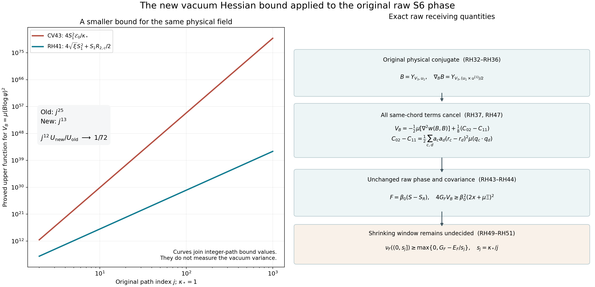

# The full raw S6 phase: second energy and a stronger physical conjugate covariance

This proof concerns the actual finite-volume vacuum and the unchanged path
\(L_j=j^4,a_j=(100j)^{-1},g_j^2=\kappa_*/(200j)\). It proves exact
first- and second-energy matrices for the original raw phase, an explicit
second-energy upper bound, and a physical conjugate variance bound whose
available upper function grows as \(j^{13}\), improving the earlier
\(j^{25}\) function. Neither bound determines the sign of
\(G_{F,j}-E_{F,j}/s_j\), where \(s_j=\kappa_*/j\).
The precise remaining signed covariance contraction is calculated below,
including its finite matrix and all original root coefficients.

The goal of a smooth interacting gapless four-dimensional theory is not a
conclusion of this note. All asymptotic statements about upper functions
or lower functions are identified as such; none is asserted to be an
asymptotic equivalence for an unknown actual expectation.

## 1. Original objects, metric, action, and raw vector

Let \(m=2L,n=m+1,L\ge2\). Vertices are
\(z=(i,k,l)\in\{0,\ldots,m\}^3\), at positions
\(o+a(i-L,k-L,l-L)\). Every positive nearest-neighbour edge and every
elementary face of this open cube is present. Thus
\[
 N=3mn^2,\qquad M=3m^2n.
 \tag{RH1}
\]
The configuration space is \(SU(2)^N\), with probability Haar on each
factor and the round radius-two metric. Put
\(T_\alpha=-i\sigma_\alpha/2\),
\(X_{e\alpha}f=\partial_t f(\ldots,e^{tT_\alpha}U_e,\ldots)|_0\).
These fields are orthonormal and satisfy
\([X_{e\alpha},X_{e\beta}]=-\epsilon_{\alpha\beta\gamma}X_{e\gamma}\).
The sign follows by applying the two derivatives to the matrix coordinate:
\(X_\alpha X_\beta U=T_\beta T_\alpha U\).
Write
\[
 U=c(U)I+q(U)\cdot T,\quad c^2+|q|^2/4=1,\quad
 q^\alpha(U)=-2\operatorname{tr}(T_\alpha U),\quad
 \Delta=\sum_{e,\alpha}X_{e\alpha}^2.
 \tag{RH2}
\]
For each face \(p=(z;d,e),d<e\), its word, defect, and the full
Hamiltonian are
\[
 \begin{gathered}
 U_p=U_d(z)U_e(z+e_d)U_d(z+e_e)^{-1}U_e(z)^{-1},\quad
 D_p=2-\operatorname{tr}U_p\in[0,4],\quad W=\sum_pD_p,\\
 H=-\kappa\Delta+bW,\qquad
 \kappa=2g^2/a,\quad b=1/(2g^2a),\quad
 \xi=b/\kappa=1/(4g^4),\quad \kappa b=a^{-2}.
 \end{gathered}\tag{RH3}
\]
In particular \(bW=2bM-b\sum_p\operatorname{tr}U_p\).
The physical action is
\(U_{(s,t)}\mapsto h_sU_{(s,t)}h_t^{-1}\), for every original vertex,
including the boundary. Physical vectors are invariant under this action.

The positive unit ground state is denoted by \(\psi\), with
\(H\psi=E_0\psi\), \(w=\log\psi\), and \(d\mu=\psi^2dU\).
Compact ellipticity gives a smooth minimizer; replacing it by its absolute
value does not increase its form, and the strong maximum principle makes
the nonnegative minimizer strictly positive. For smooth \(f\), expansion
and integration by parts give
\[
 \langle f\psi,(H-E_0)f\psi\rangle=\kappa\mu|\nabla f|^2.
 \tag{RH4}
\]
It follows that every other ground vector is a scalar multiple of
\(\psi\): its quotient by \(\psi\) has zero gradient on the connected
configuration product. Gauge transformations and the reflection below
therefore fix \(\psi\). The full and physical ground energies coincide.
All functions used below are smooth at each finite volume; compactness and
strict positivity justify all differentiations and integrations.

The original rooted tree contains every direction-one edge, the
direction-two edges at first coordinate zero, and the direction-three
edges at first two coordinates zero. Its complete transport is
\[
 t_{i,k,l}=
 \left(\prod_{r=0}^{l-1}U_3(0,0,r)\right)
 \left(\prod_{s=0}^{k-1}U_2(0,s,l)\right)
 \left(\prod_{t=0}^{i-1}U_1(t,k,l)\right),\qquad
 Z_c=t_{s(c)}U_ct_{t(c)}^{-1}.
 \tag{RH5}
\]
Products are ordered increasingly from left to right. Empty products are
identity. The full chord sets are
\[
 \begin{split}
 \mathcal C_2&=\{(i,k,l;2):1\le i\le m,\ 0\le k<m,\ 0\le l\le m\},\\
 \mathcal C_3&=\{(i,k,l;3):0\le i,k\le m,\ (i,k)\ne(0,0),\ 0\le l<m\}.
 \end{split}\tag{RH6}
\]
With \(h=\pi/(2n),s=\sin h,c=\cos h,C=\cot h\), retain
\[
 \begin{gathered}
 v_0(r)=n^{-1/2},\quad v(r)=\sqrt{2/n}\cos\frac{\pi(r+1/2)}n,\quad
 w_1(r)=-\sqrt{2/n}\sin\frac{\pi(r+1)}n,\\
 a_{(i,k,l;2)}=-v(i)w_1(k)v_0(l)/\sqrt2,\quad a_{\mathcal C_3}=0,\\
 b_{(i,k,l;2)}=v_0(i)w_1(k)v(l)/\sqrt2,\quad
 b_{(i,k,l;3)}=-v_0(i)v(k)w_1(l)/\sqrt2,\\
 u_1=\sum_ca_cq(Z_c),\quad u_3=\sum_cb_cq(Z_c),\quad S=u_1\cdot u_3,\\
 (RU)_1(i,k,l)=U_1(m-i-1,k,l)^{-1},\quad
 (RU)_d(i,k,l)=U_d(m-i,k,l)\quad(d=2,3),\\
 S_R=S\circ R,\quad D=S+S_R,\quad
 \sigma_*=\sqrt8\sin h,\quad\beta_0=\sigma_*/(2g^2),\quad F=\beta_0(S-S_R).
 \end{gathered}\tag{RH7}
\]
Every reflected root word means substitution of this map in (RH5).
For example its tree transport is
\[
 t^R_{i,k,l}=
 \left(\prod_{r<l}U_3(m,0,r)\right)
 \left(\prod_{s<k}U_2(m,s,l)\right)
 \left(\prod_{t<i}U_1(m-t-1,k,l)^{-1}\right).
 \tag{RH8}
\]
Under a gauge action all \(Z_c\) are conjugated by the root gauge element,
so \(u_1,u_3\) rotate together. This proves that \(S,S_R,D,F\) are
physical. Reflection is an isometry, preserves the complete potential,
and makes \(F\) odd. Hence \(\mu F=0\).

For reference, strict nonzero raw norm can be proved on an original chord.
Take \(e=(1,L-1,0;2)\), \(K=Z_e\), \(H_\partial=Z_{(m,L-1,0;2)}\).
The ordered boundary comb is
\(A_{k,l}=(\prod_{t<l}Z_{(m,0,t;3)})(\prod_{s<k}Z_{(m,s,l;2)})\).
Solving the tree coordinates in (RH5) makes tree links identity by a
gauge action and preserves product Haar successively by left and right
invariance. Substituting (RH8) then gives the exact reflected word
\(A_{k,l}KH_\partial^{-1}A_{k,l}^{-1}\). Its original coefficients are
\(-a_e,b_e\). Thus the quadratic harmonic part, as a function of \(K\)
with the full exterior fixed, is
\[
 \Pi_2^{(e)}F=-\beta_0a_eb_e[\chi_1(K)+\chi_1(KH_\partial^{-1})],\quad
 \chi_1(U)=4c(U)^2-1,\quad
 \|\Pi_2^{(e)}F\|_{dK}^2
 =\tfrac43\beta_0^2a_e^2b_e^2[1+2c(H_\partial)^2]>0.
 \tag{RH9}
\]
Here \(a_eb_e\ne0\) for every odd \(n\ge5\). The norm follows from
\(\int z_iz_jz_kz_l=(\delta_{ij}\delta_{kl}+\delta_{ik}\delta_{jl}
+\delta_{il}\delta_{jk})/24\) on the unit quaternion coordinates;
this tensor is fixed by rotation invariance and two traces. Constants and
affine terms in the entire polynomial remain present; projection only
proves its nonconstancy. Consequently
\[
 G_F=\mu F^2>0,\qquad E_F=\kappa\mu|\nabla F|^2>0.
 \tag{RH10}
\]

## 2. Every root transport in the gradient and covariant Hessian

For a physical edge define the orthonormal frame
\[
 E_{e\alpha}=\sum_\gamma
 (\operatorname{Ad}_{t_{s(e)}^{-1}})_{\gamma\alpha}X_{e\gamma},\qquad
 T_{ce}=\mathbf1_{e\in t_{s(c)}}+\delta_{ce}-\mathbf1_{e\in t_{t(c)}},\qquad
 R_{ce}=\mathbf1_{e\in t_{s(c)}}+\delta_{ce}+\mathbf1_{e\in t_{t(c)}}.
 \tag{RH11}
\]
Both occurrences of a shared tree edge remain in \(R_{ce}\). A field's
own coefficient matrix does not depend on its edge, so each \(E_{e\alpha}\)
is Haar divergence free and \(\sum E_{e\alpha}^2=\Delta\).
Direct differentiation of every letter of (RH5) gives
\[
 \begin{split}
 E_{e\alpha}q_c&=c_cT_{ce}\mathbf e_\alpha+
              \tfrac12R_{ce}\mathbf e_\alpha\times q_c=:J_{c,e\alpha},\\
 E_{e\alpha}c_c&=-\tfrac14T_{ce}q_c^\alpha,
 \end{split}\tag{RH12}
\]
where \(q_c=q(Z_c),c_c=c(Z_c)\). The signs and factor \(1/2\)
follow from
\((z\cdot T)(y\cdot T)=-(z\cdot y)I/4+(z\times y)\cdot T/2\).

Write \(e\prec f\) when the tree edge \(e\) lies in the root path to
\(s(f)\); a chord is never such an ancestor. Differentiating the frame,
and using the radius-two bi-invariant connection, gives exactly
\[
 \nabla_{E_{e\alpha}}E_{f\beta}
 =-\left(\mathbf1_{e\prec f}+\tfrac12\delta_{ef}\right)
             E_{f,\mathbf e_\alpha\times\mathbf e_\beta}.
 \tag{RH13}
\]
For distinct links the only connection term is the derivative of the
root transport, equal to minus the displayed ancestor rotation. For a
single link the coefficient of that rotation is \(1/2\), because its
invariant-field bracket has the sign in (RH2). This proves (RH13) with
no singular quotient geometry.

Let \(I=(e,\alpha),J=(f,\beta)\), and set
\(\gamma_{ef}=\mathbf1_{e\prec f}+\delta_{ef}/2\). The full vector
Hessian of each original word is therefore
\[
 \begin{split}
 H_{c,IJ}:=\nabla^2q_c(E_{e\alpha},E_{f\beta})
 ={}&-\tfrac14T_{ce}T_{cf}q_c^\alpha\mathbf e_\beta
       +\tfrac12R_{cf}\mathbf e_\beta\times J_{c,e\alpha}\\
 &+\gamma_{ef}\left[c_cT_{cf}(\mathbf e_\alpha\times\mathbf e_\beta)
       +\tfrac12R_{cf}(\mathbf e_\alpha\times\mathbf e_\beta)\times q_c\right].
 \end{split}\tag{RH14}
\]
This is an exact finite formula, including every repeated root occurrence
and connection term. Its symmetry also follows directly by subtracting
the two differentiated expressions and inserting their frame bracket.

Put \(J_{1,I}=\sum_ca_cJ_{c,I}\),
\(J_{3,I}=\sum_cb_cJ_{c,I}\),
\(H_{1,IJ}=\sum_ca_cH_{c,IJ}\), and
\(H_{3,IJ}=\sum_cb_cH_{c,IJ}\). The raw scalar derivatives are
\[
 \begin{split}
 g_I:=E_IS&=u_3\cdot J_{1,I}+u_1\cdot J_{3,I},\\
 H^S_{IJ}&=u_3\cdot H_{1,IJ}+u_1\cdot H_{3,IJ}
                   +J_{1,I}\cdot J_{3,J}+J_{3,I}\cdot J_{1,J}.
 \end{split}\tag{RH15}
\]
The two product terms are both retained.

If \(e'\) is the reflected positive edge, the differential of reflection
in these frames is the orthogonal matrix
\[
 \Omega_e(U)=
 \begin{cases}
 -\operatorname{Ad}_{t_{s(e')}(RU)U_e^{-1}t_{s(e)}(U)^{-1}},&d(e)=1,\\
 \operatorname{Ad}_{t_{s(e')}(RU)t_{s(e)}(U)^{-1}},&d(e)=2,3.
 \end{cases}\tag{RH16}
\]
For a reversed edge, differentiating the inverse sends a left coefficient
\(Y\) to \(-U_e^{-1}YU_e\); converting to the target root frame proves
this formula. Consequently the complete reflected tensors are
\[
 \begin{gathered}
 g^R_e(U)=\Omega_e(U)^Tg_{e'}(RU),\quad
 H^{S_R}_{ef}(U)=\Omega_e(U)^TH^S_{e'f'}(RU)\Omega_f(U),\\
 \nabla F=\beta_0(g-g^R),\qquad
 \nabla^2F=\beta_0(H^S-H^{S_R}).
 \end{gathered}\tag{RH17}
\]
The second equality is the naturality of the covariant Hessian under the
isometry \(R\): differentiating the first equality with the connection
(RH13) supplies precisely the derivatives of \(\Omega\). Hence none may
be dropped by differentiating its entries as constants.

## 3. The actual vacuum Hessian and complete energy matrices

The ground equation and curvature convention are
\[
 \Delta w+|\nabla w|^2=(bW-E_0)/\kappa,\quad
 \mathscr L=\Delta+2\nabla w\cdot\nabla,\quad
 \operatorname{Ric}=\tfrac12g,\quad
 \mathscr R(v,z,v,z)=\tfrac14\sum_e(|v_e|^2|z_e|^2-\langle v_e,z_e\rangle^2).
 \tag{RH18}
\]
Here \(g\) in tensor expressions is the metric, whereas \(g^2\) in
(RH3) is the coupling. To keep the imported bound verifiable, the full
stationary argument is recorded. If \(h_w=\nabla^2w\), scalar derivative
commutation on this locally symmetric product gives
\[
 \kappa^{-1}(\nabla^2(bW))_{ij}
 = (\mathscr Lh_w)_{ij}+2(h_w^2)_{ij}
 +2\mathscr R_{ikjl}(h_w)_{kl}
 -\operatorname{Ric}_{ik}(h_w)_{kj}-\operatorname{Ric}_{jk}(h_w)_{ik}
 +2\mathscr R_{ikjl}w_kw_l.
 \tag{RH19}
\]
Indeed \(\nabla_i(h_w)_{jk}-\nabla_k(h_w)_{ij}=\mathscr R_{ikjl}w_l\).
Differentiating \(|\nabla w|^2\) twice gives \(2h_w^2\), the covariant
drift, and the last curvature term. Commuting the Hessian of \(\Delta w\)
gives the remaining two Ricci terms and \(2\mathscr R*h_w\);
derivatives of Ricci vanish. This derives every term in (RH19).

At a negative global minimum eigenvalue \(\lambda\) of \(h_w\), extend
its unit eigenvector radially in geodesic coordinates. Its first covariant
derivative vanishes at the point and the correction to the scalar
Laplacian is \(2\lambda\langle v,\Delta v\rangle=0\), since the
extension has unit length. Thus \((\mathscr Lh_w)(v,v)\ge0\).
The curvature and Ricci terms combine to
\(2\operatorname{tr}[\mathscr R(v,\cdot,v,\cdot)(h_w-\lambda g)]\ge0\),
and the last curvature term is nonnegative. It follows that
\(2\lambda^2\le\kappa^{-1}\nabla^2(bW)(v,v)\).
Twice differentiating each four-letter face along a product geodesic
retains four repeated-letter and twelve ordered distinct-letter terms.
Their operator norms give
\[
 |\nabla^2D_p(y,y)|\le\tfrac12\left(\sum_{e\in\partial p}|y_e|\right)^2
 \le2\sum_{e\in\partial p}|y_e|^2,\quad
 \nabla^2(bW)\le8b\,g,\quad
 \boxed{\nabla^2w\ge-2\sqrt\xi\,g.}
 \tag{RH20}
\]
Every original boundary incidence is counted and is at most four. The
constant \(2bM\) and \(E_0\) have zero Hessian but remain in (RH18).
This is the OS17–OS21/HVR3–HVR10 result with its proof and signs retained.

For arbitrary real smooth \(f,h\), weighted integration gives
\(\mu\mathscr Lf=0\) and
\(\mu\Gamma(f,h)=-\mu(f\mathscr Lh)\), where
\(\Gamma(f,h)=\langle\nabla f,\nabla h\rangle\).
The full polarization of weighted Bochner is
\[
 \mu[(\mathscr Lf)(\mathscr Lh)]
 =\mu[\langle\nabla^2f,\nabla^2h\rangle_{\rm HS}
            +\tfrac12\Gamma(f,h)-2h_w(\nabla f,\nabla h)].
 \tag{RH21}
\]
To prove the sign, expand
\(\mathscr L\Gamma(f)/2-\Gamma(f,\mathscr Lf)\).
The two Hessian-of-\(f\) drift terms cancel and leave
\(\|\nabla^2f\|^2+(\operatorname{Ric}-2h_w)(\nabla f,\nabla f)\).
Its integral is \(\mu(\mathscr Lf)^2\); polarization proves (RH21).

Let \(m_S=\mu S=\mu S_R\), and define the centered pair
\(f_1=S-m_S,f_2=S_R-m_S\). Write
\[
 \begin{gathered}
 Q=\mu S^2,\quad Q_R=\mu SS_R,\quad
 K=\mu|\nabla S|^2,\quad K_R=\mu\langle\nabla S,\nabla S_R\rangle,\\
 H_S=\mu\|\nabla^2S\|^2,\quad H_R=\mu\langle\nabla^2S,\nabla^2S_R\rangle,\\
 J_S=\mu h_w(\nabla S,\nabla S),\quad
 J_R=\mu h_w(\nabla S,\nabla S_R),\\
 \mathsf G=\begin{pmatrix}Q-m_S^2&Q_R-m_S^2\\Q_R-m_S^2&Q-m_S^2\end{pmatrix},\quad
 \mathsf K=\begin{pmatrix}K&K_R\\K_R&K\end{pmatrix},\quad
 \mathsf H=\begin{pmatrix}H_S&H_R\\H_R&H_S\end{pmatrix},\quad
 \mathsf J=\begin{pmatrix}J_S&J_R\\J_R&J_S\end{pmatrix}.
 \end{gathered}\tag{RH22}
\]
Reflection invariance proves every repeated diagonal entry, including
that of \(\mathsf J\), because \(w\circ R=w\).
For \(A=H-E_0\) on the original physical space,
\(A(f_i\psi)=-\kappa(\mathscr Lf_i)\psi\). Hence the exact raw
first- and second-energy matrices and their receiving bound are
\[
 \boxed{\mathsf E=\kappa\mathsf K,\qquad
 \mathsf E_2=\kappa^2(\mathsf H+\tfrac12\mathsf K-2\mathsf J),\qquad
 \mathsf E_2\preceq\kappa^2\mathsf H+(\kappa/2+4/a)\mathsf E.}
 \tag{RH23}
\]
The final inequality follows by applying (RH20) to each real linear
combination of the gradients; this is a matrix inequality, and covers
complex coefficients by their real and imaginary parts. It retains all
cross terms in (RH14)–(RH17). The Gram matrix of
\((f_1\psi,f_2\psi,A f_1\psi,A f_2\psi)\) is
\[
 \begin{pmatrix}\mathsf G&\mathsf E\\\mathsf E&\mathsf E_2\end{pmatrix}\succeq0.
 \tag{RH24}
\]
In particular each of the original even and odd blocks has its own exact
moment inequality. The odd block, with the original coefficient
\(\beta_0(1,-1)\), is
\[
 \begin{split}
 G_F&=2\beta_0^2(Q-Q_R),\qquad E_F=2\kappa\beta_0^2(K-K_R),\\
 E_{2,F}&=2\kappa^2\beta_0^2[H_S-H_R+\tfrac12(K-K_R)-2(J_S-J_R)],\\
 E_F^2&\le G_FE_{2,F},\qquad
 E_{2,F}\le2\kappa^2\beta_0^2(H_S-H_R)+(\kappa/2+4/a)E_F.
 \end{split}\tag{RH25}
\]
Thus \(H_S-H_R\), and not two unrelated pointwise Hessian suprema, is
the exact receiving tensor. It is nonnegative because it equals half
\(\mu\|\nabla^2(S-S_R)\|^2\).

## 4. Complete occurrence constants and original-path powers

Let \(n_{ce}=R_{ce}\) count every occurrence in the original word,
including opposite occurrences in a shared root prefix. Define
\[
 \begin{gathered}
 S_1=\sum_c|a_c|=\sqrt{2/n}C(C-c),\quad
 S_3=\sum_c|b_c|=\sqrt{2/n}[(2-1/n)C^2-(c/n)C],\\
 D_{1e}=\sum_c|a_c|n_{ce},\quad D_{3e}=\sum_c|b_c|n_{ce},\quad
 A_{\mu,ef}=\sum_c|M_{\mu c}|n_{ce}n_{cf},\quad
 A_\mu=\sum_c|M_{\mu c}|\sum_en_{ce}^2,\\
 A_1=m\sqrt{2/n}C(5C-4c),\qquad
 A_3=(m/n)\sqrt{2/n}[(9m+5)C^2-2cC].
 \end{gathered}\tag{RH26}
\]
Here \(M_{1c}=a_c,M_{3c}=b_c\). For verification, a direction-two
word has \(\sum_en_{ce}^2=2i+4k+4l+2\), and a direction-three word
has \(2i+2k+4l+2\). Their shared root prefixes have respectively
\(k+l\) and \(l\) links occurring twice. The absolute sums
\(\sum_{i=0}^m|v(i)|=\sqrt{2/n}C\),
\(\sum_{i=1}^m|v(i)|=\sqrt{2/n}(C-c)\), and
\(\sum_{k=0}^{m-1}|w_1(k)|=\sqrt{2/n}C\)
follow by the finite geometric sums of the exponentials on each side of
the middle zero. Reflection gives their first coordinate moments.
The first row's weighted coordinate means are
\(mC/[2(C-c)],(m-1)/2,m/2\); substitution proves \(A_1\).
The third direction-two row has mass \(\sqrt{2/n}(m/n)C^2\) and
squared-occurrence average \(5m+1\). Its unexcluded direction-three
rectangle has mass \(\sqrt{2/n}C^2\) and average \(4m\).
The excluded corner has mass \(\sqrt{2/n}cC/n\) and average \(2m\).
Adding and subtracting exactly these contributions proves \(A_3\).

Each first derivative of a word has vector norm at most its occurrence
count: one differentiated unit-quaternion factor has norm \(1/2\),
and the vector extraction has norm at most twice the quaternion norm.
Each covariant Hessian component has vector norm at most
\(n_{ce}n_{cf}/2\). For distinct edges this follows by inserting two
generators in every ordered pair of letter positions; for the same edge
use the symmetrized second derivative, equal to its covariant Hessian
in the invariant frame. Its repeated-letter insertions and the two
orders of distinct-letter insertions have the same bound. Rotating each
edge's unit tangent basis to (RH11) preserves this argument. Therefore
\[
 \begin{gathered}
 |\nabla S|^2\le3\sum_e(2S_3D_{1e}+2S_1D_{3e})^2
 \le\mathcal C_{\rm occ}:=12[S_3\sqrt{S_1A_1}+S_1\sqrt{S_3A_3}]^2,\\
 |H^S_{e\alpha,f\beta}|\le
 S_3A_{1,ef}+S_1A_{3,ef}+D_{1e}D_{3f}+D_{3e}D_{1f},\\
 \|\nabla^2S\|^2\le
 \mathcal H_{\rm occ}:=9[S_3A_1+S_1A_3+2\sqrt{S_1A_1S_3A_3}]^2.
 \end{gathered}\tag{RH27}
\]
To verify the last inequality,
\(\|A_{\mu,\cdot\cdot}\|_{\rm Frob}\le
\sum_c|M_{\mu c}|\|n_c n_c^t\|_{\rm Frob}=A_\mu\),
and \(\|D_\mu\|^2\le S_\mu A_\mu\) by coefficient-weighted
Cauchy–Schwarz. The four matrix terms in the preceding line then give
the displayed expression by the triangle inequality. The factor nine
counts both original colour indices; no root word was shortened.

The odd projection contracts the norm, gradient norm, and Hessian norm
in \(L^2(\mu)\): reflection acts isometrically on each corresponding
tensor bundle and fixes \(\mu\). Since
\(S-S_R=2P_-S\), (RH25) yields
\[
 \begin{gathered}
 G_F\le\overline G_F:=64\beta_0^2S_1^2S_3^2,\qquad
 E_F\le\overline E_F:=4\kappa\beta_0^2\mathcal C_{\rm occ},\\
 P_F:=4\kappa^2\beta_0^2\mathcal H_{\rm occ},\quad Q_a:=\kappa/2+4/a,\\
 \boxed{E_{2,F}\le P_F+Q_aE_F\le P_F+Q_a\overline E_F,\qquad
 G_F\ge\frac{E_F^2}{P_F+Q_aE_F}.}
 \end{gathered}\tag{RH28}
\]
All finite constants are original trigonometric expressions.

On the prescribed path, retain precisely
\[
 \begin{gathered}
 m_j=2j^4,\quad n_j=2j^4+1,\quad h_j=\pi/(4j^4+2),\quad
 \beta_{0,j}=\frac{200\sqrt2j}{\kappa_*}\sin h_j,\\
 \kappa_j=\kappa_*,\quad b_j=10000j^2/\kappa_*,\quad
 \xi_j=10000j^2/\kappa_*^2,\quad Q_{a_j}=\kappa_*/2+400j,\quad
 s_j=\kappa_*/j.
 \end{gathered}\tag{RH29}
\]
Let \(\tau=19/2+3\sqrt{10}\). Using \(C/n\to2/\pi\),
\(c\to1\), \(A_1/(nS_1)\to5\), \(A_3/(nS_3)\to9/2\),
\(S_1S_3/n^3\to64/\pi^4\), and
\(j^6\beta_{0,j}^2\to5000\pi^2/\kappa_*^2\), one obtains
\[
 \begin{gathered}
 \mathcal H_{\rm occ}/n^8\longrightarrow36864\tau^2/\pi^8,\qquad
 \mathcal C_{\rm occ}/n^7\longrightarrow49152\tau/\pi^8,\\
 \frac{\overline G_{F,j}}{j^{18}}\longrightarrow
 \frac{83886080000}{\kappa_*^2\pi^6},\quad
 \frac{\overline E_{F,j}}{j^{22}}\longrightarrow
 \frac{125829120000\tau}{\kappa_*\pi^6},\\
 \frac{P_{F,j}+Q_{a_j}\overline E_{F,j}}{j^{26}}
 \longrightarrow\frac{188743680000\tau^2}{\pi^6}.
 \end{gathered}\tag{RH30}
\]
The \(Q_a\overline E_F\) contribution has order \(j^{23}\), so its
ratio to \(j^{26}\) tends to zero. These are limits of proved bound
functions, not estimates from a simulated vacuum.

## 5. An exact acceleration cancellation for the original conjugate

Retain the original full soft cochain \(V=V_3\):
\[
 V_1(i,k,l)=0,\quad V_2(i,k,l)=w_1(k)v(l)/\sqrt{2n},\quad
 V_3(i,k,l)=-v(k)w_1(l)/\sqrt{2n}.
 \tag{RH31}
\]
It is defined on every physical edge of its direction. The finite sums
\(\sum v^2=\sum w_1^2=1\) give \(\sum_eV_e^2=1\).
Set \(W_r=\sum_{t<r}w_1(t)\), \(v_*=v(0)\). Its root integral is
\[
 p_{i,k,l}(V)=\frac{v(l)W_k-v_*W_l}{\sqrt{2n}},\quad
 Y_\alpha=\sum_eV_eE_{e\alpha},\quad Y_z=\sum_\alpha z_\alpha Y_\alpha,
 \quad B=Y_{u_1}.
 \tag{RH32}
\]
The fields \(Y_\alpha\) are orthonormal and divergence free. Let
\(d_c=p_{s(c)}+V_c-p_{t(c)}\) and
\(r_c=p_{s(c)}+V_c+p_{t(c)}\). Word differentiation gives
\[
 Y_zq_c=c_cd_cz+\tfrac12r_c z\times q_c,
 \quad Y_zc_c=-\tfrac14d_cz\cdot q_c,\qquad
 d_c=0\quad(c\in\mathcal C_2),\quad r_c=2p_{t(c)}\quad(c\in\mathcal C_2).
 \tag{RH33}
\]
The last two assertions follow by inserting (RH31) in (RH32), or by
the finite identities \(v(r+1)-v(r)=2\sin h\,w_1(r)\) and
\(v(r)=v_*+2\sin h\,W_r\). They hold before expectation.

For \(k\ge0\), introduce the exact auxiliary rows
\[
 u^{[k]}=\sum_{c\in\mathcal C_2}a_cr_c^kq_c,\qquad u^{[0]}=u_1.
 \tag{RH34}
\]
They record the original root coefficients; the phase \(F\) is
unchanged. Equation (RH33) proves
\(Y_\alpha u^{[k]}=\mathbf e_\alpha\times u^{[k+1]}/2\).
In particular
\[
 \operatorname{div}B=0,\quad |B|^2=|u_1|^2=:h_1,\quad
 Bu_1=\tfrac12u_1\times u^{[1]},\quad Bh_1=0.
 \tag{RH35}
\]
The field is physical: its root colour rotates together with its frame,
and their contraction is invariant under every gauge action. It is
smooth and complete on the compact product. Its flow preserves Haar,
so \(-iB\) is the generator of the resulting unitary pullback group.

The full connection in (RH13) now gives the cancellation
\[
 \boxed{\nabla_BB=Y_{Bu_1}=
 Y_{(u_1\times u^{[1]})/2},\qquad
 \operatorname{div}(\nabla_BB)
       =\tfrac12[u_1\cdot u^{[2]}-|u^{[1]}|^2].}
 \tag{RH36}
\]
For detail, the physical edge coefficient of \(B\) is
\(V_e\operatorname{Ad}_{t_{s(e)}^{-1}}u_1\). Its derivative along
\(B\) is
\(V_e\operatorname{Ad}_{t_s^{-1}}[Bu_1-p_s(V)u_1\times u_1]\).
The second term is exactly zero. The same-edge connection is a vector
crossed with itself and is also zero. This proves the first identity
with every root transport retained until it cancels.
For the divergence, use the divergence-free \(Y_\alpha\) and
(RH34). The two colour sums are
\[
 \sum_\alpha\mathbf e_\alpha\cdot
 [ (\mathbf e_\alpha\times u^{[1]})\times u^{[1]}]
 =-2|u^{[1]}|^2,\quad
 \sum_\alpha\mathbf e_\alpha\cdot
 [u_1\times(\mathbf e_\alpha\times u^{[2]})]
 =2u_1\cdot u^{[2]}.
\]
Their common factor is \(1/4\), proving the second identity.
The Ricci contribution has not been discarded: it is already included
in the exact product connection used here.

For a fixed colour vector \(z\), the same calculation has
\(\nabla_{Y_z}Y_z=0\), because both \(Y_zz\) and the root rotation
\(p_s(V)z\times z\) vanish. Hence the actual three-colour soft score
matrix has the volume-independent bound
\[
 \mu[(Y_\alpha w)(Y_\beta w)]_{\alpha,\beta=1}^3
 =-\tfrac12[\mu h_w(Y_\alpha,Y_\beta)]_{\alpha,\beta=1}^3
 \preceq\sqrt\xi I_3.
 \tag{RH36a}
\]
The equality follows by integrating \(Y_z[(Y_zw)\psi^2]\) and
polarizing in fixed \(z\). It cannot be multiplied by a variable
\(|u_1|^2\) outside the expectation; the acceleration correction in
(RH36) is what handles that original variable colour.

Put \(x=\mu h_1>0\), \(V_B=\mu(Bw)^2\), and
\(\mathcal D=\mu[u_1\cdot u^{[2]}-|u^{[1]}|^2]\).
The strict inequality for \(x\) follows by varying any independent
chord whose \(a_c\ne0\), with the others fixed: the vector-valued
function \(u_1\) cannot vanish identically, and the actual smooth
density is strictly positive.
Integration of \(B[(Bw)\psi^2]\), followed by the weighted divergence
identity for \(\nabla_BB\), proves the exact formula
\[
 \boxed{V_B=-\tfrac12\mu h_w(B,B)+\tfrac18\mathcal D
 \ \le\ \sqrt\xi\,x+\tfrac18\mathcal D.}
 \tag{RH37}
\]
Indeed \(B^2w=h_w(B,B)+\langle\nabla w,\nabla_BB\rangle\),
\(\mu B^2w=-2V_B\), and
\(\mu\langle\nabla w,A\rangle=-\mu\operatorname{div}A/2\).
The inequality is (RH20). The signed \(\mathcal D\) is retained in
the strongest displayed bound.

## 6. The complete root coefficient sum and its evaluated improvement

Define the three deterministic absolute-row moments
\[
 R_k=\sum_{c\in\mathcal C_2}|a_c|r_c^k\quad(k=0,1,2),\qquad
 R_0=S_1,\quad t_0=R_1/S_1,\quad R_{2,c}=R_2-R_1^2/S_1.
 \tag{RH38}
\]
The notation \(R_{2,c}\) means a centered coefficient moment; the
subscript is not a chord index. Its full finite evaluation is
\[
 \begin{gathered}
 T=\sqrt{2/n}C,\qquad v_*=\sqrt{2/n}c,\qquad
 Q_3=(2/n)^{3/2}[3C-\cot(3h)]/4,\\
 t_0=\frac{\sqrt2c^2}{n^{3/2}\sin h},\qquad R_1=S_1t_0,\\
 R_2=\frac{2(C-c)}{n^2}\left[
 \frac{T^3}{3}+\frac T2+\frac{Q_3}{6}
 +\frac{v_*}{2\sin h}(T^2+1)
 +\frac{v_*^2(1+n v_*^2)T}{4\sin^2h}\right].
 \end{gathered}\tag{RH39}
\]
Here \(3h<\pi\) and none of the displayed denominators vanishes for
odd \(n\ge5\).

We give the whole sum calculation. The retained root coefficient is
\(r_{(i,k,l;2)}=\sqrt{2/n}[v(l)W_{k+1}-v_*W_l]\), independent of
\(i\). From \(W_l=(v(l)-v_*)/(2\sin h)\),
\[
 \sum_lv(l)=0,\quad\sum_lv(l)^2=1,\quad
 \sum_lv(l)W_l=(2\sin h)^{-1},\quad
 \sum_lW_l^2=(1+n v_*^2)/(4\sin^2h).
\]
Thus
\[
 \sum_lr_{k,l}=\sqrt{2/n}\,c^2/\sin h,\quad
 \sum_lr_{k,l}^2=\frac2n\left[W_{k+1}^2-
 \frac{v_*W_{k+1}}{\sin h}+
 \frac{v_*^2(1+n v_*^2)}{4\sin^2h}\right].
\]
Set \(q_k=-w_1(k)>0\), \(z_{k+1}=\sum_{t\le k}q_t=-W_{k+1}\).
Then \(\sum q_k=T\), \(\sum q_k^2=1\),
\(\sum q_k^3=Q_3\), and telescoping squares gives
\(\sum q_kz_{k+1}=(T^2+1)/2\).
Reflection \(q_k=q_{m-1-k}\) implies
\(z_{k+1}+z_{m-k}=T+q_k\), hence
\(\sum q_k^2z_{k+1}=(T+Q_3)/2\).
Telescoping cubes then gives
\(\sum q_kz_{k+1}^2=T^3/3+T/2+Q_3/6\).
Finally \(\sin^3t=(3\sin t-\sin3t)/4\) and the full finite sine
sums give the displayed \(Q_3\). Multiplying the preceding expressions
by \(\sum_{i=1}^m|v(i)|/\sqrt{2n}=(C-c)/n\) proves (RH39),
including all endpoints and the original sign of each root integral.

For any deterministic real \(t\), the complete algebraic identity is
\[
 u_1\cdot u^{[2]}-|u^{[1]}|^2
 =u_1\cdot\sum_ca_c(r_c-t)^2q_c
             -\left|\sum_ca_c(r_c-t)q_c\right|^2.
 \tag{RH40}
\]
This neither changes \(F\) nor deletes the original \(r_c\) terms:
expansion shows the two linear and quadratic powers of \(t\) cancel.
Since \(|q_c|\le2\), Cauchy–Schwarz and \(t=t_0\) give
\[
 \mathcal D\le2R_{2,c}\sqrt x,\qquad
 \boxed{V_B\le U_H(x):=\sqrt\xi\,x+\tfrac14R_{2,c}\sqrt x
 \le\overline U_H:=4\sqrt\xi S_1^2+\tfrac12S_1R_{2,c}.}
 \tag{RH41}
\]
The last step uses \(x\le4S_1^2\). The choice \(t_0\) minimizes
\(\sum|a_c|(r_c-t)^2\), as follows by completing that exact scalar
quadratic. This minimizes only an upper-bound constant; no physical
observable or state has been rescaled.

The deterministic uniform bound on the correction is attained by an
actual configuration of the independent original chords. In fact
\[
 u_1\cdot u^{[2]}-|u^{[1]}|^2\le4S_1R_{2,c}.
 \tag{RH41a}
\]
To see this directly, expand it as in (RH47), absorb
\(\operatorname{sgn}(a_c)\) into each \(q_c\), and bound their dot
products by four. The remaining nonnegative sum is
\(2\sum|a_ca_d|(r_c-r_d)^2=4(S_1R_2-R_1^2)\).
Choose every chord with \(a_c\ne0\) to have
\(q_c=2\operatorname{sgn}(a_c)e_1\), and every tree link identity.
These are legitimate unit quaternions with scalar coordinate zero and
give equality. This proves sharpness of that deterministic correction
constant; it says nothing about equality under the actual vacuum.

The full finite expressions in (RH39) yield
\[
 \begin{gathered}
 R_2/\sqrt n\longrightarrow\frac{304\sqrt2}{3\pi^4},\qquad
 R_{2,c}/\sqrt n\longrightarrow\frac{208\sqrt2}{3\pi^4},\\
 \frac{\overline U_{H,j}}{j^{13}}\longrightarrow
 \frac{102400}{\kappa_*\pi^4},\qquad
 \frac{S_{1,j}R_{2,c,j}/2}{j^8}\longrightarrow\frac{3328}{3\pi^6}.
 \end{gathered}\tag{RH42}
\]
For the first limit, the three order-\(n^{3/2}\) terms inside the
bracket of (RH39) have coefficients
\(16\sqrt2/(3\pi^3),8\sqrt2/\pi^3,12\sqrt2/\pi^3\).
The outside coefficient is asymptotic to \(4/(\pi n)\).
Also \(S_1t_0^2/\sqrt n\to32\sqrt2/\pi^4\), which proves the
centered limit. With \(S_{1,j}^2/j^{12}\to256/\pi^4\) and
\(\sqrt{\xi_j}=100j/\kappa_*\), the other two follow.
The old CV43 bound was
\(4S_1^2\mathcal E_0/\kappa_*\), with
\(\mathcal E_0=\min(2bM,3\sqrt{NM}/a)\), whose ratio to
\(j^{25}\) tends to \(7372800/(\kappa_*\pi^4)\).
Consequently the ratio of the new upper function to that old function,
multiplied by \(j^{12}\), tends to \(1/72\). Both inequalities may
be kept by taking their minimum at each finite path point.

## 7. Raw covariance, the remaining signed block, and the endpoint test

The complete original commutator numerator is
\[
 \begin{gathered}
 A_{33}=\sum_cb_cd_cc_c,\qquad
 \Xi=2(A_{33}-1)|u_1|^2+u_3\cdot(u_1\times u^{[1]})-BD,\\
 BF=\beta_0(2|u_1|^2+\Xi),\qquad
 J_F:=\mu BF=\beta_0(2x+\mu\Xi),\qquad
 J_F=-2\mu(FBw).
 \end{gathered}\tag{RH43}
\]
To verify it, (RH33) gives
\(Bu_3=A_{33}u_1+u_1\times(\sum_cb_cr_cq_c)/2\).
Its second summand is orthogonal to \(u_1\); combine this with
\(Bu_1\) from (RH35), and use \(F=\beta_0(2S-D)\).
The quantity \(BD\) differentiates the full reflected words (RH8):
for \(Y_e=V_e\operatorname{Ad}_{t_s^{-1}}u_1\cdot T\),
\(BU_e=Y_eU_e\), \(B(U_e^{-1})=-U_e^{-1}Y_e\), and the derivative
of a product is the sum over all its letter positions. These rules
evaluate it by finite original-word operations; it is not assumed zero
or assigned an unsupported parity.

Weighted integration and Cauchy–Schwarz give the unchanged raw inequality
and its stronger available denominator:
\[
 \boxed{4G_FV_B\ge J_F^2,\qquad
 G_F\ge\frac{\beta_0^2(2x+\mu\Xi)^2}{4U_H(x)}.}
 \tag{RH44}
\]
The denominator is strictly positive because \(x>0\) and \(\xi>0\).
No sign or nonzero value is assumed for \(2x+\mu\Xi\).
More generally, put \(j_i=\mu Bf_i\) for the two centered functions in
(RH22). For every coefficient vector the same integration proves
\[
 \mathsf G\succeq\frac{jj^t}{4U_H(x)}.
 \tag{RH45}
\]
This is a covariance inequality for the original pair, not a statement
only about a unit vector. The matrix records the even and odd numerator
combinations before applying reflection.

We now calculate, rather than only name, the signed contraction in
(RH37). Let
\(M_{cd}=\mu[q_c\cdot q_d]\), and for nonnegative integers \(r,s\)
let
\[
 C_{rs}=\mu[u^{[r]}\cdot u^{[s]}]
       =\sum_{c,d\in\mathcal C_2}a_ca_dr_c^rr_d^sM_{cd}.
 \tag{RH46}
\]
The actual root gauge invariance implies
\(\mu q_c=0\) and
\(\mu(q_c^\alpha q_d^\beta)=\delta_{\alpha\beta}M_{cd}/3\):
all rotation-invariant vectors vanish and all rotation-invariant
two-tensors are scalar multiples of the identity, with scalar fixed by
their trace. Both \(M\) and \((C_{rs})\) are positive semidefinite
Gram matrices. The exact remaining contraction is
\[
 \boxed{\mathcal D=C_{02}-C_{11}
 =\tfrac12\sum_{c,d}a_ca_d(r_c-r_d)^2M_{cd}.}
 \tag{RH47}
\]
Every diagonal chord term cancels. Its deterministic coefficient matrix is
\(\frac12[a(ar^2)^t+(ar^2)a^t]-(ar)(ar)^t\); it has rank at most
three, with at most one positive and two negative directions. To check
the inertia bound, factor it through the three columns
\((a,ar,ar^2)\) and the fixed symmetric form
\(\begin{pmatrix}0&0&1/2\\0&-1&0\\1/2&0&0\end{pmatrix}\), whose
eigenvalues are \(1/2,-1/2,-1\). This is a proved low-rank receiving
block for the actual covariance, retaining all original root coefficients.
It does not fix its sign against \(M\).

There is a further exact covariance hierarchy with the same root rows.
Let \(B_r=Y_{u^{[r]}}\),
\(\mathsf V_{rs}=\mu(B_rw)(B_sw)\), and
\(\mathsf J_r=\mu B_rF\). For any finite real coefficient list
\(z\), the field \(\sum z_rB_r\) has zero divergence and the same
acceleration calculation as (RH36), with each \(u^{[k]}\) replaced by
\(\sum z_ru^{[r+k]}\). Polarizing (RH37) therefore proves
\[
 \begin{gathered}
 \mathsf V_{rs}=-\tfrac12\mu h_w(B_r,B_s)
   +\tfrac1{16}[C_{r,s+2}+C_{r+2,s}-2C_{r+1,s+1}],\\
 \mathsf V\preceq\mathsf U,\qquad
 \mathsf U_{rs}=\sqrt\xi C_{rs}
   +\tfrac1{16}[C_{r,s+2}+C_{r+2,s}-2C_{r+1,s+1}],\\
 \begin{pmatrix}G_F&-\mathsf J^t/2\\-\mathsf J/2&\mathsf V\end{pmatrix}\succeq0.
 \end{gathered}\tag{RH48}
\]
The last matrix is the Gram matrix of \(F\) and the actual scores
\(B_rw\); it requires no inverse or positivity assumption on a
commutator numerator. In particular
\(4G_F(z^t\mathsf U z)\ge(z^t\mathsf J)^2\) for every real \(z\).
The right side of the upper matrix inequality is itself nonnegative,
because it exceeds the nonnegative actual Fisher matrix. This extends
the scalar calculation without changing the receiving raw phase.

For completeness the spectral measure remains
\(\nu_F(B)=\|\mathbf1_B(A)F\psi\|^2\). It has moments
\(G_F,E_F,E_{2,F}\) and zero mass at zero, by ground-state uniqueness
and \(\mu F=0\). Thus
\[
 \nu_F((0,s])\ge\max\{0,G_F-E_F/s\},\qquad
 \nu_F((0,R])\ge\max\{0,4E_F/R-4E_{2,F}/R^2\}.
 \tag{RH49}
\]
The first bound uses \(\mathbf1_{(0,s]}(\lambda)\ge1-\lambda/s\)
on the support of \(\nu_F\). The second uses
\(\mathbf1_{(0,R]}(\lambda)\ge4\lambda(1-\lambda/R)/R\)
for every \(\lambda\ge0\); the quadratic is nonpositive above \(R\).
In particular \(R=2E_{2,F}/E_F\) gives mass at least
\(E_F^2/E_{2,F}\). This window uses the actual original energy units.

The new upper second moment does not certify the prescribed shrinking
window. Its direct substitution gives
\[
 G_F-E_F/s_j\ge\frac{E_F^2}{P_F+Q_{a_j}E_F}-E_F/s_j,
 \qquad Q_{a_j}=\kappa_*/2+400j>s_j\quad(j\ge2).
 \tag{RH50}
\]
For every \(E_F>0\) the right side is strictly negative, since
\(E_F/(P_F+Q_{a_j}E_F)<1/Q_{a_j}<1/s_j\).
This establishes the limitation of that particular certificate, not
the sign of the actual endpoint.

The improved explicit conjugate denominator also has a precise scale
test. Pointwise \(|BF|^2\le h_1|\nabla F|^2\) is not integrated by
replacing \(h_1\) by its mean. Instead apply Cauchy–Schwarz directly to
\(\mu\langle B,\nabla F\rangle\); it gives
\(J_F^2\le xE_F/\kappa\). Since \(U_H(x)\ge\sqrt\xi x\),
\[
 \frac{J_F^2}{4U_H(x)}\le\frac{E_F}{4\kappa\sqrt\xi}
                         =\frac a4E_F.
 \tag{RH51}
\]
Consequently the lower bound produced by (RH44), minus the actual
\(E_F/s_j\), is negative once \(400j^2>\kappa_*\). No upper bound
on \(E_F\) was used in this test. Keeping the signed contraction in
(RH37), or the full block in (RH48), can be stronger; replacing it by
the positive coefficient bound in (RH41) loses that possibility.

The next calculation has therefore isolated and evaluated an actual
remaining mechanism. The acceleration is exactly (RH36); its scalar
covariance is the off-diagonal, rank-at-most-three contraction (RH47),
with the complete finite coefficient sums (RH39). Its higher receiving
matrix is (RH48). The other unchanged raw contractions are
\(H_S-H_R,J_S-J_R,Q-Q_R,K-K_R\) in (RH22)–(RH25), and
\(2x+\mu\Xi\) with the full reflected derivative in (RH43).
Their required cancellation is not supplied by a variance or norm
assumption. These formulas give explicit next quantities to calculate
in the actual state.

If a unit-vector statement is desired, its exact map is
\(F\psi\mapsto F\psi/\sqrt{G_F}\), permitted by (RH10), with spectral
measure \(\nu_F/G_F\), first moment \(E_F/G_F\), and second moment
\(E_{2,F}/G_F\). Every raw mass above is multiplied by \(1/G_F\) under
that map. No uniform bound on \(G_F\), or positive endpoint, is created
by it.

## 8. Source identities, checks, and figure

The exact local versions and read coverage are recorded in
`RAW_S6_SOURCE_USE_LEDGER.json`, including SHA-256 hashes. Existing indexed
literature routing was consulted before derivation, and a bounded direct
index query is retained in `LITERATURE_ROUTES.json`. No PDF was read and no
unread external theorem is used. The stationary matrix argument is proved
in (RH18)–(RH20), not substituted from a different equation.

The unchanged S6 definitions are the retained programme's
[PK143a–PK202](https://github.com/KokunoYumeto/yang-mills-interacting-workbench/blob/485b61423c1f4e1805deb453c1b6b342b27842b6/yang-mills/continuations/20260930-s6-ns-moment-map-bridge/PERIOD_COUPLING_AND_PHYSICAL_KERNELS.md#L2440).
The local providers read here are IP1–IP9 for the original row occurrence
constants, CV1–CV43 for the complete conjugate field, PG25–PG32 for the
nonzero conditional polynomial, and OS17–OS28/HVR3–HVR16 for the actual
Hessian and Bochner route. These are programme derivations; external human
authorship is not inferred. No literature novelty claim is made.

`check_raw_hessian.py` independently enumerates original words and row
coefficients, compares every new root moment against (RH39), verifies
the signed root covariance identity and acceleration-divergence algebra,
checks the covariant Hessian against product-geodesic finite differences,
and evaluates the original-path constants. The finite checks supplement
the proofs for all permitted boxes; they do not simulate the vacuum.

The left panel compares the two proved conjugate-variance upper functions
at \(\kappa_*=1\), retaining all finite trigonometric factors. The right
panel displays the exact root acceleration, covariance contraction, and
raw moment map, with equation locators. Its arrows are proved identities
and inequalities, not assertions of a continuum limit. The source is
`raw_hessian_figure.py`. A three-dimensional scene would add no useful
information to these operator and covariance relations.

Complete programme sources: [original covariance and Hessian proof](https://github.com/KokunoYumeto/yang-mills-interacting-workbench/blob/791f11fb3fcad8b36bbabd19018a792bf469c262/yang-mills/continuations/20261011-central-signs-shrinking-window/ORIGINAL_SOURCE_COVARIANCE.md), [HVR1–HVR34](https://github.com/KokunoYumeto/yang-mills-interacting-workbench/blob/791f11fb3fcad8b36bbabd19018a792bf469c262/yang-mills/continuations/20261011-central-signs-shrinking-window/HESSIAN_RECEIVING_REVIEW.md), [LC1–LC42](https://github.com/KokunoYumeto/yang-mills-interacting-workbench/blob/791f11fb3fcad8b36bbabd19018a792bf469c262/yang-mills/continuations/20261011-central-signs-shrinking-window/LOCAL_CURVATURE_BUDGET.md), and [PVC1–PVC50](https://github.com/KokunoYumeto/yang-mills-interacting-workbench/blob/791f11fb3fcad8b36bbabd19018a792bf469c262/yang-mills/continuations/20261011-central-signs-shrinking-window/PHYSICAL_LOCAL_COVARIANCE.md). Actual source reading and comparison scope are recorded in [the source-use ledger](https://github.com/KokunoYumeto/yang-mills-interacting-workbench/blob/main/yang-mills/continuations/20261011-central-signs-shrinking-window/RAW_UPPER_SOURCE_USE_LEDGER.json).

The earlier full raw-phase providers are [IP1–IP22](https://github.com/KokunoYumeto/yang-mills-interacting-workbench/blob/791f11fb3fcad8b36bbabd19018a792bf469c262/yang-mills/continuations/20261011-central-signs-shrinking-window/PHASE_MOMENTS_AND_ORIGINAL_PATH.md), [CV1–CV43](https://github.com/KokunoYumeto/yang-mills-interacting-workbench/blob/791f11fb3fcad8b36bbabd19018a792bf469c262/yang-mills/continuations/20261011-central-signs-shrinking-window/CONJUGATE_VARIANCE.md), [PG1–PG32](https://github.com/KokunoYumeto/yang-mills-interacting-workbench/blob/791f11fb3fcad8b36bbabd19018a792bf469c262/yang-mills/continuations/20261011-central-signs-shrinking-window/POLYNOMIAL_GRADIENT_BOUNDS.md), and [SR1–SR72](https://github.com/KokunoYumeto/yang-mills-interacting-workbench/blob/791f11fb3fcad8b36bbabd19018a792bf469c262/yang-mills/continuations/20261011-central-signs-shrinking-window/SQUARE_ROOT_SCORE_RECEIVING_MAPS.md).

## Exact directional potential and transported-root covariance

[DP1–DP43, including DP36a–DP36b](DIRECTIONAL_POTENTIAL_AND_ROOT_DEFECT.md) prove the complete soft-direction potential Hessian, all root-frame commutators and variable-field acceleration terms. The direction leaves every 12- and 13-face trace invariant. Its full uniform potential coefficient tends to 3/2+8/pi^2. In the actual vacuum its directional potential Hessian differs from half the transported-curl covariance by an explicit error of order j^-1/2 before multiplication by the original b_j.

An exact original-link family has all elementary face defects tending to zero and transverse directional Hessian tending to 1/2. The full rooted Wilson covariance DP28, signed kinetic matrix DP41 and score-root covariance DP43 identify the remaining actual-state calculations. Local higher curvature moments receive exact maps into every finite original covariance block. No comparison configuration replaces the actual vacuum.
