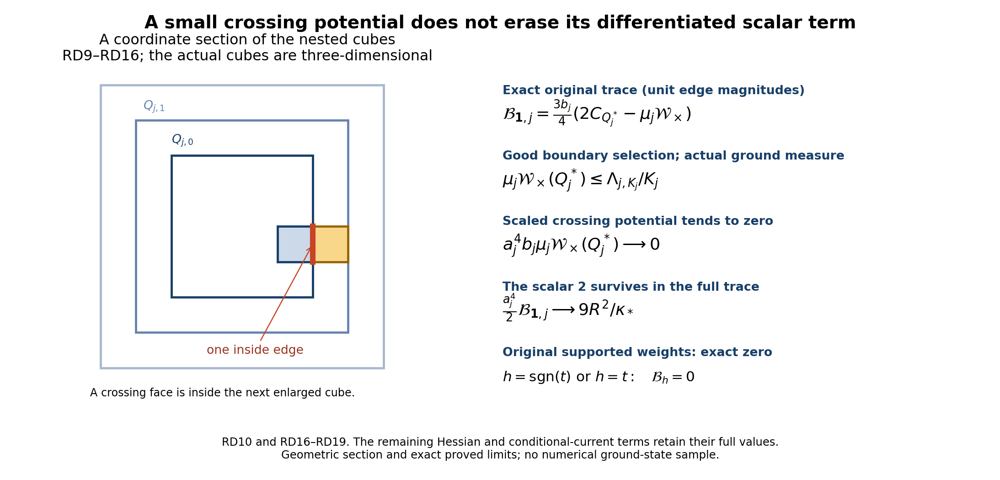
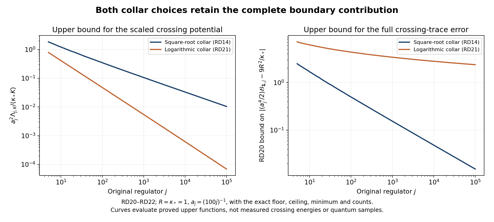

# Retained marginal derivatives and good boundary cubes

This calculation uses the actual ground state of [SG1–SG33](https://github.com/KokunoYumeto/yang-mills-interacting-workbench/blob/419dbbe0da0e2b7f3401088cf51f60378a9fba81/yang-mills/continuations/20261011-central-signs-shrinking-window/ACTUAL_GROUND_GRADIENT_TRIAL.md), its exact disintegration in [CG1–CG34](https://github.com/KokunoYumeto/yang-mills-interacting-workbench/blob/419dbbe0da0e2b7f3401088cf51f60378a9fba81/yang-mills/continuations/20261011-central-signs-shrinking-window/CONDITIONAL_GROUND_CURRENT_TRIAL.md), and the original patch estimates [CE1–CE7](https://github.com/KokunoYumeto/yang-mills-interacting-workbench/blob/419dbbe0da0e2b7f3401088cf51f60378a9fba81/yang-mills/continuations/20261011-central-signs-shrinking-window/CURRENT_COVARIANCE_EQUALITY.md). It evaluates the derivative term left in CG22 and constructs boundary cubes with small actual crossing deficit. The crossing potential and its Laplacian trace have different limiting contributions; both are retained below.

## 1. Original data

Keep the open cubic lattice, all positive links, all vertex gauge constraints, Haar probability, and the radius-two \(\mathrm{SU}(2)\) metric with \(T_\beta=-i\sigma_\beta/2\) orthonormal. The original quantities are
\[
\begin{gathered}
L_j=j^4,\quad a_j=(100j)^{-1},\quad
g_j^2=\kappa_*a_j/2,\quad b_j=(\kappa_*a_j^2)^{-1},\\
U_p=U_d(z)U_k(z+e_d)U_d(z+e_k)^{-1}U_k(z)^{-1},\quad
D_p=2-\operatorname{Tr}U_p,\quad d<k,\\
x_{p,j}=o+a_j\{z-L_j\mathbf1+(e_d+e_k)/2\},\quad
x_{e,j}=o+a_j\{z-L_j\mathbf1+e_d/2\},\\
V_j=b_j\sum_pD_p,\quad H_j=-\kappa_*\Delta+V_j,\quad
H_j\psi_j=E_{0,j}\psi_j,\quad \psi_j>0,\quad\int\psi_j^2dU=1,\\
d\mu_j=\psi_j^2dU,\quad w_j=\log\psi_j,\quad
C_{\mathbf f,j}=a_j\sum_{\sigma,p}f_\sigma(x_{p,j})D_p,\quad
s_j=\kappa_*/j=100\kappa_*a_j .
\end{gathered}\tag{RD1}
\]
All \(f_\sigma\) are real, continuous and compactly supported. Suppress \(j\) only in finite-regulator identities.

For an inside edge cube \(Q\), let \(x\) denote its links and \(v\) the remaining links. Retain the original positive marginal and conditional density
\[
\begin{gathered}
m(x)=\int\psi(x,v)^2dv,\quad \varphi=\sqrt m,\quad
w_Q=\log\varphi,\quad \chi=\psi/\varphi,\quad
\mathbb E_xF=\int F\chi^2dv,\\
g=\nabla w,\quad \bar g=\nabla_Qw_Q,\quad
\xi_e=\nabla_e\log\chi=g_e-\bar g_e\quad(e\in Q),\\
H=\nabla^2w,\quad \bar H=\nabla_Q^2w_Q,\quad
\mathcal G_{ef}=\mathbb E_x(\xi_e\otimes\xi_f),\quad
\bar H=\mathbb E_xH_{QQ}+2\mathcal G .
\end{gathered}\tag{RD2}
\]
The same conditional expectation and original metric as CG2–CG3 are used. In particular no product decomposition of the gauge-invariant Hilbert space is asserted.

For a real deterministic edge weight \(h\), zero outside \(Q\), put
\[
\begin{gathered}
F_h=\sum_{e\in Q}h_e|g_e|^2,\quad
\bar F_h=\sum_{e\in Q}h_e|\bar g_e|^2,\quad
\Delta_h=\sum_{e\in Q}h_e\Delta_e,\\
S_h=\Delta_hw+2F_h,\qquad
s_h=\Delta_hw_Q+2\bar F_h,\qquad
q_h=S_h-s_h,\quad \mathbb E_xq_h=0,\\
N_h=a^4\mu|D_hg|^2,\quad N^\gamma_h=a^4\mu|D_h\bar g|^2,\quad
N^\delta_h=a^4\mu|D_h\xi|^2,\quad N_h=N^\gamma_h+N^\delta_h .
\end{gathered}\tag{RD3}
\]
Thus \(q_h\) is CG25's \(q_{h,h}=2p_h+t_h\), with the original equal weights retained.

Define the complete Hessian graph energies, including every outside edge in the first one,
\[
\begin{gathered}
J_h=\sum_{e<f}(h_e-h_f)^2\mu\|H_{ef}\|_{\rm HS}^2,\qquad
\bar J_h=\sum_{\substack{e<f\\e,f\in Q}}
(h_e-h_f)^2\mu\|\bar H_{ef}\|_{\rm HS}^2,\\
A_h=\mu H(D_hg,D_hg),\qquad
\bar A_h=\mu\bar H(D_h\bar g,D_h\bar g).
\end{gathered}\tag{RD4}
\]
These are full original quantities. In particular \(J_h-\bar J_h\) has not been assigned a sign.

## 2. Complete evaluation of the retained derivative

Write \(\mathcal W_Q=\sum_{\partial p\subseteq Q}D_p\), and \(\mathcal W_\times\) for the sum over every crossing face. Retain
\[
\begin{gathered}
U_Q=b\mathcal W_Q+R_Q+\kappa\mathcal T_Q,\quad
-\kappa\Delta_Q\varphi+U_Q\varphi=E_Q\varphi,\quad E_Q=E_0-E_{\rm out},\\
R_Q=\mathbb E_x\{\kappa|\nabla_{\rm out}w|^2+
V_{\rm out}-E_{\rm out}+b\mathcal W_\times\},\qquad
\mathcal T_Q=\mathbb E_x\sum_{e\in Q}|\xi_e|^2 .
\end{gathered}\tag{RD5}
\]
Every scalar part of \(V\), the outside energy and every crossing term remain in this equation. Set
\[
\begin{gathered}
\mathcal B_h=\frac{3b}{4}\sum_{p\ {\rm crossing}}
\sigma_{h^2,p}(2-\mu D_p),\qquad
\sigma_{h^2,p}=\sum_{e\in\partial p\cap Q}h_e^2,\\
\boxed{\quad
\mu\Delta_{h^2}(R_Q+\kappa\mathcal T_Q)
=\mathcal B_h-4\kappa(A_h-\bar A_h)
-2\kappa(J_h-\bar J_h)-2\kappa\mu q_h^2 .
\quad}
\end{gathered}\tag{RD6}
\]
Here \(\Delta_{h^2}=\sum h_e^2\Delta_e\), not \(\Delta_h^2\).
To prove (RD6), SG8 and SG32 give
\[
\kappa a^4\mu S_h^2
=\frac{a^4}{2}\mu\Delta_{h^2}V
-2\kappa a^4A_h-\kappa a^4J_h.
\]
CG21 gives the same identity with \(s_h,U_Q,\bar A_h,\bar J_h\).
Since \(\mathbb E_xq_h=0\), their left-side difference is
\(\kappa a^4\mu q_h^2\). Subtract the two complete formulas and solve for \(\mu\Delta_{h^2}U_Q\).
Every face outside \(Q\) has zero \(\Delta_{h^2}\) derivative; each incident edge of a crossing face contributes
\(\Delta_eD_p=\tfrac34(2-D_p)\).
Therefore \(\mu\Delta_{h^2}(V-b\mathcal W_Q)=\mathcal B_h\), proving the boxed identity with all factors. This subtraction uses the full ground equations before any derivative annihilates a constant.

There is a version retaining the positive semiconvex tensors:
\[
\begin{gathered}
\mathcal S=H+\frac2{\kappa a}I\ge0,\qquad
\bar{\mathcal S}=\bar H+\frac2{\kappa a}I\ge0,\\
\mu\Delta_{h^2}(R_Q+\kappa\mathcal T_Q)
=\mathcal B_h+\frac8{a^5}N^\delta_h
-4\kappa\{\mu\mathcal S(D_hg,D_hg)
-\mu\bar{\mathcal S}(D_h\bar g,D_h\bar g)\}\\
\hspace{12mm}-2\kappa(J_h-\bar J_h)-2\kappa\mu q_h^2 .
\end{gathered}\tag{RD7}
\]
Insert \(H=\mathcal S-2(\kappa a)^{-1}I\) and its marginal counterpart in (RD6). The norm difference is exactly \(N^\delta_h/a^4\), so its coefficient is \(4\kappa\cdot2/(\kappa a)\cdot a^{-4}=8/a^5\). The difference of the two nonnegative semiconvex contractions is not assumed nonnegative.

A current-covariance evaluation is also exact. Define
\[
\begin{gathered}
p_h=\sum_{e\in Q}h_e\langle\bar g_e,\xi_e\rangle,\quad
X_h=\sum_{e\in Q}h_e|\xi_e|^2,\quad
\tau_h=\mathbb E_xX_h,\quad
j_h=2p_h+X_h-\tau_h,\\
F_h=\bar F_h+\tau_h+j_h,\qquad \mathbb E_xj_h=0,\\
\mu\Delta_{h^2}(R_Q+\kappa\mathcal T_Q)
=\mathcal B_h+2\kappa\mu(\tau_hs_h)
+2\kappa\mu(j_hq_h)-2\kappa(J_h-\bar J_h)-2\kappa\mu q_h^2\\
=\mathcal B_h+2\kappa\mu(\tau_hs_h)-2\kappa(J_h-\bar J_h)
-2\kappa\mu(q_h-j_h/2)^2+\frac{\kappa}{2}\mu j_h^2 .
\end{gathered}\tag{RD8}
\]
The weighted divergence identity gives \(A_h=-\mu F_hS_h/2\) and
\(\bar A_h=-\mu\bar F_hs_h/2\).
Expand \(F_hS_h=(\bar F_h+\tau_h+j_h)(s_h+q_h)\). Conditional means remove exactly the terms pairing an inside function with \(j_h\) or \(q_h\), leaving
\(\mu F_hS_h-\mu\bar F_hs_h=\mu\tau_hs_h+\mu j_hq_h\).
Substitution proves the first equality; expanding the displayed square proves the second. These formulas evaluate the derivative without replacing an unknown signed covariance by zero.

## 3. The direct crossing trace vanishes for the original supported weights

Let \([c,c+R]^3\), \(R>0\), contain the three test supports. Use the original CE4 fitting cube
\[
v_{j,d}=L_j+\lfloor(c_d-o_d)/a_j\rfloor-1,\qquad
q_j=\lceil R/a_j\rceil+3,\qquad
Q_{j,k}:\ v_j-k\mathbf1+\{0,\ldots,q_j+2k\}^3 ,
\quad k\ge0 .
\tag{RD9}
\]
The notation \(Q_{j,k}\) denotes all edges with both endpoints in that vertex cube. The original positive edge orientation is unchanged.

Take either CE7's original weight
\(h_e=\operatorname{sgn}t_d(x_{e,j})\), with \(\operatorname{sgn}0=0\),
or SG20's continuous weight \(h_e=t_d(x_{e,j})\), where
\(t_1=f_{12}+f_{13},t_2=f_{12}+f_{23},t_3=f_{13}+f_{23}\).
For every \(Q_{j,k}\) inside the original lattice,
\[
h_e=0\ \text{on its boundary edges},\qquad
\sigma_{h^2,p}=0\ \text{for every crossing face},\qquad
\mathcal B_h=0 .
\tag{RD10}
\]
Here is the geometric proof with the fitting offsets retained. Every crossing face has exactly one inside edge; this edge is contained in a boundary coordinate plane of the cube, as in CE4. A lower boundary coordinate in physical space is
\(o_d+a_j(\lfloor(c_d-o_d)/a_j\rfloor-1-k)\le c_d-a_j(1+k)\).
An upper boundary coordinate is at least \(c_d+R+a_j(1+k)\), since
\(\lfloor u\rfloor>u-1\) and \(q_j\ge R/a_j+3\).
The center of an edge lying in that plane has the same normal coordinate. It is therefore outside the closed support cube. Every \(t_d\) vanishes there, proving the first assertion. The single inside edge of a crossing face is consequently weighted zero, proving the rest.

This is a support calculation for these precise weights. The original crossing potential still occurs in \(R_Q\), and its derivatives, exterior Hessians, conditional variance and both graph terms remain in (RD6)–(RD8). No exterior correlation has been declared zero.

## 4. A different exact trace formula for all unit-magnitude weights

For \(h_e^2=1\) on every edge of \(Q\), \(\Delta_{h^2}=\Delta_Q\), regardless of the signs. Define
\[
\begin{gathered}
\mathcal O_Q=\sum_{\substack{e\in Q\\f\notin Q}}\mu\|H_{ef}\|^2,\qquad
\mathcal V_Q=\sum_{e,f\in Q}\mu\mathbb E_x
\|H_{ef}-\mathbb E_xH_{ef}\|^2,\\
\mathcal G_2=\mu\sum_{e,f\in Q}\|\mathcal G_{ef}\|^2,\quad
\mathcal G_H=\mu\sum_{e,f\in Q}
\langle\bar H_{ef},\mathcal G_{ef}\rangle,\quad
T^\delta_Q=\mu\sum_{e\in Q}|\xi_e|^2 .
\end{gathered}\tag{RD11}
\]
Every summand and the full ordered pair convention in these quantities is specified. The full weighted Bochner identity and its marginal counterpart give
\[
\boxed{\quad
\mu\Delta_Q(R_Q+\kappa\mathcal T_Q)
=\mathcal B_{\mathbf1}
-2\kappa\{\mathcal O_Q+\mathcal V_Q
-4\mathcal G_H+4\mathcal G_2+\tfrac12T^\delta_Q\}.
\quad}
\tag{RD12}
\]
Indeed their difference is
\[
\frac{\mu\Delta_Q(V-U_Q)}{2\kappa}
=\mathcal O_Q+
\sum_{e,f\in Q}\mu\{\mathbb E_x\|H_{ef}\|^2-\|\bar H_{ef}\|^2\}
+\tfrac12T^\delta_Q.
\]
Conditional orthogonal projection gives
\(\mathbb E_x\|H_{ef}\|^2=
\mathbb E_x\|H_{ef}-\mathbb E_xH_{ef}\|^2+
\|\mathbb E_xH_{ef}\|^2\).
Use \(\mathbb E_xH_{ef}=\bar H_{ef}-2\mathcal G_{ef}\), expand its complete square, and subtract the inside potential trace. This proves (RD12). Its right side is independent of the choices of unit signs, as its left side must be.

For these full unit-magnitude weights only, the contraction of positive tensors has the additional exact form
\[
\begin{gathered}
\mathcal G_H
=\mu\operatorname{tr}(\bar{\mathcal S}\mathcal G)
-\frac2{\kappa a}T^\delta_Q,\qquad
\operatorname{tr}(\bar{\mathcal S}\mathcal G)\ge0,\\
\mu\Delta_Q(R_Q+\kappa\mathcal T_Q)
=\mathcal B_{\mathbf1}
-2\kappa\{\mathcal O_Q+\mathcal V_Q+4\mathcal G_2+
(\tfrac8{\kappa a}+\tfrac12)T^\delta_Q
-4\mu\operatorname{tr}(\bar{\mathcal S}\mathcal G)\}.
\end{gathered}\tag{RD13}
\]
The covariance tensor \(\mathcal G\) is positive, and
\(\operatorname{tr}(\bar{\mathcal S}\mathcal G)
=\operatorname{tr}(\mathcal G^{1/2}\bar{\mathcal S}\mathcal G^{1/2})\ge0\).
Also \(\operatorname{tr}\mathcal G=\mathbb E_x\sum|\xi_e|^2\).
These identities prove the displayed expression and all its coefficients. No claim that a product of three noncommuting positive tensors has positive trace is made for arbitrary \(h_e^2\); (RD6)–(RD8) remain the general weighted formulas.

## 5. Good boundary cubes in the actual ground state

All selection below is deterministic once the original ground measure is fixed. Choose
\[
K_j=\max\{1,\lfloor\sqrt{R/a_j}\rfloor\}.
\tag{RD14}
\]
For sufficiently large \(j\), every cube \(Q_{j,k}\), \(0\le k\le K_j\), is strictly inside the original lattice: their offsets and side lengths are \(O(j)\), their enlargement is \(O(\sqrt j)\), and \(L_j=j^4\). Their exact counts remain
\[
\begin{gathered}
q_{j,k}=q_j+2k,\quad v_{j,k}=v_j-k\mathbf1,\qquad
N_{j,k}=3q_{j,k}(q_{j,k}+1)^2,\quad
M_{j,k}=3q_{j,k}^2(q_{j,k}+1),\\
C_{j,k}=2q_{j,k}(q_{j,k}+1)
\sum_{d=1}^3
\{\mathbf1_{v_{j,k,d}>0}+\mathbf1_{v_{j,k,d}+q_{j,k}<2L_j}\},\\
\Lambda_{j,k}=
\min\{2M_{j,k},6g_j^2\sqrt{N_{j,k}M_{j,k}}\}+2C_{j,k}.
\end{gathered}\tag{RD15}
\]
Both terms in the minimum and every lattice-boundary indicator are retained.

The crossing face sets for \(Q_{j,0},\ldots,Q_{j,K_j-1}\) are pairwise disjoint, and all their faces are inside \(Q_{j,K_j}\). To prove it, a face crossing \(Q_{j,k}\) has one inside edge. Every vertex of that face is within one lattice step in each coordinate of an endpoint of that edge. The next expanded cube \(Q_{j,k+1}\) therefore contains all four vertices. That face is fully inside every later cube and can never cross again. Conversely its four vertices are already in \(Q_{j,k+1}\subseteq Q_{j,K_j}\). Nonnegativity of every \(D_p\) now gives the exact estimate
\[
\sum_{k=0}^{K_j-1}\mu_j\mathcal W_\times(Q_{j,k})
\le\mu_j\mathcal W_{Q_{j,K_j}}\le\Lambda_{j,K_j}.
\tag{RD16}
\]
The second inequality is the original CE4 ground-energy comparison, not a new independence assumption.

Let \(k_j\) be the smallest minimizer of
\(k\mapsto\mu_j\mathcal W_\times(Q_{j,k})\) on that finite set, and put \(Q_j^*=Q_{j,k_j}\). Then
\[
\begin{gathered}
\mu_j\mathcal W_\times(Q_j^*)\le\frac{\Lambda_{j,K_j}}{K_j},\\
a_j(q_j+2k_j)\longrightarrow R,\qquad
a_j^2\mu_j\mathcal W_\times(Q_j^*)\longrightarrow0,\\
\limsup_j a_j^{3/2}\mu_j\mathcal W_\times(Q_j^*)
\le\frac{9\kappa_*R^3+24R^2}{\sqrt R}.
\end{gathered}\tag{RD17}
\]
Indeed \(K_j\to\infty\), \(a_jK_j\to0\), and
\(\sqrt{a_j}K_j\to\sqrt R\). The count formulas give
\(a_j^2\Lambda_{j,K_j}\to9\kappa_*R^3+24R^2\):
the first term \(a_j^2(2M_{j,K_j})\) tends to infinity,
whereas
\[
a_j^2\,6g_j^2\sqrt{N_{j,K_j}M_{j,K_j}}
=9\kappa_*a_j^3
\{q_{j,K_j}(q_{j,K_j}+1)\}^{3/2}
\longrightarrow9\kappa_*R^3.
\]
All six boundary indicators equal one eventually, giving
\(a_j^2(2C_{j,K_j})\to24R^2\).
Thus the minimum takes the second branch eventually; the full minimum has been evaluated, not silently replaced. These facts and (RD16) prove every limit in (RD17). The selected cubes contain the same original support and converge to the same physical cube.

## 6. Small crossing potential retains a nonzero crossing trace

On the selected actual cubes, keep the full unweighted crossing trace from (RD6). Since a crossing face has exactly one inside edge,
\[
\begin{gathered}
\mathcal B_{\mathbf1,j}
=\frac{3b_j}{4}
\{2C_{Q_j^*}-\mu_j\mathcal W_\times(Q_j^*)\},\\
a_j^4b_j\mu_j\mathcal W_\times(Q_j^*)
=\frac{a_j^2}{\kappa_*}\mu_j\mathcal W_\times(Q_j^*)\longrightarrow0,\\
\frac{a_j^4}{2}\mathcal B_{\mathbf1,j}
=\frac{3a_j^2}{8\kappa_*}
\{2C_{Q_j^*}-\mu_j\mathcal W_\times(Q_j^*)\}
\longrightarrow\frac{9R^2}{\kappa_*}.
\end{gathered}\tag{RD18}
\]
The last limit uses the original count
\(a_j^2C_{Q_j^*}\to12R^2\) and (RD17). It retains the scalar contribution 2 before and after differentiation. Thus even a crossing potential with the proved vanishing contribution in the second line cannot be used to erase the full Laplacian trace in the third. Multiplying that third line by \(a_j\) instead gives zero; both original scales have been stated explicitly.

For arbitrary weights bounded by \(H_*\), the same exact crossing formula gives
\[
\left|\frac{a_j^4}{2}\mathcal B_{h,j}\right|
\le\frac{3a_j^2H_*^2}{4\kappa_*}C_{Q_j^*},
\qquad
\limsup_j\left|\frac{a_j^4}{2}\mathcal B_{h,j}\right|
\le\frac{9H_*^2R^2}{\kappa_*}.
\tag{RD19}
\]
Here \(|2-\mu D_p|\le2\) follows from \(0\le D_p\le4\), and every crossing incidence is still present. The original supported weights have the stronger exact value zero by (RD10), including on these selected cubes.

Equations (RD6)–(RD13) leave the actual signed contractions explicit; (RD16)–(RD19) evaluate their direct crossing contribution using the original ground measure. They do not give a sign to the remaining Hessian and conditional-current differences. The next calculation must control those differences and the complete outside spectral multiplier in CG28, while retaining the CG30 physical residuals and the original shrinking windows. No positive unscaled response, reconstruction result or smooth interacting no-gap endpoint is inferred from the good boundary construction.

## 7. Exact collar tradeoff and a stronger crossing-potential bound

The square-root collar above gives one concrete balance between the crossing potential and the scalar trace. The complete finite-regulator estimate permits a second choice without replacing that original construction.

For any positive integer \(K\) with \(Q_{j,K}\) strictly inside the original lattice, choose the smallest minimizing index \(k(K)\) in \(0,\ldots,K-1\), and write \(Q^{(K)}_j=Q_{j,k(K)}\). All its boundary indicators are then one. Nonnegativity, (RD15) and (RD16) give
\[
\begin{gathered}
0\le \mu_j\mathcal W_\times(Q^{(K)}_j)\le\Lambda_{j,K}/K,\\
C_{Q^{(K)}_j}
=12(q_j+2k(K))(q_j+2k(K)+1),\\
\left|\frac{a_j^4}{2}\mathcal B_{\mathbf1,j}^{(K)}
-\frac{9R^2}{\kappa_*}\right|
\le\frac9{\kappa_*}
\left[
a_j^2(q_j+2K)(q_j+2K+1)-R^2
\right]
+\frac{3a_j^2}{8\kappa_*}\frac{\Lambda_{j,K}}K .
\end{gathered}\tag{RD20}
\]
Indeed \(a_jq_j\ge R+3a_j>R\). Thus
\(0\le a_j^2C_{Q^{(K)}_j}-12R^2
\le12\{a_j^2(q_j+2K)(q_j+2K+1)-R^2\}\).
Subtract \(9R^2/\kappa_*\) from the exact third line of (RD18), use this inequality, and retain the full nonnegative crossing deficit in the triangle inequality. This proves (RD20), including its full finite-regulator constants. No asymptotic estimate is needed for this step.

Now specify a logarithmic collar, in addition to the original square-root one:
\[
\begin{gathered}
\ell_j=\log(e+R/a_j),\qquad
\widehat K_j=
\max\left\{1,\left\lfloor\frac{R}{a_j\ell_j}\right\rfloor\right\},
\qquad \widehat Q_j=Q_j^{(\widehat K_j)},\\
a_j\widehat K_j\ell_j\longrightarrow R,\qquad
a_j\widehat K_j\longrightarrow0,\qquad
a_j^2\Lambda_{j,\widehat K_j}\longrightarrow
\mathcal L_R:=9\kappa_*R^3+24R^2,\\
\limsup_j\frac{a_j}{\ell_j}
\mu_j\mathcal W_\times(\widehat Q_j)
\le\frac{\mathcal L_R}{R},\\
\limsup_j
\frac{a_j^4b_j\,\mu_j\mathcal W_\times(\widehat Q_j)}
{a_j\ell_j}
\le\frac{\mathcal L_R}{\kappa_*R},\qquad
\limsup_j\ell_j
\left|
\frac{a_j^4}{2}\widehat{\mathcal B}_{\mathbf1,j}
-\frac{9R^2}{\kappa_*}
\right|
\le\frac{36R^2}{\kappa_*}.
\end{gathered}\tag{RD21}
\]
Here the \(e\) in the logarithm is the base of the natural logarithm. Since
\(R/(a_j\ell_j)\to\infty\) and \(a_j\ell_j\to0\), the floor changes
\(a_j\widehat K_j\ell_j\) by at most \(a_j\ell_j\), proving its stated limit.
The enlarged cube has the same physical limiting side \(R\), so the full minimum and the six boundary indicators in (RD15) have exactly the limits already evaluated in (RD17). The enlarged cube fits the original lattice for all sufficiently large \(j\).

Multiplying \(\mu_j\mathcal W_\times\le\Lambda_{j,\widehat K_j}/\widehat K_j\) by \(a_j/\ell_j\) proves the fourth line; the original \(b_j=1/(\kappa_*a_j^2)\) proves the fifth line's first bound. To obtain the trace bound, multiply (RD20) by \(\ell_j\). The full count term has limit
\[
\ell_j\left[
a_j^2(q_j+2\widehat K_j)(q_j+2\widehat K_j+1)-R^2
\right]\longrightarrow4R^2 .
\]
For this equality, write \(a_jq_j=R+\epsilon_j\), with
\(3a_j\le\epsilon_j<4a_j\), and expand
\((R+\epsilon_j+2a_j\widehat K_j)
(R+\epsilon_j+2a_j\widehat K_j+a_j)-R^2\).
The linear collar contribution is
\(4R\,a_j\widehat K_j\ell_j\to4R^2\).
Every term containing \(\epsilon_j\) or \(a_j\) tends to zero after multiplication by \(\ell_j\); the squared collar term does too because
\(\ell_j(a_j\widehat K_j)^2\to0\).
The other term in (RD20) tends to zero, since
\(a_j^2\Lambda_{j,\widehat K_j}\) has the stated finite limit and
\(\ell_j/\widehat K_j\to0\). This proves the last bound with no omitted scalar contribution.

The original square-root collar retains a faster trace-error estimate:
\[
\limsup_j\frac1{\sqrt{a_j}}
\left|
\frac{a_j^4}{2}\mathcal B_{\mathbf1,j}
-\frac{9R^2}{\kappa_*}
\right|
\le
\frac{36R^{3/2}}{\kappa_*}
+\frac{3\mathcal L_R}{8\kappa_*\sqrt R}.
\tag{RD22}
\]
Indeed \(a_jK_j/\sqrt{a_j}\to\sqrt R\), so the full count difference in
(RD20), divided by \(\sqrt{a_j}\), tends to \(4R^{3/2}\).
Its deficit term is bounded by
\(3a_j^2\Lambda_{j,K_j}/(8\kappa_*K_j\sqrt{a_j})\), which tends to
\(3\mathcal L_R/(8\kappa_*\sqrt R)\). Thus the logarithmic collar improves the proved crossing-potential scale from \(\sqrt{a_j}\) to \(a_j\ell_j\), while the original square-root collar gives the displayed trace control. Neither construction changes the exact supported-weight cancellation (RD10).

Both collar choices preserve the original ground state, test support, lattice coordinates and physical limiting cube. Their remaining retained derivatives are still exactly (RD6)–(RD13). The next calculation must control those signed contractions and the full conditional outside spectral multiplier in CG28, keeping both CG30 residuals and the original shrinking windows.

Complete reproducible diagnostics and figure sources are in [check_retained_derivative.py](check_retained_derivative.py). The curved manufactured densities and the displayed comparison are not samples of the original Yang–Mills ground. Original source versions and bounded reading coverage are recorded in [the source-use ledger](RETAINED_DERIVATIVE_SOURCE_USE_LEDGER.json).

## Conditional outside forcing and current moments

[OC1–OC24](https://github.com/KokunoYumeto/yang-mills-interacting-workbench/blob/main/yang-mills/continuations/20261011-central-signs-shrinking-window/OUTSIDE_FORCE_AND_CURRENT_MOMENTS.md) derive the actual conditional score equation, positive averaged potential Hessian and complete outside-current forcing, preserving the entire original kinetic quotient and every mixed Hessian. Exact first and second moments give a quantified resolvent improvement with both physical residuals. A crossing plaquette proves that the full-cube positive-weight current is nonzero, so the specified finite-regulator improvement is strictly positive. The full covariance, Hessian and force kernels coincide and retain inside gauge directions. The global oscillation comparison is evaluated on the original path; it supplies no vanishing filter coefficient. The limiting current moments and smooth interacting no-gap endpoint remain open calculations.

## Exact boundary projection and actual current-moment bounds

[BQ1–BQ18](https://github.com/KokunoYumeto/yang-mills-interacting-workbench/blob/main/yang-mills/continuations/20261011-central-signs-shrinking-window/BOUNDARY_FORCE_PROJECTION.md) prove that the derivative of the original inside kinetic quotient is the full weighted exact projection of the inside potential gradient. Every wholly inside face derivative cancels from the conditional force; the complete crossing field and original ground-state projection remain. Exact projection and Casimir-gradient remainders give actual force and mixed-Hessian bounds on both established collars, including \(a_j^6\|F_j\|^2\to0\) and \(a_j^5\mathcal O_{Q_j}\to0\). The first current moment is computed without third kinetic derivatives and has a quantitative upper estimate. The second moment retains its weighted boundary divergence and all six signed covariance terms. Unscaled limiting spectral mass and the smooth interacting no-gap endpoint remain active calculations.
